# When to stop repeating a task while collecting training attempts

## Teaching a model from its own attempts

A language model connected to tools can do small pieces of office work. Give it a calendar it can read and edit, and it can move meetings. It works one step at a time: it chooses an action, sees what the tool returns, and chooses the next action until it decides the job is done.

One way to make such a model better at this work is to let it practise. The model attempts a task, a program checks the result, and the attempt is saved with a score: 1 if the job was done exactly as asked, 0 if not. A training method then adjusts the model so that it becomes more likely to act as it did in the attempts that scored 1. The score is called a reward, and training of this kind is called reinforcement learning. The field calls a saved attempt a rollout; this page calls it an attempt.

Many of these training methods learn by comparison. They take several attempts at the same task, a **group**, and compare each attempt with the others. Suppose four attempts score 1, 1, 0 and 1. Each success is compared with the average of the other three (2/3) and comes out 1/3 above it; the failure is compared with 1 and comes out 1 below it. Training pushes the model towards what the successes did and away from what the failure did. If all four attempts score 1, each one equals the average of the others and every comparison is zero. The same happens when all four fail. Only a group that holds at least one success and one failure, called a **mixed group** on this page, gives this kind of training something to learn from. (This leave-one-out comparison is the one described by [Ahmadian et al., 2024](https://arxiv.org/abs/2402.14740).)

Collecting attempts from an agent is expensive. Each action is a separate model call that re-sends the task and everything so far. On the hardest tasks here, rescheduling 12 meetings, entering a correct answer takes 17 actions: read four calendars, move 12 meetings, finish. The attempt in section 2 used 17 model calls and 572,435 tokens (the units of text a model reads and writes), and a group needs four attempts. A strong model also succeeds at most tasks, so most groups hold only successes and teach nothing. In [notebook 25](../25-knowledge-work-rollouts/), GPT-6.1 Sol and GPT-6 Luna each made three attempts at 12 office tasks, and only 1 of Sol's 12 groups and 2 of Luna's held both a success and a failure (`notebooks/25-knowledge-work-rollouts/data/groups.csv`, column `mixed`).

### An illustrative example

Whoever collects the attempts has to decide how many to spend on each task. The simplest rule is to make four attempts at a task, then move to the next one. Take a task the model always solves. Its four attempts score 1, 1, 1 and 1. The group teaches nothing, and four attempts' worth of model calls are gone.

A second rule tries to avoid that waste. Make two attempts. If they disagree, the group is already mixed, so make two more to complete it. If they agree, assume the task will keep giving the same result and move on. On the always-solved task this rule spends two attempts instead of four, and the two it saves go to another task that might give a mixed group.

The complication is that two agreeing attempts do not prove that the next two would agree. A task the model solves half the time can start 1, 1 and then go 0, 1. The four-attempt rule keeps that mixed group; the two-attempt rule left after 1, 1 and never saw it. Which effect wins depends on the tasks. If every attempt succeeded independently with probability 0.5, four attempts per task would give 21.875 mixed groups per 100 attempts and the stopping rule 16.667 (section 4 draws the full curve). On a set of tasks that are mostly always solved or always failed, the attempts saved can be worth more than the groups lost. So the rule has to be tested on real tasks.

One more choice matters: what "the same budget" means. Attempts differ in length. A failing attempt can run to the action limit, and later calls carry a longer history, so two collections that make the same number of model calls can process very different amounts of text. This study compares the two rules both ways: with the same number of model calls, and with the same number of tokens.

### What this experiment does

Two OpenAI models, GPT-6.1 Sol and GPT-6 Luna, act as office agents through OpenAI's command-line tool. The tasks are fictional calendars of project reviews to reschedule at the lowest cost, plus, in the first comparison, ledgers to close and supplier quotes to choose from. Code generated every number and computed each exact answer. The **uniform collector** always makes four attempts at a task. The **adaptive collector** makes two, stops when they agree, and otherwise makes four. The adaptive collector is a collection-only version of the stopping rule in SARA ([Nomand et al., 2026](https://arxiv.org/abs/2607.26253)). No model is trained.

The first tasks were too easy for Sol, which solved every attempt, so no Sol group could be mixed. The study made the tasks harder step by step until Sol sometimes failed, then compared the two collectors on 16 new tasks of that difficulty with an equal token budget.

## The question

When a model learns from its own scored attempts, only groups that contain both a success and a failure give it something to compare. On fictional scheduling tasks (and, at first, ledger and purchasing tasks) with exactly computed answers, attempted by GPT-6.1 Sol and GPT-6 Luna, does a collector that makes two attempts per task and moves on when they agree collect more complete mixed groups of four than a collector that always makes four? Both collectors get the same budget, counted in model calls in four comparisons and in tokens in the deciding one.

Someone collecting training data from a strong agent needs this answer to decide where the collection budget should go: into a stopping rule, or into choosing tasks.

## Study summary

Sol and Luna were called through `codex exec`. The deciding comparison gave each model and collector 24 million tokens on 16 new twelve-review scheduling tasks, split into four blocks of four tasks with 6 million tokens each: 112 attempts and 2,061 model calls. Four earlier comparisons gave each model and collector 64 or 180 model calls on four other task sets (2,416 calls). The measure is the number of complete groups of four attempts that hold both a success and a failure.

- At equal tokens the two collectors collected the same number of mixed groups: Sol 4 and 4, Luna 0 and 0. The adaptive collector was one group ahead in block 2, one behind in block 4 and level in the other two. In block 2 it had stopped no group early, so that lead came from different attempts at the same two tasks, not from the rule.
- Across all five comparisons the uniform collector collected 11 mixed groups and the adaptive collector 10. Most comparisons could not separate them. Sol solved 70 of 70, 12 of 12 and 29 of 29 known attempts on the first three task sets, a ceiling at which no Sol group can be mixed, and Luna solved 0 of 36 twelve-review attempts at equal tokens, a floor.
- Stopping early saved attempts, but the saved attempts did not become mixed groups. At equal tokens the adaptive collector stopped six Sol groups after two failures and reached 14 of the 16 tasks against the uniform collector's 10. Its four extra tasks gave Sol 0 successes in 6 known attempts, and it completed 4 groups against 6.
- Most failures were valid agendas that cost a little more than the cheapest. At equal tokens, 41 of Sol's 44 failed attempts kept every rule and cost a median 4.73% more than the minimum; the exact-minimum reward scores them 0, like a double-booked room. Sol sent one unreadable reply in the whole study and no unusable one. Of Luna's 36 failures at equal tokens, 35 were read and scored wrong and one was withheld because the command-line tool used a tool it was not offered. Counting only usable replies changes one mixed-group count in the study (Luna's adaptive mixed groups on the first tasks, 3 to 2) and no comparison's direction.

In the original situation: for someone collecting training attempts from a strong agent on tasks like these, stopping after two agreeing attempts bought no extra comparisons at either budget. The tasks decided the yield. Sol spent 848 model calls on the first three task sets without producing one mixed group.

The main caveat is size. The deciding comparison has four blocks, and different attempts at the same tasks moved one block by a group. It shows no advantage for stopping early on these tasks, and it cannot rule out a small advantage in either direction.

## Contents

1. [The tasks and their exact answers](#1-the-tasks-and-their-exact-answers)
2. [How an attempt runs and how it is scored](#2-how-an-attempt-runs-and-how-it-is-scored)
3. [The models](#3-the-models)
4. [The two collectors, the budgets and the measure](#4-the-two-collectors-the-budgets-and-the-measure)
5. [How the study got here](#5-how-the-study-got-here)
6. [Results: finding tasks Sol sometimes fails](#6-results-finding-tasks-sol-sometimes-fails)
7. [Results: mixed groups in every comparison](#7-results-mixed-groups-in-every-comparison)
8. [Results: the equal-token comparison in detail](#8-results-the-equal-token-comparison-in-detail)
9. [Error analysis](#9-error-analysis)
10. [What the evidence supports](#10-what-the-evidence-supports)
11. [Limitations](#11-limitations)
12. [Spend, data and how to run](#12-spend-data-and-how-to-run)
13. [Future work and further reading](#13-future-work-and-further-reading)

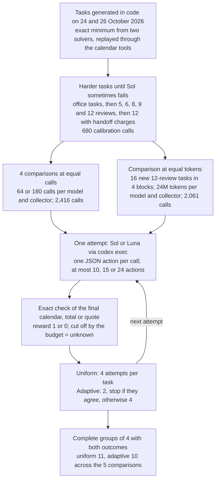

One attempt travels through the diagram like this. Task `token6r-01` (created 26 October 2026) asks for 12 reviews to be moved at the lowest cost. The uniform collector's second Sol attempt at it (`1e6489161658bc5799916166`) moved them in 17 model calls; the check found a valid agenda at the minimum, reward 1; and with the group's other attempts the rewards were 0, 1, 1, 1, one complete mixed group. Section 2 follows it step by step.

## 1. The tasks and their exact answers

Every task is fictional and every number in it was generated by seeded Python code. Five task sets were used, from easiest to hardest:

| Task set | Tasks compared | What the agent must do | Actions allowed |
|---|---|---|---|
| Office tasks | 12 (6 more as trial runs) | 4 calendar tasks: move 3 reviews for 3 people; 4 ledger tasks: close payables from 131 rows of invoices, payments, credits, holds and exchange rates; 4 purchase tasks: choose among 20 supplier quotes for 5 items | 10 |
| Five-review calendars | 2 | Move 5 reviews across 4 calendars, 9 allowed start times each | 15 |
| Six-review calendars | 4 | Move 6 reviews for 4 people into one room, 13 allowed times each | 24 |
| Twelve-review calendars with handoff charges | 4 at equal calls, 16 new ones at equal tokens | Move 12 reviews, 19 allowed times each, with ordering rules and handoff charges | 24 |

The ledger and purchase tasks ask for an exact total in cents and the cheapest feasible order; the calendar tasks ask for the cheapest valid agenda. Office-task details are in [data/ANALYSES.md](data/ANALYSES.md).

A twelve-review task works like this. Alice manages four calendars and must move 12 project reviews on 6 November 2026. Each review has two attendees, a length, a priority weight and 19 allowed start times. Three kinds of rule are hard. Each review must fit both attendees' free time, and each person has two protected appointments. No two reviews may overlap, because they share one room. Six ordering rules say that one review must end a set number of minutes before another starts. The cost is counted in penalty points. Moving a review costs its weight times the minutes moved, so a weight-3 review moved 30 minutes costs 90 points. On top of that, 12 listed handoffs each add a fixed charge unless the second review starts within a stated window after the first ends; if a 240-point charge applies to that same review, its contribution becomes 330 points. Handoff charges are costs, not rules: an agenda can pay them and still be valid. The answer is any valid agenda whose total equals the minimum.

Every accepted task has at least 10,000 valid agendas, and ignoring the handoff charges gives an agenda at least 60 points above the true minimum, so the charges change the answer. These filters are arithmetic; no model's attempt was used to choose a task.

The minimum is established three ways: an exact search and an independently written mixed-integer linear program (a standard optimisation formulation) agree on every task, and one optimal agenda is replayed through the real calendar tools. The models never see the solvers, the answer or the check's verdict during an attempt. Claude Opus 5.5 wrote the task wording from fixed rules and supplied no numbers.

The tasks are newer than the models. The 16 equal-token tasks were created on 26 October 2026 and all others on 24 October 2026; GPT-6.1 Sol's documented training cutoff is 30 April 2026 and GPT-6 Luna's 18 May 2026. Dates and sources are in `data_provenance.json` (top level and `frontier_v6/`) and `provenance.json` (`frontier_v4/`, `frontier_v5/`). The records are released under CC0-1.0.

The tools come from [OpenEnv](https://huggingface.co/docs/openenv/index) 0.10.0 (commit `21fbb0ecb2a3e74110b59cf38a1b195decc75c88`): the [Calendar](https://huggingface.co/docs/openenv/main/environments/calendar) environment with `list_events`, `get_event`, `patch_event` and an added `finish` action, plus FinQA and REPL for the ledger and purchase tasks. The calendar offers no calculator or solver.

## 2. How an attempt runs and how it is scored

Each model call is a fresh `codex exec` process. It receives a fixed instruction, the task, the tool descriptions and every action and tool reply so far, and must return one JSON object naming one tool. The harness runs that action in the environment and appends the result for the next call. The model's private reasoning is not carried from one call to the next. An attempt ends when the model calls `finish` (or submits an answer), reaches the action limit, or runs out of budget.

The reward is computed from the final state. For a twelve-review task it is 1 only if every hard rule holds, all four calendars were read before the first edit, every review keeps its identity, every protected appointment is unchanged and the total equals the minimum; otherwise 0. Three other endings are kept apart from wrong answers. A reply that is not valid JSON gets a format message and uses one action. A reply produced after the command-line tool used one of its own tools, which the study forbids, is withheld and scores 0; this page calls it an unusable reply. An attempt cut off by the budget or a connection error has an unknown reward, is never scored 0 and cannot complete a group.

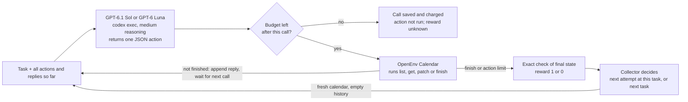

Calls inside an attempt are chained: each waits for the previous action's result. A new attempt starts from a fresh calendar and receives no earlier attempt's answer or reward. Only the collector sees past rewards, and only to decide where the next attempt goes. Each model and collector works through each block separately; this page calls one such run a block run.

### Worked example: one attempt from request to group

Sol's attempt `1e6489161658bc5799916166` is the second uniform attempt at task `token6r-01` in block 1 of the equal-token comparison. The instruction ends with "A successful API request is not proof the business task is correct." The task text lists the 12 reviews with their attendees, weights, lengths and allowed times, the six ordering rules and the 12 handoff charges.

The first four calls read the four calendars. The fifth moved review 0, saved exactly as returned:

```json
{"tool":"patch_event","arguments":{"calendarId":"cal-alice","eventId":"target-0","start":{"dateTime":"2026-11-06T09:30:00Z","timeZone":"UTC"},"end":{"dateTime":"2026-11-06T10:15:00Z","timeZone":"UTC"}}}
```

Calls 5 to 16 moved the 12 reviews once each, and call 17 was `finish`. The calls grew longer as the history grew: the first was charged 17,543 tokens and the last 37,879, and the attempt used 572,435 tokens in all. The check found every rule kept. Its movement points were 2,490 and its handoff charges 3,000 (8 of the 12 handoffs paid a charge), a total of 5,490, equal to the certified minimum. Reward 1. Every call and tool reply is in [its episode file](data/frontier_v6/comparison_complete/episodes/1e6489161658bc5799916166.json).

This attempt belongs to group `6a3060584ba4910762f8-0`. The first attempt (`cd7530a6ef925e826e887e58`) found a valid agenda costing 5,745, 4.64% above the minimum, so it scored 0; the other three scored 1. The rewards 0, 1, 1, 1 form one complete mixed group. The leave-one-out comparison gives the failure 0 − 1 = −1 and each success 1 − 2/3 = +1/3. The adaptive collector would also have continued this group, because its first two rewards disagree. On the same task in the same block, the adaptive collector's own Sol attempts scored 1, 0, 0, 0 (group `17b4cde2c3f445661a6d-0`), also one mixed group.

## 3. The models

| Model | Pinned version | Provider, how called | Size, precision | Settings | Why included |
|---|---|---|---|---|---|
| GPT-6.1 Sol | `gpt-6.1-sol`; dated version not recorded (the tool returns no dated name) | OpenAI, `codex exec` (codex-cli 0.160.1) | Not published | Medium reasoning effort; no seed or output limit available; each action a fresh process with host tools, web search and plugins disabled; per-call deadline 180 s, later 600 s and 1,200 s | A strong model that had 1 mixed group in 12 in notebook 25; the case the adaptive collector is meant to help, where most groups are all successes |
| GPT-6 Luna | `gpt-6-luna`; dated version not recorded | OpenAI, `codex exec` (codex-cli 0.160.1) | Not published | Same as Sol | A second OpenAI model that failed more often (42 of 58 known office-task attempts succeeded), so the comparison does not rest on one success rate |
| Claude Opus 5.5 | `claude-opus-5-5` as reported; dated version not recorded | Anthropic, `claude -p` | Not published | Defaults | Wrote the task wording only, in 4 calls; a different vendor from the tested models, and no numbers or answers |

The command-line tool does not confirm which weights served a call and offers no sampling seed, so repeated attempts are not guaranteed to be independent draws from one fixed model. It also adds its own context to every call: at equal tokens Luna's calls averaged 67,790 input tokens against Sol's 32,668 (`data/frontier_v6/calls.csv`).

## 4. The two collectors, the budgets and the measure

### The stopping rule

The uniform collector makes four attempts at the next task in the block's order, then moves on. The adaptive collector makes two. If one succeeded and one failed, it makes two more. If they agree, it stops that group. SARA estimates from the outcomes so far how likely a group is to end up mixed; after two agreeing outcomes, starting from no assumption about the task (a uniform prior), the estimate is (4 − 2)/(4 + 1) = 0.4. That is below the stopping threshold of 0.45 fixed before any run, so the group stops. Both collectors follow the same seeded task order within a block, and a task can come round again later as a new group. The rule never sees an uncollected attempt or the answer.

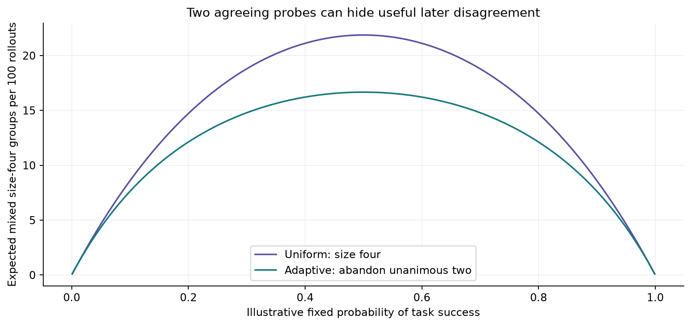

The figure is arithmetic, not data. The horizontal axis is a success probability shared by every attempt at a task; the vertical axis is the expected number of mixed groups of four per 100 attempts ("rollouts" on the axis). Purple is the uniform collector, green the adaptive one.

The uniform curve is higher everywhere. At probability 0.5 a group of four is mixed with probability 1 − 2 × (1/16) = 0.875, so 25 groups per 100 attempts give 21.875 mixed groups. The adaptive collector spends 3 attempts per group on average, and only the half of its groups that start mixed end mixed: 100/3 × 0.5 = 16.667. The curve assumes all tasks are alike. The adaptive collector can only win when tasks differ, so that attempts saved on always-solved or always-failed tasks go to tasks that sometimes fail.

### Two kinds of budget

At equal calls, each model and collector got 90 model calls per block, 180 in all over two blocks (64 in one block on the five-review tasks). Every call counts, including unreadable replies.

At equal tokens, each model and collector got 6 million tokens per block, 24 million over four blocks. A call's tokens are the input plus output tokens the tool reports. Cached input is already inside input and reasoning inside output, so neither is added again: 1,000 input tokens (700 cached) and 100 output tokens (80 reasoning) cost 1,100. Usage arrives only after a call ends, so the call that crosses the line is saved and charged, its action is not run, and its attempt becomes unknown. Only groups completed before the line count. The crossing calls went past the combined 96 million by 701,725 tokens (0.73%).

### The measure

A complete mixed group is four attempts with known rewards at one task, from one model and collector, that include at least one 1 and one 0. Rewards 1, 1, 0, 1 count as one. Rewards 1, 1, 1, 1 and 0, 0, 0, 0 count as none, and so does 1, 0 followed by an unknown, because the group is not complete. More is better. The count does not reward collecting more failures or more successes, only groups that hold both.

## 5. How the study got here

The comparison was run five times, on harder tasks each time, because a model that never fails produces no mixed groups to count.

- The office tasks came first (24 October). Sol solved all 70 known attempts, so no Sol group could be mixed. A first run lost most of its calls to connection errors and was replaced.
- Two five-review calendars were added the same evening. Sol solved all 12 known attempts.
- A difficulty ladder was then run on Sol alone: two practice tasks per level, two attempts each and two more when both outcomes appeared, stopping at the first level where one task gave both. At six reviews one attempt in eight failed, but on four new six-review tasks Sol solved all 29 known attempts. One failure had not marked a reliable boundary.
- The rule was tightened to 2 to 6 successes in 8 attempts, with both outcomes on one task. Eight, nine and twelve reviews each gave 8 of 8; adding handoff charges gave 2 of 8, and that level was chosen.
- At equal calls Luna read about twice as many input tokens as Sol, so the last comparison held tokens equal, on 16 new tasks (26 and 27 October).

Section 6 gives the success rates at each step, and section 7 keeps every comparison in one table. Service interruptions are summarised in the limitations and listed in [data/PROTOCOL.md](data/PROTOCOL.md).

## 6. Results: finding tasks Sol sometimes fails

| Task set | Used for | Sol successes / known attempts | Luna successes / known attempts |
|---|---|---|---|
| Office tasks | Comparison at equal calls | 70/70 | 42/58 |
| Five-review calendars | Comparison at equal calls | 12/12 | 4/10 |
| Six-review calendars | Ladder | 7/8 | not run |
| Six-review calendars, new tasks | Comparison at equal calls | 29/29 | 2/22 |
| Eight-review calendars | Ladder | 8/8 | not run |
| Nine-review calendars | Ladder | 9/9 (7 more cut off) | not run |
| Twelve-review calendars, no handoff charges | Ladder | 8/8 | not run |
| Twelve-review calendars with handoff charges | Ladder | 2/8 | not run |
| Twelve-review calendars with handoff charges, new tasks | Comparison at equal calls | 9/17 | 0/19 |
| Twelve-review calendars with handoff charges, 16 new tasks | Comparison at equal tokens | 16/60 | 0/36 |

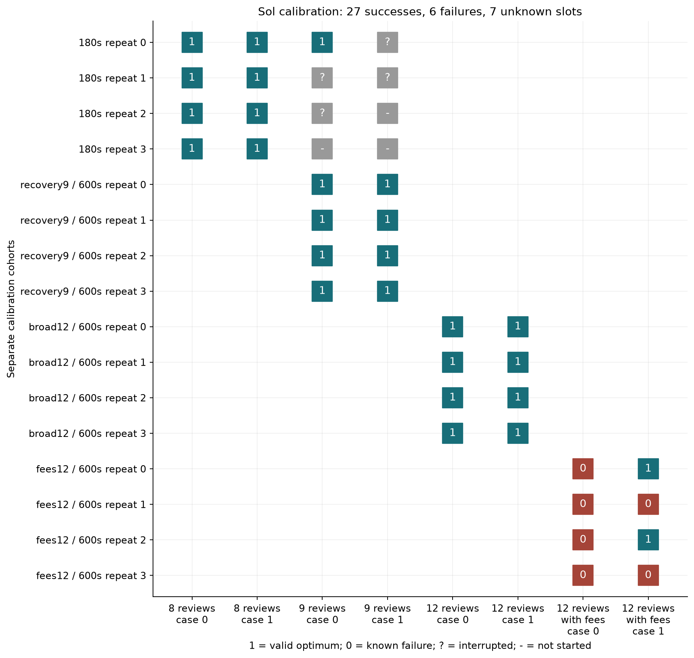

Each column of the figure is one practice task, and each row one repeat in one round of the ladder, earliest at the top. A 1 is a valid agenda at the minimum cost, a 0 a known failure, a `?` an attempt interrupted by a connection deadline and a `-` a slot never started after the interruption. The row labels name the round and its per-call deadline (`broad12` is the twelve-review version without charges, `fees12` the version with handoff charges). The title counts 27 successes, 6 failures and 7 unknown slots.

Sol kept solving every known attempt as reviews were added, at eight, nine and twelve reviews. More reviews did not mean more ways to go wrong. A full enumeration of the prepared tasks found 16 and 29 valid eight-review agendas but 446 and 220 six-review ones ([data/frontier_v4/structural_difficulty_audit.json](data/frontier_v4/structural_difficulty_audit.json)), because tight rules remove most alternatives. What changed the outcome was a second kind of cost. With handoff charges competing against movement costs, the first practice task failed four times out of four and the second twice out of four. All eight of those agendas kept every hard rule; the failures were agendas that cost more than the minimum.

The same tasks pushed Luna to the floor. Luna solved 4 of 10 five-review attempts and 2 of 22 six-review attempts, and none of its 55 known twelve-review attempts with handoff charges. At that level Luna cannot produce a mixed group, so only Sol can separate the collectors.

## 7. Results: mixed groups in every comparison

| Comparison (budget per model and collector) | Model | Uniform: mixed / complete groups | Adaptive: mixed / complete / stopped after two | Successes / known, uniform; adaptive | Unknown, uniform; adaptive |
|---|---|---|---|---|---|
| Office tasks, 12 tasks in 2 blocks (180 calls) | Sol | 0 / 8 | 0 / 0 / 18 | 34/34; 36/36 | 1; 2 |
| | Luna | 4 / 6 | 3 / 3 / 8 | 21/28; 21/30 | 1; 2 |
| Five-review calendars, 2 tasks (64 calls) | Sol | 0 / 1 | 0 / 0 / 3 | 6/6; 6/6 | 1; 1 |
| | Luna | 1 / 1 | 0 / 0 / 2 | 4/5; 0/5 | 1; 1 |
| Six-review calendars, 4 tasks in 2 blocks (180 calls) | Sol | 0 / 2 | 0 / 0 / 7 | 14/14; 15/15 | 2; 1 |
| | Luna | 0 / 2 | 1 / 1 / 3 | 1/11; 1/11 | 2; 2 |
| Twelve-review with handoff charges, 4 tasks in 2 blocks (180 calls) | Sol | 2 / 2 | 2 / 2 / 0 | 6/8; 3/9 | 2; 2 |
| | Luna | 0 / 2 | 0 / 0 / 5 | 0/8; 0/11 | 2; 2 |
| Twelve-review with handoff charges, 16 tasks in 4 blocks (24M tokens) | Sol | 4 / 6 | 4 / 4 / 6 | 11/30; 5/30 | 4; 4 |
| | Luna | 0 / 4 | 0 / 0 / 8 | 0/18; 0/18 | 4; 4 |
| All comparisons | Both | 11 | 10 | | |

The counts come from `summary.csv`, `stress_summary.csv` and `frontier_v4/`, `frontier_v5/` and `frontier_v6/summary.csv` in `data/`. Known failures include the unusable replies of section 9; unknown attempts were cut off by the budget.

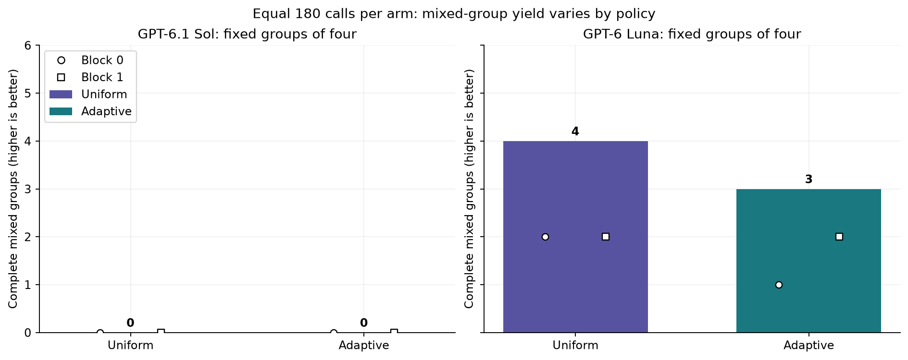

In this figure and the next, each bar is one collector's complete mixed groups with one model (purple uniform, green adaptive); the circle and square are the two blocks' counts, not error bars. In the first title "arm" means one model and collector, "policy" a model.

The office tasks gave the only comparison with several Luna mixed groups, and the uniform collector led 4 to 3. Three of its four began with two successes: `cal-04` 1, 1, 0, 0; `fin-03` 1, 1, 0, 0; and `fin-05` 1, 1, 1, 0 (from `data/groups.csv`, column `rewards`). The adaptive collector would have stopped each after two attempts, and on `fin-03` in the same block its own pair did score 1, 1 and stop. Its three mixed groups (`fin-04`, `fin-05`, `fin-06`) all began with a disagreeing pair. Every Sol group was all successes or stopped.

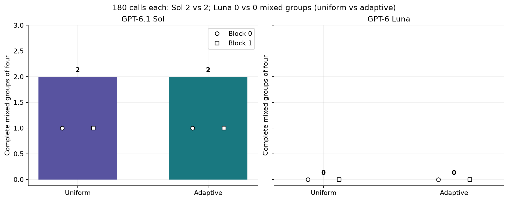

On the first twelve-review tasks, Sol gave 2 mixed groups with each collector and stopped no group early, so the rule never acted. One uniform group, `373853a396a75ef192c1-0` on `frontier5-03`, scored 1, 1, 0, 1: the adaptive rule would have stopped it after the first two. Luna failed all 19 known attempts.

Across the four equal-call comparisons the uniform collector collected 7 mixed groups and the adaptive collector 6. In 4 of the uniform 7 the first two attempts agreed. The adaptive collector stopped 46 groups after two agreeing attempts, and the attempts it saved found no extra contrast.

## 8. Results: the equal-token comparison in detail

| Model | Collector | Mixed groups | Complete groups | Stopped after two | Successes / known | Unknown | Tasks reached | Model calls | Tokens charged | Summed call time (h) |
|---|---|---|---|---|---|---|---|---|---|---|
| GPT-6.1 Sol | Uniform | 4 | 6 | 0 | 11/30 | 4 | 10 | 677 | 24,104,616 | 17.96 |
| GPT-6.1 Sol | Adaptive | 4 | 4 | 6 | 5/30 | 4 | 14 | 678 | 24,103,393 | 17.37 |
| GPT-6 Luna | Uniform | 0 | 4 | 0 | 0/18 | 4 | 8 | 352 | 24,205,064 | 1.62 |
| GPT-6 Luna | Adaptive | 0 | 0 | 8 | 0/18 | 4 | 12 | 354 | 24,288,652 | 1.52 |

The table is `data/frontier_v6/summary.csv`. Tokens charged include each block run's crossing call. Summed call time adds the length of every call; calls overlapped, so it is not elapsed time.

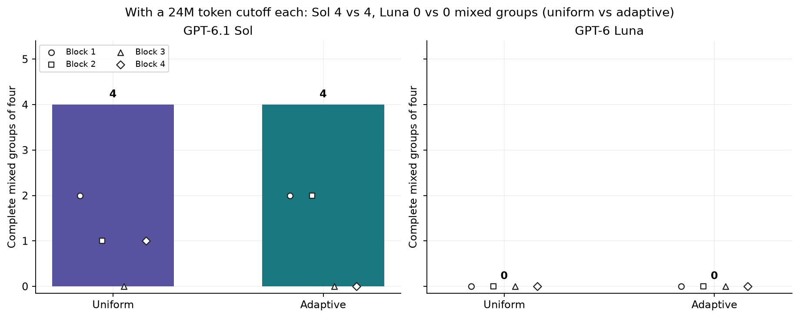

Each bar is one collector's mixed groups at 24 million tokens, and the four marker shapes are the blocks' counts. Sol's bars are equal at 4 and Luna's are both 0. The uniform collector's Sol groups came from blocks 1, 2 and 4 (2, 1, 1), the adaptive collector's from blocks 1 and 2 (2, 2).

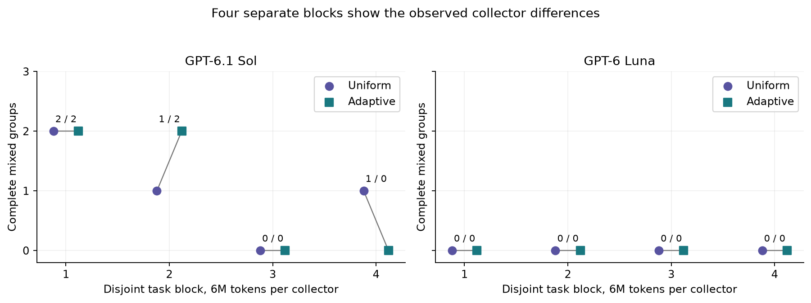

Each pair of points joins one block's uniform count (circle) and adaptive count (square), labelled uniform / adaptive. The figure numbers the blocks 1 to 4; the data files number them 0 to 3. Its title does not state a finding: the block differences, adaptive minus uniform, are 0, +1, 0 and −1 for Sol and 0 in every block for Luna.

The two non-zero blocks have different causes. In block 2 the adaptive collector stopped no group, and both collectors completed groups on the same two tasks:

| Task | Uniform rewards | Adaptive rewards |
|---|---|---|
| `token6r-07` | 1, 0, 0, 1 | 0, 1, 0, 0 |
| `token6r-06` | 0, 0, 0, 0 | 1, 0, 1, 0 |

The rule acted like uniform collection here, so the extra adaptive group came from different attempts at `token6r-06`: four uniform attempts each found a valid agenda 2.26% to 13.57% above the minimum, while two of four adaptive attempts reached it. In block 4 the adaptive collector stopped three groups after two failures and found no mixed group, while the uniform collector found one on `token6r-16`. The mean difference is 0.00 groups per block. Swapping the collector labels within blocks in all 16 possible ways gives a two-sided p-value of 1.000 for each model: every swap gives a difference at least as large as the observed zero ([data/frontier_v6/results.json](data/frontier_v6/results.json)); four blocks can only reveal large differences.

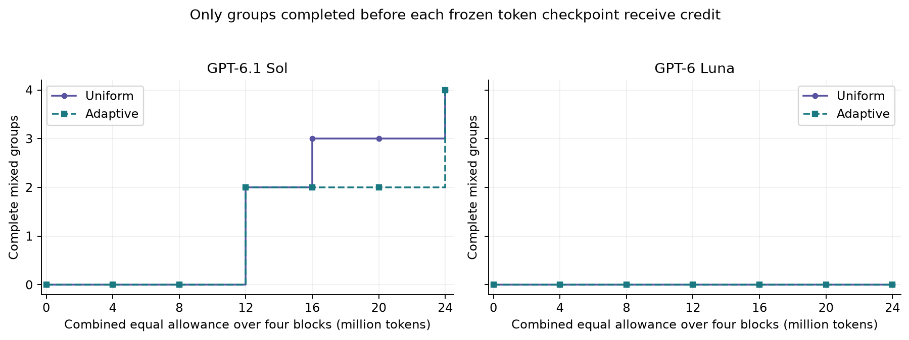

The horizontal axis is the combined budget over four blocks at checkpoints fixed before the run, every 1 million tokens per block, and the vertical axis counts mixed groups completed by that point. A group enters the curve only when its fourth attempt ends. The title says how groups are credited, not what the curves show.

Both collectors had 2 Sol mixed groups at 12 million tokens. The uniform collector reached 3 at 16 million and led 3 to 2 at the 16 and 20 million checkpoints; the adaptive collector completed two more groups between 20 and 24 million, and both ended at 4. The order changed with the budget, another sign that one group either way is within what different attempts produce.

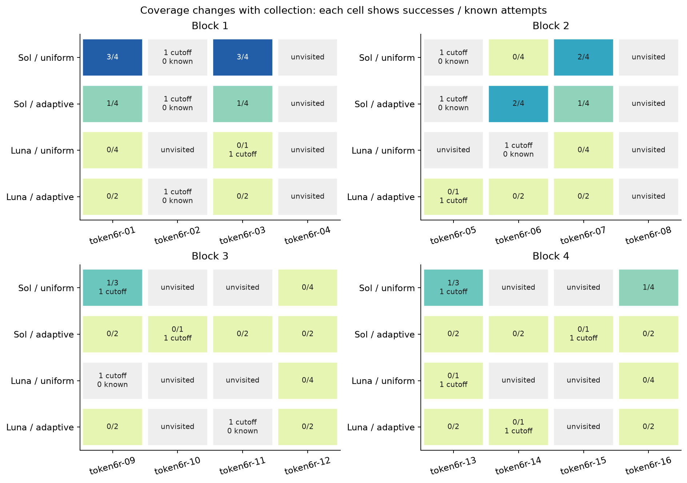

Each panel is one block, each column a task and each row a model and collector. A cell shows successes over known attempts; "1 cutoff" marks an attempt cut off by the budget, and grey cells were never attempted or hold only a cut-off attempt. Darker blue means a higher success fraction.

The adaptive collector spread Sol's effort wider, with known attempts on 12 tasks against 8. It did not pay. In blocks 3 and 4 every adaptive Sol pair failed twice and stopped, and the four tasks the uniform collector never reached (`token6r-10`, `-11`, `-14`, `-15`) gave 0 successes in 6 known attempts.

Sol also succeeded less often under the adaptive collector on the eight tasks both reached: 5 of 24 known attempts against 11 of 30 (counted from `data/frontier_v6/episodes.csv`, columns `task_id` and `reward`). The rule does not explain this. On `token6r-01` and `token6r-03` both collectors made four attempts at each task, and Sol scored 2 of 8 under the adaptive collector against 6 of 8. Eight attempts per task are few, so chance could produce such a gap. The attempts also ran at different times: those two uniform groups on the morning of 27 October and the adaptive ones that evening, both from block runs repeated after interruptions, and the tool does not confirm which weights served a call. The data cannot separate these explanations.

Equal tokens did not mean equal calls: Sol made 677 and 678 and Luna 352 and 354. Sol's calls averaged 35,578 tokens and Luna's 68,688 (from `data/frontier_v6/calls.csv`, column `charged_tokens`). Sol wrote 1.99 and 1.95 million output tokens, almost all reasoning, against Luna's 0.32 and 0.31 million.

## 9. Error analysis

Each example below is the first attempt or group by ID in its category, or illustrates the count stated beside it.

### A valid agenda can still score 0

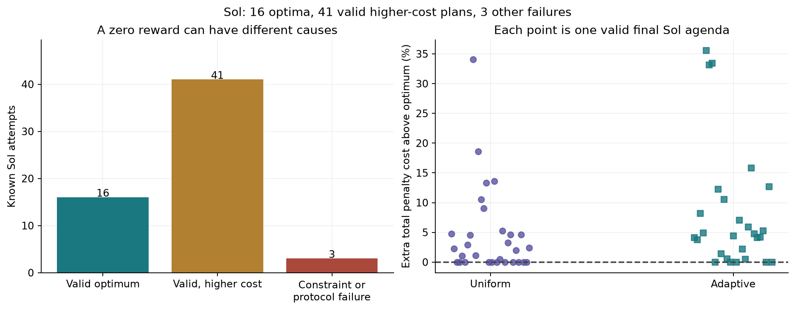

The left panel sorts Sol's 60 known attempts at equal tokens into valid agendas at the minimum (16), valid agendas that cost more (41) and agendas that broke a hard rule (3). The right panel plots each of the 57 valid agendas at its extra cost in percent; the dashed line is the minimum, and colour and marker show the collector.

Of Sol's 44 failures, 41 were valid. Two of those 41 ran out of actions, which `data/frontier_v6/failure_types.csv` lists separately as "action horizon"; the other 39 called `finish` on a costlier agenda. The valid failures cost a median 4.73% more than the minimum (3.77% across all 57 valid agendas, counting the optima as 0%) and at most 35.54%. Three were within 1%. On `token6r-07` the uniform attempt `8f97c7b2d7041bee685a4ec4` and the adaptive attempt `863bb3afca9db651be068fb7`, four hours apart, returned the same agenda at 6,150 points against a minimum of 6,120: 0.49% more. Each scores 0, like an agenda with two reviews in the same room. This is where the measure misleads most. A reward with partial credit for cheap valid agendas would turn many all-failure groups into mixed ones; this study did not test one.

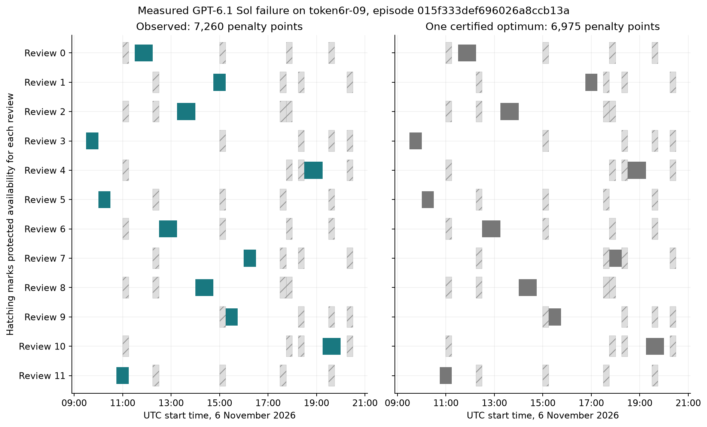

Each row is a review and each bar its time on 6 November (UTC); hatched blocks are attendees' protected appointments. Left is Sol's final agenda in attempt `015f333def696026a8ccb13a` on `token6r-09`, right one optimal agenda. Ten of the twelve reviews match. Review 1 sits at 14:45 instead of 16:45 and review 7 at 16:00 instead of 17:45. Every rule holds, and the total is 7,260 points (4,620 movement, 2,640 handoff charges) against 6,975, or 4.09% more. This was the second attempt of an adaptive pair; the first (`94813a81748f6574032f2467`) returned the identical agenda, so the pair scored 0, 0 and stopped. The task could still be solved: the uniform collector's attempts at it scored 1, 0 and 0 before its budget ran out.

### Sol revises its agenda while it works

In its 60 known attempts at equal tokens, Sol never used `get_event` to check its work. In 43 it moved at least one review more than once (counted from the `patch_event` actions in the saved episodes). Failures did this more, 4.4 repeat moves on average against 2.7, and 21 of the 44 failures used all 24 actions (19 ending with `finish`) against none of the 16 successes. Each call is a fresh process that sees the history but not its earlier reasoning, which may lead it to re-plan; the data show the repeated moves, not their cause. Failed attempts also cost more, 767,776 tokens on average against 694,639.

### Luna breaks hard rules

At equal tokens, 34 of Luna's 36 failures were finished agendas that broke a hard rule. From the check's messages (`data/frontier_v6/episodes.csv`, column `details`), 30 put two reviews in the room at once, 22 used a start time that was not allowed, 21 placed a review in protected time and 12 broke an ordering rule; 27 broke more than one kind. Attempt `010ddb8d43cddf109a8b781a` on `token6r-03` is typical: a protected-time conflict for Carol on review 5, and reviews 1 and 8 in the room together. One failure was a valid agenda 70% above the minimum, and one was the unusable reply. Luna's 23 unreadable replies among 706 calls each cost one action. With every attempt scoring 0, no stopping rule could find Luna a mixed group here.

### Stopping after two failures

At equal tokens, all 14 stopped groups (6 Sol, 8 Luna) ended on two failures (from `data/frontier_v6/groups.csv`); on the easier tasks Sol's stopped pairs were two successes. On `token6r-16` in block 4, the adaptive pair (`0397fdb08bf7c69a9cba-0`) failed twice and stopped, while the uniform group (`3514ff3294564eeacf4a-0`) scored 0, 1, 0, 0. These are separate attempts, so they show only that the task could still produce a success, not what the stopped pair would have done next.

### An attempt cut off by the budget

Attempt `05b5e1fbb96697f6dd276d87` (Sol, adaptive, `token6r-10`, block 3) was running when its block run's last call started at 5,982,769 tokens and charged another 36,741, crossing the 6 million line. The action was saved but not run, and the reward is unknown. Each of the 16 block runs ended with one such attempt; none counts as a failure.

### A ledger failure on the office tasks

Luna's attempt `0019a95f7b702ee133528dbc` at ledger task `fin-05` submitted 1,422,536 cents against an exact total of 1,405,572. Its SQL read each invoice's discount deadline from the payment-terms rows, where the field is empty. Reading it from the invoice instead reproduces the exact total (`data/financial_error_audit.json`; an analysis of the saved query, not a new reply). Luna's attempt `1e162fd0a15bf18a6ea61380` at `fin-03` succeeded in five actions with two SQL queries, submitting exactly 2,246,001 cents; its invoice-by-invoice arithmetic is in [data/ANALYSES.md](data/ANALYSES.md).

## 10. What the evidence supports

- Do not expect early stopping to collect more mixed groups from a strong agent on tasks like these. Across five comparisons it collected 10 against 11, and at equal tokens 4 against 4.
- Spend first on finding tasks the model sometimes fails. Sol spent 848 model calls on the first three task sets without a mixed group, and only tasks with competing handoff costs gave both outcomes. A short ladder with 2 to 6 successes out of 8 found that level; a single failure in 8 did not.
- Budget in tokens when models or attempts differ in length. Luna's calls cost about twice Sol's tokens, so equal calls gave Luna twice the text.
- Look at what the zeros are before training on them. Most of Sol's failures were valid agendas a few percent from the minimum, and some were the same agenda twice; most of Luna's broke hard rules. A trainer would learn different things from the two.

The uncertainty that most needs another experiment is whether the adaptive collector has a small advantage, or disadvantage, that four blocks cannot show.

## 11. Limitations

- Four blocks. The deciding comparison has four blocks of four tasks, and one block moved by a group with no help from the rule. A difference of one or two groups per model is within what different attempts produced.
- Floors and ceilings. Sol solved every known attempt on the first three task sets and Luna none on the twelve-review tasks, so only Luna on the first three sets and Sol on the twelve-review tasks could separate the collectors.
- One kind of task at the end. Both twelve-review comparisons use fictional, fully specified calendars, one tool set with no solver, and one reward that requires the exact minimum. A model given a solver, a graded reward or a different harness could sit at a different point on the ladder.
- Unattested serving. The command-line tool does not confirm the weights or offer a seed, and the 16 block runs ran at different times over two days. This may explain part of Sol's lower success under the adaptive collector, and it is not measured.
- Interruptions. During the equal-token comparison, three launches stopped on rate-limit errors before any outcome, a provider capacity error stopped four block runs and a local session restart one more. Each stopped block run was repeated in full from a fresh calendar, chosen by whether it had finished, not by its rewards; 282 calls, including 7 availability checks, are kept outside the comparison. On the office tasks, the equal-call design was registered after a first run lost 792 of 960 calls to connection errors.
- What was fixed in advance. Each comparison's question, budget, stopping rule and measure were written down before its first model call, as were the equal-token secondary checks (block differences, checkpoints, coverage, costs). A count of incomplete groups that already hold both outcomes was added after the results were seen and is reported only in [data/ANALYSES.md](data/ANALYSES.md). Run history and recorded changes are in [data/PROTOCOL.md](data/PROTOCOL.md).
- No training. The export marks every row `train_ready=false`, because the tool returns no token-level probabilities or weights, and nothing here measures a training gain. A collector that stops groups deterministically keeps a biased sample of groups, a problem PAIR ([Nomand et al., 2026](https://arxiv.org/abs/2608.11368)) addresses.

## 12. Spend, data and how to run

The notebook keeps 6,465 tested-model calls, all through `codex exec`:

| Part of the study | Model calls |
|---|---|
| Office tasks: lost first run 960, trial tasks 64, health check 1, comparison 720 | 1,745 |
| Five-review calendars | 256 |
| Six-review calendars: ladder 89, comparison 720 | 809 |
| Twelve-review at equal calls: ladder 591, availability check 1, comparison 720 | 1,312 |
| Twelve-review at equal tokens: comparison 2,061; interrupted launches and block runs, 7 availability checks 282 | 2,343 |
| Total | 6,465 |

The equal-token comparison reported 96,701,725 tokens; all 2,343 calls of that stage reported at least 106,049,962, and 11 interrupted calls returned no usage. The command-line tool reports no dollar cost for the tested models. The four Claude Opus 5.5 wording calls report USD 0.1417238 at list prices. No model was trained.

| Folder in `data/` | What it holds |
|---|---|
| top level, `primary_run/`, `calendar/`, `finqa/` | Office tasks and their comparison; `cache/`, `episodes/` and `schedules/` keep the first run lost to connection errors |
| `stress_*` files, `stress_run/` | Five-review calendars |
| `frontier_v4/`, `frontier_v5/` | Six-review and twelve-review ladders and equal-call comparisons |
| `frontier_v6/` | Equal-token comparison; `comparison_complete/` holds the 16 block runs used |
| `PROTOCOL.md`, `ANALYSES.md` | Run history; longer tables and checks |

The files use older names: a model is a "policy", a collector an "allocator", a block run an "arm", and `frontier` marks the search for tasks Sol sometimes fails; twelve-review fields named `objective_minutes` hold penalty points. Every request, raw reply, action, tool reply and final state is saved.

Running the notebook replays everything from these files with no model calls:

```powershell
python -m pip install -r requirements-replay.txt
python -m nbconvert --to notebook --execute --inplace --ExecutePreprocessor.timeout=1800 27_adaptive_knowledge_rollouts.ipynb
```

Keep `NB27_LIVE` and `NB27_V6_LIVE` unset and the live run IDs at `None`. A new collection needs `requirements-live.txt`, the pinned OpenEnv source and a signed-in `codex` tool, and writes to a new folder; [data/PROTOCOL.md](data/PROTOCOL.md) lists the steps. The full analysis is in [27_adaptive_knowledge_rollouts.ipynb](27_adaptive_knowledge_rollouts.ipynb).

## 13. Future work and further reading

### Future work

- Repeat the equal-token comparison on at least 50 new tasks in ten or more blocks per model, and also replay both collectors on one shared pool of saved attempts. Four blocks here moved by a group in each direction, and separate draws mixed chance with the rule.
- Re-score the saved attempts with a graded reward that still gives 0 to agendas breaking a hard rule, and count mixed groups again. 41 of Sol's 44 failures were valid agendas a median 4.73% above the minimum.
- Give the same tasks a solver tool or a harness that keeps the model's reasoning between calls, and measure Sol's success and mixed groups. Sol's failures moved reviews repeatedly and used all 24 actions more often than its successes.
- Replace the fixed stop with a logged probability of continuing, so that stopped groups can be accounted for in training. The deterministic stop here cannot give an unbiased sample of groups.
- Compare budgets in output tokens, total tokens and billed cost when a tool reports them. Luna's calls cost twice Sol's tokens, mostly input.

### Further reading

Links were opened on 26 October 2026 ([data/frontier_v6/reading_checks.json](data/frontier_v6/reading_checks.json)).

- [Early Verdicts, Better Budgets: Sequential Adaptive Rollout Allocation for Compute-Efficient RLVR](https://arxiv.org/abs/2607.26253) (Nomand et al., 2026). Proposes SARA, the source of the stopping rule tested here.
- [Learning as Reasoning Unfolds: Progressive Rollout Allocation for Efficient Reinforcement Learning](https://arxiv.org/abs/2607.22002) (Jiang et al., 2026). Proposes VIGOR, which shifts attempts towards tasks whose rewards still vary.
- [PAIR: Pairwise-Aware Inclusion Reweighting for Adaptive Rollout Allocation in RLVR](https://arxiv.org/abs/2608.11368) (Nomand et al., 2026). Explains how stopping some groups early changes which comparisons a trainer sees.
- [CERO: Where and When to Allocate Rollouts for RL Post-Training](https://arxiv.org/abs/2610.09679) (Zong et al., 2026). Spreads a fixed attempt budget over a whole training run, where collectors like these would be used.
- [Adaptive Decoding Methods for Token-Efficient Reinforcement Learning](https://arxiv.org/abs/2610.25860) (Li et al., 2026). Studies token budgets during training, which the command-line tool here does not expose.
- [ToolSandbox: A Stateful, Conversational, Interactive Evaluation Benchmark for LLM Tool Use Capabilities](https://arxiv.org/abs/2408.04682) (Lu et al., 2024). Scores tool-using models by the final state of their tools, as the check here reads the final calendar.
