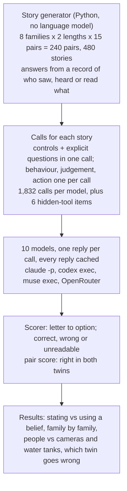
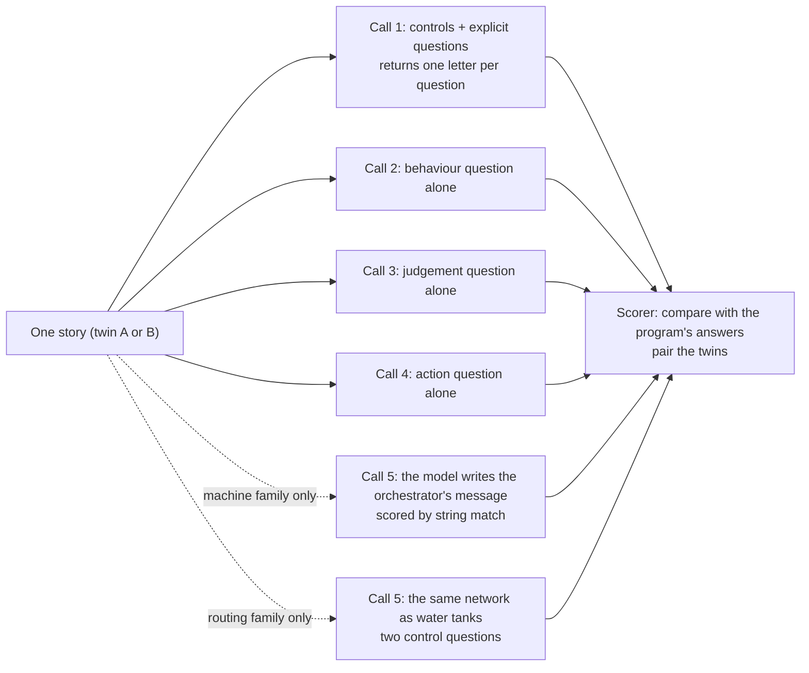
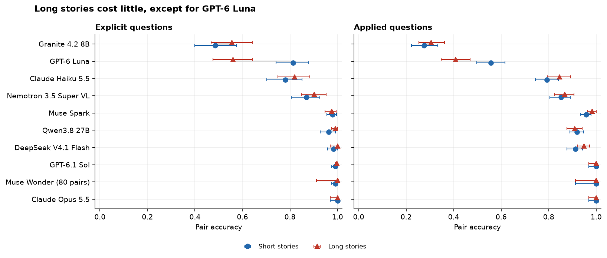

# Do language models keep track of what other people know?

Priya keeps the spare van key in the blue drawer. While she is out at lunch, her colleague Sam takes the key out and puts it on the shelf by the door. When Priya comes back and needs the key, she opens the blue drawer.

Anyone who hears this story can say what Priya will do, and why. She did not see the key move, so as far as she knows it is still in the drawer. Her belief is out of date, and what she does next follows from her belief, not from where the key really is.

This experiment asks whether language models can follow that kind of reasoning, and whether some models are worse at it than others. It writes 480 new stories in code, asks ten models about each one, and finds that the models differ mainly in whether they use what someone believes, not in whether they can say it, and that the weaker ones go wrong in one particular direction.

## Contents

- [One detail changes the answer](#one-detail-changes-the-answer)
- [Why it matters for language models](#why-it-matters-for-language-models)
- [Why the usual test no longer tells us much](#why-the-usual-test-no-longer-tells-us-much)
- [What this experiment does](#what-this-experiment-does)
- [The question](#the-question)
- [Study summary](#study-summary)
- [How the experiment runs](#how-the-experiment-runs)
- [The stories](#the-stories)
- [How the models are asked and scored](#how-the-models-are-asked-and-scored)
- [The models](#the-models)
- [Results](#results)
- [Error analysis: six cases](#error-analysis-six-cases)
- [How the study got here](#how-the-study-got-here)
- [Limitations](#limitations)
- [What the evidence supports](#what-the-evidence-supports)
- [Future work and further reading](#future-work-and-further-reading)
- [Reproducing the experiment and what it cost](#reproducing-the-experiment-and-what-it-cost)

## One detail changes the answer

The next three paragraphs are an illustrative example, not a measured case.

Suppose instead that Priya ate her lunch in the meeting room next door, which has a glass wall, and she watched Sam move the key. Now she walks straight to the shelf. She was still out of the room, and the key still moved without her touching it. The only thing that changed is whether news of the move reached her.

A rule of thumb such as "whoever left the room has the wrong idea" gets the first story right and the second one wrong. To get both right, you have to follow what each person could see, hear or read, and work out what they believe from that.

Psychologists call this ability **theory of mind**: explaining and predicting what people do from what they believe and want, even when what they believe is false. Children usually manage stories like Priya's by about age five. Younger children tend to say she will look on the shelf, because that is where the key really is ([Wellman, Cross and Watson, 2001](https://doi.org/10.1111/1467-8624.00304)). That mistake, answering with what you know instead of what the other person knows, matters later: the models in this experiment mostly make the opposite one.

## Why it matters for language models

Language models now write for people and for other programs, and the reader rarely knows everything the model knows.

An assistant that looks something up writes to a user who cannot see the search result. A coding agent that hands a job to a helper agent has to tell the helper about changes made after the helper started. A support assistant that writes "which of the two addresses above is right?" about a list only it can see has made Priya's mistake in reverse: it assumes the reader knows what it knows. The cost is a confused customer, a wasted round of messages, or a helper that edits a file under a name that no longer exists.

The same skill is needed to read a situation. A model asked whether a colleague acted carelessly, or whether someone needs to be told about a change, has to work out what that person knew at the time.

## Why the usual test no longer tells us much

The standard test is a short story like Priya's. The best-known version, the Sally-Anne test, moves a marble from a basket to a box while Sally is out of the room ([Baron-Cohen, Leslie and Frith, 1985](https://doi.org/10.1016/0010-0277(85)90022-8)). Language models have read many such stories along with their answers, and current models pass them. A high score on a story the model has seen many times can come from memory rather than from following who saw what.

Earlier research found two weak points. Models that pass the standard story can fail when one detail changes, for example when the bag is transparent ([Ullman, 2023](https://arxiv.org/abs/2302.08399)). And models that answer "does she know?" correctly can still fail to predict what she will do next, or to judge whether what she did was reasonable ([Gu et al., SimpleToM](https://arxiv.org/abs/2410.13648)).

## What this experiment does

This experiment writes new stories in code, so no model can have seen them, and asks about each story in two ways.

The first way is direct: where does Priya think the key is? The second way needs that belief without asking for it. Where will Priya look first? Was it reasonable for her to open the blue drawer? Does a colleague who saw everything need to send her a message? For a person the answers to the second kind follow from the first. A model that gets the first kind right and the second wrong can report a belief but does not use it.

Three choices keep the test honest.

1. Every story has a twin that differs in one detail, like the glass wall, and a model scores on a pair only if it answers both twins correctly. A rule of thumb that ignores the detail gets one twin wrong and scores nothing.
2. Several families of stories have a question with no mind in it that needs the same reasoning, such as what a camera at the same spot would show, or where dye poured into a tank ends up when the pipes are wired like the office gossip. If a model gets the camera right and the person wrong, the failure is about the person.
3. The stories go well beyond keys in drawers: a phone that updates only on the office Wi-Fi, a note in a language the reader cannot read, a blind copy on an email, a helper agent working from an old copy of a project, a counter seen from the other side, and news passing along a chain of colleagues.

The experiment also turns the test around: the model itself writes a follow-up message to a helper agent that missed a change, and asks a user to choose between two records the user cannot see.

## The question

Do language models differ in how well they keep track of what someone else believes when that belief differs from the truth? And does a model that answers the direct question correctly also use the belief to predict what the person will do, to judge it, and to decide what to tell them?

## Study summary

Ten language models, from three closed-model vendors and four open-weight families, each read 480 new stories: 240 twin pairs in eight families, with Muse Wonder on 80 of the pairs because of a usage quota. For every story a model answered the direct question about a belief and, in separate calls, questions that need the belief. The main measure is **pair accuracy**, the share of pairs answered correctly in both twins.

The models differ, mostly in using beliefs rather than stating them.

| Model | Stating the belief | Using it |
|---|---|---|
| Claude Opus 5.5 | 1.00 | 1.00 |
| Muse Wonder (80 pairs) | 1.00 | 1.00 |
| GPT-6.1 Sol | 0.99 | 1.00 |
| DeepSeek V4.1 Flash | 0.99 | 0.93 |
| Qwen3.8 27B | 0.98 | 0.91 |
| Muse Spark | 0.98 | 0.97 |
| Nemotron 3.5 Super VL | 0.89 | 0.86 |
| Claude Haiku 5.5 | 0.80 | 0.82 |
| GPT-6 Luna | 0.69 | 0.48 |
| Granite 4.2 8B | 0.52 | 0.29 |

The errors go mostly one way. Every model is at least 90% accurate when the person missed the change. When the person saw it, read the note or heard the announcement, the weaker models still say the person holds the old belief: Granite 4.2 8B gets 51% of those answers right and GPT-6 Luna 73%. That is the answer the classic story always rewards, and a test made only of classic stories would have scored both models at about 90%.

In Priya's terms: every model knows she will open the blue drawer when she missed the move. The top models also know she will go to the shelf when she watched through the glass. The weakest two would often send her to the drawer anyway, and would often be wrong about whether her colleague needs to message her.

The main caveat: the three strongest models answered almost every question correctly, so this test cannot rank them or show where their ability ends. The stories come from templates that state every rule, which is easier than real writing, where much is left unsaid.

## How the experiment runs

One pair travels through the diagram like this. The generator writes the device story `device-S01` twice, once where Yara reads the app in a café before her phone has downloaded a change (twin A) and once where she reads it in the office after the download (twin B), with the right answer to every question. Each twin becomes four calls: the control and explicit questions together, then the behaviour, judgement and action questions one at a time. Each model answers all eight calls. The scorer turns each letter back into an option, marks it correct, wrong or unreadable, and pairs the twins: the explicit pair score for `device-S01` is 1 only if the model said "Gate 5" in twin A and "Gate 3" in twin B.

## The stories

Every story is written by a short Python program, not by a language model. The program keeps two records as the story unfolds: what is true, and what each person has seen, heard or read. The answers come from those records, so they are exact and can be checked by reading the code. The stories were generated on 29 October 2026, after every model's training cutoff or release ([`data/model_dates.json`](data/model_dates.json)), and a different random seed per pair draws the names, places and objects.

### Twins and five kinds of question

Twin A and twin B of a pair are word for word the same except for one detail, and that detail changes the answer to the main questions. Each story is followed by questions at five levels.

| Level | Example (Priya's key) | What it checks |
|---|---|---|
| Control | Where is the key now? Where did Priya first put it? | That the model followed the events. No mind is involved. |
| Explicit | Where does Priya think the key is? | The belief, asked for directly. |
| Behaviour | Priya wants the key. Where will she look first? | Using the belief to predict an action. |
| Judgement | Priya went straight to the blue drawer. Given what she knew, was that reasonable? | Using the belief to judge an action. |
| Action | A colleague who saw everything will message Priya only if she would otherwise look in the wrong place. Does the colleague need to? | Using the belief to decide what someone else should do. |

The behaviour, judgement and action questions never mention belief, and each goes to the model in a call of its own, so the model cannot copy its explicit answer from the same reply.

Every family has a short and a long version. Long versions add events that do not matter (a second object moved about, phone calls), clock times, and a question about what the person believed at an earlier time. In two families the long version also changes the facts twice, so in twin B the person's belief is an in-between value: neither the starting state nor the true one.

### Eight families

| Family | Twin A | Twin B | Question with no mind in it |
|---|---|---|---|
| Classic (the Sally-Anne shape, as a reference) | out of the room when the object moves | watches it move, then goes out | where the object is |
| Uptake: information that arrives but is not taken in | note in a language the person cannot read; headphones on; back turned; solid wall; asleep | note in English; headphones off; facing the room; glass wall; awake | where the object is |
| Device: a phone and a person | phone updates on office Wi-Fi but the app is not opened; or the app is read before the phone updates | the app is opened after the phone updates | what the phone would show |
| Partial knowledge: knowing something changed but not what | told the door code changed, without the number; a drawer's "last opened by" screen shows someone else | not told; the screen shows the person's own name | the code, and whose name the screen shows |
| Nested knowledge: who knows that who knows | blind copy (BCC); corridor talk without the sender; forward to someone else; one group chat | CC; the sender overhears; forward to this person; two private messages | whose names are on the email |
| Machine minds: helper agents with an old copy | the rename message goes to another agent; the agent starts before the rename | the message goes to this agent; it starts after | what the agent's own copy contains |
| Spatial: seeing the counter from the other side | Sam faces Priya across the counter; stands at the right-hand end | Sam stands beside her; at the left-hand end | what a camera at Sam's spot shows |
| Routing: keeping a surprise from reaching someone | one set of habits of who tells whom | two people swap who they pass news to | dye in water tanks joined like the gossip network |

The classic family is deliberately familiar. The others were chosen because stories with their structure are rare in published text. Each family has 30 pairs, half short and half long. The rules a reader needs are stated in each story ("a phone downloads the latest board only while it is connected to the office Wi-Fi", "people here know only what they see, hear or read for themselves").

### One pair from start to finish

This is `device-S01` as generated, shortened only by leaving out the two other people's lines. The team keeps the departure gate for the 16:40 ferry on a shared board in a phone app; a phone downloads the board only on the office Wi-Fi, and a person sees it only by opening the app.

> At 9:00, Yara, Viktor and Ines open the app in the office. The board says the departure gate for the 16:40 ferry is Gate 5. At 9:30, Yara leaves the office for the dentist. At 10:00, Viktor, in the office, changes the departure gate for the 16:40 ferry on the board to Gate 3. At 10:15, Yara, sitting in a café, opens the app and reads the board. At 10:30, Yara comes back to the office for five minutes to collect a jacket, and Yara's phone connects to the office Wi-Fi. Yara does not open the app again, and leaves. Yara does not open the app again today.

That is twin A. In twin B, at 10:15 Yara "checks email but does not open the app", and at 10:30 she "opens the app, reads the board, and leaves again". Nothing else changes.

| Question | Level | Twin A | Twin B |
|---|---|---|---|
| What does the board say now? | control | Gate 3 | Gate 3 |
| What would Yara's phone show now? | control | Gate 3 | Gate 3 |
| What would it have shown at 10:15? | control | Gate 5 | Gate 5 |
| What does Yara think the gate is? | explicit | Gate 5 | Gate 3 |
| Which gate does Yara walk to? | behaviour | Gate 5 | Gate 3 |
| Yara planned around Gate 5. Was that reasonable, given what she knew? | judgement | Yes | No |
| Does a colleague who knows everything need to message her? | action | Yes | No |

In twin A the phone and the person disagree: the phone now holds Gate 3, but Yara read the board in the café before it downloaded the change, so she believes Gate 5. A model that reads "what does Yara think" off the phone gets twin A wrong. A model that reasons "she was out when it changed, so she has the old gate" gets twin B wrong.

GPT-6 Luna's answers show how this pair is scored. It answered the explicit, behaviour and action questions correctly in both twins, so its pair scores at those levels are 1. In twin B it judged that planning around Gate 5 was reasonable, although Yara had read Gate 3 in the office, so its judgement pair score is 0. Its applied score for this pair, the average of behaviour, judgement and action, is (1 + 0 + 1) / 3 = 0.67.

## How the models are asked and scored

Each call sends one story and one or more questions as plain text, with lettered options. The model is told to "use only what the story says" and to reply with a JSON object mapping question numbers to letters. Nothing in the prompt mentions beliefs or minds. Options are shuffled once per pair, so both twins show them in the same order, and within one call every question lists the same options in the same order.

An answer is unreadable when the call failed, the reply had no JSON object, or a letter was missing or invalid. Unreadable answers are counted apart from wrong ones.

**Pair accuracy** is the main measure. For each pair and level it is the share of the questions that change between the twins which the model answered correctly in both twins; each pair counts once, and the score is the average over pairs. A made-up example with three pairs:

| Pair | Questions that change | Right in twin A | Right in twin B | Pair score |
|---|---|---|---|---|
| 1 | where does she think it is now | yes | yes | 1 |
| 2 | where does she think it is now; where did she think it was at 9:20 | yes, yes | no, yes | 0.5 |
| 3 | where does she think it is now | yes | no | 0 |

The explicit pair accuracy is (1 + 0.5 + 0) / 3 = 0.50, although five of the six answers were right. A model that always gives the old place scores 0 on pairs. The **applied** score pools the behaviour, judgement and action questions the same way. Intervals are 95% intervals from resampling pairs.

The calls for one story are independent and run in parallel; none uses another's answer.

## The models

| Model | Version | Provider and how called | Size and precision | Settings | Why included |
|---|---|---|---|---|---|
| Claude Opus 5.5 | `claude-opus-5-5` (released 22 Sep 2026; cutoff June 2026) | Anthropic, `claude -p` | not published | effort medium | Anthropic's strongest model |
| Claude Haiku 5.5 | `claude-haiku-5-5` (released 7 Oct 2026; cutoff June 2026) | Anthropic, `claude -p` | not published | effort medium | Anthropic's small model: a size step within one vendor |
| GPT-6.1 Sol | `gpt-6.1-sol` (cutoff 30 Apr 2026) | OpenAI, `codex exec` | not published | reasoning effort medium | OpenAI's strongest model available through Codex |
| GPT-6 Luna | `gpt-6-luna` (cutoff 18 May 2026) | OpenAI, `codex exec` | not published | reasoning effort medium | OpenAI's small model |
| Muse Wonder | `muse-wonder-full-1.0` (released 12 Oct 2026) | Meta, `muse exec` | not published | reasoning effort medium | Meta's strongest model (80 pairs) |
| Muse Spark | `muse-spark-1.3` (released 2 Sep 2026) | Meta, `muse exec` | not published | reasoning effort medium | Meta's smaller model |
| DeepSeek V4.1 Flash | `deepseek/deepseek-v4.1-flash-20261017` | OpenRouter, DeepInfra | 552B (16B active), FP8 | temperature 1.0, reasoning medium | Highest-scoring large (over 150B) open-weight model |
| Nemotron 3.5 Super VL | `nvidia/nemotron-3.5-super-vl-20261015` | OpenRouter, Nebius | 125B (12B active), BF16 | temperature 1.0, reasoning medium | Highest-scoring mid-size (40B to 150B) open-weight model |
| Qwen3.8 27B | `qwen/qwen3.8-27b-20260814` | OpenRouter, Near AI | 28B, FP8 | temperature 1.0, reasoning medium | Highest-scoring small (4B to 40B) open-weight model |
| Granite 4.2 8B | `ibm-granite/granite-4.2-8b-20260831` | OpenRouter, DeepInfra | 9B, BF16 | temperature 1.0, reasoning medium | Highest-scoring open-weight model under 10B |

Open-weight rankings are from the Artificial Analysis Intelligence Index size-class pages, checked on 26 and 29 October 2026. "Active" parameters are the part of a mixture-of-experts model used for each word it produces. The closed models' IDs are service aliases, not dated snapshots. Each open-weight model is pinned to one provider with fallbacks off ([`data/model_catalog.json`](data/model_catalog.json)).

## Results

### Answers that could be read

Unreadable answers are rare. Nemotron 3.5 Super VL had the most, 31 of 3,084, mostly replies cut off while the model was still reasoning, even after a retry with twice the token budget; its accuracy is 0.945 over all answers and 0.955 over readable ones. GPT-6 Luna had 16 and Granite 4.2 8B 2; the rest had none. Counting unreadable answers as wrong, or leaving them out, does not change any ranking.

One format problem did matter, and it was fixed during the run. In the first version of the prompts each question in a call had its own option order, so a place could be option A in one question and option C in the next. GPT-6 Luna answered belief questions with the letter that the right place carried in an earlier question of the same call. On 71 pairs answered both ways, Luna's explicit pair accuracy is 0.49 with a separate order per question and 0.75 with one shared order. All results here use the shared order, collected again for every model.

### Stating a belief and using it

Each row is one model. The blue circle is explicit pair accuracy, the orange square applied pair accuracy (behaviour, judgement and action pooled), each over 240 pairs (80 for Muse Wonder) with a 95% interval. The distance between them is the cost of having to use a belief rather than state it.

| Model | Control accuracy | Explicit | Applied | Behaviour | Judgement | Action |
|---|---|---|---|---|---|---|
| Claude Opus 5.5 | 1.00 | 1.00 | 1.00 | 1.00 | 1.00 | 1.00 |
| Muse Wonder (80 pairs) | 1.00 | 1.00 | 1.00 | 1.00 | 1.00 | 1.00 |
| GPT-6.1 Sol | 1.00 | 0.99 | 1.00 | 1.00 | 1.00 | 1.00 |
| DeepSeek V4.1 Flash | 1.00 | 0.99 | 0.93 | 0.92 | 0.89 | 0.99 |
| Qwen3.8 27B | 0.99 | 0.98 | 0.91 | 0.92 | 0.87 | 0.98 |
| Muse Spark | 0.99 | 0.98 | 0.97 | 0.96 | 0.98 | 0.98 |
| Nemotron 3.5 Super VL | 0.98 | 0.89 | 0.86 | 0.81 | 0.83 | 0.96 |
| Claude Haiku 5.5 | 0.98 | 0.80 | 0.82 | 0.82 | 0.75 | 0.92 |
| GPT-6 Luna | 0.94 | 0.69 | 0.48 | 0.59 | 0.40 | 0.49 |
| Granite 4.2 8B | 0.93 | 0.52 | 0.29 | 0.25 | 0.31 | 0.30 |

Claude Opus 5.5 answered every pair correctly at every level (3,083 of 3,084 answers right), and GPT-6.1 Sol was one pair short of that. Muse Wonder made two errors in 1,034 answers on its 80 pairs; with that many pairs its applied score is only known to lie between 0.95 and 1.00. For these three the test is at its ceiling: they state and use beliefs without error in all eight families, so this experiment cannot rank them against each other.

Below them the scores spread out, and for most models a gap appears. DeepSeek V4.1 Flash scores 0.99 explicit and 0.93 applied, Qwen3.8 27B 0.98 and 0.91, Nemotron 3.5 Super VL 0.89 and 0.86. The two weakest models lose the most: GPT-6 Luna falls from 0.69 to 0.48 and Granite 4.2 8B from 0.52 to 0.29. Every model answers at least 93% of the control questions correctly, so these losses are not about following the events.

Judgement is the hardest of the three applied steps for most models (DeepSeek 0.89, Qwen 0.87, Haiku 0.75, Luna 0.40) and action the easiest. Deciding whether someone needs a message is close to asking what they believe; judging whether what they did was reasonable requires holding their belief and the true state side by side.

Two models show no gap. Muse Spark scores 0.98 explicit and 0.97 applied, higher on applied questions than DeepSeek and Qwen, and does not make their judgement errors (see the error cases below). Claude Haiku 5.5 scores 0.80 explicit and 0.82 applied. For both, most explicit losses come from one kind of question in the nested family, explained next.

### Family by family

Each cell is one model's pair accuracy on one family, over 30 pairs (10 for Muse Wonder), so a difference of 0.1 is about three pairs. The weaker models fail in different places.

- Granite 4.2 8B is weakest on partial knowledge (explicit 0.07), nested knowledge (0.23) and the uptake stories (0.27).
- GPT-6 Luna is weakest on the counter (0.40) and the uptake stories (0.43), but strong on partial knowledge (0.90) and the subagent stories (0.97). Its applied scores are low almost everywhere, from 0.31 to 0.72.
- Claude Haiku 5.5 is weakest on nested knowledge (0.37) and partial knowledge (0.50).
- Nemotron 3.5 Super VL drops on nested knowledge (0.59) and uptake (0.70).
- Muse Spark's only weak cell is nested knowledge (0.82); in every other family it scores 1.00 explicit and at least 0.98 applied.

Apart from the three models at the ceiling and Muse Spark, every model loses pairs on the uptake family, and its facing-away stories are the hardest: DeepSeek and Qwen score 0.67 there and Nemotron 0.17. In those stories the person is in the room with their back turned while the object is moved quietly. Being present without seeing seems harder to track than being away.

#### The reading assumption in the nested family

Many of the nested family's "Yes" answers rest on an assumption: that people read the emails and chat messages they receive. When Dmitri is on the CC line, the program counts it as known to Amara that Dmitri knows the news. But the stated rule is "people know only what they see, hear or read for themselves", and Amara never sees Dmitri read the email. Claude Haiku 5.5 answered "No" to 78 questions where the program says "Yes", 70 of them questions that need this assumption. Muse Spark did so 20 times, every one on such a question.

| Model | Accuracy, no read assumption | Accuracy, read assumed | Nested pair accuracy, all | Nested pair accuracy, strict subset |
|---|---|---|---|---|
| Claude Opus 5.5 | 1.00 | 1.00 | 1.00 | 1.00 |
| Muse Wonder (80 pairs) | 1.00 | 0.98 | 0.97 | 1.00 |
| GPT-6.1 Sol | 1.00 | 0.96 | 0.96 | 1.00 |
| DeepSeek V4.1 Flash | 1.00 | 0.99 | 1.00 | 1.00 |
| Qwen3.8 27B | 0.99 | 0.98 | 0.92 | 0.94 |
| Muse Spark | 0.99 | 0.83 | 0.82 | 1.00 |
| Nemotron 3.5 Super VL | 0.95 | 0.68 | 0.59 | 0.94 |
| Claude Haiku 5.5 | 0.93 | 0.42 | 0.37 | 0.81 |
| GPT-6 Luna | 0.82 | 0.70 | 0.47 | 0.59 |
| Granite 4.2 8B | 0.76 | 0.61 | 0.23 | 0.16 |

On the strict subset (the corridor conversation, and forwarded emails that depend only on the recipient reading their own mail), Haiku's nested score rises from 0.37 to 0.81, Nemotron's from 0.59 to 0.94 and Muse Spark's from 0.82 to 1.00. These three models apply the stated rule more literally than the program does, a defensible reading rather than a failure to track who knows what. Granite and Luna score low on the strict subset too. This split was made after the results were read; both versions are reported.

### People against cameras, copies and water tanks

Three families contain a question with no mind in it that needs the same reasoning as the question about the person: a camera fixed where Sam stands, water tanks joined exactly like the gossip network, and a subagent's own copy of the project when it started before or after a rename. Where the blue circle sits left of the grey diamond, the model did worse when the same logic was about a mind.

For the eight strongest models the markers coincide. The two weakest go the same way: Granite 4.2 8B answered the water-tank version correctly in 0.90 of pairs and the identical gossip network in 0.52; GPT-6 Luna scored 0.87 against 0.67 on that comparison and 0.57 against 0.40 on the counter. The water tanks are the clearest case, since the story, the number of links and the answer are the same and only the words change. The comparison cannot say why Granite loses almost forty points when the links are people, but it rules out the simplest explanation, that it cannot follow a chain of links.

### Which twin goes wrong

A pair can fail in two ways: the model says the person has the old belief although they took the change in (twin B wrong), or says they know the new state although they missed it (twin A wrong). The second is the error young children make. The left panel shows accuracy in each twin on the belief and behaviour questions of the four families where one twin missed a change and the other took it in (classic, uptake, device and the subagent stories, 270 answers per twin per model). The right panel counts the wrong answers by what they said.

Every model is at least 90% accurate in twin A. The errors come from twin B, though not for the top three or Muse Spark, which are at 0.99 or above in both twins: Granite 4.2 8B is right on 51% of twin B answers, GPT-6 Luna on 73%, Claude Haiku 5.5 on 88% and Nemotron 3.5 Super VL on 91%. Most wrong answers say the person still has the old belief: 130 of Granite's 157 wrong answers, 70 of Luna's 96, 33 of Haiku's 40, and all 24 of Nemotron's. The child's error appears 7 times for Granite, 11 for Luna and 2 for Haiku.

These models over-apply the false belief. Told that a colleague watched the key being moved, or read the note in English, or had their headphones off, they still answer as if the colleague was left in the dark, which is the answer of the classic story. In the classic family itself, Granite answered "the old place" to the behaviour question in all 30 twin-B stories, each of which says the move happened "while" the person watched. The same over-correction appears in space: when Sam stands beside Priya and shares her left and right, GPT-6 Luna still flipped left and right in 14 of 16 twin-B stories.

A test made only of false-belief stories would have scored Granite at 0.91 and Luna at 0.90 on these questions. The twins show how much of that comes from always answering "the old place".

### Short and long stories

Long stories add irrelevant events, clock times, a question about an earlier moment, and in two families a second change. Length costs most models little, and some score slightly higher on long stories (DeepSeek 0.98 to 1.00 explicit, Haiku 0.78 to 0.82, Granite 0.48 to 0.56); the long versions differ in content as well as length, so these few-pair differences are not an effect of length. GPT-6 Luna is the exception: explicit 0.81 on short stories and 0.56 on long ones, applied 0.56 and 0.41.

### When the model is the one who must tell

In the orchestrator items the model renamed a file and writes the follow-up to a subagent, or replies NONE. A pair counts when it names the new file where the subagent needs it and replies NONE where it does not.

| Model | Pairs right in both twins | Named the new file when needed | Said NONE when not needed | Explicit pair accuracy, subagent family | Hidden-tool replies that let the user choose |
|---|---|---|---|---|---|
| Claude Opus 5.5 | 1.00 | 1.00 | 1.00 | 1.00 | 6 / 6 |
| Muse Wonder (80 pairs) | 1.00 | 1.00 | 1.00 | 1.00 | 5 / 6 |
| GPT-6.1 Sol | 1.00 | 1.00 | 1.00 | 1.00 | 5 / 6 |
| DeepSeek V4.1 Flash | 1.00 | 1.00 | 1.00 | 1.00 | 6 / 6 |
| Qwen3.8 27B | 1.00 | 1.00 | 1.00 | 1.00 | 6 / 6 |
| Muse Spark | 1.00 | 1.00 | 1.00 | 1.00 | 6 / 6 |
| Nemotron 3.5 Super VL | 1.00 | 1.00 | 1.00 | 1.00 | 6 / 6 |
| Claude Haiku 5.5 | 1.00 | 1.00 | 1.00 | 0.87 | 6 / 6 |
| GPT-6 Luna | 0.27 | 0.63 | 0.53 | 0.97 | 6 / 6 |
| Granite 4.2 8B | 0.10 | 1.00 | 0.10 | 0.77 | 6 / 6 |

Eight models wrote the right follow-up in every pair. Granite 4.2 8B named the new file every time it was needed but also sent a message in 90% of the twins where none was needed. GPT-6 Luna missed needed messages and sent unneeded ones; its explicit accuracy on the same family is 0.97, so asked what the subagent knows it is almost always right, but asked to act on it, it is wrong in most pairs.

The six hidden-tool items did not separate the models. Every reply described both records except one each from GPT-6.1 Sol and Muse Wonder, on the same item. Sol proposed one address for a yes or no answer ("Should I update order 5521 to ship to 9 Quayside Mews, Penrith CA11 8RL?"), and Wonder asked the user to type the full delivery address. Neither reply assumes the user can see the tool result; the scoring counts both as misses because neither names both addresses. No model wrote "which of the two?" about records the user could not see.

## Error analysis: six cases

The cases below are measured answers, chosen to show each kind of error found above, using the shortest story where it occurs. How common each error is comes from the counts in the results. Pair IDs refer to [`data/scores.csv`](data/scores.csv).

### classic-S01, twin B: the old belief after watching

> Lucia puts the oven thermometer in the tin on the windowsill. Bao takes the oven thermometer out of the tin on the windowsill and puts it in the cupboard under the sink while Lucia watches. Lucia goes out to serve a customer. Lucia comes back into the room.

| Question | Correct | GPT-6 Luna | Granite 4.2 8B | Claude Opus 5.5 |
|---|---|---|---|---|
| Where does Lucia think the thermometer is? | cupboard under the sink | the tin (wrong) | cupboard (right) | cupboard (right) |
| Lucia wants it. Where will she look first? | cupboard under the sink | the tin (wrong) | the tin (wrong) | cupboard (right) |

The story says "while Lucia watches". Luna gave the classic story's answer to both questions. Granite stated the belief correctly and then predicted the old place anyway, as it did in all 30 twin-B classic stories.

### spatial-S00, twin B: left and right flipped when they should not be

Mugs in a row, seen from the door: orange, red, black. Oskar stands next to Mei, on the door side, facing the counter.

| Question | Correct | GPT-6 Luna | Claude Opus 5.5 |
|---|---|---|---|
| A camera where Oskar stands: which mug is furthest to the right of the picture? | black | black (right) | black (right) |
| From where Oskar stands, which mug is furthest to his right? | black | orange (wrong) | black (right) |

Luna solved the camera and then mirrored the answer for Oskar, as if he faced Mei across the counter. It did this in 14 of the 16 twin-B stories of this subtype.

### machine-S00, twin B: a judgement that contradicts the model's own prediction

The docs agent started before `users.csv` was renamed to `accounts.csv`, and the orchestrator then messaged it with the new name.

| Question | Correct | DeepSeek V4.1 Flash | Claude Opus 5.5 |
|---|---|---|---|
| What does the docs agent think the file is called? | accounts.csv | accounts.csv (right) | accounts.csv (right) |
| Which name does it write? | accounts.csv | accounts.csv (right) | accounts.csv (right) |
| It wrote "users.csv". Was that a reasonable mistake, given what it had? | No | Yes (wrong) | No (right) |

Six of the ten models judged this "a reasonable mistake" in at least 15 of the 16 twin-B stories of this subtype. Opus and Sol never did, Muse Wonder in none of its 6 and Muse Spark once. The models predict the right behaviour and then excuse the wrong one, probably weighing the agent's own copy, which still has the old name, over the story's rule that it should use the newest information it has.

### partial-S01, twin B: a belief stated and then not used

Hana puts the kiln key in the glaze cupboard and goes out; Kofi opens the apron pocket on the hook, not the cupboard. The cupboard's "last opened by" screen still shows Hana. The story says Hana checks the sign-out sheet only when she is not sure an item is still where she left it.

| Question | Correct | Qwen3.8 27B | Claude Opus 5.5 |
|---|---|---|---|
| What does Hana believe about the key? | sure it is still in the cupboard | sure (right) | sure (right) |
| Hana needs the key. What does she do first? | goes straight to the cupboard | checks the sign-out sheet (wrong) | goes straight (right) |

Qwen did this in 11 of the 14 twin-B stories of this subtype, DeepSeek V4.1 Flash in 10, and Nemotron and Luna in all 14, while Opus, Sol and both Muse models never did: having been away is treated as a reason for doubt, even when the story gives the person a reason to be sure.

### nested-S04, twin B: two readings of the same rule

Kofi emails Amara that the night shift is being dropped, with Dmitri on the CC line. Later, Amara and Dmitri have lunch.

| Question | Program's answer | Claude Haiku 5.5 | Granite 4.2 8B | Claude Opus 5.5 |
|---|---|---|---|---|
| Does Amara know that Dmitri knows? | Yes | No | No | Yes |
| Does Dmitri know that Amara knows that Dmitri knows? | Yes | No | No | Yes |
| Does Dmitri know that Amara knows? | Yes | No | Yes | Yes |
| Does Kofi know that Dmitri knows? | Yes | No | Yes | Yes |
| Will Amara bring the news up with Dmitri at lunch? | No | No | No | No |

Haiku's "No" answers each say that nothing the person saw or read shows them this, and nothing in the story says anyone read the email. All three models predicted correctly that Amara would not raise the news, because she thinks Dmitri has heard. Muse Spark gave Haiku's kind of "No" 20 times across the nested family.

### routing-S01, twin B: people against pipes

The gossip network includes "Anything Anders hears, Anders tells Dmitri the same day". Granite 4.2 8B answered "No" to "If Henrik tells only Anders, will Dmitri end up hearing about the party?". In the water-tank version, where Tank C is Anders and Tank D is Dmitri, it answered "Yes" to "If dye is poured into Tank C only, will it reach Tank D?".

## How the study got here

A trial run (the pilot) on 32 pairs changed the design before the main run. Claude Opus 5.5 first scored 100% at every level on six families, and its four misses all came from wording a careful reader could take two ways; those stories were rewritten. The long uptake and device stories were then made harder with a second change the person cannot know about. The other ceiling families were left as they were, so a ceiling there is reported rather than tuned away.

During the main run the Muse models ran out of a shared subscription quota. Muse Spark's remaining answers were collected after the reset, and Muse Wonder, which used the quota fastest, answered 80 pairs (the first five of every family and length). GPT-6 Luna's letter problem led to the shared option order. And the routing generator turned out to depend on Python's per-process ordering of sets for two pairs; it was fixed and those pairs collected again. All of this is recorded in date order in [`data/PROTOCOL.md`](data/PROTOCOL.md).

## Limitations

The stories come from templates. They are new and their answers exact, but their sentences are plainer and more regular than people's writing, and every rule a reader needs is stated. The results show how models track beliefs when everything is on the page.

The top of the scale is at a ceiling. Claude Opus 5.5, GPT-6.1 Sol and Muse Wonder answered nearly every question correctly, and Muse Spark is close behind, so this experiment cannot rank them or say how far their ability goes.

Some answers depend on reading the rules one way. The nested family's reading assumption is reported both ways. The subagent judgement ("was writing the old name a reasonable mistake?") was answered against the program by six of the ten models; the stated rules make the program's answer right, but a model that weighs the subagent's own files can argue the other way. Both were found after the results were read. No question met the rule fixed in advance for dropping one (every model choosing the same wrong option), so nothing was dropped.

Each model answered each question once, at medium reasoning effort, with one prompt wording; open-weight models ran at temperature 1.0, so a second run would differ on some answers. With 240 pairs the 95% intervals on the main scores are about 0.05 to 0.12 wide below the ceiling; Muse Wonder's, on 80 pairs, are wider (0.95 to 1.00 on its applied score). Qwen3.8 27B ran on an FP8 provider after the pilot used BF16.

## What the evidence supports

For tasks where a model must work out what a person or another agent knows, the strongest models tested here (Claude Opus 5.5, GPT-6.1 Sol and, on 80 pairs, Muse Wonder) were reliable on every kind of story, including the unfamiliar ones, and Muse Spark nearly so. Below them, a correct answer to "what does she think?" is not enough evidence that the model will act on it: test the judgement and the follow-up message directly, and test the case where the other person was told, not only the case where they were not. A model that passes only false-belief stories may be answering "the old place" by habit.

Whether the strongest models keep this up on harder, less explicit situations is the open question, and it needs a harder test than this one.

## Future work and further reading

### Future work

- Harder stories for the top models: five or six people, nesting to four levels, information split across several messages and longer histories, to find where Opus, Sol and Muse Wonder stop and whether the old-belief error appears there too, with Muse Wonder on every pair.
- Natural writing: have people, or a model from a vendor not under test, rewrite a sample of stories in ordinary prose with the same facts, and measure how much each score changes when the rules are implied rather than stated.
- Separating the two readings: restate the subagent judgement and the nested questions with an explicit policy, and ask models to explain their judgement, to see whether the disagreements are misreadings or a consistent alternative rule.
- Acting over several turns: a version where the model manages two or three subagents and must keep each one informed, to measure the gap GPT-6 Luna showed between answering questions about a subagent and writing its follow-up.
- Reasoning effort: run Nemotron, Haiku, Luna and Granite at low and high effort to see whether the twin-B errors shrink with more reasoning.

### Further reading

Links checked on 29 October 2026.

- [Beliefs about beliefs: Representation and constraining function of wrong beliefs in young children's understanding of deception](https://doi.org/10.1016/0010-0277(83)90004-5) (Wimmer and Perner, 1983). The original false-belief task with children, on which the classic family is modelled.
- [When representations conflict with reality: the preschooler's problem with false beliefs and "false" photographs](https://doi.org/10.1016/0010-0277(90)90036-J) (Zaitchik, 1990). Introduced the outdated-photograph task, the non-mental control that the cameras, copies and water tanks here follow.
- [Evaluating large language models in theory of mind tasks](https://doi.org/10.1073/pnas.2405460121) (Kosinski, 2024). Reports that newer language models solve most classic false-belief tasks; the twins here show how much of such a score can come from always answering "the old place".
- [Explore Theory of Mind: program-guided adversarial data generation for theory of mind reasoning](https://arxiv.org/abs/2412.12175) (Sclar et al., 2024). Generates belief-tracking stories by program search, as this experiment does by template, and finds that models fail on the harder ones.
- [FANToM: a benchmark for stress-testing machine theory of mind in interactions](https://arxiv.org/abs/2310.15421) (Kim et al., 2023). Tests belief tracking in conversations where people join and leave, close to the nested family.
- [Position: Theory of mind benchmarks are broken for large language models](https://arxiv.org/abs/2412.19726) (Riemer et al., 2025). Argues that predicting beliefs and acting on them are different abilities, the distinction measured here by the explicit and applied scores and the orchestrator items.

## Reproducing the experiment and what it cost

The notebook is [`29_theory_of_mind.ipynb`](29_theory_of_mind.ipynb). Run it top to bottom with no environment variables set and it replays every answer from the caches, with no keys and no cost; it stops on a cache miss rather than making a call. Setting `NB_LIVE=1` collects new answers; that needs `OPENROUTER_API_KEY` and logged-in `claude`, `codex` and `muse` command-line tools, and stops at `MAX_OPENROUTER_USD` and `MAX_CLI_CALLS`.

| File | What it holds |
|---|---|
| `data/cache_cli.jsonl`, `data/cache_openrouter.jsonl` | every request and reply, keyed by a hash of the full request, including the pilot and the first option order |
| `data/scores.csv` | one row per model and question: pair, twin, level, option chosen, correct option, status, tag |
| `data/model_catalog.json` | OpenRouter catalogue entries frozen at collection: permaslug, provider, precision, price, Hugging Face revision |
| `data/model_dates.json` | release dates and training cutoffs with sources |
| `data/pilot_scores.csv` | the scored pilot |
| `data/PROTOCOL.md` | the plan, the pilot changes, the interruptions and the amendment, in date order |

OpenRouter spend for the four open-weight models was $6.61, including the pilot. Claude Opus 5.5 and Haiku 5.5 used $23.15 at list price, covered by a subscription, as were the Codex and Muse calls; the Codex and Muse tools report no price. Median time per call ranged from 3.8 seconds (Granite 4.2 8B) to about 19 seconds (both Muse models).
