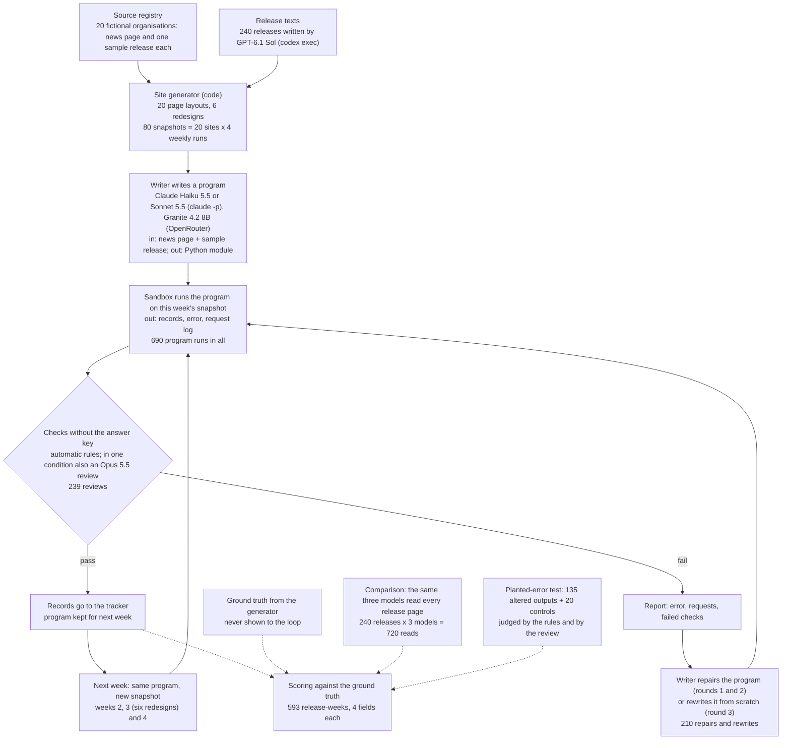
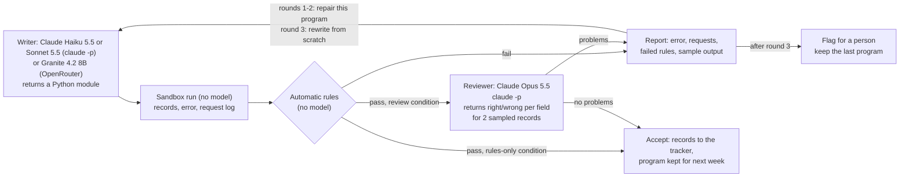
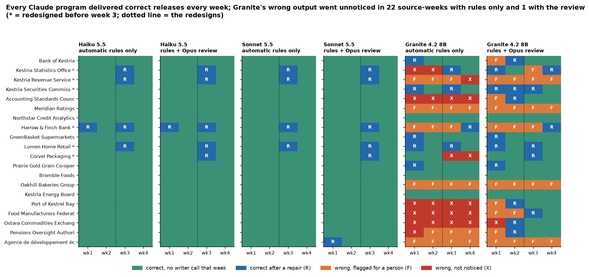
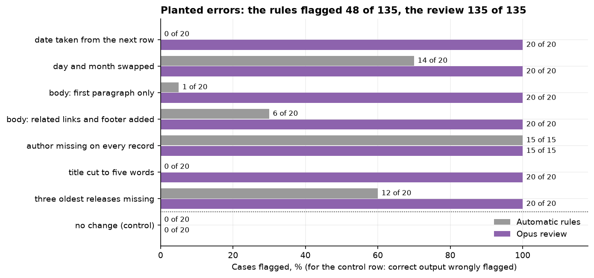
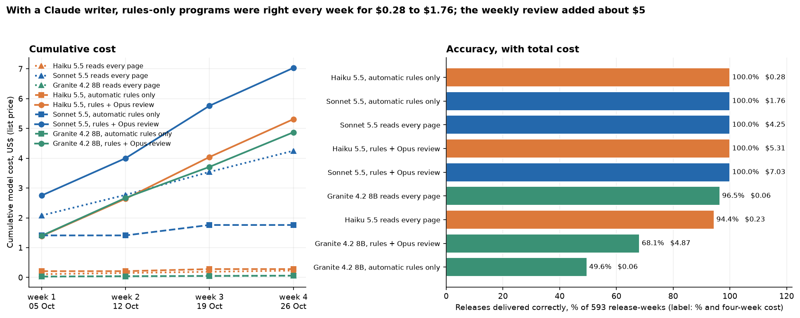

# Can a language model write, check and repair the programs that watch 20 news pages?

## Keeping track of what other organisations announce

Every organisation depends on other organisations that publish news on their websites. A finance team needs to know when the central bank changes its interest rate, when the tax authority moves a filing deadline, when the largest customer changes how quickly it pays its suppliers, or when the packaging supplier announces a surcharge. Each of these arrives as a short news release on someone else's website, and each can change a forecast, a payment date or a decision about borrowing.

Nobody sends these releases to the team. Someone has to go and look. In many teams that job falls to a junior analyst or an intern, who opens each website once a week, scans the news page for anything new and copies the useful details into a spreadsheet: the headline, the date, who wrote it and the text itself. With 20 websites that is an hour or two every week; with 100 it is most of a day. The work is repetitive, it is the first thing skipped in a busy week, and the release that matters is easy to miss.

Everything in this experiment is fictional. The company, the 20 organisations it watches, their staff, their websites and every release were made up for it, and the websites use the reserved `.example` internet domain.

### An illustrative example

Picture one website: the news page of a national tax authority. On Monday morning the analyst opens it and sees a list of releases, newest first, each with a date and a headline. The top item, dated last Thursday, was not there a week ago. The analyst opens it and copies four things into the tracker: the headline ("Sales tax filing deadline moves to 15 November"), the date, the author if one is named, and the three paragraphs of text. That is the ordinary case. It takes a few minutes and the result is right.

Now add one complication. The release page shows two dates: "Published 5 October" and, underneath, "Last updated 9 October". The tracker needs the publication date, because the team sorts announcements by when they were first made; a deadline change recorded as 9 October would look four days newer than it is, and could be missed by anyone filtering for "announced last week". A careful person reads both labels and takes the first. A person in a hurry, or a program written without that page in mind, may take whichever date it meets first.

### Turning the routine into a program

The usual way to save the hour is a small program for each website. It opens the news page, follows each link to a release and picks out the four facts. Programmers call such a program a scraper. One scraper is quick to write. Twenty are tedious, because every website is built differently: one lists releases in a table, another loads them from a separate data feed after the page opens, a third keeps the author's name only in hidden page information that a reader never sees. And a scraper that works today can stop working when the site is redesigned. Sometimes it fails loudly and finds nothing. Sometimes it fails silently and keeps returning a date, only now the wrong one.

### Two ways to use a language model

A language model can take over this work in two different ways.

The first is to let the model do the analyst's job directly. Every week, each new release page goes to the model, which returns the headline, date, author and text. No program is needed, but the model reads every page every week, so the cost grows with the number of releases, and every reading is a new chance for a mistake.

The second is to have the model write the scraper. The model sees the news page and one example release and writes a small program; the program then runs every week without the model, at almost no cost. The model is called again only when something goes wrong. If the program crashes, or its output fails a check, the error message and the failed checks go back to the model, which writes a corrected version.

That second approach stands or falls with checks that work without knowing the right answer, because in real use nobody has an answer key. This experiment tests two kinds. Automatic rules are free to run and look for output that is clearly wrong: a missing date, a date in the future, a headline that does not appear on the page, leftover web-page code in the text, or a week in which the author comes back empty for every release although last week it was always there. A review by a second, stronger model costs money: it reads a sample of the program's output next to the page it came from and says whether the headline, date, author and text match what the page shows.

## The question

Can a language model write a working extraction program for each of 20 differently built news pages from one example page, find and fix its own mistakes using only checks that do not know the right answer, and keep the programs working for four weeks in which six of the sites are redesigned? Which checks does that need: the free automatic rules alone, or the rules plus a review by a stronger model? And how do accuracy and cost compare with simply having a model read every release page?

## Study summary

**What was compared.** Three writer models, Claude Haiku 5.5, Claude Sonnet 5.5 and the small open-weight Granite 4.2 8B, each wrote one program per source for the news pages of 20 fictional organisations, with up to three repair rounds whenever a check failed. Each writer ran twice: once with automatic rules as the only check, once with the rules followed by a Claude Opus 5.5 review of two sampled records. The programs then ran for three more weeks, 593 release-weeks in all (one release on one week's listing). The same three models also read each of the 240 releases directly, as the comparison. A separate test planted 135 typical errors into correct output to see which check notices them.

**What we found.**

- The two Claude writers rarely needed the loop. Sonnet's first program was fully correct for 20 of 20 sources and Haiku's for 19 of 20; one repair fixed Haiku's last one. In week 3, four of the six redesigns broke both writers' programs; the automatic rules flagged every break, one repair fixed each, and every source delivered correct releases in every week.
- Granite 4.2 8B needed the loop all the time. Its first programs were fully correct for 4 of 20 sources, and for 9 of 20 after three repairs. With rules only, Granite's wrong output went unnoticed in 22 source-weeks; with the review, in 1. By week 4 the review condition had 16 of 20 sources right, against 10 with rules only.
- In the planted-error test the rules flagged 48 of 135 errors and the review flagged all 135, with no false alarm on 20 unchanged controls.
- With a Claude writer and rules only, four weeks of correct releases cost $0.28 (Haiku) or $1.76 (Sonnet) in model calls. The weekly review added about $5 and caught no error that the rules had missed. Reading every page cost $4.25 with Sonnet (every release right) and $0.23 with Haiku (94.4% right).

In the original situation: a team can let a capable model write its scrapers, run them every week for almost nothing, and rely on free automatic rules to notice when a redesign breaks one. A review by a stronger model pays for itself when the writer is weak or a program is new, not as a weekly routine for programs that already work.

**The main caveat.** The 20 sites are made up, small and tidy, each with one designed trap, and the same person designed the traps, the field definitions and the rules. Real sites are larger and messier and will produce errors nobody anticipated, which is where the rules are weakest: they flagged 48 of the 135 planted errors.

## Contents

1. [The sources and their websites](#1-the-sources-and-their-websites)
2. [How a program is written, run and checked](#2-how-a-program-is-written-run-and-checked)
3. [Worked example: one source from first program to repair](#3-worked-example-one-source-from-first-program-to-repair)
4. [Results: writing the first programs](#4-results-writing-the-first-programs)
5. [Results: four weeks of reuse and six redesigns](#5-results-four-weeks-of-reuse-and-six-redesigns)
6. [Results: what each check can catch](#6-results-what-each-check-can-catch)
7. [Comparison with reading every page](#7-comparison-with-reading-every-page)
8. [Error analysis](#8-error-analysis)
9. [What the evidence supports](#9-what-the-evidence-supports)
10. [Limitations](#10-limitations)
11. [Spend, data and how to run](#11-spend-data-and-how-to-run)
12. [Future work and further reading](#12-future-work-and-further-reading)

## 1. The sources and their websites

### The watch list

The fictional company is a mid-sized food manufacturer in Kestria, an invented country whose currency is the Kestrian crown. Its finance team watches 20 outside organisations. For each one, the registry ([`data/sources.csv`](data/sources.csv)) records what an analyst would record when adding a source: the organisation, which part of the finance team needs it and why, the address of its news page and, for one source, a note about what counts ("Only items labelled 'News release' are in scope. The same page lists events and consultations."). That list is the only input the system starts from.

Real news pages differ in ways that matter to a program, so each fictional site uses a different layout, and six are redesigned before week 3:

| Organisation | Kind | What makes the site different | Redesign before week 3 |
|---|---|---|---|
| Bank of Kestria | Central bank | Releases in a table of dates and titles; no author | |
| Kestria Statistics Office | Statistics office | A plain list; byline "By Name, Job title" | Every page section renamed; listing becomes cards |
| Kestria Revenue Service | Tax authority | 5 releases per page, so 8 need page 2; dates written 05/10/2026 | Page 2 removed; older items behind a "Load more" button |
| Kestria Securities Commission | Securities regulator | A "Published / Last updated / Author" box | A "Page reviewed" date above "First published" |
| Accounting Standards Council | Standard setter | Only "Last modified" is visible; the publication date is in hidden page data | |
| Meridian Ratings | Rating agency | The listing is drawn by JavaScript and arrives empty; an RSS feed carries the items | |
| Northstar Credit Analytics | Rating agency | Cards with shortened titles; two authors per release | |
| Harrow & Finch Bank | Lending bank | Pages filled in from a separate data service after they open | The data service moves to a new version; the old one answers "410 Gone" |
| GreenBasket Supermarkets | Customer | A web app with generated class names and a JSON data block | |
| Lumen Home Retail | Customer | Shortened card titles; the author only in a hidden meta tag | The meta tag replaced by a visible "Words by Name" |
| Corvel Packaging | Supplier | Cookie banner, share buttons, newsletter box and related posts around the text | Newsletter box, a "Related" link and tags moved inside the text |
| Prairie Gold Grain Co-operative | Supplier | Newswire style: the only date is in the first line of the text | |
| Bramble Foods | Competitor | The listing says "3 days ago" | |
| Oakhill Bakeries Group | Competitor | An old table layout with paragraphs split by line breaks | |
| Kestria Energy Board | Energy regulator | News, events and consultations on one page; only news counts | |
| Port of Kestrel Bay | Port authority | Only the first paragraph is on the page; the rest loads from a second address | |
| Food Manufacturers Federation | Industry association | Visible dates have no year; the full date is in page markup and a feed | |
| Ostara Commodities Exchange | Commodity exchange | Dates written 05.10.2026, with an issue date and a later "effective" date | |
| Pensions Oversight Authority | Pension regulator | Listing grouped under month headings with only the day; no date on the release page | |
| Agence de développement économique de Val-Brume | Regional agency | In French: "Publié le 1er octobre 2026", "Par Name", "Mis à jour le ..." | |

The redesigns cover the kinds of failure a maintainer meets: two remove what a program depends on, two change what is on the page so a program finds less, and two add something a program may wrongly take in.

### Why the data is new

A test like this is only fair if the models have never seen the pages. A model trained on public websites may have memorised a real central bank's news page or its releases, and would then be scored on memory. So every site is new. GPT-6.1 Sol (through `codex exec`), a model from a different company than the Claude models under test, wrote 240 release texts dated between 17 August and 23 October 2026, with the dates fixed by the code. Everything else, the HTML of every page, URLs, bylines, local date formats, banners, feeds and data services, is generated by code from those texts, so the right answer for every release is known exactly. The data was generated on 2026-10-29.

The simulation runs four weekly runs, every Monday from 5 to 26 October 2026. Week 1 (six releases per site) is when the source is added and the first program is written. Week 2 adds one to three new releases per site and changes nothing else. Week 3 adds more and redesigns six sites. Week 4 adds more on unchanged sites. A listing shows the newest eight releases.

### One site up close

This is the main part of a release page from the Securities Commission site in week 1, as a program fetches it:

```html
<main><h1>Corrected Amberford Heatworks report satisfies Commission disclosure direction</h1>
<dl class="meta"><dt>Published</dt><dd>30 September 2026</dd><dt>Last updated</dt><dd>1 October 2026</dd>
<dt>Author</dt><dd>Selin Arvane</dd><dt>Reference</dt><dd>KSC-2026-829</dd></dl>
<div class="body">
<p>The Kestria Securities Commission has completed its review of the corrected half-year report ...</p>
...
<p class="contact">Media contact: communications@ksc.example</p></main>
```

The right answer is the headline, `2026-09-30` (the first of the two dates, because the field asks for first publication), `Selin Arvane` without the label, and the three paragraphs without the "Media contact" line. In week 3 this site adds a "Page reviewed" date above "First published", so a program that relied on position rather than on the label would start returning the review date.

## 2. How a program is written, run and checked

### The models

| Role | Model | How it is called | Why |
|---|---|---|---|
| Writes and repairs programs; reads pages in the comparison | Claude Haiku 5.5 | `claude -p` | The smallest current Claude model, the natural choice for a cost-conscious team |
| Writes and repairs programs; reads pages in the comparison | Claude Sonnet 5.5 | `claude -p` | The mid-sized Claude model, to see whether a stronger writer needs fewer repairs |
| Writes and repairs programs; reads pages in the comparison | Granite 4.2 8B (`ibm-granite/granite-4.2-8b-20260831`) | OpenRouter, pinned to DeepInfra at BF16 | A small open-weight model (8.8 billion parameters, Apache 2.0, released August 2026) a team could run itself |
| Reviews sampled records | Claude Opus 5.5 | `claude -p` | A tier above every writer, so no model reviews its own work |
| Writes the release texts | GPT-6.1 Sol | `codex exec` | A different company's model, so the tested models never read text of their own making |

### What the writer is asked to do

The writer gets the task, the registry entry and the raw HTML of two pages, the listing and the sample release. It must reply with a Python module defining `extract(fetch, listing_url)`, which returns one record per listed release with five fields:

- `url`: the address of the release's own page;
- `title`: the full headline as the release page shows it;
- `date`: the date of first publication as `YYYY-MM-DD`, not a "last updated", "reviewed", event, closing or effective date;
- `author`: the credited person or people, without job titles or words such as "By", or none when nobody is credited;
- `body`: the full text, with nothing missing and nothing added (no navigation, cookie notices, share buttons, newsletter boxes, related links, tags, contact boxes or "About us" paragraphs).

The same definitions, word for word, are given to the reviewer and to the direct-reading comparison. The program gets no network access of its own: it receives a `fetch` function, which here answers from the saved snapshot of the site for that week. Each program runs in its own Python process with a two-minute limit and sockets switched off.

### The automatic rules

The rules need no model and no answer key. Each describes something every correct output must satisfy:

- the program ran without an error and returned a list of records with the five fields;
- every address belongs to the site and opens a page;
- every headline has 3 to 300 characters, no HTML, no "…" at the end, and appears in the pages the program fetched;
- every date is a real date between 2000 and the run date;
- every author looks like a name (no digits, no e-mail address, no leftover "By") and appears in the fetched pages;
- every body has at least 200 characters, no HTML, and its first and last 80 characters appear in the fetched pages;
- no two records share an address, a headline or a body;
- the dates follow the listing's order, which catches day and month read the wrong way round;
- from week 2: at least three quarters as many records as last week, some of last week's addresses found again, and no field that was filled last week suddenly empty.

Before any model was called, the rules were run on the right answers for all 20 sites in all four weeks: every one passed, so a fully correct program is never sent back by the rules.

### The model review

In the review condition, output that passes the rules goes to Claude Opus 5.5 with the listing page and two sampled release pages as a browser shows them, a one-line summary of every record and the two sampled records in full. It marks each field right or wrong and says whether the records cover the listing. Any problem sends the program back, with the reviewer's words in the report. A review costs about six US cents.

### Repair, rewrite and reuse

When a check fails, the writer gets the task and the current pages again, its own program and a report: the error and traceback, the requests the program made with their status codes, every failed rule and reviewer comment, the first two records, and up to three replies from other addresses it requested. Rounds 1 and 2 repair; round 3 writes a new program from scratch with a list of every problem seen so far. After round 3 the source is flagged for a person. A program that passes is stored and runs again next week.

### Scoring against the truth

None of the checks can see the right answers. A separate scoring step compares every week's records with the generator's truth: the headline must match (ignoring case and spacing), the date exactly, the author as the same set of names, and the body must have a word overlap (F1) of at least 0.95 with the true text. F1 combines the share of the program's words that belong to the release with the share of the release's words it found. For example, a 200-word body returned with a 30-word newsletter box scores F1 0.93 and counts as wrong; the first 190 words alone score 0.97 and count as right.

The main measure is **sources extracted fully correctly** in a week: every listed release returned, nothing else, and all four fields of every release right. One wrong date in eight releases makes the source count as wrong, because a finance team cannot tell which of the eight to trust.

### How the experiment runs



The model calls for one source in one week form a small loop:



Calls for different sources run in parallel; within one source each step waits for the one before. In week 1 the loop starts with the writer; in weeks 2 to 4 it starts with last week's program, and the writer is called only if a check fails.

## 3. Worked example: one source from first program to repair

Harrow & Finch Bank's newsroom page arrives almost empty: a short script asks a separate data service for the releases and fills the page in. A program that reads only the HTML finds nothing, so the writer has to notice the data service in the script and call it. The service's reply for the newest release in week 1 looks like this:

```json
{"id": 3837, "slug": "equipment-programme-expands-after-strong-demand-from-regional",
 "title": "Equipment programme expands after strong demand from regional ...",
 "published_at": 1790602200000, "author": {"display_name": "Devran Holt", "team": "Media relations"}, ...}
```

**Step 1, the first program.** Claude Haiku 5.5 noticed the service, called it, followed each release to its own data record and returned all six releases with the right headlines, authors and texts. But it passed `published_at`, the milliseconds since 1 January 1970, to Python's `datetime.fromtimestamp`, which expects seconds. Read as seconds, the number points to a year beyond 50,000; Python refused it, the program's own error handler turned the refusal into "no date", and every record went out with `date: None`.

**Step 2, the checks.** Nothing crashed, and a person glancing at the headlines would have seen nothing wrong. The date rule fired for every record: `date must be a "YYYY-MM-DD" string, got None`.

**Step 3, the report.** Haiku received the task and the two pages again, its program, the 15 requests the program had made (all successful, including the data-service addresses), the failed rule and the first two records.

**Step 4, the repair.** Haiku's second program, which cost $0.013, added one step: a number larger than 10^11 is taken to be milliseconds and divided by 1,000.

**Step 5, the score.** The first program found all 6 releases and got 18 of 24 fields right (75%): every title, author and body, no dates. The repaired program got 24 of 24, passed every rule, and ran unchanged in week 2. In week 3 the bank retired that data service; the repaired program then returned no records, the rules flagged it, and one more repair moved it to the new service. Both programs are in [`data/programs/haiku_rules/`](data/programs/haiku_rules/) (`hfb_week1_round0_generate.py`, `hfb_week1_round1_repair.py`).

## 4. Results: writing the first programs


On the left, each line counts the sources whose program was fully correct after each round of week 1 (solid lines: review condition; dashed: rules only; the Claude lines lie on top of each other because both conditions gave the same counts). On the right, each bar splits the 20 sources by the outcome at the end of week 1: green accepted and correct, red accepted but wrong (the dangerous case, wrong records nobody notices), orange flagged for a person, grey rejected although correct.

| Writer | Checks | Correct on first try | Correct after the loop | Accepted but wrong | Flagged for a person | Programs written | Model cost, week 1 |
|---|---|---|---|---|---|---|---|
| Claude Haiku 5.5 | rules only | 19 of 20 | 20 of 20 | 0 | 0 | 21 | $0.21 |
| Claude Haiku 5.5 | rules + review | 19 of 20 | 20 of 20 | 0 | 0 | 21 | $1.39 |
| Claude Sonnet 5.5 | rules only | 20 of 20 | 20 of 20 | 0 | 0 | 20 | $1.41 |
| Claude Sonnet 5.5 | rules + review | 20 of 20 | 20 of 20 | 0 | 0 | 21 | $2.75 |
| Granite 4.2 8B | rules only | 4 of 20 | 9 of 20 | 6 | 5 | 49 | $0.03 |
| Granite 4.2 8B | rules + review | 4 of 20 | 9 of 20 | 1 | 11 | 60 | $1.40 |

**Both Claude writers produced working programs almost at once.** Sonnet's first program was fully correct for all 20 sources, Haiku's for 19, including every trap in section 1: day/month dates, a date that exists only on the listing, text loaded from a second address, an author hidden in a meta tag, events mixed in with news. Haiku's exception was the worked example above.

**Granite 4.2 8B needed the loop and still fell short.** Of its 20 first programs, 7 crashed (four type errors, a syntax error, a missing-element error, a date-parsing error), 4 returned no records, 3 returned records that failed the rules, and 6 passed the rules, of which 2 were still wrong. Three rounds raised the count to 9 correct sources.

**The checks decided differently for Granite.** With rules only, 15 programs were accepted and 6 were wrong: bodies that stopped after the first paragraph, bodies without their subheadings and bullet lists, swapped day and month, dates under the wrong month heading, an author with half a job title attached ("Elian Corven, Head") and no author where the page names one. With the review, 9 were accepted and 1 was wrong; 10 wrong programs were flagged for a person, and 1 correct one was rejected. The review turned five of the six silent errors into flagged sources, for $1.36 in reviews that week.

The writer matters more than the checks for getting started: a Claude-class writer reaches a working program for nearly every source in one or two attempts, while a small open model leaves half the sources to a person. With a weak writer, the review decides whether the remaining errors are visible or hidden.

## 5. Results: four weeks of reuse and six redesigns



Each panel is one writer in one condition; each row a source (an asterisk marks the six redesigned sites) and each column a week. Green: correct records with no writer call that week. Blue R: a repair that week ended in correct records. Orange F: the loop gave up and flagged the source. Red X: wrong records that no check noticed. The dotted line falls just before the week-3 redesigns.

| Writer, checks | Sources correct, weeks 1 / 2 / 3 / 4 | Model cost, weeks 1 / 2 / 3 / 4 |
|---|---|---|
| Haiku 5.5, rules only | 20 / 20 / 20 / 20 | $0.21 / $0.00 / $0.07 / $0.00 |
| Haiku 5.5, rules + review | 20 / 20 / 20 / 20 | $1.39 / $1.25 / $1.40 / $1.27 |
| Sonnet 5.5, rules only | 20 / 20 / 20 / 20 | $1.41 / $0.00 / $0.35 / $0.00 |
| Sonnet 5.5, rules + review | 20 / 20 / 20 / 20 | $2.75 / $1.25 / $1.76 / $1.27 |
| Granite 4.2 8B, rules only | 9 / 9 / 9 / 10 | $0.03 / $0.01 / $0.01 / $0.01 |
| Granite 4.2 8B, rules + review | 9 / 14 / 14 / 16 | $1.40 / $1.27 / $1.04 / $1.16 |

**Weeks 2 and 4 cost nothing for the Claude programs.** All 40 Claude programs ran unchanged and returned every new release correctly. With rules only, those weeks made no model call; with the review, each cost about $1.25 for 20 reviews that found nothing wrong.

**Four of the six redesigns broke every Claude program, and the rules caught every break.** The Statistics Office rename made Haiku's programs return no records and Sonnet's return records with no date or author. The Revenue Service's "Load more" button cut the records from 8 to 5 ("Only 5 records this week against 8 last week"). Harrow & Finch's retired data service answered "410 Gone", which Sonnet's programs raised as an error and Haiku's turned into an empty list. Lumen Home's new "Words by" byline gave Haiku's programs authors starting with "Words by" (caught by the byline rule) and Sonnet's programs no author at all (caught by "author is filled for 0% of records this week against 100% last week"). One repair fixed each of the 16 breaks.

**The two redesigns meant to cause silent errors broke no Claude program.** Every Claude program kept returning the first-publication date at the Securities Commission and kept the newsletter box out of Corvel's bodies. One small piece did get in at Corvel: an inline paragraph "Related: ..." between two text paragraphs. The scoring tolerates it (word overlap 0.965 to 0.971), but the review flagged it in both Claude review conditions and the repair took it out, holding the programs to the written definition more strictly than the score does.

**Granite's programs kept failing, and only the review kept nearly all failures visible.** With rules only, five or six sources a week delivered wrong records without a flag (22 source-weeks in all), and correct sources moved only from 9 to 10. With the review, the wrong programs were flagged and retried each week; by week 4, 16 of 20 were correct and 4 were still flagged. Granite cost under four cents a week in writing calls; nearly all of the review condition's cost was review.

## 6. Results: what each check can catch

### The checks in the main run

| Check | Runs judged | Wrong runs | Wrong and caught | Wrong but passed | Correct runs | Correct but rejected |
|---|---|---|---|---|---|---|
| Automatic rules (all runs) | 690 | 272 | 232 | 40 | 418 | 0 |
| Opus review (runs that passed the rules, review condition) | 239 | 18 | 17 | 1 | 221 | 9 |

The rules never rejected a correct program and caught all 18 wrong Claude runs; the 40 wrong runs that passed were all Granite's, errors that leave a plausible value in place. The review caught 17 of the 18 wrong runs that reached it and rejected 9 correct ones, all over formatting: six Granite bodies with paragraphs joined by one line break instead of a blank line, two Claude bodies with the "Related:" line, and one Sonnet body with "40%" where the French page has "40 %". Seven of the nine cost one repair each; two pushed Granite into a worse program or a flagged week.

The main run cannot say what the review adds for a writer as good as Haiku or Sonnet, because those writers left it nothing to find. So the next test supplies the errors.

### Planted errors

The true week-2 output of every source was changed in one of seven ways that broken programs typically go wrong, applied to every record of the source as a program bug would be, and both checks judged the result. An unchanged version is the control: any flag on it is a false alarm.



| Planted error | Cases | Rules flagged | Review flagged |
|---|---|---|---|
| Date taken from the next row | 20 | 0 | 20 |
| Day and month swapped | 20 | 14 | 20 |
| Body: first paragraph only | 20 | 1 | 20 |
| Body: related links and footer added | 20 | 6 | 20 |
| Author missing on every record | 15 | 15 | 15 |
| Title cut to five words | 20 | 0 | 20 |
| Three oldest releases missing | 20 | 12 | 20 |
| No change (control) | 20 | 0 | 0 |

**The review flagged every planted error, and neither check raised a false alarm.** Its comments named the field and quoted the page, for example "Record gives 2026-09-28, but the page says 'Published on 5 October 2026'" and "Title is truncated to 'August goods imports rise faster'; the release page headline is 'August goods imports rise faster than export values'", text that can go straight into a repair report.

**The rules flagged 48 of 135, and which ones follows from what each rule can see.** Every dropped author (last week the field was always filled); most swapped dates, by their effect on the listing order; most missing releases, by the week-over-week count; a few added footers, only where the last 80 characters spanned text that never appears together on a page. They caught almost none of the errors that leave a plausible value in place: a date from the neighbouring row (0 of 20), a cut title (0 of 20), a body cut to its first paragraph (1 of 20, the one under 200 characters). The rules are a good alarm for loud breakage and a weak one for quiet mistakes, which are exactly the mistakes Granite made in the main run.

## 7. Comparison with reading every page

Each of the three models also read all 240 releases directly, once each in the week the release first appeared. It got the release page and the listing as a browser shows them, the same field definitions and the release's address; it did not have to find new releases itself, so its accuracy is an upper bound for that method.



On the left, each line is one method's cumulative cost: dotted lines with triangles are direct reading, dashed lines with squares programs with rules only, solid lines with circles programs with the review. On the right, each bar is one method's share of release-weeks delivered correctly, with its four-week cost; colours follow the model.

| Method | Release-weeks right (of 593) | Model calls | Cost, four weeks |
|---|---|---|---|
| Haiku 5.5 programs, rules only | 593 (100%) | 25 | $0.28 |
| Sonnet 5.5 programs, rules only | 593 (100%) | 24 | $1.76 |
| Sonnet 5.5 reads every page | 593 (100%) | 240 | $4.25 |
| Haiku 5.5 programs, rules + review | 593 (100%) | 107 | $5.31 |
| Sonnet 5.5 programs, rules + review | 593 (100%) | 108 | $7.03 |
| Granite 4.2 8B reads every page | 572 (96.5%) | 240 | $0.06 |
| Haiku 5.5 reads every page | 560 (94.4%) | 240 | $0.23 |
| Granite 4.2 8B programs, rules + review | 404 (68.1%) | 202 | $4.87 |
| Granite 4.2 8B programs, rules only | 294 (49.6%) | 103 | $0.06 |

**With a Claude writer, programs with rules only gave the best accuracy for the least money.** Haiku's programs were right in every release-week for $0.28, most of it spent writing the programs in week 1. Reading with Sonnet was also always right but cost $4.25, a cost that recurs in proportion to new releases. Reading with Haiku cost $0.23 and got 94.4% right.

**Reading is cheap on these pages, which narrows the gap.** A direct read here is about 2,000 tokens of page and costs about $0.001 with Haiku and $0.018 with Sonnet. Real news pages are often 10 to 50 times larger, while a program's running cost stays near zero, so these figures are the low end of the case for programs.

**The review changes the cost picture more than the choice of method.** Reviewing 20 sources every week cost about $1.25 a week and found nothing for the Claude writers in weeks 2 and 4. Reviewing only after a program is written or repaired would have cost about $1.20 in week 1, a few reviews in week 3 and nothing else.

**A small model was better at reading than at writing programs.** Granite 4.2 8B read pages with 96.5% of release-weeks right for six cents, ahead of Haiku's reading and far ahead of its own programs. For a team limited to a small open model, direct reading with a sampled review would be the better design on this evidence.

## 8. Error analysis

All 23 silent errors (accepted but wrong) came from Granite programs, 22 of them in the rules-only condition, and they are the same few mistakes carried from week to week, because an accepted program is reused unchanged. The examples below were chosen to cover a quiet failure, the one error that passed the review, a loud failure caught by a rule, a typical success and the direct-reading errors. Each is traceable in [`data/attempts.jsonl`](data/attempts.jsonl) by source and week, and each program is in [`data/programs/`](data/programs/).

**A quiet error the rules cannot see: half a release (Port of Kestrel Bay, Granite, week 1).** Only the first paragraph is in the page; the rest loads from a second address. Granite's first program read only the first paragraph, giving bodies of 550 to 650 characters that appear word for word on the page, so every rule passed; their word overlap with the true text was 0.48 to 0.61. With rules only, that program delivered half of every release for four weeks. In the review condition the reviewer wrote in week 1 "The body has only the lead paragraph ... The two paragraphs in the page's body-rest section are missing", and Granite wrote seven programs over two weeks, one of which did not compile, before a rewrite fetched the second address.

**The one error that passed the review: a single swapped date (Ostara Exchange, Granite, week 1).** Granite's program read "04.09.2026" as 9 April; only one of the six releases that week had a day of 12 or less. The two records the reviewer read in full (dated 28 and 14 September) were right, and it did not spot the wrong date in the one-line summary. In week 2 the newest release, dated 08.10.2026, was sampled, and the reviewer wrote "Day and month are swapped. The page shows 'Date of issue: 08.10.2026', which is 2026-10-08, not 2026-08-10"; one repair fixed it. With rules only, the same program went four weeks unflagged. The review reliably checks what it reads in full and only sometimes what is in the summary; at the Pensions Oversight Authority it did catch three wrong months in unsampled records by comparing the summary with the listing's month headings.

**A loud error caught by a cheap rule (Lumen Home Retail, week 3).** The redesign replaced the hidden author tag with a visible "Words by Daren Pell". Haiku's program returned "Words by Daren Pell" and the byline rule rejected it; Sonnet's program looked only at the old tag, returned no author for every release, and the fill-rate rule rejected that. Both repairs returned the name alone.

**A typical success (Pensions Oversight Authority, Sonnet 5.5).** The release page has no date; the date exists only as a day number under a month heading on the listing. Sonnet's first program walked the listing in order, kept the current month heading and combined it with each day, and returned every date correctly for four weeks without a repair. Haiku's first program also returned every date correctly. The same trap gave Granite's programs wrong months in week 1 in both conditions.

**A disagreement between the review and the score (Corvel Packaging, week 3).** After the redesign, both Claude programs kept an inline paragraph "Related: Amberford carton line completes first full production month" in two bodies. The score counted the bodies right (overlap above 0.95); the reviewer called it "a related link, not release text", which is what the field definition says. Here the review was the stricter and arguably the more correct judge.

**Direct-reading errors that a program avoids.** Haiku 5.5 included Meridian Ratings' standard disclaimer ("Credit ratings are opinions about relative credit risk ...") in 10 of the agency's 14 bodies, and returned no date for 2 of the 13 Pensions Oversight releases although the listing in its prompt showed the month and day. A program makes the same choice for every release; a reader can get the same layout right on one page and wrong on the next.

These examples show what the programs and checks did, not why a model wrote a given line of code. The difference between writers is measured; its cause, beyond model size, is not.

## 9. What the evidence supports

- **Let a capable model write the programs, and reuse them.** Claude Haiku 5.5 and Sonnet 5.5 produced correct programs for 39 of 40 sources at the first attempt and 40 of 40 after one repair, and the stored programs cost nothing to run in a normal week. Haiku is enough: it matched Sonnet on every source-week for a sixth of the writing cost.
- **Run the free automatic rules on every run, and treat a failed rule as a repair trigger.** They caught every break caused by the redesigns and every wrong Claude program, with no false alarm in 418 correct runs. The week-over-week rules did most of that work, so keep last week's summary for each source.
- **Use the model review where the rules are blind: new and repaired programs, and weak writers.** The rules flagged 48 of 135 planted errors and the review all 135. With Granite as writer the review cut silent source-weeks from 22 to 1. Reviewing unchanged Claude programs every week found nothing and cost about $1.25 a week.
- **Do not use a small open model as the writer.** Granite 4.2 8B left half the sources to a person even after three repairs a week, yet read pages directly with 96.5% right for six cents.

The uncertainty that most needs another experiment is how the rules and a sampled review do against errors nobody designed: real sites at full size, and errors that touch one release in eight rather than all of them.

## 10. Limitations

- **Made-up sites, smaller and tidier than real ones.** Pages are 3 to 8 KB with one main trap; real pages are often 10 to 50 times larger, load several scripts, block automated visitors, rate-limit requests and post some releases only as PDF files. None of that is tested.
- **The traps and the checks have the same author.** The field definitions warn against "last updated", "reviewed" and "effective" dates and one rule looks for dates out of listing order, because the person who built the sites knew those traps exist. The Claude writers' near-perfect first attempts may owe something to a specification that named the traps.
- **One sample per writer and source.** Each program was requested once; with 20 sources a difference of one or two between conditions is within the noise, and the Granite gap between conditions (10 against 16 correct sources in week 4) is a direction, not a precise figure.
- **Systematic planted errors.** Every planted error changed every record, so any sample of two showed it. The one error the review missed in the main run touched one record in six.
- **Four weeks, six chosen redesigns, list prices, one setting per model.** Real sites change on their own schedule; costs are list prices for small pages; the direct-reading comparison was given each release's address; each model ran at one setting.
- **No relevance step.** Whether a release matters to the finance team is not tested.

## 11. Spend, data and how to run

The study used 1,166 model replies at a list price of $22.16: $15.33 for Opus reviews (main run and planted-error test), $4.54 for the 720 direct reads, $2.29 for writing and repairing programs. GPT-6.1 Sol's release texts ran on a subscription that reports no price. The per-condition costs above count each call a condition made; identical requests in two conditions (shared first programs, reviews of identical output) were made once, so actual spend is below the sum of the conditions. No collected reply was left unused. The generated programs ran in 0.8 seconds each on median.

| File or folder in `data/` | What it holds |
|---|---|
| `sources.csv` | The source registry |
| `releases.json` | The release texts as GPT-6.1 Sol wrote them |
| `sites/`, `views/`, `site_manifest.json` | Every page of every site for each run date, raw and as a browser shows it, with hashes |
| `ground_truth.csv` | The right answer for every listed release in every week |
| `attempts.jsonl` | Every program run: writer, condition, week, round, code, check results, report and score |
| `programs/` | Every program written, by writer and condition |
| `direct_reads.jsonl` | Every direct read and its record |
| `planted_errors.csv` | The planted-error cases and both checks' verdicts |
| `cache_cli.jsonl`, `cache_openrouter.jsonl` | Every model reply, keyed by the full request |
| `program_runs.jsonl` | Every program run's output, keyed by program, snapshot and runner |
| `model_catalog.json` | Granite 4.2 8B's pinned version, provider, precision, licence and prices |

Running the notebook replays everything from these files with no model calls:

```bash
jupyter nbconvert --to notebook --execute --inplace 31_self_repairing_scrapers.ipynb
```

`NB_RERUN_PROGRAMS=1` runs every generated program again and reports any difference from the saved runs. New collection needs `NB_LIVE=1`, signed-in `claude` and `codex` command-line tools and an `OPENROUTER_API_KEY`; size settings and budget caps sit at the top of the notebook. The full analysis is in [31_self_repairing_scrapers.ipynb](31_self_repairing_scrapers.ipynb).

## 12. Future work and further reading

### Future work

- **Real pages, in full size.** Repeat the build on saved copies of 20 real news pages (typically 30 to 150 KB of HTML) and measure first-try and after-repair counts and the direct-reading cost per release, which grows with page size while a program's running cost does not. Motivated by direct reading with Haiku costing about $0.001 per release only because the pages are small.
- **Errors that affect only some records.** Plant errors in one record in eight and measure how often a two-record review sample sees them, against reviewing every record. Motivated by the one swapped date the review missed.
- **Review on a schedule rather than every week.** Compare reviewing every week, only after a program is written or repaired, and a rotating 20% of sources, over a longer run with more redesigns; measure the delay before a silent error is noticed against review cost. Motivated by the weekly review costing about $1.25 while finding nothing for the Claude writers in weeks 2 and 4.
- **A wider range of writers.** Granite 4.2 8B needed far more repairs than the Claude models; a medium open-weight model such as Qwen3.8 27B would show where on the size scale a writer stops needing the loop.
- **A specification written without knowledge of the traps.** Have a second person write the field definitions from the registry alone and compare first-try results.

### Further reading

Links checked on 2026-10-29.

- [Wrapper Maintenance: A Machine Learning Approach](https://arxiv.org/abs/1106.4872) (Lerman, Minton and Knoblock, 2003). Monitored 27 hand-built extraction programs ("wrappers") for a year and detected 35 of 37 site changes from learned patterns of the extracted data; the week-over-week rules here are a simple version of that verification step.
- [Language Models Enable Simple Systems for Generating Structured Views of Heterogeneous Data Lakes](https://arxiv.org/abs/2304.09433) (Arora et al., 2023). Compares having a model extract values from every document with having it write extraction code, and reports a 110-fold reduction in tokens processed for the code approach, the trade-off measured in section 7.
- [Teaching Large Language Models to Self-Debug](https://arxiv.org/abs/2304.05128) (Chen et al., 2023). Shows that models fix more of their own code when given execution results; the repair report here is that kind of feedback.
- [AutoScraper: A Progressive Understanding Web Agent for Web Scraper Generation](https://arxiv.org/abs/2404.12753) (Huang et al., 2024). Has a model write scrapers by reading the page structure step by step and measures whether the scrapers run; a more elaborate writer than the single prompt used here.
- [Trafilatura: A Web Scraping Library and Command-Line Tool for Text Discovery and Extraction](https://aclanthology.org/2021.acl-demo.15/) (Barbaresi, 2021). A widely used non-model tool for separating a page's main text from navigation and boilerplate, the body problem here.
- [NewsArticle](https://schema.org/NewsArticle) (schema.org). The shared vocabulary behind the JSON-LD and microdata on two of the sites, with `datePublished` and `dateModified` as separate properties.
