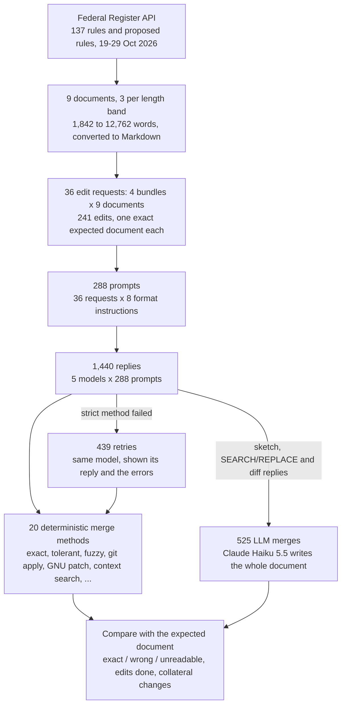
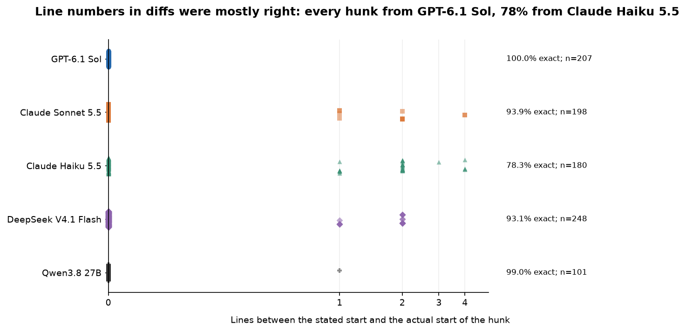
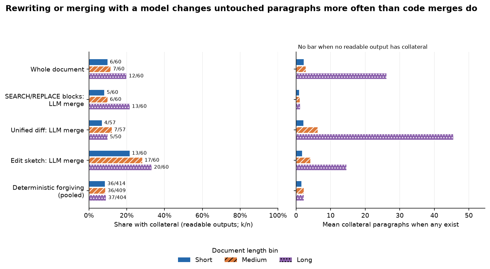

# How should a model send back its edits to a long document?

## Asking a model to change one number

Suppose you look after a 40-page regulation, about 12,000 words, and one figure in it is wrong: a paragraph says
comments are due within 30 days where it should say 45. You paste the document into a chat with a language model and
ask it to make the change. Making the change is easy for the model. The harder question is what it should send back.

The obvious answer is the whole document with the number changed. That is what a person returns after editing a
file, and it needs no special software: you replace the old file with the new one. But to change two characters the
model has to write out all 12,000 words again. That takes two or three minutes, costs as much output as writing the
document from scratch, and gives the model 12,000 chances to change something nobody asked it to change: a curly
quotation mark straightened, a paragraph left out, a sentence reworded. Nobody rereads 40 pages to check that only
one number moved.

The other answer is to send back only the change, something like "replace `within 30 days` with `within 45 days`".
That reply is a dozen words long. But now a program has to merge it into the document: find the place the model meant
and make the change there and nowhere else. Programmers have done this for decades with diff and patch tools, which
describe a change by the lines it removes and adds. Code editors built on language models face the same problem each
time they apply a suggested change, and they have settled on different answers: some have the model rewrite the whole
file, some ask for search-and-replace pairs, some ask for a patch.

### A small example, and where it goes wrong

Here is an illustrative case, made up for this explanation. A five-paragraph notice says, in its third paragraph,
"Comments must be received within 30 days of publication." The request is to change 30 to 45. A search-and-replace
reply looks like this:

```
<<<<<<< SEARCH
received within 30 days
=======
received within 45 days
>>>>>>> REPLACE
```

The merging program looks for `received within 30 days`, finds it exactly once, and swaps in the new text. The other
four paragraphs are never touched, so they cannot be damaged.

Now add one complication. The fourth paragraph contains the words "the agency’s address", with a curly apostrophe,
and a second request asks for that phrase to become "the office’s address". The model quotes it with a straight
apostrophe: `the agency's address`. An exact search finds nothing, and the edit fails. A forgiving program could
compare the texts after straightening quotes and collapsing spaces, or accept the most similar passage when no exact
match exists, and so rescue the edit.

Forgiveness has a price. If the fifth paragraph also said "within 30 days", a program that accepts "the most similar
passage" might change the wrong one. A failed edit announces itself, because the program reports that it could not
find the text. A misplaced edit does not: the document comes back looking finished. A merging rule therefore trades
failures you can see against mistakes you cannot.

There is a middle way between strict and forgiving. When an edit fails, tell the model what went wrong ("the text in
block 2 was not found in the document") and let it try once more. That costs another call but keeps the merging rule
strict.

### Two decisions

Getting an edit into a long document involves two decisions. The first is the reply format: how the model writes the
edit. The second is the merge method: how a program, or a second model, turns that reply into the edited document.

This study compares seven reply formats. In plain terms they are:

- the whole edited document, written out again;
- find-and-replace pairs, written either as marked blocks like the one above or as a JSON list;
- a unified diff, the standard format programmers use, which marks removed lines with `-` and added lines with `+`
  and states the line number where each change starts, so the model has to count lines;
- OpenAI's patch format, which looks like a diff but has no line numbers and finds each change by the unchanged lines
  around it, optionally helped by a locator line that names a nearby heading;
- commands by line number ("replace line 41 with ..."), with the document shown to the model with its lines numbered;
- an edit sketch: only the changed passages, with a marker such as `[... unchanged ...]` wherever text is left out,
  which a program or a second model then merges into the full document, the way some code editors apply suggestions.

For each format it compares the merge methods that format allows: an exact match; a match that ignores differences
in spacing and quotation marks; a fuzzy match that accepts the most similar passage; the standard command-line tools
`git apply` and GNU `patch`; placing a diff's changes by their surrounding lines while ignoring its line numbers; a
second model that writes out the merged document; and one retry with the error message.

## The question

When a model edits a long document, which reply format, merged in which way, most often gives exactly the document
that was asked for, and what does each choice cost in output, time and damage to text that should not change?

The test uses nine US Federal Register rules and proposed rules published between 19 and 29 October 2026, after every
model's training data was collected, from 1,842 to 12,762 words long. Each document gets four edit requests (a single
change, six mixed changes, renaming an abbreviation everywhere, and twenty small changes): 36 requests with 241
individual edits. The exact text to insert is always given, so every request has one correct result, computed in
code. Five models write every request in every format: GPT-6.1 Sol, Claude Sonnet 5.5, Claude Haiku 5.5, DeepSeek
V4.1 Flash and Qwen3.8 27B. That makes 1,440 replies (OpenAI's patch format was tested with two wordings of its
instructions), each merged by every method its format allows, plus 439 retries and 525 merges by a second model.

A useful answer tells a tool builder which format to ask for, what merging code to write, and when to pay for a retry
or a second model.

## Study summary

The main measure is the share of requests whose merged document is exactly the expected one, out of 180 per format
(36 requests by 5 models). Asking for find-and-replace pairs and merging them with an exact string match did best:
SEARCH/REPLACE blocks gave the exact document for 148 of 180 requests (82%) and JSON pairs for 151 (84%), rising to
153 (85%) and 154 (86%) when a failed reply got one retry. Rewriting the whole document came close at 146 (81%), and so
did a unified diff placed by its context lines rather than its line numbers, 142 (79%) with a retry. Line-number
edits reached 141 (78%). Edit sketches (115, 64%) and OpenAI's patch format (106, 59% at best) trailed.

The merge method mattered for diffs and patches, not for find-and-replace. Plain `git apply` merged only 74 of the
180 diffs, mostly because models drop a hunk's last blank line; GNU `patch` merged 126 and the most forgiving method
139 from the same replies. For find-and-replace, forgiving matches rescued nothing: models quoted text exactly, and
their failures were edits left out. A second model (Claude Haiku 5.5) writing out the merged document did worse than
code (103 of 180 against 148 for SEARCH/REPLACE), skipping blocks and once keeping "Act of 1995" when the edit said 2000.

The format also sets the cost. A find-and-replace reply took a median of 17 seconds and about 1,500 output tokens at
every length; a whole rewrite took 31 seconds on short documents and 115 on long ones; diffs and patches cost about as
much as rewriting (around 70 seconds), because the models reasoned at length to write them.

In the original situation: ask for find-and-replace pairs, apply them with an exact match, and send failures back
once. The number changes in seconds, the other 11,999 words stay untouched in 97% of replies, and failures are mostly
omissions a simple check can catch. The exception is renaming a term everywhere (51% at best), where a rewrite did
better (84%).

The main caveat is that the model mattered more than the format. GPT-6.1 Sol was exact on all 36 requests in three
formats, so for it the test is at its ceiling and cannot rank them; Qwen3.8 27B ranged from 44% (whole rewrite) to 78%
(JSON pairs with a retry). The ranking is decided by the four models below the ceiling.

## Contents

1. [How the study works](#how-the-study-works)
2. [The documents](#the-documents)
3. [The edit requests](#the-edit-requests)
4. [The reply formats, shown on one request](#the-reply-formats-shown-on-one-request)
5. [The merge methods](#the-merge-methods)
6. [The models](#the-models)
7. [How a reply is scored](#how-a-reply-is-scored)
8. [Checking the merge methods](#checking-the-merge-methods)
9. [Results](#results)
10. [Error analysis with examples](#error-analysis-with-examples)
11. [How the study got here](#how-the-study-got-here)
12. [Limitations](#limitations)
13. [What to do](#what-to-do)
14. [Spend, data and how to run](#spend-data-and-how-to-run)
15. [Future work and further reading](#future-work-and-further-reading)

## How the study works



One request, say "change 'of 1995 (44' to 'of 2000 (44'" in the Coast Guard notice, goes into eight prompts, one per
format instruction, and each prompt goes to five models. Every reply is merged by each method its format allows, and
every merged document is compared with the document the code computed when it generated the request. A reply can
lead to two further calls: a retry by the same model, which waits for the strict merge to report a failure, and a
merge by Claude Haiku 5.5, which runs on every sketch, SEARCH/REPLACE and diff reply. The notebook draws this call
graph next to the method it describes.

## The documents

The documents should be long, real (model-written text is made of the phrasing models copy most easily) and new to
every model. US Federal Register documents are all three: long, published every working day, and in the public domain
as works of the US government. The notebook takes the 137 rules and proposed rules published from 19 to 29 October
2026, converts each from XML to Markdown with one paragraph per line, and drops tables, images, formulas, footnotes and
signature blocks. The training cutoffs are April 2026 (GPT-6.1 Sol) and June 2026 (both Claude models), and the latest
model release is 17 October (DeepSeek V4.1 Flash).

Nine were drawn with a fixed seed, three per length band:

| Band | Document | Words | Lines | Topic |
|---|---|---:|---:|---|
| short | 2026-21949 | 1,842 | 127 | Coast Guard: a temporary race zone in the Port Miami shipping channel |
| short | 2026-21686 | 2,292 | 195 | FAA: correction to an airworthiness directive for Boeing airplanes |
| short | 2026-21267 | 2,478 | 135 | IRS: paying tax by commercially acceptable means |
| medium | 2026-21801 | 4,565 | 223 | NRC: reviewing reactor designs already authorised by the Department of Energy |
| medium | 2026-21821 | 5,065 | 173 | FCC: letting consumers control robocalls |
| medium | 2026-21300 | 5,936 | 241 | National Park Service: off-road vehicles in Gates of the Arctic |
| long | 2026-21622 | 9,184 | 393 | EPA: Virginia's coal ash permit programme |
| long | 2026-22116 | 10,777 | 537 | HHS: reducing burden in child support enforcement |
| long | 2026-22093 | 12,762 | 467 | OPM: strategic human capital management |

The longest is about 89,000 characters, roughly 20,000 tokens. A line is a heading, a paragraph or a blank separator,
so a "line" in a diff is usually a whole paragraph.

## The edit requests

Each request is a numbered list of edits in plain words, and the exact text to insert is always given, so there is one
correct result. The edits are generated in code from the document itself. There are six kinds:

| Kind | Example instruction (from the shortest document) | What it tests |
|---|---|---|
| Change a phrase | In the paragraph that begins "On July 22, 2026, Electric Sea Racing Limited", change "and involve approximately" to "and involve about". | A small change in one place |
| Replace a sentence | Replace the sentence "Below we summarize our analyses based on a number of these statutes and Executive orders." with this sentence: "..." | Quoting a whole sentence correctly |
| Delete a paragraph | Delete the paragraph that begins "Under section 213(a) of the Small Business Regulatory". | Removing a long line |
| Insert a paragraph | Immediately after the paragraph that begins "Also, this proposed rule does not have tribal", insert this new paragraph: "..." | Placing new text |
| Move a paragraph | Move the paragraph that begins "The Coast Guard is proposing to establish a" so that it comes immediately after the paragraph that begins "Personal information. We accept anonymous comments. Comments we". | Removing and inserting the same text far apart |
| Rename an abbreviation everywhere | Replace every occurrence of the abbreviation "COTP" with "COTA". | Many small changes spread across the document |

A phrase change either alters a number (a year, a count, a section number) or swaps a formal word for a plainer one,
such as "approximately" for "about" or "shall" for "must". Paragraphs are named by their first eight or more words,
chosen so the opening occurs only once. Inserted paragraphs and replacement sentences come from other Federal Register
documents of the same fortnight, so every word in the study is government text. They do not fit their new context:
they test placement, not editing judgement.

Each document gets four requests: `one` (a single phrase change), `mixed6` (two phrase changes, a sentence replacement,
a deletion, an insertion and a move), `rename` (one abbreviation, 8 to 39 occurrences) and `many20` (twenty phrase
changes in different paragraphs; the three shortest documents had room for 12, 20 and 17). That is 36 requests and 241
edits. For every edit the code also stores a check that can be run on any output on its own, so a result can say which
edits were done even when the document as a whole is wrong.

## The reply formats, shown on one request

Every model receives the same prompt apart from its last paragraph, which describes the reply format. The prompt gives
the document between `<document>` tags, the numbered edits, and the rule that every other character must stay as it
is; the system prompt is "You edit documents exactly as instructed. Reply only in the format the user asks for." For
line-number edits the document is shown with each line numbered (`71| This proposed rule ...`).

The simplest request asks for one change in the shortest document (`2026-21949_one`): "In the paragraph that begins
'This proposed rule will not call for a', change 'of 1995 (44' to 'of 2000 (44'." These are GPT-6.1 Sol's actual
replies, all of which merge into the exact expected document.

The whole document comes back between `<edited_document>` tags: 127 lines, about 2,500 tokens, one line changed.

SEARCH/REPLACE blocks (the format of the Aider coding assistant), 25 output tokens:

```
<<<<<<< SEARCH
of 1995 (44
=======
of 2000 (44
>>>>>>> REPLACE
```

JSON find-and-replace, the same idea written as data, like the string-replacement tools of coding agents, 28 tokens:

```json
{"edits":[{"old":"of 1995 (44","new":"of 2000 (44"}]}
```

A unified diff states where the change starts (line 68), repeats three unchanged lines on each side, and writes the
changed paragraph out twice. 325 tokens:

```diff
--- a/document.md
+++ b/document.md
@@ -68,7 +68,7 @@
 
 ### B. Collection of Information
 
-This proposed rule will not call for a new collection of information under the Paperwork Reduction Act of 1995 (44 U.S.C. 3501-3520).
+This proposed rule will not call for a new collection of information under the Paperwork Reduction Act of 2000 (44 U.S.C. 3501-3520).
 
 ### C. Federalism and Indian Tribal Governments
```

OpenAI's patch format, the one OpenAI's models are trained to write for its `apply_patch` tool: no line numbers, an
`@@` line naming a nearby line to search for, and the change found by its context. 228 tokens:

```
*** Begin Patch
*** Update File: document.md
@@ ### B. Collection of Information
 
 ### B. Collection of Information
 
-This proposed rule will not call for a new collection of information under the Paperwork Reduction Act of 1995 (44 U.S.C. 3501-3520).
+This proposed rule will not call for a new collection of information under the Paperwork Reduction Act of 2000 (44 U.S.C. 3501-3520).
 
 ### C. Federalism and Indian Tribal Governments
 
*** End Patch
```

Line-number edits, 60 tokens:

```json
{"edits":[{"action":"replace","start":71,"end":71,"text":"This proposed rule will not call for a new collection of information under the Paperwork Reduction Act of 2000 (44 U.S.C. 3501-3520)."}]}
```

An edit sketch, 66 tokens:

```
[... unchanged ...]
### B. Collection of Information

This proposed rule will not call for a new collection of information under the Paperwork Reduction Act of 2000 (44 U.S.C. 3501-3520).

### C. Federalism and Indian Tribal Governments
[... unchanged ...]
```

The find-and-replace formats are the shortest because the model quotes only the characters that change. The
line-based formats write the whole changed line, which here is a paragraph. The diff and the line-number edits depend
on the model counting lines; the patch, the sketch and the find-and-replace formats depend on it copying text.

The patch format was tested with two wordings. The first, written for this study, calls the `@@` line "a line just
before the change". The second follows OpenAI's own published description: three unchanged lines above and below each
change, and an `@@` line naming the enclosing section heading when the context alone is not unique. The full prompts
for one request are in [data/example_prompts.md](data/example_prompts.md).

## The merge methods

Every method is best effort: a block that cannot be placed is skipped, the others are applied, and the skip is recorded
as a failure. The methods differ in how much disagreement between the reply and the document they forgive.

| Format | Method | What it forgives |
|---|---|---|
| Whole document | as written | Nothing to merge: the reply is the document. |
| SEARCH/REPLACE and JSON | exact | Nothing. The quoted text must occur exactly once. |
| | tolerant | Differences in spaces, line breaks, curly versus straight quotes and dash types, if the quoted text then occurs exactly once. |
| | fuzzy | Everything `tolerant` does, then the most similar passage if its similarity is at least 0.90 and clearly better (by 0.05) than the next best. |
| Unified diff | git apply | What `git apply --reject` allows: wrong line numbers (it searches nearby), but not wrong line counts in a hunk header or mismatched context. |
| | git apply --recount | The same, but git recounts each hunk's lines instead of trusting the header. |
| | GNU patch | What `patch --fuzz=2` allows: wrong line numbers and counts, and up to two mismatched context lines at each end of a hunk. |
| | context search | Ignores line numbers and counts; places each hunk where its unchanged and removed lines occur exactly. |
| | fuzzy | `context search`, then a tolerant comparison, then dropping up to two context lines at each end, then lines at least 0.90 similar. |
| OpenAI patch | reference | OpenAI's own rules: find the `@@` line, then look for the unchanged and removed lines after it, exactly, then ignoring edge spaces, then treating typographic punctuation as plain. |
| | reference, @@ in context | The same, but also accepts an `@@` line repeated among the chunk's own unchanged lines. |
| | fuzzy | `reference`, then dropping context lines and accepting lines at least 0.90 similar. |
| Line-number edits | as given | Nothing. Line numbers must be in range and must not overlap. |
| Edit sketch | anchor merge | Finds each passage's first and last lines in the original and replaces what lies between them. |
| Sketch, SEARCH/REPLACE, diff | LLM merge | Claude Haiku 5.5 at low effort reads the original and the reply and writes out the whole merged document. |
| All but the whole document | + retry | When the strict method fails on any block, the reply goes back to the same model once with the error messages. |

The diff tools receive the model's diff as written, with only the file names fixed and a final newline added. The
retry message names each failure (`Block 3: the SEARCH text was not found in the document.`, git's own error lines);
only a failure the merge method can detect triggers a retry. Two pipelines per format were fixed before any result was
seen: the strict one (the first method listed) and the forgiving one (the fuzzy method plus one retry, or the strict
method plus one retry where there is no fuzzy method).

## The models

| Model | Pinned version | Provider and call | Size and precision | Settings | Why it is included |
|---|---|---|---|---|---|
| GPT-6.1 Sol | `gpt-6.1-sol` | OpenAI, `codex exec` (Codex CLI 0.160.1), tools off, the study's system prompt | Not published | Reasoning effort medium | OpenAI's large model, trained on the `apply_patch` format |
| Claude Sonnet 5.5 | `claude-sonnet-5-5` | Anthropic, `claude -p` (Claude Code CLI), tools off | Not published | Effort medium, up to 48,000 output tokens | Anthropic's mid-size model, whose own edit tool is exact string replacement |
| Claude Haiku 5.5 | `claude-haiku-5-5` | Anthropic, `claude -p` | Not published | Effort medium as editor, low as merge model | A small fast model, as editor and as merger |
| DeepSeek V4.1 Flash | `deepseek/deepseek-v4.1-flash-20261017` | DeepInfra via OpenRouter, no fallbacks | Open weights (MIT), 763B total, FP8 served | Reasoning medium, temperature 1 | A large, inexpensive open-weight model |
| Qwen3.8 27B | `qwen/qwen3.8-27b-20260814` | Near AI via OpenRouter, no fallbacks | Open weights (Apache 2.0), 27.8B dense, FP8 served | Reasoning medium, temperature 1 | A mid-size open-weight model that fits one GPU |

## How a reply is scored

The merged document is compared with the expected document after a light normalisation (line endings unified,
trailing spaces dropped, runs of blank lines counted as one). Each merged reply is one of three things:

- exact: the merged document equals the expected one, a document nobody has to check;
- wrong: at least one edit was applied but the result differs, through a missing edit, an edit in the wrong place, or
  text changed that should not have changed;
- unreadable: nothing could be applied, because the reply was empty, did not parse, or none of its edits matched.

An unreadable reply is a failure the program knows about; a wrong one is a mistake nobody is warned about. Three more
measures describe what went wrong: the share of edits done (each edit's own check), collateral changes (untouched
paragraphs altered or missing, plus paragraphs added, on readable replies), and an exact measure that ignores blank
lines, to separate a missing blank line between two paragraphs (which in Markdown joins them) from a wrong word. For
example, a rewrite that makes all six edits but straightens two quotation marks on page 30 is wrong with 6 of 6 edits
done and collateral changes; a SEARCH/REPLACE reply whose second block quotes text not in the document is wrong with 5
of 6 done and none. Only the second can be caught by the merge program.

## Checking the merge methods

The merge methods and the scorer are measuring instruments, so they were tested before any model reply was used. Given
a correct reply built in code for every request and format, every one of the 20 methods reproduced every expected
document (740 exact reproductions). Given deliberately damaged replies, they behaved as designed: straightened quotes
defeat the exact match but not the tolerant one; a SEARCH text that occurs twice is rejected by every method; wrong
line numbers are forgiven by every diff method; a diff whose last blank context line is missing is rejected only by
plain `git apply`; and the fuzzy patch method places a chunk whose context has a typo next to the change and copies the
typo into the document, a wrong document instead of an error.

## Results

### Which format gives the exact document


Each grey bar is the share of a format's 180 requests merged exactly, with the count below it and a thin line for the
95% Wilson interval (which treats the requests as independent although they share nine documents); markers show each
model. The left panel uses the strict merge method, the right one the forgiving method plus one retry.

| Format | Strict pipeline: exact (wrong, unreadable) | Forgiving pipeline: exact (wrong, unreadable) | Exact ignoring blank lines, forgiving |
|---|---|---|---|
| JSON find-and-replace | 151 / 180, 84% (28, 1) | 153, 85% (26, 1) | 153 |
| SEARCH/REPLACE blocks | 148, 82% (32, 0) | 150, 83% (30, 0) | 150 |
| Whole document | 146, 81% (34, 0) | 146, 81% (34, 0) | 146 |
| Unified diff | 74, 41% (75, 31) | 142, 79% (30, 8) | 148 |
| Line-number edits | 141, 78% (39, 0) | 141, 78% (39, 0) | 153 |
| Edit sketch | 105, 58% (72, 3) | 115, 64% (64, 1) | 118 |
| OpenAI patch, study wording | 39, 22% (75, 66) | 106, 59% (65, 9) | 107 |
| OpenAI patch, OpenAI's wording | 10, 6% (84, 86) | 87, 48% (79, 14) | 87 |

The find-and-replace formats and the whole rewrite form the top group, and their intervals overlap (SEARCH/REPLACE
76% to 87%, whole document 75% to 86%), so the study cannot separate them on accuracy alone. What separates them is
the kind of failure and the cost, below. The line-based formats split in two. Line-number edits are as accurate as the
top group when blank lines are ignored (153 of 180): 12 of their 39 wrong documents are right except for a missing
blank line before an inserted or moved paragraph. Diffs reach the top group only with a forgiving merge. Sketches and
patches stay below it whichever method is used.

The markers show that the model mattered more than the format. GPT-6.1 Sol was at or near 100% in five formats: all 36
whole rewrites, all 36 SEARCH/REPLACE replies after a retry (34 without), all 36 diffs with the fuzzy method, 35 JSON
replies after a retry and 34 line-number edits. That is the test's ceiling, so for GPT-6.1 Sol the order of those
formats is not a finding. Claude Sonnet 5.5 was 89% to 94% in the top formats. The ranking is decided by the other three
models: Claude Haiku 5.5 was 78% as a whole rewrite and 86% with JSON pairs, DeepSeek V4.1 Flash 89% and 75%, and Qwen3.8
27B 44% and 75%. For Claude Haiku 5.5 and Qwen3.8 27B, asking for JSON pairs instead of a rewrite was worth 8 and 31
points; for DeepSeek V4.1 Flash the rewrite was better by 14 points.

Find-and-replace failures were almost all wrong documents (1 unreadable reply in 360), while diff and patch failures
were often unreadable under the strict method, which shapes what a tool can do about them.

### Which merge method


Each bar is one merge method applied to the same 180 replies of a format, split into exact (green), wrong (red,
hatched) and unreadable (grey, dotted), with counts.

For SEARCH/REPLACE and JSON, the three matching rules gave identical results (148 and 151 exact): models quoted the
document character for character. The 32 SEARCH/REPLACE failures were search texts occurring more than once (7
blocks), search texts not in the document (10 blocks, from Claude Haiku 5.5 and Qwen3.8 27B) and, most often, edits
with no block at all. Forgiveness cannot help with
the last kind, and the retry helps only when a block failed visibly: 9 SEARCH/REPLACE replies were retried, and the
retry turned 5 of them into exact documents.

For diffs, the merge method decided the result. From the same 180 replies, plain `git apply` produced 74 exact
documents, `git apply --recount` 111, GNU `patch` 126, context search 121 and the fuzzy method 139. Much of the gap is
one habit: a hunk's last line is usually a blank context line, and models often leave it out, so the hunk is one line
shorter than its header says. Plain `git apply` calls that a corrupt patch (it did so for 18 of GPT-6.1 Sol's 36
diffs); GNU `patch` and `--recount` accept it. The line numbers themselves were rarely the problem (see below). A retry
lifted plain `git apply` from 74 to 108, because the error message tells the model exactly which hunk to fix.

For OpenAI's patch format the problem was the `@@` locator line. In prose the nearest heading is usually within the
three unchanged lines above a change, so the models named it in the `@@` line and also listed it as a context line;
OpenAI's reference rules look for the context only after the `@@` line, and the chunk cannot be placed although its
text is right (in 87% of chunks the unchanged and removed lines occur exactly in the document). Accepting a repeated
`@@` line lifted the study wording from 39 to 61 exact, and the fuzzy method plus a retry reached 106. OpenAI's own
wording did worse (10 strict, 87 forgiving): its template shows an `@@` line in every chunk, and 300 of 934 chunks
repeated the heading in the context while 211 named it without its `#` marks.

The merge model was the weakest method for find-and-replace (103 exact against 148 for the exact match) and roughly
equal to code for the other two formats (diffs 129 against 139 for the fuzzy method; sketches 115 against 105 for the
anchor merge). Of the 52 SEARCH/REPLACE replies that merged exactly in code but not through Haiku, 50 came back with
edits missing: given many short blocks and a long document, the merge model wrote the document out and left some
blocks unapplied. On twenty-edit requests only 12 of 45 Haiku merges were exact.

### What each choice costs


The panels show the median output tokens of a first reply (reasoning included) and the median time per reply.

| Format | Median output tokens: short, medium, long | Median seconds: short, medium, long |
|---|---|---|
| SEARCH/REPLACE | 1,290, 1,262, 1,844 | 16, 17, 17 |
| JSON find-and-replace | 1,413, 1,448, 1,784 | 19, 16, 20 |
| Line-number edits | 2,250, 3,200, 3,568 | 18, 21, 28 |
| Edit sketch | 2,314, 3,814, 4,894 | 23, 31, 41 |
| Whole document | 4,732, 9,860, 19,318 | 31, 55, 115 |
| Unified diff | 6,858, 10,252, 11,350 | 49, 73, 90 |
| OpenAI patch, study wording | 4,870, 8,220, 11,760 | 51, 71, 84 |

Find-and-replace cost the same at every length, and the whole rewrite grew with the document. Diffs and patches cost
about as much as rewriting, although their visible replies are much shorter (a median of 9,000 characters against
33,000): the models spent most of their tokens reasoning, counting lines and checking context, before writing. Claude Haiku 5.5's median diff reply used about 16,000 reasoning tokens. In
15 of its 36 diff requests Qwen3.8 27B reasoned for around 17,000 tokens, listing the document line by line ("Line 144:
(blank)"), and then stopped without writing a diff.

Retries and merges add calls: 439 retries ($15.20 of list price) and 525 merges ($5.46). Only 15 of 360
find-and-replace replies needed a retry, against 90 of 180 diffs under plain `git apply`.

### Which requests are hard


Each cell is the exact share of 45 requests (9 documents by 5 models) for one format and one bundle.

Find-and-replace was perfect on single edits and twenty scattered edits (45 of 45 in both formats), 87% to 89% on six
mixed edits, and weak on renames (21 and 23 of 45): a rename means one block per occurrence, up to 39, each unique, and
models left occurrences out or quoted a bare abbreviation that occurs many times. The whole rewrite was best on
renames (38 of 45) and weakest of the top group on twenty edits (34) and six mixed edits (32), where it left changes
undone or altered untouched text.

### Line numbers



Models are often said to count lines badly; here they mostly did not. The stated start line of a diff hunk was exactly
right for all 207 of GPT-6.1 Sol's hunks, 94% of Claude Sonnet 5.5's, 93% of DeepSeek V4.1 Flash's, 99% of the 101
Qwen3.8 27B wrote and 78% of Claude Haiku 5.5's, and at least 98% were within three lines for every model. In
line-number edits, 99% to 100% of edit objects named the right lines. With one paragraph per line even the longest
document has 537 lines; files with many short lines may be harder.

### Damage to text that should not change



The left panel is the share of readable merged documents in which some untouched paragraph was altered, removed or
added; the right panel is how many paragraphs, when it happened.

Code merges changed untouched text in about 9% of readable documents at every length, usually one or two paragraphs
(a paragraph run into its neighbour for lack of a blank line, a paragraph deleted along with a neighbour). Whole rewrites did so in 10% of short
documents and 20% of long ones, and when they did on a long document the damage averaged 26 paragraphs: Qwen3.8 27B
straightened the curly quotation marks throughout, which in the 12,762-word OPM rule touched 38 paragraphs. The merge
model did the same kind of damage: 33% of its merged sketches of long documents had collateral changes.

## Error analysis with examples

Each example below shows one kind of outcome, named by model, format, request and method; the notebook prints them in
full.

### A diff rejected, explained and fixed (end to end)

GPT-6.1 Sol's diff for `2026-21949_one` (shown above) had the right line numbers and the right text, but its last
blank context line was missing, so the hunk header promised 7 old lines and the hunk had 6. Plain `git apply` replied
`error: corrupt patch at line 11` and applied nothing (unreadable). The retry prompt repeated the request, quoted the
reply and gave that error line. The second reply was the same diff with the missing ` ` line added; `git apply`
accepted it and the document was exact. This habit accounts for much of the gap between `git apply` (74 exact) and
GNU `patch` (126): plain `git apply` called a hunk corrupt in 57 of the 180 diff replies, 18 of them GPT-6.1 Sol's, and
the fuzzy method, which ignores header counts, placed all 36 of GPT-6.1 Sol's diffs exactly.

### Twenty edits in a 12,762-word document

For `2026-22093_many20`, GPT-6.1 Sol's SEARCH/REPLACE reply was 20 blocks, 1,624 characters and 542 output tokens,
written in 15 seconds; every block matched once and the document was exact. Its whole rewrite of the same request was
also exact, at 88,578 characters, 17,342 tokens and 185 seconds. Both find-and-replace formats were exact on all 90
twenty-edit replies.

### A rename with two occurrences left out

For `2026-21949_rename` (replace every "COTP" with "COTA", 10 occurrences), Claude Haiku 5.5 wrote SEARCH/REPLACE blocks
for 8 occurrences. Every block applied, no error was raised, and the document came back with "COTP" still in two
paragraphs ("without obtaining permission from the COTP or a designated representative"). This is the commonest
find-and-replace failure: renames account for 24 of the 30 wrong SEARCH/REPLACE documents in the forgiving pipeline.
A merge program cannot catch it, because there is nothing to fail; a check after merging (search for the old
abbreviation) would.

### A rewrite that straightened the quotation marks

Qwen3.8 27B's whole rewrite of `2026-22093_one` made the one requested change correctly and replaced every curly double
quotation mark in the document, 104 of them in 38 paragraphs, with straight ones. A reader would not notice, but a
document management system would record 38 changed paragraphs for a one-number edit. Qwen did
this in 56% of its whole rewrites; the other four models changed untouched text in 0% to 8% of theirs.

### A sketch placed on a repeated line

GPT-6.1 Sol's edit sketch for `2026-21686_many20` began one passage with the line `(ii) [Reserved]`, which occurs twice
in the FAA document, at lines 183 and 189. The anchor merge took the first occurrence, so the passage replaced lines 183
to 189 instead of starting at 189, and three paragraphs of incorporation-by-reference text disappeared. All twenty
edits were done and no error was raised. The merge model, given the same sketch, placed it correctly. Short repeated
lines ("[Reserved]", "* * *", a bare "(a)") are the anchor merge's weak point.

### A patch with the right text and the wrong locator

GPT-6.1 Sol's patch for `2026-21949_one` (shown above) names `### B. Collection of Information` in its `@@` line and
then lists the same heading as its second context line. OpenAI's reference rules find the heading, start looking for
the context on the next line, and so never find a context that begins one line earlier: unreadable. Accepting the
repeated line places the chunk and the document is exact. This one pattern made OpenAI's own patch format the weakest
in the study.

### A merge model that kept the old year

Given GPT-6.1 Sol's single SEARCH/REPLACE block for `2026-21949_one`, which changes "of 1995 (44" to "of 2000 (44",
Claude Haiku 5.5 wrote out the 127-line document with "Paperwork Reduction Act of 1995" unchanged. The edit is
deliberately odd, since the statute is the Paperwork Reduction Act of 1995, and the merge model kept the real name. A
code merge has no knowledge to override the edit with; a model does. Through the merge model, 14% of number changes
and 10% of word changes sent as SEARCH/REPLACE blocks were lost, against none through the exact match.


### A near miss that differs only in blank lines

DeepSeek V4.1 Flash's line-number edits for `2026-21949_mixed6` made all six edits, but inserted the new paragraph and
the moved one without a blank line before them, so in Markdown each runs into the paragraph above. The document is
exact if blank lines are ignored. Twelve of the 39 wrong line-number documents are of this kind, all from DeepSeek
V4.1 Flash (7) and Qwen3.8 27B (5); asking the model to include the blank separator in inserted text, or normalising paragraph
breaks after merging, would recover them.

## How the study got here

The prompts, merge methods and scoring were specified and tested before any model was called
([data/protocol/SPEC.md](data/protocol/SPEC.md)). Three problems showed up in the replies; each correction adds to the
study rather than replacing anything, and [data/PROTOCOL.md](data/PROTOCOL.md) records each with its counts.

- After 630 of the first 1,260 replies, the patch format was failing because models repeated the `@@` line in their
  context, which the study's wording ("a line just before the change") invites. A second prompt following OpenAI's
  description and the `reference, @@ in context` method were added; both wordings are reported.
- The diff tools had been given hunks pre-checked by the study's parser, which rejected hunks with counts off by one
  that GNU `patch` accepts, and replies without a final newline, which `git apply` rejects. The tools now get the diff
  as written, with a final newline, and `git apply --recount` was added, before any retry was collected.
- Two rename answers were too narrow: the plural `ORVs` (23 times) now counts as an occurrence of `ORV`, as every
  model assumed, and `FEVS` inside a link may be renamed or left alone. The notebook reports both versions.

## Limitations

- The edits are mechanical. Every request gives the exact new text, so the study measures whether the format and the
  merge put the right text in the right place, not whether a model writes good prose or understands a vague request
  ("tighten this section"). Inserted text comes from other documents and does not fit its context, and some number
  changes make the text factually wrong, which may push a model (or the merge model, as in the 1995 example) to
  resist an edit.
- Some instructions can be read two ways. In the OPM rule, the paragraph to delete introduces a two-item list, and
  several replies (mostly DeepSeek V4.1 Flash and Qwen3.8 27B) deleted the list too; the instruction names one
  paragraph, so these count as wrong. Two rename answers were widened for the same reason (see above).
- The sample is small: 9 documents, 36 requests, 5 models, one reply each. Intervals on 180 requests are about ±6
  points and do not account for requests sharing documents. Differences of a few requests between the top formats are
  not findings.
- One kind of document: formal prose with one paragraph per line and few repeated lines. Code, hard-wrapped text or
  documents with many identical lines may change the line-number and anchor results.
- Each format has one prompt, apart from the two patch wordings, which show how much wording can matter. The
  find-and-replace formats had no "replace all" option, which would likely fix their rename failures.
- The study corrected its own instruments three times after seeing replies (above); each correction is recorded and
  both versions are reported, but they were not fixed in advance.
- The models ran through their CLIs or one provider each, at medium effort; other setups may behave differently.

## What to do

For edits whose new text is known, ask for find-and-replace pairs (JSON or marked blocks), apply them with an exact
match, and send any failed block back to the model once with the error. For every model in this study except DeepSeek V4.1
Flash, that pipeline was the most accurate or tied for it; it was also the cheapest and the fastest, and its failures
are mostly omissions,
so add a cheap check after merging: for a rename, search for the old term; for a list of edits, confirm each new text
is present. Do not add fuzzy matching; it rescued nothing here and can misplace an edit. For a rename across a long
document, give the format a replace-all option or let a strong model rewrite the document.

If you use diffs, apply them with GNU `patch`, `git apply --recount` or a context search, not plain `git apply`. Do
not use a small model to merge short find-and-replace blocks into a long document. OpenAI's patch format needs a merger
that tolerates a repeated `@@` line before it is usable on prose. Whatever the format, the choice of model mattered
more: the strongest model was near perfect in five formats, and the weakest lost a quarter of its requests even in the
best one.

The uncertainty that most needs another experiment is whether these results hold for free-form edits ("shorten this
paragraph"), where the model writes the new text itself and a find-and-replace block can no longer quote it.

## Spend, data and how to run

The study made 2,404 model calls: 1,440 first replies, 439 retries and 525 merges, plus three short calls to check the
CLI settings before the run. Claude list price was $51.91 (Claude Sonnet 5.5 $42.33, Claude Haiku 5.5 $9.59 including $5.46 of merging),
OpenRouter spend $7.17 (Qwen3.8 27B $6.14, DeepSeek V4.1 Flash $1.03). GPT-6.1 Sol ran under a Codex subscription,
which reports tokens but not cost: 6.6 million input and 1.2 million output tokens. One merge call failed four times
and is recorded as an error; no first reply or retry failed in transport.

The [notebook](38_long_text_edits.ipynb) holds every step. In `data/`: the frozen documents
(`documents/`, `documents.csv`) and inserted text (`donors.json`); the requests, checks and expected documents
(`tasks.jsonl`, `expected/`, with the accepted alternative in `expected_alt/` and the earlier answer in
`expected_v1/`); every score (`results/merges.csv`, one row per model, format, request and method) and every call
(`results/generations.csv`); the reply caches (`cache_*.jsonl.gz`); the run history and the
three corrections ([PROTOCOL.md](data/PROTOCOL.md)); and the specifications GPT-6.1 Sol wrote the code from (`protocol/`).

To replay, run `python -m nbconvert --to notebook --execute --inplace 38_long_text_edits.ipynb` from this folder. It
reads every reply from the caches, re-runs every merge method (it needs `git`, and GNU `patch` for that method) and
checks the frozen inputs against their hashes. `NB_LIVE=1` allows new calls (`claude`, `codex`,
`OPENROUTER_API_KEY`); `NB_N_DOCS` and `NB_MODELS` set the size, with caps of 3,000 CLI calls, USD 80 of Claude list
price and USD 15 of OpenRouter spend.

## Future work and further reading

### Future work

- Free-form edits ("make this paragraph shorter"), scored by a judge for the edited passage and by the collateral
  measure for the rest. The find-and-replace result depends on knowing the new text; this would test it when the model
  writes the text.
- A replace-all option (`"replace_all": true` in the JSON format) on the 9 rename requests, where find-and-replace
  reached 47% to 51% and the whole rewrite 84%.
- Code files, hard-wrapped Markdown and documents with many repeated lines, where line numbers, anchors and unique
  quotes are harder than in Federal Register prose, to test the line-number and anchor results.
- A merge model that returns only the location of each block for code to apply, to keep its help with sketches without
  its omissions and its habit of keeping text it believes is right.
- Three samples per request and model, to separate the top formats, which differ by a few requests here.

### Further reading

Links checked on 30 October 2026.

- [Diff-XYZ: A Benchmark for Evaluating Diff Understanding](https://arxiv.org/abs/2510.12487) (Glukhov et al., 2025).
  Tests models on applying, reversing and generating code diffs in several formats and finds search-replace best for
  large models, the closest published comparison to this study's code-free one.
- [Can It Edit? Evaluating the Ability of Large Language Models to Follow Code Editing Instructions](https://arxiv.org/abs/2312.12450)
  (Cassano et al., 2023). A benchmark of instructed code edits, which measures whether the edit is right rather than
  how it is written and merged.
- [Fuzzy Patch](https://neil.fraser.name/writing/patch/) (Fraser, 2006). Explains why line-based context matching can
  apply a patch in the wrong place and proposes character-level fuzzy matching weighted by expected location, the
  trade-off this study's fuzzy methods face.
- [An O(ND) difference algorithm and its variations](https://doi.org/10.1007/BF01840446) (Myers, 1986). The algorithm
  behind `diff` and `git diff`, which produced the expected diffs in this study's self-test.
- [Unified diffs make GPT-4 Turbo 3X less lazy](https://aider.chat/docs/unified-diffs.html) (Gauthier, 2023). Aider's
  account of switching a model from SEARCH/REPLACE blocks to a simplified diff, and of applying diffs flexibly,
  ignoring line numbers.
- [Editing files at 1000 tokens per second](https://cursor.com/blog/instant-apply) (Sanger, 2024). Why one code editor
  has a model rewrite the whole file and speeds that up with speculative decoding instead of asking for diffs.
