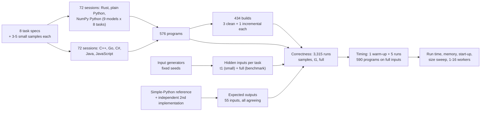
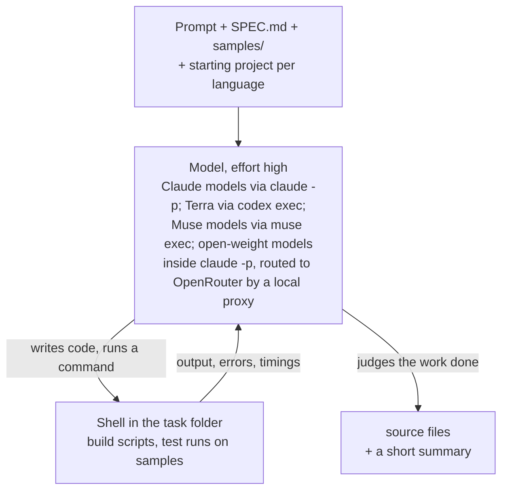
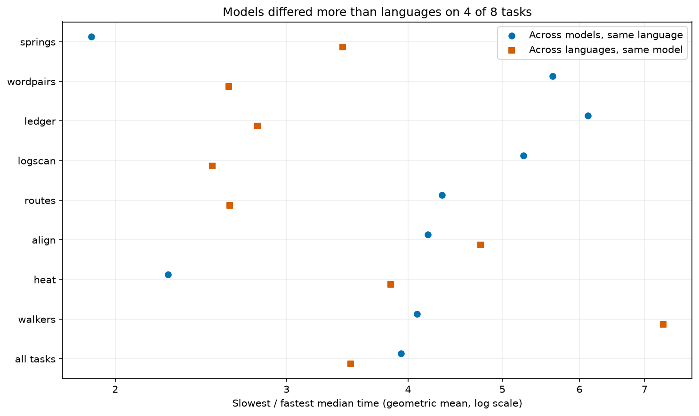
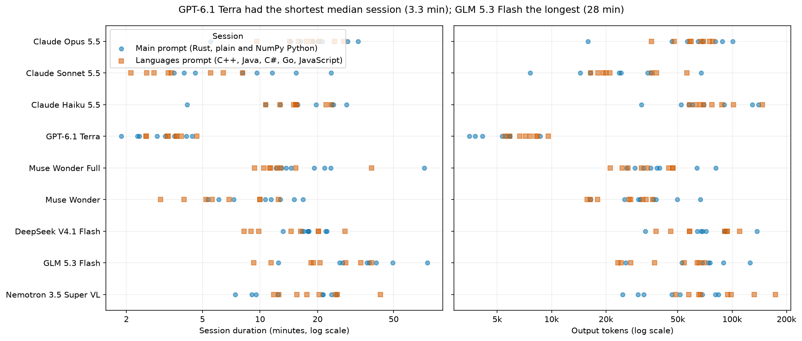

# Nine models, seven languages: how fast is the code an AI model writes?

Nine AI coding models each wrote the same eight new programs in seven languages: Rust, C++, Go, C#, Java,
JavaScript and Python, with Python written twice (with and without NumPy). All 576 programs gave the right answer.
This page measures how fast, how large in memory and how long each version was, and how much of the speed depends
on the language and how much on the model that wrote the program.

## Contents

- [A summary that runs every morning](#a-summary-that-runs-every-morning)
- [Why the same steps can take very different times](#why-the-same-steps-can-take-very-different-times)
- [Python's usual shortcut](#pythons-usual-shortcut)
- [What changes when a model writes the code](#what-changes-when-a-model-writes-the-code)
- [The question](#the-question)
- [Study summary](#study-summary)
- [How the experiment runs](#how-the-experiment-runs)
- [The eight tasks](#the-eight-tasks)
- [How each model wrote its programs](#how-each-model-wrote-its-programs)
- [How the programs were checked and timed](#how-the-programs-were-checked-and-timed)
- [Worked example: the heat task in nine versions](#worked-example-the-heat-task-in-nine-versions)
- [Results](#results)
- [Error analysis: slow choices, not wrong answers](#error-analysis-slow-choices-not-wrong-answers)
- [Limitations](#limitations)
- [What the evidence supports](#what-the-evidence-supports)
- [How the study got here](#how-the-study-got-here)
- [How to reproduce](#how-to-reproduce)
- [Run details and spend](#run-details-and-spend)
- [Future work and further reading](#future-work-and-further-reading)

## A summary that runs every morning

A web server writes one line to its access log for every request it answers: when the request arrived, which
page was asked for, whether it worked and how long the server took. A busy site writes a couple of million such
lines a day. Every morning someone wants a short summary: how many requests failed, which pages were the
busiest, and how slow the slowest answers were for each of those pages.

A short program can produce that summary. It reads the file one line at a time, checks that each line has the
expected shape, pulls out the page and the time taken, and keeps running counts. For the 2-million-line log used
in this study, a straightforward Python version takes about 7 seconds on a recent laptop.

Seven seconds is nothing for a job that runs once a day. It matters when the same work runs thousands of times: on
every file in a data pipeline, behind a dashboard, or on a cloud machine billed by the second. Memory matters in the same way, because whether a job fits in the memory of a small machine decides
whether it runs at all. The language the program is written in changes both.

## Why the same steps can take very different times

Programming languages run code in three broad ways.

Python is interpreted. A program called the interpreter reads your code and carries out each operation as it comes
to it. Before it adds two numbers it checks what kind of values they are, finds the right way to add that kind,
and creates a new object to hold the result. That flexibility makes Python quick to write, and it also means a
loop over two million log lines repeats the bookkeeping two million times.

Rust, C++ and Go are compiled ahead of time. Before the program runs, a compiler translates it into the processor's
own instructions, knowing in advance that a count is a 64-bit integer. The loop that adds up response times
becomes a few machine instructions per line. Rust and C++ leave freeing memory to the program itself; Go adds a
garbage collector, a helper that finds and frees memory the program no longer uses, which costs a little time.

Java, C# and JavaScript take a middle route. The program is first turned into a compact intermediate form. When
it starts, a virtual machine runs that form, notices which parts run most often, and compiles those parts into
machine instructions while the program runs. This is called just-in-time compilation. Long loops can then run
close to compiled speed, but the program pays to start the virtual machine and to warm it up, and all three use a
garbage collector.

Take an illustrative case, adding up a million whole numbers. Python looks up the meaning of `+` for every pair
of values and allocates a new number each time. Rust, C++ and Go keep the running total in a processor register.
Java, C# and JavaScript compile the loop after a few thousand rounds and finish at a similar pace. Nobody needs an
experiment to rank these on that loop; the useful question is how they compare on realistic work, where reading
files, splitting text and looking things up in tables also take time.

## Python's usual shortcut

Experienced Python programmers rarely write that loop. They use NumPy, a library written in C that stores a million
numbers in one compact block of memory and adds them up in one call, `values.sum()`. The loop still runs, but in
compiled code. A program written this way is still Python, yet for arithmetic on arrays it can run close to
compiled speed.

NumPy only helps when the work can be written as the same operation applied to a whole array at once. Spreading
heat across a floor plan, where every cell of a grid is updated by the same formula at each step, fits well.
Reading a line of JSON or deciding whether a log line is well formed does not: each item needs its own decisions,
and whole-array operations express decisions badly. So Python appears twice in this study, written with and
without NumPy.

## What changes when a model writes the code

The usual argument for Python and for languages with a garbage collector is that they are cheaper to write. C++
and Rust code is longer, their compilers reject more first drafts, and a developer has to know the language well
to make it fast. Teams often accept slower code because the faster version would cost too much developer time.

AI coding models change part of that calculation. Asking a model for a Rust or C++ version costs about the same as
asking for a Python version. If the model's fast-language code is correct and fast, a team gets the speed without
paying much for it. If the model writes code that is wrong, or no faster than its Python, the gain is not there.

Choosing a model is then a second decision. A team can use a large model that costs more per request, a small and
cheap one from the same company, or an open-weight model, one whose weights are published so that anyone can run
it or rent it cheaply from several hosts. All of them may write correct programs of very different speed, because
a fast program depends on choices the specification leaves open: how to read the file, what kind of table to count
words in, whether to use a general-purpose library or a few lines written for this one input format.

An illustrative case: two models are asked for the morning log summary in Go. One checks the shape of each line
with Go's regular-expression package, a general pattern matcher that is easy to get right. The other checks it by
hand, character by character, because the format is fixed. Both print the same summary. If the first takes several
times as long, the choice of model has mattered as much as the choice of language, and a comparison of languages
that used only one model would have measured that model's habits.

Published language benchmarks, built from programs that experts tuned by hand, cannot answer this. The code that
matters here is the code a model writes when it is asked.

## The question

When nine AI coding models each write the same eight programs in Rust, C++, Go, C#, Java, JavaScript and Python
(with and without NumPy), does every version give the right answer, how do the versions compare in run time,
memory, length and build time, and how much of the difference in run time comes from the language and how much
from the model that wrote the program?

The comparison uses eight tasks written for this study, so no model could have seen them or their answers before.
The nine models wrote every version of every task, 576 programs in all: three from Anthropic (Claude Opus 5.5,
Sonnet 5.5 and Haiku 5.5, from largest to smallest), one from OpenAI (GPT-6.1 Terra), two from Meta (Muse Wonder
Full and the smaller Muse Wonder), and three open-weight models (DeepSeek V4.1 Flash, GLM 5.3 Flash and Nemotron
3.5 Super). A straightforward Python solution of each task, written for clarity rather than speed, is timed as
"simple Python": what an ordinary Python program would take.

The answer bears on two decisions: which language to ask a model for, and whether a larger model buys faster
code.

## Study summary

Each model worked on each task in two agent sessions (Rust and both Pythons; the other five languages), with a
precise specification and small samples, 144 sessions in all. The programs were run on hidden inputs, including one
benchmark-sized input per task (2 million log lines, a million JSON transactions, and so on), and timed five times
each, taking turns, on one laptop.

All 576 programs and the 8 simple-Python solutions gave the exact expected output on every hidden input.
Correctness sits at its ceiling, so it separates neither the languages nor the models.

A version's relative time is its run time divided by the time of the same model's fastest version on the same
task, so 1.0 is the fastest and 2.0 twice as slow. Averaged over the eight tasks (geometric mean), every model put
the language families in the same order: Rust and C++ (1.06 to 1.98 across the nine models), Go (1.17 to 1.74), C#
(1.69 to 2.27), Java (2.34 to 2.86), JavaScript (3.04 to 3.89), NumPy Python (6.8 to 13) and plain Python (27 to
40). Rust, C++ or Go was the fastest version in all 72 task-and-model pairs.

A model speed index compares each program with the other models' programs in the same language for the same task;
1.0 is the geometric mean of the nine, and lower is faster. Claude Opus 5.5's programs were fastest, at **0.63**
(95% interval 0.55 to 0.73), and the fastest of the nine in 38 of 64 task-and-language cells. GPT-6.1 Terra's were
slowest (1.80), then Nemotron's (1.50). The other six sat between 0.83 and 1.04, with open-weight DeepSeek (0.85)
level with Claude Sonnet and Muse Wonder Full (0.83).

Among the six non-Python languages, the language explained **46%** of the run-time variation within a task and the
model **40%**. On the four tasks of text and table work (word pairs, JSON transactions, log lines, road network)
the model explained more than the language. With both Pythons included, the language explains 86%, because
Python's gap to the rest is larger than any difference between models.

In the original situation, the morning log summary took 3.4 to 5.7 s in the models' plain Python. Eight models'
fastest versions took 0.37 to 0.55 s; Terra's took 1.6 s.

The main caveat: each model wrote each program once, so one session's choice of parser or table can move a ratio
several times over, and the laptop ran other work during the timing. A difference under about 1.5 times between two
single programs is not reliable; the family order and the model index rest on dozens of programs each.

## How the experiment runs



One task travels through this as follows. The heat task's spec and samples go into two fresh folders for each
model: in the first it writes Rust and both Pythons, in the second the other five languages, testing on the
samples. The harness copies the sources out, builds every compiled version with fixed settings, and runs each
program on a hidden small input and the hidden 400 x 400-cell benchmark grid. Outputs are compared with the expected
output from the simple-Python reference, confirmed by a second implementation. Programs that pass are timed five
times on the benchmark input, taking turns with the other programs for the task; the median time is the score.

## The eight tasks

The tasks cover the kinds of work that people write scripts for, from pure arithmetic to text and record handling.
Each was written for this study on 2026-10-30, with exact rules for its input and output, so no model could have
seen the tasks, the inputs or the answers in training. The inputs are generated by code from fixed seeds.

| Task | What it computes | Kind of work | Benchmark input | Simple Python |
|---|---|---|---|---|
| springs | 4,000 masses joined by springs in a ring, moved for 15,000 steps; total energy at the end | floating-point loop | 0.4 MB | 16.4 s |
| wordpairs | how often each pair of adjacent words occurs; the 20 most common pairs | text and hash tables | 66 MB, 10 M words | 45.0 s |
| ledger | net totals per channel and account from JSON bank transactions, with exact currency conversion | parsing records | 381 MB, 1 M lines | 10.3 s |
| logscan | the morning log summary: requests by status class, busiest pages and their latency percentiles | parsing text with a pattern | 228 MB, 2 M lines | 6.7 s |
| routes | shortest road distances from 6 starting points in a road network | graph search | 300,000 nodes, 900,000 roads | 10.6 s |
| align | cheapest weighted edit from one string to another, for 300 pairs | dynamic-programming table | 60 M table cells | 13.2 s |
| heat | heat spreading across a 400 x 400 floor plan with walls and sources for 250 steps | grid arithmetic | 160,000 cells | 15.8 s |
| walkers | 64 random walks of 500,000 steps in a box, spread over several workers | parallel simulation | 32 M steps | 22.8 s |

The generators add the awkward cases a real file would contain: about 1% of log lines are malformed and must be
counted as such, and the JSON transactions contain decoy fields with the same names nested inside other objects,
escaped quotes and emoji written as escape codes. A line of the log and the start of its summary:

```
2026-10-30T14:22:05.123Z web-17 GET /api/v2/items/6929 200 1834B 10.9ms "Mozilla/5.0 (X11; Linux x86_64)"
```
```
lines 2000
malformed 40
status 2xx 1558
path /api/v2/items/{id} 227 13.4 170.0 697.9
```

The `path` line says the page template `/api/v2/items/{id}` was requested 227 times in this 2,000-line sample,
with a median latency of 13.4 ms, a 95th percentile of 170.0 ms and a maximum of 697.9 ms. Specs: [bench/tasks](bench/tasks).

## How each model wrote its programs

Each model ran as an agent: a loop in which it reads files, writes code, runs commands such as a build or a test,
reads the results and decides what to do next, until it judges the work finished.



Each model had two sessions per task, in separate folders and without access to each other: one for Rust and the
two Pythons ([prompt](bench/AUTHOR_PROMPT.md)), one for C++, Go, C#, Java and JavaScript
([prompt](bench/AUTHOR_PROMPT_LANGS.md)). Every model got the same prompts, which share their key instructions:

> Every version must print the correct output for any valid input as SPEC.md defines it, not only for the
> samples. Make each version as fast as you can. Write each one the way a skilled developer in that language
> would write fast code, using that language's own strengths. Use a single thread and a single process unless
> SPEC.md says otherwise.

The open-weight models ran inside Claude Code, the agent program that runs the Claude models, with its requests
sent through a local proxy to OpenRouter, pinned to each model's own maker's servers. Every language was limited to
its standard library plus the libraries a developer would usually reach for, downloaded in advance:

| Version | Toolchain | Build settings | Allowed beyond the standard library |
|---|---|---|---|
| Rust | rustc 1.99 | release; the model could change the release profile | serde, serde_json, regex, rayon |
| C++ | Microsoft Visual C++ 19.40 | `/O2 /GL /EHsc /std:c++20`, fixed | nlohmann/json 3.12 |
| Go | Go 1.27.3 | `go build`, fixed | nothing |
| C# | .NET 8 (SDK 8.0.427) | Release; the model could change project properties | nothing |
| Java | Java 23 (Oracle JDK) | `javac`, default JVM settings, fixed | Jackson 2.22 |
| JavaScript | Node.js 22.17 | none | nothing |
| NumPy Python | Python 3.13.5 | none | NumPy 2.2.6 |
| Plain Python | Python 3.13.5 | none | nothing |

A model's "plain Python" is Python written for speed; the simple-Python reference shows the other end.

| Model | Pinned version | Provider and how called | Size and precision | Settings | Why included |
|---|---|---|---|---|---|
| Claude Opus 5.5 | `claude-opus-5-5` | Anthropic, `claude -p` (Claude Code 2.1.296) | Not published | effort high | Anthropic's largest model |
| Claude Sonnet 5.5 | `claude-sonnet-5-5` | Anthropic, `claude -p` | Not published | effort high | Anthropic's mid-size model; an original author |
| Claude Haiku 5.5 | `claude-haiku-5-5` | Anthropic, `claude -p` | Not published | effort high | Anthropic's smallest, cheapest model |
| GPT-6.1 Terra | `gpt-6.1-terra` | OpenAI, `codex exec` (codex-cli 0.160.1) | Not published | reasoning effort high | OpenAI's model; an original author |
| Muse Wonder Full | `muse-wonder-full-1.0` | Meta, `muse exec` (Muse Code 1.4.14) | Not published | reasoning effort high | Meta's larger Muse model |
| Muse Wonder | `muse-wonder-1.0` | Meta, `muse exec` | Not published | reasoning effort high | Meta's smaller Muse model |
| DeepSeek V4.1 Flash | `deepseek/deepseek-v4.1-flash-20261017` | DeepSeek via OpenRouter, inside `claude -p` | Mixture of experts, 552B backbone (8B to 16B active) plus 196B lookup memory; mostly FP8 and 4-bit | reasoning effort high; provider pinned | Low-cost open-weight model |
| GLM 5.3 Flash | `z-ai/glm-5.3-flash-20260826` | Z.AI via OpenRouter, inside `claude -p` | Mixture of experts, 320B total, 18B active; FP8 | reasoning effort high; provider pinned | Low-cost open-weight model |
| Nemotron 3.5 Super VL | `nvidia/nemotron-3.5-super-vl-20261015` (free) | Nvidia via OpenRouter, inside `claude -p` | Mixture of experts, 120B total, 12B active; precision not stated | reasoning effort high; provider pinned | Open-weight model with a free tier |
| Claude Opus 5.5 (pilot) | `claude-opus-5-5` | Anthropic, `claude -p` | Not published | effort high | Heat in Rust and Python only, pipeline test |
| GPT-6.1 Sol (pilot) | `gpt-6.1-sol` | OpenAI, `codex exec` | Not published | reasoning effort high | Heat in Rust and Python only, pipeline test |

The closed models have no dated version names, so their pinned version is the name the command-line tool accepted;
the open-weight models are pinned by OpenRouter's dated name. Other models helped build the study but are not
measured: the specs and this text are by Claude Opus 5.5; the generators, reference and measurement scripts by
GPT-6.1 Sol and Terra; the runner for the new models and the proxy by Claude Sonnet 5.5; the figure code by Terra.

## How the programs were checked and timed

For each task a straightforward reference solution produced the expected output for every input, and a second
solution written a different way had to agree; all 55 inputs agreed. Outputs are compared field by field. A failure
would be sorted into kinds: did not build, crashed, ran out of time, wrote output that cannot be read in the
required format, or wrote readable output with a wrong value. Only the last is a wrong answer.

Every correct program ran once to warm up the disk cache and then five more times on the benchmark input, taking
turns in a shuffled order with all the other programs for the same task (73, or 79 for heat). The score is the
median of the five wall-clock times, from start to exit, including start-up, reading the input and printing.
Single-threaded programs were held to the laptop's six performance cores. Peak memory is the largest amount of
physical memory the program held at once (the peak working set), in megabytes of a million bytes.

Two ratios summarise the times. Relative time compares the versions one model wrote for one task: with a fastest
version at 0.46 s, a version taking 0.92 s has relative time 2.0. The model speed index compares the nine models'
programs for one task in one language: each program's time is divided by the geometric mean of the nine, so 0.5
means twice as fast as a typical model's program and 2.0 twice as slow. Averages over tasks use the geometric mean
(multiply the ratios and take the root), because an ordinary average lets one large ratio dominate: for ratios of
2 and 50, the ordinary average is 26, the geometric mean 10. The 95% intervals come from resampling the eight tasks
with replacement 10,000 times, so they show how much an average depends on which tasks were chosen.

## Worked example: the heat task in nine versions

The heat task describes a floor plan of 400 x 400 cells. Open cells start at 0, heat sources hold a fixed value,
and at each of 250 steps every open cell becomes `(4 * old + up + down + left + right) // 8`, where a neighbour
that is a wall, or lies outside the grid, contributes the cell's own old value. The answer is the sum of the open
cells, the hottest cell and a checksum, in exact integer arithmetic.

Claude Sonnet 5.5 used the same plan in every compiled and virtual-machine language: add a border of walls around
the grid so every cell has its neighbours at fixed distances in memory, and update the grid as one flat array with
no branches. In C++:

```cpp
for (long long i = lo; i < hi; i++) {
    b[i] = (c[i] * a[i] + ((a[i - 1] + a[i + 1] + a[i - w2] + a[i + w2]) & m[i])) >> 3;
}
```

Here `a` is the grid at the start of the step and `b` the new one, `w2` the padded row width (so `a[i - w2]` is the
cell above), `c[i]` is 4 plus the number of wall or outside neighbours (walls hold 0, so the cell's own value is
counted once for each), and `m[i]` keeps the neighbour sum for open cells and zeroes it for walls and sources.

The NumPy version does the same arithmetic on whole shifted copies of the grid. The plain-Python version, unable
to use NumPy, packs the whole grid into one Python integer, 24 bits per cell, and moves all neighbours into place
with a handful of shifts of that one huge number per step.

All nine versions printed the same `sum`, `max` and `checksum` lines on the hidden benchmark grid. Five timed runs
each gave these medians:

| Version | Median time | Relative time |
|---|---|---|
| C++ | 0.051 s | 1.0 |
| Rust | 0.054 s | 1.1 |
| C# | 0.104 s | 2.0 |
| Go | 0.109 s | 2.1 |
| Java | 0.207 s | 4.1 |
| JavaScript | 0.221 s | 4.3 |
| NumPy Python | 0.392 s | 7.7 |
| Plain Python (packed integer) | 0.867 s | 17 |
| Simple Python (reference loop) | 15.8 s | 310 |

Much of each time is start-up: an empty C++ or Rust program takes 0.03 s to start and exit here, an empty Java
program 0.11 s. The packing trick made Sonnet's plain Python 18 times faster than the simple loop. Other models
chose other plans: their C++ took 0.038 s (Opus) to 0.184 s (Nemotron), their plain Python 0.47 s (Opus, packed) to
9.8 s (GLM, a loop over cells) (see the error analysis).

## Results

### Every program gave the right answer

All 576 model-written programs, the 8 simple-Python references and the 6 pilot heat programs printed the exact
expected output on every sample, the hidden small input and the hidden benchmark input; the walkers programs gave
the same answer with 1 to 16 workers. No final program failed to build, crashed, timed out or printed unreadable
output, so there are no format failures to separate from wrong answers. This is a ceiling: the test cannot rank
models or languages on correctness, and 576 of 576 still allows a true failure rate up to about 0.5% (95% bound).

### Run time on the full inputs


Each row is a task and each marker one version, at the geometric mean of the nine models' median times, with a
line from the fastest model's program to the slowest's. The x-axis is logarithmic.

The rows show three groups. Rust, C++ and Go sit at the left, between 0.07 and 1.4 s. C#, Java and JavaScript sit
just to their right, typically 1.5 to 3 times slower. The Python versions sit far to the right: NumPy at 0.5 to 10
s, plain Python at 1.7 to 13 s and simple Python at 7 to 45 s. The lines are long: on wordpairs the nine models'
C++ ranged from 0.44 to 4.3 s, on ledger from 0.74 to 11.4 s, so the slowest model's C++ could be slower than the
fastest model's JavaScript.

### Which language was fastest


Each cell is the geometric mean over the eight tasks of a version's relative time for one model (1.0 is that
model's fastest version on each task); darker is slower, on a logarithmic scale. The simple-Python column divides
the one reference program by each model's fastest version.

| Version | Relative time, range over the nine models | Speed-up over the model's faster Python version |
|---|---|---|
| Rust | 1.11 to 1.46 | 5.6x to 9.1x |
| C++ | 1.06 to 1.98 | 3.4x to 11.8x |
| Go | 1.17 to 1.74 | 3.8x to 9.4x |
| C# | 1.69 to 2.27 | 2.9x to 6.8x |
| Java | 2.34 to 2.86 | 2.9x to 5.0x |
| JavaScript | 3.04 to 3.89 | 2.1x to 3.4x |
| NumPy Python | 6.8 to 13.3 | |
| Plain Python | 26.6 to 40.4 | |

The families separate cleanly for every model. C++ was fastest in 30 of the 72 task-and-model pairs, Rust in 29 and
Go in 13. Inside a family the order depends on the model: C++ averaged 1.06 to 1.24 for eight models and 1.98 for
Terra, whose C++ was slow on three tasks.

The right-hand column is the comparison a team would make when deciding whether to move a Python job: given the
better of the model's two Python versions, how much does each language add. It depends on the Python too: Nemotron's
gains were the largest (11.8x for C++) partly because its Python was the slowest; Terra's were the smallest (3.4x
for C++) because its C++ was.

### Language or model: which matters more

To compare the two decisions on one scale, the run times within each task were split into parts. Take the 54
programs of one task in the six non-Python languages (nine models times six languages), on a logarithmic scale so
that a doubling counts the same anywhere. Part of their spread goes with the language (every Java program slower
than every Rust one, say), part with the model (one model faster in every language), and the rest with particular
combinations and timing noise. The shares add up to 100%; the pooled row adds the parts over the eight tasks.


Each bar is one task; the bottom bar pools them. Blue is the share that goes with the language, orange the share
that goes with the model and pink the rest. The left panel uses the six non-Python languages, the right panel adds
NumPy and plain Python.

Among the six languages, the language explained 46% of the variation within a task and the model 40%, with 14%
left over. The tasks split into two kinds. Where the work is arithmetic, the language decided: springs 84% language
against 7% model, heat 72% against 12%, walkers 61% against 29%, align 60% against 22%. Where the work is reading
text and looking things up in tables, the model decided: wordpairs 11% against 70%, ledger 17% against 60%, logscan
28% against 61%, routes 31% against 59%. There a model's choice of parser and table carried across its six
languages. An unweighted average of the per-task shares gives the same split. With both Pythons included, the
language explained 86% and the model 8%, which says only that Python is far slower than the other six.



The second figure shows the contrast as ratios. A blue circle is how many times slower the slowest model's program
was than the fastest in one language, averaged (geometrically) over the six languages; an orange square is how many
times slower a model's slowest language was than its fastest, averaged over the models. Across models the ratio
averaged 2.9 (Java) to 6.1 (C++) per language; across languages it was 3.1 to 4.1 per model. The widest of nine
programs is wider than the widest of six, so this view favours the model somewhat; the split above does not.

### Which model wrote the fastest code


Each point is a model's speed index over its 64 programs (eight tasks times eight versions), with a 95% interval
from resampling tasks. The dashed line at 1.0 is a typical model; the grey band marks the open-weight models; the
x-axis is logarithmic.

| Model | Speed index (95% interval) | Fastest of nine | Slowest of nine |
|---|---|---|---|
| Claude Opus 5.5 | 0.63 (0.55 to 0.73) | 38 | 0 |
| Claude Sonnet 5.5 | 0.83 (0.75 to 0.91) | 7 | 1 |
| Muse Wonder Full | 0.83 (0.72 to 0.92) | 8 | 2 |
| DeepSeek V4.1 Flash | 0.85 (0.77 to 0.94) | 5 | 0 |
| Claude Haiku 5.5 | 0.96 (0.87 to 1.05) | 0 | 7 |
| Muse Wonder | 1.00 (0.88 to 1.13) | 5 | 3 |
| GLM 5.3 Flash | 1.04 (0.94 to 1.17) | 1 | 2 |
| Nemotron 3.5 Super VL | 1.50 (1.32 to 1.73) | 0 | 21 |
| GPT-6.1 Terra | 1.80 (1.46 to 2.21) | 0 | 28 |

The last two columns count the 64 task-and-version cells in which the model's program was the fastest or the
slowest of the nine. Opus's programs took about two thirds of a typical model's time and were never the slowest.
Terra and Nemotron wrote 49 of the 64 slowest programs. The six models in the middle have overlapping intervals,
and their order could change in a second set of sessions.


By version, Opus had the lowest index in all eight, from 0.54 (C#) to 0.70 (Java), so its lead was not one
language's. Terra's was highest in C++ (2.9), Go (2.2) and C# (2.1), where it used general libraries for parsing.
Within a company the larger model wrote faster code: Opus (0.63), Sonnet (0.83), Haiku (0.96); Wonder Full (0.83),
Wonder (1.00). Across companies, size and openness did not sort the models: open-weight DeepSeek was level with
Sonnet, while Terra, a closed model, was slowest.

### Longer sessions did not buy faster code



Each dot is one session (circles: Rust and Python; squares: the other languages): duration on the left, tokens
the model wrote on the right.

| Model | Median session | Median tool calls | Output tokens | Cost |
|---|---|---|---|---|
| Claude Opus 5.5 | 19 min | 59 | 1.01 M | USD 40 (list price) |
| Claude Sonnet 5.5 | 5.1 min | 19 | 0.45 M | USD 7.9 (list price) |
| Claude Haiku 5.5 | 15 min | 47 | 1.30 M | USD 2.7 (list price) |
| GPT-6.1 Terra | 3.3 min | 11 | 0.10 M | Codex subscription |
| Muse Wonder Full | 13 min | 40 | 0.62 M | Muse subscription |
| Muse Wonder | 8.6 min | 36 | 0.50 M | Muse subscription |
| DeepSeek V4.1 Flash | 17 min | 62 | 1.21 M | USD 8.0 (OpenRouter) |
| GLM 5.3 Flash | 28 min | 66 | 0.88 M | USD 2.2 (OpenRouter) |
| Nemotron 3.5 Super VL | 19 min | 101 | 1.16 M | USD 0 (free tier) |


The scatter plots each model's median session length against its speed index. The rank correlation across the nine
models is 0.02, no relation: Opus spent 19 minutes per session and wrote the fastest code, Nemotron as long with the
most tool calls and wrote nearly the slowest, and GLM had the longest sessions and a middling index. For Terra, little
effort and slow code went together: the shortest sessions, the fewest tokens and the shortest code (127 kB over 64
programs, against 304 to 448 kB). Opus cost five times as
much as Sonnet for programs about a quarter faster; DeepSeek matched Sonnet's speed at about the same price.

### Start-up cost


Each bar is the median of 20 runs of a program that prints one word and exits, which measures what a runtime costs
before it does any work: 0.027 s and 4.5 MB for Rust, 0.028 s and 4.0 MB for C++, 0.030 s and 6.0 MB for Go,
0.079 s and 27 MB for Node.js, 0.083 s and 22 MB for .NET, 0.10 s and 14 MB for Python, 0.11 s and 42 MB for Java,
and 0.26 s and 26 MB for Python that imports NumPy. Windows starts processes more slowly than Linux; the order would
be the same there.

### Memory


The layout matches the run-time figure, with peak memory in megabytes on a logarithmic x-axis. Relative to each
model's smallest version on each task (geometric mean over tasks), C++ needed 1.0 to 2.2 times the smallest, Rust
1.1 to 2.1, Go 1.5 to 3.2, C# 3.2 to 6.0, JavaScript 4.0 to 8.2, Java 5.7 to 11, plain Python 3.7 to 6.6 and NumPy
Python 4.2 to 9.6. On small-data tasks the difference is mostly the runtime itself; on large ones it is how data is
stored: the plain-Python wordpairs programs, holding about 4 million word pairs as Python objects, peaked at 0.8 to
1.8 GB, the C++ ones at 0.14 to 0.27 GB. Java lets its heap grow before collecting garbage.

### Small inputs and start-up time


Wordpairs, routes and heat were also run at 1/256, 1/64, 1/16 and 1/4 of the benchmark size, three timed runs each.
In each panel both axes are logarithmic and each line is one version (geometric mean of the nine models).

At 1/256 of the benchmark size the order follows the start-up costs: relative to Rust, C++ and Go took about the
same time, C# 2.5 to 3.0 times, JavaScript 2.7 to 2.8, plain Python 3.3 to 3.9, Java 4.2 to 4.5 and NumPy Python 6.9
to 8.7. As inputs grow, the virtual machines' start-up is spread over more work and they close in (C# to 1.3 to 1.9
times Rust at full size, Java to 1.4 to 3.2), while plain Python falls behind (to 12 to 25 times). For a script
that handles small files, start-up time can matter more than the language's speed.

### More cores


The walkers task splits the walks over a given number of workers. The left panel shows median run time against
workers (log scale), the right panel each version's speed-up over its own one-worker time (geometric mean over
models), with the dotted diagonal as a perfect speed-up.

Standard Python cannot run Python code on several cores in one process, so the models started one process per
worker, and plain Python ran 5.3 times faster with 16 workers than with one. The other languages used threads and
gained 2.3 to 3.8 times, less because their one-worker times (0.05 to 1.4 s) were close to their start-up floors;
Java did not gain (0.28 s with one worker, 0.33 s with sixteen). Even with 16 processes, plain Python (2.1 s) stayed
slower than every model's single-threaded C++, Rust and Go.

### Code size and build time


The left panel shows the total source size over the eight tasks per version and model, in kilobytes (line counts
would mislead, because some models wrote several statements per line). The right panel shows clean build times per
program, with the median marked.

Terra wrote the least code, 127 kB over its 64 programs, and Opus the most, 448 kB; the others wrote 304 to 404 kB.
Much of the extra length is hand-written parsing and hash tables, where much of the speed came from, though length
alone did not make code fast (Haiku and DeepSeek wrote more than Sonnet for slower or equal code). A clean build
took a median of 1.1 s for Java, 3.1 s for Rust (up to 22 s when the JSON or pattern libraries were compiled too),
3.5 s for C++, 4.4 s for C# and 5.0 s for Go, whose rebuild after a one-line change took 0.2 s.

## Error analysis: slow choices, not wrong answers

No program gave a wrong answer, so this section looks at correct programs that were much slower than they needed
to be: the largest gaps between models in one language for one task (5 to 22 times), plus one where NumPy made a
program slower. Explanations come from reading the programs; causes not tested separately are marked.

**Plain-Python heat: six models packed the grid, three looped over cells.** Opus, Sonnet, Haiku, both Muse models
and DeepSeek packed the floor plan into one large integer and moved every cell with a few shifts per step, as in the
worked example: 0.47 to 1.05 s. Terra, GLM and Nemotron updated each of the 160,000 cells in a Python loop for 250
steps: 6.8, 9.8 and 6.1 s. Theirs is the program most people would write; packing pays only in Python, where one
operation on a huge integer runs in compiled code.

**Ledger: a general JSON library against a scanner for the format.** Terra's C++ ledger took 11.4 s, its Go 7.2 s
and its JavaScript 10.1 s; the other models took 0.72 to 1.10 s in C++, 0.72 to 1.97 s in Go and 1.19 to 2.23 s in
JavaScript, except Nemotron's JavaScript (8.4 s). Terra's C++ builds a full nlohmann/json tree for each of the
million lines, its Go decodes each line into a map and then each field again with Go's reflection-based
`encoding/json`, and its JavaScript, like Nemotron's, calls `JSON.parse` per line and does every amount in `BigInt`
arithmetic. The others wrote byte-level scanners that read only the fields the task needs. This one choice is most
of the model share on ledger.

**NumPy that made parsing slower.** Haiku's NumPy ledger took 24.4 s and its NumPy logscan 14.1 s, three times its
own plain Python (7.8 and 4.6 s). The NumPy ledger is 310 lines that look for JSON fields with whole-array operations
over the raw bytes, with a fallback to the `json` module; the plain one is 52 lines around `json.loads`. Per-line
parsing decisions do not fit whole-array operations. The other models' NumPy ledgers (7.3 to 10.4 s) were no faster
than their plain Python either.

**Walkers in Rust: the same generator, eight times apart.** Muse Wonder Full's Rust took 0.044 s and Muse Wonder's
0.376 s. Both run the task's SplitMix64 random number generator, two multiplications per step that must happen in
order. Wonder Full stepped four walkers in one loop, so the processor could work on four independent chains at
once, and wrote the step without branches; its comments say why. Wonder stepped one walker at a time and picked the
direction with a four-way `match`, a branch the processor cannot predict on random data, as did four other models
(0.33 to 0.35 s). Which change did more was not measured.

**Walkers in NumPy: a wrong belief in a comment.** Nemotron's NumPy walkers took 16.7 s, against 0.78 s for Opus's.
It moved all 64 walkers one step at a time, so its Python loop ran 500,000 times over arrays of 64 numbers, with
about 30 NumPy calls per step. Its docstring says the random stream "is inherently sequential per walker". It is not: SplitMix64's state after k steps is the seed plus k times a constant, so all of a walker's random
numbers can be computed at once, which Opus's version did.

**Walkers in plain Python: 2.9 s against 18 to 24 s.** Opus's plain Python made 4,096 random numbers at a time by
packing their states into one large integer, and while a walker was far from every wall and from the origin, it
only counted how many of the next steps went each way. Five models wrote the direct loop (17.6 to 24.1 s, about the
simple reference's 22.8 s).

**Terra's other slow choices.** On wordpairs its C++ (4.3 s) used the standard `std::unordered_map`, built from
linked nodes, where the other eight wrote flat tables (0.44 to 1.9 s). On logscan its Go matched every line against
one long regular expression (3.7 s); the others checked the format by hand (0.37 to 0.57 s). Its align C++ (0.58 s
against 0.046 to 0.12 s) has no cause found.

These cases are the model share in the split above: on the text and table tasks one parsing or table choice moved
a model's programs in every language at once.

## Limitations

- One program per model, language and task. A second session might choose a different parser, table or loop and
  change a ratio several times over. The family order held for every model; the six middle models did not separate
  beyond their intervals.
- The models were asked for speed, so their plain Python is faster than ordinary Python.
- Different agent programs. The Claude models ran in Claude Code, Terra in Codex and the Muse models in Muse Code,
  each the maker's own tool. The open-weight models ran inside Claude Code through a proxy, a tool built for other
  models, which may suit them less well.
- Harness failures. 55 sessions ended for reasons outside the model (a C++ build script broken by an overlong PATH,
  a free tier's daily limit, credits running out, the laptop sleeping) and were run again from scratch; the failed
  runs are kept. One GLM session reached the 75-minute limit and was measured as written.
- One machine and fixed settings: Windows, an Intel Core Ultra 9 laptop on mains power, MSVC, .NET 8, Java 23 with
  default settings. Other programs, chiefly file synchronisation, kept a median of 9.7 of the 22 logical processors
  busy during the timing, and the median variation between a program's five repeats was 9 to 14% per language. The
  shuffled order spreads this load over all versions but widens the noise for single programs.
- Correctness at a ceiling: this test cannot say how often each model's code is wrong on harder or vaguer tasks.
- Who wrote the study. The specs are by Claude Opus 5.5, the fastest model here, and the generators by GPT-6.1 Sol;
  a spec's wording could suit one company's models. The measurement plan, the speed index and the language-and-model
  split were set before the final timing. How the split is pooled over tasks was changed after the results were
  seen, from a fit that put task-specific differences into the remainder (37% language, 26% model) to the sum over
  tasks; both are in the saved results. The run history is in [data/PROTOCOL.md](data/PROTOCOL.md).

## What the evidence supports

For a job that runs often enough for seconds to matter, ask the model for Rust, C++ or Go. Every one of the nine
models wrote its fastest version in one of these three, three to twelve times faster than its best Python, with a
build of a few seconds. C# and Java were two to seven times faster than Python but used as much memory or more;
JavaScript was two to three times faster.

For arithmetic, the language is most of the decision. For parsing text and looking things up in tables, the model
matters as much: the same language ran up to 15 times slower in one model's hands than in another's, so checking
which parser and table a model chose is worth more than switching languages. The largest model of each company
wrote its fastest code, and Claude Opus 5.5 led clearly; open-weight DeepSeek matched the mid-priced closed models.
The open question is how stable these model differences are across repeated sessions.

## How the study got here

A pilot ran the heat task in Rust and Python with the models first planned, Claude Opus 5.5 and GPT-6.1 Sol. To save
subscription quota, Claude Sonnet 5.5 and GPT-6.1 Terra then wrote Rust and Python for all tasks on 2026-10-30 and
the other five languages on 2026-11-03. Seven more models wrote everything from 2026-11-05 to 2026-11-07 with the
same prompts. A first timing of two tasks ran on battery power, 1.6 to 2.5 times slower, so every program was timed
again in one sitting on mains power on 2026-11-08, with a guard that discards any run during which the machine slept
or lost power (none did). All numbers here come from that sitting.

## How to reproduce

The notebook [39_rust_vs_python.ipynb](39_rust_vs_python.ipynb) reads only the saved results in `data/` and makes
no model calls and no timing runs. To regenerate everything, run these from this folder on Windows with Python
3.13, NumPy 2.2 and the toolchains in the table above, on mains power (the measurement takes about five hours):

```bash
python -X utf8 -m bench.generate
python -X utf8 -m bench.reference all
python -X utf8 -m bench.sessions run-all --kind main
python -X utf8 -m bench.sessions run-all --kind langs
python -X utf8 -m bench.measure all
python -m nbconvert --to notebook --execute --inplace 39_rust_vs_python.ipynb
```

The session commands skip any session whose saved programs match its request hash, so with the committed
`data/programs/` they make no model calls; new sessions need the `claude`, `codex` and `muse` tools and an
`OPENROUTER_API_KEY`. Toolchain paths can be set with `NB39_VCVARS`, `NB39_JAVA`, `NB39_DOTNET`, `NB39_GO` and
`NB39_NODE`; large inputs and builds go to `%USERPROFILE%
b-work9-rust-vs-python` or `NB39_WORK`.

## Run details and spend

- Sessions: 144 kept (16 per model) and 2 pilot sessions. Kept-session costs: Opus USD 40, Sonnet USD 7.9 and Haiku
  USD 2.7 (Claude Code list-price estimates on a subscription), DeepSeek USD 8.0 and GLM USD 2.2 (OpenRouter
  charges), Nemotron free, Terra and the Muse models on subscriptions. The 55 sessions ended by harness failures
  cost USD 17.3 more. All sessions together: 595 M input tokens (501 M read from cache) and 10.6 M output tokens.
- Measurement: 434 builds (three clean and one incremental each), 3,315 correctness runs (kept from earlier passes
  where a program's source and build were unchanged), and on 2026-11-08 from 05:40 to 10:37 UTC 2,950 timed runs,
  2,700 size-sweep runs, 1,095 scaling runs and 160 start-up runs, all correct; the power guard discarded none.
- Machine: Intel Core Ultra 9 185H (6 performance cores with two threads each, 10 efficiency cores), 34 GB RAM,
  Windows 11 build 26300, mains power, "Silent" power plan.
- Files: programs and session logs in [data/programs](data/programs) and [data/sessions](data/sessions), failed
  sessions in [data/failed_sessions](data/failed_sessions), results in [data/results](data/results), the harness in
  [bench](bench).

## Future work and further reading

### Future work

- Several sessions per model and task, to show how much of the 40% model share is the model and how much one
  session's choice; the ledger and walkers gaps of 8 to 15 times are the cases to repeat first.
- Steer the parser: repeat ledger, logscan and wordpairs with a prompt that names the approach (scan bytes, no
  general JSON tree, a flat hash table) and measure how much of the model share one sentence removes.
- Ask for clear code instead of fast code; the 18x gap between Sonnet's packed-integer heat and the simple loop
  suggests the instruction changes Python results most.
- Run each open-weight model in its maker's own agent tool, where one exists, against the same model in Claude Code.
- Re-time the saved programs on an idle Linux machine with Clang or GCC, .NET 10, a tuned Java heap, Bun, PyPy and
  free-threaded Python; no new sessions are needed.

### Further reading

Links checked on 2026-10-30.

- [EffiBench: Benchmarking the Efficiency of Automatically Generated Code](https://arxiv.org/abs/2402.02037)
  (Huang et al., 2024). Run time and memory of code from 42 models on LeetCode problems, in one language.
- [Mercury: A Code Efficiency Benchmark for Code Large Language Models](https://arxiv.org/abs/2402.07844)
  (Du et al., 2024). Scores the speed of model-written Python together with its correctness.
- [Learning Performance-Improving Code Edits](https://arxiv.org/abs/2302.07867) (Shypula et al., 2023). Trains
  models to make C++ programs faster, the step after measuring their first versions.
- [Energy efficiency across programming languages: how do energy, time, and memory relate?](https://doi.org/10.1145/3136014.3136031)
  (Pereira et al., 2017). Run time, memory and energy of 27 languages on expert-written programs.
- [The Computer Language Benchmarks Game](https://benchmarksgame-team.pages.debian.net/benchmarksgame/). Expert-tuned
  programs in many languages, for seeing how far model-written code is from tuned code.
- [Array programming with NumPy](https://doi.org/10.1038/s41586-020-2649-2) (Harris et al., 2020). How NumPy's
  arrays work, and why NumPy helped on the numeric tasks and not on parsing.
