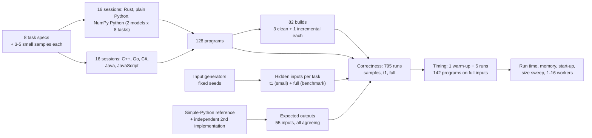
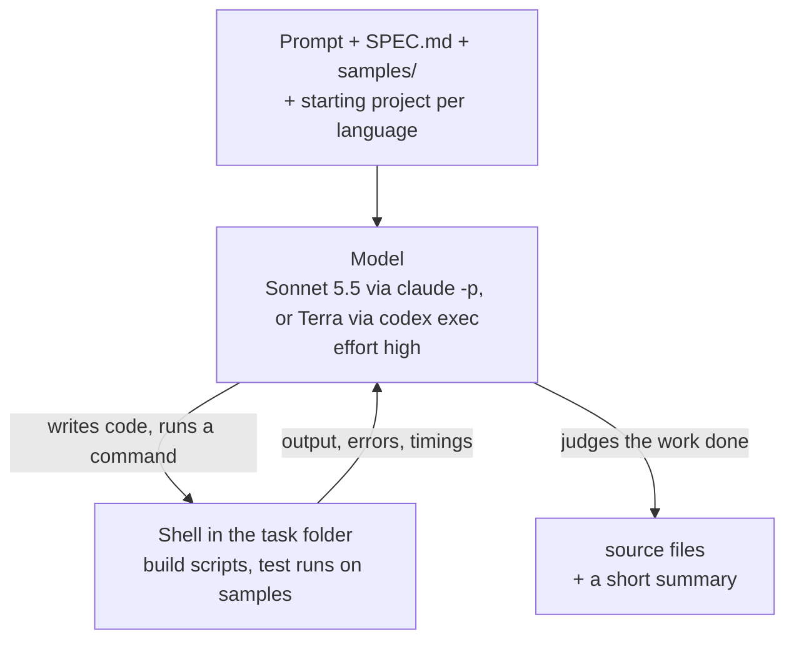
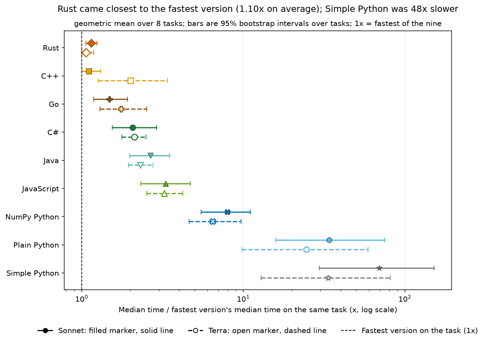
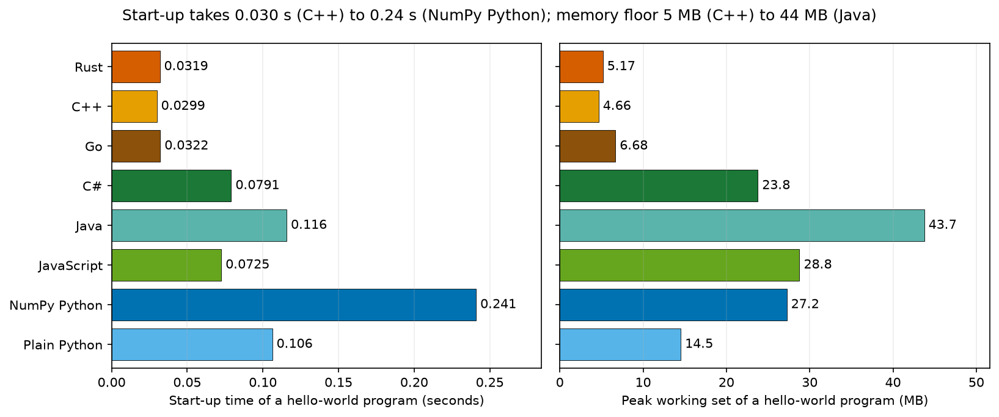

# Seven languages: how fast is the code an AI model writes?

Two AI coding models each wrote eight new programs in seven languages: Rust, C++, Go, C#, Java, JavaScript and
Python, with Python written twice (with and without NumPy). Every program gave the right answer. This page
measures how fast, how large in memory and how long each version was, and what decides the gaps.

## Contents

- [A summary that runs every morning](#a-summary-that-runs-every-morning)
- [Why the same steps can take very different times](#why-the-same-steps-can-take-very-different-times)
- [Python's usual shortcut](#pythons-usual-shortcut)
- [What changes when a model writes the code](#what-changes-when-a-model-writes-the-code)
- [The question](#the-question)
- [Study summary](#study-summary)
- [How the experiment runs](#how-the-experiment-runs)
- [The eight tasks](#the-eight-tasks)
- [How each model wrote its programs](#how-each-model-wrote-its-programs)
- [How the programs were checked and timed](#how-the-programs-were-checked-and-timed)
- [Worked example: the heat task in nine versions](#worked-example-the-heat-task-in-nine-versions)
- [Results](#results)
- [Error analysis: slow choices, not wrong answers](#error-analysis-slow-choices-not-wrong-answers)
- [Limitations](#limitations)
- [What the evidence supports](#what-the-evidence-supports)
- [How the study got here](#how-the-study-got-here)
- [How to reproduce](#how-to-reproduce)
- [Run details and spend](#run-details-and-spend)
- [Future work and further reading](#future-work-and-further-reading)

## A summary that runs every morning

A web server writes one line to its access log for every request it answers: when the request arrived, which
page was asked for, whether it worked and how long the server took. A busy site writes a couple of million such
lines a day. Every morning someone wants a short summary: how many requests failed, which pages were the
busiest, and how slow the slowest answers were for each of those pages.

A short program can produce that summary. It reads the file one line at a time, checks that each line has the
expected shape, pulls out the page and the time taken, and keeps running counts. For the 2-million-line log used
in this study, a straightforward Python version takes about 5 seconds on a recent laptop.

Five seconds is nothing for a job that runs once a day. It matters when the same work runs thousands of times: on
every file in a data pipeline, behind a dashboard that someone is waiting on, or on a cloud machine billed by the
second. Memory matters in the same way, because whether a job fits in the memory of a small machine decides
whether it runs at all. The language the program is written in changes both.

## Why the same steps can take very different times

Programming languages run code in three broad ways.

Python is interpreted. A program called the interpreter reads your code and carries out each operation as it comes
to it. Before it adds two numbers it checks what kind of values they are, finds the right way to add that kind,
and creates a new object to hold the result. That flexibility makes Python quick to write, and it also means a
loop over two million log lines repeats the bookkeeping two million times.

Rust, C++ and Go are compiled ahead of time. Before the program runs, a compiler translates it into the processor's
own instructions, knowing in advance that a count is a 64-bit integer. The loop that adds up response times
becomes a few machine instructions per line. Rust and C++ leave freeing memory to the program itself; Go adds a
garbage collector, a helper that finds and frees memory the program no longer uses, which costs a little time.

Java, C# and JavaScript take a middle route. The program is first turned into a compact intermediate form. When
it starts, a virtual machine runs that form, notices which parts run most often, and compiles those parts into
machine instructions while the program runs. This is called just-in-time compilation. Long loops can then run
close to compiled speed, but the program pays to start the virtual machine and to warm it up, and all three use a
garbage collector.

Take an illustrative case, adding up a million whole numbers. Python looks up the meaning of `+` for every pair
of values and allocates a new number each time. Rust, C++ and Go keep the running total in a processor register
from the first step. Java, C# and JavaScript start out slower, then compile the loop after it has run a few
thousand times and finish at a similar pace. Nobody needs an experiment to rank these on that loop. The useful
question is how they compare on realistic work, where reading files, splitting text and looking things up in
tables also take time.

## Python's usual shortcut

Experienced Python programmers rarely write that loop. They use NumPy, a library written in C that stores a million
numbers in one compact block of memory and adds them up in one call, `values.sum()`. The loop still runs, but in
compiled code. A program written this way is still Python, yet for arithmetic on arrays it can run close to
compiled speed.

NumPy only helps when the work can be written as the same operation applied to a whole array at once. Spreading
heat across a floor plan, where every cell of a grid is updated by the same formula at each step, fits well.
Reading a line of JSON or deciding whether a log line is well formed does not: each item needs its own decisions,
and whole-array operations express decisions badly. So Python appears twice in this study, written with and
without NumPy.

## What changes when a model writes the code

The usual argument for Python and for languages with a garbage collector is that they are cheaper to write. C++
and Rust code is longer, their compilers reject more first drafts, and a developer has to know the language well
to make it fast. Teams often accept slower code because the faster version would cost too much developer time.

AI coding models change part of that calculation. Asking a model for a Rust or C++ version costs about the same as
asking for a Python version. If the model's fast-language code is correct and fast, a team gets the speed without
paying much for it. If the model writes code that is wrong, or no faster than its Python, the gain is not there.
Published language benchmarks, built from programs that experts tuned by hand, cannot answer this. The code that
matters here is the code a model writes when it is asked.

## The question

When an AI coding model writes the same program in Rust, C++, Go, C#, Java, JavaScript and Python (with and
without NumPy), how do the versions compare in run time, memory, length and build time, how much of the gap does
NumPy close, and does each version still give the right answer?

The comparison uses eight tasks written for this study, so no model could have seen them or their answers before.
Two models wrote every version of every task: Claude Sonnet 5.5 and GPT-6.1 Terra, 128 programs in all. A
straightforward Python solution of each task, written for clarity rather than speed, is timed as a ninth version
called "simple Python". It shows what an ordinary Python program would take.

## Study summary

**What was compared.** Each model worked on each task in two agent sessions, one for Rust and both Pythons and one
for C++, Go, C#, Java and JavaScript, with the toolchains, a precise specification and small sample inputs with
their expected outputs. The programs were then run on hidden inputs, including one benchmark-sized input per task
(2 million log lines, a million JSON transactions, a 300,000-node road network, and so on), and timed five times
each, taking turns, on one laptop.

**Correctness.** All 128 programs and the 8 simple-Python solutions gave the exact expected output on every hidden
input. Correctness sits at its ceiling, so it cannot separate the languages or the models.

**Speed.** For each task and model, a version's relative time is its run time divided by the time of that model's
fastest version on the same task, so 1.0 is the fastest and 2.0 twice as slow. Averaged over the eight tasks
(geometric mean), the order was the same for both models: Rust and C++ first (1.1 for Sonnet's; 1.1 and 2.0 for
Terra's), then Go (1.5 and 1.8), C# (2.1 and 2.1), Java (2.7 and 2.3) and JavaScript (3.3 and 3.3), with NumPy
Python at 8.0 and 6.5 and plain Python at 34 and 25. Rust or C++ was fastest on every one of the 16 task-and-model
pairs except Sonnet's ledger, where Go won.

**Against Python.** Against the faster of each model's two Python versions, the ahead-of-time compiled languages
were 3 to 7 times faster, the virtual-machine languages 2 to 4 times faster. NumPy closed most of the gap on
numeric tasks and none of it on parsing JSON or log lines.

**Memory and start-up.** C++, Rust and Go needed the least memory, about 4 to 7 MB for an empty program and 1.0
to 1.7 times the smallest version on each task. Java needed 5 to 9 times the smallest, as much as Python or more.
Starting an empty program took 0.03 seconds in C++, Rust and Go, 0.07 to 0.12 seconds in JavaScript, C#, Python and
Java, and 0.24 seconds for Python that loads NumPy.

**In the original situation.** The morning log summary took 3.2 to 4.3 seconds in the models' Python versions,
0.4 to 0.8 seconds in Sonnet's six other languages and 1.3 to 3.4 seconds in Terra's. Moving such a job from
Python to the model's fastest language cut its time three to eight times; which model wrote it mattered almost as
much as the language.

**Main caveat.** Each model wrote each program once, on one Windows laptop that was also running other work during
the timing. The ranking of language families is consistent across tasks and models; differences of less than
about 30% between two programs, or between two languages in the same family, are not reliable.

## How the experiment runs



One task travels through this as follows. The heat task's spec and samples go into two fresh folders for each
model. In the first, the model writes Rust and both Pythons; in the second, C++, Go, C#, Java and JavaScript. It
builds and tests each version on the samples and stops. The harness copies the source files out, builds every
compiled version with fixed settings, and runs each program on a hidden small input and on the hidden 400 x
400-cell benchmark grid. Each output is compared with the expected output, computed by the simple-Python reference
and confirmed by a second, independently written implementation. Programs that pass are timed five times on the
benchmark input, taking turns with all the other programs for the same task, and the median time is the score.

## The eight tasks

The tasks cover the kinds of work that people write scripts for, from pure arithmetic to text and record handling.
Each was written for this study on 2026-10-30, with exact rules for its input and output, so no model could have
seen the tasks, the inputs or the answers in training. The inputs are generated by code from fixed seeds.

| Task | What it computes | Kind of work | Benchmark input | Simple Python |
|---|---|---|---|---|
| springs | 4,000 masses joined by springs in a ring, moved for 15,000 steps; total energy at the end | floating-point loop | 0.4 MB | 12.9 s |
| wordpairs | how often each pair of adjacent words occurs; the 20 most common pairs | text and hash tables | 66 MB, 10 M words | 36.4 s |
| ledger | net totals per channel and account from JSON bank transactions, with exact currency conversion | parsing records | 381 MB, 1 M lines | 7.3 s |
| logscan | the morning log summary: requests by status class, busiest pages and their latency percentiles | parsing text with a pattern | 228 MB, 2 M lines | 5.0 s |
| routes | shortest road distances from 6 starting points in a road network | graph search | 300,000 nodes, 900,000 roads | 8.5 s |
| align | cheapest weighted edit from one string to another, for 300 pairs | dynamic-programming table | 60 M table cells | 10.4 s |
| heat | heat spreading across a 400 x 400 floor plan with walls and sources for 250 steps | grid arithmetic | 160,000 cells | 14.1 s |
| walkers | 64 random walks of 500,000 steps in a box, spread over several workers | parallel simulation | 32 M steps | 19.1 s |

The generators add the awkward cases a real file would contain. About 1% of log lines are malformed (truncated,
lower-case methods, a latency missing its decimal) and must be counted as such; the JSON transactions contain decoy
fields with the same names nested inside other objects, escaped quotes and emoji written as escape codes. A line of
the log and the start of its expected summary look like this:

```
2026-10-30T14:22:05.123Z web-17 GET /api/v2/items/6929 200 1834B 10.9ms "Mozilla/5.0 (X11; Linux x86_64)"
```
```
lines 2000
malformed 40
status 2xx 1558
path /api/v2/items/{id} 227 13.4 170.0 697.9
```

The `path` line says the page template `/api/v2/items/{id}` (any numeric item id) was requested 227 times in this
2,000-line sample, with a median latency of 13.4 ms, a 95th percentile of 170.0 ms and a maximum of 697.9 ms. The
full specs are in [bench/tasks](bench/tasks), and the samples with their expected outputs in
[data/samples](data/samples).

## How each model wrote its programs

Each model ran as an agent: a loop in which it reads files, writes code, runs commands such as a build or a test,
reads the results and decides what to do next, until it judges the work finished.



Each model had two sessions per task, in separate folders and without access to each other: one for Rust and the
two Pythons ([prompt](bench/AUTHOR_PROMPT.md)), one for C++, Go, C#, Java and JavaScript
([prompt](bench/AUTHOR_PROMPT_LANGS.md)). The prompts share their key instructions:

> Every version must print the correct output for any valid input as SPEC.md defines it, not only for the
> samples. Make each version as fast as you can. Write each one the way a skilled developer in that language
> would write fast code, using that language's own strengths. Use a single thread and a single process unless
> SPEC.md says otherwise.

Every language was limited to its standard library plus the libraries a developer would usually reach for when the
standard library lacks JSON or patterns, downloaded in advance so builds work offline:

| Version | Toolchain | Build settings | Allowed beyond the standard library |
|---|---|---|---|
| Rust | rustc 1.99 | release; the model could change the release profile | serde, serde_json, regex, rayon |
| C++ | Microsoft Visual C++ 19.40 | `/O2 /GL /EHsc /std:c++20`, fixed | nlohmann/json 3.12 |
| Go | Go 1.27.3 | `go build`, fixed | nothing |
| C# | .NET 8 (SDK 8.0.427) | Release; the model could change project properties | nothing |
| Java | Java 23 (Oracle JDK) | `javac`, default JVM settings, fixed | Jackson 2.22 |
| JavaScript | Node.js 22.17 | none | nothing |
| NumPy Python | Python 3.13.5 | none | NumPy 2.2.6 |
| Plain Python | Python 3.13.5 | none | nothing |

Asking for the fastest version matters for reading the results. A model's "plain Python" is Python written for
speed, which can be far from Python written in a hurry; the simple-Python reference shows the other end.

| Model | Pinned version | Provider and how called | Size and precision | Settings | Why included |
|---|---|---|---|---|---|
| Claude Sonnet 5.5 | `claude-sonnet-5-5` (reported in each session log); Claude Code 2.1.296 | Anthropic, `claude -p --safe-mode` with tools Bash, Read, Write, Edit, Glob, Grep | Not published | effort high | Anthropic's coding model for all 32 sessions; replaced Opus 5.5 to save subscription quota |
| GPT-6.1 Terra | `gpt-6.1-terra` (Codex logs do not report a model string); codex-cli 0.160.1 | OpenAI, `codex exec --ephemeral --ignore-user-config`, workspace-write sandbox | Not published | reasoning effort high | OpenAI's model for the same 32 sessions; replaced Sol for the same reason |
| Claude Opus 5.5 | `claude-opus-5-5`; Claude Code 2.1.296 | Anthropic, `claude -p` as above | Not published | effort high | Heat task in Rust and Python only, from the first test of the pipeline: a larger Anthropic model for comparison |
| GPT-6.1 Sol | `gpt-6.1-sol`; codex-cli 0.160.1 | OpenAI, `codex exec` as above | Not published | reasoning effort high | Heat task in Rust and Python only, from the first test of the pipeline: a larger OpenAI model for comparison |

The models have no dated version names, so the pinned version is the model name the command-line tool accepted,
with the tool's version. Other models helped build the study but are not measured: the task specs and this text
are by Claude Opus 5.5; the input generators, the simple-Python reference and the measurement scripts by GPT-6.1
Sol and GPT-6.1 Terra; the notebook's figure code by GPT-6.1 Terra and Claude Sonnet 5.5.

## How the programs were checked and timed

**Correct answers.** For each task a straightforward reference solution produced the expected output for every
input, and a second solution written a different way had to agree before the input was used; all 55 inputs agreed.
A program's output is compared field by field with the expected output. A failure would be sorted into one of
several kinds: the program did not build, crashed, ran out of time, wrote output that cannot be read in the
required format, or wrote readable output with a wrong value. Only the last is a wrong answer.

**Timing.** Every correct program ran once to warm up the disk cache and then five more times on the benchmark
input, taking turns with all the other programs for the same task (up to 17) in a shuffled order. The score is the
median of the five wall-clock times, from starting the program to its exit, as a user would wait for it. That
includes starting the runtime, reading the input and printing the answer. Single-threaded programs were held to
the laptop's six performance cores; their garbage collectors and just-in-time compilers could still use helper
threads on those cores, as they would in normal use.

**Memory.** Peak memory is the largest amount of physical memory the program held at once (Windows calls it the
peak working set), in megabytes of a million bytes.

**Relative time and speed-up.** Relative time compares the versions one model wrote for one task: with a fastest
version at 0.46 s, a version taking 0.92 s has relative time 2.0. A speed-up compares two versions directly: a
Python time of 3.1 s and a Rust time of 0.46 s give 3.1 / 0.46 = 6.8x. Averages over tasks use the geometric mean
(multiply the eight ratios and take the eighth root), because an ordinary average lets one large ratio dominate:
for ratios of 2 and 50, the ordinary average is 26, the geometric mean 10. The 95% intervals come from resampling
the eight tasks with replacement 10,000 times, so they show how much an average depends on which tasks were chosen.

## Worked example: the heat task in nine versions

The heat task describes a floor plan of 400 x 400 cells. Open cells start at 0, heat sources hold a fixed value,
and at each of 250 steps every open cell becomes `(4 * old + up + down + left + right) // 8`, where a neighbour
that is a wall, or lies outside the grid, contributes the cell's own old value. The answer is the sum of the open
cells, the hottest cell and a checksum, in exact integer arithmetic.

Claude Sonnet 5.5 spent 3.5 minutes on Rust and the Pythons, and 3.4 minutes on the other five languages. In every
compiled and virtual-machine language it used the same plan: add a border of walls around the grid so every cell
has its neighbours at fixed distances in memory, and update the whole grid as one flat array with no branches. In
C++:

```cpp
for (long long i = lo; i < hi; i++) {
    b[i] = (c[i] * a[i] + ((a[i - 1] + a[i + 1] + a[i - w2] + a[i + w2]) & m[i])) >> 3;
}
```

Here `a` is the grid at the start of the step and `b` the new one, `w2` the padded row width (so `a[i - w2]` is the
cell above), `c[i]` is 4 plus the number of wall or outside neighbours (walls hold 0, so the cell's own value is
counted once for each), and `m[i]` keeps the neighbour sum for open cells and zeroes it for walls and sources.

The NumPy version does the same arithmetic on whole shifted copies of the grid. The plain-Python version, unable
to use NumPy, packs the whole grid into one Python integer, 24 bits per cell, and moves all neighbours into place
with a handful of shifts of that one huge number per step.

All nine versions printed the same `sum`, `max` and `checksum` lines on the hidden benchmark grid. Five timed runs
each gave these medians:

| Version | Median time | Relative time |
|---|---|---|
| C++ | 0.049 s | 1.0 |
| Rust | 0.057 s | 1.2 |
| C# | 0.106 s | 2.2 |
| Go | 0.118 s | 2.4 |
| Java | 0.212 s | 4.3 |
| JavaScript | 0.236 s | 4.8 |
| NumPy Python | 0.428 s | 8.7 |
| Plain Python (packed integer) | 0.903 s | 18 |
| Simple Python (reference loop) | 14.1 s | 290 |

On this short task much of each time is start-up: an empty C++ or Rust program takes 0.03 s to start and exit on
this machine, an empty Java program 0.12 s. Without start-up, the compiled languages' lead would be larger. The
packing trick made the standard-library Python 16 times faster than the simple loop, which shows how far Python
written for speed can be from Python written in a hurry.

## Results

### Every program gave the right answer

All 128 model-written programs, the 8 simple-Python references and the 6 heat programs by the two larger models
printed the exact expected output on every sample, on the hidden small input and on the hidden benchmark input.
The walkers programs also gave the same answer with 1, 4 and 16 workers. No program failed to build, crashed,
timed out or printed unreadable output.

This is a ceiling. With every program correct, the test cannot rank the models or languages on correctness, and
128 out of 128 still allows a true failure rate of up to about 2.3% for programs like these (95% upper bound). The
specs were exact, every model had samples to test against, and both models wrote extra tests of their own.

### Run time on the full inputs


Each row is a task. Each marker is one version, placed at the geometric mean of the two models' median times, with
a thin line from one model's median to the other's, so a long line marks a version where the models disagreed.
The x-axis is logarithmic: one grid step is a factor of ten.

The rows show three groups. Rust, C++ and Go sit at the left, between 0.05 and 1.5 s on most tasks. C#, Java and
JavaScript sit just to their right, typically 1.5 to 3 times slower. The Python versions sit far to the right:
NumPy at 0.4 to 10 s, plain Python at 1 to 17 s and simple Python at 5 to 36 s. The long lines on ledger and
logscan are the models disagreeing about how to parse text, which the error analysis explains.

### Which language was fastest



Each row is a version. Each marker is the geometric mean over the eight tasks of that version's relative time (1.0
is the model's fastest version on the task), filled for Sonnet and open for Terra, with bars for the 95% interval.
The x-axis is logarithmic.

| Version | Sonnet | Terra |
|---|---|---|
| Rust | 1.14 (1.06 to 1.24) | 1.06 (1.00 to 1.18) |
| C++ | 1.11 (1.00 to 1.30) | 2.00 (1.26 to 3.38) |
| Go | 1.49 (1.19 to 1.91) | 1.75 (1.30 to 2.52) |
| C# | 2.06 (1.55 to 2.91) | 2.12 (1.77 to 2.50) |
| Java | 2.67 (1.99 to 3.49) | 2.31 (1.95 to 2.76) |
| JavaScript | 3.30 (2.32 to 4.70) | 3.25 (2.52 to 4.22) |
| NumPy Python | 7.99 (5.49 to 11.0) | 6.46 (4.62 to 9.70) |
| Plain Python | 34.0 (15.9 to 74.9) | 24.6 (9.85 to 59.1) |

The families separate cleanly for both models: the ahead-of-time compiled languages near 1, the virtual-machine
languages around 2 to 3, NumPy Python around 6 to 8 and plain Python above 20. Inside a family the order depends on
the model. Sonnet's C++ and Rust were level (C++ fastest on five tasks, Rust on two, Go on ledger). Terra's Rust was
fastest on six tasks, while its C++ averaged twice its Rust's time, mostly because of three tasks discussed in the
error analysis. Java and C# swapped places between the models; JavaScript was last of the six for both.

| Speed-up over the faster Python version | Rust | C++ | Go | C# | Java | JavaScript |
|---|---|---|---|---|---|---|
| Sonnet | 6.8x | 7.0x | 5.2x | 3.8x | 2.9x | 2.3x |
| Terra | 5.9x | 3.1x | 3.6x | 3.0x | 2.7x | 1.9x |

This is the comparison a team would make when choosing whether to move a Python job: given the better of the
model's two Python versions, how much does each language add. The answer ranges from about twice (JavaScript) to
about seven times (Sonnet's C++ and Rust).

### Start-up cost



Each bar is the median of 20 runs of a program that prints one word and exits, which measures what a runtime costs
before it does any work: 0.030 s and 4.7 MB for C++, 0.032 s and 5.2 MB for Rust, 0.032 s and 6.7 MB for Go,
0.073 s and 28.8 MB for Node.js, 0.079 s and 23.8 MB for .NET, 0.106 s and 14.5 MB for Python, 0.116 s and 43.7 MB
for Java, and 0.241 s and 27.2 MB for Python that imports NumPy. Windows starts processes more slowly than Linux,
so all of these are higher than they would be on a Linux server, but their order would be the same.

### Memory


The layout matches the run-time figure, with peak memory in megabytes on a logarithmic x-axis.

C++ needed the least memory in most rows, with Rust and Go close: relative to the smallest version on each task,
their geometric means were 1.0 to 1.1 for C++, 1.3 to 1.5 for Rust and 1.5 to 1.7 for Go. C# needed 3.1 to 3.8
times the smallest, JavaScript 3.6 to 5.5, plain Python 3.8 to 3.9, NumPy Python 4.0 to 5.4 and Java 5.4 to 8.7.
On small-data tasks the difference is mostly the runtime itself: 5 to 16 MB for the compiled languages against 15
to 60 MB for the virtual machines and Python. On large-data tasks it is how data is stored. The simple Python
wordpairs solution, which keeps about 4 million word pairs as Python objects, peaked at 1.9 GB; the models'
versions in other languages needed 200 to 870 MB. Java's virtual machine lets its heap grow before collecting
garbage, so Terra's Java log scanner peaked at 619 MB for a job its Rust did in 28 MB.

### Small inputs and start-up time


Wordpairs, routes and heat were also run at 1/256, 1/64, 1/16 and 1/4 of the benchmark size, three timed runs each.
In each panel both axes are logarithmic and each line is one version (geometric mean of the two models).

At 1/256 of the benchmark size every version finishes within a few tenths of a second and the order follows the
start-up costs. Relative to Rust at that size, C++ and Go took about the same time, C# 2.4 times, JavaScript 2.6,
plain Python 3.1, Java 3.7 and NumPy Python 6.4. As inputs grow, the virtual machines' start-up and warm-up are
spread over more work and they close in (Java from 3.7 to 2.4 times Rust, C# from 2.4 to 1.9), while plain Python
falls behind (from 3.1 to 21 times). For a script that handles small files, start-up time can matter more than the
language's speed.

### More cores


The walkers task asks for the walks to be split over a given number of workers. The left panel shows median run
time against workers (log scale), the right panel each version's speed-up over its own one-worker time, with the
dotted diagonal as a perfect speed-up and the vertical line at the laptop's six performance cores.

Plain Python cannot run Python code on several cores within one process in the standard build used here, so both
models started one process per worker; with 16 workers it ran 5.4 to 5.7 times faster than with one. The compiled
and virtual-machine languages used threads and gained 1.5 to 5 times, less in relative terms because their
one-worker times (0.09 to 1.1 s) were already close to their start-up floors. Sonnet's Java became slower with more
threads (0.24 s with one, 0.45 s with sixteen). Even with 16 processes, the fastest Python program (0.86 s, NumPy)
was slower than every model's C++, Rust and Go on a single thread.

### Code size and build time


The left panel shows the total source size over the eight tasks per version and model, in kilobytes. Line counts
would mislead here, because Terra often wrote several statements on one line (its Go ledger is 33 lines and 2.8
KB). The right panel shows build times from clean and after a one-line change.

Sonnet wrote more code than Terra in every language: 43 KB of Rust and C++ against 17 KB of plain Python, and
21 KB of Rust and 16 KB of C++ against 12 KB of plain Python for Terra. Much of Sonnet's extra code is hand-written
parsing and hash tables, which is also where its speed came from. Building from clean took about 1 s for Java, 1
to 10 s for Rust (the longest when the JSON or pattern libraries were compiled too), 3 to 6 s for C++ and C#, and 5
to 7 s for Go, whose clean build recompiles its standard library; a Go rebuild after a one-line change took 0.2 s.

### The two models

Sonnet's programs were faster than Terra's in most languages, and the gap was largest where the task needed custom
parsing: on ledger, Sonnet's C++, Go and JavaScript took 0.7, 0.7 and 1.2 s against Terra's 9.8, 6.6 and 7.3 s. The
two models also worked differently. Sonnet's sessions used 114 minutes in all and made 8 to 61 tool calls each;
Terra's used 52 minutes with 4 to 26 tool calls. Both models' programs were correct; Sonnet's extra effort bought
speed. One program per model and task is a small sample of each model's behaviour, so these differences describe
these sessions, not the models in general.

Two larger models, Claude Opus 5.5 and GPT-6.1 Sol, also wrote the heat task in Rust and Python when the pipeline
was first tested. Their Rust took 0.042 and 0.044 s against 0.057 s for Sonnet and 0.106 s for Terra, and their
plain Python 0.64 and 0.87 s, also with packed integers.

## Error analysis: slow choices, not wrong answers

No program gave a wrong answer, so this section looks at the next most useful thing: programs that were correct but
much slower or larger than they needed to be, and why. The cases are all the large anomalies in the tables above,
found by comparing each model's versions with each other and with the other model's.

**Terra's ledger was slower in C++, Go and JavaScript than in Python.** Terra's C++ ledger took 9.8 s, its Go 6.6 s
and its JavaScript 7.3 s, while its plain Python took 7.2 s and its Rust 1.3 s. All three hand every line to a
general JSON library: the C++ version builds a full nlohmann/json object tree for each of the million lines, the Go
version decodes each line into a map and then decodes each field again with Go's reflection-based `encoding/json`,
and the JavaScript version calls `JSON.parse` per line and does every amount in `BigInt` arithmetic. Sonnet wrote a
small byte-level scanner in each language that reads only the needed fields, and its C++, Go and JavaScript took
0.66, 0.65 and 1.2 s. On this task the choice of parser mattered more than the language.

**Terra's C++ trailed its Rust on wordpairs and align.** On wordpairs, Terra's C++ took 3.6 s against 1.2 s for its
Rust and 0.73 s for Sonnet's C++. It keeps words in the standard `std::unordered_map`, which Microsoft's library
implements as a table of linked nodes; Sonnet's C++ wrote its own open-addressing table. On align, Terra's C++ took
0.53 s against 0.12 s for its Rust, with the same row-by-row recurrence in both. Its inner loop takes the minimum of
three values with `std::min` over an initializer list; whether the compiler handled that loop worse is a possible
explanation, not one this study tested.

**Terra's Go log scanner checked each line with Go's `regexp` package** and took 3.4 s, more than its C++ (1.5 s)
and C# (2.3 s) and close to its Python (4.0 s). Sonnet's Go checked the line format by hand, with no regular
expression, and took 0.45 s. The measured gap fits the matching itself being the cost, but this study did not time
the matcher separately.

**Some NumPy versions were no faster, or slower, than plain Python.** On ledger, Sonnet's NumPy version took 8.5 s
against 6.6 s for its plain one and Terra's 7.0 s against 7.2 s, because parsing is most of the work and NumPy
cannot speed it up; copying the parsed fields into arrays is extra work. Terra's NumPy routes (10.4 s against 8.6 s) read the road list with `np.fromstring(text, sep=" ")`,
which took 2.4 s where splitting the text took 0.3 s.

**Memory followed the same choices.** Sonnet's Rust log scanner read the whole 228 MB log into memory first and
peaked at 254 MB; Terra's Rust read it line by line and needed 28 MB. Java's large figures (up to 619 MB) come from
its virtual machine letting the heap grow before collecting garbage, which other programs on the machine pay for.

## Limitations

- **One program per model per language and task.** A second session might choose a different parser or data
  structure, as the two models did on ledger, and change a ratio several times over. The order of the language
  families held across tasks and models; the order within a family did not.
- **The models were asked for speed.** Their plain Python is faster than ordinary Python; the simple-Python
  reference shows the other end. With an instruction to write clear code, the gaps would be larger.
- **Two sessions per task.** Rust and the Pythons were written in one session, the other five languages in another,
  four days later. Within a session a model used the same plan for every language; across sessions it could choose
  differently, which adds some noise to comparisons between the two groups.
- **One machine and fixed settings.** Windows, an Intel Core Ultra 9 laptop, MSVC rather than GCC or Clang, .NET 8
  rather than .NET 10, Java 23 with default settings. Other compilers, runtime versions or tuning flags would move
  individual numbers. Other programs kept a median of 4.4 of 22 logical processors busy during the timing, and the
  median variation between the five repeats of a program was 3 to 6% per language.
- **Correctness at a ceiling.** Every program was correct, so this test cannot say how often a model's code is wrong
  in each language on harder or vaguer tasks.
- **Who wrote the study.** The specs were written by Claude Opus 5.5 and the generators by GPT-6.1 Sol, each from
  the same company as one of the tested models. The answers are computed by code and confirmed by a second
  implementation, but a spec's wording could suit one model's habits. The measurement plan was set before the
  sessions ran; the summary measures (relative time, speed-up over the faster Python version) were chosen after the
  first results were seen, and every program's time is reported. The run history is in
  [data/PROTOCOL.md](data/PROTOCOL.md).

## What the evidence supports

For a job that runs often enough for seconds to matter, asking a model for Rust, C++ or Go gave the fastest and
leanest programs, three to seven times faster than the model's best Python, with a build step of a few seconds.
C# and Java were two to four times faster than Python but used as much memory or more; JavaScript was about twice
as fast as Python.

For numeric work that fits whole-array operations, NumPy Python came within a few times of the compiled languages.
For parsing text and records, NumPy did nothing, and the language mattered less than the parser: the same model
wrote C++ that was slower than its Python when it reached for a general JSON library.

The open questions are how stable these ratios are across repeated sessions of the same model, and whether a
model's choice of parser and data structure can be steered by the prompt.

## How the study got here

A pilot ran the heat task in Rust and Python with the two models first planned, Claude Opus 5.5 and GPT-6.1 Sol.
The first full run with those models was lost after four minutes, when one session stopped every Python process on
the machine, which also stopped the program running the sessions; the prompts now forbid stopping processes by
name. The models were then changed to Claude Sonnet 5.5 and GPT-6.1 Terra to save subscription quota, and they wrote
Rust and Python for all eight tasks on 2026-10-30. On 2026-11-03 the same two models wrote C++, Go, C#, Java and
JavaScript versions, and every program was measured again in one run, so all numbers here come from the same
conditions. The October measurements of Rust and Python are kept in `data/results_2026-10-30/`. The ratio of each Python
version's time to Rust's changed by a median of 10% between the two runs, and by up to 1.8 times on heat, whose Rust
runs of under 0.1 s are mostly start-up and noise.

## How to reproduce

The notebook [39_rust_vs_python.ipynb](39_rust_vs_python.ipynb) reads only the saved results in `data/` and makes
no model calls and no timing runs. To regenerate everything, run these from this folder on Windows with Python
3.13, NumPy 2.2 and the toolchains in the table above:

```bash
python -X utf8 -m bench.generate
```

```bash
python -X utf8 -m bench.reference all
```

```bash
python -X utf8 -m bench.sessions run-all --kind main
```

```bash
python -X utf8 -m bench.sessions run-all --kind langs
```

```bash
python -X utf8 -m bench.measure all --authors sonnet terra reference
```

```bash
python -m nbconvert --to notebook --execute --inplace 39_rust_vs_python.ipynb
```

The session commands skip any session whose saved programs match its request hash, so with the committed
`data/programs/` they make no model calls. Toolchain paths can be set with `NB39_VCVARS`, `NB39_JAVA`,
`NB39_DOTNET`, `NB39_GO` and `NB39_NODE`; the vendored C++ and Java libraries are pinned by SHA-256 in
[bench/template/vendor_langs.json](bench/template/vendor_langs.json). Large inputs and build folders go to
`%USERPROFILE%\nb-work\39-rust-vs-python`, or the folder in `NB39_WORK`.

## Run details and spend

- Sessions: Claude Sonnet 5.5, 16 sessions, 114.6 minutes, USD 7.95. GPT-6.1 Terra, 16 sessions, 52.3 minutes on a
  Codex subscription. Heat-only sessions: Claude Opus 5.5, 8.0 minutes, USD 1.11; GPT-6.1 Sol, 11.9 minutes.
- Measurement on 2026-11-03: 98 build records (82 compiled programs, each built from clean three times and once
  after a change), 795 correctness runs, 710 timed runs, 612 size-sweep runs, 255 scaling runs and 160 start-up
  runs, all correct.
- Machine: Intel Core Ultra 9 185H (6 performance cores with two threads each, 10 efficiency cores), 31 GB RAM,
  Windows 11 build 26300, on AC power with the "Turbo" power plan.
- Files: programs and session logs in [data/programs](data/programs) and [data/sessions](data/sessions); results in
  [data/results](data/results); input hashes in [data/inputs_manifest.json](data/inputs_manifest.json); the harness
  in [bench](bench).

## Future work and further reading

### Future work

- **Several sessions per model and task.** Five sessions for each model, language and task would show how much a
  ratio varies between sessions of the same model; ledger alone moved from 0.7 s to 9.8 s in C++ between the two
  models.
- **Steer the parser.** Repeat ledger, logscan and wordpairs with a prompt that names the parsing approach (scan
  bytes, avoid a general JSON tree), to measure how much of the language gap is really a library choice.
- **Ask for clear code instead of fast code.** Measure the gaps a typical developer would see; the 16x difference
  between Sonnet's packed-integer heat and the simple loop suggests the instruction changes Python results most.
- **Other compilers and runtimes.** Re-time the saved programs with Clang or GCC, .NET 10, a newer Java with
  default and tuned heap settings, Bun or Deno for JavaScript, PyPy and free-threaded Python, on an idle Linux
  machine; no new sessions are needed.
- **Harder tasks.** All 128 programs were correct. Larger programs, looser specs or concurrency would show whether
  the models fail at different rates in different languages.

### Further reading

Links checked on 2026-10-30.

- [EffiBench: Benchmarking the Efficiency of Automatically Generated Code](https://arxiv.org/abs/2402.02037)
  (Huang et al., 2024). Measures the run time and memory of code from 42 models on LeetCode problems against human
  solutions, in one language rather than across languages.
- [Mercury: A Code Efficiency Benchmark for Code Large Language Models](https://arxiv.org/abs/2402.07844)
  (Du et al., 2024). Scores the speed of model-written Python together with its correctness.
- [Learning Performance-Improving Code Edits](https://arxiv.org/abs/2302.07867) (Shypula et al., 2023). Trains
  models to make C++ programs faster, the next step after measuring how fast their first versions are.
- [Energy efficiency across programming languages: how do energy, time, and memory relate?](https://doi.org/10.1145/3136014.3136031)
  (Pereira et al., 2017). Compares run time, memory and energy of 27 languages on expert-written benchmark
  programs, the hand-tuned counterpart of this comparison.
- [The Computer Language Benchmarks Game](https://benchmarksgame-team.pages.debian.net/benchmarksgame/). Times
  small expert-tuned programs in many languages; useful for seeing how far model-written code is from tuned code.
- [Array programming with NumPy](https://doi.org/10.1038/s41586-020-2649-2) (Harris et al., 2020). Explains how
  NumPy's arrays and compiled operations work, which is why NumPy helped on the numeric tasks and not on parsing.
