# Twelve models, seven languages: how fast is the code an AI model writes?

Ten AI coding models each wrote the same eight new programs in Rust, C++, Go, C#, Java, JavaScript and Python (with
and without NumPy), working as agents that could build and test their code; three wrote them again in a single reply
each, unable to run anything. All 832 programs were correct. This page measures their speed, memory, length and build
time, how much of the speed comes from the language and how much from the model, and what testing adds.

## Contents

- [A summary that runs every morning](#a-summary-that-runs-every-morning)
- [Why the same steps can take very different times](#why-the-same-steps-can-take-very-different-times)
- [Python's usual shortcut](#pythons-usual-shortcut)
- [What changes when a model writes the code](#what-changes-when-a-model-writes-the-code)
- [Two ways to ask for a program](#two-ways-to-ask-for-a-program)
- [The question](#the-question)
- [Study summary](#study-summary)
- [How the experiment runs](#how-the-experiment-runs)
- [The eight tasks](#the-eight-tasks)
- [How each model wrote its programs](#how-each-model-wrote-its-programs)
- [Writing a program in one reply](#writing-a-program-in-one-reply)
- [How the programs were checked and timed](#how-the-programs-were-checked-and-timed)
- [Worked example: the heat task in nine versions](#worked-example-the-heat-task-in-nine-versions)
- [Results](#results)
- [Error analysis: slow choices, not wrong answers](#error-analysis-slow-choices-not-wrong-answers)
- [Limitations](#limitations)
- [What the evidence supports](#what-the-evidence-supports)
- [How the study got here](#how-the-study-got-here)
- [How to reproduce](#how-to-reproduce)
- [Run details and spend](#run-details-and-spend)
- [Future work and further reading](#future-work-and-further-reading)

## A summary that runs every morning

A web server writes one line to its access log for every request it answers: when the request arrived, which
page was asked for, whether it worked and how long the server took. A busy site writes a couple of million such
lines a day. Every morning someone wants a short summary: how many requests failed, which pages were the
busiest, and how slow the slowest answers were for each of those pages.

A short program can produce that summary. It reads the file one line at a time, checks that each line has the
expected shape, pulls out the page and the time taken, and keeps running counts. For the 2-million-line log used
in this study, a straightforward Python version takes about 7 seconds on a recent laptop.

Seven seconds is nothing for a job that runs once a day. It matters when the same work runs thousands of times: on
every file in a data pipeline, behind a dashboard, or on a cloud machine billed by the second. Memory matters too,
because a job that does not fit in a small machine does not run. The language the program is written in changes
both.

## Why the same steps can take very different times

Programming languages run code in three broad ways.

Python is interpreted. A program called the interpreter carries out each operation as it comes to it: before it
adds two numbers it checks what kind of values they are, finds the right way to add that kind, and creates a new
object for the result. That makes Python quick to write, and it means a loop over two million log lines repeats the
bookkeeping two million times.

Rust, C++ and Go are compiled ahead of time. A compiler translates the program into the processor's own
instructions before it runs, knowing in advance that a count is a 64-bit integer, so adding up response times
becomes a few machine instructions per line. Go also runs a garbage collector, a helper that frees memory the
program no longer uses, which costs a little time.

Java, C# and JavaScript take a middle route. A virtual machine starts the program, notices which parts run most
often and compiles those into machine instructions while it runs (just-in-time compilation). Long loops then run
close to compiled speed, but the program pays to start and warm up the virtual machine, and all three collect
garbage. On a toy loop the ranking is obvious; the useful question is how they compare on realistic work, where
reading files, splitting text and looking things up in tables also take time.

## Python's usual shortcut

Python programmers rarely loop over numbers one at a time. They use NumPy, a library written in C that stores a million
numbers in one compact block of memory and adds them up in one call, `values.sum()`. The loop still runs, but in
compiled code, so for arithmetic on arrays a Python program can run close to compiled speed.

NumPy only helps when the work can be written as the same operation applied to a whole array at once. Spreading
heat across a floor plan, where every cell of a grid is updated by the same formula at each step, fits well.
Reading a line of JSON or deciding whether a log line is well formed does not: each item needs its own decisions.
So Python appears twice in this study, written with and without NumPy.

## What changes when a model writes the code

The usual argument for Python is that it is cheaper to write. C++ and Rust code is longer, their compilers reject
more first drafts, and a developer has to know the language well to make it fast, so teams often accept slower code.
AI coding models change that calculation: asking a model for a Rust version costs about the same as asking for a
Python one. If the model's fast-language code is correct and fast, a team gets the speed almost free; if it is wrong,
or no faster than its Python, the gain is not there.

Choosing a model is a second decision. A team can use a large model that costs more per request, a small and cheap
one from the same company, or an open-weight model, whose weights are published so that anyone can run or rent it.
They may all write correct programs of very different speed, because a fast program depends on choices the
specification leaves open: how to read the file, what kind of table to count words in, whether to use a
general-purpose library or a few lines written for this one input format.

An illustrative case: two models are asked for the morning log summary in Go. One checks the shape of each line
with Go's regular-expression package, a general pattern matcher that is easy to get right. The other checks it by
hand, character by character, because the format is fixed. Both print the same summary. If the first takes several
times as long, the choice of model mattered as much as the choice of language, and a comparison of languages that
used one model would have measured that model's habits. Benchmarks of expert-tuned programs cannot answer this.

## Two ways to ask for a program

There are two common ways to get that Go program. In the first, the model works as an agent: it gets a folder with
the task description and a few sample files, and it can write code, build it, run it, read the errors and timings,
and try again until it judges the work finished. In the second, the model gets one message with everything it needs
and answers once with the program. It cannot compile or run anything, so the reply has to be right the first time.

A model that can run its program finds its own mistakes and can time two versions against each other. That costs
more: models are billed per token (a piece of text of about three quarters of a word), and at every step of a
session the model reads the whole conversation so far again. GPT-6.1 Sol's sessions read about 590,000 input tokens
per program; Sol answering in one reply read about 15,000.

In the log example, a model in a session can write both checks, time them on a large test log and keep the faster
one. In one reply it has to choose from what it already knows. If one-reply programs are as correct and as fast, a team can get them for a fraction of the
cost; if not, the testing is part of what makes model-written code fast.

## The question

When ten AI coding models each write the same eight programs in Rust, C++, Go, C#, Java, JavaScript and Python
(with and without NumPy) in agent sessions, does every version give the right answer, how do the versions compare in
run time, memory, length and build time, and how much of the difference in run time comes from the language and how
much from the model? And how do programs written in a single reply, with no chance to build or test, compare?

The eight tasks were written for this study, so no model could have seen them or their answers. The ten session
models wrote 640 programs: Claude Opus 5.5, Sonnet 5.5 and Haiku 5.5 from Anthropic (largest to smallest), GPT-6.1
Sol and the smaller Terra from OpenAI, Muse Wonder Full and the smaller Wonder from Meta, and the open-weight
DeepSeek V4.1 Flash, GLM 5.3 Flash and Nemotron 3.5 Super. Three models wrote
all 64 again in one reply each, 192 programs: Sol, so that one model is measured both ways, and the most capable
models of OpenAI and Anthropic, GPT-6 Astra and Claude Fable 5.2, whose sessions would have cost the most. A
straightforward Python solution of each task, written for clarity, is timed as "simple Python".

The answer bears on three decisions: which language to ask for, whether a larger model buys faster code, and
whether letting the model test its work is worth it.

## Study summary

Each session model had two agent sessions per task (Rust and both Pythons; the other five languages), 160 in all;
the one-reply programs came from 192 single calls with no tools. Every program ran on hidden inputs, including one
benchmark-sized input per task (2 million log lines, a million JSON transactions), and was timed five times on one
laptop. All 832 programs and the 8 simple-Python solutions gave the exact expected output on every hidden input, a
ceiling that separates neither the languages, the models nor the two ways of writing.

A version's relative time is its run time divided by the same model's fastest version on the same task, so 1.0 is
the fastest and 2.0 twice as slow. Averaged over the tasks, every model put the language families in the same
order: Rust and C++ (1.06 to 1.98 across the ten session models), Go (1.17 to 1.74), C# (1.69 to 2.27), Java (2.34
to 2.86), JavaScript (3.04 to 3.89), NumPy Python (6.8 to 13) and plain Python (27 to 40). Rust, C++ or Go was the
fastest version in all 80 task-and-model pairs and all 24 one-reply pairs.

A model speed index compares each program with the other models' programs in the same language for the same task;
1.0 is the geometric mean of the ten session models, and lower is faster. Claude Opus 5.5's session programs were
the fastest of the ten, at **0.64** (95% interval 0.56 to 0.74); GPT-6.1 Terra's were slowest (1.84), then
Nemotron's (1.53), and the other seven sat between 0.83 (Sol) and 1.06. Among the six non-Python languages, the
language explained **47%** of the run-time variation within a task and the model **39%**; on the four tasks of text
and table work the model explained more.

One reply cost no correctness and, on average, little speed. Claude Fable 5.2's one-reply programs had the lowest
index of all, **0.60** (0.51 to 0.71), level with Opus's session programs (0.93 times their time, 0.83 to 1.04).
With the model fixed, Sol's one-reply programs took **1.13** times as long as its session programs (1.00 to 1.29)
and cost USD 4.55 against about USD 11, but 9 of 64 were more than twice as slow. GPT-6 Astra's were average (0.98).
The morning log summary took 3.4 to 5.7 s in the session models' plain Python, 0.37 to 0.55 s in nine session
models' fastest versions, 1.6 s in Terra's and 0.23 s in Fable's one-reply C++.

The main caveats: each model wrote each program once, so one choice of parser or table can move a ratio several
times over, and only Sol wrote both ways, so Fable's and Astra's results mix the model with the method.

## How the experiment runs

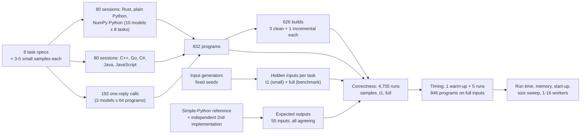

For one task, heat: its spec and samples go into two session folders per session model and into eight one-reply
prompts per one-reply model. Every program is built, run on a hidden small input and the hidden 400 x 400-cell grid,
checked against the reference output, and timed five times on the grid; the median time is the score.

## The eight tasks

The tasks, written for this study on 2026-10-30, range from pure arithmetic to text and record handling; their
inputs are generated by code from fixed seeds.

| Task | What it computes | Kind of work | Benchmark input | Simple Python |
|---|---|---|---|---|
| springs | 4,000 masses joined by springs in a ring, moved for 15,000 steps; total energy at the end | floating-point loop | 0.4 MB | 16.4 s |
| wordpairs | how often each pair of adjacent words occurs; the 20 most common pairs | text and hash tables | 66 MB, 10 M words | 45.0 s |
| ledger | net totals per channel and account from JSON bank transactions, with exact currency conversion | parsing records | 381 MB, 1 M lines | 10.3 s |
| logscan | the morning log summary: requests by status class, busiest pages and their latency percentiles | parsing text with a pattern | 228 MB, 2 M lines | 6.7 s |
| routes | shortest road distances from 6 starting points in a road network | graph search | 300,000 nodes, 900,000 roads | 10.6 s |
| align | cheapest weighted edit from one string to another, for 300 pairs | dynamic-programming table | 60 M table cells | 13.2 s |
| heat | heat spreading across a 400 x 400 floor plan with walls and sources for 250 steps | grid arithmetic | 160,000 cells | 15.8 s |
| walkers | 64 random walks of 500,000 steps in a box, spread over several workers | parallel simulation | 32 M steps | 22.8 s |

The generators add the awkward cases a real file would contain: about 1% of log lines are malformed, and the JSON
transactions contain decoy fields nested inside other objects, escaped quotes and emoji written as escape codes. A
line of the log and the start of its summary:

```
2026-10-30T14:22:05.123Z web-17 GET /api/v2/items/6929 200 1834B 10.9ms "Mozilla/5.0 (X11; Linux x86_64)"
```
```
lines 2000
malformed 40
status 2xx 1558
path /api/v2/items/{id} 227 13.4 170.0 697.9
```

The `path` line gives the page template's request count and its median, 95th-percentile and maximum latency in
milliseconds. Specs: [bench/tasks](bench/tasks).

## How each model wrote its programs

A session model ran as an agent: a loop in which it reads files, writes code, runs commands such as a build or a
test, reads the results and decides what to do next, until it judges the work finished.

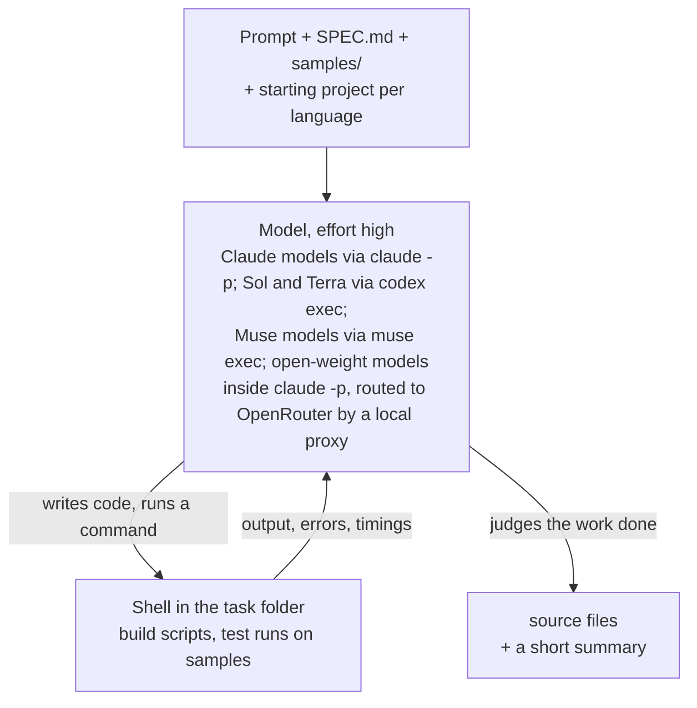

Each session model had two sessions per task, in separate folders: one for Rust and the two Pythons
([prompt](bench/AUTHOR_PROMPT.md)), one for C++, Go, C#, Java and JavaScript ([prompt](bench/AUTHOR_PROMPT_LANGS.md)).
Every model got the same prompts, which share their key instructions:

> Every version must print the correct output for any valid input as SPEC.md defines it, not only for the
> samples. Make each version as fast as you can. Write each one the way a skilled developer in that language
> would write fast code, using that language's own strengths. Use a single thread and a single process unless
> SPEC.md says otherwise.

The open-weight models ran inside Claude Code, the agent program that runs the Claude models, through a local proxy
to OpenRouter, pinned to each model's maker's servers. The toolchains were rustc 1.99, Microsoft Visual C++ 19.40
(`/O2 /GL`), Go 1.27.3, .NET 8, Java 23, Node.js 22.17 and Python 3.13.5 with NumPy 2.2.6; beyond each standard
library only serde, serde_json, regex and rayon (Rust), nlohmann/json (C++) and Jackson (Java) were available.

| Model | Pinned version | Provider and how called | Size and precision | Settings | Why included |
|---|---|---|---|---|---|
| Claude Opus 5.5 | `claude-opus-5-5` | Anthropic, `claude -p`, sessions | Not published | effort high | Anthropic's largest model |
| Claude Sonnet 5.5 | `claude-sonnet-5-5` | Anthropic, `claude -p`, sessions | Not published | effort high | Anthropic's mid-size model |
| Claude Haiku 5.5 | `claude-haiku-5-5` | Anthropic, `claude -p`, sessions | Not published | effort high | Anthropic's smallest model |
| GPT-6.1 Sol | `gpt-6.1-sol` | OpenAI, `codex exec`, sessions and one reply | Not published | effort high | OpenAI's larger model, measured both ways |
| GPT-6.1 Terra | `gpt-6.1-terra` | OpenAI, `codex exec`, sessions | Not published | effort high | OpenAI's smaller model |
| Muse Wonder Full | `muse-wonder-full-1.0` | Meta, `muse exec`, sessions | Not published | effort high | Meta's larger Muse model |
| Muse Wonder | `muse-wonder-1.0` | Meta, `muse exec`, sessions | Not published | effort high | Meta's smaller Muse model |
| DeepSeek V4.1 Flash | `deepseek/deepseek-v4.1-flash-20261017` | DeepSeek via OpenRouter in `claude -p`, sessions | Mixture of experts, 552B (8B to 16B active) plus 196B lookup memory; FP8 and 4-bit | effort high; provider pinned | Low-cost open-weight model |
| GLM 5.3 Flash | `z-ai/glm-5.3-flash-20260826` | Z.AI via OpenRouter in `claude -p`, sessions | Mixture of experts, 320B, 18B active; FP8 | effort high; provider pinned | Low-cost open-weight model |
| Nemotron 3.5 Super VL | `nvidia/nemotron-3.5-super-vl-20261015` (free) | Nvidia via OpenRouter in `claude -p`, sessions | Mixture of experts, 120B, 12B active; precision not stated | effort high; provider pinned | Open-weight model with a free tier |
| GPT-6 Astra | `gpt-6-astra` | OpenAI, `codex exec`, one reply | Not published | effort high; no tools | OpenAI's most capable model |
| Claude Fable 5.2 | `claude-fable-5-2` | Anthropic, `claude -p`, one reply | Not published | effort high; no tools | Anthropic's most capable model |
| Opus 5.5 and Sol (pilot) | as above | as above, sessions | Not published | effort high | Heat in Rust and Python, pipeline test |

Tools: Claude Code 2.1.296, codex-cli 0.160.1, Muse Code 1.4.14; closed models are pinned by the name the tool
accepted. The specs and this text are by Claude Opus 5.5, the harness by Sol and Terra, the newest analysis code by
Claude Sonnet 5.5.

## Writing a program in one reply

A one-reply call is one request and one answer. Claude Code ran with its tools off and Codex in a read-only sandbox,
both with their agent instructions replaced by one line ("You are a programmer. Answer each request in a single
reply. You cannot run code or use tools."); all 192 calls recorded no tool use.

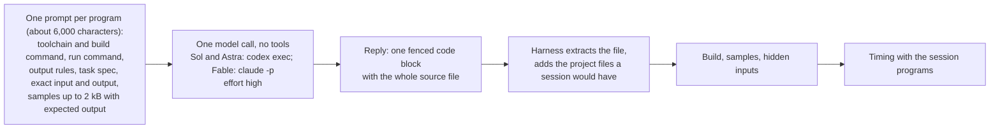

Because the model cannot test anything, the prompt ([template](bench/ONESHOT_PROMPT_V2.md)) is more explicit than
the session prompt: the compiler version and rules that commonly break builds, the exact command line, and a short
contract per task that repeats the points a first draft most often gets wrong.

Worked example: Claude Fable 5.2, heat, Rust. From a 5,745-character prompt, Fable took 233 seconds and 22,171
output tokens (18,976 of them reasoning, not part of the answer) to reply with one code block, a 7,721-byte program.
The extracted `src/main.rs` built, passed the five heat inputs and ran the benchmark grid in 0.044 s, against
0.037 s for Opus's session program. It holds each cell in 16 bits and uses the processor's AVX2 instructions to
update 16 cells at once, with the formula rewritten so no sum overflows. The call cost USD 0.93 at list prices.

## How the programs were checked and timed

A straightforward reference solution produced the expected output for every input, and a second solution written a
different way agreed on all 55 inputs. Outputs are compared field by field; a failure would be sorted into did not
build, crashed, ran out of time, unreadable output, or readable output with a wrong value (a wrong answer). Every
correct program ran once to warm up the disk cache and then five times on the benchmark input, taking turns in a
shuffled order with the other programs for the task; the score is the median wall-clock time, from start to exit.
Single-threaded programs were held to the laptop's six performance cores. Peak memory is the most physical memory
the program held at once, in megabytes.

The timing took two days: the first nine models on 2026-11-08, Sol's sessions and the one-reply programs on
2026-11-12. On the second day Opus 5.5's 64 programs were timed again as a check. They took **0.94** times as long as
on the first day (95% interval 0.91 to 0.97), probably because less background work was running (a median of 6.4
busy logical processors against 9.7), so every second-day time is divided by 0.94 before it is compared with the
first day. Comparisons within one day, such as Sol's two methods, are not affected.

Two ratios summarise the times. Relative time compares the versions one model wrote for one task: with a fastest
version at 0.46 s, a version taking 0.92 s has relative time 2.0. The model speed index divides each program's time
by the geometric mean of the ten session models' programs for the same task and language, so 0.5 means twice as
fast as a typical session model. Averages over tasks use the geometric mean, because an ordinary average lets one
large ratio dominate: for ratios of 2 and 50, the ordinary average is 26, the geometric mean 10. The 95% intervals
come from resampling the eight tasks 10,000 times, so they show how much an average depends on the choice of tasks.

## Worked example: the heat task in nine versions

The heat task describes a floor plan of 400 x 400 cells. Open cells start at 0, heat sources hold a fixed value,
and at each of 250 steps every open cell becomes `(4 * old + up + down + left + right) // 8`, where a neighbour
that is a wall, or lies outside the grid, contributes the cell's own old value. The answer is the sum of the open
cells, the hottest cell and a checksum, in exact integer arithmetic.

Claude Sonnet 5.5 used the same plan in every compiled and virtual-machine language: add a border of walls so every
cell has its neighbours at fixed distances in memory, and update the grid as one flat array with no branches. In C++:

```cpp
for (long long i = lo; i < hi; i++) {
    b[i] = (c[i] * a[i] + ((a[i - 1] + a[i + 1] + a[i - w2] + a[i + w2]) & m[i])) >> 3;
}
```

`w2` is the padded row width, `c[i]` is 4 plus the number of wall neighbours and `m[i]` zeroes the neighbour sum
for walls and sources. The NumPy version does the same arithmetic on shifted copies of the grid. The
plain-Python version packs the whole grid into one Python integer, 24 bits per cell, and moves all neighbours into
place with a handful of shifts of that one huge number per step.

All nine versions printed the same `sum`, `max` and `checksum` lines on the hidden benchmark grid. Medians of five
timed runs:

| Version | Median time | Relative time |
|---|---|---|
| C++ | 0.051 s | 1.0 |
| Rust | 0.054 s | 1.1 |
| C# | 0.104 s | 2.0 |
| Go | 0.109 s | 2.1 |
| Java | 0.207 s | 4.1 |
| JavaScript | 0.221 s | 4.3 |
| NumPy Python | 0.392 s | 7.7 |
| Plain Python (packed integer) | 0.867 s | 17 |
| Simple Python (reference loop) | 15.8 s | 310 |

Much of each time is start-up: an empty C++ or Rust program takes 0.03 s to start and exit here, an empty Java
program 0.11 s. The packing trick made Sonnet's plain Python 18 times faster than the simple loop. Other models
chose other plans: their C++ took 0.038 s (Opus) to 0.184 s (Nemotron), their plain Python 0.47 s (Opus, packed) to
9.8 s (GLM, a loop over cells).

## Results

### Every program gave the right answer

All 832 model-written programs, the 8 simple-Python references and the 6 pilot heat programs printed the exact
expected output on every sample and both hidden inputs; the walkers programs gave the same answer with 1 to 16
workers. No program failed to build, crashed, timed out or printed unreadable output, and every one-reply answer
held exactly one code block, so there are no format failures to separate from wrong answers. This is a ceiling: 832
of 832 still allows a true failure rate up to about 0.4% (95% bound), and 192 of 192 one-reply programs up to 1.6%.

### Run time on the full inputs

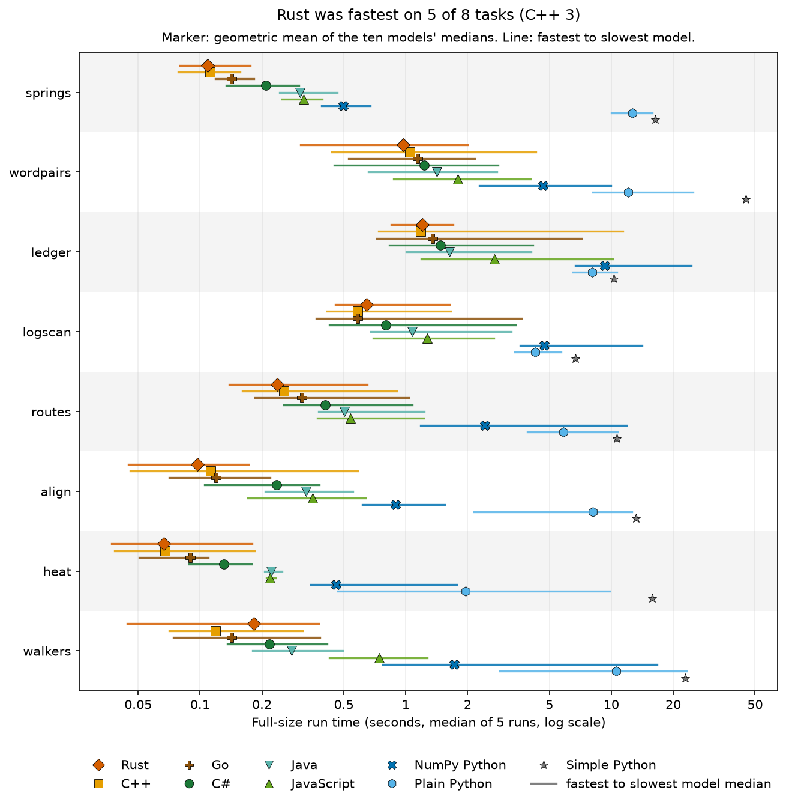

Each marker is one version's geometric mean over the ten session models, with a line from the fastest model's
program to the slowest's, on a logarithmic axis. Rust, C++ and Go sit at the left, between 0.07 and 1.4 s. C#, Java and JavaScript are typically 1.5 to 3 times
slower. NumPy takes 0.5 to 9 s, plain Python 2 to 13 s and simple Python 7 to 45 s. The lines are long: on wordpairs
the ten models' C++ ranged from 0.44 to 4.3 s, on ledger from 0.74 to 11.4 s, so the slowest model's C++ could be
slower than the fastest model's JavaScript.

### Which language was fastest

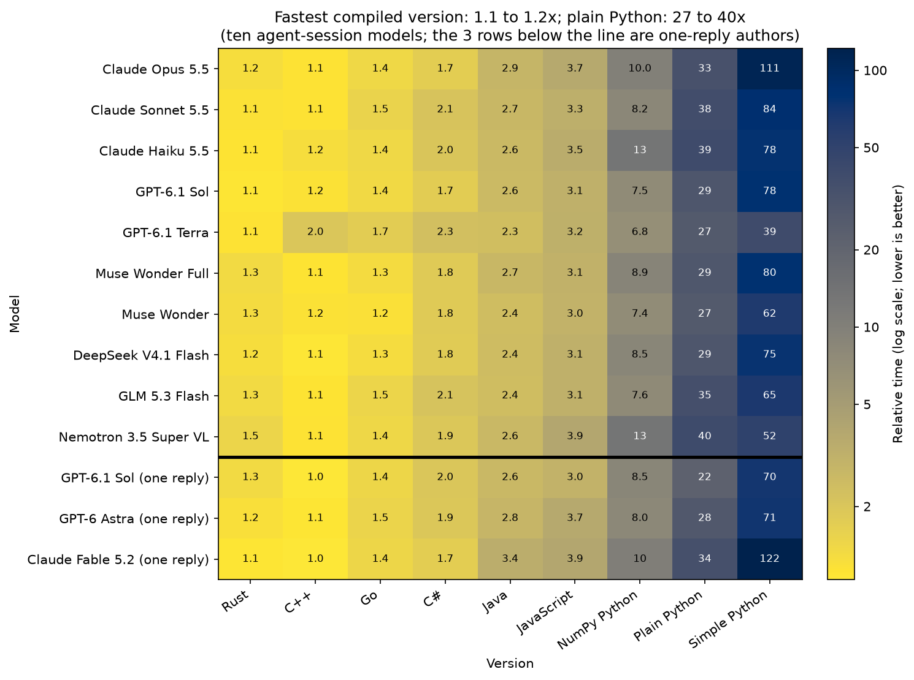

Each cell is a version's relative time for one model, averaged over the tasks; darker is slower, on a log scale.
The bottom three rows are the one-reply programs.

| Version | Relative time, range over the ten session models | Speed-up over the model's faster Python version |
|---|---|---|
| Rust | 1.08 to 1.46 | 5.6x to 9.1x |
| C++ | 1.06 to 1.98 | 3.4x to 11.8x |
| Go | 1.17 to 1.74 | 3.8x to 9.4x |
| C# | 1.69 to 2.27 | 2.9x to 6.8x |
| Java | 2.34 to 2.86 | 2.9x to 5.0x |
| JavaScript | 3.04 to 3.89 | 2.1x to 3.4x |
| NumPy Python | 6.8 to 13.3 | |
| Plain Python | 26.6 to 40.4 | |

The families separate cleanly for every model. Rust was fastest in 34 of the 80 task-and-model pairs, C++ in 32 and
Go in 14; C++ averaged 1.06 to 1.24 for nine models and 1.98 for Terra. The one-reply programs kept the same order,
with C++ fastest in 13 of their 24 pairs. The right-hand column depends on the Python too: Nemotron's gains were the
largest (11.8x for C++) partly because its Python was the slowest, Terra's the smallest because its C++ was.

### Language or model: which matters more

To compare the two decisions, the run times within each task were split into parts. Take the 60 programs of one
task in the six non-Python languages (ten models times six languages), on a logarithmic scale so that a doubling
counts the same anywhere. Part of their spread goes with the language (every Java program slower than every Rust
one, say), part with the model (one model faster in every language), and the rest with particular combinations and
timing noise. The one-reply programs are left out, so the model share is not mixed with the method.

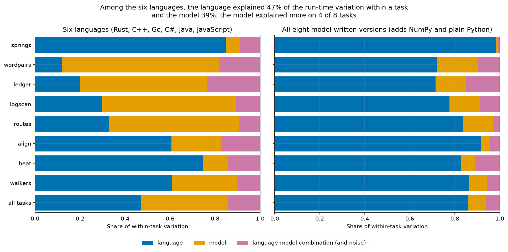

Each bar is one task and the bottom bar pools them: blue is the language's share, orange the model's, pink the rest;
the right panel adds the two Pythons. Among the six languages, the language explained 47% of the variation and the model 39%, with 14% left over. Where
the work is arithmetic, the language decided: springs 85% language against 6% model, heat 75% against 11%, walkers
61% against 29%, align 61% against 22%. Where the work is reading text and looking things up in tables, the model
decided: wordpairs 12% against 70%, ledger 20% against 56%, logscan 30% against 59%, routes 33% against 58%. There a
model's choice of parser and table carried across its six languages. With both Pythons included, the language
explained 86%, which says only that Python is far slower than the other six.

### Which model wrote the fastest code

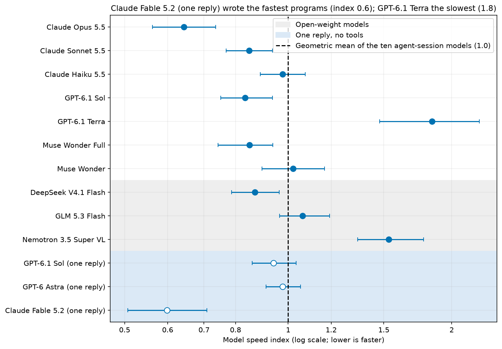

Each point is an author's speed index over its 64 programs with a 95% interval, on a log axis; the dashed line is a
typical session model, and the one-reply rows have hollow markers in a shaded band.

| Author | How it wrote | Speed index (95% interval) | Fastest of ten | Slowest of ten |
|---|---|---|---|---|
| Claude Fable 5.2 | one reply | 0.60 (0.51 to 0.71) | | |
| Claude Opus 5.5 | sessions | 0.64 (0.56 to 0.74) | 36 | 0 |
| GPT-6.1 Sol | sessions | 0.83 (0.75 to 0.94) | 5 | 0 |
| Claude Sonnet 5.5 | sessions | 0.85 (0.77 to 0.93) | 6 | 1 |
| Muse Wonder Full | sessions | 0.85 (0.74 to 0.94) | 6 | 2 |
| DeepSeek V4.1 Flash | sessions | 0.87 (0.79 to 0.96) | 5 | 0 |
| GPT-6.1 Sol | one reply | 0.94 (0.86 to 1.03) | | |
| GPT-6 Astra | one reply | 0.98 (0.91 to 1.05) | | |
| Claude Haiku 5.5 | sessions | 0.98 (0.89 to 1.07) | 0 | 7 |
| Muse Wonder | sessions | 1.02 (0.89 to 1.17) | 5 | 3 |
| GLM 5.3 Flash | sessions | 1.06 (0.96 to 1.19) | 1 | 2 |
| Nemotron 3.5 Super VL | sessions | 1.53 (1.34 to 1.77) | 0 | 21 |
| GPT-6.1 Terra | sessions | 1.84 (1.47 to 2.25) | 0 | 28 |

The last two columns count the 64 task-and-version cells in which a session model's program was the fastest or
slowest of the ten. Opus's programs took about two thirds of a typical model's time; Terra and Nemotron wrote 49 of
the 64 slowest. The seven middle models' intervals overlap, so their order could change in another set of sessions.

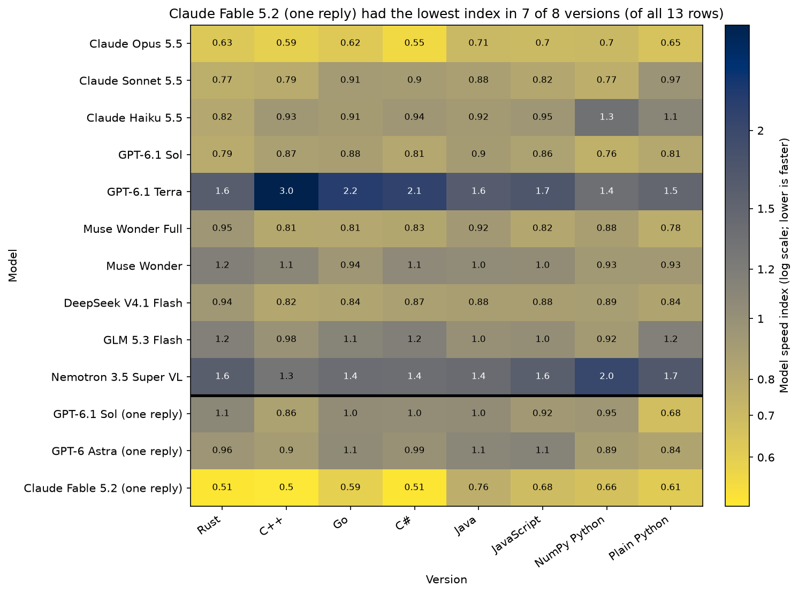

By version, Opus had the lowest index of the session models in all eight, from 0.55 (C#) to 0.71 (Java), so its lead
was not one language's. Terra's was highest in C++ (2.95), Go (2.2) and C# (2.1), where it used general libraries for
parsing. Within each company the larger model wrote faster code: Opus (0.64), Sonnet (0.85), Haiku (0.98); Sol
(0.83), Terra (1.84); Wonder Full (0.85), Wonder (1.02). Open-weight DeepSeek was level with Sonnet and Sol.

### Agent sessions against a single reply

Sol's pairs show what the agent loop adds for one model; Astra and Fable show how far one reply can go.

| Author | Input tokens per program | Output tokens per program | Minutes per program | Cost of 64 programs (list price) |
|---|---|---|---|---|
| GPT-6.1 Sol, sessions | 589,000 | 8,800 | 5.1 | USD 11.2 |
| GPT-6.1 Sol, one reply | 15,100 | 5,300 | 2.4 | USD 4.55 |
| GPT-6 Astra, one reply | 15,000 | 3,800 | 1.9 | USD 18.41 |
| Claude Fable 5.2, one reply | 3,300 | 21,700 | 3.6 | USD 58.93 |

Codex adds about 12,000 input tokens of its own to every call, most of Sol's and Astra's one-reply input. One reply
is not always cheap: Fable reasoned for about 18,000 tokens per program at USD 40 per million, so its 64 replies
cost more than Opus's 16 sessions (USD 40).

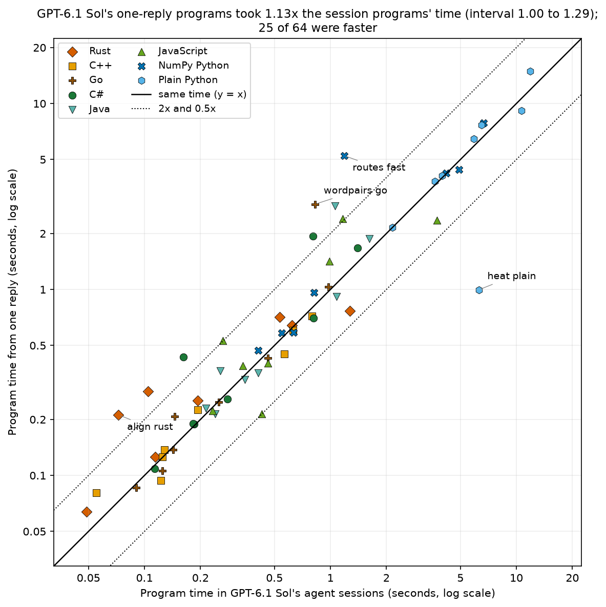

Each point is one of Sol's programs: session time across, one-reply time up, in seconds on log scales. Points above
the diagonal were slower in one reply; the dotted lines mark twice as slow and twice as fast.

Sol's one-reply programs took **1.13** times as long as its session programs (geometric mean of 64 pairs, 95%
interval 1.00 to 1.29). 25 were faster in one reply and 26 within 10% either way, but the spread is lopsided: 9
one-reply programs were more than twice as slow and 1 more than twice as fast. The slow ones cluster in wordpairs
(1.56 on average), align (1.38) and Rust (1.37). The largest gaps were NumPy routes (4.4 times slower), Go wordpairs
(3.5), Rust align (2.9) and Rust walkers (2.7); the largest gain was plain-Python heat, 6.3 times faster in one
reply. The error analysis reads these programs.

Fable's single replies (0.60) were the fastest programs in the study. Program by program they took 0.93 times as
long as Opus's session programs (0.83 to 1.04) and were faster in 39 of 64 cells, and Fable wrote the fastest of all
13 authors' programs in 26 cells. The interval includes 1.0, so level with Opus is as far as the evidence goes. Sol's
single replies (0.94) and Astra's (0.98) sat at the session models' average, behind Sol's own sessions (0.83);
Astra's took 1.15 times as long as Sonnet's session programs (1.05 to 1.24).

### Longer sessions did not buy faster code

| Model | Median session | Median tool calls | Output tokens | Cost |
|---|---|---|---|---|
| Claude Opus 5.5 | 19 min | 59 | 1.01 M | USD 40 (list price) |
| Claude Sonnet 5.5 | 5.1 min | 19 | 0.45 M | USD 7.9 (list price) |
| Claude Haiku 5.5 | 15 min | 47 | 1.30 M | USD 2.7 (list price) |
| GPT-6.1 Sol | 16 min | 44.5 | 0.56 M | subscription (USD 11 at list price) |
| GPT-6.1 Terra | 3.3 min | 11 | 0.10 M | subscription (USD 1.2 at list price) |
| Muse Wonder Full | 13 min | 40 | 0.62 M | subscription |
| Muse Wonder | 8.6 min | 36 | 0.50 M | subscription |
| DeepSeek V4.1 Flash | 17 min | 62 | 1.21 M | USD 8.0 (OpenRouter) |
| GLM 5.3 Flash | 28 min | 66 | 0.88 M | USD 2.2 (OpenRouter) |
| Nemotron 3.5 Super VL | 19 min | 101 | 1.16 M | USD 0 (free tier) |

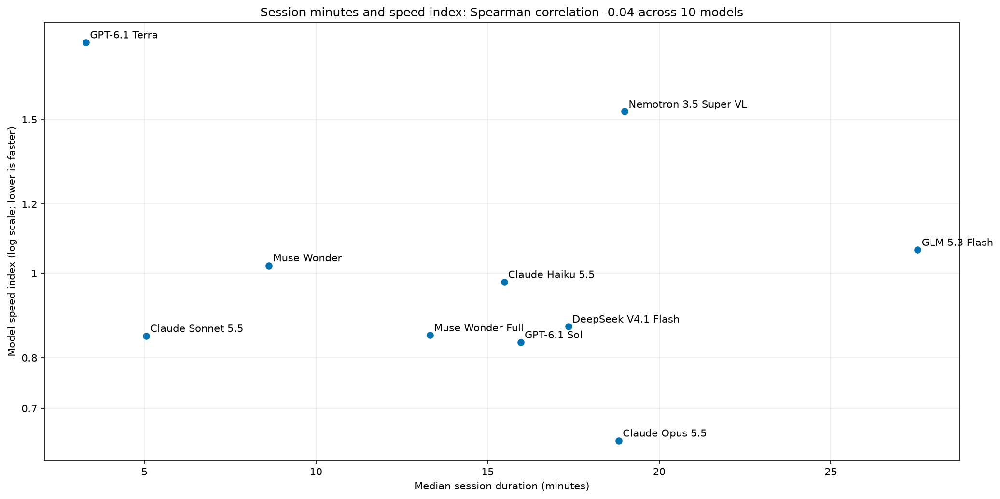

Across the ten models, median session length and speed index have a rank correlation of -0.04, no relation: Opus
and Nemotron both spent about 19 minutes per session and wrote the fastest and nearly the slowest code. Terra's
short sessions went with the slowest programs. Opus cost five times as much as Sonnet for programs about a quarter
faster; DeepSeek matched Sonnet's speed at about the same price.

### Memory

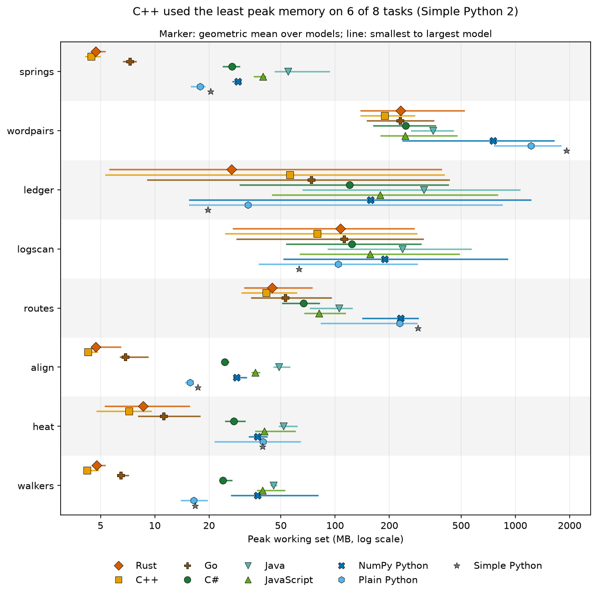

Peak memory in megabytes, laid out like the run-time figure. Relative to each model's smallest version, C++ needed 1.0 to 2.2 times the smallest, Rust 1.1 to 2.1, Go 1.4 to 3.2, C# 3.2 to 6.0,
JavaScript 4.0 to 8.2, Java 5.7 to 11, plain Python 3.7 to 6.6 and NumPy Python 3.9 to 9.6. On small inputs the
difference is mostly the runtime; on large ones it is how data is stored: the plain-Python wordpairs programs,
holding about 4 million word pairs as Python objects, peaked at 0.8 to 1.8 GB, the C++ ones at 0.14 to 0.27 GB.

### Small inputs and start-up time

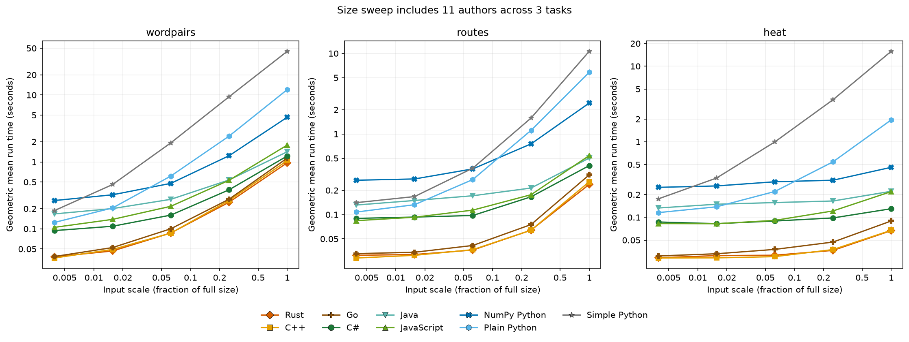

An empty program that prints one word took 0.03 s to start and exit in Rust, C++ and Go, 0.08 s in Node.js and .NET,
0.10 s in Python, 0.11 s in Java and 0.26 s in Python that imports NumPy (medians of 20 runs). Wordpairs, routes and
heat also ran at 1/256 to 1/4 of the benchmark size; the figure has one line per version, on log axes. At 1/256 the order follows the start-up costs: relative to Rust,
C# took 2.5 to 3.0 times, plain Python 3.3 to 4.0, Java 4.2 to 4.6 and NumPy 6.9 to 8.5. As inputs grow the virtual
machines close in (C# 1.3 to 1.9 times Rust at full size), while plain Python falls behind (12 to 29 times).

### Code size and build time

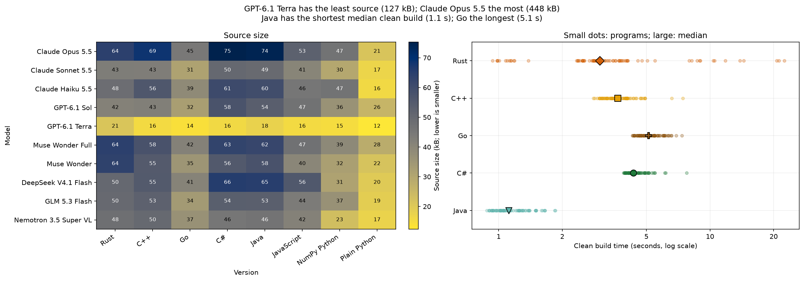

The left panel shows the total source size per version and model in kilobytes; the right panel clean build times
per program, with the median marked. Terra wrote the least code, 127 kB over its 64 programs, and Opus the most of
the session models, 448 kB; the others wrote 304 to 404 kB. The one-reply programs were longer: Sol's 378 kB against
337 kB from its sessions, Astra's 373 kB and Fable's 507 kB. Much of the extra length is hand-written parsing and
hash tables. A clean build took a median of 1.1 s for Java, 3.0 s for Rust (up to
22 s when the JSON or pattern libraries were compiled too), 3.7 s for C++, 4.3 s for C# and 5.1 s for Go, whose
rebuild after a one-line change took 0.2 s.

## Error analysis: slow choices, not wrong answers

No program gave a wrong answer, so this section reads correct programs that were much slower than they needed to be:
the largest gaps between models in one language for one task, one where NumPy made a program slower, and the
largest gaps between Sol's two methods. Causes not tested separately are marked.

**Plain-Python heat: six session models packed the grid, four looped over cells.** Opus, Sonnet, Haiku, both Muse
models and DeepSeek packed the floor plan into one large integer, as in the worked example: 0.47 to 1.05 s. Sol,
Terra, GLM and Nemotron updated each of the 160,000 cells in Python for 250 steps: 6.3, 6.8, 9.8 and 6.1 s. Sol's
one-reply program packed the grid in 24-bit lanes and took 1.00 s, the largest gain of one reply over a session.

**Ledger: a general JSON library against a scanner for the format.** Terra's C++ ledger took 11.4 s, its Go 7.2 s
and its JavaScript 10.1 s; the other session models took 0.74 to 1.10 s in C++, 0.72 to 1.97 s in Go and 1.19 to
2.23 s in JavaScript, except Nemotron's JavaScript (8.4 s) and Sol's (3.7 s). Terra's programs parse each of the million
lines into a full JSON structure (and its JavaScript, like Nemotron's, does every amount in `BigInt`); the others
wrote byte-level scanners that read only the fields the task needs. This one choice is most of the model share on
ledger.

**NumPy that made parsing slower.** Haiku's NumPy ledger took 24.4 s, three times its plain Python (7.8 s): 310 lines
that hunt for JSON fields with whole-array operations over the raw bytes, against 52 lines around `json.loads`.
Per-line parsing decisions do not fit whole-array operations: across all 13 authors the fastest NumPy ledger (6.7 s)
was slower than the fastest plain one (6.5 s).

**Routes in NumPy: a session that profiled, a reply that guessed.** Sol's one-reply NumPy routes took 5.25 s against
1.18 s for its session program. The one-reply program used NumPy only to read the file, then searched the road
network in a plain Python loop over nodes, so it ran at the speed of Sol's one-reply plain Python (4.10 s). The
session program expanded whole frontiers of nodes with array operations, falling back to a loop for narrow ones. Its
log shows how it got there: Sol generated a benchmark-sized road network, profiled its graph reader and timed the
search.

**Wordpairs in Go: counting with a hash table or by sorting.** Sol's one-reply Go took 2.88 s, its session Go 0.83 s.
Both give each word a number. The one-reply program counts each pair in a hash table; with about 4 million distinct
pairs the table is far larger than the processor's caches, so most lookups wait for memory. The session program
appends every pair to a list, radix-sorts it and counts runs of equal pairs, reading memory in order; the session
wrote a benchmark script and ran it. Astra's one-reply Go (2.79 s) and both OpenAI models' one-reply C#, Java and
JavaScript were similarly slow on this task; whether the table is the whole cause was not measured.

**Walkers in Rust: the same generator, eight times apart.** Muse Wonder Full's Rust took 0.044 s and Muse Wonder's
0.376 s. Wonder Full stepped four walkers in one loop without branches, so the processor could work on four
independent random-number chains at once; Wonder stepped one walker at a time and picked the direction with a
four-way `match`, a branch the processor cannot predict, as did four other models (0.33 to 0.35 s). Which change did
more was not measured.

**Logscan in Go: the opening's example, measured.** Terra's Go matched every log line against one long regular
expression and took 3.7 s; the other nine session models checked the format by hand and took 0.37 to 0.57 s.

These cases are the model share in the split above: on the text and table tasks one parsing or table choice moved a
model's programs in every language at once. Sol's cases go both ways: testing found faster plans for routes and
wordpairs, and a session still missed the packed grid that one reply found.

## Limitations

- One program per model, language and task. A second session or reply might choose a different parser, table or loop
  and change a ratio several times over; the middle models did not separate.
- Only Sol wrote both ways, so the 1.13 ratio is one model's. Fable and Astra wrote one way only, with a more exact
  prompt than the sessions had, so their results mix model, method and prompt.
- The models were asked for speed, so their plain Python is faster than ordinary Python. Each model family ran in
  its maker's agent program; the open-weight models ran in Claude Code through a proxy, built for other models.
- 55 sessions ended for reasons outside the model (an overlong PATH, a free tier's limit, credits running out, the
  laptop sleeping) and were run again; the failed runs are kept.
- One Windows laptop with fixed settings. Other programs, chiefly file synchronisation, kept a median of 9.7 of 22
  logical processors busy on the first timing day and 6.4 on the second; a program's five repeats varied by a median
  of 9 to 14%.
- Second-day times are divided by one factor measured on Opus's programs, which varied by task from 0.86 (logscan)
  to 0.98 (align), so one new program compared with one first-day program carries up to about 10% more uncertainty.
  Dividing each program by its own task and language factor gives identical speed indices.
- Correctness at a ceiling: this test cannot say how often each model's code is wrong on harder or vaguer tasks.
- The specs are by Claude Opus 5.5, one of the fastest models here, and the generators by GPT-6.1 Sol; their wording
  could suit one company's models. The pooling of the language-and-model split was changed after the first results
  were seen, and the drift correction was chosen after the second day's times were seen; see
  [data/PROTOCOL.md](data/PROTOCOL.md).

## What the evidence supports

For a job that runs often enough for seconds to matter, ask the model for Rust, C++ or Go. Every model wrote its
fastest version in one of these three, three to twelve times faster than its best Python, with a build of a few
seconds. C# and Java were two to seven times faster than Python but used as much memory or more; JavaScript was two
to three times faster.

For arithmetic, the language is most of the decision. For parsing text and looking things up in tables, the model
matters as much (the same language ran up to 15 times slower in one model's hands), so checking which parser and
table a model chose is worth more than switching languages. The largest model of each company wrote its fastest
code, and open-weight DeepSeek matched the mid-priced closed models.

A single reply with an exact prompt gave correct programs from all three models, and Fable's were as fast as the
best session programs. For the one model measured both ways, the agent loop bought about 13% speed for about 2.5
times the cost, mostly by avoiding a few much slower choices. Where a few seconds matter, use a session, or time a
one-reply program on a large input before relying on it. The open questions are how stable these differences are
across repeated sessions and replies, and whether a session gives Fable the gain it gave Sol.

## How the study got here

A pilot ran heat in Rust and Python with Opus 5.5 and Sol. To save quota, Sonnet 5.5 and Terra then wrote all tasks,
and seven more models followed from 2026-11-05 with the same prompts. A first timing ran on battery power, 1.6 to 2.5
times slower, so everything was timed again on mains power on 2026-11-08, with a guard that discards runs during
which the machine slept (none did). Sol's sessions followed on 2026-11-09. A first one-reply prompt, tried on heat
and ledger by Haiku, Sonnet, Sol and Terra, gave 8 failing programs out of 64 (none of Sol's), so exact per-task
contracts were added before Sol, Astra and Fable wrote the 192 one-reply programs. Gemini models were planned, but
their batch requests were refused for lack of credit. The new programs were timed on 2026-11-12.

## How to reproduce

The notebook [39_rust_vs_python.ipynb](39_rust_vs_python.ipynb) reads only the saved results in `data/` and makes
no model calls and no timing runs. To regenerate everything, run these from this folder on Windows with Python 3.13,
NumPy 2.2 and the toolchains above, on mains power (the measurement takes about seven hours):

```bash
python -X utf8 -m bench.generate
python -X utf8 -m bench.reference all
python -X utf8 -m bench.sessions run-all --kind main
python -X utf8 -m bench.sessions run-all --kind langs
python -X utf8 -m bench.oneshot run --protocol v2
python -X utf8 -m bench.oneshot export
python -X utf8 -m bench.measure all
python -X utf8 -m bench.measure anchor --authors opus55
python -m nbconvert --to notebook --execute --inplace 39_rust_vs_python.ipynb
```

The session and one-reply commands skip any request whose saved result matches its hash, so with the committed
`data/` they make no model calls; new ones need the `claude`, `codex` and `muse` tools and an `OPENROUTER_API_KEY`.
Toolchain paths can be set with `NB39_VCVARS`, `NB39_JAVA`, `NB39_DOTNET`, `NB39_GO` and `NB39_NODE`; large inputs
and builds go to `%USERPROFILE%\nb-work\39-rust-vs-python` or `NB39_WORK`.

## Run details and spend

- Sessions: 160 kept and 2 pilot. Opus USD 40, Sonnet 7.9 and Haiku 2.7 (Claude Code list-price estimates),
  DeepSeek 8.0 and GLM 2.2 (OpenRouter), Nemotron free, Sol, Terra and Muse on subscriptions; 55 failed sessions
  cost USD 17.3 more. All sessions read 633 M input tokens (538 M from cache) and wrote 11.2 M.
- One-reply calls at list prices: Sol USD 4.55, Astra 18.41, Fable 58.93 (Claude Code reported 36.83, at older
  rates), plus about USD 3.5 for the first prompt's 64 test calls.
- Measurement: 626 builds, 4,755 correctness runs; on 2026-11-08 2,950 timed, 2,700 size-sweep, 1,095 scaling and
  160 start-up runs; on 2026-11-12 1,280 timed, 320 Opus check, 1,152 size-sweep and 480 scaling runs. All correct;
  the power guard discarded none. Intel Core Ultra 9 185H (6 performance and 10 efficiency cores), 34 GB RAM,
  Windows 11 build 26300.
- Files: [data/programs](data/programs), [data/sessions](data/sessions), one-reply prompts and replies in
  [data/oneshot](data/oneshot), results in [data/results](data/results), the harness in [bench](bench).

## Future work and further reading

### Future work

- Several sessions and replies per model and task, to show how much of the 39% model share is the model and how
  much one session's choice.
- Fable 5.2 in agent sessions and Opus 5.5 in one reply, to separate the model from the method behind Fable's 0.93
  ratio against Opus.
- One reply plus one round of feedback: return the program's own timing on a large input to the model once, and
  measure how much of Sol's 13% gap and its nine slow programs that recovers at a fraction of a session's cost.
- Repeat ledger, logscan and wordpairs with a prompt that names the parser and table to use, to see how much of the
  model share one sentence removes.
- Re-time all saved programs in one sitting on an idle Linux machine, with Clang, .NET 10, PyPy and free-threaded
  Python.

### Further reading

Links checked on 2026-11-12.

- [EffiBench: Benchmarking the Efficiency of Automatically Generated Code](https://arxiv.org/abs/2402.02037)
  (Huang et al., 2024). Run time and memory of code from 42 models on LeetCode problems, in one language.
- [Is Self-Repair a Silver Bullet for Code Generation?](https://arxiv.org/abs/2306.09896) (Olausson et al., 2024).
  Letting a model repair its code from test feedback gains less than expected once its cost is counted, the
  trade-off behind the session and one-reply comparison here.
- [Energy efficiency across programming languages: how do energy, time, and memory relate?](https://doi.org/10.1145/3136014.3136031)
  (Pereira et al., 2017). Run time, memory and energy of 27 languages on expert-written programs.
- [The Computer Language Benchmarks Game](https://benchmarksgame-team.pages.debian.net/benchmarksgame/). Expert-tuned
  programs in many languages, for seeing how far model-written code is from tuned code.
- [Array programming with NumPy](https://doi.org/10.1038/s41586-020-2649-2) (Harris et al., 2020). How NumPy's
  arrays work, and why NumPy helped on the numeric tasks and not on parsing.
