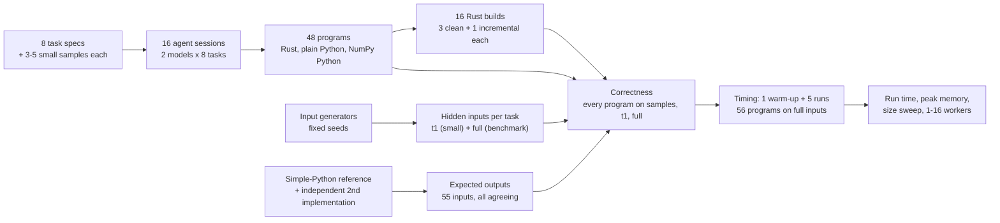
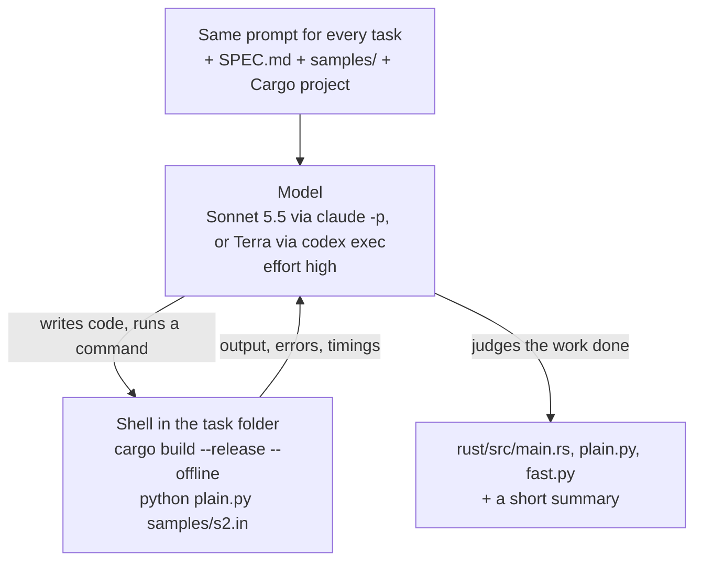
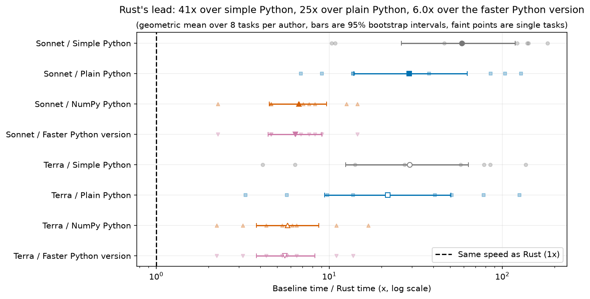
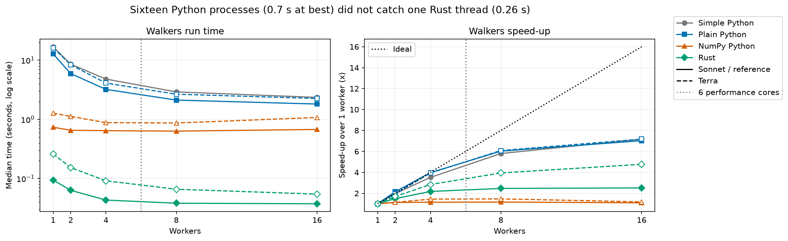

# Rust or Python: how much faster is the code an AI model writes?

Two AI coding models each wrote eight new programs three times: once in Rust, once in Python using only its
standard library, and once in Python with NumPy. Every program gave the right answer. This page measures how
much faster, smaller and longer the Rust versions were, and when Python's usual shortcut closes the gap.

## Contents

- [A summary that runs every morning](#a-summary-that-runs-every-morning)
- [Why the same steps can take very different times](#why-the-same-steps-can-take-very-different-times)
- [Python's usual shortcut](#pythons-usual-shortcut)
- [What changes when a model writes the code](#what-changes-when-a-model-writes-the-code)
- [The question](#the-question)
- [Study summary](#study-summary)
- [How the experiment runs](#how-the-experiment-runs)
- [The eight tasks](#the-eight-tasks)
- [How each model wrote its programs](#how-each-model-wrote-its-programs)
- [How the programs were checked and timed](#how-the-programs-were-checked-and-timed)
- [Worked example: the heat task from spec to speed-up](#worked-example-the-heat-task-from-spec-to-speed-up)
- [Results](#results)
- [Error analysis: slow choices, not wrong answers](#error-analysis-slow-choices-not-wrong-answers)
- [Limitations](#limitations)
- [What the evidence supports](#what-the-evidence-supports)
- [How the study got here](#how-the-study-got-here)
- [How to reproduce](#how-to-reproduce)
- [Run details and spend](#run-details-and-spend)
- [Future work and further reading](#future-work-and-further-reading)

## A summary that runs every morning

A web server writes one line to its access log for every request it answers: when the request arrived, which
page was asked for, whether it worked and how long the server took. A busy site writes a couple of million such
lines a day. Every morning someone wants a short summary: how many requests failed, which pages were the
busiest, and how slow the slowest answers were for each of those pages.

A short Python program can produce that summary. It reads the file one line at a time, checks that each line
has the expected shape, pulls out the page and the time taken, and keeps running counts. For the
2-million-line log used in this study, a straightforward version takes about 5 seconds on a recent laptop.

Five seconds is nothing for a job that runs once a day. It matters when the same work runs thousands of times:
on every file in a data pipeline, behind a dashboard that someone is waiting on, or on a cloud machine billed by
the second. Memory matters in the same way. A program that keeps every page's response times needs room for
them, and whether a job fits in the memory of a small machine decides whether it runs at all.

## Why the same steps can take very different times

Python is interpreted. A program called the interpreter reads your code and carries out each operation as it
comes to it. Before it adds two numbers it checks what kind of values they are, finds the right way to add that
kind, and creates a new object to hold the result. That flexibility is what makes Python quick to write: a
variable can hold anything, and nothing needs declaring. It also means that a loop over two million log lines
repeats that bookkeeping two million times.

Rust is compiled. Before the program runs, a compiler translates it into the processor's own instructions, and
it knows in advance that a count is a 64-bit integer and a latency is another. The loop that adds up response
times becomes a few machine instructions per line, with no type checks and no new objects. The compiler is
strict in return: a program does not build until every type and every use of memory is accounted for, and
building takes time.

Take an illustrative case, adding up a million whole numbers. A Python `for` loop looks up the meaning of `+`
for each pair of values and allocates a new number each time. A Rust loop keeps the running total in a register
of the processor. Nobody needs an experiment to predict that Rust wins this one. The useful question is by how
much on realistic work, where reading files, splitting text and looking things up in tables also take time.

## Python's usual shortcut

Experienced Python programmers rarely write that loop. They use NumPy, a library written in C that stores a
million numbers in one compact block of memory and adds them up in one call, `values.sum()`. The loop still
runs, but in compiled code. A program written this way is still Python, yet for arithmetic on arrays it can run
close to compiled speed.

The catch is that NumPy only helps when the work can be written as the same operation applied to a whole array
at once. One task in this study fits that shape well: spreading heat across a floor plan, where every cell of a
grid is updated by the same formula at each step. Many everyday tasks do not. Reading a line of JSON, deciding
whether a log line is well formed, or finding the shortest route through a road network one junction at a time
all involve a decision for each item, and whole-array operations express decisions badly.

So "how much faster is Rust than Python" has at least three sides: plain Python, Python that leans on NumPy, and
Rust. The answer can differ from one task to the next.

## What changes when a model writes the code

The usual argument for Python is that it is cheaper to write. Rust code is longer, its compiler rejects more
first drafts, and a developer has to know the language well to make it fast. Teams often accept slower Python
because the faster version would cost too much developer time.

AI coding models change part of that calculation. Asking a model for a Rust version costs about the same as
asking for a Python version. If the model's Rust is correct and fast, a team gets the speed without paying much
for it. If the model writes Rust that is wrong, or no faster than its Python, the gain is not there. Published
language benchmarks, built from programs that experts tuned by hand, cannot answer this. The code that matters
here is the code a model writes when it is asked.

## The question

When an AI coding model writes the same program three ways (Rust, Python with only the standard library, and
Python with NumPy), how much faster and how much smaller in memory is the Rust version, how much of the gap does
NumPy close, and does each version still give the right answer?

The comparison uses eight tasks written for this study, so no model could have seen them or their answers
before. Two models wrote all three versions of every task: Claude Sonnet 5.5 and GPT-6.1 Terra. That is 48
programs. A straightforward standard-library solution of each task, written for clarity rather than speed,
serves as a fourth version, called "simple Python" below. It shows what an ordinary Python program would
take.

## Study summary

**What was compared.** Each model worked on each task in its own folder for a few minutes to half an hour,
with the Rust and Python toolchains, a precise specification and three small sample inputs with their expected
outputs. Its programs were then run on hidden inputs, including one benchmark-sized input per task (2 million
log lines, a million JSON transactions, a 300,000-node road network, and so on), and timed five times each on
the same laptop.

**Correctness.** All 48 programs gave the exact expected output on every hidden input, as did the eight
simple-Python solutions. Correctness sits at its ceiling, so it cannot separate the languages or the models.
The comparison rests on speed, memory, code size and build time.

**Speed.** The measure is the speed-up: the Python version's run time divided by the Rust version's run time
on the same task, so 6x means Rust finished in one sixth of the time. Rust was the fastest version in all 16
task-and-model pairs. Against the faster of each model's two Python versions, Rust was **6.0 times faster** on
average (geometric mean over 16 pairs; 6.4x for Sonnet, 95% interval 4.4 to 9.1, and 5.6x for Terra, 3.8 to
8.3). The individual pairs ranged from 2.2x to 14.5x. Against plain standard-library Python the gap was about
25x, and against simple Python about 41x.

**NumPy.** NumPy closed most of the gap on numeric tasks (a physics simulation, a grid, an alignment table,
random walks), where it made Python 3 to 28 times faster than the same model's plain version. It gave nothing on
parsing JSON or log lines, and on two of those tasks the NumPy version was slower than the plain one.

**In the original situation.** The morning log summary took 3.1 to 3.9 seconds in the models' Python and 0.46 to
1.2 seconds in their Rust. A team running it once a day would not notice; a pipeline running it on thousands of
files would cut its compute time by roughly three to seven times.

**Main caveat.** Each model wrote each program once, on one Windows laptop that was also running other work
during the timing (a median of 8 of its 22 logical processors were busy elsewhere). The large ratios are well
beyond that noise; differences under about 30% between two programs, or between the two models, are not.

## How the experiment runs



One task travels through this as follows. The heat task's spec and samples go into a fresh folder for each
model. The model writes `rust/src/main.rs`, `plain.py` and `fast.py`, compiles and tests them on the samples, and
stops. The harness then copies the three files out, builds the Rust program, and runs all three programs on a
hidden small input and on the hidden 400 x 400-cell benchmark grid. Each output is compared with the expected
output, which was computed by the simple-Python reference and confirmed by a second, independently written
implementation. Programs that pass are timed five times on the benchmark input, interleaved with the other
programs for the same task, and the median time is the program's score. The [worked
example](#worked-example-the-heat-task-from-spec-to-speed-up) follows heat through every step.

## The eight tasks

The tasks cover the kinds of work that people write scripts for, from pure arithmetic to text and record
handling. Each one was written for this study on 2026-10-30, with exact rules for its input and output, so no
model could have seen the tasks, the inputs or the answers in training. The inputs are generated by code from
fixed seeds.

| Task | What it computes | Kind of work | Benchmark input | Simple Python |
|---|---|---|---|---|
| springs | 4,000 masses joined by springs in a ring, moved for 15,000 time steps; total energy at the end | floating-point loop | 0.4 MB | 12.0 s |
| wordpairs | how often each pair of adjacent words occurs in a text; the 20 most common pairs | text and hash tables | 66 MB, 10 M words | 44.1 s |
| ledger | net totals per channel and account from JSON bank transactions, with exact currency conversion | parsing records | 381 MB, 1 M lines | 7.9 s |
| logscan | the morning log summary: requests by status class, busiest pages and their latency percentiles | parsing text with a pattern | 228 MB, 2 M lines | 5.0 s |
| routes | shortest road distances from 6 starting points in a road network | graph search | 300,000 nodes, 900,000 roads | 8.9 s |
| align | cheapest way to edit one string into another, for 300 pairs, with weighted costs | dynamic-programming table | 300 pairs, 60 M table cells | 8.9 s |
| heat | heat spreading across a 400 x 400 floor plan with walls and fixed sources for 250 steps | grid arithmetic | 160,000 cells | 13.0 s |
| walkers | 64 random walks of 500,000 steps in a box, spread over several workers | parallel simulation | 32 M steps | 15.5 s |

The simple-Python column is the median time of the straightforward reference solution, timed with the
others. The input generators add the awkward cases a real file would contain. The log file has truncated lines,
lower-case methods and latencies with a missing decimal, about 1% of lines in all, which must be counted as
malformed. Here are a well-formed line and a malformed one from a small sample:

```
2026-10-30T14:22:05.123Z web-17 GET /api/v2/items/6929 200 1834B 10.9ms "Mozilla/5.0 (X11; Linux x86_64)"
2026-10-30T14:22:05.123Z web-17 GET
```

and the start of the expected summary for that 2,000-line sample:

```
lines 2000
malformed 40
status 1xx 16
status 2xx 1558
...
path /api/v2/items/{id} 227 13.4 170.0 697.9
```

The last line says the page template `/api/v2/items/{id}` (any numeric item id) was requested 227 times, with a
median latency of 13.4 ms, a 95th percentile of 170.0 ms and a maximum of 697.9 ms. The JSON transactions
contain decoy fields with the same names nested inside other objects, escaped quotes and emoji written as
escape codes, so a program that searches the text for `"account"` instead of parsing the JSON gets the wrong
total. The heat floor plans look like this tiny sample, where `#` is a wall, a digit is a heat source and `.` is
open floor:

```
7 9 4
#9.9.9#.#
#####.#..
..1..#...
```

The full specs are in [bench/tasks](bench/tasks), and the samples with their expected outputs are in
[data/samples](data/samples).

## How each model wrote its programs

Each model ran as an agent: a loop in which it reads files, writes code, runs commands such as `cargo build` or
`python plain.py samples/s2.in`, reads the results and decides what to do next, until it judges the work
finished.



The prompt was identical for every task and both models. Its key instructions:

> Every version must print the correct output for any valid input as SPEC.md defines it, not only for the
> samples. Make each version as fast as you can. Write each one the way a skilled developer in that language
> would write fast code, using that language's own strengths. Use a single thread and a single process unless
> SPEC.md says otherwise.

Rust programs could use four common libraries (serde and serde_json for JSON, regex for patterns, rayon for
parallel loops), downloaded in advance so the build works offline. The plain Python version could use only the
standard library; the NumPy version could add NumPy 2.2. The full prompt is
[bench/AUTHOR_PROMPT.md](bench/AUTHOR_PROMPT.md).

Asking for the fastest version matters for reading the results. The models' "plain Python" is Python written
for speed by a capable model, which is not the same as Python written by someone in a hurry. That is why the
simple-Python reference is timed as well: it shows what a straightforward program costs.

| Model | Pinned version | Provider and how called | Size and precision | Settings | Why included |
|---|---|---|---|---|---|
| Claude Sonnet 5.5 | `claude-sonnet-5-5` (reported in each session log); Claude Code 2.1.296 | Anthropic, `claude -p --safe-mode` with tools Bash, Read, Write, Edit, Glob, Grep | Not published | effort high | Anthropic's coding model for all 16 main sessions; replaced Opus 5.5 to save subscription quota |
| GPT-6.1 Terra | `gpt-6.1-terra` (Codex logs do not report a model string); codex-cli 0.160.1 | OpenAI, `codex exec --ephemeral --ignore-user-config`, workspace-write sandbox | Not published | reasoning effort high | OpenAI's model for the same 16 sessions; replaced Sol for the same reason |
| Claude Opus 5.5 | `claude-opus-5-5`; Claude Code 2.1.296 | Anthropic, `claude -p` as above | Not published | effort high | Heat task only, from the first test of the pipeline: a larger Anthropic model for comparison |
| GPT-6.1 Sol | `gpt-6.1-sol`; codex-cli 0.160.1 | OpenAI, `codex exec` as above | Not published | reasoning effort high | Heat task only, from the first test of the pipeline: a larger OpenAI model for comparison |

The models do not have dated version names, so the pinned version is the model name the command-line tool
accepted on 2026-10-30, with the tool's version. Several other models took part in building the study, but none
of them is measured: the task specs and this text were written by Claude Opus 5.5, and the input generators,
the simple-Python reference and the measurement scripts were written by GPT-6.1 Sol.

## How the programs were checked and timed

**Correct answers.** For each task, a straightforward reference solution produced the expected output for every
input, and a second solution written a different way (for example a different shortest-path algorithm, or a
hand-written JSON reader) had to agree before the input was used. All 55 inputs agreed. A program's output is
compared field by field with the expected output. Each failure would be sorted into one of several kinds: a
program that did not build, crashed, ran out of time, wrote output that cannot be read in the required format,
or wrote readable output with a wrong value. The last kind is a wrong answer; the others are failures to
deliver one. No program failed in any of these ways. For the spring simulation, which uses floating-point
numbers, values within one part in a billion of the expected value count as equal, because adding the same
numbers in a different order can change the last digits.

**Timing.** Every correct program ran once to warm up the disk cache and then five more times on the benchmark
input, taking turns with the other programs for the same task in a shuffled order. The score is the median of
the five times: the wall-clock time from starting the program to its exit, as a user would wait for it. That
includes starting the interpreter or the executable, reading the input and printing the answer. Single-threaded
programs were held to the laptop's six performance cores, so the scheduler could not move them to the slower
efficiency cores between runs.

**Memory.** Peak memory is the largest amount of physical memory the program held at once (Windows calls it the
peak working set). For the walkers task the measure is the total memory committed by all of the program's
processes, because the Python versions start one process per worker.

**Speed-up and its average.** The speed-up compares two versions of the same task: a Python time of 3.1 s and a
Rust time of 0.46 s give 3.1 / 0.46 = 6.8x. Averaging speed-ups across tasks uses the geometric mean (multiply
the 16 ratios and take the 16th root), because an ordinary average lets one large ratio dominate. For two tasks
with speed-ups of 2x and 50x, the ordinary average is 26x, which describes neither; the geometric mean is 10x,
the ratio that applied to both tasks gives the same total product. The 95% intervals come from resampling the
eight tasks with replacement 10,000 times, so they describe how much the average depends on which tasks were
chosen.

## Worked example: the heat task from spec to speed-up

The heat task describes a floor plan of 400 x 400 cells. Open cells start at 0, heat sources hold a fixed value,
and at each of 250 steps every open cell becomes

```
new = (4 * old + up + down + left + right) // 8
```

where a neighbour that is a wall, or lies outside the grid, contributes the cell's own old value. The answer is
the sum of all open cells, the hottest cell and its position, and a checksum. Integer arithmetic keeps the
answer exact in every language.

**Sonnet's session.** Claude Sonnet 5.5 spent 3.5 minutes and 18 tool calls on heat, and its summary reports that
all three versions match every sample and agree with a brute-force check it wrote itself. Its three programs
take three different routes to the same arithmetic.

The Rust version adds a border of walls around the grid so every cell has four neighbours at fixed distances in
memory, then updates one row at a time with a tight loop that the compiler can turn into vector instructions:

```rust
for j in 0..w {
    let s = cf[j] * o[j] + up[j] + dn[j] + lf[j] + rt[j];
    out[j] = ((s >> 3) & mk[j]) | fx[j];
}
```

Here `cf[j]` is 4 plus the number of wall neighbours (walls are stored as 0, so the cell's own value is added
once for each), `mk` zeroes walls and sources, and `fx` puts the fixed source values back.

The NumPy version does the same arithmetic on whole shifted copies of the grid, one array operation per term:

```python
for _ in range(steps):
    mul(cur[1:-1, 1:-1], coef, out=tmp)
    add(tmp, cur[:-2, 1:-1], out=tmp)
    add(tmp, cur[2:, 1:-1], out=tmp)
    ...
```

The plain-Python version could not use NumPy, and a loop over 160,000 cells for 250 steps would take many
seconds. Instead it packs the whole grid into a single Python integer, 24 bits per cell, and moves every cell's
neighbours into place with shifts of that one huge number. Python's integers can be any size, and the
interpreter does arithmetic on them in compiled code, so each step is a handful of operations on a number with
about 3.8 million bits:

```python
for _ in range(steps):
    s = (X << 2) + (X << up_sh) + (X >> up_sh) + (X << L) + (X >> L)
    s += (X & W0) + (X & W1) + (X & W2) + (X & W3)
    X = ((s >> 3) & keep) | F
```

**Building and checking.** The Rust program built from clean in 4.8 s. All three programs printed the expected
`sum`, `max` and `checksum` lines on the hidden small input and on the hidden benchmark grid.

**Timing.** Five runs each on the benchmark grid gave these medians:

| Version | Median time | Speed-up of Rust |
|---|---|---|
| Simple Python (reference loop over cells) | 13.0 s | 182x |
| Sonnet plain Python (packed integer) | 0.98 s | 13.8x |
| Sonnet NumPy Python | 0.33 s | 4.6x |
| Sonnet Rust | 0.071 s | 1x |

The faster of Sonnet's two Python versions is the NumPy one, so this pair contributes 4.6x to the headline
average. The packing trick made the standard-library version 13 times faster than the simple loop, which shows
how far "plain Python" written for speed can be from plain Python written in a hurry. Part of Rust's 0.071 s is
not the simulation at all: starting any executable took about 0.05 s on this machine (see [start-up
time](#small-inputs-and-start-up-time)).

## Results

### Every program gave the right answer

All 48 model-written programs, the 8 simple-Python references and the 6 heat programs by two larger models printed the exact
expected output on every sample, on the hidden small input and on the hidden benchmark input. The walkers
programs also gave the same answer with 1, 4 and 16 workers. No program failed to build, crashed, timed out or
printed unreadable output.

This is a ceiling. With every program correct, the test cannot rank the models or the languages on correctness,
and 48 out of 48 still allows a true failure rate of up to about 6% for programs like these (95% upper bound).
The specs were exact, every model had samples with expected outputs to test against, and both models wrote and
ran their own extra tests; harder or vaguer tasks may separate them.

### Run time on the full inputs


Each row is a task. Markers show the median of five runs for each version (grey circle: simple Python; blue
square: plain Python; orange triangle: NumPy Python; green diamond: Rust), filled for Sonnet and open for Terra,
with a thin line from the fastest to the slowest run. The x-axis is logarithmic, so equal distances are equal
ratios: one grid step is a factor of ten. The dotted vertical lines mark the time to start an empty program and
exit: about 0.05 s for a Rust executable, 0.11 s for Python and 0.33 s for Python that imports NumPy.

Rust is the leftmost marker in every row, for both models. The spread of versions within a row shows where the
languages differ most. On springs, align, heat and walkers the plain-Python markers sit near the simple-Python
one at 6 to 16 s (heat excepted, where Sonnet's packed integer helped), NumPy pulls back to 0.3 to 1.4 s, and
Rust sits between 0.06 and 0.27 s. On ledger and logscan, all Python markers cluster together at 3 to 10 s and
Rust stands alone at 0.5 to 1.2 s.

| Task | Simple Python | Plain (Sonnet / Terra) | NumPy (Sonnet / Terra) | Rust (Sonnet / Terra) |
|---|---|---|---|---|
| springs | 12.0 s | 12.6 / 11.0 s | 0.45 / 0.57 s | 0.098 / 0.088 s |
| wordpairs | 44.1 s | 13.1 / 15.8 s | 2.2 / 7.0 s | 0.95 / 1.62 s |
| ledger | 7.9 s | 6.9 / 7.1 s | 9.6 / 7.6 s | 0.77 / 1.25 s |
| logscan | 5.0 s | 3.1 / 3.9 s | 3.2 / 3.8 s | 0.46 / 1.20 s |
| routes | 8.9 s | 5.7 / 8.7 s | 2.2 / 10.6 s | 0.15 / 0.63 s |
| align | 8.9 s | 5.5 / 8.2 s | 0.49 / 1.15 s | 0.064 / 0.105 s |
| heat | 13.0 s | 0.98 / 6.8 s | 0.33 / 0.37 s | 0.071 / 0.166 s |
| walkers (1 worker) | 15.5 s | 11.3 / 13.7 s | 0.90 / 1.44 s | 0.11 / 0.27 s |

### How much faster Rust was



Each row compares Rust with one Python version for one model. Small faint markers are the eight tasks; the large
marker is their geometric mean and the bar its 95% interval over tasks. The dashed line at 1 would mean equal
speed; everything to its right means Rust was faster.

| Rust compared with | Sonnet | Terra |
|---|---|---|
| Simple Python | 58x (26 to 119) | 29x (12 to 64) |
| Plain Python | 29x (14 to 63) | 22x (9 to 50) |
| NumPy Python | 6.7x (4.5 to 9.6) | 5.8x (3.8 to 8.7) |
| Faster of plain and NumPy | 6.4x (4.4 to 9.1) | 5.6x (3.8 to 8.3) |

The last row is the comparison a developer would make: given both Python versions, pick the faster one, and ask
how much Rust adds on top. The answer is about six times, and at least 2.2 times on every task. The plain-Python
comparison has wide intervals because the gap depends heavily on the task: Rust was 3 to 14 times faster than
plain Python on the record and text tasks (ledger, logscan, wordpairs), 14 to 38 times on routes, and 51 to 128
times on the arithmetic tasks (springs, align, walkers). The simple-Python row differs between the models only because their
Rust differs; the simple-Python programs are the same.

### Where NumPy helps and where it does not

| Task | Plain / NumPy time, Sonnet | Plain / NumPy time, Terra |
|---|---|---|
| springs | 27.8 | 19.4 |
| walkers | 12.6 | 9.6 |
| align | 11.2 | 7.1 |
| wordpairs | 6.1 | 2.3 |
| heat | 3.0 | 18.3 |
| routes | 2.6 | 0.82 |
| logscan | 0.97 | 1.04 |
| ledger | 0.72 | 0.93 |

A value above 1 means the NumPy version was faster than the same model's plain version. NumPy paid off when the
work is arithmetic over many numbers at once. The spring simulation updates 4,000 masses with the same formulas
at every step; the walkers' random numbers can be generated in blocks; each row of the alignment table can be
computed with array operations. It did nothing for the parsing tasks: each JSON line or log line still has to be
read by Python code one at a time, and NumPy can only take over after that. On ledger, both models' NumPy
versions were slower than their plain versions; the [error analysis](#error-analysis-slow-choices-not-wrong-answers)
explains why. Heat shows the effect of the plain version's quality: against Terra's ordinary cell loop NumPy was
18 times faster, against Sonnet's packed integer only 3 times.

### Memory


The layout matches the run-time figure, with peak memory in megabytes on a logarithmic x-axis. The dotted lines
are the memory an empty program needs: about 4.5 MB for Rust, 14 MB for Python and 26 MB for Python with NumPy
loaded. Megabytes here are millions of bytes.

Rust used less memory than both of the same model's Python versions in 15 of the 16 pairs; against the faster
Python version it needed 3.8 times less for Sonnet and 3.4 times less for Terra (geometric means). On small-data
tasks (springs, align, heat) the difference is mostly the interpreter itself: Rust needed 4.6 to 16 MB, Python
15 to 58 MB. The larger differences come from how Python
stores data. Every Python integer and string is a separate object with its own bookkeeping, so the simple
solution of wordpairs, which keeps a dictionary of about 4 million word pairs as tuples of strings, peaked at
1.9 GB. The models' plain versions stored each pair as a single packed integer and needed 770 to 870 MB; their
Rust needed 290 and 520 MB.

The exception is Sonnet's Rust log scanner, which read the whole 228 MB log into memory before parsing and
peaked at 253 MB, four times its plain Python (59 MB). Terra's Rust read the file line by line and needed 28 MB. Memory
depends on such choices as much as on the language.

### Small inputs and start-up time


Each panel is one task, run at 1/256, 1/64, 1/16, 1/4 and the full benchmark size. Both axes are logarithmic.
Solid lines are Sonnet (and the simple-Python reference), dashed lines Terra. The dotted horizontal lines are
the start-up times.

At 1/256 of the benchmark size, every version finishes within a few tenths of a second, and the ranking is
mostly about start-up: Rust at 0.02 to 0.05 s, plain Python at 0.08 to 0.15 s, NumPy Python at 0.2 to 0.3 s
because importing NumPy alone takes about 0.2 s more. Rust was then only 2.5 to 4.4 times faster than the faster
Python version, and plain Python beat NumPy Python on all three tasks. As inputs grow, the lines separate.
On routes, Rust's lead over the faster Python version grew from 3.4x at the smallest size to 14 to 19x at the
two largest; on wordpairs it peaked at 5 to 9x at middle sizes, where Rust was still close to its start-up time
while NumPy had begun to pay for itself. For a script that handles small files, start-up time can matter more
than the language's speed.

### More cores



The walkers task asks for the walks to be split over a given number of workers. The left panel shows median run
time against workers (log scale); the right panel shows each program's speed-up over its own one-worker time,
with the dotted diagonal as a perfect speed-up and the vertical line at the laptop's six performance cores.

Plain Python cannot run Python code on several cores within one process in the standard build used here, so
both models' plain versions started one process per worker. They scaled well up to four workers and reached
about 7 times at 16 (Sonnet: 12.7 s to 1.8 s). The NumPy versions barely changed: they took 0.7 and 1.3 s on one
worker, and starting extra Python processes, each importing NumPy, cost about as much as it saved. Rust threads
start cheaply, but Rust's one-worker times (0.09 and 0.26 s) were already close to the start-up floor, so 16
threads gained 2.5 and 4.7 times.

Even with 16 processes, the fastest Python program (0.68 s) was slower than either model's Rust on a single
thread. Using every core helps Python, but on this task it did not make up for the interpreter.

### Code size and build time


The left panel counts lines of code per program, without blank lines and comments. The right panel shows the
time to build each Rust program from clean and to rebuild it after a one-line change.

Rust programs were longer: Sonnet's eight Rust programs had 1,361 lines against 526 for its plain Python (2.6
times) and Terra's 497 against 342 (1.5 times). Most of the difference is in the parsing tasks. Sonnet wrote its
own JSON reader for ledger (395 lines) and its own log-line checker for logscan (246 lines) instead of using the
allowed serde_json and regex libraries; Terra used the libraries and wrote 61 and 88 lines. Those libraries
cost build time: Terra's ledger and logscan took 17 s and 15 s to build from clean, against 1 to 3 s for its
other programs. Sonnet turned on the compiler's slowest, most thorough optimisation settings for all eight
programs (whole-program optimisation in a single unit), and its builds took 3.5 to 5.4 s each; Terra kept the
defaults. One incremental rebuild (Terra's wordpairs, 12.8 s) took longer than the same program's clean builds,
which points to the busy machine rather than the compiler. Python needs no build step, which is part of what makes it quick to try
things in.

### The two models

Sonnet's Rust was faster than Terra's on seven of the eight tasks, by 1.6 to 4.2 times, and its plain Python on
seven (on ledger by only 2%). Terra's Rust springs program was 10% faster than Sonnet's, which is within the measurement noise. The two
models also worked differently. Sonnet used 80 minutes of session time over the eight tasks (3.5 to 24 minutes
each, 8 to 61 tool calls) and Terra 25 minutes (2 to 4 minutes each, 4 to 15 tool calls). Sonnet made more
specialised choices: a bucket queue instead of a general priority queue for routes, which exploits the short
road lengths; a rewritten alignment recurrence; the packed-integer heat grid; hand-written parsers. Terra wrote
plainer programs closer to the textbook method. Both styles gave correct programs; the extra effort bought speed.

One program per model per task is a small sample of each model's behaviour, so these differences describe these
16 sessions, not the models in general.

Two larger models, Claude Opus 5.5 and GPT-6.1 Sol, also wrote the heat task when the pipeline was first tested.
Opus 5.5's heat programs took 0.037 s
(Rust), 0.35 s (NumPy) and 0.59 s (plain Python, also with a packed integer), and Sol's took 0.042,
0.37 and 0.86 s. Both of their Rust programs were faster than Sonnet's (0.071 s) and Terra's (0.166 s), and their
Rust was 9 times faster than their faster Python version, against 4.6x for Sonnet and 2.2x for Terra on the same
task.

## Error analysis: slow choices, not wrong answers

No program gave a wrong answer, so this section looks at the next most useful thing: programs that were
correct but slower or larger than they needed to be, and why. The cases below are all the large anomalies in the
tables above, found by comparing each model's versions with each other and with the other model's.

**Terra's NumPy routes was slower than its plain version (10.6 s against 8.7 s).** The two files differ in one
place. The NumPy version reads the 2.7 million numbers of the road list with `np.fromstring(text, sep=" ")`,
then converts them back to ordinary Python lists for the shortest-path search, which is the same code in both.
Timed alone, that NumPy call took 2.43 s, where splitting the text and converting with `int` took 0.32 s. NumPy's
text parser is slower than Python's own for this job, and the search, which is most of the work, cannot use
arrays at all. Sonnet's NumPy routes (2.2 s) used NumPy throughout: it parsed the digits with array operations, stored the
network as flat arrays, and ran the search in batches that relax many roads per array operation.

**Both models' NumPy ledger was slower than their plain version.** Sonnet's two ledger programs read the file
the same way: each block of lines becomes one JSON array, parsed with a single `json.loads` call. The plain
version then adds each transaction straight into dictionaries. The NumPy version first copies the parsed fields
of the block into NumPy arrays with `np.fromiter` and adds them up with `np.add.at`. Parsing is most of the
time, and NumPy cannot speed it up; the copying is extra work on top, so the NumPy version took 9.6 s against
6.9 s. Terra's NumPy ledger said in its summary that
"NumPy offers little advantage for this string-heavy, irregular input" and used the same approach as its plain
version, which was then 8% slower because of NumPy's import time and the noise. A model that recognises when
NumPy does not apply does better than one that applies it anyway.

**Terra's heat was slower in Rust and in plain Python than Sonnet's.** Terra's programs store, for every open
cell, the positions of its four neighbours, and the update loop looks them up one by one. That is a sound general
method, but the lookups jump around in memory, so the Rust compiler cannot process several cells with one
instruction; Sonnet's padded grid with fixed offsets can. Terra's Rust took 0.166 s against 0.071 s. In plain
Python, the same per-cell loop took 6.8 s, where Sonnet's packed integer took 0.98 s. Terra's programs also stop
early if the grid stops changing, which is correct but never triggered on these inputs.

**Sonnet's Rust log scanner used four times the memory of its Python.** It reads the whole 228 MB file with one
call before parsing it, which is simple and fast (0.46 s, the fastest logscan) but holds the entire file in
memory. For a log larger than the machine's memory, that program would fail where the line-by-line programs
would not.

**Sonnet's Rust springs had one slow run.** Its five runs ranged from 0.076 to 0.379 s. The program is the same
every time, so the spread comes from the machine (another process taking the core, or a disk or antivirus
delay), not from the code. The median (0.098 s) is not affected much, but it is a reminder that runs of a tenth
of a second on a busy laptop carry large relative noise.

## Limitations

- **One program per model per task.** Each cell of the comparison is one session's output. A second session might
  choose a different algorithm, as Sonnet and Terra did on heat, and change a ratio by several times. The averages
  over eight tasks are steadier than any single task, and their intervals show how much they depend on the choice
  of tasks, but not how much they depend on the luck of one session.
- **The models were asked for speed.** Both were told to make every version as fast as they could and had time
  to test. The plain-Python versions are therefore faster than ordinary Python; the simple-Python reference
  shows the other end. With a different instruction ("write a clear solution"), the gaps to Rust would be larger.
- **A busy machine.** Other agent sessions, a browser, the ChatGPT app and antivirus scanning were running during
  the timing, keeping a median of 8 of 22 logical processors busy, and memory was nearly full. The median
  variation between repeats of the same program was 8.5%, with up to five times between the fastest and slowest
  run of one program. The large ratios (above about 2x) are safe; small differences between programs are not.
- **One laptop, one operating system.** Windows starts processes more slowly than Linux, which adds about 0.05 s
  to every Rust run and 0.1 s to every Python run here. On Linux the small-input comparisons would shift
  towards larger Rust leads; the large-input results would change little.
- **Correctness at a ceiling.** Every program was correct, so this test cannot say how often a model's Rust or
  Python is wrong on harder or less precisely specified tasks.
- **Who wrote the study.** The task specs were written by Claude Opus 5.5 and the input generators by GPT-6.1
  Sol, each from the same company as one of the two models tested. The answers are computed by code and confirmed
  by a second implementation, so no model's knowledge enters the expected outputs, but a spec's wording could suit
  one model's habits. The measurement plan was set before any session ran; the headline comparison (Rust against
  the faster Python version) was chosen after the timings were seen, and the notebook reports every other
  comparison too. The run history, including a first run lost to a session that stopped every Python process on
  the machine, is in [data/PROTOCOL.md](data/PROTOCOL.md).

## What the evidence supports

For work that is mostly parsing text or records, such as the log summary, JSON totals and word counting, a
model-written Rust version was 2 to 7 times faster than the best model-written Python version and usually used
less memory, and NumPy did not help. That is the case where asking the model for Rust pays off most clearly, as
long as the job runs often enough for seconds to matter and a build step is acceptable.

For numeric work that fits whole-array operations, NumPy got within 2 to 8 times of Rust, and for many uses that
is enough. For graph searches and table recurrences that do not fit arrays well, Rust's lead was larger (8 to 15
times) and NumPy helped only when the model used it carefully.

For small inputs, start-up time dominates and none of this matters much. The open question is how stable these
ratios are across repeated sessions of the same model, which needs several programs per model and task, and
whether the models stay correct on harder or vaguer tasks.

## How the study got here

A pilot ran the heat task with the two models first planned, Claude Opus 5.5 and GPT-6.1 Sol, to test the whole
pipeline; both passed every check, and their programs are kept as the larger-model comparison above. The first full run
with those models was lost after four minutes, when one session stopped every Python process on the machine to
clean up its own tests, which also stopped the program running the sessions. The prompt now forbids stopping
processes by name. Before the second run, the models were changed to Claude Sonnet 5.5 and GPT-6.1 Terra to save
subscription quota, and all 16 sessions, heat included, used them. Earlier, a check of the reference timings had
raised the spring simulation from 5,000 to 15,000 steps so that its Rust version would run long enough to time.

## How to reproduce

The notebook [39_rust_vs_python.ipynb](39_rust_vs_python.ipynb) reads only the saved results in `data/` and makes
no model calls and no timing runs. To regenerate everything:

```bash
python -X utf8 -m bench.generate
```

```bash
python -X utf8 -m bench.reference all
```

```bash
python -X utf8 -m bench.check_reference
```

```bash
python -X utf8 -m bench.sessions run-all
```

```bash
python -X utf8 -m bench.measure all --authors sonnet terra reference
```

```bash
python -m nbconvert --to notebook --execute --inplace 39_rust_vs_python.ipynb
```

Run them from this folder on Windows with Python 3.13, NumPy 2.2 and Rust 1.99. The measurement uses Windows job
objects; the generators and reference solutions are plain Python. `bench.sessions run-all` skips any session whose
saved programs match the request hash, so with the committed `data/programs/` it makes no model calls. Large inputs
(about 1 GB) and build folders go to `%USERPROFILE%\nb-work\39-rust-vs-python`, or the folder in `NB39_WORK`.

## Run details and spend

- Author sessions: Claude Sonnet 5.5, 8 sessions, 80.4 minutes, USD 4.18. GPT-6.1 Terra, 8 sessions, 24.7
  minutes, 2.2 M input tokens (mostly cached) and 43 k output tokens on a Codex subscription. Heat-only sessions: Claude Opus
  5.5, 8.0 minutes, USD 1.11; GPT-6.1 Sol, 11.9 minutes.
- Measurement: 18 Rust builds, 435 correctness runs, 310 timed runs, 252 size-sweep runs and 105 scaling runs, all
  correct, on 2026-10-30 between 18:28 and 19:18 UTC.
- Machine: Intel Core Ultra 9 185H (6 performance cores with two threads each, 10 efficiency cores), 31 GB RAM,
  Windows 11 build 26300, on AC power with the "Turbo" power plan; Python 3.13.5, NumPy 2.2.6, Rust 1.99.0.
- Files: programs and session logs in [data/programs](data/programs) and [data/sessions](data/sessions); results
  in [data/results](data/results); input hashes in [data/inputs_manifest.json](data/inputs_manifest.json); the
  harness in [bench](bench). The harness was written by GPT-6.1 Sol and the notebook's code by GPT-6.1 Terra,
  with figure changes by Claude Sonnet 5.5; the text is by Claude Opus 5.5.

## Future work and further reading

### Future work

- **Several sessions per model and task.** Run five sessions for each model and task, to measure how much a
  speed-up varies between sessions of the same model. The heat task alone showed a 2.2x to 9x spread between
  four models, larger than the interval of the headline average.
- **Ask for clear code instead of fast code.** Repeat the study with the instruction to write a clear, idiomatic
  solution, to measure the gap a typical developer would see. The 13x difference between Sonnet's packed-integer
  heat and the simple loop suggests the instruction changes the plain-Python result most.
- **Harder or vaguer tasks.** All 48 programs were correct. Tasks with looser specs, larger programs or
  concurrency would show whether the models' Rust and Python fail at different rates.
- **A quiet Linux machine.** Re-time the saved programs on an idle Linux server, to separate the language from
  Windows start-up costs and from background load, especially for the sub-second Rust runs.
- **Free-threaded Python and other interpreters.** Python 3.14's free-threaded build and PyPy could change the
  walkers and plain-Python results; the saved programs could be timed under them without new sessions.

### Further reading

Links checked on 2026-10-30.

- [EffiBench: Benchmarking the Efficiency of Automatically Generated Code](https://arxiv.org/abs/2402.02037)
  (Huang et al., 2024). Measures the run time and memory of code from 42 models on LeetCode problems against
  human solutions, in one language rather than across languages.
- [Mercury: A Code Efficiency Benchmark for Code Large Language Models](https://arxiv.org/abs/2402.07844)
  (Du et al., 2024). Scores the speed of model-written Python together with its correctness, the single-language
  counterpart of this comparison.
- [Learning Performance-Improving Code Edits](https://arxiv.org/abs/2302.07867) (Shypula et al., 2023). Trains
  models to make C++ programs faster, the next step after measuring how fast their first versions are.
- [Energy efficiency across programming languages: how do energy, time, and memory relate?](https://doi.org/10.1145/3136014.3136031)
  (Pereira et al., 2017). Compares run time, memory and energy of 27 languages on expert-written benchmark
  programs, the hand-tuned baseline this study contrasts with.
- [Array programming with NumPy](https://doi.org/10.1038/s41586-020-2649-2) (Harris et al., 2020). Explains how
  NumPy's arrays and compiled operations work, which is why NumPy helped on the numeric tasks and not on parsing.
- [PEP 703: Making the Global Interpreter Lock Optional in CPython](https://peps.python.org/pep-0703/) (Gross,
  2023). The change that lets Python threads run on several cores, which would affect the walkers comparison.
