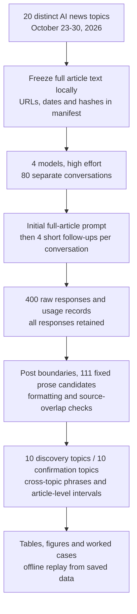
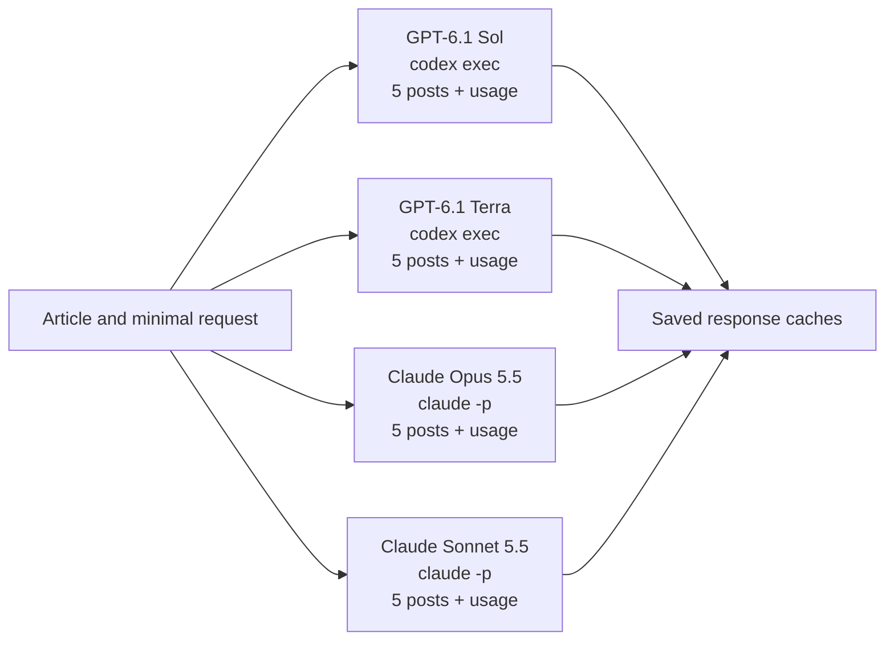
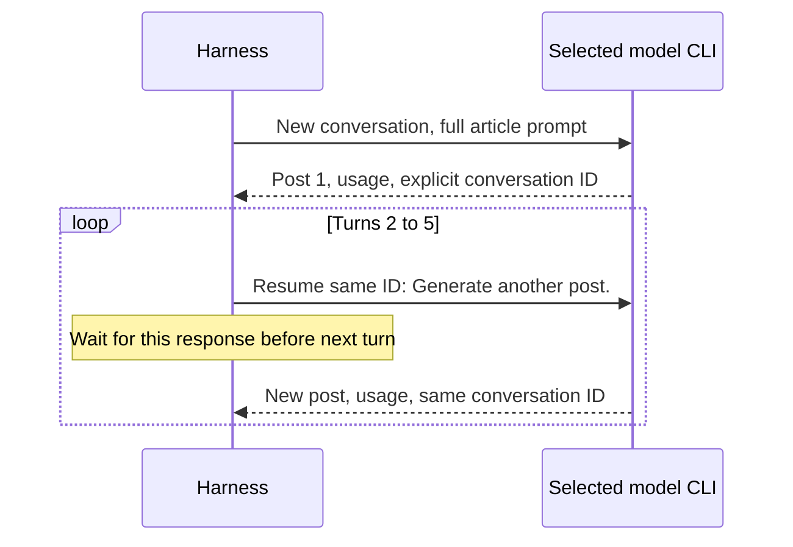
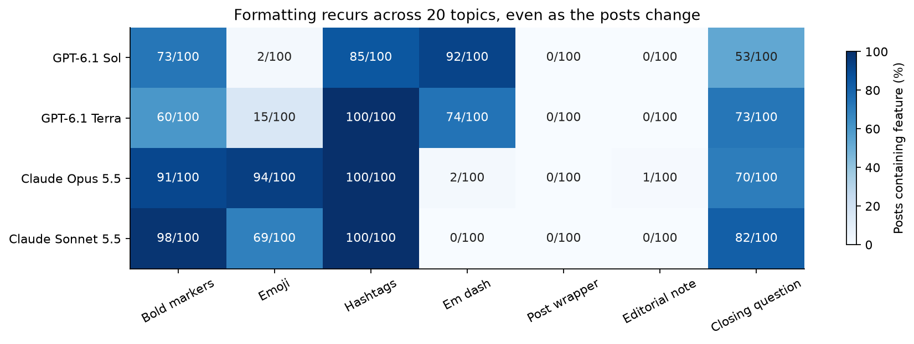
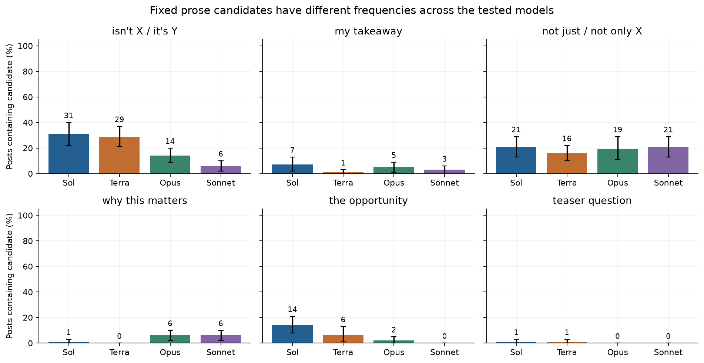
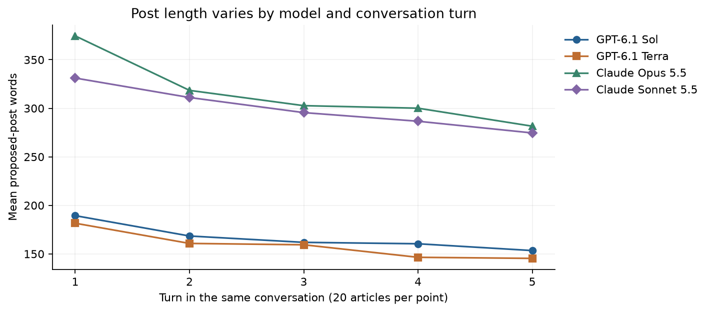
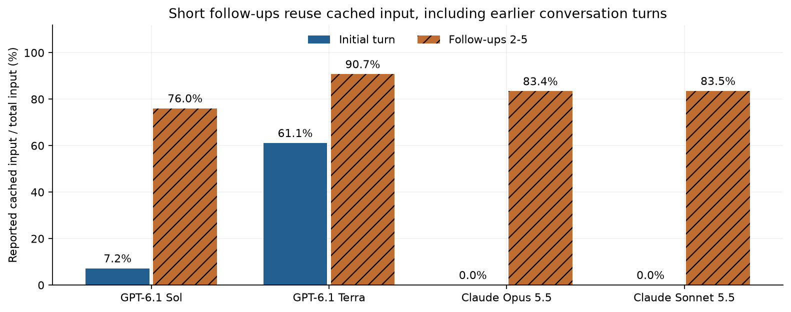

# How four models write LinkedIn posts from recent AI news

A person sharing an AI news article on LinkedIn needs to decide what to say first, why the news matters to a professional reader, and how to finish. A useful post keeps the facts straight while giving the reader a reason to spend time on them. Asking an assistant for a draft leaves many of those choices to the assistant.

The first sentence can lead with the announcement, raise a question or set up a contrast. Later paragraphs can connect the news to a practical decision. The ending might offer a lesson, ask readers for their views or simply stop after the last useful point. These choices give a post much of its voice.

Consider an illustrative example. A lab announces a model that can work with longer documents. One possible post explains which documents a team could now process. Another explains the cost of running it. These are different angles on the same news, and neither needs an instruction about tone or length to be possible. This is a teaching example, not one of the measured model responses.

Now imagine asking for another post in the same conversation. The assistant can see the earlier draft. It may choose another angle, reuse a familiar opening or keep the same closing structure. Changing the facts it highlights does not necessarily change its writing habits.

A repeated expression is not automatically a problem. A closing question can invite a useful discussion, and a technical term may be necessary to describe the news accurately. The question here is how often the same phrases and structures recur, and whether that happens across unrelated subjects rather than only within one article.

That distinction matters to someone choosing or editing a writing assistant. If an opening recurs across many drafts, the person may spend time replacing it. If the draft's closing question is nearly automatic, it may make posts on different subjects feel alike. Counting only whether complete documents differ would miss both patterns.

To measure recurrence, this study counts how many posts contain a phrase or formatting feature. If 12 of a model's 100 posts use an expression, its post incidence is 12%. It also counts how many of the 20 article topics contain it. A phrase found in 12 posts across eight subjects is different evidence from a phrase found in all five attempts about one subject.

The comparison keeps the source article and the short request the same for all four models. Each model gets one conversation per article and writes five posts in that conversation. This lets us ask which openings, transitions, point endings, post closings and layouts recur when a person requests several drafts from recent AI news.

All four models returned 100 readable responses: **400 posts across 20 recent news topics**, with five posts in each model/article conversation. Every model ran at high effort through its CLI. The first request included the full article; the next four messages were exactly `Generate another post.` No tool calls were observed.

Closing questions appeared in 53/100 Sol posts, 73/100 Terra posts, 70/100 Opus posts and 82/100 Sonnet posts. The fixed phrase inventory and cross-topic search below show which parts of the prose recur alongside those layouts. These are observed writing habits, not scores of which model writes better.

The main caveat is the conversation setup: later posts can draw on earlier drafts. These results describe the requested workflow on this 20-topic AI-news sample, not five independent answers to an empty conversation or every kind of LinkedIn writing. The source text and unavoidable CLI/runtime scaffolding can also affect the output.

## Contents

1. [The source articles](#1-the-source-articles)
2. [Models and controlled requests](#2-models-and-controlled-requests)
3. [What counts as repeated prose](#3-what-counts-as-repeated-prose)
4. [Formatting across the posts](#4-formatting-across-the-posts)
5. [Fixed prose candidates and discovered phrases](#5-fixed-prose-candidates-and-discovered-phrases)
6. [Conversation turns and concrete cases](#6-conversation-turns-and-concrete-cases)
7. [Provider cache reuse](#7-provider-cache-reuse)
8. [Limits and practical interpretation](#8-limits-and-practical-interpretation)
9. [Spend, saved data and reproduction](#9-spend-saved-data-and-reproduction)
10. [Future work and further reading](#10-future-work-and-further-reading)



One article takes the same path through each model. Its full text appears only on the first turn, and the CLI carries the conversation forward for the next four requests. Each new post is saved with its source ID, model, turn and provider usage. The analysis uses the saved responses, not another model's opinion about their style.

## 1. The source articles

The input set contains 21,219 words across 20 articles published October 23-30, 2026, inside the requested ten-day window relative to November 1 in Toronto. Each article covers a different announcement, incident, commercial development or research update. The topics include model releases, healthcare, scientific data, security, publishing, copyright, infrastructure and consumer applications.

| ID / source article | Published | Area | Words | Analysis split |
|---|---|---|---|---|
| [01-kimi: Introducing Kimi K3.1 Pro](https://simonwillison.net/2026/Oct/23/kimi-k31-pro/) | 2026-10-23 | model release | 296 | confirmation |
| [02-tb-screening: Bringing foundational models to the front lines of TB screening](https://research.google/blog/bringing-foundational-models-to-the-front-lines-of-tb-screening/) | 2026-10-23 | healthcare | 1507 | confirmation |
| [03-gemini-carbon: Gemini 4 Carbon: our next frontier model](https://blog.google/innovation-and-ai/models-and-research/gemini-models/introducing-gemini-4-carbon/) | 2026-10-28 | model release | 1001 | confirmation |
| [04-nemotron-speech: NVIDIA Nemotron 3.5 Transcribe and Granary v2: Intelligent Multilingual Transcription You Can Prompt and Adapt](https://huggingface.co/blog/nvidia/nemotron-transcribe-granary) | 2026-10-28 | speech | 2125 | confirmation |
| [05-enterprise-roi: Anthropic just launched tools to show companies what their AI spending is buying](https://techcrunch.com/2026/10/28/anthropic-just-launched-tools-to-show-companies-what-their-ai-spending-is-buying/) | 2026-10-28 | enterprise adoption | 735 | confirmation |
| [06-protostar: Announcing Project ProtoStar: Making Publicly Funded Science AI-Ready](https://huggingface.co/blog/announcing-project-protostar) | 2026-10-29 | scientific data | 1348 | confirmation |
| [07-apple-local-models: Introducing AnySpeechRecognizer and AnyDecisionModel: Open Models for Speech and Decisions on Apple Platforms](https://huggingface.co/blog/anydecisionmodel) | 2026-10-29 | on-device development | 2589 | discovery |
| [08-model-spec: An updated Model Spec for more capable and beneficial AI](https://openai.com/index/updated-model-spec/) | 2026-10-29 | model behaviour | 1148 | discovery |
| [09-misalignment-monitoring: How we detect frontier model misalignment](https://openai.com/index/how-we-detect-frontier-model-misalignment/) | 2026-10-29 | safety research | 3197 | discovery |
| [10-reddit-login: As search traffic dries up, Reddit announces it’s shifting to a logged-in experience](https://techcrunch.com/2026/10/29/as-search-traffic-dries-up-reddit-announces-its-shifting-to-a-logged-in-experience/) | 2026-10-29 | publishing and search | 763 | discovery |
| [11-thrive-adt: OpenAI-backed Thrive Holdings acquires ADT](https://techcrunch.com/2026/10/29/openai-backed-thrive-holdings-acquires-adt/) | 2026-10-29 | acquisition | 256 | confirmation |
| [12-dartmouth-writing: Dartmouth provost resigns following accusations he used artificial intelligence for writing](https://abcnews.com/Technology/wireStory/dartmouth-provost-resigns-accusations-artificial-intelligence-writing-137686123) | 2026-10-29 | writing and accountability | 519 | discovery |
| [13-cursor-extension: Official Claude Code Extension on Cursor Marketplace Trojanized with Persistent SSH Backdoor](https://thehackernews.com/2026/10/official-claude-code-vs-code-extension.html) | 2026-10-30 | software security | 1260 | confirmation |
| [14-seti: Things That Go Beep in the Night: Agentic AI Joins the Search for Extraterrestrial Signals](https://blogs.nvidia.com/blog/ai-joins-the-search-for-extraterrestrial-signals/) | 2026-10-30 | scientific applications | 519 | discovery |
| [15-doordash-agents: DoorDash said it’s only received ‘several hundred’ orders from AI agents](https://techcrunch.com/2026/10/30/doordash-said-its-only-received-several-hundred-orders-from-ai-agents/) | 2026-10-30 | agent adoption | 319 | discovery |
| [16-zest: Zest’s new AI agent finds restaurants and books reservations over text](https://techcrunch.com/2026/10/30/zests-new-ai-agent-finds-restaurants-and-books-reservations-over-text/) | 2026-10-30 | consumer applications | 682 | discovery |
| [17-orbital-compute: Google’s first data center satellite is online and writing poetry](https://techcrunch.com/2026/10/30/googles-first-data-center-satellite-is-online-and-writing-poetry/) | 2026-10-30 | infrastructure | 592 | confirmation |
| [18-wikimedia: The Wikimedia Foundation files to protect open knowledge in New York Times v OpenAI case](https://wikimediafoundation.org/news/2026/10/30/wikimedia-foundation-amicus-brief-new-york-times-v-open-ai-case/) | 2026-10-30 | copyright | 945 | discovery |
| [19-training-preferences: Making it easier for websites to express AI training preferences](https://openai.com/index/helping-websites-express-ai-training-preferences/) | 2026-10-30 | publisher controls | 283 | confirmation |
| [20-community-safety: Community safety report and new protections for teens](https://openai.com/index/community-safety-report-and-new-protections-for-teens/) | 2026-10-30 | consumer safeguards | 1135 | discovery |

Each row is one source shared by all four models, not an additional prompt variation. The articles vary in length and in publisher voice. Keeping that variation is part of testing habits across subjects; matching the same article within every four-model comparison prevents one model receiving easier or more promotional source material than another. It does not make the selected news a random sample of the industry.

The complete article body was used, including substantive lists, code, captions and correction notices. Extraction removed navigation, sharing widgets, related-story cards and accessibility-only labels. The title and publication date accompanied the body. No model received a summary, length instruction or editorial explanation of the article. The full inputs are local and git-ignored because public access does not itself grant redistribution rights. [The article manifest](data/main/articles.json) retains URLs, dates, extraction selectors, retrieval times and hashes; [source-overlap records](data/main/source_overlap.json) support offline analysis without republishing each article.

The date rule is recorded in [the model freshness record](data/main/freshness.json). Sol's documented cutoff is April 30, 2026 and Terra's is June 1. The Claude release-date fallbacks are September 22 for Opus 5.5 and September 28 for Sonnet 5.5. Every selected article was published later. Recent publication reduces ordinary training-data overlap, but undated model IDs and undocumented later updates mean it cannot prove that a provider never saw a page.

An announcement date and the date described by an article are not always identical. The Dartmouth departure was announced October 28, the compromised extension was distributed October 29, Zest introduced its feature October 29, and the orbital-compute article describes first model prompts that week. These all remain inside the event window. The manifest records those distinctions. The smoke-test Mistral article is excluded from the main set so that its inspected outputs do not enter the main comparison.

## 2. Models and controlled requests

| Model | Requested version / immutable pin | Provider and call | Size / precision | Settings | Why included |
|---|---|---|---|---|---|
| GPT-6.1 Sol | `gpt-6.1-sol`; no immutable dated revision exposed | OpenAI, `codex exec` | Not published | High effort; default supported sampling; neutral optional base instruction | Requested GPT-6.1 family member |
| GPT-6.1 Terra | `gpt-6.1-terra`; no immutable dated revision exposed | OpenAI, `codex exec` | Not published | High effort; default supported sampling; neutral optional base instruction | Requested GPT-6.1 family member |
| Claude Opus 5.5 | `claude-opus-5-5`; no immutable dated revision exposed | Anthropic, `claude -p` | Not published | High effort; default supported sampling; neutral optional base instruction | Requested Claude 5.5 family member |
| Claude Sonnet 5.5 | `claude-sonnet-5-5`; no immutable dated revision exposed | Anthropic, `claude -p` | Not published | High effort; default supported sampling; neutral optional base instruction | Requested Claude 5.5 family member |

The requested model IDs are fixed and the raw CLI traces retain reported IDs when available. The table also names the limit on that control: the CLIs expose no immutable dated revision for this collection. Matching a named effort setting does not establish identical hidden computation across providers. These are the four requested models, with no automatic fallback model.

Every new model/article conversation begins with:

```text
Write a LinkedIn post based on the following article.

<article>
{{complete_article_text}}
</article>
```

Each of the next four turns contains only:

```text
Generate another post.
```

The follow-up does not repeat the article or ask for a different angle. It does not specify a length, audience, style, opening, hashtag policy or avoidance of familiar words. The models cannot see the phrase inventory or any analysis result. The optional CLI base instruction is the same neutral line, `You are a helpful assistant.` There are 80 separate conversations, one for each model/article pair; no article's outputs become context for a different article.





The four model workers can run in parallel. Within a model/article conversation the five calls are strictly sequential, and the harness waits for each response before asking for another. The article order is shuffled with a saved seed. The models do not exchange messages. The response cache is keyed by the complete request fingerprint and by turn, so a provider cache hit cannot substitute a local copy of an earlier post for a new generation.

All models were called only through their CLIs. Web search, command execution, browser/computer/image operations, MCP connections, optional skills, plugins, hooks, memories and multi-agent operation were disabled through the smoke-tested controls. Claude init records require empty executable-tool, MCP and skill catalogues. Codex's supported feature switches disable those operations, and raw events are checked for tool calls. The observed number of tool calls is zero.

Each model's 100 proposed post bodies is distinct after case and whitespace normalisation, with zero exact duplicate pairs within an article conversation. This verifies a basic collection property, not stylistic variety. The phrase and formatting analyses can still find repeated passages and structures inside different complete posts.

Some runtime instructions cannot be removed. Claude still lists three built-in plugin inventory labels, and Codex debug output retains mandatory runtime catalogue/team/environment scaffolding despite feature disables. No repository writing rules enter the generation working directory. Thus zero observed tool use and the supported disable switches are verified, while an identical pure provider system prompt is not. [The protocol](data/PROTOCOL.md) and saved command records document that distinction.

### How the study got here

The earlier smoke test checked repeated generations, explicit session resumes, cache counters and output boundaries. It found that Codex token counters and Claude cost counters accumulate across resumed sessions, and that assistant notes should be separated from the proposed post. Those engineering repairs were made before the full run. The 40 smoke outputs and their diagnostics remain saved separately and do not enter any main result below. The owner then authorised the 400-post collection and fixed the short follow-up wording.

## 3. What counts as repeated prose

The first analysis uses a fixed inventory of 111 vocabulary items, phrases and structure candidates, saved before the smoke generations and retained unchanged for the full run. It includes expressions such as `my takeaway`, `why this matters` and `the opportunity`, vocabulary candidates such as `delve` and `underscore`, and sentence patterns such as a negative contrast followed by a positive claim. [The inventory](data/prose_lexicon.json) gives every exact matching rule and its provenance.

The research papers in Further reading motivate counting lexical overrepresentation; they do not establish that every item is overused by these four models on LinkedIn. The repository's editorial watchlist supplies candidates, and the LinkedIn-specific expressions are stated investigator hypotheses. A match is descriptive, not automatically a defect or an AI-authorship signal. Literal technical use and useful signposting remain possible.

For each phrase the report counts posts containing it, total occurrences, occurrences per 1,000 words and distinct source topics. Counts are also separated by location: the opening sentence, opening paragraph, first 30 words, transition-start windows, non-final paragraph endings, final substantive paragraph and closing sentence. Raw responses and editorial notes have their own views. These zones overlap, so adding their counts would double-count text.

The closing is the final substantive sentence before a hashtag-only block. A literal response wrapper, such as a label announcing a LinkedIn post, is counted separately from the opening. A clearly delimited editorial note is preserved separately from the post ending. Sentence and boundary rules are deterministic heuristics. Raw responses remain available so a reader can inspect ambiguous cases rather than take the parser as a judgment of quality.

The second analysis searches all two-to-eight-word sequences. A sequence contributes to the model-signature search only on posts whose own source article does not contain it under the same tokenisation. This conservative filter prevents a product name or copied source wording from becoming a signature merely because the model repeats the news. It cannot prove the origin of a phrase or make every remaining expression distinctive.

Ten article topics were assigned to discovery and ten to confirmation before main generation. A discovered phrase needs at least five discovery posts across at least three discovery topics. It is labelled confirmed only if it also occurs in at least five confirmation posts across at least three confirmation topics. Each half contains 50 posts per model. Other observations remain exploratory. The threshold was fixed in [the preregistration](data/main/preregistration.json), not chosen to make a particular model look distinctive.

The displayed 95% intervals resample whole articles, with all five posts kept together, using 2,000 bootstrap draws. They describe variation across this 20-topic sample under the same procedure. They are not intervals across independent model weights or randomly chosen LinkedIn users. All-zero observations can yield a zero-width bootstrap interval; they do not prove a phrase has zero probability in future writing. Held-out support is a replication threshold, not a multiple-testing-adjusted significance claim.

## 4. Formatting across the posts

The chart asks which visible choices recur across the source topics. Compare rows within each column: a high count means the feature appears in many of that model's 100 proposed posts. Numeric labels make the comparison readable without relying on colour. Wrappers and editorial notes describe the assistant response around the post, rather than formatting inside the proposed post.



| Model | Bold | Emoji | Hashtags | Em dash | Closing question | Wrapper / note |
|---|---|---|---|---|---|---|
| GPT-6.1 Sol | 73/100 | 2/100 | 85/100 | 92/100 | 53/100 | 0 / 0 |
| GPT-6.1 Terra | 60/100 | 15/100 | 100/100 | 74/100 | 73/100 | 0 / 0 |
| Claude Opus 5.5 | 91/100 | 94/100 | 100/100 | 2/100 | 70/100 | 0 / 1 |
| Claude Sonnet 5.5 | 98/100 | 69/100 | 100/100 | 0/100 | 82/100 | 0 / 0 |

Closing questions appear in GPT-6.1 Sol: 53/100, GPT-6.1 Terra: 73/100, Claude Opus 5.5: 70/100, Claude Sonnet 5.5: 82/100. A question at the end is therefore a recurring choice in this workflow, rather than something the prompt required. These frequencies do not show whether readers would find the questions useful or repetitive; the study did not publish the posts or measure engagement.

The other columns separate choices that can easily get conflated. Bold markers are Markdown syntax in the returned text, not proof LinkedIn will render them as bold. Emoji counts test presence; the detailed table also retains emoji-range codepoint counts. Hashtags are separate from headings and links. An em dash is a punctuation observation, not an error. A post wrapper or source-checking note may create editing work even when the proposed post itself is usable.

The complete [per-post formatting table](data/main/formatting.csv) includes words, paragraphs, short lines, blank lines, Markdown bullets, numbered items, emoji-prefixed lines, headings, links and punctuation. Emoji-prefixed lines are recorded separately rather than automatically called list items. [The summary table](data/main/formatting_summary.csv) includes article-bootstrap intervals. These quantities let a reader distinguish repeated layout from repeated wording, and inspect whether a high average is spread across topics or concentrated in a few conversations.

## 5. Fixed prose candidates and discovered phrases

The fixed-candidate chart compares the same six matching rules across models. Each bar is the percentage of 100 proposed posts containing that candidate. The black whiskers are the article-bootstrap 95% intervals defined above. The raw source-overlap counts remain in the full table; the displayed fixed counts include all occurrences and do not by themselves establish that wording originated with a model.



| Fixed candidate | Sol | Terra | Opus | Sonnet |
|---|---|---|---|---|
| my takeaway | 7/100 | 1/100 | 5/100 | 3/100 |
| the opportunity | 14/100 | 6/100 | 2/100 | 0/100 |
| isnt x its y | 31/100 | 29/100 | 14/100 | 6/100 |
| not just x | 21/100 | 16/100 | 19/100 | 21/100 |
| why this matters | 1/100 | 0/100 | 6/100 | 6/100 |
| teaser question | 1/100 | 1/100 | 0/100 | 0/100 |

For the literal phrase `my takeaway`, the observed counts are GPT-6.1 Sol: 7/100 across 5 topics, GPT-6.1 Terra: 1/100 across 1 topics, Claude Opus 5.5: 5/100 across 5 topics, Claude Sonnet 5.5: 3/100 across 3 topics. The topic counts matter because five similar endings in one conversation are weaker evidence of a general habit than the same ending recurring across unrelated articles. The matching phrase may still be useful prose; the experiment measures frequency, not an automatic quality penalty.

The negative-contrast rule is broader than an exact phrase. It flags a nearby pattern such as a statement that something is not one thing followed by a positive reframing. It is a candidate span requiring contextual review, not a grammar parser or a claim that all such contrasts are artificial. The [fixed count table](data/main/fixed_prose_counts.csv) includes zeroes, locations, word-normalised occurrence rates, source-absent denominators and the number of topics represented. [Traceable match examples](data/main/fixed_phrase_examples.csv) connect positive counts to saved post IDs.

The teaser-question candidate is near the floor: one Sol post, one Terra post and no Opus or Sonnet posts match it. This sample cannot rank the models reliably on such a rare candidate. A zero count means it was not observed under this matching rule, not that the model never writes it.

The next table shows a small selection from the source-filtered phrase search. Selection is deterministic: within each model, take up to three of the most prevalent confirmed phrases of at least three words in the displayed locations, skipping phrases nested inside an already selected phrase. This prevents the table being filled with overlapping fragments of one longer sentence. It does not make the selected expressions the only interesting patterns.

| Model | Location | Source-absent phrase | Posts | Topics | Discovery / confirmation posts |
|---|---|---|---|---|---|
| Claude Opus 5.5 | transition_starts | `do you think` | 14 | 11 | 7 / 7 |
| Claude Opus 5.5 | whole | `out to me` | 13 | 12 | 6 / 7 |
| Claude Sonnet 5.5 | transition_starts | `do you think` | 17 | 11 | 12 / 5 |
| Claude Sonnet 5.5 | whole | `out to me` | 12 | 12 | 5 / 7 |

Every displayed phrase met the frozen support threshold separately on discovery and confirmation topics. The posts and topics columns use all 20 topics, while the last column exposes the held-out support rather than hiding it behind a single frequency. Source-derived occurrences were removed on a paired article basis. Function-word phrases and ordinary English constructions can still pass the threshold; confirmation of recurrence does not establish an exclusive model fingerprint.

The complete search is in [phrase_candidates.csv](data/main/phrase_candidates.csv), including phrases that did not confirm. Openings, transitions, point endings and closings can be inspected separately. [Family fixed counts](data/main/family_fixed_counts.csv) show both member models alongside the two-family totals. [Shared confirmed phrases](data/main/family_shared_phrases.csv) require confirmation for each of the family's two tested models separately. A phrase common to one family member alone is not presented as shared by the family.

Family totals pool 200 posts but still represent only two tested models and the same 20 topics. They do not isolate an effect of a vendor's training choices, and CLI scaffolding remains a possible contributor. The per-model columns are retained so that a pooled family count cannot conceal a large difference between its members.

## 6. Conversation turns and concrete cases

Five posts from a conversation share an article and earlier context, but their lengths and openings can change as the person asks for another draft. The figure compares mean proposed-post length across turns. Each point averages the same 20 articles for one model; the lines connect observed means and do not imply a causal learning curve.



The horizontal axis is turn number, with the full article supplied only at turn 1. The vertical axis is words in the extracted proposed post, excluding a recognised wrapper or editorial note. Mean words from turn 1 to turn 5: GPT-6.1 Sol 189.4 to 153.4; GPT-6.1 Terra 181.6 to 145.4; Claude Opus 5.5 374.6 to 281.6; Claude Sonnet 5.5 331.1 to 274.6. Each endpoint averages 20 posts. The plot describes which drafts a person received at each step. It does not show that asking again causes a particular length, because the model also sees its previous answers and there is no independently randomised history-control arm in the main study. [The turn table](data/main/turn_summary.csv) retains counts and formatting alongside length.

The following cases were selected to make the workflow inspectable: two consecutive Sol drafts about one science article, an Opus first draft of that same article, a different subject through Terra, and Sonnet's fifth draft of a public-data article. They illustrate the measurement boundaries and comparisons rather than being a sample of the highest or lowest quality posts. They do not replace the aggregate tables.

### An ordinary first draft

Case `14-seti/gpt-6.1-sol/01` uses [Things That Go Beep in the Night: Agentic AI Joins the Search for Extraterrestrial Signals](https://blogs.nvidia.com/blog/ai-joins-the-search-for-extraterrestrial-signals/). The expected behaviour is a newly generated post based on that article; there is no single correct wording. The observed opening is:

> AI agents listening for alien AI sounds like science fiction.

The proposed post closes with:

> Where else could that shorter loop change what researchers can discover?

This post has 178 words, 11 paragraph blocks and 3 hashtags. A closing question is recorded as true, and a separate editorial note as false. These are observable output properties, not a quality score. The full response and source ID remain available in [the saved-post collection](data/main/posts.md).

### The same conversation asks for another angle

Case `14-seti/gpt-6.1-sol/02` uses [Things That Go Beep in the Night: Agentic AI Joins the Search for Extraterrestrial Signals](https://blogs.nvidia.com/blog/ai-joins-the-search-for-extraterrestrial-signals/). The expected behaviour is a newly generated post based on that article; there is no single correct wording. The observed opening is:

> The most interesting part of AI searching for extraterrestrial signals isn’t the possibility of finding alien AI.

The proposed post closes with:

> Sometimes, the breakthrough is shortening the distance between measurement and action.

This post has 155 words, 10 paragraph blocks and 3 hashtags. A closing question is recorded as false, and a separate editorial note as false. These are observable output properties, not a quality score. The full response and source ID remain available in [the saved-post collection](data/main/posts.md).

### A different model sees the same science article

Case `14-seti/claude-opus-5-5/01` uses [Things That Go Beep in the Night: Agentic AI Joins the Search for Extraterrestrial Signals](https://blogs.nvidia.com/blog/ai-joins-the-search-for-extraterrestrial-signals/). The expected behaviour is a newly generated post based on that article; there is no single correct wording. The observed opening is:

> 🛸 **AI agents built by humans, listening for AI agents built by aliens.**

The proposed post closes with:

> What other fields do you think are ready for "agentic instruments"? 👇

This post has 386 words, 15 paragraph blocks and 9 hashtags. A closing question is recorded as true, and a separate editorial note as false. These are observable output properties, not a quality score. The full response and source ID remain available in [the saved-post collection](data/main/posts.md).

### A security incident changes the subject

Case `13-cursor-extension/gpt-6.1-terra/01` uses [Official Claude Code Extension on Cursor Marketplace Trojanized with Persistent SSH Backdoor](https://thehackernews.com/2026/10/official-claude-code-vs-code-extension.html). The expected behaviour is a newly generated post based on that article; there is no single correct wording. The observed opening is:

> A trusted extension update can become a backdoor—even when it carries the legitimate publisher’s identity.

The proposed post closes with:

> The broader lesson: publisher identity and automatic updates are important trust signals—but they aren’t substitutes for monitoring the software supply chain and endpoint behavior.

This post has 213 words, 9 paragraph blocks and 4 hashtags. A closing question is recorded as false, and a separate editorial note as false. These are observable output properties, not a quality score. The full response and source ID remain available in [the saved-post collection](data/main/posts.md).

### A public-data announcement reaches its fifth draft

Case `06-protostar/claude-sonnet-5-5/05` uses [Announcing Project ProtoStar: Making Publicly Funded Science AI-Ready](https://huggingface.co/blog/announcing-project-protostar). The expected behaviour is a newly generated post based on that article; there is no single correct wording. The observed opening is:

> **Project ProtoStar, by the numbers 🔢**

The proposed post closes with:

> Want to participate or bring your institution on board? 👉 protostar@orcaopen.org

This post has 227 words, 13 paragraph blocks and 6 hashtags. A closing question is recorded as false, and a separate editorial note as false. These are observable output properties, not a quality score. The full response and source ID remain available in [the saved-post collection](data/main/posts.md).

### First-person writing needs an attribution check

Case `01-kimi/claude-sonnet-5-5/02` uses [Introducing Kimi K3.1 Pro](https://simonwillison.net/2026/Oct/23/kimi-k31-pro/). The expected behaviour is a newly generated post based on that article; there is no single correct wording. The observed opening is:

> **A pelican riding a bicycle is my favorite way to test a new AI model.**

The proposed post closes with:

> What's your go-to test prompt for a new model?

This post has 278 words, 8 paragraph blocks and 5 hashtags. A closing question is recorded as true, and a separate editorial note as false. These are observable output properties, not a quality score. The full response and source ID remain available in [the saved-post collection](data/main/posts.md).

This case also shows a concrete editing risk. The source is Simon Willison's report of trying the model. The prompt gives no personal history for the LinkedIn account, but the draft adopts first-person experience, including a claim about skipping benchmark tables and trying the model. Publishing that as the account owner's own experience would require verification or revision. This is an inspected attribution risk in one saved case, not an estimate of the rate of unsupported claims across all 400 posts.

### Errors, disagreements and boundaries

All 400 planned responses were readable, so there is no unreadable model response to invent as an error example. Readability is at the ceiling and does not rank the models' skill. A response can still contain a factual mistake, an unsuitable claim or awkward writing; no gold-post or factual adjudication was performed. The saved text is the evidence for a later quality review.

Two models can legitimately emphasise different aspects of the same article. The same-article cases above show the actual input source, observed opening and closing, and measured formatting. Their differences establish different returned drafts, not that one model understood the news better.

Parser boundaries also matter. A label announcing a post is not the reader-facing hook, and an assistant note after the draft is not necessarily the post closing. The smoke test exposed those cases before main collection, and the raw responses are retained alongside the derived view. Potentially ambiguous cases should be inspected from the raw response rather than silently reclassified to support a preferred result. [Protocol history](data/PROTOCOL.md) records the earlier parser amendments and preserved old classifications.

## 7. Provider cache reuse

A provider can reuse calculations for an unchanged conversation prefix while generating a new answer. That is different from this notebook's local response cache, which only replays a completed request during analysis. Every main-study response required a generation request; cached input tokens are provider-reported usage for that request.

The chart compares the first turn of each conversation with turns 2-5. It aggregates tokens before dividing, so longer requests have their actual weight. The denominator includes the full model-visible input, including prior conversation turns and CLI scaffolding, not only the three words in the follow-up message.



| Model | All input tokens | Cache reads | New cache writes | Cached share, turns 2-5 | Reported CLI dollar equivalent |
|---|---|---|---|---|---|
| GPT-6.1 Sol | 894,726 | 565,120 | 0 | 76.0% | Unavailable |
| GPT-6.1 Terra | 882,672 | 751,360 | 0 | 90.7% | Unavailable |
| Claude Opus 5.5 | 461,811 | 337,050 | 124,561 | 83.4% | $2.6418 |
| Claude Sonnet 5.5 | 454,390 | 331,243 | 122,947 | 83.5% | $1.2971 |

On turns 2-5, the weighted cache-read shares are GPT-6.1 Sol: 76.0%, GPT-6.1 Terra: 90.7%, Claude Opus 5.5: 83.4%, Claude Sonnet 5.5: 83.5%. These are observations from this run, not guaranteed backend behaviour. An initial turn may already read a shared runtime prefix from cache, and a later turn may need to write newly added conversation history even if much of the old context is reused.

For Claude, ordinary input, cache-read input and cache-write input are disjoint and must be added to obtain total input. For Codex the input counter is already inclusive. Resumed Codex counters accumulate across the saved conversation, and Claude's reported dollar cost also accumulates. The collector retains native counters and differences them within the same conversation before aggregating. The smoke verification against native last-turn counters is retained in [counter scope checks](data/counter_scope_checks.json); main per-turn values and scopes are in [the cache ledger](data/main/provider_cache_usage.csv).

To encourage reuse, all five turns of an article/model block remain sequential, with unchanged source, optional system line, working directory, effort and tool configuration. Conversation IDs are explicitly resumed; there is no global last-conversation lookup. Article text is not resent on follow-ups, and no padding is added to reach a provider cache threshold. Different model workers run independently so an output from another model never enters the conversation.

A high read fraction is not the same as a small bill. Later turns contain earlier posts, and cache writes and generated output have their own costs. Dollar equivalents are only stated where the CLI exposes them. Runtime/provider prefix caching can also reuse material shared across articles; the counters do not isolate the article's own contribution. No causal cache-strategy comparison or routing guarantee is claimed.

## 8. Limits and practical interpretation

The evidence supports a specific editing workflow: inspect recurring openings, transitions, point endings, closing questions and layout choices for these four models when requesting five drafts from one article-specific conversation. The saved counts identify concrete habits worth reviewing. They do not establish that a model is a better LinkedIn writer, that a recurring phrase is always undesirable, or that a reader could identify AI authorship from it.

There is no human-written LinkedIn comparison corpus, blinded editorial score, engagement outcome or independent factual answer key. A model can vary its wording while adding an unsupported claim, or reuse a phrase while accurately explaining the news. Distinct response hashes and readable-output counts address collection integrity rather than writing quality. With every model returning readable text, that success measure is at a ceiling.

The 20 topics were selected from a short AI-news window, not randomly sampled from all professional writing. They include related industry themes and several company-authored announcements. Publisher tone and source length may influence posts. Source-overlap filtering removes an important confound for exact phrases, but it cannot remove every effect of the source's framing or meaning.

The five sequential posts are conditional on earlier drafts. The phrase counts and intervals therefore keep article clusters intact. The discovery/confirmation split reduces the chance of presenting a one-topic coincidence as a broad habit, but it remains a small held-out sample and does not turn descriptive phrase mining into a validated authorship detector. Nested phrases and common function-word sequences also mean the number of confirmed candidates is not a count of independent habits.

Provider families are represented by two models each. Model versions are requested undated IDs rather than immutable weight snapshots, and mandatory CLI/runtime instructions are not identical across providers. No observed tool use was allowed, but the retained platform scaffolding limits claims about a bare model's intrinsic style. These are results for the named CLI workflows and settings.

The analysis design, source set, fixed inventory, follow-up wording and confirmation thresholds were fixed before main generation. Earlier smoke-driven parser repairs and the user's change to continued conversations are recorded in [the protocol](data/PROTOCOL.md). The practical use of the findings is to know what to look for in drafts, with a new experiment needed to test whether those habits affect reader preference or publishing outcomes.

## 9. Spend, saved data and reproduction

The main collection contains 400 generation requests: 100 per model, 80 separate conversations, five responses each. All 400 were readable, with no observed tool calls, no content retry and no fallback model. There are no paid judge calls. The source set contains 21,219 words, and the full model input is larger because conversations and runtime context are included.

For the 200 included Claude responses, the CLI-reported list-price equivalent totals $3.938860. Codex dollar equivalents are unavailable in the saved events, so the full dollar total and actual subscription charge cannot be stated. These are reported token-price equivalents, not an invoice. Earlier smoke and diagnostic costs remain separate; one interrupted smoke diagnostic has unknown final usage. [The main financial summary](data/main/financial_summary.json) keeps those boundaries explicit.

The main public data are under `data/main/`. Every response has raw JSONL stdout, stderr, parsed text, request fingerprint, source ID, model ID, conversation ID, turn, settings, timing and native usage. Article text is retained locally and git-ignored; public source metadata and overlap fingerprints support reproducibility without redistributing the source bodies.

- [Executed notebook](40_linkedin_writing_habits.ipynb), with collection and analysis helpers embedded for self-contained replay.
- [All main generated responses](data/main/posts.md), with stable article/model/turn IDs.
- [Article manifest](data/main/articles.json) and [preregistration](data/main/preregistration.json).
- [Per-post ledger](data/main/posts.csv), [cache usage](data/main/provider_cache_usage.csv) and [model summary](data/main/model_summary.csv).
- [Fixed prose counts](data/main/fixed_prose_counts.csv), [match examples](data/main/fixed_phrase_examples.csv), [phrase search](data/main/phrase_candidates.csv) and [shared family phrases](data/main/family_shared_phrases.csv).
- [Formatting](data/main/formatting.csv), [formatting summaries](data/main/formatting_summary.csv) and [turn summaries](data/main/turn_summary.csv).
- [Collector](full_study.py), [analysis](main_analysis.py), [validation](data/main/validation.json), [protocol](data/PROTOCOL.md) and [file manifest](data/MANIFEST.json).

From this folder, the ordinary reproduction path is offline:

```powershell
python -m unittest -v test_smoke_study.py test_full_study.py
python main_analysis.py
python -m nbconvert --to notebook --execute --inplace 40_linkedin_writing_habits.ipynb
```

The notebook imports no helper from another repository folder. It embeds its own CLI wrappers and analysis functions, reads the committed response caches and derived source-overlap records, and makes no model or network call during default execution. Python, NumPy, pandas, matplotlib, nbformat and nbconvert are needed for replay; the collector also uses requests and Beautiful Soup for source acquisition. Article source hashes prevent a changed web page from silently becoming the original input.

Live collection is explicit and budgeted. The complete run used the preregistered allowance of 400 new calls; in this version the explicit equivalent is `python full_study.py collect --max-new 400`, while the collector's ordinary default limit stays small. Existing request slots are verified and reused locally, not regenerated. Interrupted starts and holes in saved conversation history require reconciliation rather than silently appending a replacement turn to a later-mutated conversation. Never delete a middle turn just to rerun it: later posts already depend on that history.

The main notebook and README present one answer from the full run. Earlier smoke evidence remains in its original cache folders and protocol history, with no smoke posts pooled into main counts. The original full source files need not be present for default offline analysis because the saved overlap fingerprints are checked against the unchanged cached outputs.

## 10. Future work and further reading

Links checked November 1, 2026 (Toronto local date).

### Future work

- Compare fresh sessions and continued conversations on a new, matched 20-topic sample with randomised condition order. Measure phrase recurrence and cache use separately; the current five-turn results are conditional on prior drafts.
- Add a preselected, blinded human review of factual faithfulness, clarity, specificity and readiness to publish. Measure whether the observed recurring prose and formatting change reader preferences; the current study has no quality or engagement outcome.
- Repeat on non-AI subjects and independent reporting with a larger topic sample. Measure which patterns persist outside the narrow AI-news window, since source vocabulary and company announcement tone can influence the counts.
- Test a minimal user preference such as a request to omit a recurring closing structure, while holding the source and model fixed. Measure how much the confirmed patterns change and whether factual support is preserved; the current prompt intentionally gave no stylistic guidance.

### Further reading

- [Delving into LLM-assisted writing in biomedical publications through excess vocabulary](https://arxiv.org/abs/2406.07016) (Kobak et al., 2025). Motivates frequency-based comparison while showing why a word alone is not an authorship judgment.
- [Why Does ChatGPT "Delve" So Much? Exploring the Sources of Lexical Overrepresentation in Large Language Models](https://arxiv.org/abs/2412.11385) (Juzek and Ward, 2024). Studies lexical overrepresentation in another writing setting; its results do not by themselves establish LinkedIn habits.
- [Prompt caching](https://developers.openai.com/api/docs/guides/prompt-caching) (OpenAI, accessed 2026). Explains prefix caching and usage fields, with API controls that must not be assumed to exist in Codex.
- [Prompt caching](https://platform.claude.com/docs/en/build-with-claude/prompt-caching) (Anthropic, accessed 2026). Explains read/write counters and growing conversation prefixes, which determine the cache denominator used here.
