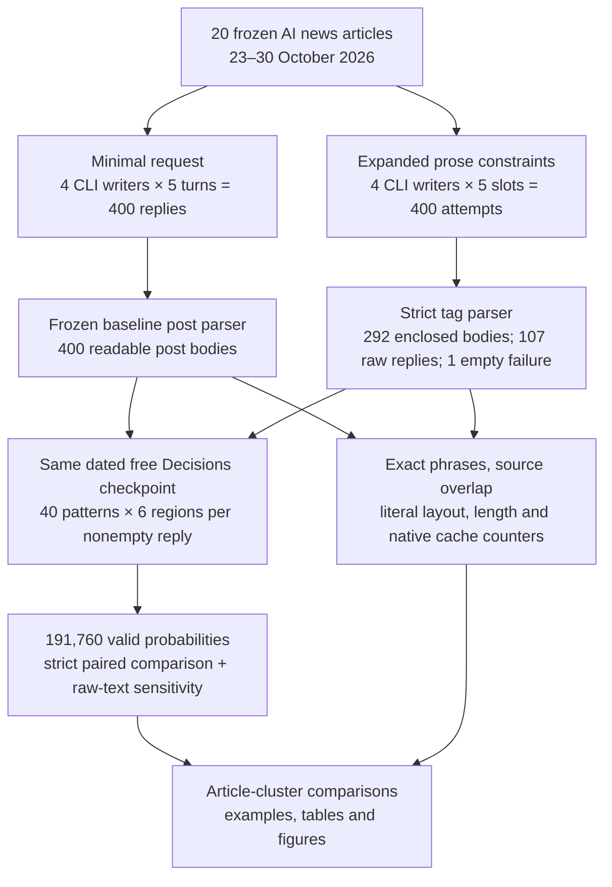
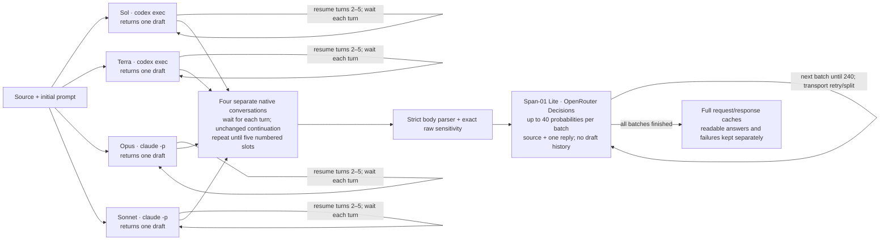
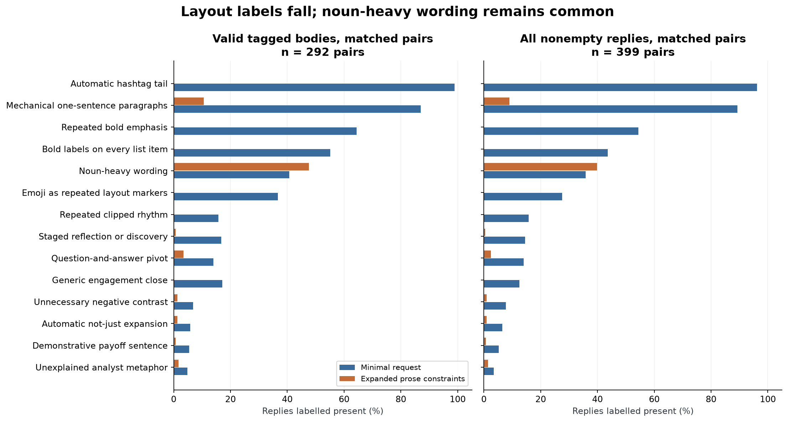
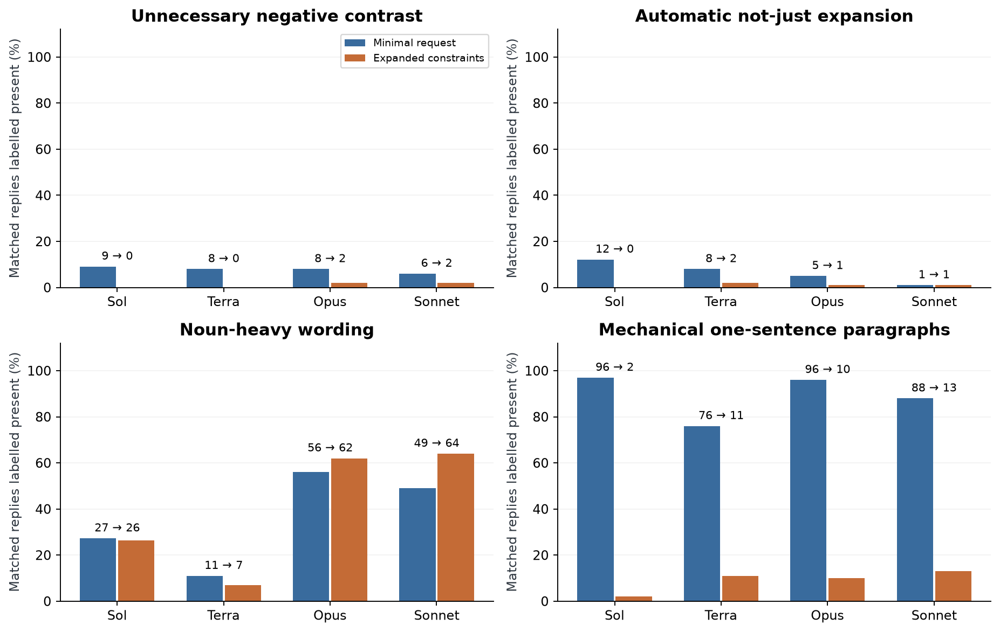
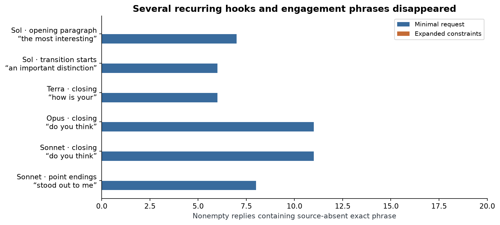
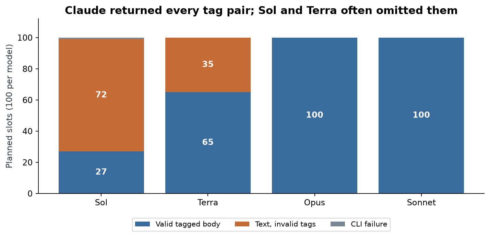
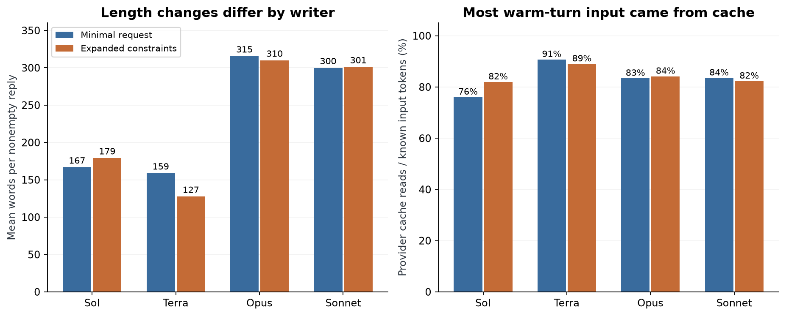
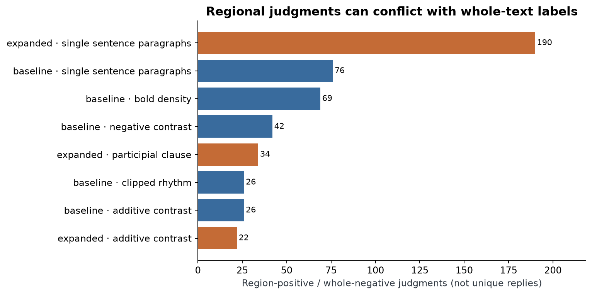

# Can prose constraints change recurring LinkedIn writing habits?

A person wants to share news about an AI tool on LinkedIn. They give a writing model the announcement and ask for a post. A useful draft explains what happened and why it matters to a reader. The person still needs to check the facts and decide whether the voice fits.

Another draft offers a choice. Yet five drafts can share a familiar opening, short-paragraph rhythm and invitation to comment. The words differ while the structure returns, leaving the editor to remove the same devices repeatedly.

**Illustrative example, not measured data.** Suppose an announcement says a support tool can now search old tickets. A draft might begin, “This isn't just search. It's a new way to work.” That opening delays the useful fact and introduces an alternative the reader did not ask about. A direct account could begin with the new ability and explain which tickets it can search.

Now add a complication: the tool searches archived tickets but cannot open attachments. A distinction between what it can and cannot do helps the reader. An instruction to remove every negative word would lose useful information. The editing problem concerns the role of the wording in context, rather than whether a particular word appears.

One approach leaves every writing choice to the model. Another leaves angle and length open while discouraging stock framing, unnecessary contrasts, repetitive rhythm and generic endings. That might save editing work, replace one habit with another or make extraction harder.

These possibilities need separate measurements. Counting hashtags can establish whether a visible format changed. Deciding whether a contrast is unnecessary requires reading the claim with its source. Neither measurement establishes that readers prefer the draft or that its facts are correct.

This study therefore keeps two kinds of evidence. It records literal wording and layout, and asks a separate classification model to return a probability for each of 40 editorial patterns. Several patterns can occur in one draft. Their counts are never added into a writing-quality score.

The question is: **on the same 20 AI news articles, how do four writers' drafts change when a minimal request is replaced by prose constraints, an explicit standalone-post continuation and a tagged output request?**

## Study summary

Each writer was asked for five successive posts per article in each condition: 400 baseline slots and 400 expanded-prompt slots. All writers used high effort, CLI access and no tools or web search. A **pattern frequency** is the number of replies the free classification model labels present, divided by the number with readable answers for that pattern. The main tag-valid comparison contains **292 matched pairs**; the secondary audit includes **399 matched pairs of nonempty replies**, preserving missing-tag replies as exact raw text.

In valid tagged pairs, negative-contrast labels change from 20/292 → 4/292. In the broader audit, generic hashtag-tail labels changed from **384/399 to 0/399**, and unnecessary-negative-contrast labels changed from **31/399 to 4/399**. Noun-heavy wording changed from **143/399 to 159/399**. These are classifier estimates; there is no human preference or factual-quality result.

The output contract was a substantial limitation: **107 nonempty replies omitted valid post tags**, and one Sol request returned an empty capacity error. Claude returned all 200 tag pairs; Sol returned 27/100 and Terra 65/100. Many contextual categories sit near zero under this classifier, so the study cannot rank writers on those categories. The prompts were developed after examining baseline writing, the baseline was collected first and the writer IDs are undated aliases. The results are an exploratory comparison of the complete prompting package.

## Contents

1. [Articles and the writing task](#1-articles-and-the-writing-task)
2. [Prompts, models and conversation design](#2-prompts-models-and-conversation-design)
3. [How a reply becomes a measurement](#3-how-a-reply-becomes-a-measurement)
4. [Which patterns changed, and which remained](#4-which-patterns-changed-and-which-remained)
5. [Differences among the four writers](#5-differences-among-the-four-writers)
6. [Repeated openings, transitions and endings](#6-repeated-openings-transitions-and-endings)
7. [Format failures, length and provider caching](#7-format-failures-length-and-provider-caching)
8. [Before-and-after examples and remaining contrasts](#8-before-and-after-examples-and-remaining-contrasts)
9. [Classifier checks, disagreements and limits](#9-classifier-checks-disagreements-and-limits)
10. [Reproduction, cached data and spend](#10-reproduction-cached-data-and-spend)
11. [Future work and further reading](#11-future-work-and-further-reading)



For the Kimi example, the complete saved article enters each writer conversation. Five replies are collected in order, then each reply is split according to its condition's output contract. The classifier receives one reply and its source, while exact phrase counting compares the reply with that same source. A missing tag prevents a strict post-body result; it still leaves a clearly labelled raw reply for the secondary audit.

## 1. Articles and the writing task

The inputs are 20 complete, frozen public articles, one per selected topic, published from October 23 through October 30, 2026. They total 21,219 words. The set covers releases, speech, healthcare, scientific applications, publishing, security, infrastructure and AI adoption. It is a deliberately varied convenience sample of AI news, rather than a random sample of LinkedIn subjects or industry events.

Both conditions receive identical frozen titles, dates and substantive article text. Extraction removes page furniture and retains meaningful lists, captions and corrections. The [manifest](data/main/articles.json) records extraction methods and hashes; publisher text stays local and excluded from Git.

| Example ID | Date | Article / topic | Words |
|---|---|---|---|
| 01-kimi | 2026-10-23 | [Introducing Kimi K3.1 Pro](https://simonwillison.net/2026/Oct/23/kimi-k31-pro/) | 296 |
| 02-tb-screening | 2026-10-23 | [Bringing foundational models to the front lines of TB screening](https://research.google/blog/bringing-foundational-models-to-the-front-lines-of-tb-screening/) | 1507 |
| 06-protostar | 2026-10-29 | [Announcing Project ProtoStar: Making Publicly Funded Science AI-Ready](https://huggingface.co/blog/announcing-project-protostar) | 1348 |
| 16-zest | 2026-10-30 | [Zest’s new AI agent finds restaurants and books reservations over text](https://techcrunch.com/2026/10/30/zests-new-ai-agent-finds-restaurants-and-books-reservations-over-text/) | 682 |

These four examples show the range; [the complete 20-article index](data/expanded_full_comparison/ARTICLES.md) gives every title, date, URL and length.

The longest source has 3,197 words and Kimi has 296. Longer sources offer more material and larger classification requests. Source length is not equalized and draft length is left to the writer.

The [freshness record](data/main/freshness.json) checks the recent articles against documented writer cutoffs or release-date fallbacks. Opaque backend changes prevent proving no prior exposure. Phrase counts exclude exact wording present in the same source.

**Measured input example: `01-kimi`.** The saved source reports the release of Kimi K3.1 Pro, benchmark comparisons and token prices. It also attributes an image-generation observation to the article's author. The intended LinkedIn poster supplied no biography or test history. A useful draft can report the observation with attribution; a claim that the poster personally tested it needs separate evidence. That distinction is part of the contextual rubric, not a rule that every use of “I” is wrong.

## 2. Prompts, models and conversation design

The minimal condition asks, “Write a LinkedIn post based on the following article,” followed by the complete article. Turns two through five contain only “Generate another post.” The expanded condition keeps the task open while adding 15 constraints about prose and layout, an explicit standalone-post continuation and an output boundary. Length and angle stay open.

The expanded task begins:

```text
Write a LinkedIn post based on the article below. Use your judgment about the angle, voice, length, structure and ending.
```

Inside `<constraints>`, it asks for plain prose; direct claims and ordinary words; meaningful connections between ideas; varied rhythm; necessary uncertainty; and an ending that stops when the subject is covered. It discourages unnecessary negative contrasts, “not just” expansions, stock framing, significance tails, staged revelations, forced groups of three and invented personal experience. [The complete initial template](data/prompt_conditions/simple_prose_v3.txt) is the exact experimental prompt, including useful exceptions. Nothing is added from this report during generation.

The exact continuation is:

```text
Write another standalone LinkedIn post from the same article. Treat it as an independent post, not a continuation, revision or critique of earlier posts. Follow the same prose constraints.

Return only the post inside <linkedin_post>...</linkedin_post>. Do not add explanations, notes or corrections before or after the tags.
```

Each model/article block has its own new conversation ID. The first call supplies the article and initial task; the next four resume that conversation with the saved continuation. Earlier drafts remain visible. “Independent” describes the requested standalone post, so the five drafts are correlated observations rather than five independent statistical samples.

| Model | Pinned version / identity limit | Provider and call | Size / precision | Output settings | Reason for inclusion |
|---|---|---|---|---|---|
| GPT-6.1 Sol | `gpt-6.1-sol`; undated alias | OpenAI, `codex exec` / explicit resume | Not published | High; tools/search off; neutral system | One GPT-6.1 writer; tests the previously observed Sol style |
| GPT-6.1 Terra | `gpt-6.1-terra`; undated alias | OpenAI, `codex exec` / explicit resume | Not published | High; tools/search off; neutral system | Second writer from the same tested family |
| Claude Opus 5.5 | `claude-opus-5-5`; undated alias | Anthropic, `claude -p` / explicit resume | Not published | High; tools/search off; neutral system | One Claude writer; longer drafts in the baseline |
| Claude Sonnet 5.5 | `claude-sonnet-5-5`; undated alias | Anthropic, `claude -p` / explicit resume | Not published | High; tools/search off; neutral system | Second Claude writer; permits a within-family comparison |
| Span-01 Lite | `respan/span-01-lite-20260925`; dated checkpoint and native returned ID | Respan via OpenRouter Decisions API, standard zero-price route | Not published | Typed boolean questions; no effort control exposed; no tools; Respan only; prices capped at zero | The live catalogue exposed one unique free decision checkpoint; applies the same rubric to both conditions |

Writer IDs are undated aliases. Codex was `0.160.1`; Claude Code was `2.1.296`. Calls share a neutral system prompt and isolation settings, with no notebook, style file, search or tools available. Native logs show no tool activity.



Writers can run concurrently; turns within a conversation wait. The classifier receives source and one reply, with no writer identity, condition or prior drafts. Classification order is interleaved across matched pairs; writing-condition order is not.

### How the study got here

A smoke test checked output diversity and collection code. An intermediate source-auditing prompt produced editorial commentary in some Claude replies. The current prompt removes that procedure. All 20 matching Kimi preview replies were imported, including the format failure; the remaining 380 slots use the unchanged prompt. Both current arms are reclassified with the same free model. Earlier paid labels and intermediate outputs remain in [protocol history](data/PROTOCOL.md), outside the current numerical comparison.

## 3. How a reply becomes a measurement

The workflow above separates generation from extraction. A **strict readable post** contains exactly one complete, nonempty, non-nested `<linkedin_post>...</linkedin_post>` pair. Text before and after is saved separately. Missing, repeated, malformed or empty tags do not cause an automatic rewrite or a guessed body. An empty CLI error has no prose to classify.

| Population | What enters | Matched pairs | What it can establish |
|---|---|---|---|
| Strict post-body comparison | Baseline parsed body; expanded valid enclosed body | 292 | Change among cells with a readable post body in both conditions |
| Raw-text sensitivity | Same baseline body; exact entire expanded reply if tags fail | 399 | Whether a reduction survives inclusion of missing-tag prose; not a repaired post parser |
| Recovery-block sensitivity | Raw pairs excluding Sol on the SETI article | 395 | Whether that one capacity-interrupted conversation changes the observation |

The secondary raw audit was declared after early tag failures, before full-run classification. It keeps every nonempty invalid-tag reply as exact raw text; no post body is guessed. The older baseline parser stays frozen because its prompt requested no tags.

### Regions and literal measurements

The classifier sees six named regions. **Whole** is the entire measured text; **opening paragraph** is the first paragraph; **transition starts** are the first 12 whitespace-delimited words of later sentences and paragraphs; **point endings** are final sentences of substantive paragraphs other than the last; **conclusion** is the last substantive paragraph; and **closing** is its final sentence. A hashtag-only final paragraph is excluded from substantive endings. Sentence splitting is a fixed heuristic and is not a linguistic gold standard.

Regions are provided beside the whole text and source. An instance must occur within its named region. Assembled transition and point-ending windows can alter layout, so whole-text labels are primary and regional formatting labels are diagnostic. Separate opening-sentence and 30-word inventories do not change the classifier regions.

Literal counters measure words, paragraphs, hashtags, Markdown bold, list markers, specified emoji ranges, punctuation and exact “not just / not only / more than just” phrases. They never assign contextual prose faults and do not cover every emoji sequence.

### Typed multi-label questions

The free Decisions model answers one yes/no probability per pattern and region. Forty separate probabilities allow multiple labels on one reply; the 40 values do not have to sum to one. The state contains the source, whole text, six regions and frozen definitions with useful exceptions. The question shape is:

```json
{"whole__negative_contrast": {
  "type": "noul",
  "instructions": "Under the RUBRIC definition and exceptions for negative_contrast, does an instance occur in region whole? Use the whole post and source for context.",
  "criteria": {"true": "The defined pattern occurs in the specified region.", "false": "The defined pattern is absent from the specified region."}
}}
```

The rubric defines negative contrast as denying an alternative the reader may never have proposed, allowing correction of an actual misunderstanding. Source and reply are treated as data. Probability 0.70 is present at 0.5; 0.30 is absent. The 0.2/0.8 sensitivities are operating choices, not calibrated guarantees.

**Illustrative counting example.** If four of ten readable paired replies receive a label under the minimal request and one of the same ten under the expanded prompt, the frequencies are 40% and 10%, a decrease of 30 percentage points. A missing probability is removed from that predicate's paired denominator; it is never converted to “absent.” The actual [paired table](data/expanded_full_comparison/paired_patterns.csv) gives the denominator for every model, region, pattern and threshold.

Intervals resample the 20 articles 2,000 times, retaining available matched drafts within each sampled article and averaging article-level changes. The central 95% of those draws is shown. Post-weighted changes are also retained because unequal tag survival can alter weighting. Intervals cover variation across these articles, conditional on classifier and aliases; they exclude classifier bias, prompt selection and backend drift. The 40-pattern audit is exploratory with no multiple-comparison correction.

### Worked measured case: from raw reply to a label

For `01-kimi/claude-sonnet-5-5/01`, the original opening is:

> Kimi K3.1 Pro just landed on the Kimi API, and it may change how we think about open models.

The expanded opening in the same numbered slot is:

> Moonshot released Kimi K3.1 Pro on its API on October 23 and says full model weights will follow by November 4. Weights are not out yet, so it is still a hosted model for now.

The original parser and tag parser each supply their measured body. The classifier's whole-text negative-contrast probabilities are 0.054 and 0.019; each is independently compared with 0.5. Literal word counts are 292 and 242. These steps link the saved input, raw output, extracted body and returned probabilities. There is no single correct LinkedIn post or human gold prose label for this item.

## 4. Which patterns changed, and which remained

Compare each pattern across the two prompting packages. The left panel uses only matched valid post bodies; the right panel includes missing-tag text as exact raw replies. Blue bars show the minimal request and orange bars show expanded constraints. The horizontal axis is the percentage labelled present at probability at least 0.5. The two panels have different selected populations, so a change in their level can reflect which drafts survived the tag contract.



| Pattern | Strict valid-body pairs | All nonempty pairs (secondary) | Article-cluster change, secondary |
|---|---|---|---|
| Automatic hashtag tail | 289/292 → 0/292 | 384/399 → 0/399 | -96.2 pp [-100.0, -92.5] |
| Mechanical one-sentence paragraphs | 254/292 → 31/292 | 356/399 → 36/399 | -80.2 pp [-85.7, -74.5] |
| Repeated bold emphasis | 188/292 → 0/292 | 217/399 → 0/399 | -54.4 pp [-61.1, -48.2] |
| Bold labels on every list item | 161/292 → 0/292 | 174/399 → 0/399 | -43.6 pp [-47.6, -39.9] |
| Noun-heavy wording | 119/292 → 139/292 | 143/399 → 159/399 | +4.0 pp [-1.7, +10.2] |
| Emoji as repeated layout markers | 107/292 → 0/292 | 110/399 → 0/399 | -27.5 pp [-33.5, -21.8] |
| Repeated clipped rhythm | 46/292 → 0/292 | 63/399 → 0/399 | -15.8 pp [-20.1, -11.5] |
| Staged reflection or discovery | 49/292 → 2/292 | 58/399 → 2/399 | -14.1 pp [-18.4, -10.1] |
| Question-and-answer pivot | 41/292 → 10/292 | 56/399 → 10/399 | -11.5 pp [-15.5, -8.3] |
| Generic engagement close | 50/292 → 0/292 | 50/399 → 0/399 | -12.6 pp [-16.7, -8.8] |
| Unnecessary negative contrast | 20/292 → 4/292 | 31/399 → 4/399 | -6.8 pp [-10.8, -3.0] |
| Automatic not-just expansion | 17/292 → 4/292 | 26/399 → 4/399 | -5.5 pp [-8.0, -3.2] |
| Demonstrative payoff sentence | 16/292 → 2/292 | 21/399 → 3/399 | -4.5 pp [-6.9, -2.5] |
| Unexplained analyst metaphor | 14/292 → 5/292 | 14/399 → 6/399 | -2.0 pp [-4.0, +0.0] |

Each arrow uses the same article/model/turn cells. Intervals resample articles and measure percentage-point changes, not numbers of instances. These are the 14 largest baseline frequencies; [all 40 patterns, thresholds and regions](data/expanded_full_comparison/paired_patterns.csv) include increases and zeroes.

Hashtag-tail labels changed from 384/399 → 0/399, repeated one-sentence-paragraph labels from 356/399 → 36/399, and repeated bold-emphasis labels from 217/399 → 0/399. Those movements agree with the direct observations of zero hashtag strings and zero bold spans across all 399 nonempty expanded replies. These visible changes do not establish reader preference.

The contrast result is narrower. Unnecessary-negative-contrast labels changed from 31/399 → 4/399, while automatic not-just-expansion labels changed from 26/399 → 4/399. The rubric allows useful factual distinctions, so these numbers differ from a literal count of “not” or “but.” They also differ from the earlier paid classifier's counts, which are not part of this comparison. The full examples below show why a returned flag still needs contextual interpretation.

Noun-heavy wording remains a substantial category: 143/399 → 159/399. The change's article-cluster interval is -1.7 to +10.2 percentage points, including zero. Asking a writer to avoid familiar slogans does not ensure that it describes actions directly. That aggregate observation does not show that the instructions caused abstract nouns, or that every noun phrase should be removed. It identifies a remaining review task under this classifier's definition.

The [threshold table](data/expanded_full_comparison/paired_patterns.csv) repeats every comparison at 0.2 and 0.8. At the stricter 0.8 cutoff, negative contrast is 5/399 → 2/399 and noun-heavy wording is 20/399 → 24/399. Some categories are at or near a floor even in the baseline. A zero does not establish that the prose is free of the behavior, and a category with only a few labelled cases cannot support a reliable writer ranking.

Excluding the capacity-interrupted Sol SETI block gives negative contrast 31/395 → 4/395 and noun-heavy wording 143/395 → 159/395. This sensitivity retains the broader pattern while making the scope of that recovery explicit. It cannot remove the larger temporal or prompt-selection confounds.

## 5. Differences among the four writers

The following comparison keeps model identity visible. Each percentage uses matched nonempty replies for that writer: 99 for Sol because of its capacity failure, and 100 for each other writer. These are the secondary raw-text comparisons; the [full table](data/expanded_full_comparison/paired_patterns.csv) also supplies the smaller strict valid-body populations, including their article counts.



| Writer | Negative contrast | Not-just expansion | Noun-heavy wording | Isolated sentence paragraphs |
|---|---|---|---|---|
| Sol | 9/99 → 0/99 | 12/99 → 0/99 | 27/99 → 26/99 | 96/99 → 2/99 |
| Terra | 8/100 → 0/100 | 8/100 → 2/100 | 11/100 → 7/100 | 76/100 → 11/100 |
| Opus | 8/100 → 2/100 | 5/100 → 1/100 | 56/100 → 62/100 | 96/100 → 10/100 |
| Sonnet | 6/100 → 2/100 | 1/100 → 1/100 | 49/100 → 64/100 | 88/100 → 13/100 |

The labels above the bars give counts before and after. The plots use percentages to keep Sol's 99 pairs visible beside the other writers' 100. The two Claude models both returned every tag pair, so their strict and raw-text populations coincide. Sol and Terra's valid-tag subsets are selected by format compliance; treating those subsets alone as all of their writing would overstate what the strict comparison covers.

Family names cover only the two tested members under this design. A family phrase must meet the support rule separately in both; one writer’s habit is not assigned to its whole family.

Source text, nominal model ID, effort and tool access are fixed. Writing conditions were collected at different times, so backend changes remain a possible contributor. Randomized interleaving is needed for a stronger causal claim.

## 6. Repeated openings, transitions and endings

A phrase can recur without violating any editorial rule. To find wording habits, the analysis lowercases and normalizes apostrophes, builds exact sequences of two through eight words, and checks each sequence against that reply's own source article. It counts a phrase once per reply and retains candidates seen in at least five replies across at least three articles for a particular model and region.

This **source-absent** rule removes exact wording already present in that article. It does not remove paraphrased source language or prove that the phrase came from a model-specific habit. Common connective phrases can pass it. These inventories are descriptive, chosen after viewing the outputs, and do not use the earlier baseline discovery/confirmation split as if the expanded prompt were a new preregistered validation sample.



| Writer | Location | Exact source-absent phrase | Minimal request | Expanded prompt |
|---|---|---|---|---|
| Sol | opening paragraph | “the most interesting” | 7/100 | 0/99 |
| Sol | transition starts | “an important distinction” | 6/100 | 0/99 |
| Terra | closing | “how is your” | 6/100 | 0/100 |
| Opus | closing | “do you think” | 11/100 | 0/100 |
| Sonnet | closing | “do you think” | 11/100 | 0/100 |
| Sonnet | point endings | “stood out to me” | 8/100 | 0/100 |

These examples were selected from recurring baseline hooks, transitions and endings. Both counts are computed directly with per-article source exclusion; a missing filtered-inventory row is never treated as zero. Several familiar phrases disappear, which does not establish that every opening or ending became varied.

The expanded drafts still share connective and attribution phrases. One transition example per writer meeting the support rule is:

| Writer | Location | Example recurring string | Replies | Articles |
|---|---|---|---|---|
| Sol | transition starts | “a way to” | 5 | 3 |
| Terra | transition starts | “openai says it” | 8 | 4 |
| Opus | transition starts | “a model that” | 8 | 6 |
| Sonnet | transition starts | “a model that” | 6 | 3 |

Ordinary attribution and connective wording can recur: “says it will” can attribute company plans across several articles. These string counts never assign an editorial fault.

No expanded opening-paragraph string of at least three words meets the five-reply/three-article rule. This does not prove unique openings: structures can repeat with different words. The [common inventory](data/expanded_full_comparison/common_phrases.csv) includes two-word strings; [fixed counts](data/expanded_full_comparison/fixed_phrases.csv) track the original 111 entries across regions.

### Contextual labels by location
+
+The API also asks whether a defined instance occurs in a specific region, using the whole text and source for context. The following selected questions address the opening, the move into another point, paragraph endings, the concluding paragraph and the final sentence. Counts use the same secondary matched nonempty population and threshold of 0.5.
+
+| Location | Selected contextual pattern | Minimal → expanded, matched replies |
|---|---|---|
| opening paragraph | Generic scene-setting opener | 1/399 → 0/399 |
| transition starts | Question-and-answer pivot | 15/399 → 4/399 |
| point endings | Unnecessary negative contrast | 13/399 → 4/399 |
| conclusion | Repeated conclusion | 0/399 → 0/399 |
| closing | Generic engagement close | 12/399 → 0/399 |
+
+Regions overlap and their answers are separate judgments. Counts must not be added or forced to match whole-text labels. Closing engagement labels change from 12/399 → 0/399; point-ending negative contrast changes from 13/399 → 4/399. All regional probabilities remain in the paired table.
+
+The [family table](data/expanded_full_comparison/family_phrases.csv) requires separate support in both tested members. Overlapping strings such as “what do you” and “what do you think” must not be added together.

## 7. Format failures, length and provider caching

A response can do useful writing and still fail the program's output contract. The following figure keeps those outcomes separate. Blue is an extractable tagged body, orange is a nonempty raw reply with invalid tags and grey is the empty CLI error. Every writer has 100 planned slots.



| Writer | Valid tagged body | Nonempty, invalid tags | CLI failure | Outside text |
|---|---|---|---|---|
| Sol | 27/100 | 72 | 1 | 0 |
| Terra | 65/100 | 35 | 0 | 0 |
| Opus | 100/100 | 0 | 0 | 0 |
| Sonnet | 100/100 | 0 | 0 | 0 |

There were 107 nonempty tag failures: 72 from Sol and 35 from Terra. Of these replies, 86 contained neither tag and 21 contained only a closing tag. The raw-text audit retains that closing tag rather than silently repairing the response. The remaining Sol failure was a capacity error before any prose appeared. No writer added commentary outside a valid tag pair. A missing boundary is a format failure; it is not evidence that the wording is wrong. All raw outputs remain saved, and the secondary audit measures their exact text without claiming to have extracted a valid post.

**Measured format case: `06-protostar/gpt-6.1-sol/01`.** The raw reply begins:

> Project ProtoStar will help research institutions publish publicly funded datasets, models and code in formats that researchers and AI systems can reuse. That work includes documentation and provenance so someone outside the original team can understand what the resources contain and how to use them.

The expected output has the same post inside one tag pair. This reply has no valid boundary, so `post_body` is null and the strict comparison excludes it. Its raw words are still classified with input type `raw_unparsed_response`. This example was chosen to show an ordinary missing-tag reply, not a refusal or an invented parsing repair. It represents one of the 107 nonempty format failures.

One Sol SETI request returned “Selected model is at capacity” with exit code 1 and no text. The failed second slot was kept. The same conversation then received the unchanged continuation for numbered slots three through five, without a retry of slot two or a fabricated assistant message. The unanswered user request remains in its native history. All 400 slots were attempted, producing 399 nonempty replies; the recovery-block sensitivity removes the entire Sol SETI block.



The left panel counts words in all nonempty measured replies. Its four expanded means, in Sol/Terra/Opus/Sonnet order, are 179.1, 127.5, 309.8, 301.0 words; the baseline means are 166.7, 158.7, 315.5, 299.8. The prompt prescribes no length. Terra became shorter in this collection, Sol longer, and Claude remained around 300 words. No brevity or quality preference is inferred from those lengths.

The right panel sums provider-reported cache reads and divides by total known input tokens on turns two through five. The expanded fractions are Sol 82.0%, Terra 89.0%, Opus 84.2%, Sonnet 82.3%. The failed Sol turn has no usable token counters and is excluded from that ratio, rather than counted as a zero-token cache miss. Codex cumulative counters are differenced into per-turn increments; Claude's native cache categories are combined without double-counting session totals.

Resuming preserves the article and growing history as a cacheable prefix. The observed reuse does not prove this strategy maximizes savings: no cache-policy comparison was run, and prior drafts remain visible. The classifier exposes no cache-read counter, so its cache rate is unknown.

## 8. Before-and-after examples and remaining contrasts

These four examples use the same source and numbered slot for comparability, rather than selecting the largest label changes. Opening and closing sentences are exact excerpts; linked paired responses retain every paragraph.

### Sol: Kimi, numbered post 2

Stable pair: `01-kimi/gpt-6.1-sol/02`, using the same 296-word release article. Expected: a standalone source-based post, with plain prose and tags under the expanded prompt. Observed tag status: `ok`.

**Original opening sentence and closing:**

> Open-weight AI doesn’t need to win every benchmark to change the market.

> **Which matters most in your model evaluations—and how do you measure it?**

**Expanded opening sentence and closing:**

> Moonshot is charging twice as much for a version of Kimi K3.1 Pro that it says runs 2–3 times faster.

> For an interactive application, measure whether the faster version brings acceptable answers within the required response time, then calculate the extra cost at expected traffic levels.

The free classifier's whole-text negative-contrast probabilities are 0.065 → 0.025; noun-heavy wording is 0.119 → 0.224. Labels use the complete text; one pair is not a representative sample. [Complete responses](data/expanded_full_comparison/examples.json).

### Terra: Kimi, numbered post 2

Stable pair: `01-kimi/gpt-6.1-terra/02`, using the same 296-word release article. Expected: a standalone source-based post, with plain prose and tags under the expanded prompt. Observed tag status: `ok`.

**Original opening sentence and closing:**

> What if choosing a frontier AI model became less about the leaderboard—and more about control?

> Would you prioritize access to model weights over a small difference in benchmark scores?

**Expanded opening sentence and closing:**

> Kimi K3.1 Pro gives API users a choice between standard pricing and a Highspeed version that Moonshot says runs 2–3 times faster.

> Until then, K3.1 Pro is available through its API.

The free classifier's whole-text negative-contrast probabilities are 0.143 → 0.008; noun-heavy wording is 0.135 → 0.041. Labels use the complete text; one pair is not a representative sample. [Complete responses](data/expanded_full_comparison/examples.json).

### Opus: Kimi, numbered post 2

Stable pair: `01-kimi/claude-opus-5-5/02`, using the same 296-word release article. Expected: a standalone source-based post, with plain prose and tags under the expanded prompt. Observed tag status: `ok`.

**Original opening sentence and closing:**

> **Half the price of Claude Opus 5.5, and close on performance.**

> Are you evaluating open-weight models for production, or sticking with the closed frontier labs? 🤔

**Expanded opening sentence and closing:**

> Kimi K3.1 Pro is available today only through Moonshot's API.

> Because the API is OpenAI-compatible, that kind of side-by-side takes only an endpoint URL and a key.

The free classifier's whole-text negative-contrast probabilities are 0.069 → 0.178; noun-heavy wording is 0.212 → 0.118. Labels use the complete text; one pair is not a representative sample. [Complete responses](data/expanded_full_comparison/examples.json).

### Sonnet: Kimi, numbered post 2

Stable pair: `01-kimi/claude-sonnet-5-5/02`, using the same 296-word release article. Expected: a standalone source-based post, with plain prose and tags under the expanded prompt. Observed tag status: `ok`.

**Original opening sentence and closing:**

> **A pelican riding a bicycle is my favorite way to test a new AI model.**

> What's your go-to test prompt for a new model?

**Expanded opening sentence and closing:**

> Kimi K3.1 Pro gives teams choosing a model on cost a concrete comparison.

> An index score and a vendor's own benchmarks describe general performance, so the model's results on a team's actual prompts remain the number to check before switching.

The free classifier's whole-text negative-contrast probabilities are 0.098 → 0.017; noun-heavy wording is 0.202 → 0.168. Labels use the complete text; one pair is not a representative sample. [Complete responses](data/expanded_full_comparison/examples.json). In this Sonnet baseline, the draft says that the poster ran a pelican test; the source attributes that work to its own author, and the poster supplied no biography. The classifier's invented-experience probability is 0.067. That output is a source-role check the classifier may miss, not evidence that a low label count guarantees sound attribution. No manual label is added to the results.

### Sonnet still uses “not only”

Two expanded Sonnet replies contain the literal phrase “not only”; no expanded writer uses the literal “not just” or “more than just” variants in this collection. This is a string observation, not an automatic contextual fault assignment. In `08-model-spec/claude-sonnet-5-5/03`, the passage says:

> These sit alongside the principle that the model should consider effects on other people, not only the person giving instructions.

The whole-text automatic-not-just-expansion probability is 0.035. The other occurrence is `12-dartmouth-writing/claude-sonnet-5-5/05`:

> In this case, faculty applied those expectations to the senior administrator who ranks above them, and the committee's conclusion centered on candor about his AI use, not only on the use itself.

That reply's probability is 0.017. Both phrases survive the explicit instruction to state additional facts directly. Whether the rubric's contextual escalation occurs is the API's separate judgment. Literal compliance with a wording instruction and contextual prose classification should not be conflated.

### A returned negative-contrast label can be debatable

For `16-zest/claude-opus-5-5/05`, the source concerns a restaurant agent that delayed its public launch until it could book tables. The expanded reply includes:

> A version that only recommended places would have been useful, but it would have left users to copy a restaurant name into OpenTable or Resy and finish the job themselves.

The classifier returns negative-contrast probability 0.615. The counterfactual explains a source-described product choice, exposing the boundary between useful distinction and rhetorical alternative. With no independent gold label, the probability is preserved without manual correction or calling it a proven defect.

## 9. Classifier checks, disagreements and limits

A free API is useful only if its output can be interpreted. The pilot checked three authored fixtures: a rhetorical example, a formatted example and a neutral example. It recognized nine of ten intended positive instances and all six intended negative instances. Those 16 checks are an informal smoke test, not a representative accuracy estimate or a calibrated validation set. One intended question-and-answer pivot was missed even though the fixture said “The takeaway? The future is here.” Its returned probability was 0.064.

A separate long-source control returned 0.922 for an obvious authored contrast, 0.946 for a hashtag tail and 0.002 for absent bold. This checks transport on the largest source, not subtle classification accuracy or attention to every source detail. The usable context limit was not independently established.

Across the full data there are **603 region-positive / whole-negative judgments** at the 0.5 threshold. These are separate returned answers, not mutually constrained outputs. The most frequent conflict groups are:



| Condition | Pattern | Regional conflicts |
|---|---|---|
| expanded | single_sentence_paragraphs | 190 |
| baseline | single_sentence_paragraphs | 76 |
| baseline | bold_density | 69 |
| baseline | negative_contrast | 42 |
| expanded | participial_clause | 34 |
| baseline | clipped_rhythm | 26 |
| baseline | additive_contrast | 26 |
| expanded | additive_contrast | 22 |

The horizontal axis counts judgments, with blue for baseline and orange for expanded replies. One reply can contribute several region conflicts for the same pattern. The [conflict table](data/expanded_full_comparison/region_conflicts.csv) retains every probability pair and stable ID. Assembling transition starts or paragraph endings on separate lines can create an apparent one-sentence layout. That is why whole-text layout labels are the comparison outcome and regional layout labels are diagnostics. Contextual region-versus-whole contradictions are retained too; none is manually reconciled.

At the main threshold, 17 of the 40 whole-text categories have zero labelled cases in both arms of the broader paired audit. Other categories have only a handful. These floors prevent a meaningful ranking on those criteria. A classifier can miss a real device, apply a useful-exception rule inconsistently or flag an ordinary factual contrast. Returned probabilities quantify its outputs, not the frequency of human-verified writing faults.

The prompt/taxonomy were selected after baseline inspection, Kimi is not held out, and writing conditions were collected sequentially using undated aliases. Constraints, continuation and tags change together. English AI news limits transfer; missing tags select the strict population; conversation drafts can influence one another.

No factual, preference, engagement or editing-time outcome was measured. The evidence supports a change in visible habits within this sample, while tags and contextual prose still need review. It cannot identify AI authorship or establish that people prefer the new drafts.

## 10. Reproduction, cached data and spend

The notebook replays saved responses and classification probabilities. Its default execution makes no model calls, does not need publisher text and imports no module from this repository. All helpers are defined inside it. Source-overlap evidence is stored as candidate hashes and fixed-phrase source counts; replay verifies that the observed outputs still match that evidence before using it.

| Condition | Writer | Completed / attempted | Mean words, nonempty | Warm cache reads | Reported dollar equivalent |
|---|---|---|---|---|---|
| baseline | Sol | 100/100 | 166.7 | 76.0% | Unknown |
| baseline | Terra | 100/100 | 158.7 | 90.7% | Unknown |
| baseline | Opus | 100/100 | 315.5 | 83.4% | $2.641758 |
| baseline | Sonnet | 100/100 | 299.8 | 83.5% | $1.297102 |
| expanded | Sol | 99/100 | 179.1 | 82.0% | Unknown |
| expanded | Terra | 100/100 | 127.5 | 89.0% | Unknown |
| expanded | Opus | 100/100 | 309.8 | 84.2% | $3.125052 |
| expanded | Sonnet | 100/100 | 301.0 | 82.3% | $1.810578 |

Known Claude equivalents for the expanded condition total **$4.9356308**, including the $0.2131714 preview; the other 380 attempts add $4.7224594. Codex dollars and actual total subscription charges are unknown. Earlier runs retain separate ledgers, and cache replay makes no new model call.

The full classification ledger contains **5,438 HTTP attempts**, with statuses {'200': 5438}. Successful attempts report **$0.000000** in total. There are 0 successful attempts and 0 failed attempts without native cost fields. A missing field remains unknown. The separate long-source control and zero-price route probe each reported zero; earlier pilot diagnostics are recorded in their own [report](data/free_decision_pilot/REPORT.md).

The dated standard route advertises zero input/output prices, confirmed by a tiny control. Respan-only routing, zero price ceilings and disabled fallback prevent a paid substitution. Both current arms use that route. Its `:free` alias is the same checkpoint, not an independent classifier; earlier paid labels remain separate.

The full audit returned 191,760 valid probabilities, 0 invalid and 0 missing answers among nonempty cases. The empty generation has no probabilities. Native token totals and transport details are in the [summary](data/expanded_full_comparison/summary.json); classifier cache reads are not exposed.

Public records retain outputs, settings, native usage and hashes. Full publisher-containing requests remain in ignored private caches. [Validation](data/expanded_full_comparison/validation.json) reconstructs answers and checks prompt histories, raw logs, counters, pilot bytes and provider guards, then replays tables with sources, network and CLIs unavailable. Local Langfuse was unavailable; full caches and backfill records are retained.

Useful files: [executed notebook](40_linkedin_writing_habits.ipynb), [all expanded responses](data/simple_prose_v3_full/outputs.md), [baseline posts](data/main/posts.md), [all definitions and illustrations](data/expanded_audit/STYLE_GUIDE.md), [full probabilities](data/expanded_full_comparison/probabilities.csv), [protocol history](data/PROTOCOL.md), [writer registration](data/simple_prose_v3_full/preregistration.json), [classification registration](data/simple_prose_v3_full_classifier/protocol.json) and [file manifest](data/MANIFEST.json). Tables and complete examples are linked beside their interpretation above.

To replay locally, install the notebook's ordinary Python dependencies and run:

```text
cd notebooks/40-linkedin-writing-habits
python -m nbconvert --to notebook --execute --inplace 40_linkedin_writing_habits.ipynb
```

Fresh collection requires matching private sources, authenticated writer CLIs and an OpenRouter credential. The collectors have small default call limits and explicit maximum-new-call knobs. Changed prompts or models require a new registration; successful exact requests replay from cache.

## 11. Future work and further reading

### Future work

- Randomize and interleave the two writing conditions on a fresh, held-out article sample. Keep article pairing and the same free classifier, and measure pattern changes alongside model/version evidence. The present temporal separation and prompt selection limit causal interpretation.
- Test constraints, standalone continuation and tag instructions as separate components. Measure format compliance and the same prose labels. The 107 missing-tag replies and simultaneous prompt changes motivate this test.
- Build a blinded human-labelled set with useful factual contrasts, unnecessary rhetorical contrasts and noun-heavy passages. Measure classifier precision, recall and threshold calibration. The missed authored pivot, near-floor categories and regional contradictions show why smoke controls are insufficient.
- Compare fresh independent conversations with the five-turn conversation design at a fixed topic and request budget. Measure wording diversity, cache reads and editing time. The observed cache reuse comes with prior drafts remaining visible.
- Ask readers to edit or choose complete posts after checking sources. Measure preference, factual errors and minutes of editing alongside pattern frequencies. The current study establishes no human quality or engagement improvement.

### Further reading

Links checked November 2, 2026 (Toronto time).

- [Do LLMs write like humans? Variation in grammatical and rhetorical styles](https://arxiv.org/abs/2410.16107) (Reinhart et al., 2025). Examines grammatical and rhetorical variation in other models, motivating analysis beyond familiar vocabulary.
- [Why Does ChatGPT “Delve” So Much? Exploring the Sources of Lexical Overrepresentation in Large Language Models](https://aclanthology.org/2025.coling-main.426/) (Juzek and Ward, 2025). Provides historical lexical comparisons and cautions against assuming a universal current blacklist.
- [Delving into LLM-assisted writing in biomedical publications through excess vocabulary](https://arxiv.org/abs/2406.07016) (Kobak et al., 2025). Studies excess vocabulary at corpus scale in a different domain; it does not validate a detector for individual LinkedIn posts.
- [Submit a Decisions request](https://openrouter.ai/docs/api/api-reference/alphadecisions/submit-a-decisions-request) (OpenRouter, accessed 2026). Documents typed questions over shared state, the API mechanism used for the multi-label audit.
