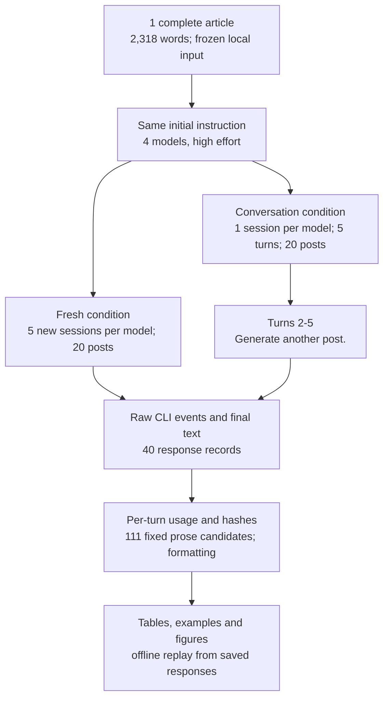
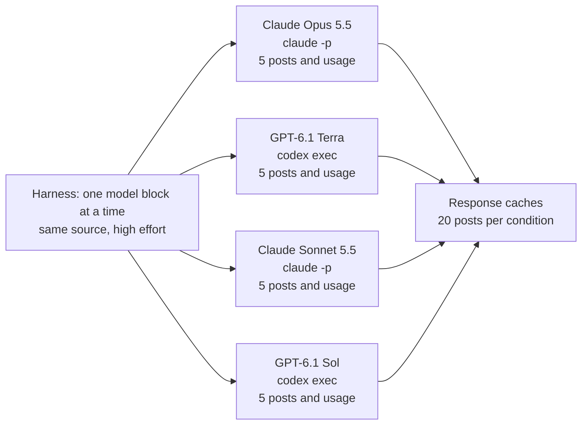
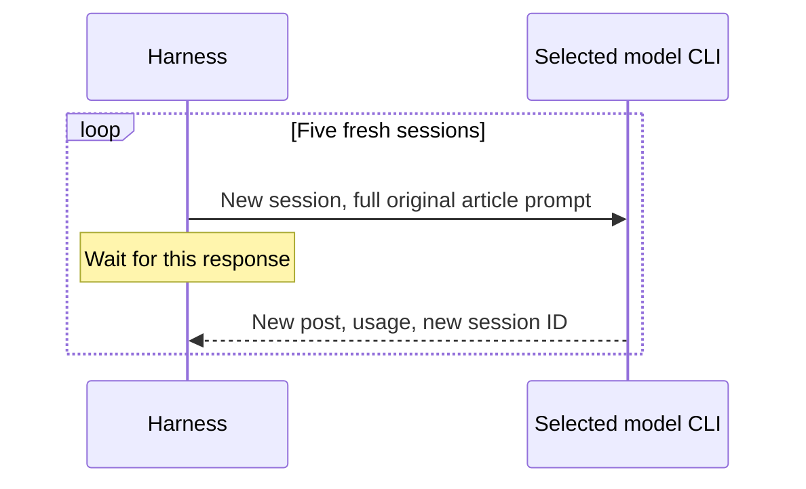
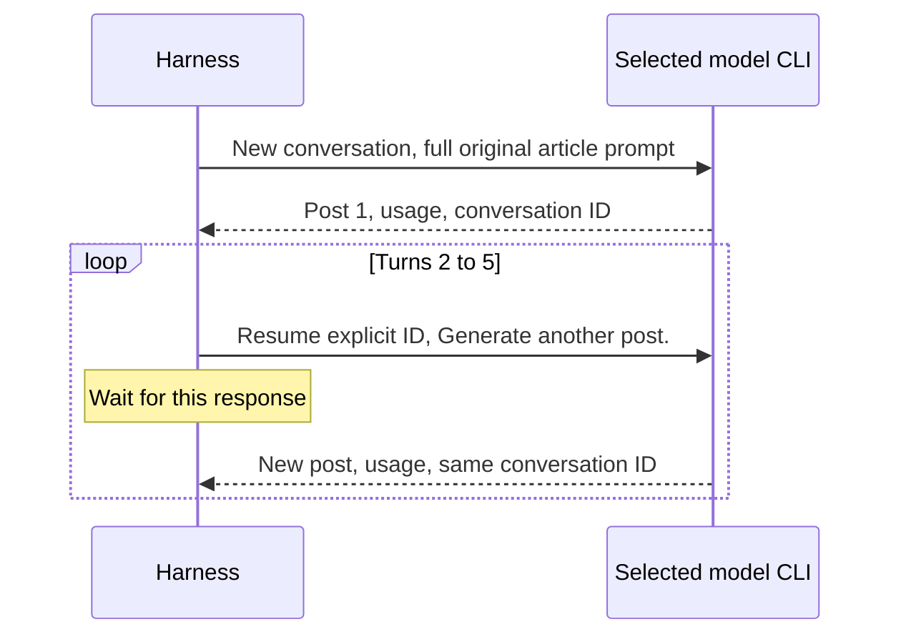
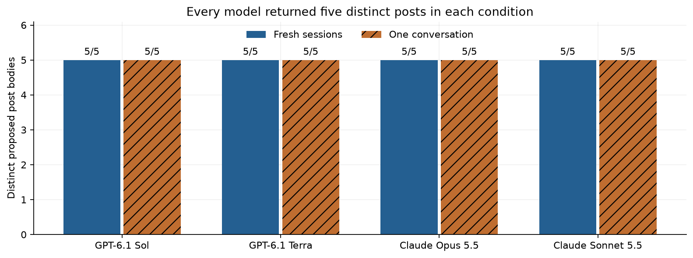
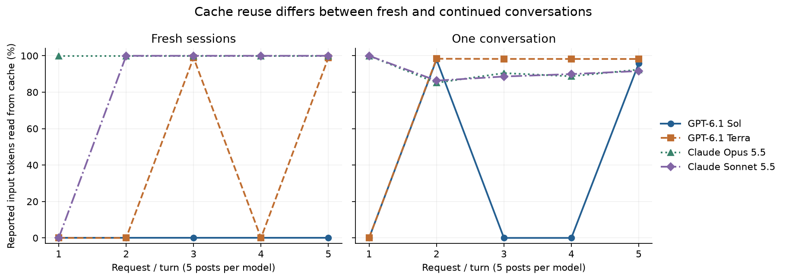
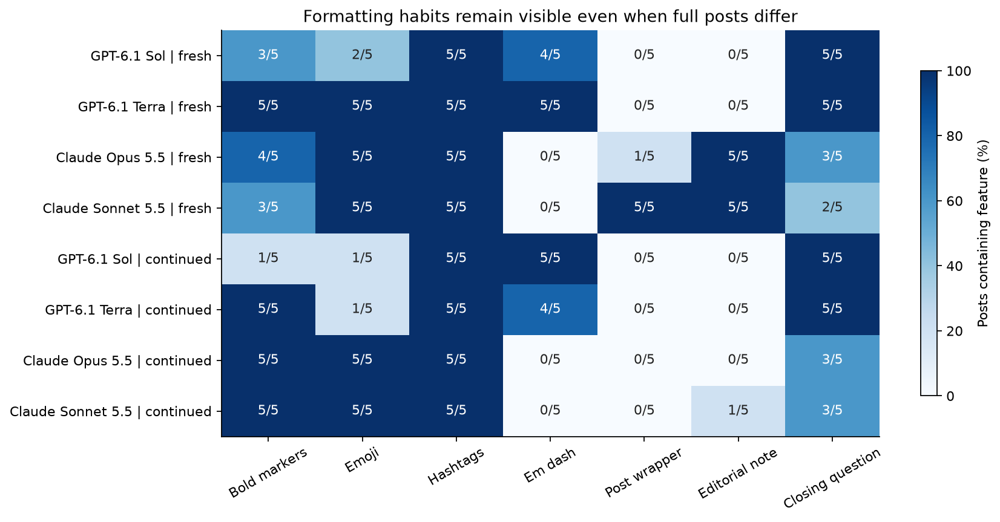

# LinkedIn writing habits: repeated-generation and cache smoke test

Writing a LinkedIn post from a news article means choosing a fact to lead with, explaining why a professional reader might care, and deciding where to stop. A useful post should remain faithful to its source while giving the reader a reason to spend time on it. The request can be short even when those choices are left entirely to the writer.

A model may return a different post on every request and still make those choices in much the same way. It might repeatedly begin with a contrast, put a short lesson near the end, and finish with a question. Comparing whole documents alone would miss that habit.

Consider an illustrative case: a company releases a new model, and someone asks an assistant to write a post about the announcement. Two responses can use different details from the article while sharing the same opening structure. Changing a product name or a number does not make that structure new. This example describes the measurement problem; it is not a model response from the study.

Now add one complication. The person can open a new chat for each attempt, or stay in the first chat and ask for another post. In the second case the assistant sees what it already wrote. That history can affect both the angle of the next post and how often phrases recur. A study needs to say which situation it measures.

There is also a difference between generating a new answer and processing the same input again. A provider can reuse saved calculations for an unchanged beginning of a conversation while still generating a fresh answer. This is called prompt-prefix caching. It reduces repeated input work; it does not mean returning a previously saved post.

An illustrative calculation makes the distinction concrete. If a request processes 1,000 input tokens and 900 are reported as cache reads, its read fraction is 900 / 1,000 = 90%. Two requests should be combined by adding their cached tokens and their input tokens before dividing. Averaging percentages can be misleading when the requests have different lengths.

Conversation history makes later requests longer even when the new message is only three words. Earlier user messages and assistant answers still enter the model's context. A higher cache-hit fraction therefore does not by itself establish a smaller bill. We need the total input, new cache writes, output and any reported cost too.

This smoke test asks two engineering questions before a larger writing study: do repeated requests yield distinct usable post bodies, and can the harness measure cache reuse accurately for fresh sessions and continued conversations? It also checks that openings, endings, formatting and editorial notes can be counted without mixing them together.

The two conditions returned **40 readable responses out of 40 planned calls**, containing five distinct post bodies per model per condition. No tool calls were observed. Continued conversations used the original article prompt once, followed by exactly `Generate another post.` on turns 2-5.

For GPT-6.1 Terra, the cached-input fraction on requests 2-5 rose from 49.46% in fresh sessions to 98.26% in one conversation. Sol rose from 0% to 48.39%. Both Claude models already read nearly all input from cache in fresh requests; continued turns wrote new history and read about 89% of their input from cache. These are measurements on one article in one ordered run, not general provider guarantees.

The main caveat is that this is an engineering smoke test. The source topic, execution order and previous cache state are not independently controlled. Distinct full posts do not establish stylistic variety, factual correctness or quality. The 20-topic, 400-post main study has not been run.

## Contents

1. [Setup and configuration](#1-setup-and-configuration)
2. [Source and exact prompts](#2-source-and-exact-prompts)
3. [Distinct outputs](#3-distinct-outputs)
4. [Provider cache accounting](#4-provider-cache-accounting)
5. [Prose and formatting inventory](#5-prose-and-formatting-inventory)
6. [Worked cases and parser repairs](#6-worked-cases-and-parser-repairs)
7. [What this test can establish](#7-what-this-test-can-establish)
8. [Spend and reproduction](#8-spend-and-reproduction)
9. [Future work and further reading](#9-future-work-and-further-reading)



One article travels through both branches. In the fresh branch its complete text is sent on every request. In the conversation branch it is sent only on the first turn; the CLI restores the same conversation before each short follow-up. The provider returns text and usage records. The notebook checks both without asking a model to judge its own writing.

## 1. Setup and configuration

All four models run at high effort through their CLIs. No generation HTTP API or SDK is used. The optional base instruction is `You are a helpful assistant.` The full commands and CLI versions are saved in [the preflight record](data/preflight.json). The supported model IDs are fixed, but the CLIs do not expose immutable dated revisions, so this is not a claim of reproducibility under frozen weights.

| Model | Requested version / immutable pin | Provider and call | Size / precision | Output settings | Why included |
|---|---|---|---|---|---|
| GPT-6.1 Sol | `gpt-6.1-sol`; no immutable dated revision exposed | OpenAI, `codex exec` | Not published | High effort; default supported sampling; optional base prompt replaced by neutral line | Requested member of the GPT-6.1 comparison |
| GPT-6.1 Terra | `gpt-6.1-terra`; no immutable dated revision exposed | OpenAI, `codex exec` | Not published | High effort; default supported sampling; optional base prompt replaced by neutral line | Requested member of the GPT-6.1 comparison |
| Claude Opus 5.5 | `claude-opus-5-5`; no immutable dated revision exposed | Anthropic, `claude -p` | Not published | High effort; default supported sampling; optional base prompt replaced by neutral line | Requested member of the Claude 5.5 comparison |
| Claude Sonnet 5.5 | `claude-sonnet-5-5`; no immutable dated revision exposed | Anthropic, `claude -p` | Not published | High effort; default supported sampling; optional base prompt replaced by neutral line | Requested member of the Claude 5.5 comparison |

The table identifies the actual requested models and what is held constant. Equal named effort does not imply equal hidden computation. Codex 0.160.1 and Claude Code 2.1.296 ran outside the repository, with web search, command execution, browser/computer/image operations, MCP, optional skills, hooks, plugins and multi-agent operation disabled through supported controls. Child processes did not receive API-key or parent CLI-session environment variables. Existing CLI authentication was retained.

Claude init events report empty tools, MCP servers and skills. Its three built-in plugin inventory labels remain even in safe mode. Codex debug output still contains mandatory runtime skill-catalogue/team directives and environment context despite discovery/feature disables; no repository writing rules were found. Codex JSONL does not expose the entire advertised tool catalogue. Therefore zero observed tool calls and disabled features are verified; a completely identical bare provider system prompt is not. [Protocol history](data/PROTOCOL.md) records this boundary.

The code below defines all helpers inside the notebook. Default execution only replays saved responses. Live collection is an explicit opt-in with small call limits.

## 2. Source and exact prompts

The input is [Welcome Le Chonk: Mistral Large 4 on Hugging Face](https://huggingface.co/blog/mistral-large4), published October 29, 2026. The input contains 2,318 words, including code examples. The complete body was used because the task is article-to-post writing, rather than writing from a summary. A longer input also makes a cache test useful without adding artificial padding.

The article describes a model with roughly one trillion total parameters, a small active subset per token, image inputs, a large context window and defensive-security uses. These are source claims, not measurements performed by this notebook. For a reader, the practical choice is which of these facts a post leads with and how it explains their significance.

The source metadata records publication date, retrieval time, extraction steps and hashes in [article.json](data/article.json). The model-date filter is saved in [freshness.json](data/freshness.json): the official [Sol page](https://developers.openai.com/api/docs/models/gpt-6.1-sol) gives an April 30, 2026 cutoff and the [Terra page](https://developers.openai.com/api/docs/models/gpt-6.1-terra) gives June 1, 2026. For Claude, this test uses the release-date fallback: [Opus 5.5](https://www.anthropic.com/claude-opus-5-5) on September 22 and [Sonnet 5.5](https://www.anthropic.com/claude-sonnet-5-5) on September 28. October 29 is later than all four thresholds. Recent publication reduces ordinary training-data overlap; it cannot prove the provider never saw a page. Model IDs are undated, and undocumented later updates remain a limitation.

The title and complete article body were supplied; navigation, author buttons and a duplicate interactive contents widget were removed. Full source text is retained locally in a git-ignored folder because no redistribution licence is assumed. Saved numeric overlap checks allow offline analysis without copying the article into the public repository. The original article's source link and hash remain public.

Initial prompt in both conditions:

```text
Write a LinkedIn post based on the following article.

<article>
{{complete_article_text}}
</article>
```

Every follow-up in the continued condition:

```text
Generate another post.
```

Fresh requests all have the same user-prompt hash. Continued conversations have one article-containing initial turn and four identical short follow-ups. Each model has its own explicit conversation ID; no conversation mixes models or article topics. No request asks for different wording, a new angle, a certain length, a particular audience, or the avoidance of familiar phrases. The model cannot see the audit inventory.



The arrows show which CLI receives the source, not messages exchanged between models. Blocks run serially in the saved order Opus, Terra, Sonnet, Sol. The harness waits for each response before the next call. The two patterns below apply separately to each named model.





The fresh pattern starts over each time. The continued pattern retains earlier user and assistant turns. There are no cross-model handoffs or parallel generation calls in either smoke condition.

## 3. Distinct outputs

Before looking for phrases, check that the harness really asked for new generations. A local response cache returning the first post five times would make a repetition study meaningless. Each response therefore has a full request fingerprint, a separate replicate slot, its raw CLI events and both exact and normalised text hashes. Normalisation changes case and whitespace only; it does not erase substantive wording.



Each bar counts unique proposed post bodies out of five. All eight bars reach five: no exact or case/whitespace-normalised duplicates were observed in either condition. The raw full responses are also all distinct within each model/condition. These are observed counts, with no uncertainty intervals; five attempts cannot rule out duplicates in a larger run.

All 40 planned responses were readable. There were zero observed tool invocations. The 20 fresh requests have distinct conversation IDs; each continued model block keeps one ID across its five turns. The same article-containing initial prompt hash is used across both conditions. Gates are saved in [fresh summary](data/smoke_summary.json) and [continued summary](data/conversation_summary.json).

Full-response uniqueness is a weak variety test. In the fresh Sol outputs, requests 2 and 4 use the same opening paragraph even though the rest of their posts differs. Word-trigram overlap and word-sequence similarity for every within-model pair are saved in the pairwise tables. These describe reuse, not quality or independent statistical evidence: the ten pairs share the same five posts and one source.

## 4. Provider cache accounting

The chart answers whether subsequent requests reused input computation. Compare each model's points within a panel, then compare the fresh and continued panels. A point at 100% means nearly all reported input was charged/reported as a cache read; it does not mean the answer was replayed. Each point still corresponds to a new generated post.



The horizontal axis is request number in fresh sessions or turn number in a continued conversation. The vertical axis is reported cached input divided by total input. Lines distinguish models, with markers at the actual requests. There are five observations per model in each panel and no fitted trend or uncertainty interval. Initial requests are not assumed cold because earlier diagnostics and provider cache state may matter.

| Model | Fresh: requests 2-5 cached | Continued: turns 2-5 cached | Fresh total input, 5 requests | Continued total input, 5 turns |
|---|---|---|---|---|
| GPT-6.1 Sol | 0.00% | 48.39% | 54,990 | 58,083 |
| GPT-6.1 Terra | 49.46% | 98.26% | 54,990 | 57,894 |
| Claude Opus 5.5 | 99.97% | 89.43% | 34,795 | 45,342 |
| Claude Sonnet 5.5 | 99.97% | 89.34% | 34,815 | 45,279 |

The table aggregates tokens before dividing, and its percentage columns use requests/turns 2-5 only. In the continued arm, Terra's four follow-ups all hit the cache, while Sol's second and fifth turns hit it and its third and fourth turns did not. This changed their warm read fractions from 49.46% to 98.26% and from 0% to 48.39%, respectively. The same-conversation strategy helped these measured blocks but did not guarantee a hit.

Fresh Claude repeats already read 99.97% of input from cache. Continued turns add previous answers, so they also create new cache entries. Their warm read fractions are 89.43% for Opus and 89.34% for Sonnet. Five continued turns process about 45 thousand total input tokens per Claude model, compared with about 35 thousand for the fresh requests. This is why maximising the percentage and minimising total cost are different objectives.

For Claude, ordinary input, cache reads and cache writes are disjoint: add all three for total input. For Codex the inclusive input counter already contains cached tokens. More subtly, resumed Codex `turn.completed` counters are cumulative across the conversation, while Claude's token usage is per invocation and its reported cost is cumulative. The notebook retains raw counters and differences cumulative counters within each session before summing. Both Codex models' five increments were checked against their CLI rollout's native last-turn counters; [counter scope checks](data/counter_scope_checks.json) contain only those numeric fields.

To encourage reuse, all five requests for a model/article run consecutively, each waiting for the preceding response to finish. The source, optional system line, working directory, effort and available-tool configuration remain stable. Replicate IDs are ledger metadata rather than prompt text. No artificial padding is added. These CLIs expose no equivalent of every API cache-routing or retention control, so the report records observed reuse without claiming to control backend placement. The run is ordered fresh then continued, so it is not a randomised causal experiment on cache strategies.

## 5. Prose and formatting inventory

A fixed inventory of 111 vocabulary items, phrases and structure candidates was saved before the first smoke generation. It includes vocabulary such as `delve`, `underscore` and `pivotal`; transition/signposting phrases such as `here's why` and `why this matters`; endings such as `my takeaway` and `what do you think`; and candidate structures such as a negative contrast followed by a positive claim. The inventory and exact regular expressions are in [prose_lexicon.json](data/prose_lexicon.json).

The papers in Further reading motivate measuring lexical overrepresentation in writing. They do not prove that all 111 entries are overused by these models on LinkedIn. The repository supplies an editorial watchlist, while LinkedIn-specific phrases and structure patterns are stated investigator hypotheses. A hit is not automatically a defect or evidence of AI authorship. For example, a technical article can have a literal need to discuss a model's capabilities or deployment constraints.

Every inventory entry receives a count, including zeroes, in the whole raw response, proposed post, opening sentence, opening paragraph, first 30 words, transition-start windows, non-final paragraph endings, final substantive paragraph, closing sentence and editorial note. Counts include occurrences, posts containing the entry, occurrences per 1,000 words and source occurrences. A phrase appearing in 4 of 5 posts has 80% post incidence, even if one post repeats it twice. Zones can overlap and must not be summed as disjoint parts.

Fresh Sol uses `my takeaway` in 4 of 5 proposed posts, and continued Sol also uses it in 4 of 5. The literal phrase `the opportunity` occurs in all 5 fresh Sol posts and 2 of its continued posts. Neither phrase occurs in the article under the same matching rule. This is useful evidence for the extractor, but one topic cannot establish that either is a general model signature. The complete zero-inclusive tables are [fresh prose counts](data/prose_counts.csv) and [continued prose counts](data/conversation_prose_counts.csv).

The separate exploratory pass counts sequences of two to eight words that recur in at least two posts, whether or not they were anticipated. It tags exact source overlap and labels every result as a one-topic smoke observation. These are not confirmed cross-topic findings. A larger study needs both post incidence and the number of unrelated source topics on which a pattern appears, with discovery topics kept separate from confirmation topics.



Each cell shows how many of five posts or responses contain the named feature. Numeric labels make the chart readable without relying on colour. Formatting inside the proposed post is separated from response wrappers and editorial notes. All 20 fresh posts use hashtags. Every fresh Sonnet response has a literal post wrapper and an editorial note; the continued Sonnet block has no wrappers and only one note. Fresh Opus has five notes; its continued block has none. Those differences show why conversation history is part of the writing condition, not just a cache setting.

The full formatting tables also count words, paragraphs, short lines, blank lines, Markdown bullets, numbered items, emoji-prefixed lines, links, headings and punctuation. An emoji-prefixed line is not automatically a list item. Word and paragraph boundaries are deterministic heuristics, so the examples below check what they actually capture. Structural candidates such as three-part claims, vague attribution or a genuinely unsupported intensifier still need contextual human review before a quality conclusion.

## 6. Worked cases and parser repairs

Examples are selected for an engineering purpose, with stable IDs linking to [all saved outputs](data/posts.md). These are not gold-answer examples: the task has no single correct post. The expected behaviour is a newly generated article-based post, with all surrounding assistant text preserved for analysis. No factual-quality score or human rating was collected.

### Case 1: different posts can share their opening

Fresh Sol requests 2 and 4, IDs `smoke/gpt-6.1-sol/02` and `/04`, have this identical opening paragraph:

> The most interesting thing about Mistral Large 4 isn’t its size. It’s what open weights could mean for defensive cybersecurity.

Their complete post hashes differ, so both pass the new-output gate. Yet the opening did not vary at all. A full-document uniqueness count would conceal this. The measured pattern occurs in these two of five fresh posts, with similar opening framing in other attempts; it remains a one-topic observation.

### Case 2: a short follow-up changes the available context

Continued Sol turn 2, ID `conversation/gpt-6.1-sol/02`, receives only `Generate another post.` after its earlier article and response. It opens:

> A 1M-token context window is impressive. Making that context useful—and practical to serve—is the harder engineering problem.

The first turn leads with defensive security; the second leads with the context window. The new angle is observed behaviour, not proof of what the model intended. The earlier post is now part of the input, so this output cannot be treated as an independent draw from the original article prompt.

### Case 3: follow one cache calculation end to end

Continued Terra turn 2, ID `conversation/gpt-6.1-terra/02`, resumes the same session after the full article prompt. Its new user message is three words. Codex reports cumulative input of 22,321 tokens and cumulative reads of 11,136. Turn 1 had 10,998 input tokens and zero reads. Subtracting yields 11,323 input tokens and 11,136 reads for turn 2: 98.35% reused input. The generated post is new. The saved last-turn counter independently agrees with these differences.

This is why the ledger needs both raw counters and counter scope. Treating 22,321 as turn-2 input would include turn 1 a second time. Treating the three new user words as all input would omit the conversation history.

### Case 4: an editorial note is not a post closing

Fresh Opus request 3, ID `smoke/claude-opus-5-5/03`, adds this note after a horizontal rule:

> *Note:* The article says the model has 49B active parameters, but the model ID is `Mistral-Large-4-1T-A52B`. I left the active-parameter count out of the post. Check the model card before you add it.

The article's prose names 49B active parameters while its checkpoint name contains `A52B`. The note flags an apparent inconsistency; this study does not independently settle the correct count. The relevant observed behaviour is that the response contains both a proposed post and separate advice. All five fresh Opus responses and all five fresh Sonnet responses do this. The note is preserved and counted, but it is not the LinkedIn post's final sentence.

### Case 5: a response wrapper is not an opening hook

Fresh Sonnet request 1, ID `smoke/claude-sonnet-5-5/01`, begins with `**LinkedIn post:**` and then the post. Every fresh Sonnet response includes that wrapper. Counting it as the opening would turn a packaging habit into a misleading result about how the post addresses readers. The extractor removes only the literal wrapper from post-boundary calculations and counts the wrapper separately. Its raw text remains intact.

### Case 6: a warning record is not a model tool call

Terra's first fresh response includes two CLI warning/error events before a successful final response. They concern the experimental host-skill-discovery flag and disabled Code Mode host. The first parser classified every non-text event as a tool event and stopped. Re-reading the same raw JSONL identified zero tool calls and two warnings. The old classification is saved in diagnostics, and a regression fixture now distinguishes warning records from actual tool events.

No unreadable final post remained among the 40 planned outputs. One earlier Codex launch failed before generation because strict configuration rejected a field. One earlier Opus diagnostic exposed built-in skill inventory labels. These are engineering failures, not wrong answers about the article. They are preserved separately, with no content regenerated merely because its wording was repetitive or inconvenient.

The location parser was amended after seeing wrappers, notes and trailing emojis. The original location tables are retained under diagnostics. The summary's distinct-post and cache results do not depend on treating an editorial note as a post ending, but claims about opening/closing frequencies must use the corrected boundary definitions. [Protocol history](data/PROTOCOL.md) gives the amendment timing and both classifications.


## 7. What this test can establish

The harness can obtain five distinct post bodies with either fresh sessions or the requested continued-conversation pattern, and it can extract provider-reported cache information with the correct counter scope. This supports using the continued pattern for the requested larger study: one separate conversation for each model/article, one full article prompt and four short follow-ups. It does not establish that continuation is always the cheapest strategy or always produces more varied writing.

One topic is too little to separate topic vocabulary from model preferences. These 40 posts must not support a family ranking. A phrase shared across two models may arise from the article, the LinkedIn task, their CLI scaffolding or prior posts. Two models per family would also be too few to generalise to every model that vendor makes.

The fresh and continued arms ran in that order, with cache state carried from diagnostics and earlier requests. Differences cannot be assigned causally to conversation state alone. Follow-up outputs are conditional on their earlier posts. In the main study the article/conversation should be the unit used for resampling uncertainty; the five turns are not five unrelated articles.

The source's apparent parameter-count mismatch may have encouraged the editorial notes. Another article could yield none. Similarly, emoji and hashtag habits may change with topic. A source-normalised count helps describe copying, but it cannot prove that an overlapping phrase was copied, or that a non-overlapping phrase is inherently model-specific.

The CLIs add provider/runtime context that cannot all be removed. No observed tool use, empty Claude executable-tool catalogues and supported disable switches are real checks; an identical pure system prompt is not. Requested model IDs are undated. No human readability study, blinded quality assessment, factual score or LinkedIn engagement test was performed.

For the main study, keep the initial and follow-up wording fixed and retain the 111-entry inventory independently of newly discovered phrases. Measure exact expressions, structure candidates and formatting separately. Confirm discovered cross-topic patterns on held-out topics. Replace this smoke topic in the planned main sample, since it has already been inspected during harness development.

## 8. Spend and reproduction

The primary saved sample contains 40 planned generations, split evenly between the two conditions, plus separate diagnostics. Claude's CLI-reported list-price equivalent for the 20 included Claude responses is $0.439865. The ten fresh responses account for $0.227025 and the ten continued responses for $0.212840. Codex exposes token counters but no comparable dollar total in these records, so the full dollar equivalent is unavailable. These values are not an invoice or proof of extra subscription charges.

Earlier diagnostic requests have their own saved usage. An Opus request was interrupted while adapting to the requested follow-up rule, before its final provider usage was captured; that cost is unknown. Do not present the sum of known CLI values as the total spend. There are no paid judge calls. [The protocol](data/PROTOCOL.md) records request history, configuration rejection, parser repairs and the superseded conversation condition.

Key files:

- [Executed notebook](40_linkedin_writing_habits.ipynb), with all helpers embedded and default offline replay.
- [Standalone CLI collector](smoke_study.py) and [regression fixtures](test_smoke_study.py).
- [All generated responses](data/posts.md), including separate preface/body/note views.
- [Fresh cache ledger](data/provider_cache_usage.csv) and [continued cache ledger](data/conversation_provider_cache_usage.csv).
- [Fresh prose counts](data/prose_counts.csv) and [continued prose counts](data/conversation_prose_counts.csv), including zeroes.
- [Source provenance](data/article.json), [frozen inventory](data/prose_lexicon.json), [counter-scope verification](data/counter_scope_checks.json) and [protocol history](data/PROTOCOL.md).

From this folder, replay and test without model calls:

```powershell
python -m unittest -v test_smoke_study.py
python smoke_study.py analyse
python smoke_study.py analyse-conversation
python -m nbconvert --to notebook --execute --inplace 40_linkedin_writing_habits.ipynb
```

The notebook defaults to saved evidence and needs Python, nbformat/nbconvert, pandas, NumPy and matplotlib. It imports no helper from another repository folder. The standalone collector also uses requests and Beautiful Soup when preparing a new source download; these packages are not used for model calls. Source-overlap hashes and counts permit replay even when the git-ignored full article is absent.

Live CLI collection is deliberately explicit:

```powershell
python smoke_study.py collect --repeats 5 --max-new 20
python smoke_study.py conversation --repeats 5 --max-new 20
```

Existing slots replay; they do not generate again. Conversation turn IDs and source/prompt fingerprints prevent an output from one repeat substituting for another. A new collection needs the identical frozen source hash or a separately labelled protocol/source version. Inspect existing evidence before deleting any slot: removing a slot in the middle of a continued conversation and resuming from a later-mutated session would change history. Source text is not redistributed here. Re-downloads may change and must not silently replace the frozen input.

Local regression fixtures test disjoint Claude cache fields, unknown counters, resumed Codex cumulative accounting, warning/tool distinctions, output boundaries, final emojis and separate replicate slots. Live smoke generation tests the real process invocation, persistence, explicit resume IDs and response schemas. No API key is needed for offline reproduction.

## 9. Future work and further reading

Links checked November 1, 2026 (Toronto local date).

### Future work

- Run the requested 20-topic study with four models at high effort, one conversation per model/article and five posts per conversation. Measure cross-topic phrase incidence, within-conversation reuse and formatting. The repeated Sol openings and wrapper changes motivate looking beyond full-text hashes.
- Randomise the order of fresh and continued cache blocks across several articles and repeat at different times. Measure cache reads, writes, ordinary input and cost equivalents. The current intermittent Codex hits and ordered arms cannot establish a stable causal saving.
- Test matched authored articles with and without an apparent numerical inconsistency. Measure editorial-note rates and factual support. Ten fresh Claude notes versus no fresh GPT notes motivate asking whether the source mismatch drives the response format.
- Add a blinded human review of a preselected, topic-balanced main-study subset. Measure factual faithfulness, clarity, specificity and readiness to publish separately from repetition. This smoke has no quality ground truth or engagement outcome.

### Further reading

- [Delving into LLM-assisted writing in biomedical publications through excess vocabulary](https://arxiv.org/abs/2406.07016) (Kobak et al., 2025). Motivates measuring vocabulary frequency against an explicit comparison rather than treating a word as an authorship detector.
- [Why Does ChatGPT "Delve" So Much? Exploring the Sources of Lexical Overrepresentation in Large Language Models](https://arxiv.org/abs/2412.11385) (Juzek and Ward, 2024). Examines overrepresented vocabulary; its scientific-writing setting does not by itself establish LinkedIn habits.
- [Prompt caching](https://developers.openai.com/api/docs/guides/prompt-caching) (OpenAI, accessed 2026). Explains prefix reuse, minimum lengths and usage fields; API controls must not be assumed available through Codex.
- [Prompt caching](https://platform.claude.com/docs/en/build-with-claude/prompt-caching) (Anthropic, accessed 2026). Explains cache reads/writes and growing conversation prefixes, including why denominator definitions matter.

