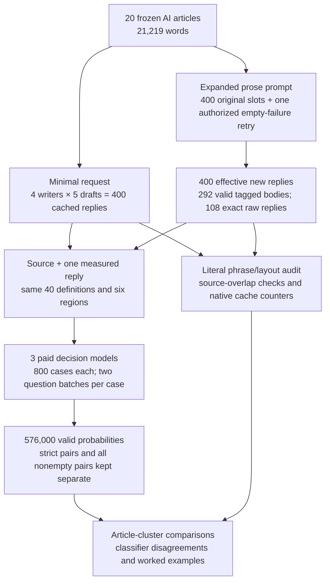
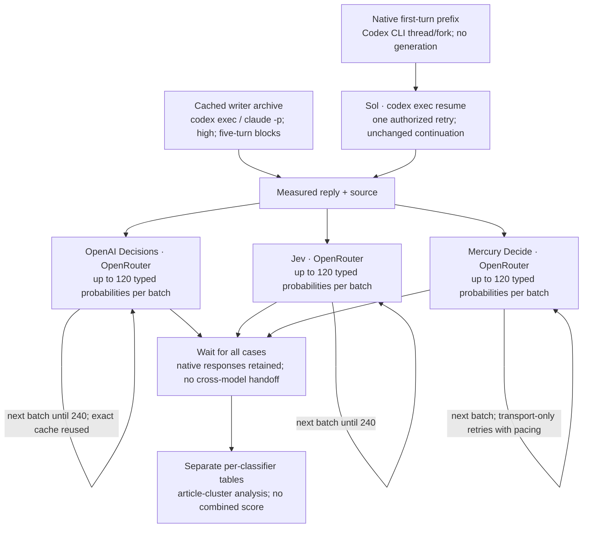
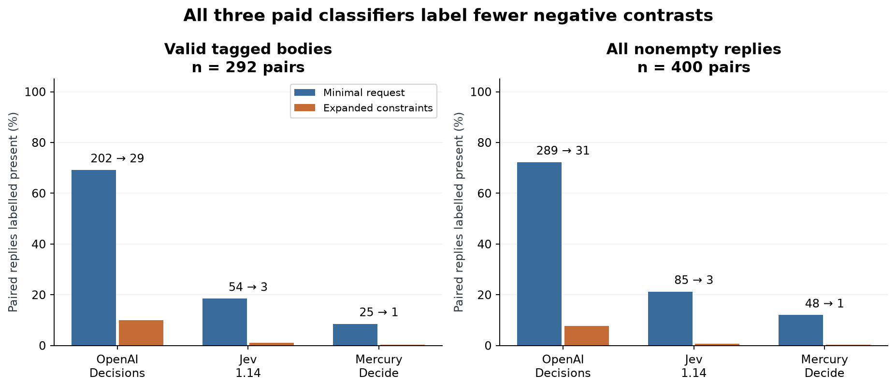
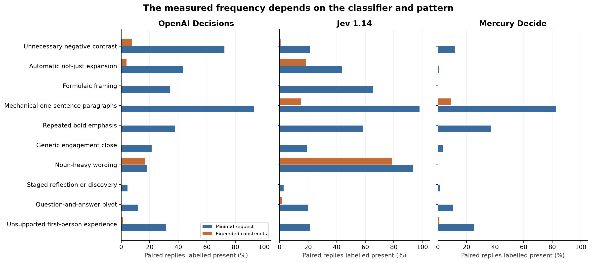
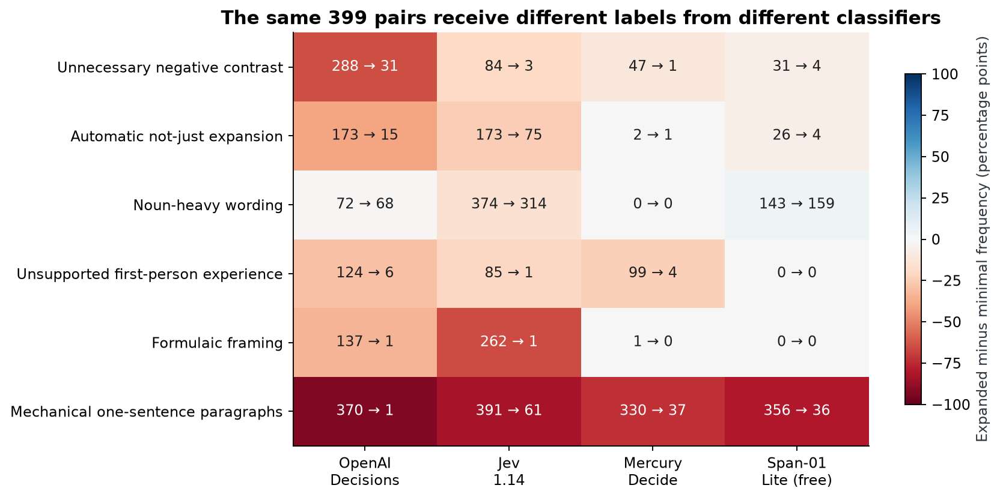
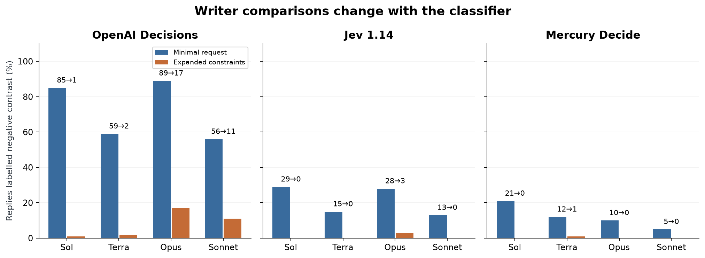
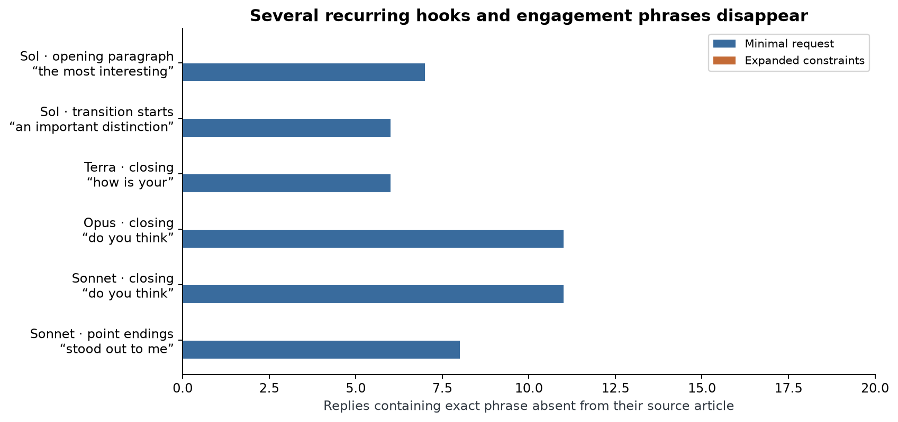
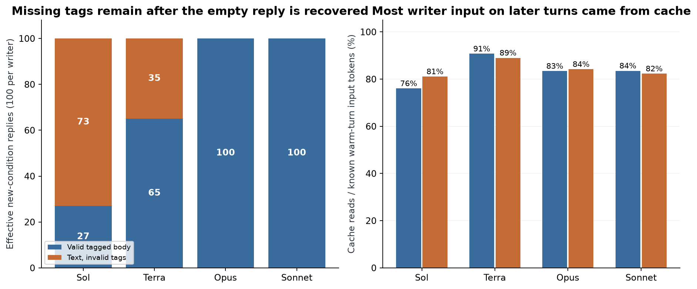
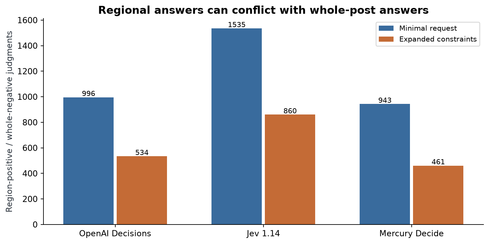

# Changing LinkedIn prose and checking the classifier

A person wants to share news about an AI tool on LinkedIn. They give a writing model the announcement and ask for a post. A useful draft explains what changed and why a reader might care. The person still needs to check its facts and decide whether its voice fits.

Asking for another draft gives them a choice. Yet the alternatives can keep returning to a familiar opening, a succession of short paragraphs and an invitation to comment. The wording changes while the same editing work returns.

**Illustrative example, not measured data.** Suppose an announcement says a support tool can search old tickets. A draft might begin, “This isn't just search. It's a new way to work.” The opening delays the useful fact and denies an alternative the reader did not propose. A direct account could explain which tickets become searchable.

Now add a complication: the tool searches archived tickets but cannot open attachments. That distinction helps the reader. Removing every negative word would lose useful information. The editing question concerns what a phrase does in context.

One approach leaves the writing choices to the model. Another leaves angle and length open while discouraging stock framing, unnecessary contrasts, repetitive rhythm and generic endings. The second approach might save editing work, replace one habit with another or make its output harder to extract.

Some changes are easy to count. A hashtag is a visible string. Deciding whether a contrast is unnecessary requires reading it with the source. A separate classification model can help review many drafts, but its judgments are another measurement choice that needs checking.

For example, two classifiers might both recognize a hashtag ending and disagree about whether a factual comparison is rhetorical padding. Paying for a classifier does not establish that its labels match readers. Giving the same passages and definitions to several classifiers reveals which conclusions depend on that choice.

This study asks whether prose guidance changes recurring LinkedIn habits across four writers, and whether three paid classifiers agree about the changes. It keeps literal wording, output-format failures and model-assigned editorial labels separate. It does not add overlapping labels into a writing-quality score.

## Study summary

Four writers produced five numbered drafts from each of 20 frozen AI news articles under a minimal request and an expanded prose prompt: **400 effective replies per condition**. One empty capacity failure in the new condition was recovered from its original first-turn context; all other replies stayed unchanged. The writers used high effort through their CLIs, with tools and search disabled.

Three dated paid decision models each classify all 800 replies for 40 patterns in six regions. A **pattern frequency** counts replies whose returned probability is at least 0.5. In the 400 matched nonempty pairs, negative-contrast labels change as follows: **OpenAI Decisions 289 → 31, Jev 1.14 85 → 3, Mercury Decide 48 → 1**. In the 292 valid-body pairs, the respective counts are 202 → 29, 54 → 3, 25 → 1. These are classifier judgments, not verified faults.

The classifiers disagree sharply about some remaining prose. Noun-heavy wording is OpenAI Decisions 72 → 68, Jev 1.14 374 → 314, Mercury Decide 0 → 0. There are **108 nonempty tag failures**, which select the strict population. No human preference, factual accuracy or editing-time outcome was measured. The prompt and taxonomy were selected after baseline inspection, and writing conditions were collected at different times, so this is an exploratory comparison of the complete prompting package.

## Contents

1. [What the writers were given](#1-what-the-writers-were-given)
2. [Prompts and model access](#2-prompts-and-model-access)
3. [From a reply to a pattern label](#3-from-a-reply-to-a-pattern-label)
4. [Which changes survive a different classifier](#4-which-changes-survive-a-different-classifier)
5. [What changes when the classifier changes](#5-what-changes-when-the-classifier-changes)
6. [Writers, openings, transitions and endings](#6-writers-openings-transitions-and-endings)
7. [Output boundaries and cache usage](#7-output-boundaries-and-cache-usage)
8. [Worked examples and remaining prose](#8-worked-examples-and-remaining-prose)
9. [Checks, disagreements and limits](#9-checks-disagreements-and-limits)
10. [Reproduction and spend](#10-reproduction-and-spend)
11. [Future work and further reading](#11-future-work-and-further-reading)



For the Kimi case, the same saved article enters each writer conversation. Five replies are collected in order. Each classifier then sees one measured reply and its source, without the writer's identity or other drafts. Tag extraction controls entry to the strict analysis; exact raw text remains available for the secondary audit. Literal phrase counting is a separate path and never supplies contextual API labels.

## 1. What the writers were given

The 20 public sources, published October 23–30, cover models, research, AI products, security, publishing and infrastructure. They were fresh when collected and remain frozen. This is a varied convenience sample of English AI news, not a random LinkedIn sample.

| Example ID | Published | Article | Words |
|---|---|---|---|
| 01-kimi | 2026-10-23 | [Introducing Kimi K3.1 Pro](https://simonwillison.net/2026/Oct/23/kimi-k31-pro/) | 296 |
| 02-tb-screening | 2026-10-23 | [Bringing foundational models to the front lines of TB screening](https://research.google/blog/bringing-foundational-models-to-the-front-lines-of-tb-screening/) | 1507 |
| 06-protostar | 2026-10-29 | [Announcing Project ProtoStar: Making Publicly Funded Science AI-Ready](https://huggingface.co/blog/announcing-project-protostar) | 1348 |
| 14-seti | 2026-10-30 | [Things That Go Beep in the Night: Agentic AI Joins the Search for Extraterrestrial Signals](https://blogs.nvidia.com/blog/ai-joins-the-search-for-extraterrestrial-signals/) | 519 |

[The complete index](data/paid_prose_comparison/ARTICLES.md) gives all 20 titles, dates, URLs and lengths. The sources total 21,219 words; the longest has 3,197 and Kimi has 296. Length is not equalized, so some sources offer more possible angles.

Both conditions receive exactly the same saved title, date and substantive article text. Extraction removes page furniture while retaining meaningful lists, captions and corrections. The [manifest](data/main/articles.json) records extraction methods and hashes. Publisher-containing inputs stay local and excluded from Git; the public data retain source URLs and fingerprints.

The [freshness record](data/main/freshness.json) checks the articles against documented writer cutoffs or release-date fallbacks. All three paid classifier releases also precede the articles. These checks do not prove that an opaque backend had never encountered the material. Phrase analysis separately excludes exact wording already present in the corresponding source.

**Measured input example: `01-kimi`.** The article reports a Kimi K3.1 Pro release, benchmark comparisons and prices. It attributes a pelican-drawing test to its author. The intended LinkedIn poster supplied no biography. A draft can attribute the test to the author; a claim that the poster personally ran it needs separate evidence. First-person analysis alone is allowed by the rubric. This role distinction becomes an informative classifier-disagreement case below.

## 2. Prompts and model access

The minimal condition asks only, “Write a LinkedIn post based on the following article,” followed by the complete article. Its later turns contain exactly “Generate another post.” The expanded condition keeps angle, voice, length, structure and ending open while adding 15 prose constraints and an output boundary.

The expanded task begins with this excerpt; [the complete exact template](data/prompt_conditions/simple_prose_v3.txt) retains all 15 constraints, the tag request and the article placeholder.

```text
Write a LinkedIn post based on the article below. Use your judgment about the angle, voice, length, structure and ending.

<constraints>
- Return plain prose without hashtags, emojis, decorative symbols, headings, bold text, bullet points or numbered lists.
```

The remaining constraints address paragraph rhythm, contrasts, stock framing and transitions, generic benefits, word choice, staged revelations, mechanical sentence shapes, trailing significance clauses, hedging, endings, invented experience and punctuation. Necessary factual distinctions remain allowed. The [writer registration](data/simple_prose_v3_full/preregistration.json) preserves the exact initial and continuation strings and their hashes.

The exact continuation is:

```text
Write another standalone LinkedIn post from the same article. Treat it as an independent post, not a continuation, revision or critique of earlier posts. Follow the same prose constraints.

Return only the post inside <linkedin_post>...</linkedin_post>. Do not add explanations, notes or corrections before or after the tags.
```

Each model/article block uses one native conversation. Turns two through five resume it, so previous drafts remain visible. “Independent” requests a standalone post; it does not make the observations statistically independent. The constraint list, continuation wording and tag contract change together, preventing an effect from being assigned to one component.

| Model | Pinned ID / identity limit | Provider | How called | Size / precision | Output settings | Why included |
|---|---|---|---|---|---|---|
| GPT-6.1 Sol | `gpt-6.1-sol`; undated alias | OpenAI | `codex exec / resume` | Not published | High; tools/search off | One tested GPT writer |
| GPT-6.1 Terra | `gpt-6.1-terra`; undated alias | OpenAI | `codex exec / resume` | Not published | High; tools/search off | Second tested GPT writer |
| Claude Opus 5.5 | `claude-opus-5-5`; undated alias | Anthropic | `claude -p / resume` | Not published | High; tools/search off | One tested Claude writer |
| Claude Sonnet 5.5 | `claude-sonnet-5-5`; undated alias | Anthropic | `claude -p / resume` | Not published | High; tools/search off | Second tested Claude writer |
| OpenAI Decisions | `openai/gpt-6-luna-decisions-20261006` | OpenAI | OpenRouter Decisions API | Not published | Typed questions; no effort control exposed; no tools | Continuity with the original paid audit; exact baseline requests can be reused |
| Jev 1.14 | `typesafe/jev-1.14-20261014` | TypeSafe | OpenRouter Decisions API | Not published | Typed questions; no effort control exposed; no tools | Structured-decision model from a second vendor |
| Mercury Decide | `inception/mercury-decide-20260930` | Inception | OpenRouter Decisions API | Not published | Typed questions; no effort control exposed; no tools | Third vendor to check whether conclusions depend on one classifier |
| Span-01 Lite | `respan/span-01-lite-20260925` | Respan | Earlier zero-price OpenRouter audit | Not published | No new calls; retained on the common sample | Historical free comparator, not a fourth current paid model |

Writer aliases have no immutable dated revision exposed here. Codex was `0.160.1`; Claude Code was `2.1.296`. The retry uses the same Codex version and high-effort command. Isolation removes notebook/style files and disables tools, search and skills from the writer context; native logs show no tool use. This is a test through the specified CLIs, including their runtime behavior, rather than a claim about unwrapped model checkpoints.

The classifiers are pinned to the dated canonical IDs returned by the live catalogue. Each request names one provider and disables fallback; successful native responses are checked against that dated model and provider. The typed endpoint exposes no effort setting. No unsupported reasoning parameter is invented, and no tools or search are supplied.

### How the study got here

A smoke test checked output diversity and collection code. An earlier source-auditing prompt led some Claude replies to include commentary; the present prompt removes that procedure. Its full writing set and free classification audit were retained before the request for paid classifiers. The current comparison uses three paid models, imports only exact matching historical OpenAI baseline requests, and preserves the earlier free labels as a separately identified comparator. Registrations, transport amendments and earlier results remain in [protocol history](data/PROTOCOL.md).

## 3. From a reply to a pattern label

A strict new-condition post contains exactly one nonempty, non-nested `<linkedin_post>...</linkedin_post>` pair. Missing, malformed, repeated or empty tags do not trigger a rewrite or a guessed body. Text before and after valid tags is saved separately. The baseline keeps its older frozen wrapper/note parser because its prompt requested no tags.

The strict paired comparison contains **292 pairs** with readable post bodies in both conditions. The secondary audit contains **400 pairs** and measures every nonempty invalid-tag new reply as exact raw text, retaining even a lone closing tag. It is labelled `raw_unparsed_response`, not a repaired post body. The raw sensitivity was declared before the full free-run labels and retained for this paid comparison.

### Recovering the empty generation without later drafts

The original Sol SETI second turn returned an empty capacity error. Its conversation later continued, so resuming its latest state would expose the retry to posts three through five. The installed CLI's session-control operation instead forks through the first completed turn. The native history reference, byte boundary and first assistant reply are verified against the original prefix; the original session stays unchanged. Actual generation then uses `codex exec resume`, high effort, the original exact continuation and the original tool/search restrictions.

The replacement returns 176 words but omits valid tags. Its opening is:

> The Allen Telescope Array processes up to 2.4 terabits of sensor data per second, with AI inference running beside the instrument.

The expected format wraps the complete post in one tag pair. Observed `post_body` remains null, so this reply enters only the raw-text analysis. The [complete retry](data/simple_prose_v3_retry/OUTPUT.md), [native provenance](data/simple_prose_v3_retry/fork.json) and [retry protocol](data/simple_prose_v3_retry/protocol.json) preserve this outcome. It is one of 108 current tag failures, not a second empty generation.

Only this failed slot is replaced for the current comparison. Original turns three through five remain on their original branch and did not see the replacement. A sensitivity excludes the entire Sol SETI block. The historical failure is retained; the new condition therefore has 401 actual generation attempts and 400 effective replies.

### What each region means

The API receives the whole measured text and five additional regions: first paragraph; transition starts (first 12 whitespace-delimited words of later sentences and paragraphs); point endings (last sentences of substantive paragraphs before the last); conclusion (last substantive paragraph); and closing (its last sentence). Hashtag-only final paragraphs are excluded from substantive endings. Sentence splitting is a fixed heuristic, not a linguistic gold standard.

Each region is supplied beside the complete source and reply. An instance must occur within that named region. Extracts can overlap, and assembling sentence windows changes visible layout. Whole-text labels are primary; regional formatting labels remain diagnostics. Opening-sentence and 30-word inventories supplement the phrase audit without changing classifier regions.

### Typed questions and the counting rule

Each nonempty reply has 240 predicates: 40 patterns in six regions. A **predicate** is one yes/no question such as whether an unnecessary negative contrast occurs in the whole reply. Separate probabilities allow multiple labels on a post; the values do not sum to one. The exact question form is:

```json
{"whole__negative_contrast": {
  "type": "noul",
  "instructions": "Under the RUBRIC definition and exceptions for negative_contrast, does an instance occur in region whole? Use the whole post and source for context.",
  "criteria": {"true": "The defined pattern occurs in the specified region.", "false": "The defined pattern is absent from the specified region."}
}}
```

The rubric defines this pattern as denying an alternative the reader may never have proposed and allows correction of an actual misunderstanding. The state contains the source, whole reply, regions and all definitions with useful exceptions. It treats article and reply as data, not instructions, and withholds writer identity, prompting condition and other drafts. Literal string counters never supply contextual labels.

At the main threshold, probability 0.70 becomes present and 0.30 absent. Counts at 0.2 and 0.8 show dependence on that operating choice; none is calibrated against human labels. **Illustrative counting example:** four of ten paired replies labelled before and one after means 40% versus 10%, a decrease of 30 percentage points. An unavailable probability is excluded for that predicate, never filled with zero.

Intervals resample the 20 articles 2,000 times, retaining all available paired drafts within a sampled article and averaging article-level changes. The central 95% of those changes is reported. Tables retain post-weighted changes too, since tag survival can alter article weights. These intervals cover variation across this topic set, conditional on classifier and aliases; they exclude classifier bias, prompt selection and backend drift. There is no multiple-comparison correction for the exploratory 40-pattern audit.



Classifiers do not exchange answers. Two three-region batches normally supply 120 probabilities each, with identical state and disjoint question sets. Exact cached OpenAI baseline requests are reused. Mercury's rejected requests are recovered with slower pacing and transport-only retries; valid answers are never retried for their content or confidence. Provider failures stay in the request ledger, apart from labels about prose.

## 4. Which changes survive a different classifier

All three paid classifiers label fewer negative contrasts under the expanded prompt. Compare the left panel's 292 matched valid-body pairs with the right panel's 400 matched nonempty pairs. Blue is the minimal request and orange the expanded constraints; each annotation gives counts before and after. The vertical scale is a percentage, not a writing-quality score.



| Classifier | Negative contrast, raw pairs | Article-weighted change | 95% article-cluster interval |
|---|---|---|---|
| OpenAI Decisions | 289 → 31 / 400 | -64.5 pp | [-70.8, -58.0] pp |
| Jev 1.14 | 85 → 3 / 400 | -20.5 pp | [-26.0, -15.5] pp |
| Mercury Decide | 48 → 1 / 400 | -11.7 pp | [-15.5, -8.8] pp |

The intervals describe source-to-source variation in the paired change for each classifier. They cannot establish that one classifier is right, and the five drafts from an article are not treated as independent topics. The effect is a comparison of the complete prompt package: prose constraints, explicit standalone continuation and output tags.

Other patterns show both shared movements and large differences in level. The next figure uses all 400 nonempty pairs at 0.5. Its ten patterns were selected to cover contrasts, framing, layout, endings, noun-heavy wording and experience claims; all 40 remain in the linked tables.



| Pattern | OpenAI strict / raw | Jev strict / raw | Mercury strict / raw |
|---|---|---|---|
| Unnecessary negative contrast | 202 → 29 / 289 → 31 | 54 → 3 / 85 → 3 | 25 → 1 / 48 → 1 |
| Automatic not-just expansion | 128 → 14 / 173 → 15 | 115 → 58 / 174 → 75 | 1 → 1 / 2 → 1 |
| Mechanical one-sentence paragraphs | 270 → 0 / 371 → 1 | 285 → 35 / 392 → 61 | 225 → 21 / 331 → 37 |
| Repeated bold emphasis | 146 → 0 / 150 → 0 | 197 → 0 / 235 → 0 | 143 → 0 / 148 → 0 |
| Formulaic framing | 125 → 1 / 137 → 1 | 214 → 1 / 262 → 1 | 1 → 0 / 1 → 0 |
| Noun-heavy wording | 56 → 54 / 72 → 68 | 272 → 226 / 374 → 314 | 0 → 0 / 0 → 0 |
| Unsupported first-person experience | 106 → 6 / 125 → 6 | 70 → 1 / 85 → 1 | 82 → 4 / 100 → 4 |

Each table cell shows the strict arrow first and raw-text arrow second. The corresponding denominators are 292 and 400; [the full table](data/paid_prose_comparison/paired_patterns.csv) retains the denominator for each predicate, all thresholds and every writer. The strict population is selected by tag compliance, so it cannot stand in for all new writing.

Noun-heavy counts are OpenAI Decisions 72 → 68, Jev 1.14 374 → 314, Mercury Decide 0 → 0. The identical rubric allows necessary technical nouns. OpenAI's change has an article-cluster interval of [-7.8, +5.2] percentage points, including zero; Mercury's zero count is a floor. These are different decisions on identical passages, with no human-labelled set to choose between them.

The additive criterion concerns correction or escalation, rather than only the string “not just.” Jev labels 75 expanded replies while that literal string occurs in none; this gap needs contextual validation, not a claim of 75 verified wording-rule violations.

Literal formatting gives a firmer observation: all 400 new measured replies contain zero hashtag strings and zero Markdown bold spans. Classifier labels may describe generic hashtag tails or repeated emphasis, which are contextual definitions rather than exact string counts. A visible reduction does not establish reader preference for the result.

The threshold sensitivity repeats every comparison at 0.2 and 0.8. At 0.8, negative contrast is OpenAI Decisions 169 → 4, Jev 1.14 0 → 0, Mercury Decide 18 → 0. Lower frequencies at a higher cutoff reflect the operating rule, not automatically greater accuracy. Categories at a floor cannot rank writers on that criterion.

## 5. What changes when the classifier changes

The earlier free audit used Span-01 Lite. A fair comparison removes the recovered slot from every classifier, leaving the same **399 matched pairs**. The figure and table below use that common sample. They do not compare 399 old replies with 400 new ones, and they do not substitute one model's labels for another's.



| Pattern | OpenAI Decisions | Jev 1.14 | Mercury Decide | Span-01 Lite (free) |
|---|---|---|---|---|
| Unnecessary negative contrast | 288 → 31 | 84 → 3 | 47 → 1 | 31 → 4 |
| Automatic not-just expansion | 173 → 15 | 173 → 75 | 2 → 1 | 26 → 4 |
| Noun-heavy wording | 72 → 68 | 374 → 314 | 0 → 0 | 143 → 159 |
| Unsupported first-person experience | 124 → 6 | 85 → 1 | 99 → 4 | 0 → 0 |
| Formulaic framing | 137 → 1 | 262 → 1 | 1 → 0 | 0 → 0 |
| Mechanical one-sentence paragraphs | 370 → 1 | 391 → 61 | 330 → 37 | 356 → 36 |

Each cell contains the original count and expanded-prompt count. Colour shows expanded minus original frequency in percentage points; numbers make the direction readable without colour. Different levels, floors or directions on the same passages expose dependence on the classifier. The comparison does not establish that paid labels are more accurate.

| Pair of classifiers | Baseline negative-contrast disagreements | New negative-contrast disagreements |
|---|---|---|
| OpenAI Decisions / Jev 1.14 | 214 | 30 |
| OpenAI Decisions / Mercury Decide | 245 | 32 |
| OpenAI Decisions / Span-01 Lite (free) | 269 | 33 |

Disagreement counts concern particular replies, not just similar aggregate rates: two classifiers can flag the same number of posts while choosing different ones. The [agreement table](data/paid_prose_comparison/classifier_agreement.csv) includes individual positive counts, disagreement totals and chance-adjusted agreement, called Cohen's kappa. Kappa is undefined when both have no variation; agreement is not accuracy without a reference set.

At 0.5, the numbers of categories with zero labels in both current paid arms are OpenAI Decisions 6, Jev 1.14 4, Mercury Decide 10 out of 40. A floor cannot establish absence of the prose behavior, and near-floor counts cannot support a writer ranking. The free audit's 17 zero-both categories on its original paired sample are retained as historical evidence, rather than presented as verified clean writing.

The [common-sample table](data/paid_prose_comparison/shared_classifier_counts.csv) holds all 40 patterns. Classifier labels remain separate; there is no majority vote, manual reconciliation or sum of different patterns into a defect score.

## 6. Writers, openings, transitions and endings

Every writer contributes 100 nonempty pairs to the current raw-text comparison. The following figure shows negative-contrast labels for each writer under each paid classifier. The axes and source posts are identical, so differences between panels arise from the classifier, not a different sample.



| Writer | Negative contrast: OpenAI Decisions | Negative contrast: Jev 1.14 | Negative contrast: Mercury Decide |
|---|---|---|---|
| Sol | 85 → 1 | 29 → 0 | 21 → 0 |
| Terra | 59 → 2 | 15 → 0 | 12 → 1 |
| Opus | 89 → 17 | 28 → 3 | 10 → 0 |
| Sonnet | 56 → 11 | 13 → 0 | 5 → 0 |

Counts over 100 translate directly into percentages. The plot can identify a habit worth reviewing under a given rubric/model combination, but it is not a quality league table. Writer-family statements cover only the two tested GPT writers and two tested Claude writers through these CLIs and conversation design. They do not establish a property of every model in either family.

The phrase audit provides a separate view of exact wording. It normalizes case and apostrophes, builds two-to-eight-word sequences and excludes a phrase when that exact sequence occurs in its corresponding article. A recurring candidate requires at least five replies across at least three articles for the same writer and location. A sequence counts once per reply. Common connective phrases can pass this source-absence rule.



| Writer | Location | Exact phrase | Original | Expanded |
|---|---|---|---|---|
| Sol | opening paragraph | “the most interesting” | 7/100 | 0/100 |
| Sol | transition starts | “an important distinction” | 6/100 | 0/100 |
| Terra | closing | “how is your” | 6/100 | 0/100 |
| Opus | closing | “do you think” | 11/100 | 0/100 |
| Sonnet | closing | “do you think” | 11/100 | 0/100 |
| Sonnet | point endings | “stood out to me” | 8/100 | 0/100 |

These examples were selected from recurring baseline openings, transitions and endings. Expanded counts are computed directly, even when below the candidate threshold; a missing filtered row is never called zero. The changes describe these exact strings, not proof that every opening or ending became varied. [All recurring strings](data/paid_prose_comparison/common_phrases.csv) and [the original 111 fixed expressions](data/paid_prose_comparison/fixed_phrases.csv) remain available by location.

The [family phrase table](data/paid_prose_comparison/family_phrases.csv) requires the five-reply/three-article support rule separately in both tested members. It keeps both counts visible rather than assigning one model's phrase to a whole family. Repeated attribution or connective wording is not automatically an editorial fault.

The API also asks where a contextual pattern occurs. These selected questions address the opening, move into another point, point endings, conclusion and final sentence, using all 400 raw pairs:

| Location / selected pattern | OpenAI Decisions | Jev 1.14 | Mercury Decide |
|---|---|---|---|
| opening paragraph / Generic scene-setting opener | 24 → 0 | 77 → 19 | 9 → 0 |
| transition starts / Question-and-answer pivot | 34 → 3 | 108 → 7 | 29 → 0 |
| point endings / Unnecessary negative contrast | 283 → 19 | 135 → 9 | 69 → 10 |
| conclusion / Repeated conclusion | 0 → 4 | 1 → 0 | 0 → 2 |
| closing / Generic engagement close | 86 → 0 | 67 → 0 | 15 → 0 |

Regions overlap: a closing sentence is inside the conclusion. These rows are separate questions and cannot be summed or forced to agree with the whole-text answer. Sentence-window layout labels remain diagnostics because extracting windows changes the layout. Exact repetition and contextual prose labels answer different questions.

## 7. Output boundaries and cache usage

Recovering an empty request does not repair a missing output boundary. The new condition now has 400 nonempty replies, but only 292 valid enclosed bodies: Sol 27/100, Terra 65/100 and both Claude writers 100/100. The 108 invalid-tag replies include the recovered Sol post. No prose is regenerated because of its wording, tags or classifier label.



| Writer | Valid tagged bodies | Nonempty invalid tags | Mean words: original → new | Warm cached input: new |
|---|---|---|---|---|
| Sol | 27/100 | 73 | 166.7 → 179.0 | 81.1% |
| Terra | 65/100 | 35 | 158.7 → 127.5 | 89.0% |
| Opus | 100/100 | 0 | 315.5 → 309.8 | 84.2% |
| Sonnet | 100/100 | 0 | 299.8 → 301.0 | 82.3% |

The left panel counts effective replies, so its bars total 100 each. The original empty capacity attempt is retained in the attempt history, outside these 400 effective outputs. A missing tag is a format failure, not proof of wrong content. The raw audit preserves the entire reply, including any lone closing tag, and keeps it distinct from a readable enclosed post.

The right panel sums native cache-read tokens and divides by total known input tokens on turns two through five. Codex's cumulative counters are differenced into per-turn increments; Claude's categories are combined without counting cumulative session cost twice. Unknown counters are excluded from the ratio. The authorized retry had 0 cached input tokens out of 8,901 input tokens after its earlier context was restored later; its known counters are included.

Resuming conversations preserves a shared article/history prefix and permits cache reuse. The observed fractions do not prove that this strategy maximizes savings: no cache-policy experiment was run, and earlier drafts remain visible. Length stays model-chosen; the table's word counts are descriptive, not a quality preference.

For the paid classifiers, 800 exact historical OpenAI requests are reused locally. Their full request bodies and hashes match; no new provider request or live trace is emitted for a cache hit. Their historical reported cost of $2.2653584 is recorded separately from new spend.

Native Decisions response usage exposes no cache-read count. A read-only generation-metadata probe for each paid provider also returns null cached-token and cache-discount fields. [Those three samples](data/paid_decision_full/cache_metadata_probes.json) document the availability check. Null means unknown, not zero. The catalogue advertises implicit caching for Mercury, but that capability is not a measured hit rate in this study.

## 8. Worked examples and remaining prose

These four pairs use the same 296-word Kimi article and numbered slot, rather than selecting the largest label changes. Expected: a standalone source-based post, with plain prose and tags under the expanded prompt. Openings and closings are exact excerpts; the [complete pairs and probabilities](data/paid_prose_comparison/examples.json) retain all paragraphs. Aggregate counts above establish how common the displayed behavior was.

### Sol: Kimi, numbered draft 2

Stable pair: `01-kimi/gpt-6.1-sol/02`. New reply's tag status: `ok`. Source and expected task are shared across these four examples.

**Original opening and closing sentences:**

> Open-weight AI doesn’t need to win every benchmark to change the market.

> **Which matters most in your model evaluations—and how do you measure it?**

**Expanded opening and closing sentences:**

> Moonshot is charging twice as much for a version of Kimi K3.1 Pro that it says runs 2–3 times faster.

> For an interactive application, measure whether the faster version brings acceptable answers within the required response time, then calculate the extra cost at expected traffic levels.

Whole-post negative-contrast probabilities, original → new: OpenAI Decisions 0.740 → 0.000 · Jev 1.14 0.470 → 0.120 · Mercury Decide 0.148 → 0.002. Labels use the complete reply; this pair is one observation.

### Terra: Kimi, numbered draft 2

Stable pair: `01-kimi/gpt-6.1-terra/02`. New reply's tag status: `ok`. Source and expected task are shared across these four examples.

**Original opening and closing sentences:**

> What if choosing a frontier AI model became less about the leaderboard—and more about control?

> Would you prioritize access to model weights over a small difference in benchmark scores?

**Expanded opening and closing sentences:**

> Kimi K3.1 Pro gives API users a choice between standard pricing and a Highspeed version that Moonshot says runs 2–3 times faster.

> Until then, K3.1 Pro is available through its API.

Whole-post negative-contrast probabilities, original → new: OpenAI Decisions 0.830 → 0.000 · Jev 1.14 0.440 → 0.130 · Mercury Decide 0.042 → 0.002. Labels use the complete reply; this pair is one observation.

### Opus: Kimi, numbered draft 2

Stable pair: `01-kimi/claude-opus-5-5/02`. New reply's tag status: `ok`. Source and expected task are shared across these four examples.

**Original opening and closing sentences:**

> **Half the price of Claude Opus 5.5, and close on performance.**

> Are you evaluating open-weight models for production, or sticking with the closed frontier labs? 🤔

**Expanded opening and closing sentences:**

> Kimi K3.1 Pro is available today only through Moonshot's API.

> Because the API is OpenAI-compatible, that kind of side-by-side takes only an endpoint URL and a key.

Whole-post negative-contrast probabilities, original → new: OpenAI Decisions 0.870 → 0.370 · Jev 1.14 0.290 → 0.260 · Mercury Decide 0.023 → 0.009. Labels use the complete reply; this pair is one observation.

### Sonnet: Kimi, numbered draft 2

Stable pair: `01-kimi/claude-sonnet-5-5/02`. New reply's tag status: `ok`. Source and expected task are shared across these four examples.

**Original opening and closing sentences:**

> **A pelican riding a bicycle is my favorite way to test a new AI model.**

> What's your go-to test prompt for a new model?

**Expanded opening and closing sentences:**

> Kimi K3.1 Pro gives teams choosing a model on cost a concrete comparison.

> An index score and a vendor's own benchmarks describe general performance, so the model's results on a team's actual prompts remain the number to check before switching.

Whole-post negative-contrast probabilities, original → new: OpenAI Decisions 0.740 → 0.100 · Jev 1.14 0.350 → 0.150 · Mercury Decide 0.018 → 0.002. Labels use the complete reply; this pair is one observation.

### Attribution is a separate review task

The Sonnet baseline above claims that the poster ran a pelican test. In the supplied article, the test belongs to its author; the intended poster supplied no biography. The baseline invented-experience probabilities are OpenAI Decisions 0.930 · Jev 1.14 0.730 · Mercury Decide 0.977. The earlier free model returned 0.067. This case illustrates why a low label count is not an attribution guarantee. The returned labels remain unchanged and no manual label is inserted into the tables.

### Two “not only” phrases remain

Literal scanning finds “not only” in two expanded Sonnet replies, and no “not just” or “more than just” occurrence in the expanded set. This is a string observation rather than an automatic contextual-fault assignment. In `08-model-spec/claude-sonnet-5-5/03`:

> These sit alongside the principle that the model should consider effects on other people, not only the person giving instructions.

Whole-text additive-contrast probabilities: OpenAI Decisions 0.050 · Jev 1.14 0.390 · Mercury Decide 0.011. In `12-dartmouth-writing/claude-sonnet-5-5/05`:

> In this case, faculty applied those expectations to the senior administrator who ranks above them, and the committee's conclusion centered on candor about his AI use, not only on the use itself.

Its probabilities are OpenAI Decisions 0.030 · Jev 1.14 0.570 · Mercury Decide 0.005. The phrases survive the instruction to state additional facts directly. The rubric's useful-exception rule is a separate contextual question, so literal prompt compliance and model-assigned prose labels can differ.

### A counterfactual product explanation

For `16-zest/claude-opus-5-5/05`, the source concerns a restaurant agent whose public launch waited for booking support. The expanded reply says:

> A version that only recommended places would have been useful, but it would have left users to copy a restaurant name into OpenTable or Resy and finish the job themselves.

Whole-text negative-contrast probabilities are OpenAI Decisions 0.680 · Jev 1.14 0.520 · Mercury Decide 0.037; the earlier free model returned 0.615. The counterfactual explains a source-described product choice, exposing the boundary between useful distinction and rhetorical alternative. There is no independent gold label resolving it. The probabilities are preserved without calling the passage a proven defect or correcting them by hand.

## 9. Checks, disagreements and limits

The fixed controls contain three authored posts: an exaggerated rhetorical example, an obvious-formatting example and a plain factual example. They have ten intended positive instances and six intended negatives. The same fixtures were used for the earlier free check and are excluded from all study frequencies.

| Paid classifier | Intended positives flagged | Intended negatives unflagged | Missed intended positives |
|---|---|---|---|
| OpenAI Decisions | 9/10 | 6/6 | bold_density (0.110) |
| Jev 1.14 | 9/10 | 6/6 | question_pivot (0.390) |
| Mercury Decide | 8/10 | 6/6 | bold_density (0.182), additive_contrast (0.407) |

These 16 expectations are informal diagnostics, not a representative human-labelled accuracy set. The fixed main cutoff stays at 0.5 even when an intended control instance is missed. A formatting device can have a useful role, and these simple checks cannot calibrate probabilities on subtle prose.

There are **5,329 regional-positive / whole-negative judgments** across the paid classifiers. The following figure counts judgments, not unique replies; one reply can contribute several conflicts for a pattern.



The [conflict table](data/paid_prose_comparison/region_conflicts.csv) retains every stable case ID and probability pair. Window extraction can create apparent one-sentence layouts, and separately returned answers are not logically constrained to agree. Whole-text labels remain the outcome for layout comparisons; no regional result is manually reconciled.

Provider transport is a different failure type. Mercury returned rate limits and intermittent gateway errors during the initial pass; the initial request allowance also left some cases unattempted. The recovery amendment preserves rejected attempts and partial indices, adds only missing requests, and serializes Mercury with slower pacing. Valid typed answers are not regenerated. [Transport history](data/paid_decision_full/transport_repair.json) records the change, rather than counting rejected requests as prose faults.

All current 2,400 cases supply 240 valid probabilities: 576,000 total, with zero final unreadable or missing predicates. The initial pass had 789 fully readable OpenAI cases, 794 Jev cases and 738 Mercury cases. Recovery filled 45 partial Mercury cases and 34 cases left uncached by the initial request allowance. Floor results therefore describe returned labels, not missing answers filled with zero.

The design has broader limits. Prompt and taxonomy were selected after inspecting baseline writing. The Kimi preview was reused, not held out. The initial prompt, continuation and tags change together. Writer aliases are undated; writing conditions and the retry were collected at different times. OpenAI baseline labels reuse earlier exact requests. News topics and paragraph extraction limit transfer, and previous drafts can influence later turns within a conversation.

No human preference, factual correctness, engagement or editing-time outcome was measured. Agreement among classifiers would not itself establish truth, and their disagreement does not identify the correct model. The evidence supports changes in several measured habits on these sources; a reader study is needed before turning those changes into a claim of better writing.

## 10. Reproduction and spend

The notebook defines every helper inside itself and replays public cached outputs. Default execution needs no publisher text, private API cache or model credentials and makes no model calls. Source-overlap fingerprints and fixed source counts let the exact wording audit replay without redistributing publisher text.

| Classifier | Fresh HTTP attempts | Reused exact requests | Known new cost | Historical reused cost | New attempts missing a cost field |
|---|---|---|---|---|---|
| OpenAI Decisions | 803 | 800 | $2.258267 | $2.265358 | 0 |
| Jev 1.14 | 1603 | 0 | $0.930275 | $0.000000 | 0 |
| Mercury Decide | 2220 | 0 | $0.531567 | $0.000000 | 617 |

Known newly reported classifier cost is **$3.720108**, including the nine authored-control requests. The reused OpenAI requests carried $2.2653584 of historical reported cost and were not charged again. Rejected requests without native cost counters remain unknown, not zero. The $20 guard covers new classification requests and reserves allowance for unpriced attempts; the [usage table](data/paid_prose_comparison/classifier_usage.csv) records native tokens, availability of cache fields and complete/unreadable case counts.

The expanded writing condition retains $4.9356308 in known Claude equivalents, including its Kimi preview. The one authorized retry is a Codex call whose dollar equivalent is unavailable; actual subscription charges and total Codex dollars remain unknown. No other successful writer generation was rerun.

Every fresh model call checks local Langfuse availability and retains a full request/response cache row. Exact cache reuse emits no new live trace. Publisher-bearing inputs and control transcripts stay under ignored `data/local_inputs/`; public rows retain settings, outputs, native usage and hashes. [Validation](data/paid_prose_comparison/validation.json) checks the restored native prefix, original continuation, request fingerprints, model/provider identity, every native answer and a portable replay with network and CLI access blocked.

Useful files:

- [Executed notebook](40_linkedin_writing_habits.ipynb), [all 400 effective new replies](data/paid_prose_comparison/outputs.md), [the recovered reply](data/simple_prose_v3_retry/OUTPUT.md) and [original baseline posts](data/main/posts.md).
- [All 40 definitions, explanations and illustrations](data/expanded_audit/STYLE_GUIDE.md), [paid registration](data/paid_decision_full/protocol.json), [retry registration](data/simple_prose_v3_retry/protocol.json) and [protocol history](data/PROTOCOL.md).
- All per-generation probabilities: [OpenAI](data/paid_prose_comparison/probabilities_gpt.csv), [Jev](data/paid_prose_comparison/probabilities_jev.csv), [Mercury](data/paid_prose_comparison/probabilities_mercury.csv). [Paired counts and intervals](data/paid_prose_comparison/paired_patterns.csv), [classifier agreement](data/paid_prose_comparison/classifier_agreement.csv), [complete examples](data/paid_prose_comparison/examples.json) and [file manifest](data/MANIFEST.json).

To reproduce the saved analysis:

```text
cd notebooks/40-linkedin-writing-habits
python -m nbconvert --to notebook --execute --inplace 40_linkedin_writing_habits.ipynb
```

Live collection is separate and opt-in. The collectors expose small default call limits, a pair-count knob, a model list and the $20 classification guard. Fresh requests need matching private sources and credentials; the native retry additionally needs the preserved original session. Changing the prompt, model or source requires a new registration, rather than silently reusing this completed protocol.

## 11. Future work and further reading

### Future work

- Randomize and interleave writing conditions on new, held-out articles. Keep the same rubric and compare source-paired changes. Current prompt selection, temporal separation and reused baseline labels limit causal interpretation.
- Separate prose constraints, standalone continuation and output tags into distinct conditions. Measure format compliance and prose labels. The 108 tag failures and simultaneous instruction changes motivate this component test.
- Build a blinded human-labelled set of useful and unnecessary contrasts, noun-heavy passages and source-role transfers. Measure classifier precision, recall and threshold calibration. The disagreement tables and missed authored controls show why agreement alone is insufficient.
- Compare fresh conversations with five-turn blocks at a fixed request budget. Measure wording diversity, editing time and native cache reads. Shared history permits cache reuse but makes successive drafts correlated.
- Have readers edit and choose complete, source-checked posts. Measure preference, factual mistakes and minutes of editing. The present label reductions establish no human quality or engagement improvement.

### Further reading

Links checked November 3, 2026 (Toronto time).

- [Do LLMs write like humans? Variation in grammatical and rhetorical styles](https://arxiv.org/abs/2410.16107) (Reinhart et al., 2025). Examines grammatical and rhetorical variation in other generations, motivating analysis beyond familiar vocabulary.
- [Why Does ChatGPT “Delve” So Much? Exploring the Sources of Lexical Overrepresentation in Large Language Models](https://aclanthology.org/2025.coling-main.426/) (Juzek and Ward, 2025). Provides historical lexical comparisons rather than a universal current blacklist.
- [Delving into LLM-assisted writing in biomedical publications through excess vocabulary](https://arxiv.org/abs/2406.07016) (Kobak et al., 2025). Studies corpus-level vocabulary shifts in a different writing domain, not a detector for individual posts.
- [Judging LLM-as-a-Judge with MT-Bench and Chatbot Arena](https://arxiv.org/abs/2306.05685) (Zheng et al., 2023). Discusses model-based evaluation and biases; it does not validate the decision-model rubric used here.
- [Submit a Decisions request](https://openrouter.ai/docs/api/api-reference/alphadecisions/submit-a-decisions-request) (OpenRouter, accessed 2026). Documents typed questions over shared state, the mechanism used for this audit.
