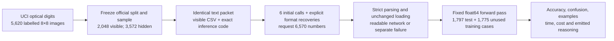
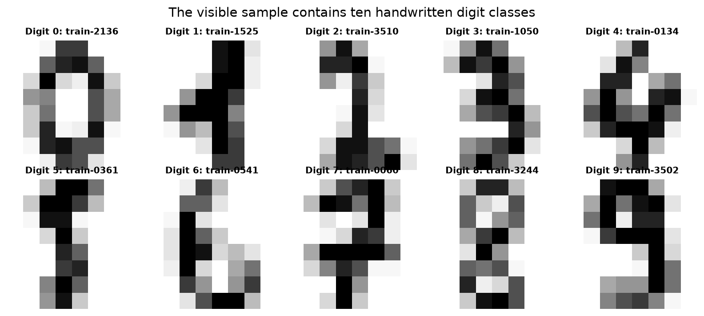
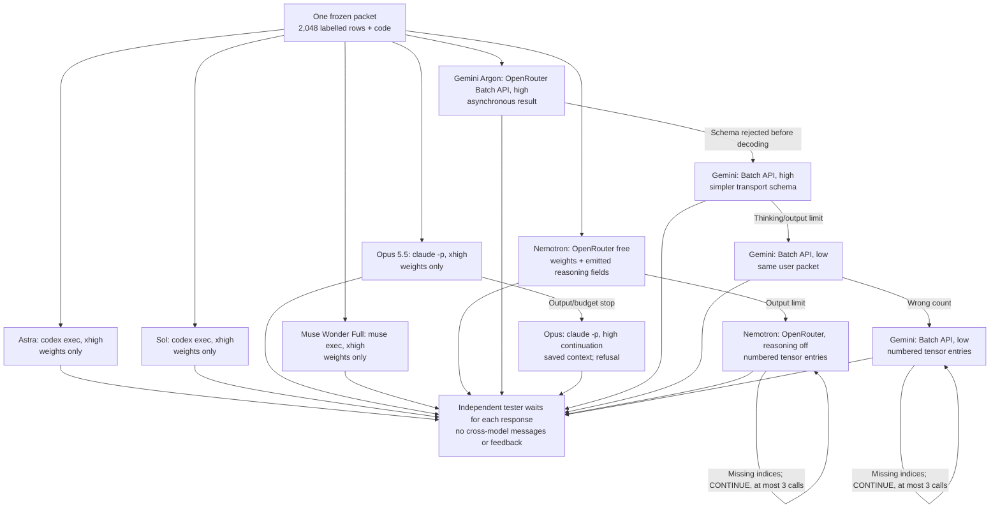
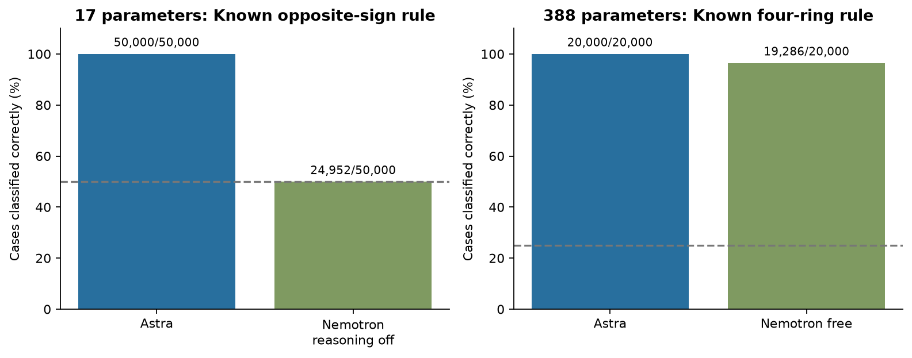
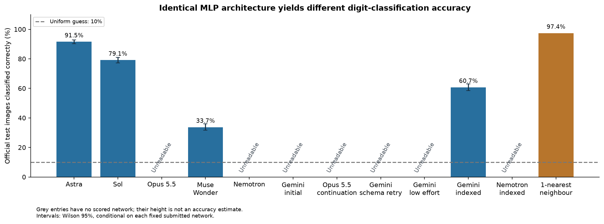
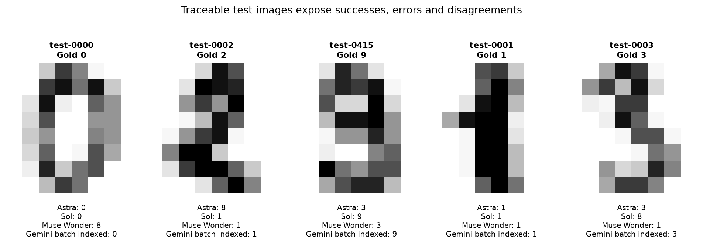
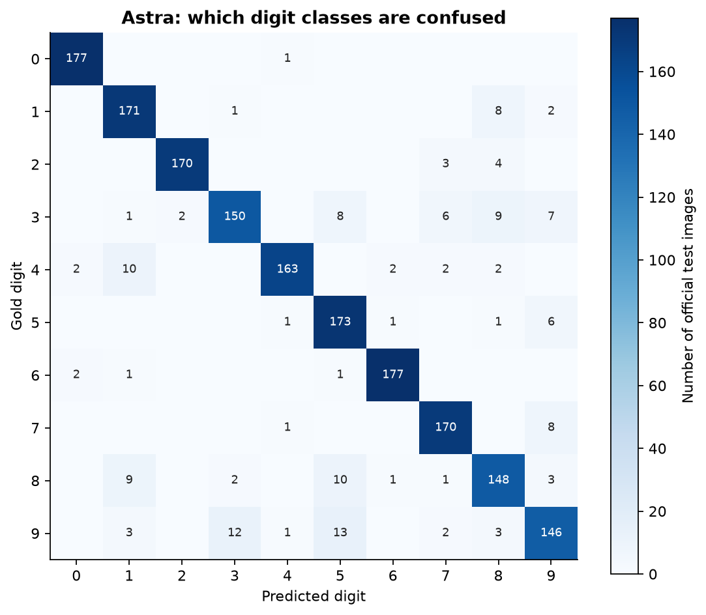
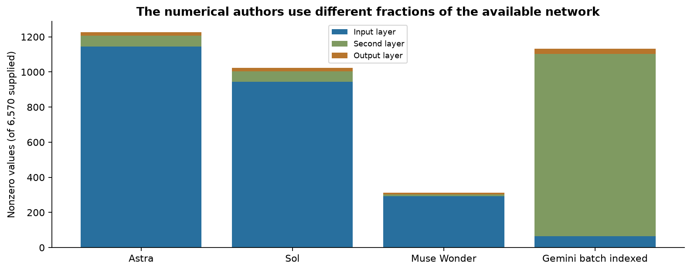

# Replicating direct weight writing with small neural networks

A neural network makes decisions through calculations whose numerical coefficients are called weights. Usually a training program chooses those numbers by repeatedly adjusting mistakes on examples. Another possibility is to ask a language model to choose the actual coefficients directly. A useful outcome would be a complete set of numbers that makes the network perform the requested task on inputs it has not been shown.

This notebook is part of our attempt to reproduce that idea on much smaller models, motivated by [Sparks of Weight-Space Programming](https://rikiyat.github.io/blog/weight-space-programming/) (Takehi et al., 2026). The distinction is between writing the numbers and merely writing code that trains a network. Throughout these experiments, the language model authors the candidate parameters and an independent harness saves and tests them unchanged.

Start with an explicitly illustrative task: two numbers belong to class one when their signs differ, and class zero when their signs match. A human can describe that rule in one sentence. A language model that writes weights must go further: its numbers have to make the network's arithmetic distinguish the two cases. An answer that explains the rule well but supplies unusable coefficients has not completed the task.

One complication is a curved decision boundary. Points can be assigned to rings according to distance from the origin, but a network built from straight-line calculations has to approximate the curves. Another complication is learning the rule from examples rather than receiving it explicitly. These changes help distinguish a compact numerical implementation of a known rule from choosing a useful classifier from a labelled sample.

Our experiments therefore move from seventeen-value rules to a 388-value ring classifier, then to a 6,570-value handwritten-digit classifier. The digit input is an eight-by-eight grid of ink counts, and the answer is one of ten labels. For an illustrative zero, a loop of dark blocks surrounds a blank centre. A six may also contain a loop, so one pixel detector will not settle every case. The network needs combinations of evidence that remain useful when handwriting changes.

The architecture specifies which calculations happen. Each layer multiplies inputs by a weight matrix, adds biases and passes its results onward. The final layer produces scores, and the largest score identifies the predicted class. The teacher receives this exact arithmetic and must supply every coefficient. It cannot execute code, inspect files, run an optimizer or query the evaluator while writing its answer.

The linked [SQL experiment](../42-tiny-sql-direct-weights/) tests another branch of the same replication attempt: directly writing a tiny sequence generator. Together the notebooks record what worked, what failed at the task, and what stopped before any executable network existed. Preparatory pretrained-model inspection and random initialization are kept separate from evidence that a language model successfully wrote weights.

The central question is how far the direct-writing result extends when the network is smaller and the task changes. Success on one rule does not guarantee success on a sequence task, and a long numerical response can fail before its function can be tested. The public digit dataset also may be familiar from pretraining. Its score establishes what the submitted network does on these images, while leaving open how much the teacher learned from the supplied sample.

## Study summary

This component of the replication tests directly written MLPs at three sizes: seventeen parameters for explicit mathematical rules, 388 for four rings, and **6,570 for digits**. Astra succeeds on the small rule tests; the larger six-model comparison supplies the same **2,048 labelled images** and measures performance on **1,797 official test images**. Another 1,775 training images are held back as a secondary check. An MLP, or multilayer perceptron, is a network of successive fully connected layers; each neuron in a layer receives every output of the previous layer.

Accuracy counts the images whose predicted digit equals the supplied label. For example, 90 correct predictions among 100 images would be 90% accuracy. Larger values are better. A one-nearest-neighbour reference, which simply copies the label of the most similar visible image, scores 1,750/1,797, or 97.38%, on the official test split. It is a separate reference method, not a source of candidate network weights.

3 of six first submissions produced scored networks; 3 ended without a usable network. Astra classified 1645/1,797 test images correctly (91.54%). Sol classified 1422/1,797 test images correctly (79.13%). Muse Wonder classified 606/1,797 test images correctly (33.72%). Transport recoveries are reported separately below and never replace the first-attempt failure counts.

With the owner's numbered-output intervention, Gemini also produces a complete network: 4,202 indexed entries followed by 2,368 missing entries on a continuation, scoring 1,091/1,797 (60.71%). Those two indexed calls follow three earlier unusable Gemini requests. This reproduces useful direct writing under a multi-call format workflow, not a first-reply success.

This is one submission per model on an old public benchmark. The result is conditional on the architecture, the chosen sample, the prompt and each provider's output settings. Possible pretraining exposure makes this an upper bound on learning from previously unseen data. A large number of tested images does not turn six generated networks into a reliable general model ranking.

## Contents

- [1. Replication scope and data](#1-replication-scope-and-data)
- [2. The fixed network and numerical contract](#2-the-fixed-network-and-numerical-contract)
- [3. Model access and isolation](#3-model-access-and-isolation)
- [4. How the study got here](#4-how-the-study-got-here)
- [5. Results and comparisons](#5-results-and-comparisons)
- [6. Worked test cases and error analysis](#6-worked-test-cases-and-error-analysis)
- [7. Reasoning logs and parameter patterns](#7-reasoning-logs-and-parameter-patterns)
- [8. Limits and practical meaning](#8-limits-and-practical-meaning)
- [9. Reproduction, caches and spend](#9-reproduction-caches-and-spend)
- [10. Future work and further reading](#10-future-work-and-further-reading)



One image from the visible training sample is serialized as sixty-four ink counts and a digit label. The same packet goes independently to every teacher model. A returned parameter vector is reshaped into six tensors and applied to hidden images. Their labels enter only when predictions are scored. No output from one teacher is passed to another, and the tester gives no corrective feedback during this study.

## 1. Replication scope and data

The original blog distinguishes reading behaviour from weights, repairing a trained network, and writing a network from scratch. Our direct-writing tests target the last of these. Its tool-free game-writing experiment uses a 600→32→32→6 tanh network, which contains 20,486 weights and biases by calculation from the published shape. Our seventeen-, 388- and 6,570-value MLPs are approximately 1,205, 53 and 3 times smaller, respectively. The tasks and activations differ, so the comparison tests the mechanism at smaller sizes rather than reproducing the published game scores.

| Blog capability | What our programme tests | Replication status |
|---|---|---|
| Write weights from a task specification | Known-rule MLPs and sample-based digit MLPs, with complete numeric output and no teacher tools | Functional small-network examples reproduced on our tasks |
| Repair useful pretrained behaviour | SQL revisions start from an untrained tiny sequence scaffold; frozen word vectors supply representations | Pretrained-network repair claim not tested equivalently |
| Identify a hidden behaviour from weights | The tester inspects submitted matrices after observing outputs | No blind weight-reading experiment conducted |

The positive claim supported here is that language-model-authored numerical vectors can implement useful functions without a tester-run optimizer. We have no matched trained-MLP baseline and have not reproduced the article's reinforcement-learning comparisons. The nearest-neighbour digit reference below is a different classifier, included to show useful information in the sample.

The complete programme is outlined below. Preparatory controls, functional failures and incomplete submissions are labelled separately; none is silently converted into evidence for or against the whole blog. This notebook develops the MLP evidence. The linked SQL notebook develops the language-generation tests and retains the initial language-model controls.

| Experiment | Network size | Observed outcome |
|---|---|---|
| Pretrained reference | 19,969 stored | MacroStories inspected; no preserved scored generation |
| Random language control | 10,000 editable | Ten untrained tokens; near-uniform scores |
| Sol SQL writing and revision | 2,208 editable + 55,500 frozen | Constant query: 1/8 exposed match; revision 0/12 |
| Astra SQL writing | 2,208 editable + 55,500 frozen | Completed run 0/16; earlier cancellation unscored |
| Free-model SQL writing | 2,208 editable + 55,500 frozen | Ultra malformed; Super 6 nonzeros, 0/16 |
| SQL decoding controls | 2,208 editable, unchanged | Zero schema matches in 1,845 outputs, 11 conditions |
| Bounded SQL weights | 2,208 editable + 55,500 frozen | All numerical checks pass; 0/16 SQL matches |
| Weight inspection | 2,208 SQL; 388 MLP; Pythia-14m reference | SQL score collapse; interpretable ring-network structure |
| Known-rule tiny MLPs | 17 per task | Astra 50,000/50,000 classification; regression error zero |
| Four-ring MLP | 388 | Astra 20,000/20,000; Nemotron 96.43%; boundary errors remain |
| Sample-based digit MLP | 6,570 | Astra 91.54%, Sol 79.13%, Muse 33.72%; other first replies unusable |
| Indexed output and continuation | 6,570 | Gemini: 6570 explicit values across two indexed replies; 1091/1797 test correct (60.71%). Nemotron: three upstream timeouts, no values. |

The [full experiment ledger](data/replication_ledger.json) records scope and outcome categories, including interruptions and provider failures.

The source is [Optical Recognition of Handwritten Digits](https://archive.ics.uci.edu/dataset/80/optical+recognition+of+handwritten+digits), by E. Alpaydin and C. Kaynak, donated to UCI on June 30, 1998. UCI publishes 5,620 cases with sixty-four integer features. The data are licensed under [CC BY 4.0](https://creativecommons.org/licenses/by/4.0/). The downloaded archive, individual text files and their SHA-256 hashes are saved in `data/source/` and the manifest. This notebook does not substitute scikit-learn's smaller packaged digits dataset.

Each image is represented by an eight-by-eight grid. Read the first eight numbers as its top row, the next eight as the second row, and so on. An ink count of zero represents a blank block and sixteen is the upper end of the count range. The final CSV entry is the class label. It is removed before inference. There are no names, natural-language descriptions or class labels hidden among the sixty-four model inputs.

The official files provide 3,823 training cases and 1,797 test cases. We leave the official test file intact. With the fixed seed 20261103, the visible subset contains 205 training images for each of digits zero through seven, and 204 each for eight and nine. These class counts sum to 2,048. The remaining 1,775 training cases provide a secondary hidden split. No label from either hidden split appears in the user packet.

Keeping the official test split avoids choosing favourable cases after observing weights. The source notes say thirty writers supplied training images and thirteen different writers supplied test images. Unused training images provide a separate check; combining these scores could hide a source discrepancy.



The ten panels show actual visible cases, one per label. Greyscale intensity represents the supplied ink counts, and the titles identify the original zero-based training row. A broad loop, a thin vertical stroke and a diagonal stroke leave different patterns, but the image size is small enough that some strokes merge. These examples make the input concrete without giving the teachers an additional image channel: every teacher receives the pixel values as text.

All six first requests share the same approximately 305 KB packet and prompt hash. No teacher receives a trained network, hidden labels, nearest-neighbour predictions or a test score.

No official test pixel row exactly duplicates a visible image. This excludes literal row copying, while similar handwriting, writer effects and pretraining exposure remain possible.

The owner's public-data exception is recorded before the teacher responses. The test measures whether the submitted weights recognize these digits; prior exposure remains possible.

## 2. The fixed network and numerical contract

The network has sixty-four inputs, hidden layers of sixty-four and thirty-two neurons, and ten output scores. A fully connected layer multiplies its inputs by a matrix and adds one bias per output neuron. The hidden activation is ReLU, which replaces negative intermediate values by zero. The final layer is linear, so its ten outputs are scores rather than calibrated probabilities.

| Tensor | Shape | Values | Zero-based offsets in the response |
|---|---|---:|---|
| W1 | 64 × 64 | 4,096 | 0–4,095 |
| b1 | 64 | 64 | 4,096–4,159 |
| W2 | 32 × 64 | 2,048 | 4,160–6,207 |
| b2 | 32 | 32 | 6,208–6,239 |
| W3 | 10 × 32 | 320 | 6,240–6,559 |
| b3 | 10 | 10 | 6,560–6,569 |

The six tensors contain 6,570 independent values. Matrix rows correspond to output neurons and columns to input neurons. Each is flattened row by row, then the tensors are concatenated in the table's order. Supplying a complete flat vector avoids disagreements about row nesting, but it makes counting and indexing part of the output task. A correct numerical idea with missing entries is still not an executable submission.

The owner later requested one-based numbered objects per tensor and continuation prompts for missing entries. This workflow preserves complete tensor/index/number members, checks all required indices, and asks only for missing ranges. Gemini's two replies cover all 6,570 entries with no conflicts. Every assembled value is verified against those original indexed members. Nemotron's three requests time out upstream before any numeric entry. The original flat-vector failures remain separate outcomes.

```python
import numpy as np
def preprocess(raw_pixels):
    # Exactly 64 integers, row-major flattening of the 8 by 8 image.
    # 0 is blank, 16 is the largest ink count. No fitted transform.
    return np.asarray(raw_pixels, dtype=np.float64) / 16.0
def network(raw_pixels, W1, b1, W2, b2, W3, b3):
    x = preprocess(raw_pixels)
    h1 = np.maximum(x @ W1.T + b1, 0.0)
    h2 = np.maximum(h1 @ W2.T + b2, 0.0)
    return h2 @ W3.T + b3
def postprocess(scores):
    # Digit labels are 0 through 9. Ties choose the lowest index.
    return np.argmax(scores, axis=-1)
```

This is the exact code in the teacher packet. Dividing by sixteen is a fixed scale conversion; it uses no estimated mean, standard deviation or hidden labels. The two hidden matrix products and ReLU operations are the only learned computations. The postprocessor selects a digit from the ten scores. It adds no handwriting-specific rules and never repairs a mistaken class.

For an explicitly illustrative score vector, suppose digit five had the largest score and digit eight the second largest. The prediction would be five, regardless of whether either score was positive. The difference between those two scores is a margin. This notebook can use a small margin to select a difficult example, but cannot interpret a margin of 0.9 as a 90% probability. No probability calibration data are supplied.

Each teacher is asked to return only `{"weights":[...]}` with exactly 6,570 explicit finite JSON numbers. Booleans, missing entries, extra object keys, symbolic expressions and non-finite constants are rejected. The program never pads a short vector, cuts a long one to size, replaces suspicious values or infers a repeated block. Such repairs would turn the tester into a second parameter author and make success difficult to attribute.

The first-call failures prompted documented transport recoveries. Google rejected the exact-length JSON grammar before generating a token, so its first recovery keeps the user prompt unchanged and simplifies only the provider schema. That high-reasoning request then exhausted a 32,768-token emitted response without final weights. A final low-reasoning variant returned 6,013 numbers instead of 6,570. Its vector is retained but cannot be loaded into the specified architecture. Claude first exhausted its output/budget allowance, then its saved-session continuation returned a refusal citing a provider safety classifier. No Claude weights were available, and no further Claude retries were attempted. These are service/completion outcomes rather than observed digit-classification errors.

After parsing, the vector is reshaped in float64 and saved in `candidate.npz`. Every saved array is compared exactly with the corresponding response slice. The frozen forward code then produces scores for visible and hidden images. Non-finite forward scores are flagged as an unusable network rather than converted into predictions. A candidate can pass the JSON contract and still be a poor classifier; those outcomes are reported separately.

Unlike the bounded SQL trial, this MLP experiment has no density rule or requirement that weights resemble a Gaussian distribution. Sparse networks and zero biases can be sensible numerical programs. The prompt asks for moderate coefficients but permits every finite value. We inspect their distribution after generation rather than changing their values to match an initializer. The output numbers alone determine whether a useful function is implemented.

## 3. Model access and isolation

| Teacher | Pinned version or runtime ID | Provider and call | Published size/precision | Output settings | Why included |
|---|---|---|---|---|---|
| GPT-6 Astra | gpt-6-astra; revision not exposed | OpenAI, codex exec | Not disclosed | xhigh; legacy 17-value medium; no tools | Requested author; known-rule successes |
| GPT-6.1 Sol | gpt-6.1-sol; immutable revision not exposed | OpenAI, codex exec | Not disclosed | xhigh; tools disabled | Requested second OpenAI numerical author |
| Claude Opus 5.5 | claude-opus-5-5; immutable revision not exposed | Anthropic, claude -p | Not disclosed | xhigh first; high continuation; tools disabled | Requested independent vendor; recovery kept separate |
| Muse Wonder Full | muse-wonder-full-1.0; immutable revision not exposed | Meta, muse exec | Not disclosed | xhigh; empty preset; tools disabled | Requested independent vendor |
| Nemotron 3.5 Super VL | nvidia/nemotron-3.5-super-vl-20261015 | NVIDIA, OpenRouter free | 120B total, 12B active; precision not attested | Reasoning first; off indexed; 131,072 cap; free only | Requested open-weight author; 388-value comparison |
| Gemini 4 Argon batch | google/gemini-4-argon-20261013 | Google Vertex, OpenRouter Batch API | Not disclosed | high original and schema retry; low final variant; 131,072 requested output cap | Requested Google comparison; asynchronous batch route |

The CLI model names are the exact requested identifiers, but immutable dated weight revisions are not exposed for them. Where the transport does not attest a snapshot, the table says so instead of presenting an alias as a pinned checkpoint. OpenRouter metadata pins canonical dated slugs before requests are sent. Published parameter count and numerical precision of the teacher models are recorded only where available; the candidate MLP always runs in float64.



The six calls are independent and can run concurrently. Concurrency does not give teachers a shared workspace or access to one another's replies. The CLI working directories are empty runtime directories, not notebook folders. Teacher processes are configured without shell, code execution, file tools, web search, skills or callable agents. Their input comes from the supplied prompt or a prompt file read by the CLI transport itself.

This distinction between the transport and the model is essential. The tester must read a file to send a large prompt and must write the answer somewhere. That does not give the model a file-reading or file-writing tool. The model's task is to emit text containing numbers. The parent harness alone stores those numbers in the required format and evaluates them.

Startup records and events audit isolation: Codex uses neutral isolated instructions, Claude reports empty tool and skills catalogues, and Muse uses an empty preset. Mandatory built-in metadata and exact switches remain in the protocol and raw logs. Actual tool-use events invalidate a submission.

The user packets are identical, but mandatory provider system scaffolding and output enforcement are not identical. Codex, Muse and OpenRouter can enforce a JSON shape through their native options; Claude is asked for the same JSON contract in the prompt. Reasoning-effort labels also differ by provider. These differences are part of this practical transport comparison and prevent a claim that only teacher weights or reasoning effort varied.

## 4. How the study got here

The earlier tiny MLP had two inputs, four ReLU hidden neurons and one output, for seventeen parameters. It was given a complete rule: classify opposite signs as class one and matching signs as class zero, or compute `abs(x1) + 0.5*abs(x2)`. Zero coordinates were excluded from classification. Astra's emitted numbers achieved 50,000/50,000 correct classifications and zero absolute error on 50,401 regression points. Those are measured results on those rules, not a promise that a larger data-only task will be easy.

One saved measured example is `(-0.8, 0.3)`, the first example in the archived seventeen-parameter results. Opposite signs require class one. Astra's score is 0.6000000000000001, above the fixed zero threshold, so its class is one. The regression target is `0.8 + 0.5*0.3`; both the cached target and its output are 0.9500000000000001 in float64. This is one exact success, with the aggregate checks providing coverage beyond the example.

The next network had two hidden layers of sixteen neurons and four outputs, for 388 parameters. Its complete rule assigned points in the unit disk to four rings using radius boundaries 0.25, 0.50 and 0.75. Astra classified all 20,000 balanced random points correctly; free Nemotron classified 19,286/20,000 correctly, or 96.43%. The dense-grid Astra score was 125,601/125,625. The twenty-four grid errors were concentrated at exact boundaries, so the random-sample ceiling did not establish an exact circle implementation.

The working Astra ring network can be interpreted as an approximation to radius followed by thresholds. Its many zero values and low-rank blocks therefore have a functional explanation. This is why the digits experiment does not ban sparse constructions. In a deliberately difficult narrow boundary stress set, its score was 34,784/43,200, or 80.52%; that stress score samples special slivers around thresholds and should not be substituted for ordinary disk accuracy.



The two panels show different tasks and are not a size-controlled comparison. The seventeen-value task has two labels and 50,000 classification points; its dashed chance reference is 50%. The ring task has four labels and 20,000 balanced points, with a 25% chance reference. Astra reaches the measured ceiling in both samples. Nemotron's earlier reasoning-off tiny trial is much weaker than its later reasoning-enabled ring trial, but task and settings changed together. The notebook recomputes these counts from the archived arrays without asking either teacher for a new response.

All historical prompts, responses, numeric arrays, point sets and results are archived under `data/legacy/`, with a file-level migration manifest. These earlier trials informed the harder question but are not six-model comparison rows. They differ in teacher set, effort, task information and sample construction. The larger experiment adds sixty-four visual features, ten labels, seventeen times as many parameters and a sample in place of a complete label formula.

## 5. Results and comparisons

Before comparing accuracies, check whether each response could be used as a network. A blank reply, unfinished stream or malformed vector is not a set of digit predictions. The table separates those failures from readable but wrong predictions. It also keeps requests still running separate from failures. A pending row cannot be interpreted as zero accuracy.

| Submission | Workflow | Official test | Wilson 95% | Visible accuracy | Unused training | Format/service failures |
|---|---|---|---|---|---|---|
| Astra | First submission | 1645/1797 (91.54%) | 90.16–92.74% | 93.16% | 94.03% | 0 |
| Sol | First submission | 1422/1797 (79.13%) | 77.19–80.95% | 82.91% | 83.61% | 0 |
| Opus 5.5 | First submission | Thinking/output limit, then budget exhaustion | N/A | N/A | N/A | 1 unusable response |
| Muse Wonder | First submission | 606/1797 (33.72%) | 31.57–35.94% | 37.74% | 37.86% | 0 |
| Nemotron | First submission | Incomplete or failed model response | N/A | N/A | N/A | 1 unusable response |
| Gemini batch | First submission | Provider rejected schema before decoding | N/A | N/A | N/A | 1 unusable response |
| Opus 5.5 continuation | Recovery | Refusal citing provider safety classifier; no weights | N/A | N/A | N/A | 1 unusable response |
| Gemini batch schema retry | Recovery | Incomplete or failed model response | N/A | N/A | N/A | 1 unusable response |
| Gemini batch low effort | Recovery | Expected 6570 weights; received 6013 | N/A | N/A | N/A | 1 unusable response |
| Gemini batch indexed | Indexed, 2 calls | 1091/1797 (60.71%) | 58.43–62.95% | 61.82% | 63.83% | 0 |
| Nemotron indexed | Indexed, 3 calls | 3 provider errors before numerical output | N/A | N/A | N/A | 3 provider errors |



Blue bars show accuracy on the 1,797 official test images. The brown reference bar shows one-nearest-neighbour using only the same visible images. The dashed line at 10% is uniform random guessing over ten labels, not a fitted baseline. Error bars are Wilson 95% intervals for each fixed network's image-level correctness. They do not include uncertainty from making another teacher request, selecting another visible sample or choosing different writers.

The highest first-attempt score observed is Astra at 1645/1,797 (91.54%). The nearest-neighbour reference correctly labels 105 more images. Astra and Sol differ by 223 correctly labelled images on this fixed test set. These are differences between single submitted networks. They do not establish a stable ranking across repeated requests or new datasets. The separately labelled Gemini batch indexed scored 1091/1,797 (60.71%) after its documented transport recovery.

The visible-sample score is useful because a network can fail even to represent the examples it was given. A high visible score with a substantially lower hidden score would instead suggest sample-specific behaviour or a shift between sources. Neither pattern proves its cause without more evidence. The unused-training score helps distinguish a discrepancy confined to the official test split from a broader failure on unseen examples.

One-nearest-neighbour achieves 1,749/1,775, or 98.54%, on unused training images and 1,750/1,797, or 97.38%, on official test images. It stores all 2,048 visible images and compares them at prediction time. The generated MLP gets no such lookup operation and has only 6,570 numerical parameters. Therefore the reference shows that the sample contains useful local structure, but does not establish that this architecture and a tool-free numerical author should match it.

With only one attempt per model, differences describe the submitted artefacts, not stable capacities of the model families. A response that happens to be well structured can dominate a single comparison even if another generation would differ. If several methods sit near a floor or ceiling, the test should be treated as unable to rank them there. The raw count of separating images is more informative than ordering nearly identical percentages.

## 6. Worked test cases and error analysis

Examples below are drawn from fixed official test row IDs. The first case is always the first test row. Once readable submissions exist, selection adds the first success and first error for the highest observed score, the smallest uncalibrated top-two margin, and a disagreement between the first two readable submissions when available. The procedure fills any missing categories with the first unused cases. These rules are explicit so striking examples do not masquerade as a representative sample.



### Case 1: `test-0000`, gold digit 0

Selection: First official test item, fixed ordinary case. Observed outputs: Astra → 0, Sol → 0, Muse Wonder → 8, Gemini batch indexed → 0. The shown predictions disagree with the gold label for at least one network. This item contributes one count per scored network; the panel above shows its actual pixel grid. The stable row index connects it to `data/source/optdigits.tes` and the saved prediction arrays.

### Case 2: `test-0002`, gold digit 2

Selection: First error for highest observed score. Observed outputs: Astra → 8, Sol → 1, Muse Wonder → 1, Gemini batch indexed → 1. The shown predictions disagree with the gold label for at least one network. This item contributes one count per scored network; the panel above shows its actual pixel grid. The stable row index connects it to `data/source/optdigits.tes` and the saved prediction arrays.

### Case 3: `test-0415`, gold digit 9

Selection: Smallest uncalibrated top-two score margin. Observed outputs: Astra → 3, Sol → 9, Muse Wonder → 3, Gemini batch indexed → 9. The shown predictions disagree with the gold label for at least one network. This item contributes one count per scored network; the panel above shows its actual pixel grid. The stable row index connects it to `data/source/optdigits.tes` and the saved prediction arrays.

### Case 4: `test-0001`, gold digit 1

Selection: First unused official test item to complete five distinct examples. Observed outputs: Astra → 1, Sol → 1, Muse Wonder → 1, Gemini batch indexed → 1. Every available prediction shown matches the gold label. This item contributes one count per scored network; the panel above shows its actual pixel grid. The stable row index connects it to `data/source/optdigits.tes` and the saved prediction arrays.

### Case 5: `test-0003`, gold digit 3

Selection: First unused official test item to complete five distinct examples. Observed outputs: Astra → 3, Sol → 8, Muse Wonder → 1, Gemini batch indexed → 3. The shown predictions disagree with the gold label for at least one network. This item contributes one count per scored network; the panel above shows its actual pixel grid. The stable row index connects it to `data/source/optdigits.tes` and the saved prediction arrays.

### End-to-end calculation for `test-0000`

The first eight raw ink counts are `[0, 0, 5, 13, 9, 1, 0, 0]`. Dividing by sixteen gives `[0.0, 0.0, 0.3125, 0.8125, 0.5625, 0.0625, 0.0, 0.0]` for the first input row. The complete input remains sixty-four numbers. Astra's unchanged matrices yield the following ten output scores.

| Digit | Observed score |
|---|---|
| 0 | 86.5 |
| 1 | 67.0625 |
| 2 | 72.875 |
| 3 | 73.5625 |
| 4 | 73.5 |
| 5 | 76.0625 |
| 6 | 74.25 |
| 7 | 67.6875 |
| 8 | 75.0625 |
| 9 | 78.6875 |

The largest score has digit 0; the hidden label is 0. This contributes 1 to that network's correct count. No score or label is fed back into its parameters.

The panels show the actual sixty-four-value inputs before division by sixteen. Success means the largest score has the gold label. Any distinction between similar loops or strokes must arise from the supplied matrices and biases; the displayed gold labels were absent from the hidden packet.



Rows are gold digits and columns are predictions. Each cell counts official test images, and the diagonal counts correct answers. For Astra, 13 of 180 true digit-9 images were labelled 5; 12 of 180 true digit-9 images were labelled 3. These are the two largest off-diagonal counts in this submitted network. The figure is selected descriptively by the highest observed score, not as an independently validated winner. Counts identify recurring class confusions; they do not establish why the errors occur.

Selection is descriptive: a small margin can accompany a correct or incorrect answer. No human relabelling is performed, and unobserved failure categories are never filled with invented cases.

An end-to-end case starts with a raw sixty-four-entry row. Its entries are scaled, passed through the two hidden layers and converted to ten scores by the final affine layer. Argmax yields one integer. Comparing that integer to the hidden label contributes exactly one correct or incorrect count to the accuracy numerator. It does not affect any weight, later prediction or request. Prediction arrays retain all ten scores so an investigator can inspect this sequence without asking the teacher to run again.

## 7. Reasoning logs and parameter patterns

| Submission | Emitted reasoning text | Reasoning tokens | Raw evidence |
|---|---|---|---|
| Astra | No readable reasoning text emitted | 16471 | [Raw evidence](data/responses/astra/response.json) |
| Sol | No readable reasoning text emitted | 21633 | [Raw evidence](data/responses/sol/response.json) |
| Opus 5.5 | No readable reasoning text emitted | 64000 | [Raw evidence](data/responses/opus/response.json) |
| Muse Wonder | No readable reasoning text emitted | 16786 | [Raw evidence](data/responses/muse/response.json) |
| Nemotron | [160,543 characters](data/responses/nemotron/reasoning.txt) | 131072 | [Raw evidence](data/responses/nemotron/response.json) |
| Gemini batch | No readable reasoning text emitted | Not reported | [Raw evidence](data/responses/gemini/response.json) |
| Opus 5.5 continuation | No readable reasoning text emitted | 1007 | [Raw evidence](data/recovery/opus/response.json) |
| Gemini batch schema retry | No readable reasoning text emitted | 32765 | [Raw evidence](data/recovery/gemini/response.json) |
| Gemini batch low effort | No readable reasoning text emitted | 0 | [Raw evidence](data/recovery/gemini-low/response.json) |
| Gemini batch indexed | No readable reasoning text emitted | 0 | [Raw evidence](data/indexed/gemini/assembled_response.json) |
| Nemotron indexed | No readable reasoning text emitted | Not reported | [Raw evidence](data/indexed/nemotron/workflow_summary.json) |

The notebook preserves provider-emitted reasoning because it can show the numerical construction a teacher describes: an intended feature detector, an indexing plan, a simplification or a decision to use sparse blocks. These logs are observations of emitted text. They are not a guarantee that every intermediate computation was exposed, and a plausible explanation does not validate a parameter vector. The independent forward pass remains the test of what the final numbers do.

Claude's `thinking_delta` events and final thinking blocks are retained when present. Nemotron's reasoning text and reasoning-detail fields are retained as streamed. Muse's raw events preserve any reasoning fields its CLI chooses to expose. Codex may provide a reasoning-token count without the full text. The analysis does not try to reconstruct absent content or substitute a narrative written by the tester.

The raw events are the source of truth; `reasoning.txt` is a convenience rendering. Opaque signatures stay opaque. Timing and usage accompany every completed response, without assuming that longer reasoning implies a better network.

Weight summaries count exact zeros and describe magnitudes after generation. A large fraction of zeros can mean unused neurons, a deliberately sparse program or an unhelpful constant predictor. A dense matrix can be just as useless. The interpretation must connect a pattern to the forward computation or observed predictions. No weights are rescaled merely to make a plot look like one from a conventionally trained model.

| Submission | Exact zeros / 6,570 | Nonzero first-layer rows / 64 | Nonzero second-layer rows / 32 | Largest magnitude |
|---|---|---|---|---|
| Astra | 5344 | 40 | 20 | 40.625 |
| Sol | 5546 | 40 | 20 | 19.25 |
| Muse Wonder | 6257 | 10 | 10 | 12.75 |
| Gemini batch indexed | 5438 | 64 | 20 | 2.7 |



The stacked bars count nonzero coefficients in each affine layer, including its bias. The total contract remains 6,570 values for every network; the bars show how many are not exactly zero. A nonzero row is a structural count, not proof that the neuron activates on an image. It also differs from a mathematical count of minimal functional degrees of freedom. These diagnostics explain utilisation without equating more nonzero entries with a better classifier.

For the first Astra and Sol submissions, forty of the sixty-four first-layer rows and twenty of the thirty-two second-layer rows are nonzero. Muse uses ten rows in each hidden layer. Their official test accuracies differ considerably, but this observation cannot establish that using fewer neurons caused a lower score. The actual numerical detectors also differ. The values and structural counts are cached in `data/parameter_use.json` for direct inspection.

Astra and Sol have exactly identical second-layer and output matrices and biases. Their different predictions therefore come from the first matrix and its biases. Inspection of those common downstream arrays gives a more specific description: for each digit, group four first-layer ReLU outputs as `a,b,c,d`; the final digit score is `max(a+b, c+d)`. The second layer computes `ReLU(a+b-c-d)` and `c+d`, and the final layer adds them. Since all four first-layer outputs are nonnegative, that sum equals the stated maximum. This is an interpretation of observable weights, not a reconstruction of hidden reasoning or an alternative inference implementation.

The notebook checks the equivalent expression against the ordinary full network scores on all 1,797 test images and saves the largest numerical differences in `data/program_structure.json`. The interpretation explains why dozens of hidden slots can remain unused while a nontrivial classifier still runs. It also narrows the comparison between these two particular submissions to different first-layer numerical features. It does not establish that the models computed class means, used a particular learning algorithm internally or would choose the same construction on another request.

Structural interpretation never repairs a transposition, fills a row or changes a coefficient. The emitted numbers remain the object being evaluated.

## 8. Limits and practical meaning

The strongest data limitation is the benchmark's age. These public files were donated in 1998, long before the current teachers were trained. A model may have seen the data, examples, class prototypes or code for the benchmark. Hiding rows from the prompt does not make them historically secret. A fresh digit collection or a carefully transformed new task is needed before claiming learning from an unseen dataset.

The strongest design limitation is one generated network per model. Image-level intervals quantify finite test cases while holding that network fixed. They do not quantify variation between independent numerical submissions. A convincing capacity comparison would repeat requests and sample selection, preserve every generated vector, and summarize variability across networks rather than treating thousands of image predictions as independent teacher trials.

The visible sample is almost balanced by digit; the official test split has its own class counts. Accuracy therefore weights test labels by their observed frequencies. Per-class results help identify a model that mainly predicts one or two digits. They also prevent an aggregate from hiding a class with little support. This remains a single dataset, so the score does not transfer automatically to higher-resolution images, colour images or real document OCR.

The architectural choice is an experimental constraint. Sixty-four hidden neurons followed by thirty-two permit many piecewise linear computations, but no optimizer is run to establish the best achievable accuracy for this exact architecture. The nearest-neighbour reference establishes useful information in the sample, not an MLP ceiling. This study evaluates direct weight writing under the chosen contract, not the theoretical capacity of all networks of this size.

Output length is part of the challenge. Writing 6,570 explicit numbers can require tens of thousands of tokens before reasoning. A failed format may reflect counting, indexing or response-length limits rather than an inability to describe a good algorithm. The caches separate these outcomes, but the one-shot design cannot determine how much a retry, a block-wise interface or a more permissive representation would help.

These results concern numerical writing with teacher tools disabled. Allowing execution, fitting or intermediate evaluation would be a different workflow, including settings explored by the original blog.

## 9. Reproduction, caches and spend

The executed [notebook](41_direct_weight_mlps.ipynb) defines its helpers internally, blocks network requests, and replays local caches to reproduce predictions, figures and reported spend. Initial requests are in `data/responses/`, earlier recoveries in `data/recovery/`, and numbered chunks in `data/indexed/`. Source images, sample membership and hidden labels are committed for audit.

Install Python with NumPy, SciPy, matplotlib, requests, nbformat, nbconvert and an IPython kernel. From this folder, run `jupyter nbconvert --to notebook --execute --inplace 41_direct_weight_mlps.ipynb`. Replay requires no model credential. The complete hidden files are available to the reader; the isolation and prompt hash are what establish which rows each teacher received during generation.

Fresh collection is separate: `python experiment.py collect --models astra --max-new-calls 1`. Started markers prevent accidental duplicate requests. `indexed_recovery.py` implements the owner-requested indexed continuation workflow. Inspect existing logs before resuming; credentials stay in local authentication or the environment.

| Submission | Native input tokens | Native output tokens | Wall time | Reported USD or list-price equivalent |
|---|---|---|---|---|
| Astra | 270858 | 30414 | 546.2 s | Not reported |
| Sol | 270858 | 35562 | 529.9 s | Not reported |
| Opus 5.5 | 2 | 64000 | 511.0 s | $5.602564 (cumulative session list-price equivalent) |
| Muse Wonder | 282926 | 30415 | 424.3 s | Not reported |
| Nemotron | 302686 | 131072 | 2113.7 s | $0.000000 |
| Gemini batch | Not reported | Not reported | 371.1 s | $0.000000 |
| Opus 5.5 continuation | 4 | 1158 | 16.6 s | $5.741595 (cumulative session list-price equivalent) |
| Gemini batch schema retry | 302875 | 32768 | 709.8 s | $0.466715 |
| Gemini batch low effort | 302875 | 13723 | 610.1 s | $0.371490 |
| Gemini batch indexed | 662718 | 45237 | 1386.4 s | $0.888903 |
| Nemotron indexed | Not reported | Not reported | 364.4 s | Not reported |

Unknown CLI charges are not treated as zero. Claude's dollar counters are cumulative: its final session total is US$5.741595, including the earlier US$5.602564 stop. Its budget flag allowed an overshoot. Nemotron is restricted to a zero-price route without paid fallback. Google batch IDs permit polling without resubmission. Raw usage retains provider-specific token counters.

The [protocol](data/PROTOCOL.md) records design changes, recovery settings and parser rules. The [manifest](data/manifest.json) pins inputs and model identities; the archive manifest hashes historical files. Replay sends no traces; fresh calls use optional local Langfuse when available.

## 10. Future work and further reading

Links below were checked on November 3, 2026.

### Future work

- Reproduce a published game-writing task with matched activations, evaluation and a trained baseline, then reduce network size. Measure which published performance comparisons survive; the current positive results use different tasks.
- Add a blind weight-reading test using matched networks for different known rules. Ask teachers to identify behaviour without outputs, rather than relying on the tester's post-hoc interpretation.
- Start with a competent pretrained small network and a defined defect, then request targeted edits. Measure retained skill and repaired behaviour; our SQL scaffold lacks the trained sequence core used in the blog's repair setting.
- Compare flat and indexed outputs across repeated requests with matched reasoning and total output budgets. Measure format completion and conditional accuracy; our recovery workflows change several transport settings together.
- Use newly collected handwriting or a preregistered new labelling and multiple visible samples. Measure variation between submitted networks and reduce the public-data exposure caveat.

### Further reading

- [Optical Recognition of Handwritten Digits](https://doi.org/10.24432/C50P49) (Alpaydin and Kaynak, 1998). The source dataset and its official train/test files.
- [Sparks of Weight-Space Programming](https://rikiyat.github.io/blog/weight-space-programming/) (Takehi et al., 2026). The motivating distinction between directly writing numerical networks and editing existing pretrained parameters.
- [Understanding the difficulty of training deep feedforward neural networks](https://proceedings.mlr.press/v9/glorot10a.html) (Glorot and Bengio, 2010). Explains scale considerations for network initialization, without making a histogram a test of functional correctness.
- [Git Re-Basin: Merging Models modulo Permutation Symmetries](https://arxiv.org/abs/2209.04836) (Ainsworth et al., 2023). Shows why neuron coordinates and raw parameter patterns need functional interpretation.
- [On Calibration of Modern Neural Networks](https://proceedings.mlr.press/v70/guo17a.html) (Guo et al., 2017). Explains why classifier scores and margins should not be read as reliable confidence probabilities.
