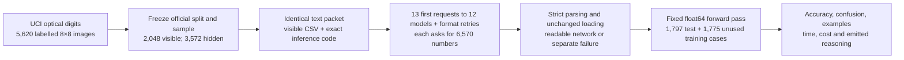
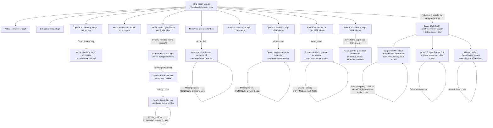

# Replicating direct weight writing with small neural networks

A neural network makes decisions through calculations whose numerical coefficients are called weights. Usually a training program chooses those numbers by repeatedly adjusting mistakes on examples. Another possibility is to ask a language model to choose the actual coefficients directly. A useful outcome would be a complete set of numbers that makes the network perform the requested task on inputs it has not been shown.

This notebook is part of our attempt to reproduce that idea on much smaller models, motivated by [Sparks of Weight-Space Programming](https://rikiyat.github.io/blog/weight-space-programming/) (Takehi et al., 2026). The distinction is between writing the numbers and merely writing code that trains a network. Throughout these experiments, the language model authors the candidate parameters and an independent harness saves and tests them unchanged.

Start with an explicitly illustrative task: two numbers belong to class one when their signs differ, and class zero when their signs match. A human can describe that rule in one sentence. A language model that writes weights must go further: its numbers have to make the network's arithmetic distinguish the two cases. An answer that explains the rule well but supplies unusable coefficients has not completed the task.

One complication is a curved decision boundary. Points can be assigned to rings according to distance from the origin, but a network built from straight-line calculations has to approximate the curves. Another complication is learning the rule from examples rather than receiving it explicitly. These changes help distinguish a compact numerical implementation of a known rule from choosing a useful classifier from a labelled sample.

Our experiments therefore move from seventeen-value rules to a 388-value ring classifier, then to a 6,570-value handwritten-digit classifier. The digit input is an eight-by-eight grid of ink counts, and the answer is one of ten labels. For an illustrative zero, a loop of dark blocks surrounds a blank centre. A six may also contain a loop, so one pixel detector will not settle every case. The network needs combinations of evidence that remain useful when handwriting changes.

The architecture specifies which calculations happen. Each layer multiplies inputs by a weight matrix, adds biases and passes its results onward. The final layer produces scores, and the largest score identifies the predicted class. The teacher receives this exact arithmetic and must supply every coefficient. It cannot execute code, inspect files, run an optimizer or query the evaluator while writing its answer.

The linked [SQL experiment](../42-tiny-sql-direct-weights/) tests another branch of the same replication attempt: directly writing a tiny sequence generator.

The central question is how far the direct-writing result extends when the network is smaller and the task changes. A long numerical response can also fail before its function can be tested, and the public digit dataset may be familiar from pretraining, so a score shows what the submitted network does on these images, not how much the teacher learned from the sample.

## Study summary

This component of the replication tests directly written MLPs at three sizes: seventeen parameters for explicit mathematical rules, 388 for four rings, and **6,570 for digits**. Astra succeeds on the small rule tests; the larger comparison gives twelve models the same **2,048 labelled images** and measures performance on **1,797 official test images**. Another 1,775 training images are held back as a secondary check. An MLP, or multilayer perceptron, is a network of successive fully connected layers; each neuron in a layer receives every output of the previous layer.

Accuracy counts the images whose predicted digit equals the supplied label: 90 correct among 100 images is 90%, and random guessing gives about 10%. A one-nearest-neighbour reference, which copies the label of the most similar visible image, scores 1,750/1,797 (97.38%); it is a separate method, not a source of network weights.

{{HEADLINE}}

Fable 5.1 is the one Claude model whose first flat reply could be scored: exactly 6,570 values, 1,628 correct (90.60%), after 166,646 thinking tokens and US$19.79. Most other failures were failures to write the numbers out, not bad designs. Opus 5.5 and Sonnet 5.5 each wrote a template-matching classifier in their first flat reply and then miscounted rows: Opus left out three rows of zeros (6,378 values) and Sonnet added a line of 56 zeros and dropped two biases (6,624). Asked again for numbered entries per tensor, each returned the same values with correct counts in one reply. Gemini needed three unusable requests and two numbered replies. Haiku 5.5 ran into long runs of zeros twice, then declined to write weights it could not test. The first Opus request, at the highest effort setting, spent its whole 64,000-token allowance thinking and wrote nothing.

Asking for numbered entries from the start removed the format problem but not the design problem. The three highest-ranked open-weight models on OpenRouter each delivered all 6,570 entries; GLM-5.3 and MiMo-V2.6-Pro needed a second call because their first ran out of output, or hit a provider error, while still reasoning. Their networks classify 21.1% (DeepSeek V4.1 Flash), 10.8% (GLM-5.3) and 18.6% (MiMo-V2.6-Pro) of the test images correctly, because none of them puts its ten digit scores on a common scale, so one or two digits win almost every image.

This is one submission per model and setting on an old public benchmark. Settings are not matched: the Claude requests used high effort and a 128,000-token allowance, the open-weight models medium reasoning with numbered entries asked for from the start, the other models their providers' settings, and the numbered retries saw their own earlier reply. Possible pretraining exposure makes every score an upper bound on learning from unseen data, and 1,797 test images do not turn ten single networks into a reliable model ranking.

## Contents

- [1. Replication scope and data](#1-replication-scope-and-data)
- [2. The fixed network and numerical contract](#2-the-fixed-network-and-numerical-contract)
- [3. Model access and isolation](#3-model-access-and-isolation)
- [4. How the study got here](#4-how-the-study-got-here)
- [5. Results and comparisons](#5-results-and-comparisons)
- [6. Worked test cases and error analysis](#6-worked-test-cases-and-error-analysis)
- [7. Reasoning logs and parameter patterns](#7-reasoning-logs-and-parameter-patterns)
- [8. Limits and practical meaning](#8-limits-and-practical-meaning)
- [9. Reproduction, caches and spend](#9-reproduction-caches-and-spend)
- [10. Future work and further reading](#10-future-work-and-further-reading)

One visible image travels as sixty-four ink counts and a digit label in the packet that goes to every teacher. A returned parameter vector is reshaped into six tensors and applied to hidden images, whose labels enter only when predictions are scored. No teacher sees another's output or any score.

## 1. Replication scope and data

The original blog distinguishes reading behaviour from weights, repairing a trained network, and writing a network from scratch. Our direct-writing tests target the last of these. Its tool-free game-writing experiment uses a 600→32→32→6 tanh network, which contains 20,486 weights and biases by calculation from the published shape. Our seventeen-, 388- and 6,570-value MLPs are about 1,205, 53 and 3 times smaller, with different tasks and activations, so they test the mechanism at smaller sizes rather than reproduce the published scores.

| Blog capability | What our programme tests | Replication status |
|---|---|---|
| Write weights from a task specification | Known-rule MLPs and sample-based digit MLPs, with complete numeric output and no teacher tools | Functional small-network examples reproduced on our tasks |
| Repair useful pretrained behaviour | SQL revisions start from an untrained tiny sequence scaffold; frozen word vectors supply representations | Pretrained-network repair claim not tested equivalently |
| Identify a hidden behaviour from weights | The tester inspects submitted matrices after observing outputs | No blind weight-reading experiment conducted |

The positive claim supported here is that language-model-authored numbers can implement useful functions without a tester-run optimizer; there is no matched trained-MLP baseline. The programme so far:

{{REPLICATION_LEDGER}}

The source is [Optical Recognition of Handwritten Digits](https://archive.ics.uci.edu/dataset/80/optical+recognition+of+handwritten+digits), by E. Alpaydin and C. Kaynak, donated to UCI on June 30, 1998. UCI publishes 5,620 cases with sixty-four integer features. The data are licensed under [CC BY 4.0](https://creativecommons.org/licenses/by/4.0/). The archive, its files and their SHA-256 hashes are saved in `data/source/` and the manifest.

Each image is an eight-by-eight grid read row by row, with ink counts from 0 (blank) to 16. The final CSV entry is the class label, which is removed before inference.

The official files provide 3,823 training cases and 1,797 test cases; the test file stays intact. With the fixed seed 20261103, the visible subset has 205 training images for each of digits zero to seven and 204 each for eight and nine, 2,048 in all. The other 1,775 training cases form a secondary hidden split.

Keeping the official test split avoids choosing favourable cases after observing weights. The source notes say thirty writers supplied training images and thirteen different writers supplied test images, so the unused training images are reported as a separate check.

The ten panels show actual visible cases, one per label, with greyscale for ink counts and the original zero-based training row in each title. A broad loop, a thin vertical stroke and a diagonal stroke leave different patterns, but at this size some strokes merge. Every teacher receives these pixels as text, not as an image.

Every first request uses the same approximately 305 KB packet and prompt hash. No teacher receives a trained network, hidden labels, nearest-neighbour predictions or a test score. No official test pixel row exactly duplicates a visible image, which excludes literal copying but not similar handwriting or pretraining exposure.

## 2. The fixed network and numerical contract

The network has sixty-four inputs, hidden layers of sixty-four and thirty-two neurons, and ten output scores. A fully connected layer multiplies its inputs by a matrix and adds one bias per output neuron. The hidden activation is ReLU, which replaces negative intermediate values by zero. The final layer is linear, so its ten outputs are scores rather than calibrated probabilities.

| Tensor | Shape | Values | Zero-based offsets in the response |
|---|---|---:|---|
| W1 | 64 × 64 | 4,096 | 0–4,095 |
| b1 | 64 | 64 | 4,096–4,159 |
| W2 | 32 × 64 | 2,048 | 4,160–6,207 |
| b2 | 32 | 32 | 6,208–6,239 |
| W3 | 10 × 32 | 320 | 6,240–6,559 |
| b3 | 10 | 10 | 6,560–6,569 |

Matrix rows are output neurons and columns are input neurons. Each tensor is flattened row by row and the tensors are joined in the table's order, so counting and indexing become part of the output task: a correct idea with a missing entry is not an executable submission.

The owner later asked that replies with parsing errors be requested again as one-based numbered objects per tensor, so a model can see where each tensor ends, with a continuation prompt when output size cuts a reply short. The workflow keeps only complete entries and asks only for missing ranges, at most three calls per model. Gemini covers all 6,570 entries in two replies, and Opus 5.5 and Sonnet 5.5, resuming their own CLI sessions, in one each. Nemotron's requests time out upstream and Haiku 5.5 declines. The three open-weight models get this format from their first call and each completes it within two calls.

{{PREPOST}}

This is the exact code in the teacher packet. Dividing by sixteen is a fixed scale conversion that uses no estimated statistics or labels, and the postprocessor only picks the largest of the ten scores. In an illustrative case where digit five scores highest and eight second, the prediction is five; the gap between the two is a margin, which this notebook uses to pick a difficult example but never reads as a probability.

The flat contract asks for only `{"weights":[...]}` with exactly 6,570 finite JSON numbers. The program never pads a short vector, cuts a long one or replaces values, because such repairs would make the tester a second parameter author.

Google first rejected the exact-length JSON grammar before generating a token; a simpler schema then exhausted a 32,768-token response, and a low-effort variant returned 6,013 numbers. The first Opus continuation returned a refusal citing a provider safety classifier. These are completion and counting outcomes, not digit-classification errors.

A parsed vector is reshaped in float64, saved in `candidate.npz`, checked against the reply and run through the frozen forward code. Sparse networks and zero biases are allowed. A network can pass the contract and still be a poor classifier, which is reported separately.

## 3. Model access and isolation

{{MODEL_TABLE}}

The CLIs do not expose dated weight revisions, so the table says so instead of presenting an alias as a pinned checkpoint. OpenRouter metadata pins canonical dated slugs before requests are sent.

Requests are independent and pass nothing between models: no scores, labels or other models' weights. Teachers run in empty working directories with no shell, code execution, file tools, web search, skills or agents; startup records confirm empty tool catalogues, and no tool-use event occurred. Provider scaffolding, output enforcement and reasoning-effort labels differ, which is part of this practical comparison.

## 4. How the study got here

The earlier tiny MLP had two inputs, four ReLU hidden neurons and one output, seventeen parameters, and a complete rule: class one when two numbers' signs differ, or compute `abs(x1) + 0.5*abs(x2)`. Astra's numbers achieved 50,000/50,000 correct classifications and zero error on 50,401 regression points.

One saved measured example is `(-0.8, 0.3)`, the first example in the archived seventeen-parameter results. Opposite signs require class one. Astra's score is 0.6000000000000001, above the fixed zero threshold, so its class is one. The regression target is `0.8 + 0.5*0.3`; both the cached target and its output are 0.9500000000000001 in float64.

The next network had two hidden layers of sixteen neurons and four outputs, for 388 parameters. Its complete rule assigned points in the unit disk to four rings using radius boundaries 0.25, 0.50 and 0.75. Astra classified all 20,000 balanced random points correctly; free Nemotron classified 19,286/20,000 correctly, or 96.43%. On a dense grid Astra scored 125,601/125,625, with the errors at exact boundaries.

The Astra ring network reads as an approximation to radius followed by thresholds, so its many zeros have a functional explanation; this is why the digits experiment allows sparse constructions.

The two panels show different tasks, not a size-controlled comparison. The seventeen-value task has two labels and a 50% chance line; the ring task has four labels and a 25% chance line. Astra reaches the measured ceiling in both. The notebook recomputes these counts from the arrays archived under `data/legacy/`. These trials are not rows of the digit comparison, which adds sixty-four visual features, ten labels and a sample in place of a complete rule.

The digit comparison began with six models. The first Opus 5.5 request spent its whole output allowance on thinking, so the owner asked for weights from Opus, Sonnet 5.5 and Haiku 5.5, and later Fable 5.1, with more room to write. Claude Code subagents could not hold the 268,000-token packet, so the requests went through `claude -p` at high effort with a 128,000-token allowance. The owner then asked for the three highest-ranked open-weight models that OpenRouter serves, chosen by the Artificial Analysis Progress Index: DeepSeek V4.1 Flash 1017, GLM-5.3 and MiMo-V2.6-Pro. Because most earlier failures came from running out of output or miscounting, their packet asks for numbered entries from the first call and says that the entries alone take about 45,000 tokens; it differs from the other packets only in that return section. The [protocol](data/PROTOCOL.md) records each step.

## 5. Results and comparisons

A blank reply, unfinished stream or malformed vector is not a set of digit predictions, so those submissions get their own table with the reason instead of an accuracy.

{{RESULT_TABLE}}

Rows are grouped by how each submission was requested. Blue bars show accuracy on the 1,797 official test images; a cross marks a submission with no network, which is not an accuracy of zero. The brown bar is the nearest-neighbour reference and the dashed line is random guessing. Error bars are Wilson 95% intervals over test images for each fixed network; they do not cover what another request would produce.

{{RESULT_INTERPRETATION}}

Fable 5.1's first reply is the second-best network, 17 correct images behind Astra. Opus 5.5's numbered network follows, 48 behind Fable and 158 ahead of Sol. It took two calls, a flat reply with three missing rows and then a numbered reply, so it is not a first-reply success. Sonnet 5.5's network is right on 1,214 images. It recognises zeros and sixes well (94% and 97% of them) but fewer than half of the fours and fives (41% and 45%). Section 7 shows that the Claude networks are template matchers.

The three open-weight networks sit near the random-guessing line: DeepSeek V4.1 Flash 379 correct, MiMo-V2.6-Pro 335 and GLM-5.3 194, against about 180 expected from guessing. Their numbered replies parsed without a single conflict or gap, so these are wrong digits, not format failures; section 6 shows why.

Each bar is one submission's output in tokens: light for reasoning the provider counted but did not show, solid for the visible reply, blue when a network resulted. Submissions that produced a network used {{SCORED_TOKEN_RANGE}} output tokens over their calls. Fable 5.1 and GLM-5.3 are at the top because their thinking hit the output cap once before they wrote; the first Opus request, Nemotron and the Gemini schema retry hit it and wrote nothing. Opus 5.5 high and Sonnet 5.5 finished well inside 128,000 tokens and still miscounted, so a larger allowance alone did not fix them; numbered entries did. Haiku's flat reply ran to 256,483 tokens, almost all zeros. Tokenizers differ, so lengths compare only approximately.

No scored network does much better on the visible sample than on hidden images: each one's visible, unused-training and test accuracies lie within about five percentage points. The nearest-neighbour reference (97.38% on test, 98.54% on unused training) stores all 2,048 visible images and compares them at prediction time, a lookup the MLP does not have, so it shows useful structure in the sample rather than a target for a tool-free author.

## 6. Worked test cases and error analysis

The cases follow fixed rules, so striking examples cannot be picked by hand: the first test row, the first success and first error of the highest-scoring network, its smallest top-two margin, and the first unused rows to make five. Row IDs connect each case to `data/source/optdigits.tes` and the saved predictions.

{{EXAMPLES}}

The panels show the actual sixty-four-value inputs before division by sixteen; the gold labels were absent from the packet. In case 2, Opus's template network labels a two correctly while the other eight networks call it an eight, a one or a zero. GLM-5.3 answers 0 in all five cases, the collapse described below.

{{CONFUSION}}

### Replies that failed the count

Two unusable Claude replies show that a format failure can hide a working design. Sonnet 5.5's flat reply (`data/claude_family/sonnet/weights_output.json`) puts one matrix row per line, so its layout can be read without changing a value:

| Lines of the reply | Values per line | What the contract needs there |
|---|---|---|
| 1 to 64 | 64 | W1, 64 rows of 64 |
| 65 | 64 | b1, 64 values |
| 66 | 56, all zeros | nothing |
| 67 to 98 | 64 | W2, 32 rows of 64 |
| 99 | 30 | b2, 32 values |
| 100 to 109 | 32 | W3, 10 rows of 32 |
| 110 | 10 | b3, 10 values |

The extra line adds 56 values and the short bias line removes 2, so the vector has 6,624 entries and every tensor after b1 would be read from the wrong offsets. Picking which line to drop would make the tester a co-author, so the reply stays unusable. Sonnet's numbered reply has the same templates and biases without those two errors and scores 1,214/1,797. Opus 5.5's flat reply lacks two first-layer and one second-layer row, all three zeros; its numbered reply repeats the same nonzero rows and scores 1,580/1,797.

Haiku 5.5 is the opposite case. Every number after the 491st in its flat reply is zero; it hit the output cap, restarted when the CLI asked it to resume, hit it again and ended with a note that its attempts had "degenerated into long runs of zeros". Asked for numbered entries, it declined to write weights it could not test and offered a training script, which the protocol does not allow.

### Networks that collapse onto one or two digits

The three open-weight networks are the opposite of the Claude count failures: the format is perfect and the digits are wrong. Each one sends most images to one or two classes.

| Network | Design | Most-predicted digits (of 1,797) | What tips the scores |
|---|---|---|---|
| DeepSeek V4.1 Flash | 10 hand-drawn templates in layer 1, passed straight through | 1: 1,388; 4: 199 | The "1" template rewards central ink that most digits have (mean activation 0.39, against 0.11 to 0.31) |
| GLM-5.3 | Identity layer 1; 10 digit-average templates in raw ink counts in layer 2 | 0: 1,670; 3: 127 | The "0" template holds 374 units of ink, against 175 to 266, while the per-digit offsets differ by only 4.5; the templates for 4 to 9 also do not resemble the real digit averages |
| MiMo-V2.6-Pro | Identity layer 1; 32 region sums; dense output layer | 1: 1,546; 7: 171 | The output offsets run from −62.2 for digit 0 to −21.5 for digit 1, a 40-point head start for "1" |

GLM's templates for 0 to 3 resemble the real averages of those digits in the sample (correlation 0.57 to 0.89), and those for 1 to 3 match the last versions in its reasoning entry for entry. Its templates for 5 to 9 match its reasoning best when shifted three or four positions, which suggests the values slid against their index numbers as it wrote them; it revised the templates many times, so this is a likely reading rather than a proof. Fable 5.1 built the same kind of design with templates that match the real averages (correlation 0.96 to 0.99) and per-digit biases that balance them, and scored 90.60%. What the three open-weight networks lack is the step that makes ten scores comparable, such as subtracting half of each template's squared length in a nearest-average classifier. A training run would tune that automatically; a model writing numbers by hand has to work it out, and none of these three did.

## 7. Reasoning logs and parameter patterns

Provider-emitted reasoning can show the construction a teacher intended, though it need not expose every step and a plausible plan does not validate the numbers. Nemotron ([160,543 characters](data/responses/nemotron/reasoning.txt)) and the three open-weight models stream readable reasoning; the Claude CLI and Codex report reasoning-token counts with no text. Nothing absent is reconstructed.

Many zeros can mean unused neurons, a deliberately sparse program or a constant predictor, so a weight pattern only counts as explained when it is tied to the forward computation or the predictions.

{{PARAMETER_TABLE}}

The stacked bars count nonzero coefficients in each affine layer, including its bias, against the 6,570 values every network supplies (dashed line). A nonzero row is a structural count, not proof that the neuron activates on an image, and more nonzero entries do not make a better classifier: Opus's network uses 565 nonzero values and scores higher than Gemini's 1,132.

Row counts alone cannot show that fewer neurons caused a lower score: Opus uses thirteen rows in each hidden layer and scores 87.92%, Muse ten and 33.72%.

The Claude networks are template matchers, a design that compares an image with a stored typical image of each digit. Fable's identity first layer feeds ten second-layer templates that correlate 0.96 to 0.99 with the real digit averages, each with its own bias, plus 20 correction units that switch on for 1% to 9% of test images and add to one digit's score. Read from the submitted weights, the templates with their biases alone label 1,614 test images correctly, 194 more than without the biases, and the correction units add 14. Sonnet's identity first layer hands the 64 scaled pixels to the second layer, where each of the first ten rows is a digit template with a bias near 14; the output layer copies template c to digit c. Each digit score is therefore one template's dot product with the image plus a bias. Opus's thirteen first-layer rows are templates with biases between 15 and 18, large enough that no template unit switches off on any test image (smallest pre-activation 26.2). Digits 1, 7 and 9 get two templates each. The second layer computes `ReLU(b - a)` beside `a`, and the output layer adds them, which equals `max(a, b)` for nonnegative `a` and `b`. On all 1,797 test images, scoring each digit by its best template reproduces Opus's full network exactly, and {{SONNET_TEMPLATE_CHECK}}. This reads the submitted weights, not hidden reasoning.

The open-weight models' reasoning text shows where their designs came from. DeepSeek V4.1 Flash decided to "handcraft digit templates" from common shapes instead of computing them from the 2,048 images, and spent much of its 45,801 characters planning how to write thousands of zero entries without losing count. GLM-5.3 spent 312,221 characters estimating and revising an average image for each digit from the sample until its allowance ran out; its second call wrote those estimates as templates. MiMo-V2.6-Pro planned sums over rows, columns and regions, and its first call had begun listing entries inside its reasoning when the provider stream failed.

Astra and Sol have identical second-layer and output matrices and biases, so their different predictions come from the first layer. For each digit, group four first-layer ReLU outputs as `a,b,c,d`: the second layer computes `ReLU(a+b-c-d)` and `c+d`, and the output layer adds them, which equals `max(a+b, c+d)` because all four are nonnegative.

The notebook checks each of these readings against the full network on all 1,797 test images (`data/program_structure.json`). They explain why dozens of hidden slots can stay unused in a working classifier, and they never change a coefficient.

## 8. Limits and practical meaning

The strongest data limitation is the benchmark's age: these files were donated in 1998, so a model may have seen the data, class prototypes or code for it. A fresh digit collection is needed before claiming learning from an unseen dataset.

The strongest design limitation is one generated network per model and setting. Image-level intervals hold that network fixed and say nothing about how much a second request would differ; a capacity comparison would repeat requests and visible samples and summarize the spread across networks.

Accuracy weights digits by their frequency in the official test split, so per-class results matter: Sonnet's network, for example, gets fewer than half of the fours and fives right. This is a single small-image dataset, and the scores do not transfer to higher-resolution images or document OCR.

No optimizer is run on this architecture, so its best achievable accuracy is unknown; the nearest-neighbour reference shows useful information in the sample, not an MLP ceiling.

Output length and counting are part of the challenge: 6,570 explicit numbers take about 30,000 output tokens before any reasoning. Numbered entries fixed both Claude counts and let all three open-weight models finish, but only the open-weight models had them from the start, so this design cannot say how the others would do with them from the start or with matched settings.

All results concern numerical writing with teacher tools disabled; allowing execution or fitting, as some of the blog's settings do, is a different workflow.

## 9. Reproduction, caches and spend

The executed [notebook](41_direct_weight_mlps.ipynb) defines its helpers internally, blocks network requests, and replays local caches to reproduce predictions, figures and reported spend. Initial requests are in `data/responses/`, earlier recoveries in `data/recovery/`, the high-effort Claude requests in `data/claude_family/`, numbered retries in `data/indexed/` and the open-weight requests in `data/open_models/`. Source images, sample membership and hidden labels are committed for audit.

Install Python with NumPy, SciPy, matplotlib, requests, nbformat and nbconvert. From this folder, run `jupyter nbconvert --to notebook --execute --inplace 41_direct_weight_mlps.ipynb`; replay needs no model credential. `indexed_recovery.py` runs the numbered-entry workflow for OpenRouter models; `claude_family.py` and `claude_indexed.py` collect the Claude requests and their numbered replies, and `open_models.py` the open-weight requests.

{{SPEND}}

Unknown CLI charges are not treated as zero. The first Opus session's counter is cumulative: US$5.74 in all, including the US$5.60 stop. Together these seven Claude calls report US$32.62 in list-price equivalents, US$19.79 of it Fable 5.1. The five open-weight calls cost US$1.54 on OpenRouter, US$1.40 of it GLM-5.3.

The [protocol](data/PROTOCOL.md) records design changes, recovery settings and parser rules, and the [manifest](data/manifest.json) pins inputs and model identities. Replay sends no traces; fresh calls go to a local Langfuse when one is running.

## 10. Future work and further reading

Links below were checked on November 3, 2026.

### Future work

- Reproduce a published game-writing task with matched activations, evaluation and a trained baseline, then reduce network size. Measure which published performance comparisons survive; the current positive results use different tasks.
- Add a blind weight-reading test using matched networks for different known rules. Ask teachers to identify behaviour without outputs, rather than relying on the tester's post-hoc interpretation.
- Start with a competent pretrained small network and a defined defect, then request targeted edits. Measure retained skill and repaired behaviour; our SQL scaffold lacks the trained sequence core used in the blog's repair setting.
- Ask every model for numbered entries from the first request, with matched effort and output allowances, and repeat each request several times. Measure format completion and accuracy; numbered entries fixed both Claude count errors and let all three open-weight models finish, but the open-weight networks still scored 11% to 21%.
- Use newly collected handwriting or a preregistered new labelling and multiple visible samples. Measure variation between submitted networks and reduce the public-data exposure caveat.

### Further reading

- [Optical Recognition of Handwritten Digits](https://doi.org/10.24432/C50P49) (Alpaydin and Kaynak, 1998). The source dataset and its official train/test files.
- [Sparks of Weight-Space Programming](https://rikiyat.github.io/blog/weight-space-programming/) (Takehi et al., 2026). The motivating distinction between directly writing numerical networks and editing existing pretrained parameters.
- [Understanding the difficulty of training deep feedforward neural networks](https://proceedings.mlr.press/v9/glorot10a.html) (Glorot and Bengio, 2010). Explains scale considerations for network initialization, without making a histogram a test of functional correctness.
- [Git Re-Basin: Merging Models modulo Permutation Symmetries](https://arxiv.org/abs/2209.04836) (Ainsworth et al., 2023). Shows why neuron coordinates and raw parameter patterns need functional interpretation.
- [On Calibration of Modern Neural Networks](https://proceedings.mlr.press/v70/guo17a.html) (Guo et al., 2017). Explains why classifier scores and margins should not be read as reliable confidence probabilities.
