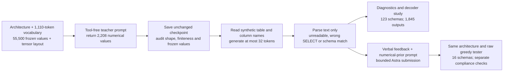
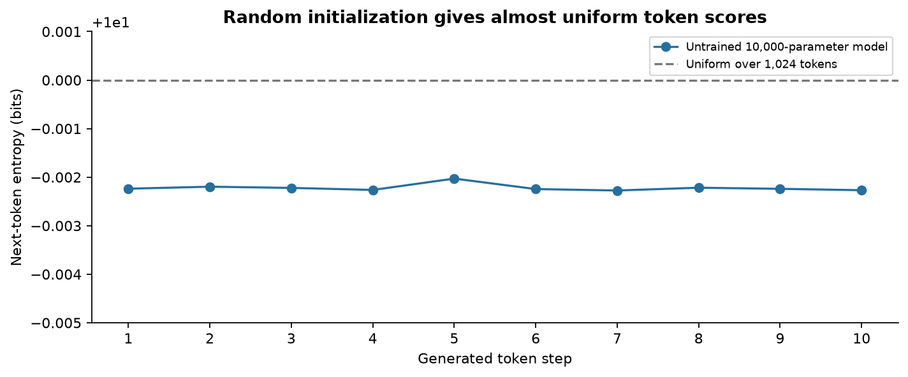
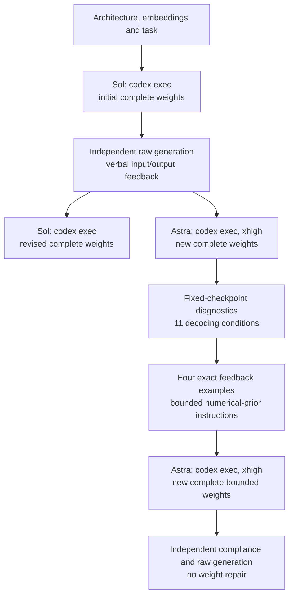
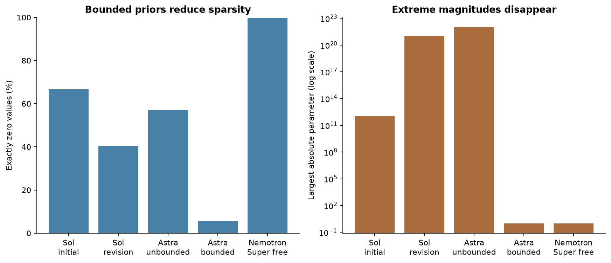
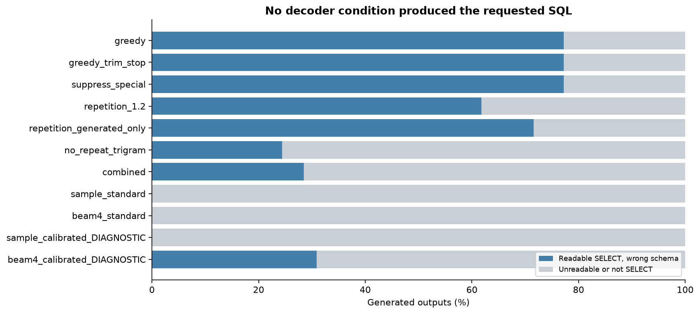

# Replicating direct weight writing in a tiny SQL generator

A request to list the names in a table called `users` has a short SQL answer: `select "name" from "users";`. A useful query generator must preserve the supplied names while putting the keywords, punctuation and spacing in the right places. If the table changes to `products`, a query that still refers to `users` is wrong even if it looks perfectly reasonable to a SQL parser.

Neural language models generate text one token at a time. A token can represent a word, a character or a control marker, depending on the tokenizer. After reading the input and the tokens it has already produced, the network assigns a score to every possible next token. A decoder uses those scores to choose the next token. The network repeats this process until it emits an end marker or reaches a length limit.

The arithmetic inside a network depends on its weights. These are numerical coefficients in matrices and vectors. Usually a training program adjusts them over many examples. This is the language-generation branch of our small-model replication attempt inspired by [Sparks of Weight-Space Programming](https://rikiyat.github.io/blog/weight-space-programming/) (Takehi et al., 2026). We ask another language model to directly write all of a tiny generator's editable numbers, then test the numerical result.

To make that possible, we supply the complete architecture, tokenizer, fixed word vectors, tensor order and desired behaviour. The teacher model must return a JSON array containing 2,208 numbers. It cannot execute code, read files, search the web or test an intermediate version. The surrounding harness saves the numbers unchanged and then measures the text that the tiny network actually produces.

Consider an explicitly illustrative input specifying table `users` and columns `name,date`. The desired output is `select "name","date" from "users";`, followed by an end token. The generator has to choose `select`, open a quoted name, copy the first column, insert a comma, copy the second column, produce `from`, copy the table name and stop. This example describes the intended task; it is not a successful response from any submitted checkpoint.

Now change just the column list to `price`. Memorizing one fixed query is no longer enough. The network must use the input to change its output, and it must remember where it is in the query as generation proceeds. This is a harder requirement than producing a sequence that merely contains SQL keywords. It connects correct text form to the supplied schema, the table and column names in the request.

We reduce the editable size by reusing fifty-dimensional GloVe word vectors. Each vocabulary token has a fixed vector describing associations learned from word co-occurrence. A shared projection maps those vectors into the tiny transformer's eight-dimensional internal space. The same projected vectors are used to read tokens and score output tokens. This saves editable parameters, but pretrained word associations do not provide a pretrained sequence generator.

The practical question is where direct weight writing breaks. Can a teacher produce a network that follows the names? If it fails, do ordinary decoding controls help, or do numerical pathologies prevent the scores from being useful? A related question is whether instructions about reasonable scales, means and density can make the numbers more conventional while preserving the actual SQL goal.

## Study summary

The tiny model has 2,208 editable values and 55,500 frozen embedding values. We archive Sol's initial and revised submissions, Astra's unbounded and bounded submissions, free Nemotron attempts, and an exploratory decoding study. Sol's first weights produce a valid fixed SELECT and stop on all eight inputs, but preserve the requested schema only in the one exposed case matching that query. The primary task requires the supplied table and every supplied column in order. SQL is parsed for structure; no database or table is created and no query is executed in this notebook.

The unbounded Astra checkpoint scored **0/123 schemas correctly under every one of eleven decoding conditions**, for 1,845 generated outputs in total. Ordinary greedy generation produced 95 readable SELECT statements, all with the wrong requested structure, and 28 unreadable or non-SELECT replies. A later bounded Astra submission passed every numerical-prior check but scored **0/16**, with no readable SELECT output. This small test sits at a task-performance floor and cannot rank the failed SQL generators as general models.

The bounded instructions changed the numerical profile: exact zeros fell from 1,261/2,208 to 120/2,208, and the maximum absolute value fell from 10²² to 1.0. That is evidence that the teacher followed numerical constraints. It is not evidence that those constraints supplied the missing sequence behaviour. The notebook distinguishes numerical compliance, readable SQL and correct schema binding throughout.

This branch did not reproduce useful conditional language generation at the chosen size. The linked MLP tests do reproduce useful direct numerical writing on our smaller tasks. We have not tested an equivalent repair of a competent pretrained language model. The work is exploratory and iterative: earlier outputs influenced later feedback and decoder choices, and the schemas are a synthetic diagnostic set. Comparing two newly authored vectors cannot establish a causal effect of sparsity, scale or a particular prior.

## Contents

- [1. Task, tokenizer and fixed representations](#1-task-tokenizer-and-fixed-representations)
- [2. Architecture and model access](#2-architecture-and-model-access)
- [3. What counts as success](#3-what-counts-as-success)
- [4. Weight distributions and numerical priors](#4-weight-distributions-and-numerical-priors)
- [5. Why the unbounded output scores fail](#5-why-the-unbounded-output-scores-fail)
- [6. Decoding controls and raw examples](#6-decoding-controls-and-raw-examples)
- [7. Bounded weights and remaining failures](#7-bounded-weights-and-remaining-failures)
- [8. Limits and interpretation](#8-limits-and-interpretation)
- [9. Reproduction, evidence and spend](#9-reproduction-evidence-and-spend)
- [10. Future work and further reading](#10-future-work-and-further-reading)



For one request, the input markers delimit the table name and the column list. The tokenizer maps them into fixed IDs. A teacher-supplied projection and transformer assign successive token scores, which become generated text. The scoring code compares parsed table and column names with the request. The feedback edge represents a separate later teacher call; no weight adjustment happens inside a generation or decoder sweep.

## 1. Task, tokenizer and fixed representations

The replication programme began by examining how small a language model could be, before asking a teacher to write its weights. [MacroStories](https://huggingface.co/raincandy-u/MacroStories), a published 19,969-parameter pretrained model, served as a size reference. Its pinned download manifest is retained under `data/context/macrostories/`. The retained artefacts do not contain a scored generation cache, and the model's licence was not recorded, so this notebook neither redistributes its weights nor counts that inspection as a direct-writing success.

Next we initialized an exactly 10,000-parameter transformer with a 1,024-token vocabulary and generated ten tokens without training. Its 8,192 token-embedding values account for 81.92% of the editable state. That observation motivated the later fixed-vector/shared-projection design: replacing 8,192 editable embedding values by a 400-value projection gives 10,000−8,192+400 = 2,208 editable values. The vocabulary subsequently grows to 1,110 and its fixed fifty-dimensional table contains 55,500 values. Fewer editable values here means a shorter teacher response, not a smaller total stored model.

The initial random model's saved prompt is `the world is`; its ten-token continuation is `united popular party no major construction you state rss this`. Across the ten steps its token-distribution entropy is close to ten bits, the value for 1,024 equally likely tokens. Entropy measures uncertainty: a fair two-way choice has one bit, and ten binary choices can distinguish 1,024 possibilities. The measured trace is therefore consistent with nearly uniform token scores. This is an initialization control, not a failed teacher-written network, because no teacher chose its weights.



The horizontal axis is generation step, from one to ten; the vertical axis is entropy in bits. The dashed reference is the ten-bit uniform value. The deliberately narrow, labelled vertical range makes the small differences visible. No linguistic-quality benchmark was run on this one continuation. Its purpose is to establish the untrained starting point and explain the embedding-size reduction before interpreting the later weight-writing attempts.

The remaining programme comprises complete Sol/Astra SQL submissions and revisions, free-model format tests, the fixed-checkpoint decoder study, the bounded-prior rewrite, and the seventeen-, 388- and 6,570-value MLPs in notebook 41. A failed provider request or cancelled run does not receive a task score. The [programme ledger](../41-direct-weight-mlps/data/replication_ledger.json) distinguishes these outcomes from functional failures and successes.

The requested task is a deliberately narrow SQL operation: select all listed columns from the listed table, in the listed order. There are no joins, filters, aggregate functions or nested queries in the target. The point is to test conditional sequence construction and name preservation before asking for general natural-language-to-SQL ability. A correct answer on this task would not establish general SQL reasoning.

The model receives input such as `<BOS><TABLE>users<COLUMNS>name,date<SQL>`. The special markers identify the beginning, table field, column field and start of the answer. The visible names come from the retained vocabulary. Word tokens are matched first; unknown pieces fall back to characters or an unknown marker according to the saved tokenizer. Generated token strings are concatenated exactly, which is why repeated words can appear with no spaces between them.

The vocabulary has 1,110 entries. It retains the original common-word vocabulary and adds SQL keywords, punctuation, character tokens and controls. Special characters are important because quotation marks, commas and semicolons are part of the desired query. An end-of-sequence token is also necessary; reaching the hard generation limit is different from intentionally finishing a query.

Each fixed token vector has fifty entries, yielding 1,110 × 50 = 55,500 frozen scalars. Matched words use pretrained GloVe vectors, while special or missing entries use the fixed rows recorded in the original experiment. These rows are supplied to the teacher and remain unchanged in every candidate. The notebook's archive includes both the exact numerical subset and its provenance, so replay does not depend on a current online embedding service.

The [GloVe project](https://nlp.stanford.edu/projects/glove/) describes the vectors as representations learned from aggregated word co-occurrence. Its pretrained data are distributed under the Public Domain Dedication and License. The code and the data have distinct licensing statements; the data subset is what this model reuses. Old pretrained embeddings are allowed here as inputs. The newly assembled schema requests, rather than the embedding-training corpus, are the text-generation test cases.

The synthetic cases are fixed in the archive. The broader decoder study uses 123 schemas. Teacher feedback and earlier inspections exposed some cases, so these are diagnostic cases rather than a hidden generalization benchmark. The bounded call receives four concrete feedback cases and is then run on those plus twelve additional cases. Reporting the counts this way avoids implying that every displayed example was unseen by the teacher.

One frozen representation does not eliminate the need for the rest of the network to implement a useful function. It only means those 55,500 values do not need to be generated in the teacher's response. The shared projection and transformer still have to turn input token IDs into appropriate context-dependent output scores. This is the central difference between reducing the number of editable values and obtaining a competent pretrained small language model.

## 2. Architecture and model access

The internal width is eight. There is one causal transformer block with two attention heads, a feedforward width of fifty-six and sixty-four learned positions. Layer normalization uses epsilon 10⁻⁵. Dropout is disabled. A shared 50 × 8 projection transforms the frozen token vectors; the resulting matrix is used for both input representations and output scores. There is no independent output bias or additional score normalization.

| Component | Editable values | Role |
|---|---:|---|
| Shared projection, 50 × 8 | 400 | Maps fixed vectors into internal coordinates and ties input/output use |
| Position table, 64 × 8 | 512 | Supplies location information for input and generated tokens |
| Three layer-normalization gain/bias pairs | 48 | Normalize intermediate and final states |
| Attention input matrix and bias | 216 | Produce query, key and value vectors |
| Attention output matrix and bias | 72 | Combine the two attention heads |
| Feedforward input matrix and bias | 504 | Expand eight features to fifty-six hidden values |
| Feedforward output matrix and bias | 456 | Return feedforward features to width eight |
| Total editable | 2,208 | All values returned by the teacher |

The total stored numerical state is 57,708 scalars when frozen embeddings are included. Only 2,208 are independent editable values in these trials. Reusing a matrix at input and output does not create a second set of editable values. It imposes a relationship between how tokens are represented and how output tokens can be scored. The exact ordered tensor layout is committed with the response vectors.

| Teacher | Pinned version or requested ID | Provider and call | Published size/precision | Settings | Why included |
|---|---|---|---|---|---|
| GPT-6.1 Sol | gpt-6.1-sol; dated revision not exposed | OpenAI, codex exec | Not disclosed | xhigh; tool-free; initial and verbal-feedback revision | Initial numerical editor and feedback attempt |
| GPT-6 Astra | gpt-6-astra; dated revision not exposed | OpenAI, codex exec | Not disclosed | xhigh completed runs; max interrupted run retained | Requested replacement editor and bounded-prior comparison |
| Nemotron 3 Ultra free | nvidia/nemotron-3-ultra-550b-a55b:free; see archived request metadata | NVIDIA, OpenRouter free | Snapshot size/precision not separately attested | Reasoning enabled; zero-price route | Free alternative; overlong incomplete submission retained |
| Nemotron 3.5 Super VL free | nvidia/nemotron-3.5-super-vl-20261015 | NVIDIA, OpenRouter free | 120B total, 12B active; serving precision unknown | Reasoning enabled; zero-price route | Free alternative; valid but degenerate submitted network |
| Pythia-14m reference | EleutherAI/pythia-14m @ cf967c0a9a04383db6f7b1108d86b2962634b4ac | Local checkpoint inspection only | 14,067,712 parameters; FP16 stored weights | No generation or training | Descriptive trained-weight reference, not a competing SQL teacher |

Teacher calls are made through the indicated CLI or OpenRouter route. They receive the full required context as text and emit numbers. Tools, code execution, web search, skills and file access are disabled for the teacher. The harness reads and writes files, but it does not offer those operations to the model. The archive includes commands, request packets and raw events so isolation claims can be checked against recorded evidence.



The diagram summarizes the information flow, not a fair tournament. Later teachers receive feedback unavailable to earlier submissions. An earlier Astra run was cancelled before it produced a full candidate and is retained as an interrupted request, not scored as a bad SQL network. Free-model attempts are retained even when malformed. The chronological protocol records these distinctions and prevents a later clean table from erasing failed or abandoned calls.

## 3. What counts as success

There are three useful levels of outcome. First, the teacher response must be a complete vector of finite numbers with the expected length. Second, the resulting generated text must parse as one SELECT statement. Third, that statement must select exactly the requested plain columns, in order, from exactly the requested table, without extra clauses. Passing the first or second level does not imply passing the third.

For the illustrative `users(name,date)` request, `select "name" from "users";` is readable but incomplete because it omits `date`. A query that names both columns but reads another table is also wrong. These are task errors. An unterminated quoted string is instead unreadable to the scorer. The distinction matters because a formatting or decoding change can alter parseability without teaching the model which names it should use.

The parser is SQLGlot 30.11.0 in SQLite-dialect mode with errors raised. The scorer requires one SELECT AST, an abstract syntax tree, which is the parser's representation of query structure. It compares the table name and the ordered top-level column list with the case. It rejects extra filters, grouping, ordering, limits, joins and related clauses for this narrow target task. It performs no SQL execution and makes no claim about returned rows or database permissions.

Accuracy here counts complete schema matches. For example, two matching queries out of ten cases would be 20%, regardless of how many wrong queries looked syntactically plausible. We separately count readable-but-wrong outputs and unreadable or non-SELECT outputs. A score restricted to readable replies can diagnose format effects; it cannot rescue a method that never preserves the requested table and columns.

| Submission | Cases | Schema matches | Readable but wrong | Unreadable/non-SELECT | EOS |
|---|---|---|---|---|---|
| Sol initial | 8 | 1 | 7 | 0 | 8 |
| Sol revision | 12 | 0 | 0 | 12 | 12 |
| Astra unbounded | 16 | 0 | 11 | 5 | 0 |
| Astra bounded | 16 | 0 | 0 | 16 | 0 |
| Nemotron Super free | 16 | 0 | 0 | 16 | 0 |

The initial Sol submission's one match is an exposed easy case: it generated the same query for the `data(name)` schema and the other inputs. A constant query can be right when the request happens to match it. That does not show schema conditioning. Its seven readable wrong answers are therefore as informative as the single match. The later revised Sol and both Astra candidates produce no correct query on their displayed raw-generation cases.

These rows use different case counts and feedback histories, so their percentages are not a matched ranking. The paired numerical comparison later in the notebook uses the two Astra submissions on the same sixteen cases. Even there, each checkpoint is a single new numerical construction rather than a controlled perturbation of one attribute. The appropriate conclusion is a boundary of these attempts, not a universal inability theorem.

## 4. Weight distributions and numerical priors

The unbounded Astra checkpoint has 1,261 exact zeros among 2,208 editable values, or 57.11%. Its largest absolute value is 10²², and its smallest nonzero magnitude is about 2.20 × 10⁻²⁹. This roughly fifty-order dynamic range motivates a numerical investigation. The observation does not alone prove the network is invalid: structured numerical programs can use sparse or low-rank matrices, and inverse scalings can preserve a function in some architectures.

The issue is whether those particular scales work through this model's residual paths, fixed epsilon, nonlinearities and tied output representation. Its shared projection has an RMS around 1.08 × 10⁻²⁴, while parts of attention and feedforward matrices are enormous. Every layer-normalization gain is approximately 0.00316227766, the square root of epsilon. The final output head consequently operates at an exceptionally small score scale.

For context, the earlier diagnostic downloaded EleutherAI's Pythia-14m checkpoint at revision `cf967c0a9a04383db6f7b1108d86b2962634b4ac`, licensed Apache 2.0. It contains 14,067,712 stored parameters. In the chosen non-embedding core, only two of 1,189,888 values are exactly zero, and all twenty-four core matrices have full numerical rank under the study's rule. Its maximum absolute value is 65.625. These are measurements of one trained checkpoint, not required statistics of all language models.

The comparison has limits. Pythia has different dimensions, training, precision and parameter roles. Its histogram cannot dictate a correct profile for a hand-programmed eight-wide transformer. A layer-normalization gain normally plays a different role from a bias or an attention matrix. Pooling all parameter types into one target mean would erase these distinctions and could make a plausible instruction actively harmful.

The bounded prompt therefore uses per-group experimental constraints. Matrix means target zero within a tolerance; biases may remain zero; layer-normalization gains target one. Matrix scales use Xavier-style fan-in/fan-out considerations, with residual-output adjustments. Positions have a separate small scale. The density rule excludes decorative near-zero filler, while the projection's rank and condition rule discourages losing an entire coordinate. These are chosen constraints informed by numerical practice, not claimed laws of trained weights.

| Group | Target mean | Target RMS or gain | Chosen restrictions |
|---|---:|---:|---|
| Shared projection, 50→8 | 0 | 0.1857 RMS | RMS within half to twice target; rank 8; condition number at most 100 |
| Attention Q, K and V, each 8→8 | 0 | 0.3536 RMS | Each block checked separately |
| Attention residual output | 0 | 0.2500 RMS | Residual scale adjustment |
| Feedforward input, 8→56 | 0 | 0.1768 RMS | Separate block mean and RMS |
| Feedforward residual output, 56→8 | 0 | 0.1250 RMS | Residual scale adjustment |
| Position embeddings | 0 | 0.05 RMS | Values within ±0.5; broad RMS range 0.01–0.2 |
| Layer-normalization gains | 1 | 1 | Values 0.5–2; mean 0.8–1.2 |
| Bias vectors | 0 | At most 0.1 RMS | Values within ±0.5; zero allowed |

All scalars are restricted to ±2, with tighter group limits where shown. Matrix means must remain within a quarter of their target RMS in absolute value. At least 80% of each matrix block must have magnitude at least 5% of its target RMS. These density and mean rules are applied per block, including separate query, key and value slices of the fused attention matrix. Full machine-readable tolerances and all checks are saved alongside the exact prompt.



The left panel counts exact zeros, not merely small values. The right panel uses a logarithmic axis because the raw magnitudes differ by many orders. The bounded Astra submission has only 120 zeros, or 5.43%, and its largest absolute value is one. It passes every hard numerical-prior check, whereas the previous submission violates thirty-nine checks under the same validator. This confirms compliance with the chosen restrictions. Its continued SQL failure shows why those checks cannot substitute for evaluating behaviour.

## 5. Why the unbounded output scores fail

The final token scores are dot products between the final hidden state and the projected fixed token vectors. Layer normalization bounds the hidden-state norm in terms of its gain and bias. Combining that bound with the largest projected-vector norm yields a global absolute logit bound of approximately 6.89 × 10⁻²⁵ for the unbounded checkpoint. A logit is simply a raw next-token score before conversion to probabilities.

The observed first-step score standard deviation is even smaller, about 9.25 × 10⁻³⁴ for the inspected initial prompt. Applying ordinary float64 softmax makes all 1,110 probabilities exactly equal to 1/1,110. Softmax exponentiates and normalizes scores; differences this tiny disappear when represented as ordinary probabilities around one. The resulting entropy equals the logarithm of the vocabulary size, the uniform-distribution value.

Greedy decoding still compares the raw scores directly and can select their largest tiny value. This is why greedy text can be deterministic even though normal sampling behaves as if every token were equally likely. Beam search uses normalized log probabilities and can lose the same distinctions. A decoder designed for a trained model with meaningful score scales is not guaranteed to behave sensibly on an arbitrary parameter vector.

One diagnostic multiplied logits by the reciprocal of the observed first-step standard deviation, roughly 1.08 × 10³³. This restored numerical separation for the experiment but did not recover correct SQL. It was a diagnostic gain, not confidence calibration and not an estimate of how sure the model was. Rescaling scores can sharpen an ordering; it cannot make the requested identifier outrank unrelated words when the underlying ordering is wrong.

Teacher-forced inspection provides another view. It asks what rank the desired next token receives when the model is given the correct prefix so far. Across 123 canonical target sequences, the desired identifiers ranked first only three times in 368 identifier positions. The end token ranked first zero times in 123 positions. Spaces and punctuation did much better, with 776 top-ranked tokens in 1,350 positions. These measurements support a specific failure to choose names and stop, rather than a problem limited to one accidental greedy continuation.

The original study also compared an independent explicit forward calculation with the Transformer implementation and reproduced all sixteen unbounded Astra outputs. The self-contained NumPy replay in this notebook independently reproduces all sixteen unbounded and all sixteen bounded outputs exactly. Changing from float64 to float32 matched fifteen of sixteen earlier raw outputs and did not produce useful SQL. These checks reduce the chance that an implementation mismatch alone explains the failure.

Direct conversion to float16 is particularly unsuitable for the unbounded checkpoint: 105 weights overflow and 792 nonzero weights become zero. That is a portability finding, not a violation of the original float64 task. The bounded checkpoint avoids its extreme stored magnitudes, but representability is still distinct from functional correctness. We do not clip or quantize any submitted value to manufacture a better-looking result.

## 6. Decoding controls and raw examples

The decoder study freezes the unbounded Astra checkpoint and changes only generation controls. Every condition uses float64, a context limit of sixty-four tokens and at most thirty-two new tokens. No condition adds a SQL template, copies names from the prompt by a separate routine or substitutes a grammar-generated answer. This keeps the question focused on whether ordinary controls make useful information already in the model accessible.

| Condition | Outputs | Readable SELECT | Unreadable/non-SELECT | Schema matches | EOS |
|---|---|---|---|---|---|
| greedy | 123 | 95 | 28 | 0 | 0 |
| greedy_trim_stop | 123 | 95 | 28 | 0 | 0 |
| suppress_special | 123 | 95 | 28 | 0 | 0 |
| repetition_1.2 | 123 | 76 | 47 | 0 | 0 |
| repetition_generated_only | 123 | 88 | 35 | 0 | 0 |
| no_repeat_trigram | 123 | 30 | 93 | 0 | 41 |
| combined | 123 | 35 | 88 | 0 | 41 |
| sample_standard | 369 | 0 | 369 | 0 | 0 |
| beam4_standard | 123 | 0 | 123 | 0 | 0 |
| sample_calibrated_DIAGNOSTIC | 369 | 0 | 369 | 0 | 0 |
| beam4_calibrated_DIAGNOSTIC | 123 | 38 | 85 | 0 | 41 |



Each horizontal bar divides all outputs in a condition into readable-but-wrong SELECT statements and unreadable or non-SELECT text. There is no correct category because every condition has zero schema matches. Sampling conditions contain 369 outputs, three seeds for each of 123 schemas; other conditions contain 123. The same three seeds are reused across schemas for paired inspection, so the 369 sampled outputs are not independent random streams.

Whitespace trimming and stopping at a semicolon leave the base parseability unchanged. Repetition penalties and no-repeat rules can reduce repeated tokens or alter when an end marker appears, but they also reduce the number of readable SELECT statements in this sweep. Normal sampling and standard four-beam search produce no readable SELECT output. The diagnostic logit gain changes some behaviour but still produces no schema match.

This is why postprocessing should be judged against the task, not just visual variety. A string with fewer repeated words may be less SQL-like. Suppressing special controls can avoid printing an input marker but cannot teach which column to name. A grammar could force syntactically valid SQL, but that would be a different intervention; valid syntax alone would still not prove correct table and column selection.

### Measured case 1: Sol initial, `example-1`

Input: `<BOS><TABLE>data<COLUMNS>name<SQL>`

Expected query:

```sql
select "name" from "data";
```

Observed raw output (long strings explicitly excerpted):

```text
select"name"from"data";
```

Matches this exposed schema. The scorer compares the parsed table and ordered columns; it does not substitute the expected names. This same case ID is retained in that submission's `raw_outputs.json`.

### Measured case 2: Sol initial, `example-2`

Input: `<BOS><TABLE>users<COLUMNS>name,date<SQL>`

Expected query:

```sql
select "name","date" from "users";
```

Observed raw output (long strings explicitly excerpted):

```text
select"name"from"data";
```

Readable SELECT with incorrect schema. The scorer compares the parsed table and ordered columns; it does not substitute the expected names. This same case ID is retained in that submission's `raw_outputs.json`.

### Measured case 3: Sol revision, `example-1`

Input: `<BOS><TABLE>data<COLUMNS>name<SQL>`

Expected query:

```sql
select "name" from "data";
```

Observed raw output (long strings explicitly excerpted):

```text
nudenudenudenudeeditionnude"""""asc"""asc"nudeislandnude"they"
```

Unreadable or not a SELECT statement. The scorer compares the parsed table and ordered columns; it does not substitute the expected names. This same case ID is retained in that submission's `raw_outputs.json`.

### Measured case 4: Astra unbounded, `example-2`

Input: `<BOS><TABLE>users<COLUMNS>name,date<SQL>`

Expected query:

```sql
select "name","date" from "users";
```

Observed raw output (long strings explicitly excerpted):

```text
  select """-"login"     from loginloginloginloginloginloginloginloginloginloginloginloginloginlogin
```

Unreadable or not a SELECT statement. The scorer compares the parsed table and ordered columns; it does not substitute the expected names. This same case ID is retained in that submission's `raw_outputs.json`.

### Measured case 5: Astra bounded, `example-2`

Input: `<BOS><TABLE>users<COLUMNS>name,date<SQL>`

Expected query:

```sql
select "name","date" from "users";
```

Observed raw output (long strings explicitly excerpted):

```text
universitymilesmilesmilesmilesmilesmilesmilesmilesmilesmilesmilesmilesmilesmilesmilesmilesmilesmilesmilesmilesmilesmilesmilesmilesmilesmilesmilesmilesmilesmilesmiles
```

Unreadable or not a SELECT statement. The scorer compares the parsed table and ordered columns; it does not substitute the expected names. This same case ID is retained in that submission's `raw_outputs.json`.

### Measured case 6: Nemotron Super free, `example-1`

Input: `<BOS><TABLE>data<COLUMNS>name<SQL>`

Expected query:

```sql
select "name" from "data";
```

Observed raw output (long strings explicitly excerpted):

```text
<BOS><BOS><BOS><BOS><BOS><BOS><BOS><BOS><BOS><BOS><BOS><BOS><BOS><BOS><BOS><BOS><BOS><BOS><BOS><BOS><BOS><BOS><BOS><BOS><BOS><BOS><BOS><BOS><BOS><BOS><BOS><BOS>
```

Unreadable or not a SELECT statement. The scorer compares the parsed table and ordered columns; it does not substitute the expected names. This same case ID is retained in that submission's `raw_outputs.json`.

### Same request under decoder changes

These are saved outputs for `example-2`, not repaired SQL.

| Condition | Cached output excerpt |
|---|---|
| greedy | `  select """-"login"     from loginloginloginloginloginloginloginloginloginloginloginloginlogin… [excerpt]` |
| greedy_trim_stop | `select """-"login"     from loginloginloginloginloginloginloginloginloginloginloginloginloginlo… [excerpt]` |
| suppress_special | `  select """-"login"     from loginloginloginloginloginloginloginloginloginloginloginloginlogin… [excerpt]` |
| repetition_1.2 | `  select "!"-"login"     from passworddownloadlistingsloginloginloginloginloginloginloginloginl… [excerpt]` |
| repetition_generated_only | `  select "!"-"login"     from passworddownloadlistingsloginloginloginloginloginloginloginloginl… [excerpt]` |
| no_repeat_trigram | `  select """-"login"   asc from loginloginloginpasswordloginloginlistingsloginloginselectloginl… [excerpt]` |

The examples are chosen to cover the initial constant-query behaviour, the revised malformed text, a typical unbounded Astra failure, a decoder tradeoff and the bounded submission's failure. They use stable schema IDs from the saved inputs. They are not invented completions. Long repetitions are explicitly described or excerpted, with the complete strings available in the linked cache. The all-condition results show how common task failure was: every one of the 1,845 decoder-study outputs missed the requested schema.

## 7. Bounded weights and remaining failures

The bounded teacher request includes the same full architecture, vocabulary and frozen embeddings. It replaces numerical anchoring on previous extreme weights with explicit per-group priors and four observed input/output pairs. The independent tester asks for the complete vector, saves it unchanged and applies the same raw greedy generation. It does not project a returned matrix into the acceptable set or tune a temperature to improve the score.

The response contains all 2,208 values. It changes 2,112 entries relative to the previous Astra candidate, keeps all frozen values unchanged and passes every hard numerical-prior check. The projection has rank eight and a moderate measured condition number. Layer-normalization gains are one instead of the square-root-epsilon value. These are concrete numerical improvements relative to the stated constraints.

The resulting text is nevertheless unusable for the requested SQL task. For the `data(name)`, `users(name,date)` and `products(name,price)` examples, the model emits `university` followed by `miles` thirty-one times. For `subscribe(calendar)` it emits `lake` followed by the same repetition. Other cases print repeated quotation marks or unrelated token strings. None of the sixteen outputs is a readable SELECT, and none emits the end token within the generation limit.

This comparison answers a limited but useful question: making the weight statistics more moderate did not make this particular submitted network a SQL generator. It does not show that extreme coefficients were beneficial or that bounds are generally harmful. The teacher wrote an entirely different vector under a changed prompt, without controlled interventions on individual coefficients. Several numerical and functional properties changed together.

The successful 388-parameter ring classifier archived in [notebook 41](../41-direct-weight-mlps/) provides a useful contrast in scope. It implements an interpretable geometric approximation with many zeros. That success demonstrates that direct numerical programming can work for a small explicit rule in these experiments. It does not imply that the tiny transformer has learned to copy identifiers or compose a query, and it argues against treating sparsity alone as a universal failure signal.

The broader positive results are Astra's exact measured seventeen-value rules, Astra and Nemotron's useful ring classifiers, and the 6,570-value digit networks produced by Astra, Sol and Muse. Astra's digit network gets 1,645/1,797 test images right. These reproduce the mechanism of writing useful numerical networks at smaller scales on our tasks. The SQL results delimit that reproduction: writing a useful classifier and recovering generative language behaviour are different achievements, and neither establishes the original article's pretrained-model repair result.

## 8. Limits and interpretation

These are small exploratory trials developed through conversation. Feedback, schema inspection and post-hoc diagnostics influence later choices. The notebook preserves that history in the protocol instead of presenting the result as preregistered confirmatory evidence. The decoder conditions were fixed before their complete sweep, but after earlier raw outputs had been inspected. The bounded constraints were chosen after diagnosing the extreme checkpoint.

The different submissions do not receive identical information or get evaluated on identical case sets. Only the two Astra raw-generation rows share the same sixteen displayed cases. We therefore avoid averaging all historical percentages or claiming that Sol, Astra and Nemotron have been ranked fairly. Some free responses fail before a usable model exists, which is separately recorded as a format or completion failure.

The architecture is unusually small. Width eight and one causal block impose strong limits, especially with tied output geometry and no independent output bias. The frozen word vectors were trained for word co-occurrence, not for this SQL generation pipeline. A poor result could reflect capacity, representation, numerical design, the teacher's difficulty in tracking parameter indices, or several of these together. These data do not isolate one cause.

The motivating [weight-space programming article](https://rikiyat.github.io/blog/weight-space-programming/) distinguishes writing small networks from scratch from editing a useful pretrained model. Its pretrained Qwen editing example starts with sequence competence already present. Our transformer starts without such a trained sequence-processing core. Reusing GloVe is not an equivalent starting point. This notebook is a constrained exploration inspired by that work, not a like-for-like replication of its larger-model editing result.

The Pythia comparison is descriptive, and the chosen priors are experimental restrictions. Neither a near-zero mean nor a full-rank matrix establishes a meaningful feature representation. Conversely, sparse and low-rank constructions can be correct programs. Any claim about how trained language-model weights generally behave needs a broader set of checkpoints, matched parameter roles and precision controls than this one reference provides.

Finally, parseability is narrower than useful SQL. The notebook creates no tables, checks no returned data and tests no security or permission behaviour. A matching projection query can be scored structurally on synthetic names, but its execution semantics in a live database are outside the experiment. Keeping that boundary explicit prevents an encouraging syntax count from being mistaken for production readiness.

## 9. Reproduction, evidence and spend

The executed [notebook](42_tiny_sql_direct_weights.ipynb) defines the tokenizer, explicit NumPy forward pass, greedy decoder and parse-only scorer inside its cells. It imports no helper from another repository folder and makes no teacher request. The full response arrays, original frozen embeddings, tensor layout and raw-generation caches are local. The numerical forward replay checks both Astra checkpoints against all thirty-two archived strings.

Install NumPy, matplotlib, SQLGlot 30.11.0, nbformat, nbconvert and an IPython kernel. From this folder run `jupyter nbconvert --to notebook --execute --inplace 42_tiny_sql_direct_weights.ipynb`. The default replay does not call any CLI, open a browser or require API credentials. The decoder-study tables are recomputed from saved summary data; full per-output generation records remain available for deeper re-scoring.

The `data/history/` tree preserves teacher prompts, direct responses, command settings, checkpoints and raw outputs from the conversation experiments. Some original scaffold source is retained as historical evidence but is never imported by the notebook. In particular, early obsolete SQLite helper code is not part of the replay. The active scorer parses text only. `data/diagnostics/` holds cached numerical measurements and the 1,845-output decoder record.

The complete GloVe source download is omitted because the exact frozen subset is already committed. The 28 MB Pythia reference checkpoint is also omitted; its canonical repository, pinned revision, original hash, configuration and derived diagnostic statistics are retained. Rechecking those reference statistics requires downloading that revision explicitly. It is unnecessary for reproducing SQL generation from the teacher weights.

| Submission | Input tokens | Output tokens | Reasoning tokens | Wall time | Dollar spend |
|---|---|---|---|---|---|
| Sol initial | 308671 | 27757 | 20473 | Not reported | Unknown CLI charge |
| Sol revised | 359754 | 10646 | 339 | 1469.1 s | Unknown CLI charge |
| Astra unbounded | 328007 | 31395 | 22790 | 1007.2 s | Unknown CLI charge |
| Astra bounded | 312108 | 31903 | 22379 | 964.2 s | Unknown CLI charge |
| Nemotron Super free | 503851 | 29414 | 22784 | 290.8 s | $0 free API |

No fresh paid model call is made to compile or execute this notebook. Historical CLI dollar charges are not exposed and remain unknown. Free OpenRouter attempts record their known zero price when available. Token counts are taken from native usage rather than estimated from the length of a displayed excerpt. Interrupted requests without final usage remain interrupted with missing usage, not zero-cost successes.

The [protocol history](data/PROTOCOL.md) distinguishes the cancelled request, successful numerical submissions, malformed free responses, decoder exploration and bounded-prior prompt. The migration manifest hashes the copied files against the original artefacts. This matters because a polished summary can otherwise conceal an interrupted call or a parser change. Readers can follow a table row back to a full request and response without relying on the prose alone.

## 10. Future work and further reading

Links below were checked on November 3, 2026.

### Future work

- Compare edits to a pretrained small sequence model with writing a new transformer from scratch. Measure conditional name preservation under the same schema task; frozen word vectors did not provide a pretrained sequence core here.
- Vary width and the output-head design while holding the teacher packet and visible examples fixed. Measure whether identifier token ranking improves; the current tied eight-dimensional head and teacher-forced identifier failures motivate this test.
- Compare raw generation, ordinary repetition controls and an explicitly labelled SQL grammar intervention. Measure syntax validity separately from schema correctness; the current decoder sweep changes readability without recovering names.
- Compare unconstrained, scale-bounded and role-specific numerical prompts across repeated teacher submissions. Measure functional accuracy and constraint compliance separately; one bounded vector cannot identify which prior affected behaviour.
- Begin with a small copying or finite-state token task before SELECT generation. Measure each primitive on hidden inputs; this study combines copying, ordering, punctuation and stopping in one task.

### Further reading

- [GloVe: Global Vectors for Word Representation](https://aclanthology.org/D14-1162/) (Pennington et al., 2014). Explains the fixed word representations used here and the difference between co-occurrence vectors and sequence modelling.
- [Using the Output Embedding to Improve Language Models](https://arxiv.org/abs/1608.05859) (Press and Wolf, 2017). Discusses tying input and output embeddings, the parameter-sharing choice in this tiny model.
- [Understanding the difficulty of training deep feedforward neural networks](https://proceedings.mlr.press/v9/glorot10a.html) (Glorot and Bengio, 2010). Motivates fan-in/fan-out scale priors while leaving functional correctness to evaluation.
- [PICARD: Parsing Incrementally for Constrained Auto-Regressive Decoding](https://arxiv.org/abs/2109.05093) (Scholak et al., 2021). Describes a grammar-aware decoding intervention that is distinct from the ordinary controls tested here.
- [On Calibration of Modern Neural Networks](https://proceedings.mlr.press/v70/guo17a.html) (Guo et al., 2017). Helps distinguish probability calibration from the diagnostic logit amplification used in the numerical study.
