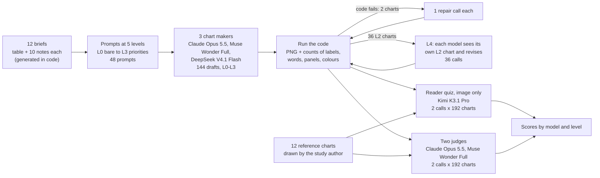
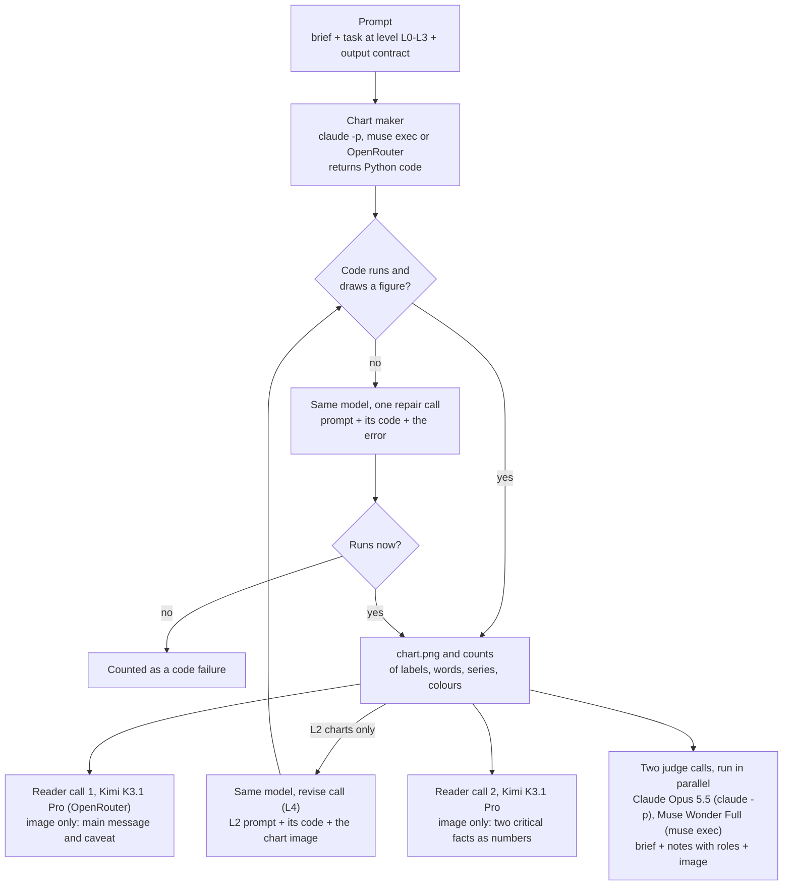
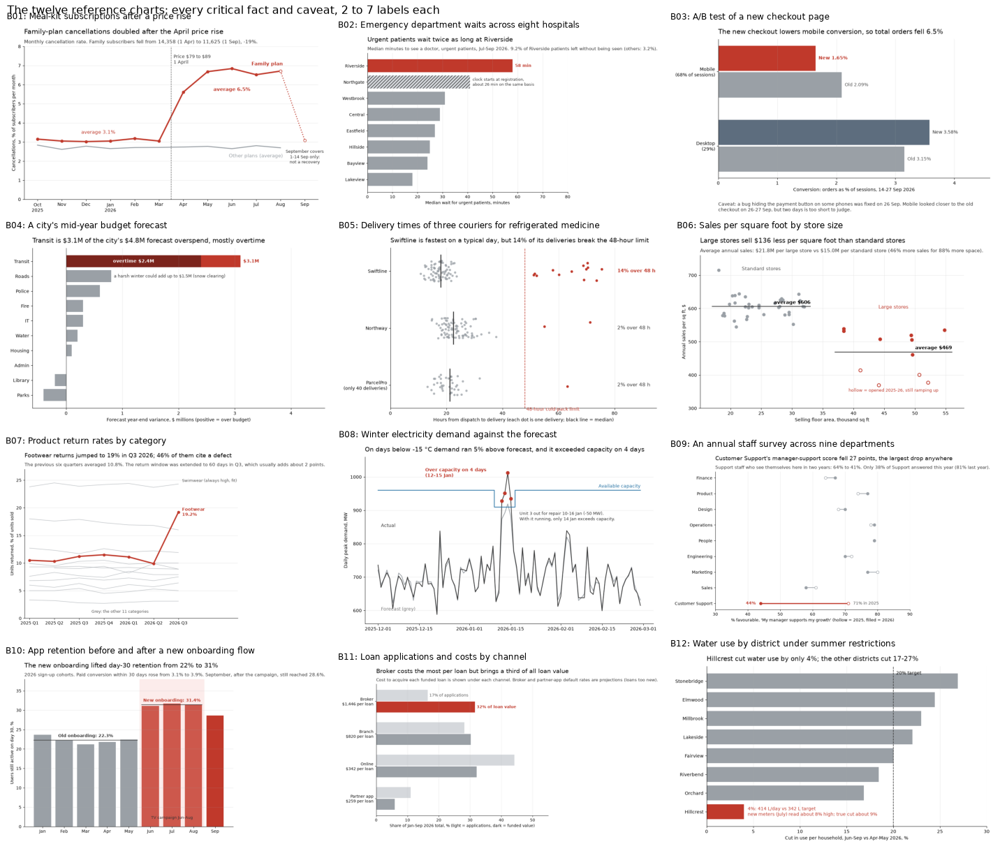
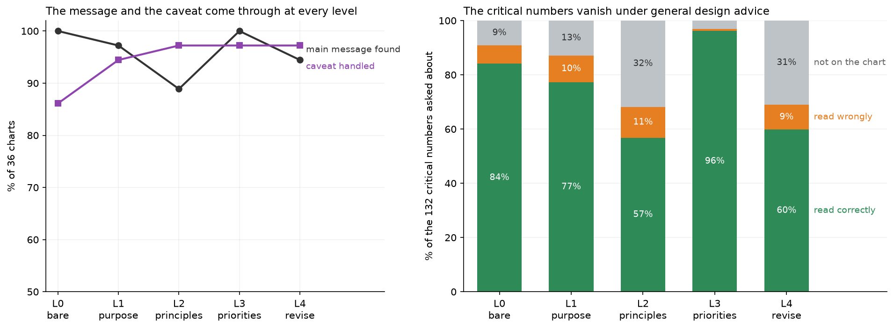
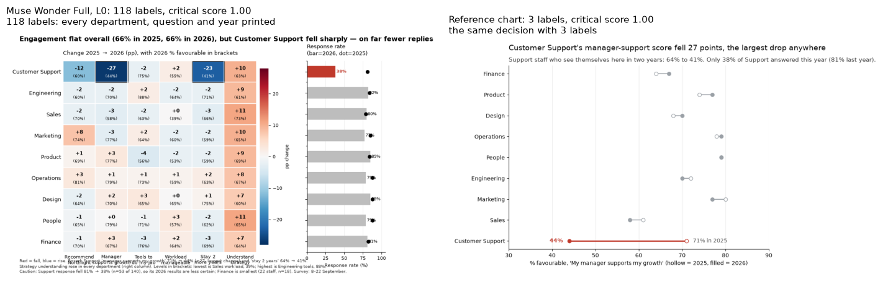
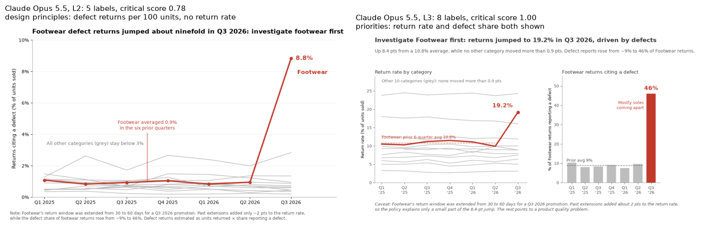
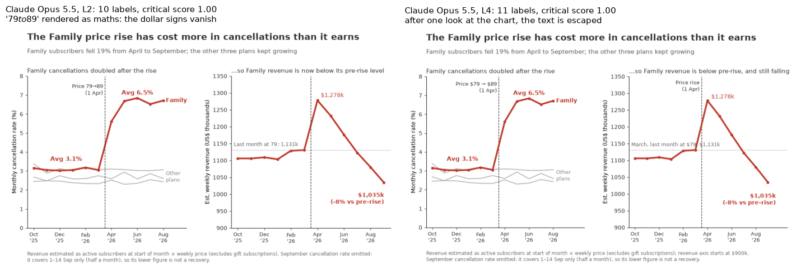

# When a model is given more than one chart can show, what does it leave out?

## A chart for a ten-second look

Someone at a meal-kit company has to prepare one chart for Thursday's pricing meeting. In April the company raised the price of its Family plan from \$79 to \$89 a week, and the committee will decide whether to reverse the rise. The analyst has a table of monthly figures for all four plans and a page of notes from working through it. The chart will be on the screen for about ten seconds before the discussion starts.

The committee needs one fact above all: since the price went up, the share of Family customers who cancel each month has doubled, from about 3% to about 6.5%. It also needs a warning. The September figures were pulled halfway through the month, so September's low cancellation rate covers half a month and is not a recovery. A chart that shows September without saying so invites the committee to conclude that the problem has gone away.

The analyst's notes hold plenty more, and all of it is true. The Couple plan is the largest. The Vegetarian plan is growing fastest and has the best ratings. Support tickets peaked in December, sign-ups peak in January, and gift subscriptions are not counted. None of this bears on whether to reverse the Family price rise. Making the chart is mostly an editing job: choosing what to leave out without leaving out what the decision depends on.

## What goes wrong

People now often hand this job to an AI model. They paste in the table and the notes, ask for a chart, and get back code that draws it. A common complaint about the results is that they say too much. Every point gets a value label, every plan gets a line and a legend entry, a second panel appears for a second measure, and a footnote adds three more facts. Each label is accurate. Together they leave the reader to do the editing the chart was meant to do, in a meeting where nobody has time for it.

The opposite failure exists too. A chart can be clean and still drop the one warning that changes the decision, or show the right trend without a number anyone can repeat. A useful chart does both jobs: it carries little enough that the main message is obvious at a glance, and it carries everything critical.

### An illustrative example

Here is a simplified, made-up version. Suppose the table held only the four plans' monthly cancellation rates and the analyst wrote three notes: (a) Family cancellations doubled after the price rise; (b) September is half a month; (c) the Vegetarian plan is growing fastest.

One way to chart this draws four coloured lines and prints every monthly value beside its point: 48 numbers, a legend with four entries, and note (c) as a footnote because it seemed interesting. The reader's eye goes to whichever line is highest or brightest. Note (b) is missing, so September's dip looks like good news.

Another way draws the Family line in red and the other three plans as one grey average line. The title states the finding, "Family-plan cancellations doubled after the April price rise". Two numbers are printed, the average rate before and after the rise, and a short note sits beside September. This chart has far fewer marks than the first and carries both (a) and (b). It leaves out (c), which is true but does not affect the decision.

A person who makes the second chart starts from the decision, picks the message, and then asks of every line, label and colour whether it helps the committee decide. The question is whether a model does the same.

### How much to tell the model

There are two broad ways to ask. One is to hand over the material and say "make a chart". The model then has to work out for itself who the chart is for, what they will decide and which notes matter. The other is to tell it more. You can say who the audience is and what they must decide. You can add general design advice: state the finding in the title, use one strong colour for what matters, and print only the numbers that carry the message. You can go further and say which notes are critical and which to leave off, which does the editing for the model. Or you can show the model the chart it drew and ask it to improve it, as a designer looks at a draft.

Each step costs the person asking a little more effort, and the last two need either knowledge of what matters or an extra round. If a bare request already gives clean charts, the extra instruction is wasted. If clean charts only come when someone spells out the priorities, the model is not doing the editing and the person still has to.

## The question

A model receives a data table and analyst notes that hold more than one chart should show. Does it choose the critical information, show it, and leave the rest off? How do the number of labels on its charts, and the critical information a reader can take from them, change as the instructions grow from a bare request, to the purpose, to design principles, to explicit priorities, and finally to a look at its own rendered chart?

## Study summary

The study uses twelve made-up briefs like the meal-kit one, each a data table plus ten analyst notes: two critical facts, one critical caveat and seven true notes the decision does not need. Three models made one chart for every brief at each of five levels of instruction, 180 charts in all, each written as matplotlib code: Claude Opus 5.5, Muse Wonder Full and the open-weight DeepSeek V4.1 Flash. Every chart was measured three ways. The harness counted the labels and other text drawn on it. A reader model that saw only the image was asked for the main message, the caveat and the critical numbers. Two judge models that saw the brief rated the chart and marked which notes it called out.

- With only "make a chart from this", Muse Wonder Full put 24 labels on an average chart and Claude Opus 5.5 put 16. DeepSeek V4.1 Flash put 6, but used legends and extra panels instead. The reference charts drawn for this study carry 4. Saying who the chart is for and what they decide removed few labels: 12 on average, and DeepSeek rose to 10.
- Six general design rules (title states the finding, one highlight colour, label only what carries the message, and so on) cut the labels to 5 per chart. They also cut the critical numbers. The reader could read only 57% of them, against 84% with the bare request, because 32% were no longer on the chart.
- When the prompt also quoted the three critical notes and asked for the rest to be left off, the reader read 96% of the critical numbers and found the main message on every chart. These charts carried 7 labels, 2 more than with the general rules alone, and almost no secondary notes.
- Shown the chart it had drawn, a model kept roughly the same content (5.6 labels, 60% of critical numbers) but cleaned up the drawing: overlapping text and garbled dollar amounts nearly disappeared, and the judges listed 0.4 errors per chart instead of 1.1.

Back in the meal-kit meeting: a bare request gives the committee a chart with everything on it, so the critical facts are there but have to be found among a dozen or more labels. General design advice gives a clean chart that often leaves off the number the committee needs, such as the cancellation rate before and after the rise. Clean and complete charts came only when the person asking said which notes mattered, which means the person still did the editing.

The caveat that most affects this result is the reader. It is a model that reads every label however small, and it found the main message on all 36 charts made from bare requests, including one with 118 labels. A person glancing at a slide for ten seconds is likely to be hurt more by clutter than this reader was; the judges' clarity rating (3.6 out of 5 for bare requests, 4.6 with design rules) points the same way. Every code reply rendered (178 first time, 2 after one repair), so format failures play no part in the comparison.


## Contents

1. [The twelve briefs](#1-the-twelve-briefs)
2. [Five levels of instruction](#2-five-levels-of-instruction)
3. [The models](#3-the-models)
4. [How the experiment runs](#4-how-the-experiment-runs)
5. [How a chart is measured](#5-how-a-chart-is-measured)
6. [Results: labels on the chart](#6-results-labels-on-the-chart)
7. [Results: critical information a reader takes away](#7-results-critical-information-a-reader-takes-away)
8. [Results: what the judges saw](#8-results-what-the-judges-saw)
9. [Error analysis](#9-error-analysis)
10. [What the evidence supports](#10-what-the-evidence-supports)
11. [Limitations](#11-limitations)
12. [Spend, data and how to run](#12-spend-data-and-how-to-run)
13. [Future work and further reading](#13-future-work-and-further-reading)

## 1. The twelve briefs

Each brief is a small, fictional business or public-sector situation, generated in code for this study. Every brief has an audience and the decision it faces, a data table with more columns and rows than one chart needs (24 to 220 rows, 7 to 12 columns), and ten analyst notes with numbers computed from the table. Of the ten notes, two are critical facts that bear on the decision, one is a critical caveat that changes how the data must be read, and seven are true but secondary. Some secondary notes are tempting on purpose: the highest bar, the fastest-growing group, a record day. The models never see the roles. They see the ten notes in a fixed order that mixes the three kinds.

The data is synthetic because the test needs exact answers. Every number in every note, and every answer to the reader quiz, is computed from the same table, so a reader's answer can be checked to a tolerance. No model can have seen these tables before. The generator is seeded and its output is frozen in [`data/briefs/`](data/briefs/).

| Brief | Situation | Decision | Critical caveat |
|---|---|---|---|
| B01 | Meal-kit subscriptions after a price rise | Reverse the Family plan's price rise? | September covers 1 to 14 September only |
| B02 | Emergency waits at eight hospitals | Which department gets 12 triage nurses? | Northgate starts its wait clock earlier, so looks slower |
| B03 | A/B test of a new checkout page | Roll out the new checkout? | A mobile payment-button bug was fixed two days before the end |
| B04 | A city's mid-year budget forecast | Which department gets a spending review? | A harsh winter could add up to \$1.5 million to Roads |
| B05 | Couriers for refrigerated medicine | Which courier gets the contract? | ParcelPro's figures rest on only 40 deliveries |
| B06 | Sales per square foot by store size | Large or standard format for new stores? | Four large stores are new and still building up trade |
| B07 | Product return rates by category | Which category to investigate for quality? | Footwear's return window was doubled for a promotion |
| B08 | Winter electricity demand against the forecast | Buy 40 MW of extra capacity? | A 50 MW unit was out for repair during the cold snap |
| B09 | Staff survey across nine departments | Which department gets manager support? | Customer Support's response rate fell from 81% to 38% |
| B10 | App retention before and after new onboarding | Keep the new onboarding? | A TV campaign ran in the same months |
| B11 | Loan applications and costs by channel | Close the broker channel? | Broker default rates are projections |
| B12 | Water use by district under restrictions | Where to focus enforcement? | Hillcrest's new meters read about 8% high |

Several caveats can be handled in either of two ways: by stating them on the chart, or by leaving out the affected data. A chart of B01 that stops at August no longer needs the September warning. The scoring accepts both.

### One brief in full

These are the ten notes of B01, in the order the models see them. The role column is never shown to the chart makers.

| Note | Role | Text |
|---|---|---|
| F1 | secondary | Couple is the largest plan, with 21,832 active subscribers at the start of September 2026. |
| F2 | secondary | Vegetarian is the fastest-growing plan: active subscribers rose 39% between October 2025 and September 2026. |
| F3 | critical | Family plan cancellations rose after its price went from \$79 to \$89 a week on 1 April 2026. The Family cancellation rate averaged 3.1% a month from October to March and 6.5% from April to August. |
| F4 | secondary | Support tickets peaked in December 2025 (1,621 across all plans) during holiday delivery delays. |
| F5 | secondary | New sign-ups peak in January: 2,804 across all plans in January 2026, the New Year rush. |
| F6 | critical | Family plan active subscribers fell from 14,358 at the start of April to 11,625 at the start of September (-19%). The other three plans all grew over the year. |
| F7 | secondary | Vegetarian boxes have the highest average rating (4.59 out of 5). |
| F8 | secondary | Single has the lowest cancellation rate, averaging 2.4% a month. |
| F9 | caveat | September 2026 figures cover 1 to 14 September only, so September sign-ups and cancellations are about half a month. The Family plan's September cancellation rate of 3.1% is not a recovery. |
| F10 | secondary | Figures exclude gift subscriptions, which are about 3% of orders. |

The table itself has 48 rows (four plans by twelve months) and nine columns: month, plan, weekly price, active subscribers, new sign-ups, cancellations, cancellation rate, average rating and support tickets. Two or three of those columns are enough for the decision.

## 2. Five levels of instruction

Every prompt has three parts. The brief (the CSV text, a description of each column and the ten notes) and a fixed output contract are the same at every level. The contract asks for matplotlib code that reads `data.csv` and draws one figure of 10 by 6 inches, which may contain several panels; the harness saves the figure. Only the task part changes.

| Level | Task text | What it adds |
|---|---|---|
| L0, bare request | "Make a chart from this." | Nothing. The model must infer the purpose. |
| L1, purpose | "Make a chart for Harvest Table's pricing committee, who must decide whether to reverse the April price rise on the Family plan. They will see it for about ten seconds on a slide in a meeting, so it should help them make that decision." | The decision that defines what is critical |
| L2, design principles | L1 plus six general rules (below) | General advice that names no note |
| L3, priorities | L2 plus the three critical notes quoted, then "The other analyst notes are true but not needed for this decision. Leave them off the chart unless the chart cannot be read correctly without them." | The editing decision, made for the model |
| L4, look and revise | The L2 prompt, the model's own L2 code and a picture of the chart it produced: "Look at it as the audience would see it, then improve the chart." | A second pass with sight of the output |

The six rules added at L2 are general and name no note:

```text
- Pick the one message the audience most needs for this decision, and make the title state it as a sentence.
- Show only the data needed for that message. Leave out series, columns and notes that do not help the decision.
- Use one strong colour for what matters and grey for context. Label lines or bars directly instead of using a legend when you can.
- Add a number label only where the number is part of the message. Do not label every bar or point.
- If a caveat changes how the chart should be read, state it briefly on the chart.
- Keep scales honest: bar charts start at zero, units are labelled, no 3-D effects and no second y-axis.
```

The comparison between L2 and L3 separates two skills: at L2 the model has to decide what matters, at L3 it is told. If L3 charts are much cleaner and more complete, the gap is the model's editorial judgement; if they are still cluttered, the problem is in how it draws. L4 starts from the L2 prompt, so the difference between L2 and L4 is the effect of one look at the rendered chart.

## 3. The models

Three models make the charts. They cover two closed model families that this repository calls through their command-line tools, and the strongest recent open-weight model that accepts images. A reader from a fourth vendor takes the quiz, and two judges rate every chart. The judges are also chart makers, so section 8 checks whether either favours its own charts.

| Role | Model | Pinned version | How it was called | Size and precision | Settings | Why it is included |
|---|---|---|---|---|---|---|
| Chart maker | Claude Opus 5.5 | `claude-opus-5-5` | `claude -p` (Claude Code 2.1.296), no tools, short neutral system prompt | Not published | effort high | Anthropic's top model; a common choice for analysis work |
| Chart maker | Muse Wonder Full | `muse-wonder-full-1.0` | `muse exec` (Muse Code 1.4.14), empty preset, one model step | Not published | reasoning effort high | Meta's top model through its own CLI |
| Chart maker | DeepSeek V4.1 Flash | `deepseek/deepseek-v4.1-flash-1017`, permaslug `deepseek/deepseek-v4.1-flash-20261017` | OpenRouter, pinned to the DeepSeek first-party endpoint | 763B total parameters (mixture of experts), MIT licence | reasoning effort high | Joint top of large open-weight models on the Artificial Analysis Progress Index (checked 5 November 2026), and it accepts images, which L4 needs |
| Reader | Kimi K3.1 Pro | `moonshotai/kimi-k3.1-pro`, permaslug `moonshotai/kimi-k3.1-pro-20261023` | OpenRouter, pinned to Moonshot AI (mxfp4) | 2.78T total parameters, custom licence | provider default reasoning | A strong vision model from a vendor that makes no charts here, so it has no stake in any chart |
| Judge | Claude Opus 5.5 | `claude-opus-5-5` | `claude -p` | as above | effort medium | Top model; also a chart maker |
| Judge | Muse Wonder Full | `muse-wonder-full-1.0` | `muse exec` | as above | reasoning effort medium | Top model; also a chart maker |

Every call runs in an empty temporary folder with no tools, so a model cannot inspect the study, and all three chart makers get the same system prompt ("You are a helpful assistant."). The briefs were generated for this study, so no model can have seen them in training.

## 4. How the experiment runs



For each brief, model and level, the harness sends one prompt and takes the longest Python code block from the reply. It runs the code in a separate Python process inside a folder that holds only `data.csv`, saves the figure and counts what is on it. If the code raises an error or draws no figure, the model gets one repair call with its code and the error, which is what a person would do next. The L4 call goes to the same model after its L2 chart has rendered, with the L2 prompt, its L2 code and the chart as an image. The diagram below shows every model call made for one chart.



### Worked example: one chart from prompt to score

This is brief B01 at level L2 (purpose plus design principles), drawn by Muse Wonder Full. It shows every part of the scoring at work: a chart that looks good, carries the main message and handles the caveat, but leaves off two of the four critical numbers.

![Line chart titled "Family cancellations doubled after the April price rise and stayed high, other plans did not change". The Family plan's monthly cancellation rate is a thick red line, about 3.1% from October to March and about 6.5% from April to August, with labels "Before: 3.1% a month" and "Apr-Aug: 6.5% a month". Couple, Vegetarian and Single are thin grey lines near 2.5% to 3%. A dashed line marks 1 April, labelled "Family price 79→89 per week" with the dollar signs missing. A footnote says September is excluded because it covers 1 to 14 September only.](figures/worked_example.png)

1. Muse Wonder Full replied with 77 lines of matplotlib code, and the harness rendered the chart above.
2. The counts found 8 labels (the two averages, the price-change note, four line-end names and the footnote), no legend and one colour.
3. The reader, seeing only the image, gave the main message as "Family cancellations doubled after the April price rise and stayed high, while cancellations for other plans did not change" and reported the September exclusion as the caveat. Both match the B01 patterns.
4. It read the Family cancellation rate before and after the rise as 3.1% and 6.5% (true values 3.08% and 6.47%), but answered `null` for the subscriber counts in April and September, which the chart does not show: 2 of 4 numbers.
5. The critical score is (1 + 1 + 0.5) / 3 = 0.83.
6. The judges rated it 1.5 for overload, 5 for clarity and 7.5 out of 10. Both noted that the 19% fall in subscribers is missing and that two line-end labels overlap. Neither noticed that the price note reads "79→89": the code wrote "\$79→\$89", and matplotlib drew the text between the two dollar signs as a formula (section 9).

## 5. How a chart is measured

A chart is measured three ways, each answering a different question.

### Clutter, counted from the figure

After the code runs, the harness walks the matplotlib figure and lists every drawn piece of text with its role: title, axis label, tick label, legend entry, or annotation, meaning any other text the code placed on the chart (a value on a bar, a note beside a line, a subtitle, a footnote). The main clutter measure is the number of annotations, called labels below, because labels are where charts most often say too much; when a title was drawn as free text, that item counts as the title. The harness also counts words, numbers, panels, series, non-grey colours and overlapping text.

### What a reader takes away: the quiz

Kimi K3.1 Pro sees only the chart image, never the data or notes, and answers in two calls. The first asks for the main message in one sentence and any caveat the chart states; asking these first, in their own call, keeps the specific questions from hinting at the answer. The second asks for the critical facts as numbers, for example "What was the Family plan's monthly cancellation rate before the April 2026 price change, and after it?", with `null` allowed when the chart does not show a value.

The main message is scored with a pattern written for each brief before any chart was made (for B01: the Family plan together with cancellations rising or subscribers falling), and so is the caveat (for B01: September together with "partial", "half", "1 to 14" or similar). A number is correct within a set tolerance of the value computed from the data. The critical score is the average of main message found (0 or 1), caveat handled (0 or 1, also counting a chart that most judges say left out the affected data) and the share of critical numbers read correctly. A chart scores 1.0 only if a reader who sees nothing but the chart gets the message, the caveat and every critical number.

### What a careful reviewer sees: the judges

Claude Opus 5.5 and Muse Wonder Full each see the brief, the data, all ten notes marked CRITICAL, CAVEAT or SECONDARY, and the chart image, without knowing which model or level made it. For every note, a judge says whether the chart calls it out (states it or draws attention to it), shows it without pointing to it, or leaves it out. The count of secondary notes called out measures content overload, as opposed to the visual clutter that the label count measures. The judge also rates overload (1 = nothing competes with the main message, 5 = the message is hard to find) and clarity (5 = the decision-critical message is obvious within ten seconds), lists errors such as wrong numbers or garbled text, and gives an overall rating from 1 to 10 for how ready the chart is to show.

### Reference charts

For each brief the study author drew one reference chart from the brief's priorities: the critical facts and caveat on the chart, the secondary notes left off, a title that states the finding and a handful of labels. The author is Claude Opus 5.5 in the session that built this notebook, drawing by hand and with sight of the result, not one of the chart-making runs. The reference charts are not part of the comparison. They check the quiz (the reader got the message, the caveat and every critical number on all twelve, so every question can be answered from a clean chart) and show how few labels a complete chart needs: 2 to 7, 4.1 on average.



## 6. Results: labels on the chart

This table gives the main measures for the 36 charts at each level (12 briefs by 3 models), with the reference charts for comparison. Every one of the 180 code replies rendered a chart, 178 on the first run and 2 after one repair, so no chart is missing from any level; the reader's 384 replies all parsed, and 383 of the 384 judge replies did.

| Level | Labels per chart | Words per chart | Secondary notes called out (of 7) | Main message found | Caveat handled | Critical numbers read correctly | Critical score | Judges' overall (1-10) |
|---|---|---|---|---|---|---|---|---|
| L0, bare request | 15.4 | 120 | 1.50 | 100% | 86% | 84% | 0.90 | 5.9 |
| L1, purpose | 12.1 | 123 | 1.19 | 97% | 94% | 77% | 0.90 | 6.7 |
| L2, design principles | 5.3 | 87 | 0.44 | 89% | 97% | 57% | 0.81 | 7.5 |
| L3, priorities | 7.4 | 107 | 0.14 | 100% | 97% | 96% | 0.98 | 7.9 |
| L4, look and revise | 5.6 | 88 | 0.50 | 94% | 97% | 60% | 0.84 | 8.1 |
| Reference charts | 4.1 | 65 | 0.08 | 100% | 100% | 100% | 1.00 | 8.6 |

With a bare request (L0), two of the three models crowd their charts. Muse Wonder Full averages 24 labels per chart (median 15.5, up to 118) and Claude Opus 5.5 averages 16 (median 13, up to 56), against 4 on the reference charts. Almost all of them are numbers, usually a value printed on every bar or point. These charts also have 2.1 panels on average (references: 1.0), legends with 3.6 entries and 3.0 non-grey colours. DeepSeek V4.1 Flash puts only 5.8 labels on its bare-request charts but uses legends (5.2 entries) and extra panels (2.4) instead, so its charts are labelled differently rather than sparse.

Telling the model who the chart is for and what they decide (L1) did not reliably reduce labels: 3.3 fewer per chart, with a 95% interval from 11.0 fewer to 2.2 more (intervals here come from resampling the twelve briefs). DeepSeek added about 4 (interval 1.2 to 7.6), annotating the bars that support the decision.

The six design rules (L2) are what cut the labels. From L1 to L2 the charts lost 6.8 labels each (interval 4.2 to 9.6), ending at 5.3, close to the reference charts' 4.1. Every model reached 5 to 6 labels, legends disappeared from all 36 L2 charts, and colour dropped to one highlight per chart. For Muse Wonder Full the fall from L0 to L2 was from 24 labels to 5.

Naming the priorities (L3) added labels back: 2.1 more per chart than L2 (interval 1.3 to 2.9), mostly for Muse Wonder Full (3.0) and Claude Opus 5.5 (2.6). These are not noise: the models put each quoted critical note on the chart, usually as a number beside its bar or line, and the next section shows they are exactly the numbers missing at L2. The revise pass (L4) left the count where L2 had it (5.6 against 5.3; interval for the difference -0.3 to 1.1).

The figure below shows these levels for one brief, the city budget review (B04), drawn by Muse Wonder Full. At L0 it draws every department's overspend split into five coloured spending types, with a legend and a second panel of the same overspend as a percentage. All 24 labels are correct and the critical facts are there (\$3.1 million of the \$4.8 million is Transit, mostly overtime), but they are hard to find. At L2 the chart is one panel with Transit in red, overtime marked inside its bar and 4 labels, about the same as the reference. All five charts score 1.00, because this brief's critical numbers fit in a title; what changes is how hard they are to find.


## 7. Results: critical information a reader takes away

A chart with few labels is only useful if the critical information is still on it. The left panel below shows how often the reader found the main message and how often the caveat was handled, by level. The right panel splits the 132 critical numbers asked about at each level (36 charts, three or four numbers each) into numbers the reader read correctly, numbers it read wrongly, and numbers that were not on the chart, where it answered `null`.



The main message and the caveat come through almost everywhere, so they cannot rank the levels. The reader found the main message on all 36 bare-request charts and on 89% to 100% at the other levels; the caveat was handled on 86% of bare-request charts and 94% to 97% at the other levels. Both sit near the ceiling, and the few misses are individual cases discussed in section 9.

The critical numbers are where the levels differ. With a bare request the reader read 84% of them correctly. Under the design rules (L2) it read 57%, and the drop is almost entirely numbers that were no longer on the chart: 32% of the L2 numbers drew a `null`, against 9% at L0. The rule "add a number label only where the number is part of the message" was taken as "print fewer numbers", and the numbers dropped were often the ones the decision needed, such as the cancellation rates before and after the price rise or the share of loan value that comes from brokers. The size of the drop differs by model. DeepSeek V4.1 Flash fell from 83% to 36% of numbers read, Muse Wonder Full from 94% to 61%, and Claude Opus 5.5 hardly changed (75% to 72%).

Naming the priorities (L3) restored the numbers: 96% read correctly, with only 4 of 132 missing. That is 40 percentage points more than L2 (interval 31 to 49) and more than the bare request's 84%. The critical score rose from 0.81 at L2 to 0.98 at L3 (difference 0.17, interval 0.12 to 0.23), close to the reference charts' 1.00.

The look-and-revise pass did not bring the numbers back: 60% read correctly at L4 against 57% at L2. Looking at its own chart, a model judged it as a picture (spacing, overlaps, readability) and did not ask whether the committee could read the numbers it needs.

One scoring rule changed after the results were seen: ten answers to one B12 question gave the range printed on the chart ("17-27"), which the first parser read as its first number and the fixed parser reads as its midpoint. Under the first parser the critical scores by level are 0.90, 0.89, 0.81, 0.97 and 0.84, against 0.90, 0.90, 0.81, 0.98 and 0.84 now.

## 8. Results: what the judges saw

The reader measures what can be taken from a chart; the judges measure what a careful reviewer who knows the brief thinks of it. The three panels show, by level and model, the secondary notes a chart called out (0 to 7), the judges' overload rating (1 = nothing competes with the main message, 5 = the message is buried) and their overall rating (1 to 10). Each value is the mean of the two judges; the dashed line is the reference charts.


The judges saw the same pattern as the counts. Bare-request charts called out 1.5 secondary notes on average, and Muse Wonder Full's called out 2.8 of the 7: the fastest-growing plan, the busiest hospital, the record day. The design rules cut this to 0.44, and naming the priorities cut it to 0.14, close to the references (0.08). So the extra labels at L3 are not secondary notes creeping back; they are the critical numbers.

The overload rating fell from 3.1 at L0 to 1.6 at L2 (difference 1.5, interval 1.2 to 1.7), rose slightly at L3 (1.9) and was lowest at L4 (1.4), equal to the references. The overall rating rose at every level: 5.9, 6.7, 7.5, 7.9 and 8.1, against 8.6 for the references. The judges rated the L4 charts slightly above the L3 charts, while the reader got far more from L3: the judges see a chart as someone who already knows the story, the reader as someone who does not.

The label count and the judges' overload rating agree moderately (rank correlation 0.56 across the 180 charts). The two judges agree closely with each other: rank correlations of 0.81 on overload, 0.73 on clarity and 0.82 on the overall rating, and the same call on 96.5% of the 1,910 note-by-note decisions. Neither favours its own model's charts. Claude Opus 5.5 rated its own charts 7.75 and Muse Wonder Full rated them 7.97; Muse Wonder Full rated its own charts 6.57 and Claude Opus 5.5 rated them 6.67.

## 9. Error analysis

The averages hide very different charts. The cases below were chosen to illustrate each pattern in the results; the counts with each say how common it is.

### The most crowded chart



Muse Wonder Full's bare-request chart for the staff survey (B09) has 118 labels and 225 words: the change on every question for every department, with the 2026 score in brackets, plus a panel of response rates. It is the extreme case of the habit seen across bare-request charts (print every value), applied to a table with 108 rows. The judges rated it 4.5 for overload and 3.5 overall. The reader found everything, for a critical score of 1.00. A model that reads every label at full resolution is not slowed down by 118 of them; a committee member looking at a slide for ten seconds would be. Here the judges' ratings are the better guide, and they are much worse than for the reference, which carries the same information with 3 labels (overload 4.5 against 1.0, clarity 2.5 against 5.0).

### A clean chart that lost its numbers



Claude Opus 5.5's L2 chart for the returns brief (B07) follows every design rule, and the judges gave it 9 out of 10. But to sharpen the message the model plotted a measure that is not in the data: defect returns per 100 units sold, the return rate times the share of returns that report a defect. On that measure footwear went from 0.9 to 8.8. Asked for footwear's return rate, the reader read those two numbers and was wrong on both; the 19.2% and the 10.8% before it are not on the chart. At L3, told that the return rate and the defect share are what the audience needs, the same model drew two panels with 8 labels, and the reader got every number right. This is the usual way numbers went missing under the design rules: of the critical numbers on the 36 L2 charts, 32% were not shown and 11% were read wrongly, mostly because the chart showed a related measure (an index, a derived rate or a difference) instead of the values asked for.

### When the model does its own analysis


Two of the lowest critical scores belong to charts that answer the decision with an analysis the notes did not contain. For the loan brief (B11), Claude Opus 5.5 at L2 computed the cost per \$100 lent and found that broker loans, the most expensive per loan, are among the cheapest per dollar lent (\$2.50 against \$4.10 at branches). That is a useful point for a committee thinking of closing the broker channel, but it is not the message the brief marks as critical (broker brings a third of loan value from a sixth of applications), so the summary missed the pattern and the chart scored 0.58.

For the electricity brief (B08), the same model built the chart around the decision itself: would an extra 40 MW have covered last winter's worst day? It marks the week Unit 3 was out for repair and works out that 14 January would still have been 12 MW short with the unit running. Both judges said it states the critical caveat and rated it 8 and 9. The quiz scored it 0.17, the lowest in the study: the reader's summary ("an extra 40 MW would not have covered last winter's worst day") did not match the pattern, it named a different caveat (the forecast's cold-day error), and it counted 1 day over capacity because the chart marks only 14 January. This chart answers the committee's question better than its score says.

Of the seven summaries that missed the main-message pattern, a person would accept two (this one, and DeepSeek V4.1 Flash's L1 chart for B12, "Hillcrest is the clear enforcement priority"). The other five carry a different message, such as DeepSeek's two B03 charts that lead with the payment-bug fix rather than the fall in mobile orders. Six of the seven are at L2 or L4, where the model chose the message itself; every L3 chart matched.

### A bug that raises no error: dollar signs read as maths



In matplotlib, text between two dollar signs is drawn as a formula: the signs disappear and the words turn italic, so "\$79 to \$89" is drawn as "79to89". The code runs without any error or warning, so a harness that only checks that the code runs cannot catch it. 40 of the 180 model charts (22%) contain such a label: 8 at L0, 12 at L1, 8 at L2, 9 at L3 and 3 at L4. Three briefs about money (B01 prices, B04 budgets, B11 loan costs) account for 33 of them, and no model avoided it reliably; the study author made the same mistake in three draft reference charts. Looking at the rendered chart catches it. The revision pass fixed 5 of the 8 garbled L2 charts, including all 3 of Claude Opus 5.5's, and also cut overlapping text from 0.47 to 0.08 pairs per chart and the judges' listed errors from 1.07 to 0.42. The judges noticed the garbling on 26 of the 40 charts.

### Caveats: where the reader and the judges differ

The quiz asks the reader for one caveat, and when a chart states both the critical caveat and a harmless one from the secondary notes, the reader sometimes names the harmless one. That happened on 5 charts where both judges say the critical caveat is shown. Scoring caveats by the judges instead gives 92%, 94%, 100%, 100% and 100% at L0 to L4 and moves the critical score by at most 0.02; the quiz's definition, fixed before the run, is used throughout. Five misses are agreed by both measures, all at L0 or L1: DeepSeek V4.1 Flash's charts for B04 and B07 state no caveat, and Claude Opus 5.5's bare-request chart for B11 names the partner-app launch instead of the projected default rates.

## 10. What the evidence supports

If you ask a model for a chart that supports a decision, four things follow from these results.

Say what the chart is for and give general design rules. Together they took the average chart from 15 labels to 5, removed legends and extra panels, and nearly removed side notes. Purpose alone did little.

Then check, or state, the numbers the decision needs. General rules made the models drop critical numbers: 32% of them were not on the L2 charts. Quoting the two or three points the audience needs (L3) put 96% of them on the chart at a cost of two extra labels, and was the only level that matched the reference charts on both counts. In practice that means one more short paragraph in the prompt.

Look at the rendered chart, or let the model look. One look fixed overlapping text and garbled dollar amounts that no error message reports. It did not bring back missing numbers, so it is a check on the drawing, not on the content.

Do not rely on a model reader to tell you whether a chart is too busy. Kimi K3.1 Pro read a 118-label chart perfectly. How much clutter costs a person glancing at a slide is the uncertainty that most needs another experiment.

## 11. Limitations

The reader is a model, not a person in a meeting. It reads every label at full resolution and found the main message on all 36 bare-request charts, so the critical score probably flatters the bare-request and purpose levels. The judges' overload and clarity ratings capture some of this, but no person read these charts under time pressure. The comparison between L2 and L3 is less exposed to this problem, because both levels produce charts with few labels.

The judges are also chart makers. Claude Opus 5.5 and Muse Wonder Full each judged their own charts along with the others'. Section 8 shows no sign that either favoured its own, and the two agree closely, but a third judge from a vendor that makes no charts, GPT-6.1 Sol, was planned and could not run because its command-line quota ran out during the study.

Each brief, model and level got one chart, so a single chart per cell mixes the effect of the level with run-to-run variation; the intervals resample briefs and do not cover it.

The briefs are tidy: a small table, ten notes an analyst has already written, and exactly two critical facts and one caveat, defined by the study. Real requests are messier, and the study's definition of "critical" is one reading of each decision; two of Claude Opus 5.5's charts (B08 and B11) chose a different but defensible message and scored low for it.

The L2 rules are one wording; the rule "add a number label only where the number is part of the message" is the likely cause of the missing numbers, and a different wording might keep them.

All charts are matplotlib code. The dollar-sign problem is specific to matplotlib, and the label counts depend on how matplotlib represents text. The rule that counts a free-text title as a title rather than a label was added after the first look at the results; without it the label counts by level are 15.4, 12.5, 5.6, 7.9 and 6.2 instead of 15.4, 12.1, 5.3, 7.4 and 5.6, and no comparison changes.

Apart from that rule and the range parser in section 7, both reported with the original numbers, the scoring was fixed before the run. The run history is in [`data/PROTOCOL.md`](data/PROTOCOL.md).

## 12. Spend, data and how to run

The study made 954 model calls, including 21 while testing the harness on B01 (17 were identical to calls in the run and reused; 4 scored a draft reference chart that was later corrected). Claude Opus 5.5 made 60 charts and 193 judgements for a list-price equivalent of \$18.28 on a subscription. Through OpenRouter, DeepSeek V4.1 Flash cost \$0.39 for 61 calls and Kimi K3.1 Pro \$4.16 for 386 reader calls. Muse Wonder Full's 254 calls ran on a subscription that reports no price. The total reported cost is \$22.82.

- [`44_chart_overload.ipynb`](44_chart_overload.ipynb) is the notebook, committed with its outputs. Its code was written by Claude Opus 5.5.
- [`data/briefs/`](data/briefs/) holds each brief's `data.csv` and `brief.json` (notes with roles, quiz questions and answers).
- [`data/charts/`](data/charts/) holds every chart's final `code.py`, `chart.png` and `metrics.json` (each drawn text item with its role and position), plus `first_attempt.py` where a repair was needed; reference chart code is in [`data/reference/`](data/reference/).
- [`data/cache/calls.jsonl`](data/cache/calls.jsonl) holds every model call: the full request (model, settings, prompt, SHA-256 of each image) and the reply.
- [`data/results/`](data/results/) holds one row per chart (`charts.csv`), per generation job, per reader quiz and per judgement, and the level comparisons with their intervals (`level_contrasts.csv`).
- [`data/PROTOCOL.md`](data/PROTOCOL.md) records the run history.

Running the notebook replays every reply from the cache and makes no calls:

```bash
python -m nbconvert --to notebook --execute --inplace 44_chart_overload.ipynb
```

To collect fresh replies, set `NB44_LIVE=1` before starting Jupyter. That needs the `claude` and `muse` command-line tools signed in (and `codex` to add GPT-6.1 Sol as a judge) and `OPENROUTER_API_KEY`. The size knobs at the top of the notebook (`N_BRIEFS`, `MAKERS_USED`, `JUDGES_USED`) shrink a fresh run, and `NB44_MAX_CALLS` caps it.

## 13. Future work and further reading

### Future work

- Reword the number rule. Change one L2 sentence to "print the numbers the decision depends on, and no others" and measure again, to see whether the drop from 84% to 57% of critical numbers comes from that rule.
- Let the model name its own priorities. Ask it to list the facts and caveat the audience needs before drawing, then compare its list with the brief's roles and its chart with the L3 charts. This tests whether the model can do the editing step that L3 does for it.
- Put the reader in the revise loop. At L4 the model fixed the drawing but not the content. Give it the reader's answers ("a reader could not find the cancellation rate before the rise") and measure whether the numbers come back.
- Test a ten-second human glance, or a reader given a small, low-resolution image. The model reader found the main message on every bare-request chart, including one with 118 labels; this would show what clutter costs a person.
- Repeat each cell three times, add GPT-6.1 Sol as a judge that makes no charts, and use recent public data with no analyst notes, where the model must find the critical facts itself.

### Further reading

Links checked on 5 November 2026.

- [MatPlotAgent: Method and Evaluation for LLM-Based Agentic Scientific Data Visualization](https://arxiv.org/abs/2402.11453) (Yang et al., 2024). An agent that revises its plotting code from a vision model's feedback on the rendered chart; level L4 here is one round of the same idea.
- [VisEval: A Benchmark for Data Visualization in the Era of Large Language Models](https://arxiv.org/abs/2407.00981) (Chen et al., 2024). A benchmark that checks charts generated by language models for validity, legality and readability, partly with a vision model, much as this study combines counts with judges.
- [ChartQA: A Benchmark for Question Answering about Charts with Visual and Logical Reasoning](https://arxiv.org/abs/2203.10244) (Masry et al., 2022). Questions answered from chart images alone; the reader quiz here applies the same idea to the study's own charts, with answers computed from the data.
- [Graphical Perception: Theory, Experimentation, and Application to the Development of Graphical Methods](https://doi.org/10.1080/01621459.1984.10478080) (Cleveland and McGill, 1984). Experiments on how accurately people read values from different chart encodings.
- [What Makes a Visualization Memorable?](https://doi.org/10.1109/TVCG.2013.234) (Borkin et al., 2013). Found that charts with more colour and recognisable elements are remembered better, a reminder that what is memorable and what serves a quick decision are different targets.
- [Frames and Slants in Titles of Visualizations on Controversial Topics](https://doi.org/10.1145/3173574.3174012) (Kong, Liu and Karahalios, 2018). Showed that a chart's title shapes what readers take away from it, the reason the design rules here ask for a title that states the finding.
