# Can a language model write a random forest and an LSTM by hand?

## A trained model is a file of numbers

When a lender screens applications or a shop plans tomorrow's staffing, the prediction usually comes from a trained
model. This experiment works with two common kinds.

A random forest sorts cases into classes. It is a set of decision trees, and each tree is a flowchart of yes-or-no
questions about the case: "is feature 3 above 5.0?", then, depending on the answer, another question, until the path
ends at a leaf. The leaf holds a vote for each class. The forest asks every tree, averages the votes and picks the
class with the most.

An LSTM (long short-term memory network) is a small neural network for sequences. It reads a history one day at a
time, keeps a few numbers in memory as it goes, and at the end writes a forecast. What it keeps, what it forgets and
how it turns memory into a forecast are all set by its weights, a few hundred numbers fed into a fixed formula.

Either way, the finished model is data. A forest is a list of questions, thresholds and leaf votes. An LSTM is a list
of weights. Normally nobody writes these by hand. A training program reads labelled examples and searches for numbers
that fit them: it picks the question that best separates the classes in the examples, then the next one, or it
nudges every weight a little at a time to reduce the forecast error.

## Asking a language model to write the file

Language models can read a few hundred rows of a table and describe the pattern in them. This experiment asks for
more than a description. A model receives the same labelled examples a training program would get, together with
the exact code that will run its answer, and has to write the whole file itself: every question and threshold of the
forest, or every weight of the LSTM. It has no tools, so it cannot run code, fit anything or check its numbers. A
separate tester loads the file unchanged and scores it on data the model never saw.

There are three reasons to run this test. The first is that it shows whether a model can turn data into a working
program without executing anything, which is hard to see from a chat answer. The second is that a written model can
in principle be better than a trained one. A training program does not know what kind of rule produced the data; it
makes the locally best cut at each step and fits whatever the examples show, noise included. A reader who recognises
the rule can write it down directly. The third is practical: a written model is readable, so a person can check what
it does, but only if the file loads and the structure inside matches the rule.

### An illustrative example: a circle drawn with straight cuts

This small example is made up to explain the idea; the measured tasks come later.

Picture points scattered over a 10 by 10 square. A point is labelled "inside" when it lies within a circle of radius
3 around the centre (5, 5), and "outside" otherwise. A decision tree cannot ask "are you inside the circle?". It can
only ask about one coordinate at a time, such as "is x0 at most 2.5?", so every region it describes is a rectangle.
To describe a circle it has to build a staircase: a central square whose corners are trimmed by further questions,
each level of questions making the steps finer. With up to eight questions on each path from the top of the tree to a
leaf, the staircase can follow a circle closely.

A person writing this tree by hand would first look at the labelled points, notice that the "inside" points form a
disc around (5, 5), and then place the cuts from the geometry of a circle, not from the individual points.

Now add one complication: one label in ten is wrong. A few "inside" labels appear in the corners, and a few points
near the centre are marked "outside". A training program that sees only the examples cannot tell a wrong label from a
small real pocket of the class, so it may carve a little box around a stray point, or misplace a step because several
wrong labels happen to sit together. The person who has recognised the circle ignores those points. With few examples
and noisy labels, finding the rule and fitting the examples can give different models, and hidden test data shows
which one generalises.

### The same idea for a forecaster

A second made-up example. A shop sells more on Saturdays than on Mondays, so a reasonable forecast for tomorrow starts
from the sales on the same weekday last week. An LSTM reads the last 28 days one at a time, oldest first. To use the
value from 7 days before the forecast, it has to catch that one number as it passes, hold it in memory and ignore the
six days that follow.

Weights can do this. Because the tester always feeds exactly 28 days, a memory cell can count the steps and open its
input only at the step that holds the value from a week ago. Another arrangement passes values along a chain of memory
cells, one step per day, like a queue. A training program is never told to build either; it finds whatever arrangement
reduces the error on the examples, and with a few hundred training days it may settle on a rougher one.

The complication here is promotions. A promotion lifts sales on its day and is followed by a dip the next day. The
forecaster is told whether tomorrow is a promotion day, so a written LSTM has to add the lift when that flag is on
and subtract the dip when yesterday's flag was on, on top of the weekly pattern.

### Two ways to get the numbers

The comparison is between two ways of producing the same kind of model.

- Training: a program starts from random or empty values and adjusts them step by step to fit the labelled examples.
  It is cheap and repeatable, never breaks the file format, and knows nothing about what rule produced the data.
- Writing: a language model reads the examples, works out what rule it thinks produced them, and writes the
  thresholds or weights that compute that rule. It may find the real rule and beat training, misread the data, or
  return a file that does not load.

Both are held to the same limits. A written forest may use at most 20 trees with at most 8 questions on any path, and
the trained forest gets the same limits. A written LSTM has 8 memory units and 393 weights, and the trained LSTM has
the same shape.

## The question

Can a language model with no tools write a working random forest classifier and a working LSTM forecaster directly,
as parameter files, from a small labelled sample? How does the written model compare with the same kind of model
trained in the usual way, and with simpler rules of thumb? The answer matters to anyone deciding whether a model's
"I can see the pattern" can be turned into a component they would deploy, and at what cost and risk.

## Study summary

Eight language models (three Claude models, GPT-6.1 Sol, Muse Wonder Full and three large open-weight models) each
wrote three random forests for each of four classification tasks and three LSTMs for each of two forecasting tasks,
144 requests in all. Every file was loaded unchanged and scored on 5,000 hidden rows (accuracy, the share predicted
correctly) or 140 hidden days (RMSE, the typical forecast error in units of sales), against the same kinds of model
trained on the same visible data and against the rule that generated the data.

When the labels follow a short rule, the best writers find the rule and write it down, and then they beat training by
a wide margin. GPT-6.1 Sol did so in all 9 of its rules-task forests, scoring 92.0% to 92.4% against a ceiling of
92.6%. With only 200 visible rows, the trained forest with the same limits scored 54.2% and gradient boosting 75.4%.
Opus scored 90% or more in 5 of its 9 rules-task forests, Muse in 4 and Fable in 3; their other forests scored 26% to
90%, most of them after dropping or misplacing one of the three rules. Sonnet, Kimi and DeepSeek wrote readable forests
that scored 33% to 60%. GLM 5.3 spent its whole 128,000-token output allowance reasoning in 15 of 18 requests and
returned nothing.

When the labels come from a smooth function with no short description, writing has no advantage: the best written
forests (Sol, median 71.1%) matched the trained forest with the same limits (69.4%) and fell short of gradient
boosting (74.1%).

The best written LSTMs work. On a weekly sales series, Opus, Fable and Sol scored RMSE 2.60 to 3.02, better than the
same network trained by gradient descent (3.87) but not as good as a plain linear model on the same inputs (2.47).
They average the same weekday over the last three or four weeks and add 15 to 18 for a promotion, close to the
generator's +15. None picked up a 30-day pay cycle added in the second series.

In practice, a model can hand over a working, readable forest that beats anything trained on a small sample, but only
when the data follows a rule it can see, and not every time. A cheap check helps: because nothing is fitted, a written
file's score on the visible rows predicts its hidden score (correlation 0.97), so keeping the best of three files on the
visible data recovered a near-ceiling forest from Opus, Fable, Muse and Sol on the 200- and 600-row tasks. The main
caveat is that every task is synthetic and built to have a recognisable rule; three requests per model per task show
the spread but do not pin down any model's success rate.

## Contents

- [How the experiment runs](#how-the-experiment-runs)
- [The data](#the-data)
- [The request and the models](#the-request-and-the-models)
- [How a reply is scored, and the references](#how-a-reply-is-scored-and-the-references)
- [Worked example: one forest followed through one hidden row](#worked-example-one-forest-followed-through-one-hidden-row)
- [Results: written forests](#results-written-forests)
- [Results: written LSTMs](#results-written-lstms)
- [What the written models encode](#what-the-written-models-encode)
- [Unreadable replies and wrong answers](#unreadable-replies-and-wrong-answers)
- [Effort, time and cost](#effort-time-and-cost)
- [How the study got here](#how-the-study-got-here)
- [Limitations](#limitations)
- [What the evidence supports](#what-the-evidence-supports)
- [How to reproduce](#how-to-reproduce)
- [Future work and further reading](#future-work-and-further-reading)

## How the experiment runs

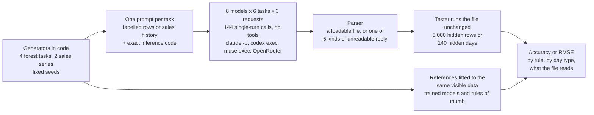

Each request is a single call with no conversation history, so there is no chain of model calls. The only repeated
call is a retry after a transport failure (a crashed command line or an HTTP error), at most three attempts, all
logged. One example travels like this: the 600-row rules task becomes a 25,421-character prompt; Claude Fable 5.1
returns a 175-node, three-tree forest as JSON; the parser checks it against the prompt's rules; the tester runs it on
5,000 hidden rows and counts 4,573 correct (91.5%). The worked example below follows one of those rows.

## The data

All data is synthetic, generated in code from fixed seeds on 9 November 2026; the 600-row rules task and the weekly
sales task reproduce the sets of the pilot run on 5 November. No model can have seen any of it in training, and the
exact generating rule is known, so every score can be compared with the best possible score.

### The forest tasks

Each row has eight features. x0 to x6 are numbers between 0 and 10 with two decimals. x7 is a category code 0, 1, 2
or 3; the prompt says the codes are names, so their order means nothing. The label is one of four classes. In the
three rules tasks it comes from three rules, checked in this order so that a later rule overrides an earlier one:

| Class | Name used here | Rule |
|---|---|---|
| 1 | exactly-one | exactly one of x3 and x4 is above 5 |
| 2 | category | x7 is code 2 and x2 is above 4 |
| 3 | circle | the point (x0, x1) lies within 2.83 (the square root of 8) of (5, 5) |
| 0 | rest | none of the above |

x5 and x6 are never used. After the rule is applied, 10% of rows get a class drawn at random, which can be the same
class, so 7.4% of the hidden labels differ from the rule and the rule itself scores 92.6% on the hidden rows. No
classifier can expect to do better, so 92.6% is the ceiling.

| Task | Visible rows | Hidden rows | What changes |
|---|---|---|---|
| Rules, 200 rows | 200 (the first 200 of the 600) | 5,000 | less data |
| Rules, 600 rows | 600 | 5,000 | the pilot task |
| Rules, 1,500 rows | 1,500 (the 600 plus 900 more) | 5,000 | more data |
| Smooth, 600 rows | 600 | 5,000 | labels from a smooth random function |

The three rules tasks share the same 5,000 hidden rows and their visible rows are nested, so differences between them
come only from the amount of data. The smooth task keeps the features and the noise but replaces the rules with a
function that has no short description: each class gets a score made of eight random sine waves over x0 to x3 plus a
shift for each category code, and the label is the class with the highest score. Its noise-free labels also score
92.6%. It asks what happens when there is no rule to recognise, only a shape to approximate, which is the situation a
training program is built for.

Here are the first rows a model sees, with the label as given and what the rule says:

| x0 | x1 | x2 | x3 | x4 | x5 | x6 | x7 | label | rule |
|---|---|---|---|---|---|---|---|---|---|
| 0.86 | 6.22 | 2.46 | 6.03 | 7.73 | 5.46 | 0.92 | 3 | 0 | rest |
| 5.98 | 6.26 | 5.26 | 3.85 | 0.18 | 5.54 | 7.94 | 3 | 3 | circle |
| 3.12 | 0.53 | 1.33 | 3.66 | 7.31 | 6.76 | 8.35 | 0 | 1 | exactly-one |
| 0.66 | 3.51 | 5.27 | 6.45 | 1.23 | 7.87 | 1.24 | 2 | 2 | category |
| 8.87 | 5.63 | 1.73 | 9.35 | 5.13 | 3.96 | 0.85 | 2 | 0 | rest |
| 7.48 | 9.88 | 10.00 | 3.77 | 6.32 | 6.66 | 7.77 | 3 | 3 | exactly-one |

The fourth row is the category class: code 2 and x2 = 5.27. The fifth row also has code 2, but x2 is only 1.73, and x3
and x4 are both above 5, so the rule says rest. The last row shows the noise: it is labelled circle, but the point
(7.48, 9.88) is far outside the circle and the rule says exactly-one. In the 600 visible rows 8.7% of labels disagree
with the rule like this, about one in twelve. With 200 rows there are only 31 rows of the category class to learn
from.


The left panel shows the circle class (green diamonds) filling the disc, with a few stray labels of other classes
inside it and a few green points outside. The middle panel shows the exactly-one class (orange squares) in the
top-left and bottom-right quarters of x3 against x4, mixed with circle and category points because those rules
override it. The right panel is the smooth task: broad irregular bands with no two-feature view that separates them.

### The LSTM tasks

Each task is a 700-day sales series. Sales start near 100 and grow by 0.03 a day. On top sit a weekly cycle (-6, -3,
-2, 0, +4, +11 and -4 on the seven days of the week), promotions on about 12% of days (+15 on the day and -6 on the day
after), and noise that carries over: each day's noise is 0.6 times the previous day's plus a fresh random amount with a
standard deviation of 2. The second task adds a 30-day pay cycle, with sales higher on the first four days of each
30-day month (+9.9, +5.9, +2.9, +0.9) and 3.1 lower in its last six days.

The models see days 0 to 559 and are scored on days 560 to 699, 140 forecasts of one day ahead. For each hidden day
the tester feeds the true values of the previous 28 days (35 for the two-cycle task, so that a full month fits) with
the promotion flags, including the flag of the day being forecast.

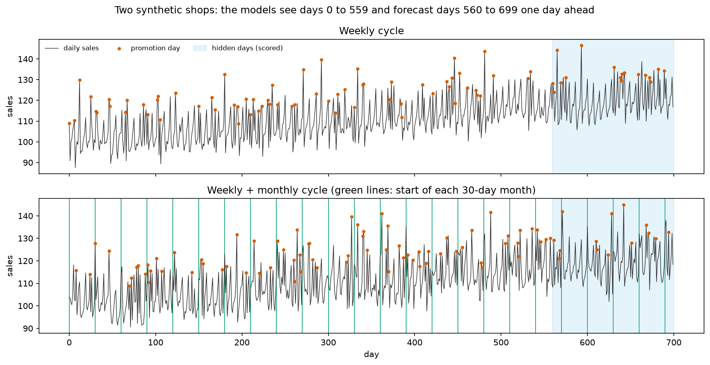

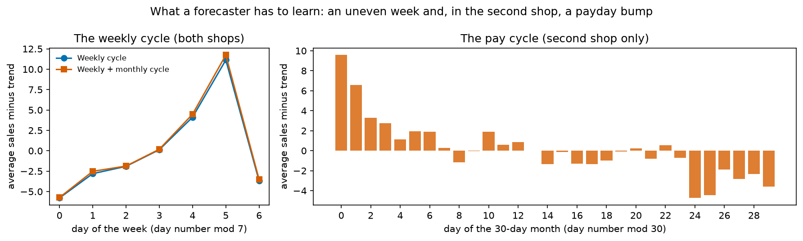

The second chart averages the visible days without promotions: the same uneven week in both shops, and in the second
shop a payday bump that fades over four days, then a dip at the end of each month.

## The request and the models

Every model gets the same prompt for a task, once per request, with no conversation history. The prompt says there
are no tools and that the tester will not train, repair or choose anything; it states the task, the size limits, the
exact inference code that will run the answer, the required JSON format, and the labelled rows or the sales history.
The 600-row forest prompt is 25,421 characters, the 1,500-row prompt 60,522, and each LSTM prompt 9,369. An excerpt of
the forest prompt:

```text
You are the sole author of a random forest classifier. You have NO tools, code execution,
calculator, files, web or other agents. Reason internally. The tester loads your JSON unchanged and only
runs the inference code below. It will not train, prune, repair or choose anything.
TASK: predict a class 0, 1, 2 or 3 from eight features. ... Labels may be noisy. The 600 labelled rows
below are the ONLY data you receive. You are scored by accuracy on 5,000 hidden rows from the same source.
MODEL LIMITS: at most 20 trees. In each tree, a path from the root to a leaf passes through at most
8 internal (split) nodes, and the tree has at most 511 nodes. ...
  [exact tree_predict and forest_predict code; the required JSON format; then the 600 labelled rows]
```

The LSTM prompt has the same shape: the exact `lstm_predict` code (gate order, shapes, normalisation
`(sales - 100) / 20`), the required arrays (`W_ih` 32 by 2, `W_hh` 32 by 8, two biases of 32, `W_out` 1 by 8, `b_out`),
and 560 lines of `day,sales,promotion flag`.

| Model | Pinned version | Provider and how called | Size and precision | Settings | Why included |
|---|---|---|---|---|---|
| Claude Opus 5.5 | `claude-opus-5-5` (the CLI exposes no dated snapshot) | Anthropic, `claude -p` (Claude Code 2.1.296) | Not published | Effort high, no tools, 128,000 output tokens per message | Wrote 91% forests in the pilot; Anthropic's main frontier model |
| Claude Fable 5.1 | `claude-fable-5-1` | Anthropic, `claude -p` | Not published | Effort high, no tools, 64,000 tokens per message (the model's cap) | Anthropic's largest model; wrote both the best and a poor pilot forest |
| Claude Sonnet 5.5 | `claude-sonnet-5-5` | Anthropic, `claude -p` | Not published | Effort high, no tools, 128,000 tokens per message | A cheaper Claude model that scored 38 to 42% on the pilot forest, to show where the ability starts |
| GPT-6.1 Sol | `gpt-6.1-sol` (no dated snapshot exposed) | OpenAI, `codex exec` 0.160.1 with shell, code, browser, skills and multi-agent features switched off | Not published | Reasoning effort high | OpenAI's strongest model available through its CLI |
| Muse Wonder Full | `muse-wonder-full-1.0` | Meta, `muse exec` 1.4.14, preset `empty` (no tools) | Not published | Reasoning effort high | Meta's strongest Muse model |
| Kimi K3.1 Pro | `moonshotai/kimi-k3.1-pro-20261023` | OpenRouter, provider Moonshot AI | 2.8 trillion parameters, 104 billion active; mxfp4 | Reasoning effort high, `max_tokens` 128,000 | Highest-ranked large open-weight model on Artificial Analysis on 9 November |
| GLM 5.3 | `z-ai/glm-5.3-20260816` | OpenRouter, provider Z.AI | 753 billion, 40 billion active; fp8 | Reasoning effort high, `max_tokens` 128,000 | Third-ranked large open-weight model |
| DeepSeek V4.1 Flash | `deepseek/deepseek-v4.1-flash-20261017` | OpenRouter, provider DeepSeek | 552 billion, 16 billion active; precision not published | Reasoning effort high, `max_tokens` 128,000 | Second-ranked large open-weight model, at a small fraction of the others' price |

None of the models could run code. The Claude, Codex and Muse command lines were set up with every tool switched off
and started in an empty folder, and all 144 replies were checked for tool calls: there were none. The open-weight
models were called through OpenRouter's chat interface without tools. One difference in output allowance is
discussed under [unreadable replies](#unreadable-replies-and-wrong-answers): when a Claude reply reaches its
per-message cap, Claude Code continues it in a second message, while the open-weight models stop at 128,000 tokens.

## How a reply is scored, and the references

A reply is loaded by a parser that checks it against the rules the prompt states. The only text cleaning it does is to
remove one surrounding Markdown code fence. A forest must have 1 to 20 trees; every tree needs a node with id 0,
unique ids and every child id present; no path may pass more than 8 questions or loop back on itself; every leaf must
hold four non-negative numbers. An LSTM must have the six weight arrays in the stated shapes, all finite. A reply that
fails is unreadable, in one of five kinds (no reply, cut off at the output limit, not JSON, wrong shape, breaks
limits), and unreadable replies are counted apart from wrong answers throughout. A lenient parser that takes the first
complete JSON object anywhere in the reply is reported beside it; it rescued no reply.

Readable forests are scored by accuracy on the 5,000 hidden rows. Because 7.4% of hidden labels are noise, the most a
forest can expect is 92.6%. A second measure, agreement with the rule, compares predictions with the noise-free labels;
a forest that implements the rule exactly scores 100% on it. LSTMs are scored by root mean squared error (RMSE) on the
140 hidden days, in units of sales: square each error, average, take the square root. A forecast off by 1 on each of
four days has RMSE 1; one exact on three days and off by 4 on the fourth has the same average miss of 1 a day but RMSE
2, because RMSE weighs large misses more. Lower is better, and the unpredictable noise puts a floor near 2.

The forest references are fitted to the same visible rows: the commonest class; a scikit-learn decision tree with at
most 8 questions per path; scikit-learn's random forest with the language models' limits (20 trees, 8 questions per
path); the same forest with 200 unlimited trees; histogram gradient boosting, which adds many small trees one after
another and is usually the strongest trained tree model on such tables (it exceeds the 20-tree limit); and the
noise-free rule, the ceiling.

The LSTM references are repeat yesterday; same weekday last week, a standard seasonal rule of thumb; a linear model
fitted by least squares to the same inputs the LSTM sees, which suits these additive series; the same 8-unit LSTM
trained by gradient descent from six random starts, with the last 12 visible weeks held out to choose the start and
when to stop; and the true formula, which carries over the previous day's noise and sets the floor (1.97 weekly, 1.90
two-cycle).

## Worked example: one forest followed through one hidden row

Claude Fable 5.1's first forest for the 600-row task has three trees and 175 nodes. Here is the first hidden row
followed through each tree with the prompt's exact inference code:

```text
Hidden row 0: x0=3.66, x1=3.62, x2=6.12, x3=9.23, x4=5.99, x5=6.97, x6=0.63, x7=0
  tree 0: x0 > 2.15 -> x0 <= 7.85 -> x0 <= 5 -> x0 > 3.5 -> x0 <= 4 -> x1 > 2.44 -> x1 <= 7.56 -> leaf [0, 0, 0, 3]
  tree 1: x1 > 2.15 -> x1 <= 7.85 -> x1 <= 5 -> x1 > 3.5 -> x1 <= 4 -> x0 > 2.44 -> x0 <= 7.56 -> leaf [0, 0, 0, 3]
  tree 2: x7 <= 1.5 -> x3 > 5 -> x4 > 5 -> leaf [1, 0, 0, 0]
  average vote [0.333, 0.0, 0.0, 2.0] -> class 3 (circle); label 3, rule says 3
```

The row lies 1.9 from the centre (5, 5), inside the circle. Tree 0 narrows x0 into a band from 3.5 to 4, then checks
that x1 lies between 2.44 and 7.56, the circle's height at that band: one step of a staircase. Tree 1 does the same with
x0 and x1 swapped; both vote 3 for circle. Tree 2 is a rule tree: the code is not 2 and x3 and x4 are both above 5, so
it votes 1 for rest. The average, 2.0 for circle against 0.33 for rest, gives circle, the label and the rule.

The vote weights carry the design: the circle trees vote 3 and the rule tree 1, so the circle overrides the other
rules, exactly as in the generator. Fable did not average a crowd of noisy trees as a trained forest does; it wrote the
generating rule as a program, using the forest format as its programming language. On all 5,000 hidden rows this
forest scores 91.5% and agrees with the rule on 98.7%.

The same walk-through for a forecast: Fable's first weekly LSTM forecasting day 569, a promotion day. The tester feeds
days 541 to 568 normalised as `(sales - 100) / 20`, each with the following day's promotion flag (the last row carries
flag 1 for day 569). The network outputs 131.29 against true sales of 128.55, an error of +2.74. The noise-free part of
day 569 is 130.07, so most of the miss is the day's noise. "Same weekday last week" would have said 109.95, because it
does not know about the promotion; Fable's weights add about 16 when that flag is on, close to the generator's +15.

## Results: written forests

Median accuracy on the 5,000 hidden rows in percent, with the lowest and highest of the three requests:

| Model | Rules, 200 rows | Rules, 600 rows | Rules, 1,500 rows | Smooth, 600 rows |
|---|---|---|---|---|
| GPT-6.1 Sol | 92.3 (92.0 to 92.4) | 92.4 (92.4 to 92.4) | 92.4 (92.0 to 92.4) | 71.1 (69.5 to 71.8) |
| Claude Opus 5.5 | 91.0 (62.9 to 91.6) | 81.8 (63.7 to 91.4) | 91.8 (62.1 to 91.9) | 63.1 (62.9 to 68.5) |
| Claude Fable 5.1 | 90.8 (78.9 to 91.7) | 81.6 (62.2 to 91.5) | 62.2 (61.8 to 81.9) | 67.6 (64.9 to 67.8) |
| Muse Wonder Full | 91.9 (91.3 to 91.9) | 89.8 (28.9 to 91.5) | 33.5 (26.3 to 80.2) | 53.8 (44.4 to 59.6) |
| Kimi K3.1 Pro | 47.5 (45.1 to 51.6) | 58.5 (41.8 to 59.1) | 45.8 (41.6 to 52.5) | 60.5 (60.4 to 60.8) |
| DeepSeek V4.1 Flash | 48.7 (40.2 to 55.1) | 40.1 (33.1 to 42.8) | 37.0 (34.8 to 39.3), 2 of 3 readable | 55.0 (53.6 to 56.3), 2 of 3 readable |
| Claude Sonnet 5.5 | 45.3 (42.9 to 45.9) | 39.1 (37.5 to 45.7) | 39.5 (38.8 to 45.5) | 62.4 (61.8 to 63.3) |
| GLM 5.3 | 37.6, 1 of 3 readable | none readable | 30.5, 1 of 3 readable | none readable |
| *Trained tree, 8 splits* (reference) | 49.4 | 62.6 | 68.6 | 63.8 |
| *Trained forest, same limits* (reference) | 54.2 | 65.0 | 77.9 | 69.4 |
| *Trained forest, 200 trees* (reference) | 59.9 | 70.9 | 82.4 | 72.3 |
| *Gradient boosting* (reference) | 75.4 | 84.7 | 88.5 | 74.1 |
| *Commonest class* (reference) | 31.1 | 31.1 | 31.1 | 24.9 |
| *Noise-free rule* (reference) | 92.6 | 92.6 | 92.6 | 92.6 |

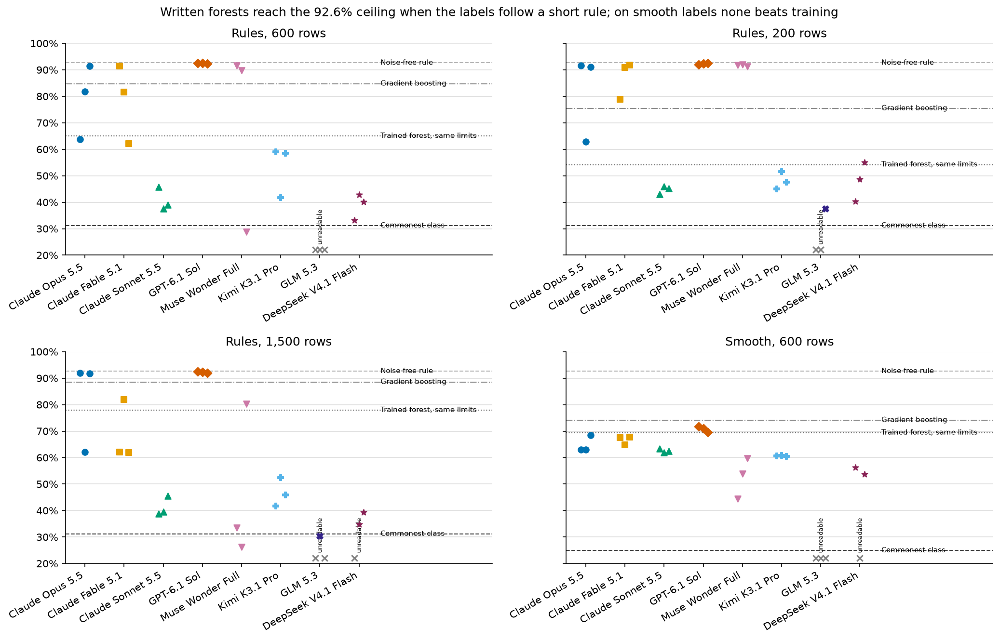

Each marker is one written forest; a grey cross marks an unreadable reply. On the rules panels the markers split into
a cluster at the ceiling (every Sol forest and many from Opus, Fable and Muse, 89.8% to 92.4%, agreeing with the rule
on 97% to 99.8% of rows) and a cloud below the trained forest (every forest from Sonnet, Kimi, GLM and DeepSeek, 30% to
60%). Between them sit only the misreads of the top group.

When the top group finds the rule it beats every trained model: on 600 rows the trained forest with the same limits
scores 65.0%, the 200-tree forest 70.9% and gradient boosting 84.7%, against 92.4% for the median Sol forest. But only
Sol is reliable. Opus scored 63.7%, 81.8% and 91.4% on the same 600-row prompt, Fable 62.2%, 81.6% and 91.5%, Muse
28.9%, 89.8% and 91.5%; Sol scored 92.4% three times.

On the smooth panel the cluster is gone: all written forests sit between 44% and 72%, around the trained forest and
below gradient boosting. There is no rule to recognise, only a curved boundary to approximate with boxes, which is what
a training program is built to do.

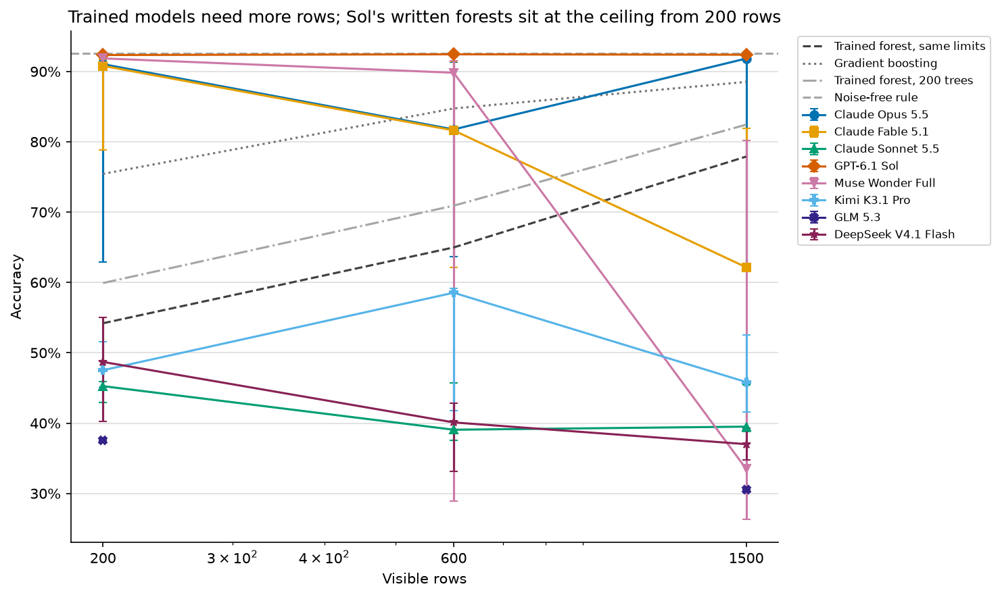

Trained models improve steadily with data (gradient boosting from 75.4% to 88.5%, the trained forest with the same
limits from 54.2% to 77.9%). Sol's line is flat at the ceiling because with 200 rows it already writes the rule. More
data hurt some writers: Muse's median fell from 91.9% at 200 rows to 33.5% at 1,500 and Fable's from 90.8% to 62.2%.
With three requests per point, one request going the other way moves a median by tens of points, so this direction is
suggestive, not established.

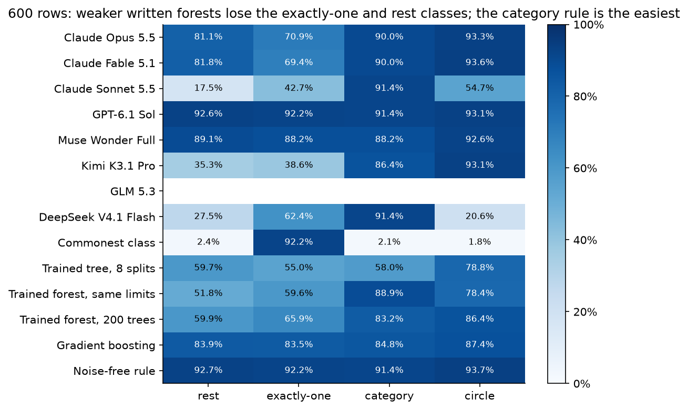

Split by the rule behind each hidden row's true class, the category rule is the easiest (86% to 91% for almost every
written forest: one split on x7 and one on x2 describe it). The circle separates the groups: about 93% for Sol, Opus,
Fable, Muse and Kimi, 55% for Sonnet and 21% for DeepSeek. Exactly-one is where the top group loses points (median Opus
70.9% against 92.2% for Sol), and Kimi, at 39% on exactly-one and 35% on rest, found two of the three rules. The trained
forest is weakest on exactly-one (59.6%) and rest (51.8%), because neither x3 nor x4 alone says anything about
exactly-one, so a greedy first split on either gains nothing.

## Results: written LSTMs

RMSE on the 140 hidden days (lower is better), median with the best and worst of three requests:

| Model | Weekly cycle | Weekly + monthly cycle |
|---|---|---|
| GPT-6.1 Sol | 2.83 (2.79 to 2.95) | 4.65 (4.02 to 5.71) |
| Claude Opus 5.5 | 2.84 (2.60 to 3.02) | 4.06 (4.02 to 6.92) |
| Claude Fable 5.1 | 2.70 (2.63 to 2.97) | 4.68 (4.07 to 5.32) |
| Muse Wonder Full | 3.31 (3.14 to 4.02) | 4.65 (4.08 to 4.66) |
| Kimi K3.1 Pro | 3.34 (3.30 to 3.56) | 4.96 (4.85 to 5.58) |
| DeepSeek V4.1 Flash | 4.89 (4.36 to 5.92) | 7.12 (6.70 to 7.18) |
| Claude Sonnet 5.5 | 3.61 (3.40 to 6.26) | 6.75 (5.48 to 7.97) |
| GLM 5.3 | none readable | none readable |
| *Repeat yesterday* (reference) | 11.23 | 11.10 |
| *Same weekday last week* (reference) | 8.35 | 8.37 |
| *Trained LSTM, same size* (reference) | 3.87 | 5.13 |
| *Linear model, same inputs* (reference) | 2.47 | 3.17 |
| *True formula* (reference) | 1.97 | 1.90 |

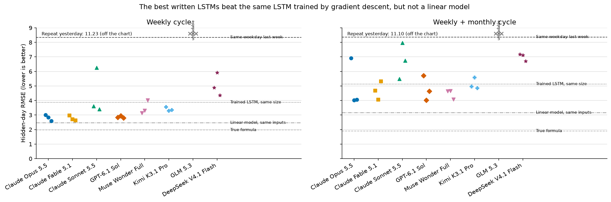

On the weekly task Opus, Fable and Sol sit between 2.60 and 3.02, below the trained LSTM (3.87) and above the linear
model (2.47); 16 of the 21 readable weekly LSTMs beat the trained LSTM. None of the 42 readable LSTMs beats the linear
model on either task, and every one beats both rules of thumb by a wide margin. On the two-cycle task every model moves
up; the best files (Sol, Opus, Muse, Fable) reach 4.02 to 4.08, still better than the trained LSTM (5.13) but further
from the linear model (3.17).

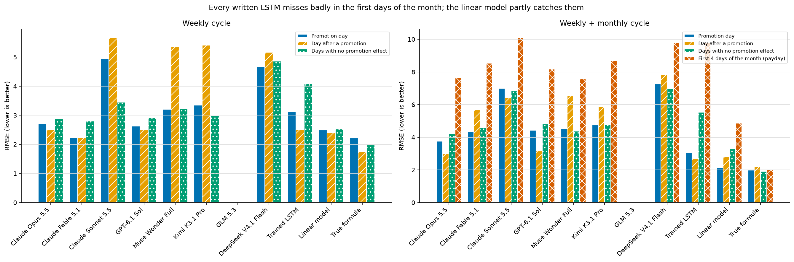

On the weekly task the top written LSTMs do about as well on promotion days as on other days (Fable 2.23, Sol 2.63), so
they handle the lift; Muse, Kimi, Sonnet and DeepSeek do worse on the day after a promotion (medians 5.2 to 5.7),
because several of their files ignore the dip. On the two-cycle task the payday bars stand out: the written LSTMs miss
the first four days of the month by 7.0 to 12.6, against 4.86 for the linear model and 2.02 for the true formula. The
trained LSTM misses them as badly (9.81). The linear model catches part of the pay cycle because the value 30 days back
is one of its inputs and least squares gives it a weight of 0.4; no written LSTM puts more than 0.05 there.

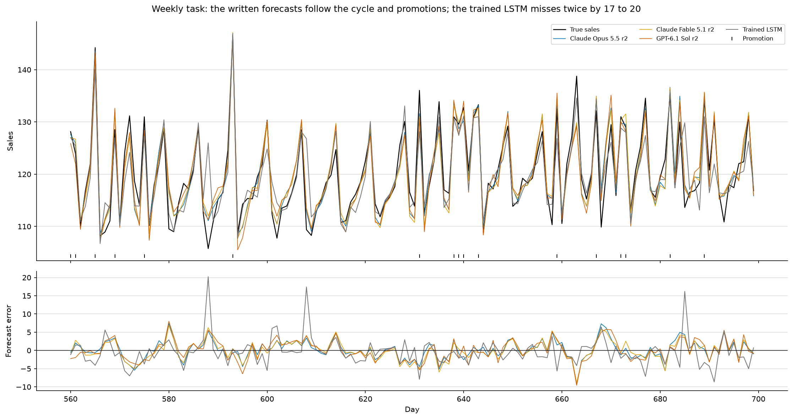

The written forecasts follow the weekly rhythm and the promotions, and their errors move together, which marks the
day's noise. The trained LSTM is usually close, but on days 588 and 608, two days with sales about 5 below the usual
pattern, it overshoots by 20 and 17 while the written forecasts overshoot by 3 to 6. Training a 393-weight network on
500 days is fragile (its 36 candidates ranged from 2.57 to 10.1); the written LSTMs avoid that by not fitting at all.

## What the written models encode

A written model is a program, so it can be read.

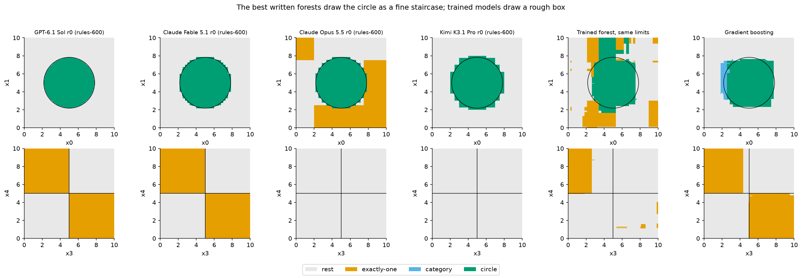

The top row colours the plane of x0 and x1 by predicted class, with the other features held where only the circle rule
can apply; the bottom row does the same for x3 and x4, where only the exactly-one rule can apply.

A typical success: Sol's first forest (92.4%) draws the circle as a staircase so fine it looks smooth, and the
exactly-one quarters exactly at 5. Fable's (91.5%) draws a coarser staircase and the same quarters. Across all the
forests at the ceiling the design is the same: 25 to 252 questions on x0 and x1, 3 on the category rule (x7 at 1.5 and
2.5 to isolate code 2, then x2 at 4), 3 to 18 on exactly-one with thresholds at or within 0.03 of 5, and none on x5 or
x6. That is the generating rule written as trees, usually one or two circle trees outvoting one rule tree.

An informative failure: Opus's first forest (63.7%) draws a good circle, but its bottom row is blank. It found no
exactly-one pattern in x3 and x4 and instead marked corner regions of the x0 and x1 plane as exactly-one (orange in the
top row): a misread of which features carry the rule. All three of Opus's forests below 64% and most of Kimi's spend no
questions on x3 and x4 at all. The other failures differ: Fable's 62.2% forest on 600 rows asks 64 questions about x5
and x6, which carry nothing, so it built structure on noise; Muse's 28.9% forest has 20 trees only two questions deep,
spread over every feature, the look of a forest built without finding any rule. Sonnet spends 0 to 32 questions on the
circle, against 49 or more in every ceiling forest from Opus, Fable and Sol, so its circles are too coarse to score.

The trained forest draws a rough box with ragged edges and patches where a few noisy rows sat; gradient boosting draws
a tighter box and finds the exactly-one quarters. Both fit where the data is, without knowing the shape is a circle.

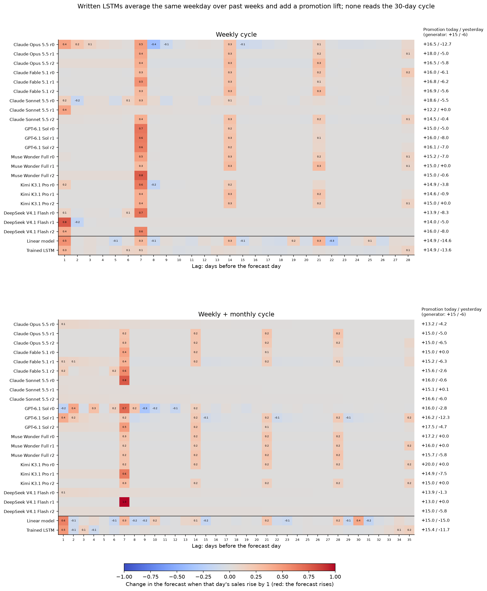

Each row is one readable LSTM (or reference) and each column a day in the input window, counted back from the day being
forecast. The colour is the average change in the forecast when that one day's sales rise by 1, measured by nudging the
input on every hidden day: a weight of 0.5 at lag 7 means the forecast moves by half of any change in last week's sales.
The numbers on the right are the change when the promotion flag of the forecast day, or of yesterday, is switched on;
the generator uses +15 and -6.

Almost every good written LSTM reads the same weekday from earlier weeks, lags 7, 14 and 21 and sometimes 28, with
weights that sum to about 1. Fable's 2.63 weekly LSTM reads lags 7, 14 and 21 at 0.31 each, an average that smooths
out each week's noise; Sol's put 0.6 on lag 7 and 0.25 on lag 14. Opus's 2.60 file adds +16.5 for a promotion today and
-5.8 after one yesterday, against the true +15 and -6.

The files build this in different ways. Fable's first weekly file wires pairs of memory units into rotations, with
recurrent weights such as `[[0.611, -0.766], [0.766, 0.611]]`, close to a seventh of a turn per day; with forget gates
off and inputs scaled down so the gates act linearly, the pairs are oscillators at one, two and three cycles a week.
Other files hold last week's value in a memory cell opened only at the right step. The heatmap cannot tell these apart,
because they compute nearly the same function.

What the best written files do not read is lag 1, yesterday. The noise carries 0.6 of each day's surprise into the
next, so yesterday's value carries information; the linear model puts 0.5 on lag 1 and the trained LSTM 0.3. A
forecaster that knew the generator's pattern exactly but ignored this carry-over would score 2.29 on the weekly task;
the true formula, which uses it, scores 1.97. The written files give up that part of the error, on top of their small
errors in the pattern. On the two-cycle task no written LSTM puts weight on lag 30, where the pay cycle would show;
Opus, Fable and Muse average lags 7, 14, 21 and 28 as before.

## Unreadable replies and wrong answers

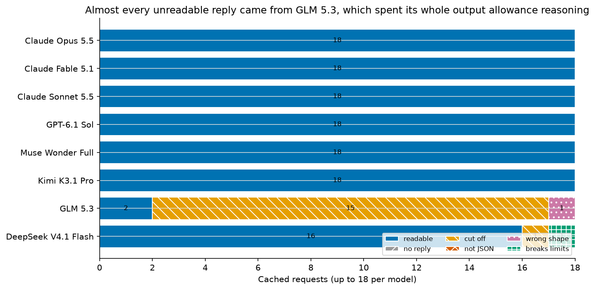

Six models returned 18 readable files out of 18. A difficult case: GLM 5.3 returned 2. In 15 requests it used the
whole 128,000-token allowance reasoning and was cut off before writing anything, and once it wrote an LSTM matrix with
33 rows where 32 were required. Its reasoning is careful, not looping: on the weekly task it ran to 277,000 characters
of checking gate values one by one. DeepSeek V4.1 Flash was cut off once and once wrote 21 trees when 20 was the limit.
The two readable GLM forests scored 30.5% and 37.6%, in line with the weaker group.

Two parsing decisions were made after some results had been seen, and the notebook reports both ways.

- Seven forests point two parents at the same node (three from Kimi, one from Muse, all three of Sol's smooth-task
  forests). The prompt does not forbid this and the inference code runs it, so they count as readable. Under the pilot
  loader's stricter rule, Sol would have no readable smooth-task forest and the best smooth median would be Fable's
  67.6%; on the rules tasks Kimi's 600-row median would fall from 58.5% to 41.8% and Muse's 1,500-row median from
  33.5% to 29.9%, both within the weaker group.
- One Fable forest arrived in two messages, because Claude Code continues a reply that reaches the per-message cap;
  the parser joins them. That reply and one Opus reply used more than the 128,000 output tokens the open-weight models
  were held to (138,847 and 156,993). Counting both as cut off would raise Fable's 1,500-row median from 62.2% to 72.0%
  and Opus's smooth median from 63.1% to 65.7%, with no change in order.

Separately, two collection processes overlapped, so 13 open-weight requests were sent twice and the reply that
finished second is scored. Scoring the overwritten replies (recovered from the tracing log) instead would turn GLM's
37.6% forest into a cut-off and move Kimi's and DeepSeek's medians by up to 8.5 points or 0.5 of RMSE. One overwritten
Kimi forest scored 84.7%, far above Kimi's kept rules-task forests (41.6% to 59.1%), in 1 of its 12 attempts.

### Catching a wrong file before use

Wrong but readable files were the common failure of the stronger models. Because a written model is not fitted to the
visible rows, its score on those rows is an honest estimate of its hidden score: the two correlate at 0.97 for forests
and 0.98 for LSTMs. So a user can ask for several files and keep the one that does best on the data they already have.

| Model | Rules, 200 | Rules, 600 | Rules, 1,500 | Smooth | Weekly | Two-cycle |
|---|---|---|---|---|---|---|
| GPT-6.1 Sol | 92.0 | 92.4 | 92.4 | 71.8 | 2.79 | 4.02 |
| Claude Opus 5.5 | 91.6 | 91.4 | 91.9 | 68.5 | 2.60 | 4.02 |
| Claude Fable 5.1 | 91.7 | 91.5 | 81.9 | 67.6 | 2.63 | 4.07 |
| Muse Wonder Full | 91.9 | 91.5 | 80.2 | 59.6 | 3.14 | 4.08 |

The table gives the hidden score of the file each model would deliver if the best of three were chosen by visible
score: within 1.2 points of the ceiling for all four on 200 and 600 rows. Across all models the check picked the best
hidden file in 37 of 44 model and task pairs, and otherwise one within 0.6 points, except Kimi on 200 rows (4.1) and
DeepSeek on the smooth task (2.7). It cannot rescue a model whose three files are all poor, and it triples the cost.

## Effort, time and cost

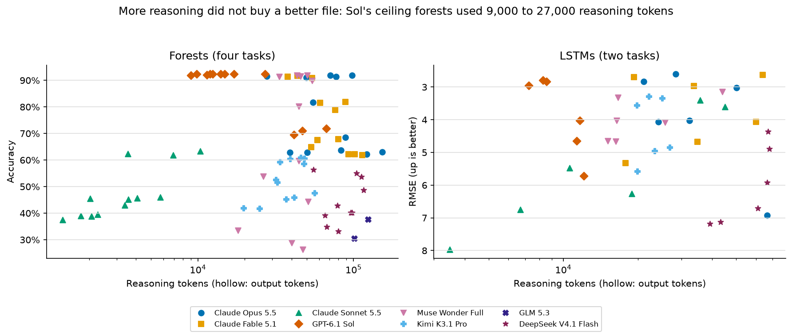

More reasoning did not buy a better file. Sol's nine ceiling forests used 9,000 to 27,000 reasoning tokens. Opus's
ceiling forests used 28,000 to 98,000 and its failed ones 39,000 to 121,000; Fable's ceiling forests used 38,000 to
54,000 and its failed ones 61,000 to 114,000, so within Fable a long reasoning run went with a worse file. Sonnet
stopped after 1,300 to 10,000 tokens and found the circle in none of its forests. DeepSeek used 55,000 to 116,000 on
forests that scored 33% to 56%.

| Model | Median reasoning tokens, forest | Median minutes, forest | Median cost per forest request | Cost, all 18 requests |
|---|---|---|---|---|
| GPT-6.1 Sol | 14,395 | 7.8 | US$0.29 | US$5.18 (API rate equivalent) |
| Claude Opus 5.5 | 74,069 | 10.5 | US$1.61 | US$25.04 |
| Claude Fable 5.1 | 68,499 | 13.8 | US$4.23 | US$66.81 |
| Muse Wonder Full | 44,438 | 12.6 | subscription | subscription |
| Kimi K3.1 Pro | 38,110 | 17.5 | US$0.44 | US$6.88 |
| DeepSeek V4.1 Flash | 87,914 | 6.3 | US$0.06 | US$0.89 |
| Claude Sonnet 5.5 | 3,472 | 0.7 | US$0.07 | US$2.50 |
| GLM 5.3 | 127,911 | 17.0 | US$0.59 | US$10.23 |

Claude costs are Claude Code's list-price equivalents, OpenRouter costs are what it charged, and Sol's is the same
tokens at OpenAI's published API rates; Muse reports tokens but no price. The slowest request took 51 minutes (Muse,
600-row task).

## How the study got here

The design came from two small pilot runs whose answers are not used here. A first test on 5 November used an easier
forest (a diagonal boundary and a box) and one 12-step cycle; Sonnet's forest scored 71.5% against 85.0% for a trained
forest, but a diagonal and a box are close to what a tree does anyway, so the rules and weekly tasks were built to
separate recognising a rule from fitting data. On those (5 to 7 November) Sonnet wrote forests at 38.5% to 42.5%, Opus
at 91.6% and 91.0% and Fable at 91.9% and 59.8%. The two Fable forests differed by 32 points, so the study uses three
requests per model per task, and the trained-LSTM reference is chosen on held-out visible weeks, which the pilot showed
beats choosing by training error.

## Limitations

- The data is synthetic and was designed to have rules a reader can see. Real tables rarely come from three clean
  rules, and the smooth task shows the advantage disappears without one.
- Three requests per model per task show how much a model varies, not its rate. Sol's 9 of 9 still allows a true
  success rate as low as 72% (one-sided 95% bound); Opus's 5 of 9 is consistent with 21% to 86%.
- Each model ran at one setting, reasoning effort high, with one prompt. A different prompt or effort could change the
  results, above all for GLM, which ran out of allowance.
- The output allowance was not exactly equal, the parser was changed twice after some replies were seen, and 13
  requests were duplicated; each is reported both ways above and none changes the order of the top models. The plan
  fixed before the collection is in [`data/PROTOCOL.md`](data/PROTOCOL.md).
- One window and one network size were tested; an 8-unit LSTM may be too small to hold a 30-day cycle by hand. The
  references are untuned defaults; tuned boosting would score higher on more rows but not reach Sol's ceiling at 200.

## What the evidence supports

If the data plausibly follows a short rule, asking a strong model to write the model is worth trying, especially with
few labelled rows: the written forest can be both more accurate than anything trained on the sample and readable. It
should not be trusted from one request. Ask for three files and keep the one with the best score on the visible data,
which here would have delivered a near-ceiling forest from four of the eight models. Sol was the only model that did
not need the check on the rules tasks, and it was also among the cheapest. If the data has no short description, train
the model. For forecasting, a written LSTM is a reasonable small forecaster but a linear model on the same inputs did
better at no cost; the open question is whether a writer can encode structure, such as a pay cycle, that it does not
spot in one reading.

## How to reproduce

The notebook [`45_handwritten_forest_lstm.ipynb`](45_handwritten_forest_lstm.ipynb) replays every reply from
`data/responses/`, so it runs end to end without an API key or a signed-in command line:

```bash
python -m nbconvert --to notebook --execute --inplace 45_handwritten_forest_lstm.ipynb
```

It needs Python 3.11 or later with numpy, pandas, matplotlib, scipy, scikit-learn and requests. To collect fresh
replies, set `NB45_FRESH=1` and remove the reply files to replace; this needs the `claude`, `codex` and `muse` command
lines signed in and `OPENROUTER_API_KEY`. `MODELS`, `TASKS` and `N_REPEATS` in the first code cell choose what to run,
and each fresh call is traced to a local Langfuse instance when one answers at `LANGFUSE_HOST`.

The study made 144 requests, plus 4 retries after transport failures (all GLM through OpenRouter) and 13 duplicated
open-weight requests. The 144 scored replies of the priced models cost US$117.52, 57% of it Fable; the duplicates
added US$5.64; Muse ran on a subscription; the pilot cost about US$18 more.

Files: `data/responses/<task>/<model>/r<k>.json` holds each request, reply, status, tokens, time and cost
(`data/duplicates/` the overwritten duplicates); `data/results.csv` one row per request with every score, beside the
summary tables; `data/references/` the trained LSTM weights; `data/attempts.jsonl` every attempt; and
[`data/PROTOCOL.md`](data/PROTOCOL.md) the pilot, the plan fixed before the collection and the collection log.

## Future work and further reading

### Future work

- Real tables published after the models' training cutoffs, with the same forest limits, to see whether the advantage
  survives data without a clean rule. The smooth task suggests it shrinks to nothing; real data may sit in between.
- Ten or more requests per model on the 600-row rules task, to estimate success rates with a usable interval and to test
  whether the visible-data check keeps working when a model's good files are rare.
- A two-step prompt that asks the model first to state the rule it sees and then to write the file. Comparing the two
  would show whether Opus's and Fable's failures are misreads of the data or mistakes in writing the trees.
- A forecasting task with a larger LSTM or a day-of-month input, to test whether any writer encodes the pay cycle when
  the network has room, and a version that says the noise carries over, to see whether writers then read yesterday's
  value as the linear model does.
- The same tasks with a code tool allowed, to separate finding the rule from the arithmetic of writing hundreds of
  thresholds.

### Further reading

Links checked on 9 November 2026.

- [Random Forests](https://doi.org/10.1023/A:1010933404324) (Breiman, 2001). The paper that defined the trained forest
  used as the main forest reference here.
- [Long Short-Term Memory](https://doi.org/10.1162/neco.1997.9.8.1735) (Hochreiter and Schmidhuber, 1997). The original
  LSTM paper, describing the gates that the written weights set by hand.
- [Why do tree-based models still outperform deep learning on typical tabular data?](https://arxiv.org/abs/2207.08815)
  (Grinsztajn et al., 2022). Shows that trees suit irregular boundaries on tabular data; the smooth task here is the
  case where a short rule is missing and trained trees hold up.
- [Tracr: Compiled Transformers as a Laboratory for Interpretability](https://arxiv.org/abs/2301.05062) (Lindner et
  al., 2023). Compiles human-written programs into transformer weights, the program-to-weights step a writer model does
  here by reasoning alone.
- [Forecasting: Principles and Practice, simple methods](https://otexts.com/fpp3/simple-methods.html) (Hyndman and
  Athanasopoulos, 3rd edition). Defines the seasonal naive forecast used here as "same weekday last week".
