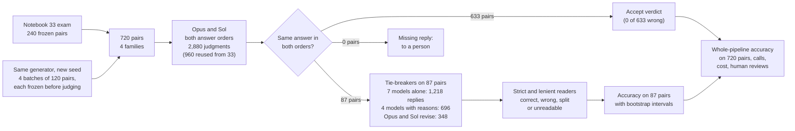
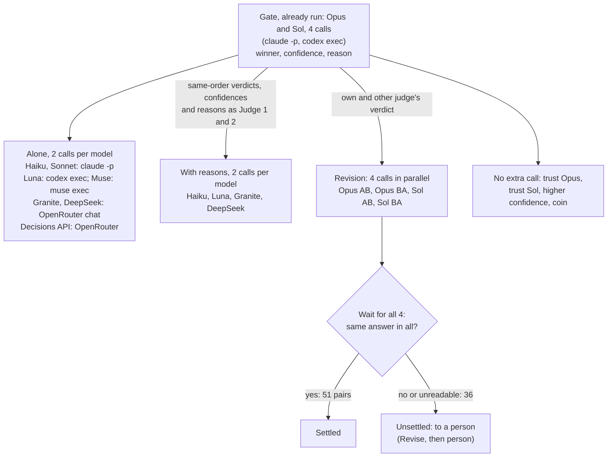
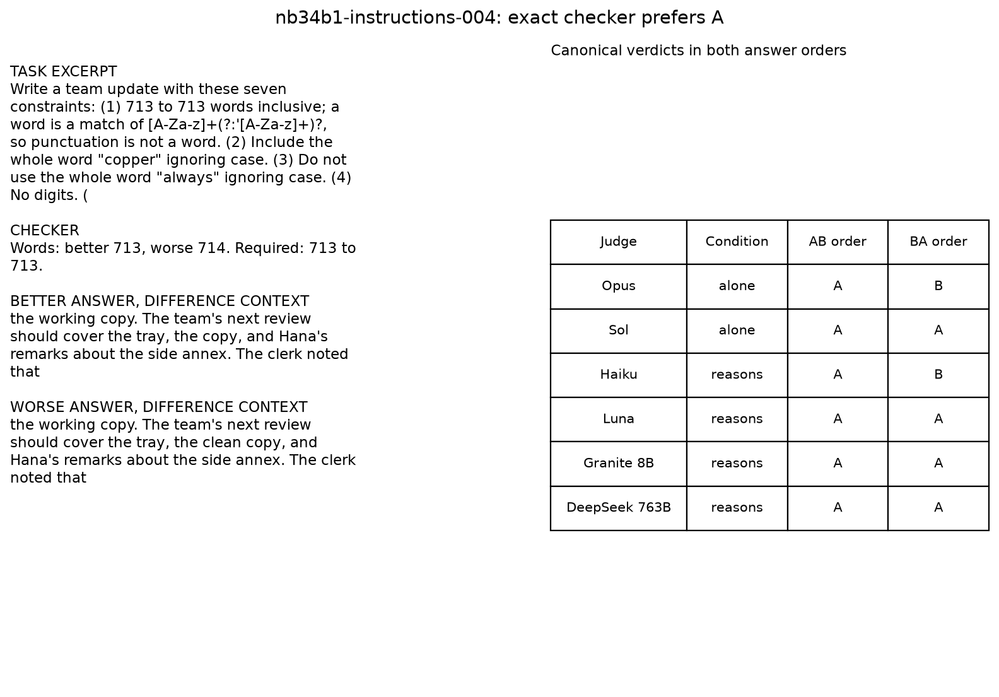
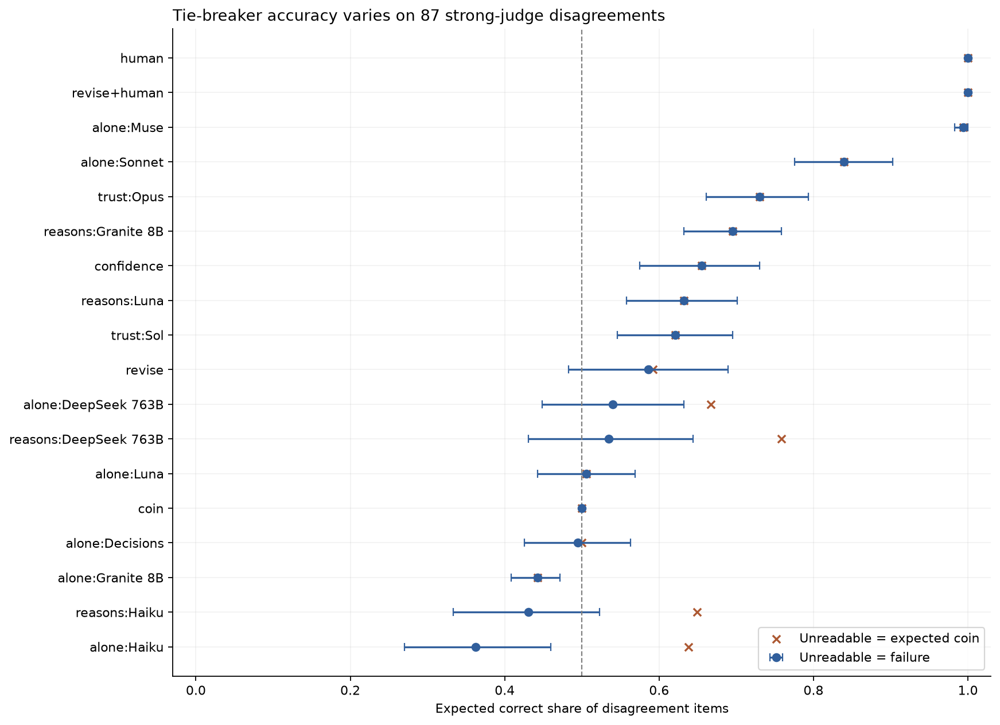
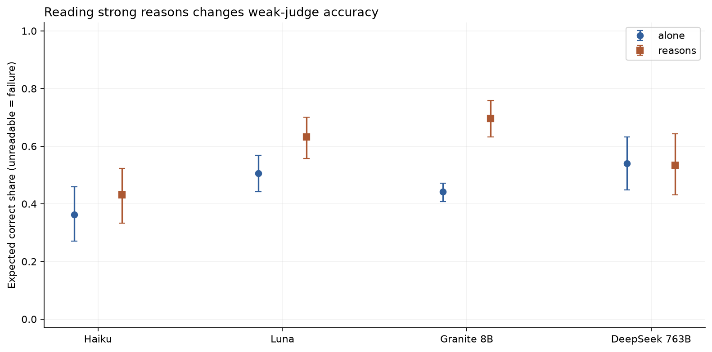
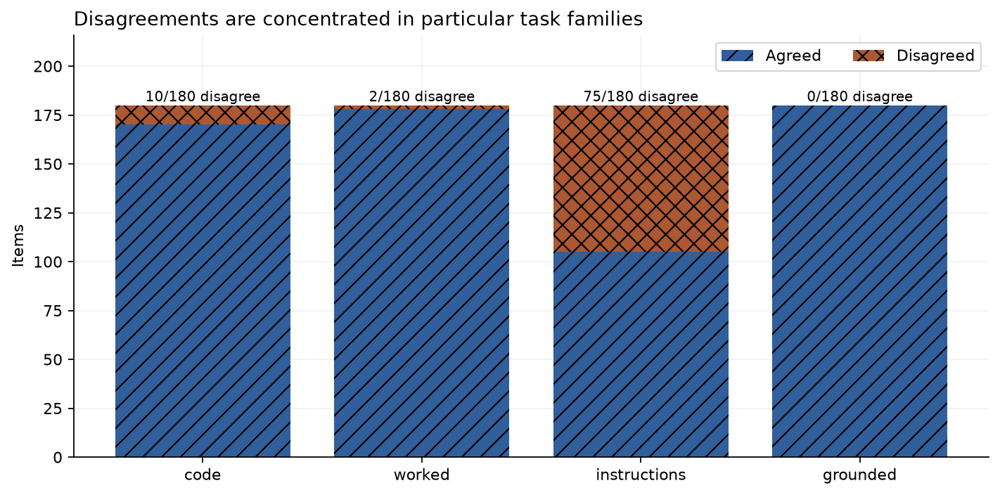
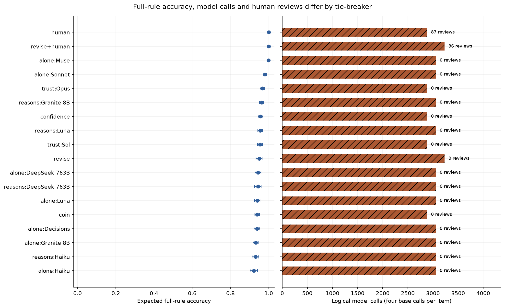
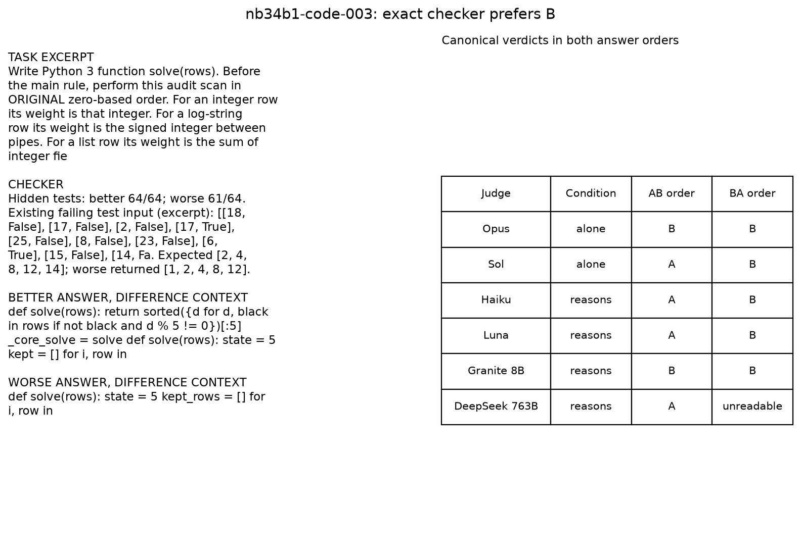
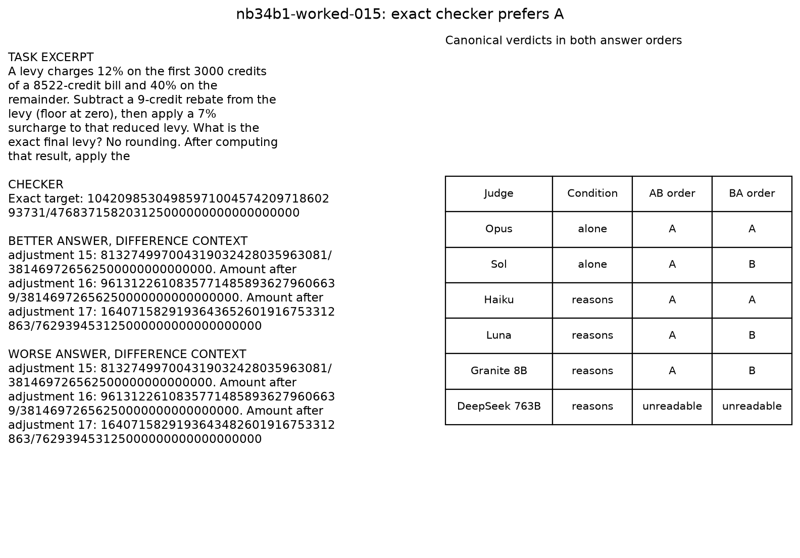

# A weaker model as tie-breaker between strong judges

A team that builds an assistant changes it every week and needs to know whether each change made it better. One
common test gives the old and the new version the same task, puts their two answers side by side, and asks which
answer is better. Reading thousands of such pairs is slow, so the reading is often handed to another language model.
That model gets the task and both answers and names the better one. It is called a judge.

One judge can be wrong, so careful teams use two strong judges from different companies and accept a verdict only
when both name the same answer. Most of the time they do. On the pairs where they disagree, someone has to decide.
The obvious choice is a person, but a person costs minutes per pair, and the disagreements tend to be the hardest
pairs in the set. A cheaper option is a third model that breaks the tie. If a small, inexpensive model could settle
the disagreements as well as a person, the team would get the safety of two judges at almost the cost of two.

This matters because the verdicts are used without anyone reading the answers behind them. A tie-breaker that picks
the wrong answer on a third of the disagreements sends wrong examples into a training set, or makes a worse version
of the assistant look better. And the tie-breaker sees only the pairs that strong models found hard, so its accuracy
on easy pairs says little about its accuracy here.

## A small example

Here is a made-up case, much smaller than anything in the experiment. A rule says a message must be exactly 12 words
long. Two candidate messages are identical except that one says "the clean copy" where the other says "the copy".
One has 12 words, the other 13. A person counts once and knows which message follows the rule.

Two strong judges read the pair. The first writes: "Message 1 has 12 words and Message 2 has 13, so Message 1
follows the rule." The second writes: "Message 1 has 12 words and Message 2 has 11, so Message 1 is the only one at
12." Both chose Message 1, so the team accepts it, and a pipeline that checks only verdicts never notices that the
two counts disagree.

Now add one complication. Ask the second judge again with the messages in the opposite order, and it chooses the
other message, with the same kind of reason and the same certainty. Its verdict depends on the order, so it did not
settle the count. The two judges now disagree, and the pair goes to the tie-breaker.

The tie-breaker can work in two ways. It can judge the pair alone, as if no one had looked at it. Or it can read both
judges' verdicts and reasons and decide which argument holds up. Reading the reasons might help a small model: a
strong judge may point to the exact word that differs, which the small model can then check. It might also hurt. If
one strong judge writes a confident, specific and wrong count, a small model that cannot count 700 words may repeat
it. A persuasive wrong reason is dangerous because it looks like evidence.

Some ways to break a tie need no third model: always trust one of the two judges, take the verdict of whichever
judge stated higher confidence, or flip a coin. Another lets the two judges read each other's reasons and reconsider
once. A person can always be the last resort.

## The question

When two strong judges disagree about which of two answers is better, can a cheaper model settle the disagreement,
and does showing it both judges' reasons make it more accurate than judging alone?

The experiment reuses the answer-pair exam from notebook 33, where code decides which answer is better, and adds 480
new pairs from the same generator: 720 pairs in all. The two strong judges are Claude Opus 5.5 (Opus) and GPT-6.1 Sol
(Sol). They disagreed on 87 pairs. On those 87, five cheaper models judged alone, four of them also judged after
reading both strong judges' reasons, Opus and Sol revised once after reading each other, and two further strong
models (Claude Sonnet 5.5 and Muse Wonder Full) judged alone as reference points. A person is assumed always right and
a coin right half the time.

## Study summary

Each method gets a score for each disputed pair: 1 if it names the better answer in both display orders, 0 if it
names the worse answer in both, and 0.5 if its choice changes with the order, which is no better than a coin. A reply
the program cannot read counts as a failure. **Accuracy** is the average over the 87 pairs; a coin scores 0.50.

- Opus and Sol named the same answer in both orders on 633 of 720 pairs and were right on all 633. They disagreed on
  87 (12.1%): 75 word-count messages, 10 code pairs and 2 long calculations.
- Judging alone, no cheap model did measurably better than a coin: GPT-6 Luna 0.51, the Decisions API 0.49, DeepSeek V4.1 Flash 0.54,
  Granite 4.2 8B 0.44 and Claude Haiku 5.5 0.36. The best rule needing no extra call, always trusting Opus, scored 0.73.
- Reading both strong judges' reasons raised two of the four cheap models on the same pairs: Granite from 0.44 to 0.70
  (+25 points, 95% interval 18 to 33) and Luna from 0.51 to 0.63 (+13, 3 to 22). Haiku (+7, -3 to 17) and DeepSeek
  (-1, -12 to 11) did not change measurably, because a quarter to over half of their pairs had an unreadable reply: Haiku's
  provider blocked many requests and DeepSeek returned many empty replies. On the 40 pairs DeepSeek answered in both
  conditions, it went from 0.79 to 0.99.
- Muse Wonder Full, judging alone, was right in both orders on 86 of the 87 pairs (0.99) and Sonnet scored 0.84. Muse
  is not a weak model: it was the most accurate of nine judges in notebook 33 and serves here as a third strong judge.
- One round of revision by Opus and Sol settled 51 of the 87 disputes, all 51 correctly, and left 36 unsettled.

For the team in the opening, a cheap tie-breaker, alone or reading the arguments, still gets roughly a third of the
disputes wrong or undecided. Disputes are better sent to a third strong judge, or to one round of revision followed by
a person for what remains (36 of 720 pairs here). The main caveat: 75 of the 87 disputes test one narrow skill,
counting about 715 words exactly, so the ranking may not hold for disputes of other kinds.

## Contents

- [How the experiment runs](#how-the-experiment-runs)
- [The exam and the disputed pairs](#the-exam-and-the-disputed-pairs)
- [The tie-breakers](#the-tie-breakers)
- [How a reply becomes a score](#how-a-reply-becomes-a-score)
- [The models](#the-models)
- [One disagreement from start to finish](#one-disagreement-from-start-to-finish)
- [How the study got here](#how-the-study-got-here)
- [Which tie-breakers settle disagreements](#which-tie-breakers-settle-disagreements)
- [Muse is a third strong judge, not a weak one](#muse-is-a-third-strong-judge-not-a-weak-one)
- [Reading the strong judges' reasons](#reading-the-strong-judges-reasons)
- [Letting the strong judges revise](#letting-the-strong-judges-revise)
- [Where the disagreements are](#where-the-disagreements-are)
- [The whole pipeline: accuracy, calls and cost](#the-whole-pipeline-accuracy-calls-and-cost)
- [Worked cases and error analysis](#worked-cases-and-error-analysis)
- [Limitations](#limitations)
- [What to do with this](#what-to-do-with-this)
- [Reproducing the results](#reproducing-the-results)
- [Future work and further reading](#future-work-and-further-reading)

## How the experiment runs



One pair travels through it like this. The generator writes a task ("a team update of exactly 713 words"), a Gemma
model writes a message the checker confirms has 713 words, and a recorded one-word edit makes a 714-word message the
checker confirms breaks the rule. The pair is frozen in a hashed batch file. Opus and Sol each judge it with each
message shown first. If both name the 713-word message in both orders, the verdict is accepted; if not, every
tie-breaker runs on the pair and each reply is read and scored against the checker. The [worked example](#one-disagreement-from-start-to-finish) follows a real disputed pair.

## The exam and the disputed pairs

The exam has four families, built by notebook 33's generator at its final difficulty. In each pair code says which
answer is better:

| Family | Task | Answer key | How the worse answer differs |
|---|---|---|---|
| Code | A Python function from a business-rule template, after a stated scan that drops and reorders rows | 64 hidden tests | Fails a few of the 64 tests |
| Worked calculation | An invoice with 26 exact steps on fractions | The exact final fraction | One wrong digit at one step, carried through |
| Instructions | A team update of about 715 words under seven checkable rules | A rule checker | Breaks one rule, almost always the word count by one word |
| Grounded answer | A question about a fictional contract register of about 1,900 words | The gold value | Uses one plausible wrong entry, such as a withdrawn rate |

Gemma 3 4B and 27B wrote the answers (Google has no judge here). Most worse answers are a checked one-place edit of a
passing answer; some code pairs use the writer's own failing attempt, so the two programs differ throughout.

The original 240 pairs are reused unchanged, with Opus's and Sol's replies from notebook 33. The 480 new pairs use the
same generator, settings and writers with a new seed, in four batches of 120 (30 per family), each frozen with a hash
before its first strong verdict. No pair was changed or removed after judging. Tasks were created on 30 October 2026
(original pairs, the first batch and 32 of the second) or 24 November 2026 (the rest); the latest judge release or
training cutoff is 17 October 2026 (DeepSeek V4.1 Flash), so no judge can have seen them
([`data/date_provenance.json`](data/date_provenance.json)).

A pair is disputed unless Opus and Sol both give one consistent verdict, in both orders, for the same answer. The 87
disputes are of three kinds: both judges consistent but on opposite answers (23), one judge changing its answer with
the order (61: Sol on 33, Opus on 28), and both changing with the order (3). The third kind is why the original exam
has 34 disputes here against 33 in notebook 33, which counted only pairs where the two judges' choices differed.

| Cohort | Pairs | Agreed | Agreed and wrong | Disputed | Share disputed |
|---|---|---|---|---|---|
| Original (notebook 33) | 240 | 206 | 0 | 34 | 14.2% |
| New batches | 480 | 427 | 0 | 53 | 11.0% |
| All | 720 | 633 | 0 | 87 | 12.1% |

Opus and Sol were never both wrong in agreement. Zero errors in 633 still allows a true rate up to 0.60% (95% Wilson
upper bound); a tie-breaker could not fix such errors, because it is never called on them.

## The tie-breakers

Every method decides only the 87 disputed pairs. They differ in what extra work they do and what they see.

| Method | Extra calls per disputed pair | What it sees |
|---|---|---|
| Person | none | Assumed always right; not a measured human |
| Coin | none | Nothing; expected score 0.5 |
| Trust Opus, trust Sol | none | That judge's verdicts from the gate |
| Higher confidence | none | In each order, the verdict of the strong judge that stated higher confidence |
| Weak model alone | 2 | The task and both answers, as the strong judges saw them |
| Weak model with reasons | 2 | The same, plus both strong judges' verdict, confidence and reason from the same order |
| Revise | 4 | Each strong judge sees its own earlier verdict and the other's, and decides once more |
| Revise, then person | 4 | As Revise; pairs still unsettled go to a person |
| Sonnet alone, Muse alone | 2 | The task and both answers; strong reference judges |

The weak models are Claude Haiku 5.5, GPT-6 Luna, Granite 4.2 8B and DeepSeek V4.1 Flash, each alone and with reasons,
and the Decisions API alone (it answers a typed choice question with a probability per answer and was not given the
reasons).

The alone prompt is notebook 33's: "You are evaluating two candidate answers to the same task. Exactly one is better.
Correctness comes first...", then the task, both answers, and a request for JSON with `winner`, `confidence` (0 to 100)
and a `reason` of at most two sentences. The reasons prompt adds "The two judges can be mistaken. Decide for yourself which
answer is better after considering both arguments." and, after the answers, blocks headed `JUDGE 1` and `JUDGE 2`, each
holding one strong judge's JSON reply from the same display order. Which strong judge is Judge 1 was drawn at random
for each pair and order, the same draw for every weak model. Because confidences are shown too, the reasons condition
tests verdicts, reasons and confidences together and cannot say which of the three mattered. All prompts are in
[`data/prompt_templates.json`](data/prompt_templates.json).



Every call is a fresh, independent request. The two revisions run in parallel, the collector waits for all four
replies, and neither judge sees the other's revision; there is no second round. Retries happen only for transport
failures and truncated OpenRouter replies, never because of a reply's content.

## How a reply becomes a score

Each method is asked once per display order, and the two answers become one score for the pair:

| Two-order result | Score |
|---|---|
| Better answer in both orders | 1 |
| Worse answer in both orders (wrong) | 0 |
| Different answers in the two orders (split) | 0.5, the same as a coin |
| Either reply unreadable | 0 in the primary view; 0.5 in the coin variant |
| Revision unsettled | 0 for Revise; a person, scored 1, for Revise, then person |

A method that always picks the answer shown second scores exactly 0.5 without reading anything.

Two reading rules from notebook 33 were fixed before any judgment. The strict rule accepts a reply only if the whole
reply is one JSON object with the three fields. The lenient rule, the primary one, takes the first complete JSON
object, for example one wrapped in a Markdown code fence. Neither guesses a verdict from prose. A reply neither can
read is unreadable: an error, an empty reply, a refusal, broken JSON or a timeout.

The 95% intervals come from 5,000 bootstrap resamples of the 87 pairs, keeping each pair's two orders together;
paired differences compare two methods on the same resampled pairs. The person and coin scores are assumptions, so
their intervals have no width.

## The models

| Model | Pinned version | Provider and access | Size and precision | Settings that change output | Why included |
|---|---|---|---|---|---|
| Claude Opus 5.5 | `claude-opus-5-5` | Anthropic, `claude -p` | Not published | Reasoning effort medium; no tools | Strong gate judge; revises once |
| GPT-6.1 Sol | `gpt-6.1-sol` | OpenAI, `codex exec` | Not published | Reasoning effort medium; no tools | Strong gate judge from a second company; revises once |
| Claude Sonnet 5.5 | `claude-sonnet-5-5` | Anthropic, `claude -p` | Not published | Reasoning effort medium; no tools | Strong reference tie-breaker (95.0% in notebook 33) |
| Muse Wonder Full | `muse-wonder-full-1.0` | Meta, `muse exec` | Not published | Reasoning effort medium; no tools | Strong reference tie-breaker from a third company (99.6% in notebook 33) |
| Claude Haiku 5.5 | `claude-haiku-5-5` | Anthropic, `claude -p` | Not published | Reasoning effort medium; no tools | Cheapest Claude model; weak tie-breaker alone and with reasons |
| GPT-6 Luna | `gpt-6-luna` | OpenAI, `codex exec` | Not published | Reasoning effort medium; no tools | Small OpenAI model; weak tie-breaker alone and with reasons |
| Granite 4.2 8B | `ibm-granite/granite-4.2-8b-20260831` (CoreWeave) | IBM open weights, OpenRouter chat | 8.8B dense, BF16 | Reasoning off; temperature 0; JSON mode | Small open-weight weak tie-breaker, alone and with reasons |
| DeepSeek V4.1 Flash | `deepseek/deepseek-v4.1-flash-20261017` (DeepInfra) | DeepSeek open weights, OpenRouter chat | 763B total, mixture of experts, FP8 | Reasoning low; temperature 0; JSON mode | Large but cheap open-weight weak tie-breaker, alone and with reasons |
| Decisions API | `openai/gpt-6-luna-decisions-20261006` | OpenAI, OpenRouter Decisions | Not published | One choice question; defaults | Returns a probability per answer; weak tie-breaker alone |
| Gemma 3 4B (writer) | `google/gemma-3-4b-it` (Parasail) | Google open weights, OpenRouter chat | 4B, BF16 | As in notebook 33 | Writes answers; no judge from Google |
| Gemma 3 27B (writer) | `google/gemma-3-27b-it` (DeepInfra) | Google open weights, OpenRouter chat | 27B, FP8 | As in notebook 33 | Writes answers, including long messages |

CLI version names are what was requested; the CLIs do not certify that the weights behind a name stayed the same
across the two collection periods. Dates and sources are in [`data/models.json`](data/models.json).

## One disagreement from start to finish

Pair `nb34b1-instructions-004` asks for a team update whose first rule is "713 to 713 words inclusive; a word is a
match of `[A-Za-z]+(?:'[A-Za-z]+)?`". The two messages are identical except for one sentence: answer A says "should
cover the tray, the copy, and Hana's remarks", answer B says "the tray, the clean copy, and Hana's remarks". The rule
checker counts 713 words for A and 714 for B. A is better.



The left side shows the task, the checker's counts and the differing sentence; the table shows which answer each
judge chose with A shown first (AB) and with B shown first (BA), in the pair's own labels.

**The gate.** Sol chose A in both orders: "A satisfies all seven constraints, including exactly 713 words ... B adds
the word 'clean,' bringing its count to 714." Opus chose A with A first (confidence 80), but with the answers swapped
it wrote "by my count, A has exactly 713 words and B has 712" and chose the message now labelled A, the 714-word one
(confidence 85). Opus split, so the pair is disputed.

**Luna alone.** Luna chose A with A first. Swapped, it wrote that the "clean copy" message "gives it exactly 713
words; B has 712" and chose the worse message with confidence 100. A split scores 0.5.

**Luna with reasons.** In the swapped order, Judge 1 was Opus (winner: the 714-word message, confidence 85, "A has
exactly 713 words and B has 712") and Judge 2 was Sol (winner: the 713-word message, confidence 100, "A has 714 because
it includes the additional word 'clean'"). Luna replied:

```json
{"winner": "B", "confidence": 99, "reason": "The answers differ by one word: A says “the clean copy” where B says “the copy.” Under the specified word-count rule, B has 713 words and meets the limit; A has 714. Both satisfy the other constraints."}
```

Both reading rules read B, which in this order is the 713-word message, so the reply is correct. Luna was also right
with A first, so with reasons the pair scores 1 instead of 0.5. The reply repeats Sol's correct count rather than
Opus's wrong one; nothing in it shows that Luna counted.

**The other methods.** Granite and DeepSeek with reasons chose correctly in both orders; Haiku with reasons split
("both judges miscounted"). In revision Opus recounted ("A has 714 words and B has 713") and all four revised replies
named the better message, so Revise settled the pair. Trust Sol scores 1, trust Opus 0.5, Muse 1.

This pair is the first of 26 where Luna scored below 1 alone and 1 with reasons. Across all four weak models and 87
pairs, reasons raised a pair's score 117 times and lowered it 56 times.

## How the study got here

Before any new pair was judged, the 24 development pairs from notebook 33 (4 disputed) were run through the new prompts
to check prompts, readers and scoring; the generator's difficulty was not changed. The stopping rule was fixed in [`data/analysis_plan.json`](data/analysis_plan.json) before the first
new batch: add batches of 120 until at least 80 disputes had accumulated, or until 480 new pairs. The disputes after
each batch numbered 48, 59, 70 and 87, so the threshold was crossed only with the fourth batch, which was also the
maximum. Collection paused for 25 days between the first and second batches. The plan, the pause and every change to
the collection code are in [`data/PROTOCOL.md`](data/PROTOCOL.md).

## Which tie-breakers settle disagreements



Each row is one method. The filled circle is its accuracy with unreadable replies counted as failures, and the bar its
95% interval. The cross is the same method when an unreadable pair gets 0.5; it moves only for methods with unreadable
replies. The dashed line is the coin. Labels follow the files: `alone:Luna` is Luna alone, `reasons:Luna` Luna with
both strong reasons.

| Method | Accuracy (95% interval) | Right both orders | Split | Wrong | Unreadable | Readable-only (pairs) | Coin variant |
|---|---|---|---|---|---|---|---|
| Person (assumed) | 1.00 | 87 | 0 | 0 | 0 | 1.00 (87) | 1.00 |
| Muse alone | 0.99 (0.98 to 1.00) | 86 | 1 | 0 | 0 | 0.99 (87) | 0.99 |
| Sonnet alone | 0.84 (0.78 to 0.90) | 66 | 14 | 7 | 0 | 0.84 (87) | 0.84 |
| Trust Opus | 0.73 (0.66 to 0.79) | 48 | 31 | 8 | 0 | 0.73 (87) | 0.73 |
| Granite with reasons | 0.70 (0.63 to 0.76) | 40 | 41 | 6 | 0 | 0.70 (87) | 0.70 |
| Higher confidence | 0.66 (0.57 to 0.73) | 42 | 30 | 15 | 0 | 0.66 (87) | 0.66 |
| Luna with reasons | 0.63 (0.56 to 0.70) | 34 | 42 | 11 | 0 | 0.63 (87) | 0.63 |
| Trust Sol | 0.62 (0.55 to 0.70) | 36 | 36 | 15 | 0 | 0.62 (87) | 0.62 |
| Revise | 0.59 (0.48 to 0.69) | 51 | 0 | 0 | 1, plus 35 unsettled | 1.00 (51 settled) | 0.59 |
| DeepSeek alone | 0.54 (0.45 to 0.63) | 36 | 22 | 7 | 22 | 0.72 (65) | 0.67 |
| DeepSeek with reasons | 0.53 (0.43 to 0.64) | 46 | 1 | 1 | 39 | 0.97 (48) | 0.76 |
| Luna alone | 0.51 (0.44 to 0.57) | 17 | 54 | 16 | 0 | 0.51 (87) | 0.51 |
| Coin (expected) | 0.50 | 0 | 87 | 0 | 0 | 0.50 (87) | 0.50 |
| Decisions API alone | 0.49 (0.43 to 0.56) | 19 | 48 | 19 | 1 | 0.50 (86) | 0.50 |
| Granite alone | 0.44 (0.41 to 0.47) | 0 | 77 | 10 | 0 | 0.44 (87) | 0.44 |
| Haiku with reasons | 0.43 (0.33 to 0.52) | 30 | 15 | 4 | 38 | 0.77 (49) | 0.65 |
| Haiku alone | 0.36 (0.27 to 0.46) | 27 | 9 | 3 | 48 | 0.81 (39) | 0.64 |

Three groups appear. Muse and Sonnet settle most disputes. The rules that reuse the gate's replies (trust Opus 0.73,
higher confidence 0.66, trust Sol 0.62) come next, with Granite and Luna with reasons among them. Every weak model
judging alone is within reach of the coin or below it.

The weak models alone fail by splitting. Granite was never right in both orders: it split on 77 pairs and chose the
worse answer consistently on the other 10, so it scores below a coin (-5.7 points, interval -9.2 to -2.9); notebook
33 found it picks the second-shown answer about 84% of the time. Luna split on 54 pairs and the Decisions API on 48: their choice followed the display position, not the answers.

Haiku and DeepSeek need the readable-only column. Haiku's 48 unreadable pairs are almost all requests its provider
blocked; on the 39 pairs it answered in both orders it scored 0.81, the highest of any weak model, and the coin
variant puts it at 0.64. DeepSeek's unreadable pairs are mostly empty replies; on readable pairs it scored 0.72 alone
and 0.97 with reasons. These readable-only scores cover pairs the model happened to answer, which may be easier, so
they do not rank Haiku and DeepSeek fairly against models that answered everything. They do show that most of
Haiku's and DeepSeek's failures here are failures to reply, not wrong answers.

Trust Opus beats trust Sol by 11 points because their errors fall on different pairs: Opus was right in both orders
on all 10 disputed code pairs, where Sol split. Higher confidence does slightly worse than trusting Opus because Sol
stated the higher confidence in 103 of the 109 same-order conflicts and was right in only 45 of those 103.

The original 34 and new 53 disputes give the same picture (Muse 1.00 and 0.99, trust Opus 0.71 and 0.75, Granite with
reasons 0.72 and 0.68, Luna alone 0.50 and 0.51); [`data/tie_breakers.csv`](data/tie_breakers.csv) has every cohort.

Under the strict reader the weak models barely move, but trust Opus drops to 0.34 and higher confidence to 0.26,
because 241 of Opus's 1,440 gate replies wrap the JSON in a Markdown code fence (every inspected sample does). The
lenient reader reads a winner in all of them, so this is a format problem, not a judging one.

## Muse is a third strong judge, not a weak one

Muse's 0.99 stands out, so its connection to the pairs was checked. It had none: Gemma models wrote the answers, code
supplied the answer keys, notebook 33's difficulty checks used Opus, Sol and Granite, and Opus's and Sol's replies
alone selected the disputes.

Muse was also never a weak model in this design. It was included, beside Sonnet, as a third strong judge from a third
company, and it judged only alone. In notebook 33 it was the most accurate of nine judges (478 of 480, 99.6%) and got
all 120 word-count judgments right where Opus and Sol erred; since 75 of the 87 disputes are word counts, its score
here is what notebook 33 predicts. Its one split is `nb34b4-worked-026`, a calculation where Opus was right and Sol
wrong. On the same pairs Muse beats trusting Opus by 26 points (interval 20 to 34): better on 39 pairs, worse on 1.

On this exam the reliable way to settle a dispute between two strong judges is a third strong judge, and Muse is the
best available. A team might also put Muse at the gate, though that evidence comes from notebook 33. Muse is the
slowest judge (about 43 seconds per call here) and its price is an estimate, because its CLI reports no usage.

## Reading the strong judges' reasons



Each pair of points is one weak model on the same 87 pairs: circle alone, square with reasons, bars 95%
intervals.

| Model | Alone | With reasons | Paired difference (95% interval) | Pairs better / worse / same | Coin-variant difference | Readable in both: pairs, alone, reasons |
|---|---|---|---|---|---|---|
| Granite 4.2 8B | 0.44 | 0.70 | +25.3 (+17.8 to +32.8) | 43 / 6 / 38 | +25.3 | 87, 0.44, 0.70 |
| GPT-6 Luna | 0.51 | 0.63 | +12.6 (+3.4 to +22.4) | 32 / 16 / 39 | +12.6 | 87, 0.51, 0.63 |
| Claude Haiku 5.5 | 0.36 | 0.43 | +6.9 (-2.9 to +16.7) | 21 / 12 / 54 | +1.1 (-4.6 to +6.9) | 31, 0.79, 0.81 |
| DeepSeek V4.1 Flash | 0.54 | 0.53 | -0.6 (-12.1 to +10.9) | 21 / 22 / 44 | +9.2 (+1.7 to +16.7) | 40, 0.79, 0.99 |

Most of Granite's gain is that it stops splitting: with reasons it was right in both orders on 40 pairs instead of 0,
and split on 41 instead of 77. On the 10 code pairs it rose from 0.00 to 0.85. Luna's gain is almost all on word-count
pairs (+15 points on 75).

For Haiku and DeepSeek unreadable replies dominate. Haiku had fewer blocked requests with reasons (38 unreadable
pairs against 48), which explains most of its +6.9; on the 31 pairs it answered both times it did not change. DeepSeek is the opposite case: on the 40 pairs it answered both times, reasons raised it from
0.79 to 0.99 (better on 14 pairs, worse on 1), but with reasons it returned nothing readable on 25 pairs it had
answered alone. Those raw replies end with `finish_reason: "length"` after a long reasoning text, so the longer
prompt seems to have used up the output budget before the answer, even after retries with a larger budget. That fits
the raw replies but was not tested directly.

One timing issue affects this comparison. On the 34 original pairs the alone replies come from notebook 33 (30 October)
and the reasons replies from 24 November; on the 53 new pairs both come from 24 November. Luna gains +20.6 points (2.9
to 38.2) on the original pairs and +7.5 (-3.8 to 18.9) on the new ones, so part of its original-pair gain may come
from the time gap or a change behind the model name. Granite gains in both (+27.9 and +23.6, intervals above zero).

### Whom the weak models follow

Where the strong judges gave different verdicts in the same order (109 orders, 85 pairs), counting readable replies:

| Weak model | Orders read | Sided with the correct judge (95% interval) | Followed the more confident judge | Followed the longer reason |
|---|---|---|---|---|
| DeepSeek | 72 | 93% (86 to 99) | 56% | 39% |
| Haiku | 72 | 68% (56 to 79) | 58% | 36% |
| Granite | 109 | 54% (45 to 63) | 72% | 28% |
| Luna | 109 | 45% (35 to 55) | 80% | 18% |

Sol was the more confident judge in 103 of the 109 orders and was right in 45 of them; Opus was more confident in 6
and right in all 6. Luna followed the more confident judge 80% of the time and sided with the correct judge in 45%, no
better than a coin. Granite followed the more confident judge 72% of the time. Neither tended to follow the longer
reason. DeepSeek sided with the correct judge in 93% of the orders it answered. These are associations: the random
Judge 1 and 2 labels rule out a habit of siding with the first-listed judge, but the confident judge also differed in
what it wrote, so confidence is not shown to be the cause.

## Letting the strong judges revise

Revision settled 51 of the 87 disputes, all 51 on the better answer. The other 35 stayed unsettled and one became
unreadable, so Revise scores 0.59 when unsettled pairs count as failures, and Revise, then person scores 1.00 while
sending 36 pairs to a person instead of 87.

Opus changed its verdict in 41 of 174 revised replies (39 to the better answer, 2 to the worse); Sol in 48 of 173
readable ones (39 better, 9 worse). All six of Sol's changes on code went to the worse answer and Opus never changed on
code, so revision settled none of the 10 code disputes, against 50 of 75 word counts. When Opus and Sol came to agree
after reading each other, they were right every time.

## Where the disagreements are



Each bar is one family of 180 pairs, split into agreed and disputed pairs.

The disputes are concentrated: 75 of 180 word-count messages (42%), 10 of 180 code pairs, 2 of 180 calculations and
none of 180 grounded answers. Notebook 33 explained the word-count disputes: the two messages differ by one word, the
target is about 715 words, and Opus and Sol miscount in opposite directions. The 10 code disputes are all pairs where
the worse program is the writer's own failing attempt, so the programs differ throughout; they are also the only
disputed pairs tagged as traps (the worse answer longer or more commented). Opus was right in both orders on all 10
and Sol split on all 10. On those 10 code pairs Muse, Sonnet and trust Opus score 1.00, Granite with reasons 0.85,
Luna alone and with reasons 0.45, and Revise 0.00. With 10 pairs, one pair moves a code score by 0.1, and the 2
calculations are too few to score at all; the word-count family carries the overall ranking.

## The whole pipeline: accuracy, calls and cost

A team runs the gate on every pair and the tie-breaker on the disputed ones. Because every agreed verdict was right,
whole-pipeline accuracy over 720 pairs is (633 + 87 x tie-breaker accuracy) / 720.



The left panel shows whole-pipeline accuracy with 95% intervals; the right panel shows logical model calls, with four
gate calls per pair, and the number of pairs sent to a person.

| Rule | Accuracy on 720 pairs | Pairs to a person | Extra calls | Extra cost on the 87 disputes (USD) |
|---|---|---|---|---|
| Person on every dispute | 100% | 87 | 0 | none (person not priced) |
| Revise, then person | 100% | 36 | 348 | 20.07, list price |
| Muse alone | 99.9% | 0 | 174 | about 1.66, estimate |
| Sonnet alone | 98.1% | 0 | 174 | 9.42, list price |
| Trust Opus | 96.7% | 0 | 0 | 0 |
| Granite with reasons | 96.3% | 0 | 174 | 0.02 |
| Luna with reasons | 95.6% | 0 | 174 | 0.07, list price |
| Revise | 95.0% | 0 | 348 | 20.07, list price |
| Coin | 94.0% | 0 | 0 | 0 |
| Haiku alone | 92.3% | 0 | 174 | 0.49, list price |

Every rule is above 92% because the gate settles 633 of 720 pairs correctly. The gate is the main cost: 2,880
strong-judge calls, about 98 dollars at list price (0.14 per pair), counting reused replies at their original prices. A cheap tie-breaker adds almost nothing (Granite 2 cents for all
87 disputes), and its accuracy shows it. Sonnet adds about 10% to the gate's cost, revision about 20%.

CLI prices are list-price estimates from reported token counts, and Muse's is a rough estimate from text length. A
team that always trusted one judge could skip the other and halve the gate, but would never see which pairs are
disputed.

## Worked cases and error analysis

Cases were chosen by a fixed rule: the first pair, in stable-ID order, meeting each category (reasons helped a weak
model, reasons hurt it, a dispute in each family, an ordinary agreement). Full inputs, prompts and every raw reply are
in [`data/worked_examples.json`](data/worked_examples.json); unreadable replies in
[`data/unreadable_examples.json`](data/unreadable_examples.json).

### An ordinary pair the gate settles

`test-grounded-000` asks for a net charge from a contract register. The better answer uses unit rate A-149 (705
credits) and gives 28 x 705 - 13 = 19,727; the worse uses A-147 (687 credits) and gives 19,223, although signed notice
W-183 withdrew A-147 before the review date. Opus chose the better answer in both orders with confidence 97 ("Signed
notice W-183 withdraws A-147, so the next applicable Marlow East unit rate is A-149") and Sol with confidence 100. No
tie-breaker was called. This is what happens to 633 of 720 pairs, including all 180 grounded answers.

### Reasons help a weak model on code

`nb34b1-code-003` is the first of 40 pairs where Granite scored below 1 alone and 1 with reasons. It asks for a
function that runs a stated scan over mixed rows, then returns the earliest five eligible days from
`[day, is_blackout]` rows. The better answer (B) passes all 64 hidden tests. The worse (A) passes 61: it counts the
`True`/`False` blackout flag as a number when weighing a row, which the task forbids. On the first failing test, with
15 `[day, blackout]` rows, the expected result is `[2, 4, 8, 12, 14]` and A returns `[1, 2, 4, 8, 12]`.



Opus chose B in both orders, naming the boolean bug. Sol split: with A first it chose A because "B crashes on valid
retained integer or log-string rows because its main rule unconditionally unpacks every row". That is true of B's code,
but every hidden test for this rule sends `[day, is_blackout]` lists, so the crash never occurs in the answer key.
Alone, Granite chose A in both orders with confidence 95. With both reasons it chose B in both orders, citing the
boolean bug. Haiku and Luna with reasons followed Sol's crash argument with A first and split.

This is not a clean proof: Sol's argument concerns inputs the task mentions but the tests never send, a trade
notebook 33 also found in its natural code pairs. Revision did not settle it: Sol's revision with A first was
unreadable (JSON missing its closing brace), and with B first Sol switched to A.

### Reasons hurt a weak model: copying a confident wrong count

`nb34b1-instructions-027`: Luna's score fell with reasons on 16 pairs, and from 1 to 0 on 2; this is the first of
those 2. The task asks for exactly 715 words. The better message (A) says "checked the blue folder against the working
copy"; the worse (B) says "checked the folder" and has 714.


Sol chose the 714-word message in both orders with confidence 100: "B has exactly 715 words ... A has 716 words because
it includes the additional word 'blue'". Opus chose correctly in both orders, though with A first its count was far off
("about 701 and 700", confidence 62). Alone, Luna chose A in both orders for a reason unrelated to the rule: "A is more
faithful and precise". With both reasons, Luna chose B in both orders and repeated Sol's count: "A has 715 words under
the specified word-count rule. B adds the word 'blue,' bringing its count to 716." Luna went from right for the wrong
reason to wrong for a borrowed one. This shows Luna repeating the confident argument, not that confidence caused it.

### A calculation where the strong reason follows the label

`nb34b1-worked-015` is one of the 2 disputed calculations. Two 26-step solutions agree through step 16; at step 17 the
better numerator contains `...643652601...` and the worse `...643482601...`. Opus, Sonnet, Haiku and Muse recomputed the
step and quoted the correct numerator in both orders. Sol wrote nearly the same sentence in both orders, "A correctly
computes adjustment 17 ... B introduces an arithmetic error at that stage", so with the answers swapped it chose the
worse answer: its reason followed the label A, not the content. With reasons, Luna and Granite chose correctly with the
better answer first and wrongly when swapped; Granite wrote that "Judge 2 explicitly verifies that A correctly computes
adjustment 17", and Luna quoted the wrong numerator as the right one. Haiku recomputed and was right both times. In
revision Sol recomputed and corrected itself, so Revise settled the pair. DeepSeek returned four empty replies.



### A code pair the revision leaves unsettled

`test-code-022` (the first of the 10 code disputes) must not merge intervals that only touch. The better answer (B)
passes all 64 tests; the worse (A) merges touching intervals and fails 2 (expected `[[0, 4], [4, 10], [13, 14]]`, A
returns `[[0, 10], [13, 14]]`). Opus chose B in both orders. Sol split, as in notebook 33, arguing with A first that "B
can raise exceptions when retained integer or log-string rows reach its interval-processing function". Granite and
Haiku with reasons chose B both times; Luna followed Sol and split. Sol kept its argument in revision, so the pair
went unsettled.

### Agreed and both wrong: no case

No pair was agreed by Opus and Sol and wrong, so this category has no example: 0 in 633, with a 95% upper bound of
0.60%.

### Unreadable replies

Unreadable replies were counted apart from wrong answers and read. Four kinds occur on the disputed pairs:

- Provider blocks (Haiku, 129 replies, all on word-count messages). The CLI returned "API Error: Haiku 5.5 can't help
  with this. Start a new session to continue. ... Details: `[bio]`" instead of a reply. The messages are generated team
  updates about samples, folders and reviews; nothing in the data says what triggered the block.
- Empty replies (DeepSeek, 62). The response had no answer text, only a reasoning transcript, usually with
  `finish_reason: "length"`, even after the retries with a larger budget. A sample begins "We need answer evaluate.
  Need inspect candidates."
- Transport failures: 11 DeepSeek requests ending in provider errors after the retries, mostly rate limits (HTTP 429)
  from DeepInfra; 5 DeepSeek timeouts; one Decisions API connection closed with a TLS error.
- Broken JSON (13 Haiku replies, 1 Sol revision). Several name a sensible winner but break the format: Haiku's reply
  on `nb34b3-code-027` put unescaped quotation marks around `||` inside its reason. Both rules treat these as
  unreadable; the rules were not changed after the results.

These decide where Haiku and DeepSeek rank: under the coin variant DeepSeek with reasons rises to 0.76 and Haiku to
0.64 and 0.65, ahead of Luna alone.

## Limitations

- The disputes test mostly one skill. 75 of 87 are messages that differ by one word, so the ranking largely measures who
  counts about 715 words correctly, or who copies the judge that did. The 10 code and 2 calculation disputes are too few
  to rank methods on those families.
- The exam is synthetic, with a planted one-place error in most pairs; real answers may produce other disputes.
- Correctness is whatever the checker says. In some code disputes a strong judge preferred an answer for handling inputs
  the task mentions but the tests never send (`nb34b1-code-003`, `test-code-022`). These were scored by the tests, as
  fixed before judging; a broader reading of the task could change a few code scores.
- The strong judges selected the disputed set and collection stopped at a count threshold, so intervals describe this
  sample, not every disagreement the generator could produce.
- Collection spans two periods 25 days apart. Original weak-alone replies (notebook 33, 30 October) are older than every
  reasons and revision reply (24 November); Opus and Sol judged the first new batch on 30 October and the other three on
  24 November. Requested model names did not change, but the CLIs do not guarantee the same weights behind them. On the
  new pairs, where both conditions come from one day, Luna's gain is smaller.
- When the plan was written, notebook 33 had already shown which original pairs Opus and Sol disputed and how the weak
  models judged them alone. The reasons and revision replies, all 480 new pairs, the stopping rule, the scoring and the
  readers were fixed before being seen.
- The reasons condition shows verdicts, confidences and reasons together, so it cannot isolate the effect of reasons.
- Haiku's results are dominated by provider blocks and DeepSeek's by empty replies, which may differ elsewhere. The
  person and coin scores are assumptions; a real reviewer counting 715 words also makes mistakes.
- The collection code changed several times for transport reasons (quota stops, the Codex path, keeping project files
  out of CLI requests). None changed a pair, prompt, setting, reader, score or the stopping rule
  ([`data/PROTOCOL.md`](data/PROTOCOL.md)).

## What to do with this

Do not hand disputes between strong judges to a cheap model, alone or with the arguments. The best weak option here,
Granite with both reasons, was right in both orders on 40 of 87 disputes, fewer than trusting Opus (48). Reasons
help some small models, but Luna and Granite mostly followed the more confident judge, here the one more often wrong.

If a dispute needs a model verdict, use a third strong judge: Muse settled 86 of 87 here and Sonnet 66. If it needs to
be right, let the two strong judges revise once and send what stays unsettled to a person: 36 of 720 pairs instead of
87, and every pair revision settled was settled correctly. For word-count rules the better fix is upstream: count with
code and leave the judges what code cannot check.

Whether weak models do better on disputes that are not exact counts is open; see
[future work](#future-work-and-further-reading).

## Reproducing the results

The notebook [`34_weak_tiebreakers.ipynb`](34_weak_tiebreakers.ipynb) replays every number and figure from the cached
replies in `data/` with no model calls and no API keys. Install [`requirements-replay.txt`](requirements-replay.txt)
and run, from this folder in PowerShell:

```powershell
Remove-Item Env:NB_LIVE -ErrorAction SilentlyContinue
Remove-Item Env:NB_STAGE -ErrorAction SilentlyContinue
$env:NB_PROFILE='full'
$env:NO_COLOR='1'
python -X utf8 -E -P -m nbconvert --to notebook --execute --inplace 34_weak_tiebreakers.ipynb --ExecutePreprocessor.timeout=-1
```

Replay blocks network calls and fails if a request is missing from the cache. A live run needs `NB_LIVE=1`; the small
default (`NB_PROFILE=smoke`) uses four original pairs, two of them disputed, and `data/run34.py` resumes the full
collection. CLIs serve the Anthropic, OpenAI and Meta models, OpenRouter (`OPENROUTER_API_KEY`) the rest, and
OpenRouter spend stops before 5 dollars. Frozen batch files are checked against their hashes on every run.

Every reply is cached in `data/cache_requests.jsonl.gz` or, for reused replies, `data/cache_from_33.jsonl.gz`, keyed by
a hash of the full request and storing the request. Pair-level outcomes are in
[`data/item_outcomes.csv`](data/item_outcomes.csv).

The study holds 5,142 judgments: 1,436 reused from notebook 33 (960 gate replies and 476 weak-alone replies on the
original disputes) and 3,706 new (1,920 gate replies on new pairs, 742 alone, 696 with reasons, 348 revisions).
Counting writers, development checks, transport checks and retries, the notebook made 6,595 calls that returned.
OpenRouter reported 1.15 dollars; with conservative reservations for replies that returned no cost (0.97) and for 17
requests interrupted without a reply (0.12), the accounted OpenRouter total is 2.24 dollars. The 3,125 CLI calls come
to about 92.96 dollars at list prices (Opus 68.43, Sol 16.37, Sonnet 6.08, Muse about 1.08 as an estimate, Haiku 0.85,
Luna 0.15). Calls ran on 30 October 2026 (17:10 to 19:07 UTC, 1,428 calls) and 24 November 2026 (14:25 to 23:30 UTC,
5,166 calls, plus one failed sign-in check at 06:07).

## Future work and further reading

### Future work

- Disputes beyond word counts. Generate natural-error code pairs until Opus and Sol dispute 100 or more, and rerun the
  tie-breakers. Only 10 code disputes exist here, too few to say whether Granite's 0.85 with reasons on code is real.
- Count with code first. Check the word-count rule with code, leave the judges the other rules, and measure how many
  disputes remain and of what kind. The 75 word-count disputes are the largest single source of disagreement here.
- Reasons without confidences. Repeat the reasons condition with the confidence numbers removed, and with one reason
  shown at a time, to separate the argument from the stated certainty. Luna followed the more confident judge in 80% of
  conflicts, and this design cannot say whether the number or the wording did it.
- A weak model that can check. Give the tie-breaker a tool that counts words or runs code. DeepSeek sided with the
  correct judge in 93% of the conflicts it answered, which suggests checking claims matters more than reading them.
- Muse at the gate. Replace one gate judge with Muse and count the remaining disputes and agreed errors; Muse settled
  86 of 87 disputes here.

### Further reading

Links checked on 24 November 2026.

- [Debating with More Persuasive LLMs Leads to More Truthful Answers](https://arxiv.org/abs/2402.06782) (Khan et al.,
  2024). Weaker models and people judged debates between stronger models more accurately than a single consultant; the
  reasons condition here is a one-shot version without interaction.
- [AI safety via debate](https://arxiv.org/abs/1805.00899) (Irving, Christiano and Amodei, 2018). Proposes that a
  weaker judge can supervise stronger agents by judging their arguments.
- [Debate Helps Supervise Unreliable Experts](https://arxiv.org/abs/2311.08702) (Michael et al., 2023). Judges without
  the source text picked the right answer more often from a debate than from one consultant; here, weak judges that
  could see the answers still followed the more confident judge.
- [Replacing Judges with Juries: Evaluating LLM Generations with a Panel of Diverse Models](https://arxiv.org/abs/2404.18796)
  (Verga et al., 2024). A panel of smaller models judged as well as one large model at lower cost; on the hard
  disputes here, single small models did not.
- [Improving Factuality and Reasoning in Language Models through Multiagent Debate](https://arxiv.org/abs/2305.14325)
  (Du et al., 2023). Model instances that read each other's answers over several rounds converged on better answers;
  the one-round revision here settled 51 of 87 disputes, all correctly.
