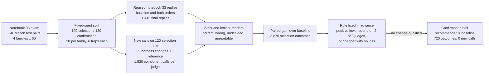
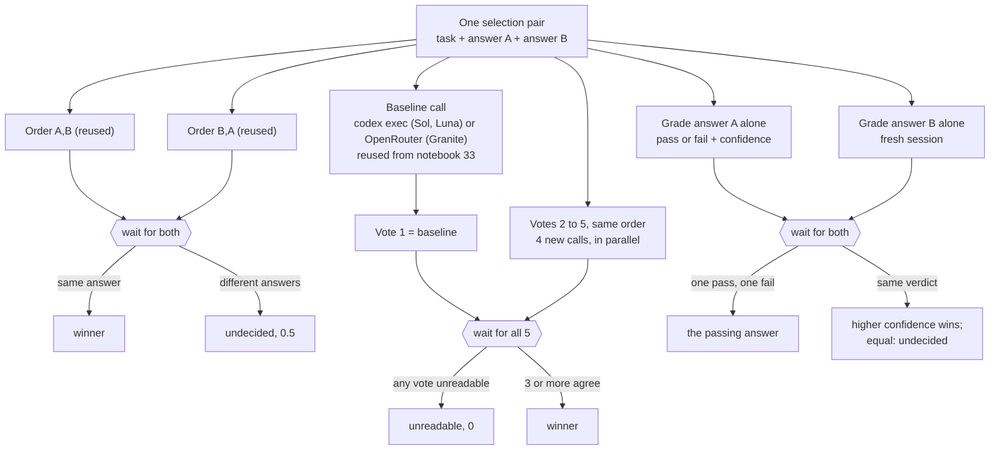
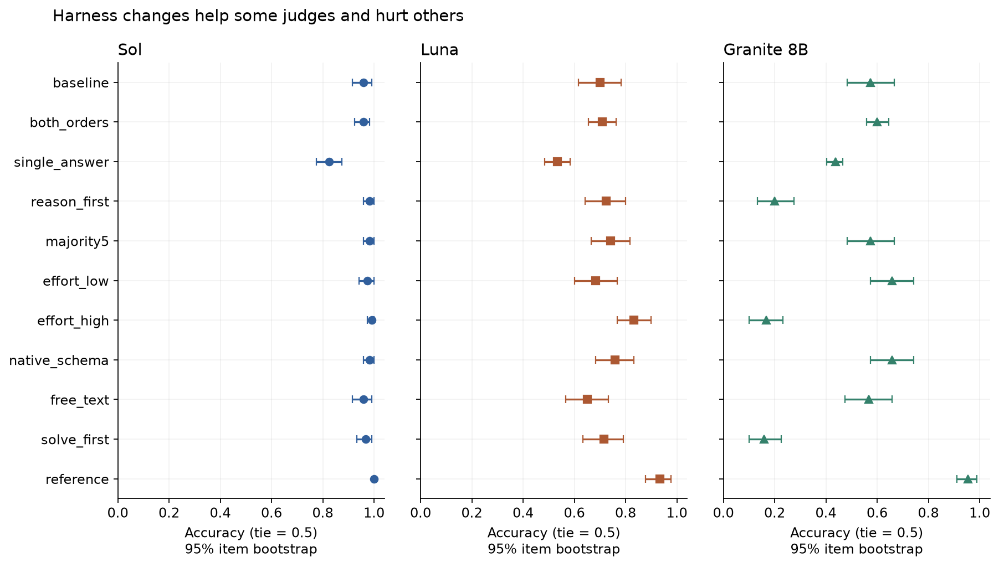
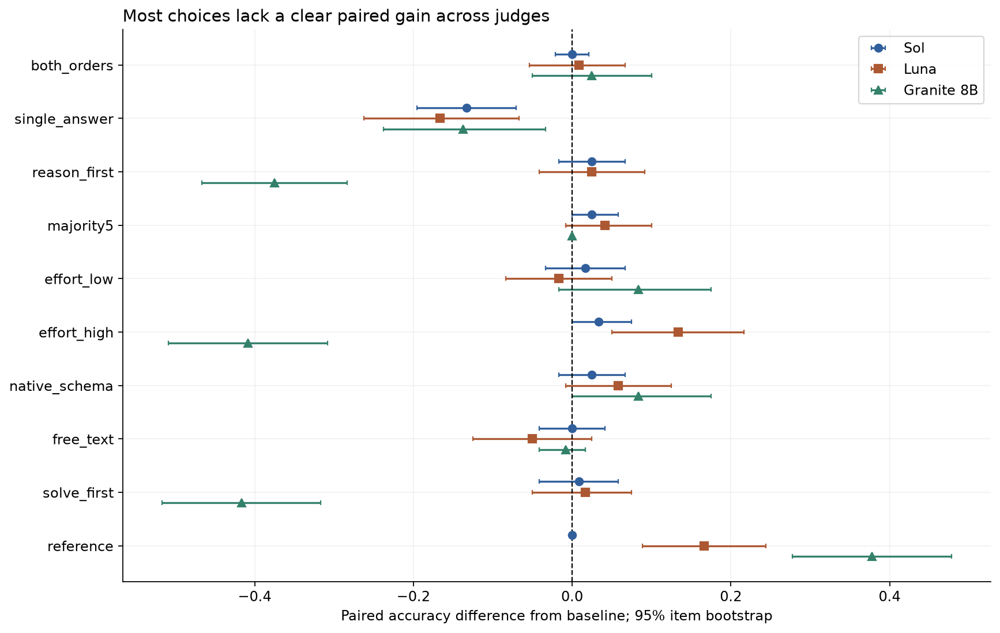
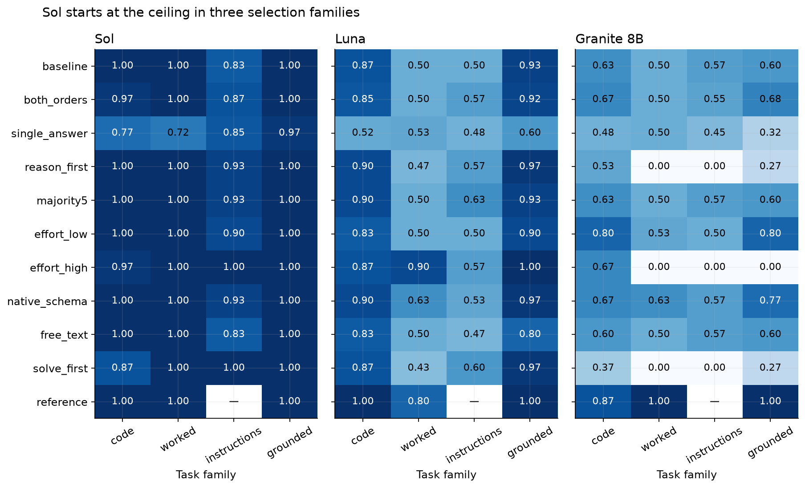
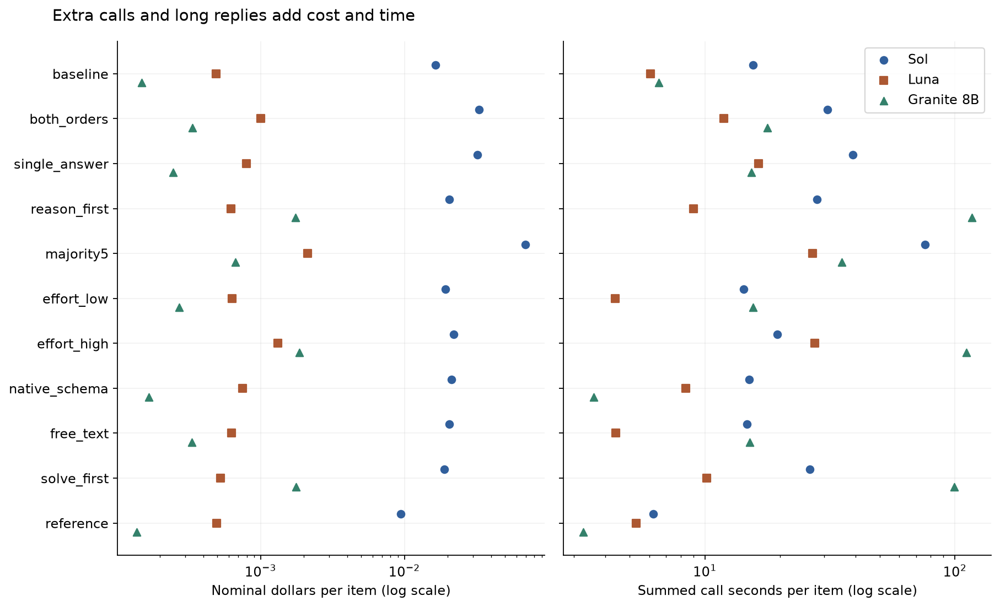
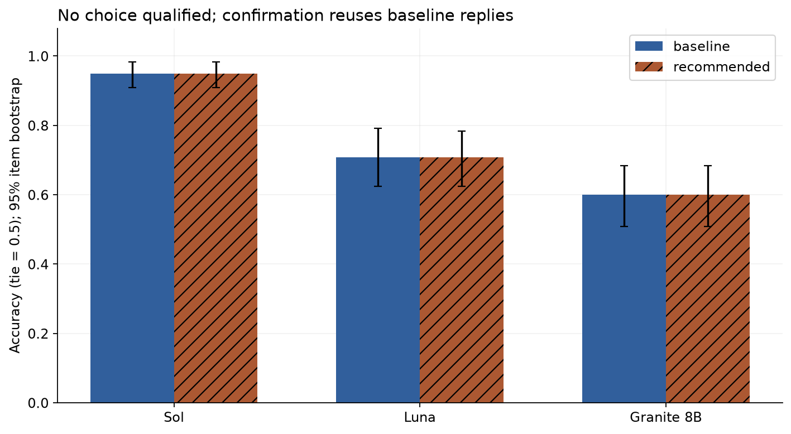
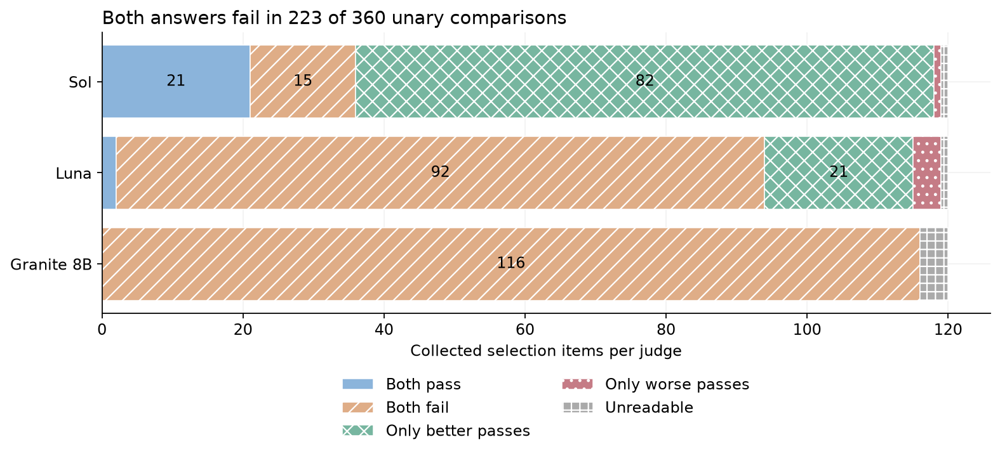

# How to build a judging harness

A team that builds an AI assistant changes it every week and has to decide whether each change made it better. A
common test gives the old and the new version the same task, puts their two answers side by side and asks which one
is better. Reading thousands of such pairs by hand is slow, so the reading is often handed to another language model.
That model gets the task and both answers and names the better one. It is called a judge.

A judge never works alone. Some program has to put the question to it, decide what the reply must look like, read the
reply, and turn it into a score. That program also decides whether to ask once or several times, in which order to
show the two answers, whether the judge may think at length first, and whether it gets an answer key. Together these
choices are the judging harness. Two teams with the same judge model can get different verdicts because their
harnesses differ.

The harness matters because it runs on every judgment and nobody checks most of them. A harness choice that adds
three points of accuracy prevents three wrong verdicts in every hundred. A choice that quietly loses verdicts, because
the program cannot read what the judge wrote, makes the judge look worse at a task it did correctly. And every extra
call per judgment multiplies the bill and the waiting time for the whole evaluation.

## A small example

Here is a made-up case, much smaller than anything in the experiment. A shop refunds an order if it is returned
within 30 days, counting day 30. Two programmers write the check. Answer 1 tests `days <= 30`; answer 2 tests
`days < 30`. They agree on every return except one made on day 30 exactly, where answer 1 refunds and answer 2 does
not. Answer 1 is right.

The simplest harness sends the task and both answers to the judge with an instruction such as "return JSON with the
winner, your confidence from 0 to 100 and a short reason". The judge replies
`{"winner": "1", "confidence": 90, "reason": "The rule includes day 30."}`. A program reads the winner, compares it
with the answer key, and records the judgment as correct.

Now add one complication. Ask again with the two answers swapped, and the judge names whichever answer it saw first,
with the same confidence. Its verdict depended on the order, not on the boundary at day 30. A person who noticed
this would want to change the harness. There are several ways to do it, and each has a price:

- Ask in both orders and accept a verdict only when the two agree. This catches order effects but doubles the calls,
  and a disagreement leaves no verdict.
- Ask five times and take the majority. This smooths out a judge that varies from one reply to the next, at five
  times the cost.
- Let the judge think longer before answering (higher "reasoning effort"), or shorter, which is cheaper.
- Ask it to write its analysis first and its verdict last, or to solve the task itself before comparing. Both give
  the judge room to work, but the reply now contains text the program must skip to find the verdict.
- Grade each answer alone, pass or fail, and compare the two grades afterwards. The judge never sees the two answers
  together, so it cannot simply spot the one place where they differ.
- Change the reply format: ask for three labelled lines of plain text, or have the provider force the reply into an
  exact JSON shape.
- Give the judge the answer key. In practice a team rarely has one, so this shows how much a key would be worth,
  not a harness most teams can use.

Some of these choices help a judge reason; others mainly change whether the program can read the verdict. One choice
can do both, in opposite directions, and help a strong judge while hurting a weak one.

## The question

Does changing one part of the judging harness make a judge pick the better answer more often than a plain baseline
prompt, for judges of different strength, and is any change worth its extra cost?

The experiment reuses the exam from notebook 33: pairs of answers where code decides which answer is better. It has
three judges: GPT-6.1 Sol (Sol), a strong judge near the top of that exam; GPT-6 Luna (Luna), a cheaper mid-range
judge; and IBM Granite 4.2 8B (Granite), a small open-weight model. The 240 test pairs were split in advance into 120
selection pairs, used to test nine single changes to the harness, and 120 confirmation pairs, kept for testing
whatever the selection half recommended. A rule written before any new judgment decided what counts as a
recommendation: a change had to raise accuracy measurably for at least two of the three judges, or be cheaper for all
three with no observed loss.

## Study summary

The measure is **accuracy**: the share of pairs where the harness named the better answer. A verdict that changes with
the order counts half (0.5), like a coin. A reply the program cannot read counts as a failure (0) and is reported apart
from wrong answers. On the selection half the baseline prompt scored 115 of 120 for Sol (95.8%), 84 for Luna (70.0%)
and 69 for Granite (57.5%).

- No change met the rule, so the baseline prompt stands. On the confirmation half it scored 114 of 120 for Sol
  (95.0%), 85 for Luna (70.8%) and 72 for Granite (60.0%). Because nothing was recommended, the confirmation half
  reuses the same baseline replies; it is not an independent test of a new harness.
- One change helped one judge measurably: high reasoning effort raised Luna from 70.0% to 83.3% (+13.3 points, 95%
  interval +5.0 to +21.7), almost all of it on long calculations (15 to 27 of 30). It raised Sol from 115 to 119 of
  120, an interval that touches zero, and it broke Granite: 100 of Granite's 120 replies were empty because hidden
  reasoning used up the token budget.
- Asking the provider to enforce the JSON shape had the largest average gain (+5.6 points across the three judges),
  but no single judge's interval excluded zero. Majority of five, both orders and low effort changed little.
- Grading each answer alone lost accuracy for every judge, by 13 to 17 points. The judges rejected both answers in 223
  of 360 comparisons, although one of the two always passes the checker.
- Analysis-first and solve-first made replies that the strict reading rule could not read at all (0 of 120 for Sol).
  The lenient rule recovered Sol and Luna, but Granite still lost 96 and 101 of 120 replies to unreadable output.
  Granite's high-effort, analysis-first and solve-first scores of 100% on readable replies cover only 19 to 24 items
  and are not wins.

For the team in the opening, the evidence supports keeping a plain one-call prompt with a JSON reply and a lenient
reader, and testing high effort per judge rather than as a general setting: it helped the mid-range judge, did little
for the strong one and broke the small one. The main caveat is that the conditions were collected at different
times, partly weeks apart and after a client software upgrade, so a small difference between conditions can include a
change in the service as well as the harness. Sol is at the ceiling on three of the four task families, so this exam
can say little about harness changes for a judge as strong as Sol.

## Contents

- [How the experiment runs](#how-the-experiment-runs)
- [The exam](#the-exam)
- [The judges](#the-judges)
- [The harness choices](#the-harness-choices)
- [How a reply becomes a score](#how-a-reply-becomes-a-score)
- [The rule for recommending a change](#the-rule-for-recommending-a-change)
- [One pair from start to finish](#one-pair-from-start-to-finish)
- [How the study got here](#how-the-study-got-here)
- [Which changes help on the selection half](#which-changes-help-on-the-selection-half)
- [Where the room for improvement is](#where-the-room-for-improvement-is)
- [What each harness costs](#what-each-harness-costs)
- [Confirmation](#confirmation)
- [Format failures and wrong answers](#format-failures-and-wrong-answers)
- [Grading one answer at a time](#grading-one-answer-at-a-time)
- [Worked cases and error analysis](#worked-cases-and-error-analysis)
- [Limitations](#limitations)
- [What to do with this](#what-to-do-with-this)
- [Reproducing the results](#reproducing-the-results)
- [Future work and further reading](#future-work-and-further-reading)

## How the experiment runs



One pair travels through this as follows. Pair `test-code-000` asks for a Python function that groups event times
into sessions, starting a new session only when the gap is greater than 8. Code from notebook 33 has already shown
that answer B is right and answer A, which uses `>= 8`, is wrong. The split puts this pair in the selection half and
fixes its display order (A first). Each judge's baseline reply comes from notebook 33's cache. Other harnesses send new
calls with the same task and answers: one for most changes, two for single-answer grading, four extra majority votes. The readers turn each reply into a verdict, the
verdicts become one outcome per pair, and the outcome is compared with B. The frozen rule then compares each change
with the baseline over all 120 selection pairs.

## The exam

Notebook 33 built the exam so that code, not another opinion, decides which answer is better. It has four families of
60 pairs:

| Family | Task | What makes the worse answer worse |
|---|---|---|
| Code | A Python function with a stated row-scanning step before a business rule | Fails 1 to 6 of 64 hidden tests |
| Worked calculation | An invoice with 26 exact steps in fractions | One wrong digit at one step, carried through the rest |
| Instructions | A team update of about 720 words with seven checkable rules | Breaks one rule, usually the exact word count by one word |
| Grounded answer | A question about a 1,912-word fictional contract register | Uses one plausible wrong entry, such as a withdrawn rate |

In 227 of the 240 pairs the worse answer is a copy of the better one with one planted edit, so a judge can find the
small place where they differ and check only that. All items were generated on 30 October 2026, after every judge's
training cutoff or release (table below), so no judge can have seen them.

This notebook copied the frozen exam files and verified their hashes against notebook 33's freeze. A fixed seed split
the 240 pairs into 120 selection and 120 confirmation pairs with 30 per family in each half and 6 of the 12 "trap"
pairs (the worse answer is longer or more polished) in each. Each pair keeps one display order for the baseline,
chosen so the better answer is shown first in exactly 15 of the 30 pairs of each family in each half. The split is in
[`data/split.csv`](data/split.csv).

## The judges

| Model | Pinned version | Provider and access | Size and precision | Settings that change output | Why included |
|---|---|---|---|---|---|
| GPT-6.1 Sol | `gpt-6.1-sol` (requested ID; training cutoff 2026-04-30) | OpenAI, `codex exec` | Not published | Reasoning effort medium (low or high in the effort conditions); no tools; empty working folder; `--output-schema` in the native-schema condition | Strong judge (95.0% in notebook 33); its errors are mainly in instructions, so a harness change has room there |
| GPT-6 Luna | `gpt-6-luna` (requested ID; training cutoff 2026-05-18) | OpenAI, `codex exec` | Not published | As for Sol | Cheaper mid-range judge (71.5% in notebook 33), below the ceiling on calculations and instructions; replaces Claude Haiku 5.5, whose provider blocked 73 of 120 instruction judgments in notebook 33 |
| Granite 4.2 8B | `ibm-granite/granite-4.2-8b-20260831`, provider CoreWeave, no fallbacks | IBM open weights (Apache-2.0), OpenRouter chat | 8.8B dense, BF16 | Reasoning off in the baseline (low or high in the effort conditions); temperature 0; 1,600 output tokens, raised to 3,200 and 6,400 on retries after a cut-off reply; JSON object mode in the baseline, JSON schema mode in the native-schema condition, no JSON mode for free text, analysis-first and solve-first | Small, cheap open-weight judge (59.4% in notebook 33), the same pin and provider as notebook 33 |

The CLI does not confirm that the requested IDs map to fixed weights. Granite has no "medium" effort, so its effort
conditions are compared with reasoning off. Sources are in [`data/models.json`](data/models.json).

## The harness choices

Each condition changes one thing from the baseline and keeps the task, the answers and the display order.

| Condition | What changes | Model calls per pair | Combined how |
|---|---|---|---|
| Baseline | The notebook 33 prompt: "Return JSON only, with exactly these fields: winner, confidence, reason" | 1 (reused) | The verdict |
| Both orders | Ask again with the answers swapped | 2 (both reused) | Agree: that answer. Disagree: undecided (0.5) |
| Majority of five | Ask five times in the same order | 5 (1 reused, 4 new) | 3 or more votes win; all 5 must be readable |
| Low effort / high effort | Reasoning effort low or high instead of medium (Granite: instead of off) | 1 | The verdict |
| Native schema | The provider or CLI enforces the JSON shape | 1 | The verdict |
| Free text | Three plain lines: `Winner:`, `Confidence:`, `Reason:` | 1 | The verdict |
| Analysis first | "Write a careful analysis first ... then finish with one JSON object" | 1 | The verdict |
| Solve first | "First work out your own solution to the task ... then compare" | 1 | The verdict |
| Single answer | Grade each answer alone: pass or fail, with confidence | 2 | Pass beats fail; same verdict: higher confidence wins; equal confidence: undecided |
| Reference | The task's answer key is added to the prompt (not for instruction pairs) | 1 | The verdict |

Exact prompts are in [`data/prompt_templates.json`](data/prompt_templates.json). The single-answer rule, including
"higher confidence wins even when both answers fail", came from the experiment brief and was fixed before any call; [Grading one answer at a time](#grading-one-answer-at-a-time) shows what it does.

The conditions that make more than one call per pair work like this. Each node is one call to the judge; no call sees
another call's reply.



A call is retried, at most three attempts, only for transport failures (rate limits, server errors) and for
OpenRouter replies cut off by the token limit, which is doubled each time; never because of what the judge answered. A usage-limit message stops the whole collector instead of being saved as a reply.

## How a reply becomes a score

Two reading rules from notebook 33 were reused unchanged. The **strict** rule accepts a reply only if the whole reply
is one JSON object with exactly the three fields. The **lenient** rule takes the first complete JSON object anywhere
in the reply and tidies case and spacing. Two adapters were written before any call for the new formats: one reads
`verdict` (pass or fail) in single-answer replies, and one reads the three labelled lines of the free-text format
(strict: only those three lines; lenient: the labelled lines anywhere). Neither rule guesses a verdict from prose. The
lenient rule is the primary one, because the analysis-first and solve-first prompts themselves ask for text before
the JSON, which the strict rule rejects by design.

Each pair ends in one of four outcomes: correct (score 1), wrong (0), undecided (0.5, when both orders or two single
grades leave no winner) or unreadable (0, when any required reply cannot be read). For example, 6 of 10 pairs right, 2 wrong, 1
undecided and 1 unreadable give accuracy (6 + 0.5) / 10 = 0.65, and 6.5 / 9 = 0.72 on readable pairs. A coin scores
0.5.

Intervals come from 5,000 bootstrap resamples of the pairs. The **paired gain** of a change is its score minus the
baseline's on the same pairs, averaged; resampling those per-pair differences gives its interval. Pairing cancels
each pair's difficulty, so it detects smaller differences than comparing two separate accuracies.

## The rule for recommending a change

The rule was written to [`data/analysis_plan.json`](data/analysis_plan.json) and hashed before the first selection
call. Using the lenient reader on the selection half, a change qualifies if:

- its paired gain has a 95% lower bound above zero for at least two of the three judges, or
- it costs no more per pair than the baseline for all three judges, strictly less for at least two, and loses no
  accuracy for any.

Qualifying changes are ranked by mean gain, then cost. At most one of each kind is combined (one aggregation:
both orders, majority or single answer; one effort; one reply format), so that the combined harness never asks for
two incompatible formats. The reference condition is reported but excluded, because a team rarely has an answer key.
If nothing qualifies, the recommended harness is the baseline, and the confirmation half scores the baseline's own
replies. The intervals used for eligibility are not adjusted for testing nine changes on three judges; the
confirmation half was meant to be the safeguard against a lucky selection result.

## One pair from start to finish

`test-code-000` is the first code pair in the selection half. The task asks for a function that first scans the rows
in their original order (computing a weight for each row, dropping some, updating a state, rotating the kept rows),
and then applies the main rule:

> Rows are integer event times. Sort and deduplicate them. A new session begins only when the gap is GREATER than 8.
> Return sessions as [first,last,count]. Empty input returns [].

Answer B passes all 64 hidden tests. Answer A is the same code with one edit, a gap test of `>= 8` instead of `> 8`,
and fails 2 of 64. Both answers count `True` and `False` as numbers in list rows, which the scan says to exclude; no
hidden test reaches that case.

Baseline, Granite, A shown first. Granite replied in 2.5 seconds for $0.0001:

```json
{"winner": "B", "confidence": 95, "reason": "Answer B correctly implements the main rule with 'gap GREATER than 8' (i.e., >8), while Answer A uses >=8, which is incorrect. All other logic matches the specification."}
```

Both readers read B. B is the better answer, so the score is 1.

Both orders, Granite. In the swapped order Granite again chose the answer shown second, with the same confidence and a
reason that again credits "Answer B" with `> 8`, although B now labels the worse code. The two orders disagree, so
the pair is undecided and scores 0.5. A correct baseline verdict turned into half a point.

Single answer, Granite. Graded alone, each answer got `"verdict": "fail"` with confidence 90. Same verdict, same
confidence: undecided, 0.5. Its reason for the better answer complains about deduplication and session tracking that
the code does correctly.

Single answer, Luna. Luna failed both answers too, but for real defects: answer A with confidence 100 ("the candidate
starts one when the gap is 8 or greater") and answer B with confidence 99 ("`isinstance(item, int)` includes `True`
and `False`"). Under the specified rule the higher confidence wins, so the harness chose A, the answer Luna was more
certain was wrong. Score 0. Luna's baseline verdict on the same pair was B, correct.

One pair, four harnesses, three different scores. The rest of the page measures how often each of these happens.

## How the study got here

Luna replaced Claude Haiku 5.5 before any call here (see the judges table). Four development pairs from notebook
33, one per family, were run through every condition before the split was used. They checked that each format could be produced and read, not how accurate it was; no item, prompt or reader
was changed because of a development reply. They already showed that the strict reader rejects almost every
analysis-first and solve-first reply (23 of 24), and that Granite at high effort often returns nothing. During
development two Granite requests hung past their time limit, so before any selection call OpenRouter requests were
moved to a separate process with a hard 210-second deadline; a timeout counts as unreadable and is not retried.

## Which changes help on the selection half

The table gives every condition for every judge on the 120 selection pairs, lenient reader. Each cell shows accuracy,
then the counts of wrong, undecided and unreadable pairs; the rest are correct. The reference row uses the 90 pairs
that have an answer key.

| Condition | Sol | Luna | Granite |
|---|---|---|---|
| Baseline | 95.8%; 5 / 0 / 0 | 70.0%; 36 / 0 / 0 | 57.5%; 51 / 0 / 0 |
| Both orders | 95.8%; 2 / 6 / 0 | 70.8%; 8 / 54 / 0 | 60.0%; 5 / 86 / 0 |
| Majority of five | 98.3%; 2 / 0 / 0 | 74.2%; 31 / 0 / 0 | 57.5%; 51 / 0 / 0 |
| Low effort | 97.5%; 3 / 0 / 0 | 68.3%; 38 / 0 / 0 | 65.8%; 38 / 0 / 3 |
| High effort | 99.2%; 1 / 0 / 0 | 83.3%; 20 / 0 / 0 | 16.7%; 0 / 0 / 100 |
| Native schema | 98.3%; 2 / 0 / 0 | 75.8%; 29 / 0 / 0 | 65.8%; 40 / 0 / 1 |
| Free text | 95.8%; 5 / 0 / 0 | 65.0%; 42 / 0 / 0 | 56.7%; 52 / 0 / 0 |
| Analysis first | 98.3%; 2 / 0 / 0 | 72.5%; 33 / 0 / 0 | 20.0%; 0 / 0 / 96 |
| Solve first | 96.7%; 0 / 0 / 4 | 71.7%; 34 / 0 / 0 | 15.8%; 0 / 0 / 101 |
| Single answer | 82.5%; 4 / 32 / 1 | 53.3%; 13 / 84 / 1 | 43.8%; 12 / 103 / 4 |
| Reference (90 pairs) | 100%; 0 / 0 / 0 | 93.3%; 6 / 0 / 0 | 95.6%; 4 / 0 / 0 |

The baseline intervals are 91.7 to 99.2% for Sol, 61.7 to 78.3% for Luna and 48.3 to 66.7% for Granite; every
interval is in [`data/summary.csv`](data/summary.csv).



Each panel is one judge. Each row is one condition; the marker is accuracy on the lenient reader with undecided pairs
at 0.5, and the bar is the 95% bootstrap interval over pairs. Compare each row with the baseline row at the top of
the same panel, not across panels: the judges start from very different places.

Nine of Sol's eleven rows sit between 95.8% and 99.2%, a few pairs apart: high effort is 4 pairs better than the baseline, majority, native schema and analysis first 3
better. The one clear drop is single answer (82.5%). Luna's panel spreads more: apart from the reference row, high effort is the only row whose
interval lies mostly to the right of the baseline's, and single answer is the clear drop. Granite's panel has three
rows near 0.2 (high effort, analysis first, solve first), each caused by unreadable replies rather than wrong
verdicts: those three rows contain no wrong answer at all. The reference row is the highest in every panel: an answer key
lifts Granite to 95.6% on the 90 pairs that have one, against 57.8% for its baseline on the same 90.

The narrow intervals for both orders and single answer come from undecided pairs, which vary less under resampling
than pairs worth 0 or 1; they are not more precise measurements.



Each marker is a condition's paired gain over the baseline
on the same pairs (circles Sol, squares Luna, triangles Granite), and the bar is its 95% interval. The dashed line is
no change. A change qualifies on accuracy only if at least two of its three bars lie wholly to the right of the line.

No row has two such bars. Luna's high-effort bar (+13.3 points, +5.0 to +21.7) is the only one wholly to the right,
from 22 pairs it corrected and 6 it broke. Sol's high-effort bar starts exactly at zero (+3.3, 0.0 to +7.5: 5
corrected, 1 broken), and so does Granite's native-schema bar (+8.3, 0.0 to +17.5: 19 corrected, 9 broken). Native
schema has the largest mean gain over the three judges, +5.6 points, but none of its three intervals excludes zero.
Majority of five has the same pattern for Sol (+2.5, 0.0 to +5.8) and a smaller one for Luna (+4.2, -0.8 to +10.0).
On the other side, single answer lies wholly to the left for all three judges (-13.3, -16.7 and -13.8 points), and
the format-heavy conditions lie far to the left for Granite (high effort -40.8, analysis first -37.5, solve first
-41.7).

No cheaper change qualified either: every condition except the excluded reference cost at least as much per pair as
the baseline for every judge. The selection rule therefore chose nothing ([`data/recommendation_eligibility.csv`](data/recommendation_eligibility.csv)).
This is a failure to meet a rule that asks for help on two judges at once, not evidence that no change helps any
judge: Luna's high-effort gain is real on this sample, it just did not carry to the other two.

Granite's majority of five equals its baseline exactly, because at temperature 0 Granite gave the same verdict in all
five votes on every one of the 120 pairs. Asking a deterministic model five times buys nothing. Sol's five votes all
agreed on 110 of 120 pairs (91.7%) and Luna's on 89 (74.2%).

## Where the room for improvement is



Each cell is one judge's accuracy for one condition on the 30 selection pairs of one family; darker is higher, and a
dash marks the instruction family under the reference condition, which has no answer key. Read along a column to see
what a change does to one family.

Sol's baseline row is 1.00 on code, calculations and grounded answers: all 90 of those pairs right. Its 5 errors are
instruction pairs (25 of 30), where the judge must count about 720 words exactly, so only there can a change help Sol: high effort and solve first both reach 30 of 30 on
instructions. High effort also broke one code pair (`test-code-053`, below), which is why its net gain is 4 and not 5.

Luna's room is in calculations and instructions, both at 15 of 30 (0.50, chance) in the baseline. High effort moved
calculations from 15 to 27 of 30 and instructions only from 15 to 17. In notebook 33, Luna and the other cheaper
judges named a calculation winner without a correct recomputation and were at chance; at high effort Luna chose the
right side on 27 of 30. Apart from the answer key (24 of 30), no other change moved Luna's calculation column above 19 of 30 (native
schema).

Granite's gains from low effort and native schema come mostly from code and grounded answers (low effort: code 19
to 24, grounded 18 to 24; native schema: grounded 18 to 23), while instructions stay near chance. The white cells in Granite's
high-effort, analysis-first and solve-first rows are families where every reply was unreadable.

The 12 trap pairs (6 per half) are too few for a separate finding; their counts are in
[`data/trap_summary.csv`](data/trap_summary.csv).

## What each harness costs



The left panel shows nominal dollars per pair and the right panel summed call seconds per pair, both on log scales.
Sol and Luna costs are list-price estimates from the token counts the CLI reports; Granite's are what OpenRouter
reported. Seconds include retries and client start-up and add up all calls, even calls that ran in parallel.

The baseline costs about $0.016 per pair for Sol, $0.00049 for Luna and $0.00015 for Granite, and takes 15.6, 6.1 and
6.5 seconds. Majority of five costs 4.2 to 4.5 times the baseline. Luna's high effort costs 2.7 times as much ($0.0013)
and takes 27.5 seconds per pair instead of 6.1: thirteen points of accuracy for about a tenth of a cent and 21 seconds
more per judgment. Granite's high effort, analysis first and solve first cost 11.8 to 12.5 times its baseline and take
100 to 117 seconds per pair, because most replies ran to the token limit three times before failing.

## Confirmation



The bars show accuracy on the 120 confirmation pairs with 95% intervals. No change qualified, so the recommended
harness is the baseline and both bars use the same cached replies: Sol 114 of 120
(95.0%), Luna 85 (70.8%), Granite 72 (60.0%), none unreadable. The paired gains are exactly zero. Their slightly different intervals are
resampling noise, not a second observation.

So the confirmation half shows only that the baseline scores about the same on fresh pairs (Sol 95.8% and 95.0%,
Luna 70.0% and 70.8%, Granite 57.5% and 60.0%). It does not test Luna's high-effort gain, which was found among 27
unadjusted judge-and-change comparisons and needs its own test on new pairs.

## Format failures and wrong answers

A judge can fail a pair by naming the worse answer or by writing something the program cannot read. The second says
more about the harness than the judge. Almost all unreadable replies here come from three causes.

Prose before the verdict. The analysis-first and solve-first prompts ask for text before the JSON. The strict reader,
which requires the whole reply to be JSON, could read 0 of 120 analysis-first replies from Sol and Granite and 1 from
Luna; for solve first, 0 from Sol and Granite and 26 from Luna. That is the reader doing what it was built to do on
a format the prompt asked for. The lenient reader, which finds the first JSON object, recovered almost all Sol and Luna
replies.

Code before the verdict. Sol's four lenient failures under solve first (`test-code-013`, `-025`, `-037`, `-049`) all
contain Sol's own Python solution, which includes a line such as `latest = {}`. The lenient reader takes that empty
`{}` as the first JSON object, finds no winner in it and reports a schema failure. All four replies end with a correct
verdict. A reader that took the last JSON object would have scored them right, but the readers were fixed before the
results and were not changed after seeing this.

Running out of tokens. Granite's 100 unreadable high-effort replies are all empty: the provider reported that the
token limit was reached, after up to three attempts at 1,600, 3,200 and 6,400 tokens, with nothing in the visible
reply. Granite's analysis-first and solve-first failures are mostly the same thing with visible text: it writes a
long analysis and is cut off before the JSON (317 of 343 analysis-first attempts ended at the limit).

The scores on readable replies show why these must be kept apart. Granite's accuracy on readable replies is 100% for
high effort (20 of 20), analysis first (24 of 24) and solve first (19 of 19), which would rank it first in those
conditions. Those few pairs are the ones where Granite happened to finish, and they are not a sample of the exam. A
harness that answers 20 of 120 questions is not better than one that answers all 120 at 57.5%.

Under the strict reader Granite's free text also falls from 56.7% to 50.8% (17 replies with extra text around the
three lines). Strict, lenient and readable-only scores for every condition are in
[`data/reader_ranking_diagnostics.csv`](data/reader_ranking_diagnostics.csv).

## Grading one answer at a time



Each bar is one judge's 120 single-answer comparisons, split by what the two separate grades were: both answers
passed, both failed, only the better one passed, only the worse one passed, or a grade was unreadable. Only the
"only better passes" segment is a clean correct result; "only worse passes" is a clean wrong one; the rest go to the
confidence tie-break.

In every pair, one answer passes the checker. A judge grading perfectly would put all 120 pairs in "only better
passes". Sol did so in 82 pairs, Luna in 21 and Granite in none. Both answers failed in 15 of Sol's pairs, 92 of
Luna's and 116 of Granite's: 223 of 360 comparisons. Granite failed both answers in every pair it could read. A possible reason, not tested
here: side by side, the two answers differ in one small place that a judge can check, while alone each answer is a
long piece of work in which the judge looks for any flaw. Luna's reason for failing the better
answer to `test-code-000` was a real flaw (booleans counted as numbers) that the hidden tests do not exercise.

When both grades agree, the specified tie-break takes the higher confidence, and when confidences are equal the pair
is undecided. Most both-fail and both-pass pairs had equal confidences, so many pairs are undecided (Sol 32, Luna
84, Granite 103). On the both-fail pairs that confidence did decide, the rule picks the answer the judge was more sure is
wrong. A check made after the results, from the cached grades with no new calls: reversing the tie-break for both-fail
pairs would raise single answer to 85.0% for Sol, 60.0% for Luna and 52.9% for Granite, still below each judge's
baseline. The loss comes from the judges failing correct answers, not from the tie-break.

## Worked cases and error analysis

The cases below were chosen by a fixed rule in the notebook: the first selection pair, in item order, showing each
kind of outcome ([`data/narrative_examples_selection.json`](data/narrative_examples_selection.json) and
[`data/worked_examples.json`](data/worked_examples.json) hold the full inputs, prompts and raw replies). How common each
behaviour is comes from the tables above.

### A calculation fixed by high effort

`test-worked-010` (Luna, selection, better answer shown second) is a 26-step invoice in exact fractions. The two
worked solutions agree until adjustment 17, "add 23 credits, then discount by 12%", where the worse solution uses a
wrong digit in the numerator and carries the error to the end. At medium effort Luna took 4.3 seconds and wrote:

```json
{"winner":"A","confidence":100,"reason":"A has the correct weighted average and adjustment values. B first diverges at adjustment 17, and its subsequent values and final fraction are incorrect."}
```

It found the right step and gave the wrong side: A here is the worse solution. At high effort Luna took 84.6 seconds
and wrote "B's adjustment 17 value correctly applies the 12% discount to adjustment 16's amount plus 23 credits ... A
diverges at adjustment 17", choosing the better solution. Score 0 became 1, at $0.0026 instead of $0.0003. This is
the most common kind of high-effort fix for Luna: 12 of its net 16 extra correct pairs are calculations.

### A strong judge argued out of a right answer

`test-code-053` (Sol, better answer shown second) is a natural code pair: two writers produced different code. The
better answer passes all hidden tests; the worse one fails 5 of 64 and counts `True` as 1 in a weight, which the task
forbids. At medium effort Sol chose the better answer with confidence 96: "A correctly excludes booleans from list-row
weights, while B counts them as integers". At high effort it chose the worse answer with confidence 72: "A crashes on
those explicitly allowed row types. B still incorrectly includes booleans ... but A cannot process the full stated
input domain." The crash Sol describes is on input types the hidden tests never send. Longer reasoning found a second
flaw and weighed it above the tested one, the same trade notebook 33 saw on three natural pairs. It is Sol's only
high-effort regression and the only condition in which Sol chose the worse answer on this pair. Its confidence, 72,
is below the 90 or more Sol stated on almost every judgment in notebook 33.

### A word count Sol miscounts

`test-instructions-008` (Sol baseline, better answer shown second) asks for exactly 723 words. The two messages differ
by one word, "shared"; the better one has 723 and the worse one 722. Sol wrote, with confidence 100: "B has exactly 723
words under the specified regex; A has 724 because it includes the extra word 'shared'." It identified the one
differing word and miscounted both totals by one. On this pair Sol was also wrong under free text and majority of
five, split under both orders, and right under the other six conditions. All five of Sol's baseline errors are
instruction pairs; across the 30 instruction pairs, high effort and solve first got all 30 right and the other
conditions 23 to 28.

### Order dependence turns into half points

`test-code-017` (Luna, both orders). With the better answer first, Luna chose it with confidence 100. With the order
swapped, it chose the other answer, also with confidence 100, writing "Neither answer correctly implements the
specification, but A is closer". The pair is undecided. Luna's both-orders verdicts disagreed on 54 of 120 pairs and
Granite's on 86 (in notebook 33 Granite chose the first-shown answer only 15.6% of the time). For these judges, asking in both orders
mostly converts right and wrong single verdicts into halves: Granite's 46 pairs moving up and 40 moving down under
both orders are all changes to or from 0.5. The harness exposes order dependence, as intended, but does not
cure it.

### Replies that did the task and still scored 0

`test-code-013` (Sol, solve first, the better answer shown first as A). Sol wrote its own solution in a code block, then: "A correctly preserves zero and negative OK values; B incorrectly skips zero values", and ended
with `{"winner":"A","confidence":100,...}`, which in this display order names the better answer. The lenient reader
stopped at `latest = {}` inside the code and scored the reply unreadable.

`test-grounded-039` (Sol, single answer). Sol's grade of the second answer is a valid JSON fail with confidence 100 and
a correct reason ("A-157 is unsigned and cannot apply"), but the CLI process then exited with a memory-allocation error
and a non-zero exit code. The reader records a transport error, so the pair is unreadable. A local client failure, not
a judging error.

`test-code-002` (Granite, high effort). The reply is empty and the provider's finish reason is the token limit, after three
attempts taking 230 seconds in all. `test-instructions-035` (Granite, native schema) shows that an enforced JSON schema
does not prevent this: the reply is a long run of tab characters until the token limit, with no verdict.

### Consistent wrong verdicts

An aggregating harness fails silently when the judge repeats a wrong verdict. The majority of five named the worse
answer on 2 pairs for Sol, 31 for Luna and 51 for Granite; both orders did so on 2, 8 and 5 pairs. These look settled
to the program, and only a different judge, a key or a person can catch them.

## Limitations

- Conditions were collected at different times. Baseline and both-orders replies are notebook 33's, from 30 October
  2026. Single answer and part of analysis first were collected the same day; the rest on 24 and 25 November, after a
  25-day pause and an upgrade of the Codex CLI (to version 0.160.1). A small difference between two conditions can
  include a change in the service or client as well as the harness. The CLI version IDs are requested pins, not
  verified fixed weights.
- Sol is at the ceiling on code, calculations and grounded answers (90 of 90 in the baseline), so its comparisons rest
  on 30 instruction pairs, and the exam cannot rank harness changes for a judge that strong.
- The selection rule found no change, so nothing was confirmed on held-out pairs. Luna's high-effort gain was found
  among 27 unadjusted comparisons and is a hypothesis for that judge, not a confirmed result.
- 227 of 240 pairs are a correct answer and a copy with one planted edit, so the exam rewards finding one small
  difference. Harness changes may behave differently on answers that differ everywhere; the 13 natural code pairs are
  too few to say. Each half has 6 trap pairs, too few for any finding about polished wrong answers.
- The reference condition has 90 pairs per judge (no key exists for instruction pairs), and in 46 of the 60 code pairs
  the better answer is an exact copy of the reference solution ([`data/reference_copy_audit.csv`](data/reference_copy_audit.csv)),
  so the reference condition partly measures matching text against a key. It is an upper bound, not a harness.
- Granite runs at temperature 0 and the CLI judges at their default sampling, so a majority of five is uninformative
  for Granite and only mildly varied for the others. Granite's format conditions also change its transport (JSON
  modes on or off), so they are not pure prompt changes.
- Correctness is what the checker says; several judges' reasons point to flaws the hidden tests do not reach.
- The single-answer tie-break picks the higher confidence even when both answers fail, as the brief specified; it
  was not changed after the results.
- Collection paused for 25 days by plan and stopped twice on Sol capacity limits; rate-limit errors were kept out
  of the outcomes. The plan, split, prompts, readers and rule were hashed before the first selection call and never
  changed; every later transport and reporting change is in [`data/PROTOCOL.md`](data/PROTOCOL.md).

## What to do with this

Keep a one-call judge with a JSON reply and a lenient reader as the default harness. None of the nine changes beat it
across judges, and several cost two to twelve times as much.

Treat reasoning effort as a per-judge setting to test, not a general improvement. High effort turned a mid-range judge
from chance to 90% on long calculations, gained a few pairs for the strong judge, and made the small judge return
nothing. Before raising effort on a small open-weight model, check that its replies still fit the token budget.

Do not grade answers one at a time to decide which of two is better: all three judges lost 13 to 17 points, mostly
by failing correct answers.

When a format asks the judge to write before its verdict, read it with a rule that expects that, and count
unreadable replies apart from wrong ones. A score on readable replies alone can hide a harness that answers a sixth of
the questions.

The open question is whether Luna's high-effort gain holds on fresh pairs, and whether a harness change helps a strong
judge on an exam that is not already at its ceiling.

## Reproducing the results

The notebook [`36_judge_harness.ipynb`](36_judge_harness.ipynb) replays every number and figure from the cached
replies in `data/` with no model calls. Install the packages in [`requirements-replay.txt`](requirements-replay.txt)
and run, from this folder, in PowerShell:

```powershell
Remove-Item Env:NB_LIVE -ErrorAction SilentlyContinue
$env:NB_PROFILE="full"
$env:MPLBACKEND="module://matplotlib_inline.backend_inline"
python -X utf8 -m nbconvert --to notebook --execute --inplace 36_judge_harness.ipynb --ExecutePreprocessor.timeout=-1
```

Replay fails if any outcome or cached reply is missing. A live run needs `NB_LIVE=1`; without `NB_PROFILE=full` it runs
a small smoke profile. It calls Sol and Luna only through `codex exec` and Granite through OpenRouter
(`OPENROUTER_API_KEY`), stops before OpenRouter spend reaches $5, and stops the whole collector on any usage-limit
message instead of retrying.

Cache layout. Every final reply and its full request is in `data/cache_imported.jsonl.gz` (7,110 records: 1,467
reused from notebook 33, including 27 earlier retries, and 5,643 collected here), keyed by a hash of the request.
New replies would go to `data/cache_requests.jsonl`; non-final records (rate-limit errors, replies after a stop) are
in `data/nonfinal_attempts.jsonl`. [`data/outcomes.csv`](data/outcomes.csv) has one row per pair, condition and judge
with every component read. The source exam files and their hashes are under `data/from_33/`.

Spend and calls. This notebook sent 6,591 requests (with retries, development and transport checks); 6,574 returned
and 17 got no reply. Of the returned requests, 931 are non-final, mostly 927 Sol replies
that were an exhausted rate-limit error. OpenRouter reported $0.87 for Granite, or $1.48 counting conservative
reservations for requests that returned no cost. The Codex CLI calls come to about $28.19 at list prices from
reported tokens (Sol $27.27, Luna $0.92); 935 CLI records reported no usage, so this is a lower bound and not a bill.
The reused notebook 33 replies are not new spend. Collection ran in four episodes totalling 10.3 hours between 30
October and 25 November 2026. The full run history, with every stop, resume and change, is in
[`data/PROTOCOL.md`](data/PROTOCOL.md).

## Future work and further reading

### Future work

- Confirm high effort for Luna. Run Luna at high effort on the 120 confirmation pairs and on a fresh draw from the
  same generator. The selection half showed +13.3 points, mostly on calculations, from an unadjusted comparison that
  the rule did not carry to confirmation.
- A harder exam for strong judges. Sol scored 90 of 90 outside instructions, so its harness comparisons rest on 30
  word-count pairs. Pairs of independently written answers, where notebook 33's strong judges dropped, would leave
  room to see whether majority, high effort or native schema help a strong judge.
- Fit the budget to the format. Rerun Granite's high-effort, analysis-first and solve-first conditions with a larger
  output budget or a cap on analysis length, and measure how many of the 96 to 101 unreadable pairs become readable
  and right.
- A reader that expects the format. Score analysis-first and solve-first replies with a reader fixed in advance to
  take the last JSON object, on new replies. Sol's four solve-first failures here were correct verdicts after code.
- Pass and fail against a reference. Grading one answer alone failed correct answers in most pairs. Test whether a
  single-answer grader does better with the answer key, which is how single-answer grading is often used in practice.

### Further reading

Links checked on 25 November 2026.

- [Judging LLM-as-a-Judge with MT-Bench and Chatbot Arena](https://arxiv.org/abs/2306.05685) (Zheng et al., 2023).
  Introduced strong models as judges of chat answers and described their position, verbosity and self-enhancement
  biases, the order effects that the both-orders condition is meant to catch.
- [Large Language Models are not Fair Evaluators](https://arxiv.org/abs/2305.17926) (Wang et al., 2023). Proposes
  evidence before the rating, averaging over both answer orders, and flagging uncertain cases for people; the first two
  are this notebook's analysis-first and both-orders conditions.
- [Self-Consistency Improves Chain of Thought Reasoning in Language Models](https://arxiv.org/abs/2203.11171) (Wang et
  al., 2022). Samples several reasoning paths and takes the most common answer, the idea behind the majority-of-five
  condition, which needs varied samples and so does nothing for a model at temperature 0.
- [Let Me Speak Freely? A Study on the Impact of Format Restrictions on Performance of Large Language Models](https://arxiv.org/abs/2408.02442)
  (Tam et al., 2024). Reports that strict output formats such as JSON can lower reasoning accuracy; here enforced JSON
  did not lower any judge's score, and the larger format effect was on whether the verdict could be read.
- [Evaluating Large Language Models at Evaluating Instruction Following](https://arxiv.org/abs/2310.07641) (Zeng et al.,
  2023). Tests prompting strategies for judges on pairs where the more polished answer ignores the instruction, the
  kind of trap pair this exam has only 12 of.
- [A Survey on LLM-as-a-Judge](https://arxiv.org/abs/2411.15594) (Gu et al., 2024). Reviews ways to make judges more
  consistent and less biased, including the prompt, aggregation and reference choices compared here.
