# Large multi-site community hospital corporation (Ontario)

`community-hospital-corp` · public hospital (acute care) · modelled on public information about Halton Healthcare (Oakville Trafalgar Memorial, Milton District and Georgetown hospitals), from its 2018/19, 2020/21 and 2021/22 annual community reports and public service listing; Ontario Health and CIHI public material for provincial rules and reporting.

A not-for-profit public hospital corporation that runs three community hospitals in a fast-growing suburban region of Ontario, with about 640 inpatient beds and an emergency department at each site. It treats about 160,000 emergency visits, 4,000 to 4,700 births and 40,000 to 45,000 surgeries a year, and runs inpatient medicine, intensive care, mental health, dialysis, chemotherapy, outpatient clinics, diagnostic imaging and a hospital laboratory. Patients do not pay for insured care: about four-fifths of its roughly $475 million to $590 million annual revenue comes from the Ontario Ministry of Health through a global budget and per-procedure funding, managed under an accountability agreement with the regional health authority (Ontario Health from 2021), with the rest from preferred accommodation, parking, retail, uninsured patients and other grants. Physicians, midwives and dentists hold privileges and bill the province directly; about 4,900 employees, most of them unionized nurses and support staff, work in clinical programs (emergency, medicine, surgery, women's and children's, mental health, diagnostics, ambulatory care and clinical support) and corporate departments (finance, people, digital health, facilities, quality). A volunteer board governs it, advised on medical matters by a Medical Advisory Committee, and it is accredited by Accreditation Canada. From 2020 to 2022 it also ran COVID-19 testing, vaccination and field hospitals.

| | |
|---|---|
| Employees | 5,911 |
| Country | Canada |
| Ownership | Not-for-profit public hospital corporation under the Ontario Public Hospitals Act, governed by a volunteer board; separate foundations raise donations. |
| Regulators | Ontario Ministry of Health, Ontario Health (formerly the Local Health Integration Network), Accreditation Canada (voluntary accreditation), Information and Privacy Commissioner of Ontario, Ontario Ministry of Labour, Regulatory colleges (CPSO, CNO and others), Canadian Institute for Health Information (mandatory data reporting) |
| Total revenue 2018/19 | 474,951,000 CAD (A) |
| Total revenue 2021/22 | 592,477,000 CAD (A) |
| Ministry of Health revenue 2021/22 | 513,519,000 CAD (A) |
| Salaries, wages and benefits 2021/22 | 413,919,000 CAD (A) |
| Hospital sites | 3 hospitals, each with an emergency department (A) |
| Inpatient beds | 639 beds (B) |
| Employed staff 2021/22 | 5,228 people (A) |
| Medical and professional staff 2021/22 | 931 physicians, dentists and midwives (A) |
| Emergency department visits 2021/22 | 161,049 visits per year (A) |
| Births 2021/22 | 4,690 births per year (A) |
| Surgeries 2021/22 | 45,256 surgeries per year (A) |
| Diagnostic imaging exams 2021/22 | 298,482 exams per year (A) |
| Laboratory tests 2021/22 | 3,220,658 tests per year (A) |

## Units

- **Executive office and board secretariat** (25 people, department): The president and CEO, vice-presidents of clinical programs, strategy, communications and the board secretariat. Sets direction and answers to the board and Ontario Health.
- **Emergency program** (560 people, site network): Runs the three emergency departments, one at each hospital, open 24 hours a day.
  - **Emergency department, large acute site** (320 people, team): The busiest emergency department, at the corporation's main acute hospital, with resuscitation, acute, ambulatory and paediatric zones.
  - **Emergency department, mid-size site** (160 people, team): Emergency department at the mid-size hospital.
  - **Emergency department, small site** (75 people, team): Emergency department at the small hospital, transferring complex patients to the main site.
- **Medicine and critical care program** (1,096 people, division): Inpatient medicine, intensive care, renal dialysis, complex continuing care and rehabilitation across the three sites.
  - **Inpatient medicine units** (790 people, team): General internal medicine, cardiology-respiratory and geriatric medicine units staffed by nurses and hospitalists.
  - **Intensive care units** (146 people, team): Level 2 and 3 intensive care at the main site and a smaller ICU at the mid-size site.
  - **Renal dialysis program** (110 people, team): In-centre hemodialysis for patients with kidney failure, run under the Ontario Renal Network funding model.
  - **Complex continuing care and rehabilitation** (50 people, team): Complex continuing care, rehabilitation and transitional beds for patients who no longer need acute care.
- **Surgical and perioperative program** (700 people, division): Operating rooms, day surgery, recovery, surgical inpatient units, medical device reprocessing, endoscopy and fracture clinic.
  - **Perioperative services** (380 people, team): Pre-admission clinic, operating rooms, post-anaesthesia care and same-day surgery.
  - **Surgical inpatient units** (200 people, team): Post-operative and surgical inpatient care.
  - **Medical device reprocessing department** (75 people, team): Cleans, inspects, packs and sterilizes surgical instruments and scopes.
  - **Endoscopy and fracture clinic** (45 people, team): Endoscopy suites and the orthopaedic fracture clinic.
- **Women's and children's program** (400 people, division): Labour and birth, postpartum and newborn care, level II neonatal care and paediatrics.
  - **Maternity (birthing and mother-baby units)** (270 people, team): Obstetrical triage, labour and delivery rooms and postpartum care.
  - **Neonatal and paediatric care** (130 people, team): Level II special care nursery and paediatric inpatient and clinic care.
- **Mental health and addictions program** (260 people, division): Inpatient psychiatry, emergency crisis assessment and outpatient mental health and addictions clinics.
  - **Inpatient psychiatry** (140 people, team): Schedule 1 inpatient psychiatric unit able to hold involuntary patients under the Mental Health Act.
  - **Emergency mental health crisis team** (30 people, team): Crisis clinicians who assess mental health patients in the emergency departments.
  - **Outpatient mental health and addictions clinics** (90 people, team): Adult, child and youth outpatient clinics and addiction services.
- **Diagnostic services** (400 people, division): Diagnostic imaging and the hospital laboratory, serving inpatients, the emergency departments and outpatients.
  - **Diagnostic imaging** (200 people, department): X-ray, CT, MRI, ultrasound, mammography, nuclear medicine and fluoroscopy at the three sites.
  - **Laboratory medicine** (200 people, department): Core chemistry and hematology, transfusion medicine, microbiology referral and anatomic pathology.
- **Clinical support services** (372 people, division): Pharmacy, allied health professions and patient flow, which every inpatient program depends on.
  - **Pharmacy** (90 people, department): Verifies and dispenses medication orders, runs unit-dose and automated dispensing cabinets, buys drugs.
  - **Allied health** (250 people, department): Physiotherapy, occupational therapy, social work, nutrition, speech-language pathology and respiratory therapy.
  - **Patient flow and bed management** (32 people, team): Assigns inpatient beds, runs daily bed meetings and manages transfers and the alternate level of care list.
- **Ambulatory and community care** (180 people, division): Outpatient specialty clinics, the systemic therapy (chemotherapy) clinic and, from 2020, COVID-19 assessment and vaccination centres.
  - **Outpatient clinics** (110 people, team): Specialty clinics such as diabetes, internal medicine, surgical follow-up and nephrology.
  - **Systemic therapy clinic** (40 people, team): Chemotherapy clinic run in partnership with the regional cancer program.
  - **COVID-19 assessment and vaccination centres** (30 people, team): Temporary testing and vaccination centres operated from 2020 to 2022, staffed largely by redeployed staff.
- **Quality, patient safety and professional practice** (60 people, department): Patient safety and risk, patient relations, infection prevention and control, privacy, accreditation and clinical education.
  - **Quality, risk and patient relations** (20 people, team): Incident management, patient relations, privacy, quality improvement plan and accreditation.
  - **Infection prevention and control** (15 people, team): Surveillance, isolation advice and outbreak management with public health.
  - **Professional practice and clinical education** (25 people, team): Clinical nurse educators and professional practice leaders.
- **Finance and supply chain** (120 people, department): Budgeting, accounting, reporting to the Ministry and Ontario Health, patient billing, procurement and materials management.
  - **Financial services and decision support** (30 people, team): General ledger, accounts payable, budgeting, decision support and statutory reporting.
  - **Supply chain** (80 people, team): Procurement, receiving, stores and distribution of supplies to clinical units.
  - **Patient accounts** (10 people, team): Bills uninsured patients, preferred accommodation, third-party payers and other provinces.
- **People and culture** (90 people, department): Human resources, labour relations, the staffing office, payroll and occupational health and safety.
  - **Human resources and labour relations** (35 people, team): Recruitment, onboarding, labour relations and HR advice to managers.
  - **Staffing office** (22 people, team): Builds nursing and support schedules and fills sick calls and vacancies shift by shift.
  - **Payroll** (15 people, team): Biweekly payroll for unionized and non-union staff.
  - **Occupational health and safety** (15 people, team): Staff immunization, injury and WSIB claims, return to work and workplace safety.
- **Digital health and information management** (233 people, department): Information technology, health information management (records and coding) and patient registration.
  - **Information technology** (80 people, team): Clinical and corporate applications, infrastructure and the service desk.
  - **Health information management** (63 people, team): Chart completion, coding and abstracting, release of information and document scanning.
  - **Patient registration and switchboard** (90 people, team): Registers emergency, inpatient and outpatient visits, validates health cards and runs switchboard.
- **Facilities and support services** (530 people, department): Environmental services, food services, portering, security, plant operations, biomedical engineering and emergency preparedness.
  - **Environmental services** (270 people, team): Cleaning of patient rooms, discharge cleans, isolation cleans and public areas.
  - **Food and nutrition services** (130 people, team): Patient meal production and tray delivery, and retail food service.
  - **Plant operations and biomedical engineering** (55 people, team): Building systems, maintenance and medical equipment servicing.
  - **Portering and security** (75 people, team): Patient transport within the hospitals and security response.
- **Medical, dental and midwifery staff** (885 people, department): Credentialed physicians, midwives and dentists who hold hospital privileges, organised in clinical departments under the chief of staff, plus the medical affairs office.
  - **Medical affairs office** (12 people, team): Credentialing, medical staff bylaws, Medical Advisory Committee support and on-call schedules.

## Demand drivers

| Driver | Per month | Unit | Evidence |
|---|---:|---|---|
| Emergency department visits | 13,000 | visits per month | A [src1], [src2], [src3] |
| Births | 360 | births per month | A [src1], [src2], [src3] |
| Surgeries | 3,700 | surgeries per month | A [src1], [src2], [src3] |
| Diagnostic imaging exams | 23,500 | exams per month | A [src1], [src2], [src3] |
| Laboratory tests | 235,000 | tests per month | A [src1], [src2], [src3] |
| Dialysis visits | 3,130 | visits per month | A [src2], [src3] |
| Oncology visits | 1,550 | visits per month | A [src2], [src3] |
| Mental health and addictions outpatient visits | 5,200 | visits per month | A [src1], [src2], [src3] |
| Fracture clinic visits | 3,000 | visits per month | A [src1], [src2], [src3] |
| Patient meals | 58,000 | meals per month | A [src1], [src2], [src3] |
| Inpatient discharges | 2,300 | discharges per month | C |
| Inpatient days | 18,500 | patient days per month | C |
| Employed staff | 4,900 | employees | A [src1], [src2], [src3] |
| COVID-19 testing centre visits (2020-2022) | 10,500 | visits per month | A [src2], [src3] |
| COVID-19 vaccine doses (2021-2022) | 11,600 | doses per month | A [src2], [src3] |
| Outpatient clinic visits (other clinics) | 20,000 | visits per month | C |

## How the core processes connect

```mermaid
flowchart LR
    subgraph g0["Emergency program"]
        p0["Receive ambulance patients and transfer care"]
        p1["Triage and register emergency patients"]
        p2["Assess, investigate and treat emergency patients"]
        p3["Obtain specialist consultations in the emergency department"]
        p4["Admit emergency patients and hold them until a bed is free"]
        p5["Discharge emergency patients home with follow-up"]
        p6["Transfer patients to and from other hospitals"]
    end
    subgraph g1["Medicine and critical care program"]
        p7["Provide daily inpatient medical and nursing care"]
        p8["Administer medications on inpatient units"]
        p9["Respond to deteriorating inpatients"]
        p10["Provide intensive care"]
        p11["Provide in-centre hemodialysis"]
        p12["Provide complex continuing care, rehabilitation and transitional care"]
        p13["Provide end-of-life care and manage deaths"]
    end
    subgraph g2["Surgical and perioperative program"]
        p14["Book elective surgery and manage the wait list"]
        p15["Assess patients before surgery"]
        p17["Perform a surgical case from admission to recovery"]
        p18["Book and perform urgent and emergency surgery"]
        p19["Provide post-operative inpatient care"]
        p21["Perform endoscopy procedures"]
        p22["Run the fracture clinic"]
    end
    subgraph g3["Women's and children's program"]
        p24["Assess pregnant patients in obstetrical triage"]
        p25["Support labour and birth"]
        p26["Provide postpartum and newborn care"]
        p27["Provide level II neonatal care"]
        p28["Provide paediatric inpatient care"]
    end
    subgraph g4["Mental health and addictions program"]
        p29["Assess mental health crises in the emergency department"]
        p30["Provide inpatient psychiatric care"]
        p31["Run outpatient mental health and addictions clinics"]
        p32["Prepare for Consent and Capacity Board hearings"]
    end
    subgraph g5["Diagnostic services"]
        p33["Collect and receive laboratory specimens"]
        p34["Run and verify laboratory tests"]
        p36["Provide blood for transfusion"]
        p37["Examine surgical and biopsy tissue"]
        p38["Book outpatient imaging"]
        p39["Perform diagnostic imaging exams"]
        p40["Read and report imaging exams"]
    end
    subgraph g6["Clinical support services"]
        p41["Assign inpatient beds and run patient flow"]
        p42["Verify and dispense medication orders"]
        p44["Assess and treat inpatients referred to allied health"]
        p45["Plan discharges and transitions from inpatient units"]
        p46["Manage patients waiting for an alternate level of care"]
    end
    subgraph g7["Ambulatory and community care"]
        p47["Receive referrals and book outpatient clinics"]
        p48["Hold outpatient specialty clinic visits"]
        p49["Give chemotherapy and systemic therapy"]
        p50["Run COVID-19 assessment centres"]
        p51["Run the COVID-19 vaccination clinic"]
    end
    x0(["Patients and families"])
    x1(["Regional paramedic service"])
    x2(["Family physicians and primary care teams"])
    x3(["Community specialist and surgeon offices"])
    x4(["Ontario Ministry of Health"])
    x5(["Ontario Health  and the Local Health Integration Network until 2021"])
    x6(["Canadian Institute for Health Information"])
    x7(["Home and community care  LHIN home care, later Home and Community Care Support Services"])
    x8(["Long-term care homes"])
    x9(["Tertiary and academic hospitals"])
    x10(["CritiCall Ontario"])
    x11(["Office of the Chief Coroner"])
    x12(["Provincial organ and tissue donation agency"])
    x13(["BORN Ontario"])
    x14(["Newborn Screening Ontario"])
    x15(["Regional public health unit"])
    x17(["Canadian Blood Services"])
    x18(["Consent and Capacity Board"])
    x36(["Police service"])
    p0 --> p1
    x1 --> p0
    p1 --> p2
    p1 --> x4
    p1 --> p24
    x0 --> p1
    p2 --> p33
    p2 --> p39
    p2 --> p42
    p2 --> p3
    p2 --> p29
    p2 --> p4
    p2 --> p5
    p2 --> p6
    p2 --> p36
    p3 --> p4
    p3 --> p5
    p3 --> p18
    p3 --> p2
    p3 --> p47
    p4 --> p41
    p4 --> p7
    p4 --> p19
    p4 --> p10
    p4 --> p30
    p4 --> p28
    p4 --> p5
    p5 --> x0
    p5 --> x2
    p5 --> p47
    p5 --> p22
    p5 --> x7
    p6 --> x10
    p6 --> x9
    p6 --> x1
    x10 --> p6
    p7 --> p33
    p7 --> p39
    p7 --> p42
    p7 --> p44
    p7 --> p45
    p7 --> p9
    p7 --> p13
    p7 --> p36
    p7 --> p18
    p7 --> p8
    x9 --> p7
    p8 --> p7
    p9 --> p10
    p10 --> p41
    p10 --> p7
    p10 --> p42
    p10 --> p6
    p10 --> p36
    p10 --> x12
    p10 --> x11
    p11 --> x5
    p11 --> p34
    p11 --> p1
    p11 --> p42
    p12 --> p45
    p13 --> x11
    p13 --> x12
    p13 --> p41
    p14 --> x5
    p14 --> p15
    x3 --> p14
    p15 --> p33
    p15 --> p17
    p17 --> p37
    p17 --> p19
    p17 --> x0
    p17 --> p36
    p17 --> p41
    p17 --> p14
    p18 --> p17
    p19 --> p42
    p19 --> p44
    p19 --> p33
    p19 --> p45
    p19 --> p36
    p21 --> p37
    x3 --> p21
    p22 --> p14
    p22 --> p39
    p22 --> x0
    p24 --> p25
    p24 --> x0
    x0 --> p24
    p25 --> p26
    p25 --> p27
    p25 --> x13
    p25 --> p36
    p26 --> x14
    p26 --> x15
    p26 --> x2
    p26 --> x0
    p27 --> p26
    p27 --> p6
    p28 --> x0
    p29 --> p4
    p29 --> p31
    p29 --> x0
    p29 --> p6
    p29 --> p5
    p29 --> x36
    p30 --> p32
    p30 --> p31
    p30 --> p42
    p30 --> x6
    p30 --> x2
    p31 --> x2
    x2 --> p31
    p32 --> x18
    p32 --> p30
    x18 --> p32
    p33 --> p34
    x2 --> p33
    p34 --> p2
    p34 --> p7
    p34 --> p19
    p34 --> x2
    p34 --> p42
    p34 --> p33
    p34 --> p10
    p36 --> p7
    p36 --> p17
    p36 --> p25
    p36 --> x17
    p36 --> p49
    p37 --> x3
    p37 --> x2
    p38 --> p39
    p38 --> x5
    x2 --> p38
    p39 --> p40
    p39 --> p38
    x2 --> p39
    p40 --> p2
    p40 --> p7
    p40 --> x2
    p40 --> x3
    p40 --> p22
    p40 --> p48
    p41 --> p4
    p41 --> p7
    p41 --> p19
    p41 --> x9
    p41 --> p0
    x9 --> p41
    p42 --> p8
    p42 --> p49
    p42 --> p10
    p44 --> p45
    p44 --> p38
    p45 --> x7
    p45 --> p46
    p45 --> x0
    p45 --> x2
    p45 --> p41
    p45 --> p47
    p46 --> p12
    p46 --> x7
    p46 --> x5
    p46 --> x8
    p47 --> p48
    p47 --> x0
    p47 --> x2
    x2 --> p47
    x3 --> p47
    p48 --> p11
    p48 --> p14
    p48 --> p33
    p48 --> p38
    p48 --> x2
    p48 --> p49
    p49 --> p42
    p49 --> x5
    p49 --> p36
    x0 --> p50
    p51 --> x0
    p51 --> x4
    x0 --> p51
```

## Process map

### Executive office and board secretariat

| Process | Owner | Type | Unit of work | Per month | Priority | Receives from | Sends to |
|---|---|---|---|---:|---:|---|---|
| **Run the board and committee cycle.** The board secretariat assembles packages for the board and its quality, finance and audit, and governance committees, executives present reports, and the board approves budgets, plans, privileges and the accountability agreement. Material prepared for the board takes executive time each month. | Executive office and board secretariat | management | one monthly board cycle | 1 | 3 | Complete the year-end audit, Ontario Health (and the Local Health Integration Network until 2021), Plan for emergencies and surges, Plan the annual operating and capital budget, Prepare for and complete accreditation, Prepare the annual quality improvement plan, Report and review patient safety incidents, Report performance under the accountability agreement, Run the Medical Advisory Committee, Set strategy and plan capacity | Appoint and reappoint medical staff, Community and media, Ontario Health (and the Local Health Integration Network until 2021), Prepare the annual quality improvement plan, Report performance under the accountability agreement, Set strategy and plan capacity |
| **Set strategy and plan capacity.** Executives refresh the multi-year strategic plan with the board, staff and community, plan capacity such as beds and redevelopment, and set annual corporate priorities that feed the budget. Planning was largely displaced by pandemic response in 2020-2021. | Executive office and board secretariat | management | one annual planning cycle | 0.083 | 3 | Run the board and committee cycle | Plan the annual operating and capital budget, Run the board and committee cycle |

### Emergency program

| Process | Owner | Type | Unit of work | Per month | Priority | Receives from | Sends to |
|---|---|---|---|---:|---:|---|---|
| **Admit emergency patients and hold them until a bed is free.** After the decision to admit, the ED requests a bed, gives admission orders and keeps caring for the patient on an ED stretcher until patient flow assigns a bed and the unit accepts report. Boarded patients occupy ED spaces and are the main cause of long ED stays. | Emergency program | core | one admission from the ED | 1,400 | 1 | Assess mental health crises in the emergency department, Assess, investigate and treat emergency patients, Assign inpatient beds and run patient flow, Obtain specialist consultations in the emergency department | Assign inpatient beds and run patient flow, Discharge emergency patients home with follow-up, Move patients within the hospitals, Provide daily inpatient medical and nursing care, Provide inpatient psychiatric care, Provide intensive care, Provide paediatric inpatient care, Provide post-operative inpatient care, Register outpatient, inpatient and diagnostic visits |
| **Assess, investigate and treat emergency patients.** An emergency physician sees the patient in order of acuity and wait, orders tests, imaging and medications, reassesses when results return and decides whether to discharge, consult, admit or transfer. Waiting for results and consultants makes up most of the visit. | Emergency program | core | one ED visit seen by a physician | 12,600 | 1 | Obtain specialist consultations in the emergency department, Read and report imaging exams, Run and verify laboratory tests, Triage and register emergency patients | Admit emergency patients and hold them until a bed is free, Assess mental health crises in the emergency department, Collect and receive laboratory specimens, Discharge emergency patients home with follow-up, Obtain specialist consultations in the emergency department, Perform diagnostic imaging exams, Provide blood for transfusion, Report and review patient safety incidents, Respond to security calls and violent incidents, Transfer patients to and from other hospitals, Verify and dispense medication orders |
| **Discharge emergency patients home with follow-up.** The physician explains the diagnosis, the nurse removes lines, gives written instructions and prescriptions and books or recommends follow-up at a clinic or with the family physician. The visit summary is faxed or sent electronically to the family physician and the chart goes to coding. | Emergency program | core | one ED discharge | 10,300 | 1 | Admit emergency patients and hold them until a bed is free, Assess mental health crises in the emergency department, Assess, investigate and treat emergency patients, Obtain specialist consultations in the emergency department | Code and abstract charts for CIHI, Family physicians and primary care teams, Home and community care (LHIN home care, later Home and Community Care Support Services), Patients and families, Receive referrals and book outpatient clinics, Run the fracture clinic, Transcribe dictations and complete charts |
| **Triage and register emergency patients.** A triage nurse takes the chief complaint and vital signs and assigns a Canadian Triage and Acuity Scale level from 1 to 5, and a registration clerk validates the health card and opens the visit. Queues build at shift change and in the evening, and acuity drift is a known error. | Emergency program | core | one ED visit | 13,000 | 1 | Patients and families, Plan for emergencies and surges, Provide in-centre hemodialysis, Receive ambulance patients and transfer care, Schedule shifts and fill sick calls | Assess pregnant patients in obstetrical triage, Assess, investigate and treat emergency patients, Ontario Ministry of Health, Schedule shifts and fill sick calls |
| **Obtain specialist consultations in the emergency department.** The emergency physician pages the on-call specialist, such as internal medicine, general surgery or orthopaedics, who comes in or advises by phone. Consultants often finish their own lists first, so the patient waits on a stretcher for hours. | Emergency program | core | one ED consultation | 1,900 | 2 | Assess, investigate and treat emergency patients | Admit emergency patients and hold them until a bed is free, Assess, investigate and treat emergency patients, Book and perform urgent and emergency surgery, Discharge emergency patients home with follow-up, Receive referrals and book outpatient clinics |
| **Receive ambulance patients and transfer care.** Paramedics bring a patient to the ambulance bay, a triage nurse takes verbal handover and triages, and the patient stays on the paramedic stretcher until an ED space and nurse are free. Offload delay ties up ambulances and is tracked by the region. | Emergency program | core | one ambulance arrival | 2,600 | 2 | Assign inpatient beds and run patient flow, Regional paramedic service, Schedule shifts and fill sick calls | Triage and register emergency patients |
| **Transfer patients to and from other hospitals.** For services not offered locally, such as cardiac catheterization, neurosurgery or high-risk neonatal care, the physician calls CritiCall Ontario, which finds an accepting hospital; the team prepares records and images and books paramedic or air transport. Finding a bed can take hours. | Emergency program | core | one outbound transfer | 60 | 3 | Assess mental health crises in the emergency department, Assess, investigate and treat emergency patients, CritiCall Ontario, Provide intensive care, Provide level II neonatal care | CritiCall Ontario, Regional paramedic service, Tertiary and academic hospitals |

### Medicine and critical care program

| Process | Owner | Type | Unit of work | Per month | Priority | Receives from | Sends to |
|---|---|---|---|---:|---:|---|---|
| **Administer medications on inpatient units.** Nurses take doses from the automated dispensing cabinet or patient drawer, scan or check the patient and drug against the electronic medication administration record, give the dose and document it. Interruptions, look-alike drugs and late doses are the common errors. | Medicine and critical care program | core | one inpatient day of medication passes | 18,500 | 1 | Change and upgrade clinical systems, Provide daily inpatient medical and nursing care, Verify and dispense medication orders | Provide daily inpatient medical and nursing care, Report and review patient safety incidents |
| **Provide daily inpatient medical and nursing care.** Hospitalists and specialists round daily, review results and write orders, and registered and practical nurses assess patients each shift, give care and document it. Most medical patients are frail older adults with several conditions, so plans change daily and length of stay grows when discharge is delayed. | Medicine and critical care program | core | one inpatient stay on a medicine unit | 1,150 | 1 | Administer medications on inpatient units, Admit emergency patients and hold them until a bed is free, Assign inpatient beds and run patient flow, Prepare and deliver patient meals, Provide blood for transfusion, Provide intensive care, Read and report imaging exams, Replenish supplies to clinical units, Run and verify laboratory tests, Schedule shifts and fill sick calls, Tertiary and academic hospitals | Administer medications on inpatient units, Assess and treat inpatients referred to allied health, Book and perform urgent and emergency surgery, Collect and receive laboratory specimens, Move patients within the hospitals, Perform diagnostic imaging exams, Plan discharges and transitions from inpatient units, Prepare and deliver patient meals, Provide blood for transfusion, Provide end-of-life care and manage deaths, Replenish supplies to clinical units, Report and review patient safety incidents, Respond to deteriorating inpatients, Schedule shifts and fill sick calls, Verify and dispense medication orders |
| **Provide in-centre hemodialysis.** Patients with kidney failure come three times a week for four-hour sessions; dialysis nurses cannulate, run and monitor the machines under nephrologist orders, and draw monthly blood work. Chair schedules are fixed, so a missed or late session pushes the whole shift. | Medicine and critical care program | core | one dialysis session | 3,130 | 2 | Hold outpatient specialty clinic visits | Clean beds after discharge, Ontario Health (and the Local Health Integration Network until 2021), Run and verify laboratory tests, Service medical equipment, Triage and register emergency patients, Verify and dispense medication orders |
| **Provide intensive care.** Intensivists and critical care nurses at one nurse to one or two patients manage ventilated and unstable patients, with respiratory therapists running ventilators. ICU beds are few and full, so new admissions depend on stepping patients down to wards that are themselves full. | Medicine and critical care program | core | one ICU admission | 150 | 2 | Admit emergency patients and hold them until a bed is free, Respond to deteriorating inpatients, Run and verify laboratory tests, Schedule shifts and fill sick calls, Verify and dispense medication orders | Assign inpatient beds and run patient flow, Office of the Chief Coroner, Provide blood for transfusion, Provide daily inpatient medical and nursing care, Provincial organ and tissue donation agency, Schedule shifts and fill sick calls, Service medical equipment, Transfer patients to and from other hospitals, Verify and dispense medication orders |
| **Provide complex continuing care, rehabilitation and transitional care.** Patients who no longer need acute care but cannot yet go home or are waiting for long-term care move to complex continuing care, rehabilitation or the regional transitional unit, where nurses and therapists work on function and the team works on discharge. Stays are long and admissions depend on beds freeing up. | Medicine and critical care program | core | one admission to complex, rehabilitation or transitional care | 60 | 3 | Manage patients waiting for an alternate level of care | Plan discharges and transitions from inpatient units |
| **Provide end-of-life care and manage deaths.** The team holds goals-of-care conversations, provides palliative symptom care, and after a death a physician or nurse pronounces, completes the death certificate, notifies the coroner when required and makes the routine call to the donation agency. Missed donation notifications are a reported quality gap. | Medicine and critical care program | core | one inpatient death | 80 | 3 | Provide daily inpatient medical and nursing care | Assign inpatient beds and run patient flow, Clean beds after discharge, Code and abstract charts for CIHI, Office of the Chief Coroner, Provincial organ and tissue donation agency |
| **Respond to deteriorating inpatients.** When a patient meets calling criteria or a nurse is worried, the critical care response team of an ICU nurse, respiratory therapist and sometimes an intensivist assesses at the bedside, stabilizes and decides on ICU transfer. Late recognition of deterioration is the main risk. | Medicine and critical care program | core | one rapid response call | 120 | 3 | Provide daily inpatient medical and nursing care | Provide intensive care |

### Surgical and perioperative program

| Process | Owner | Type | Unit of work | Per month | Priority | Receives from | Sends to |
|---|---|---|---|---:|---:|---|---|
| **Book elective surgery and manage the wait list.** The surgeon's office faxes a booking package; the booking coordinator checks it is complete, enters the case and its priority in the hospital and provincial wait time systems and offers a date within the surgeon's block. Incomplete packages and patient cancellations cause rework. | Surgical and perioperative program | core | one surgical booking | 2,150 | 1 | Community specialist and surgeon offices, Hold outpatient specialty clinic visits, Perform a surgical case from admission to recovery, Run the fracture clinic | Assess patients before surgery, Build the operating room schedule, Ontario Health (and the Local Health Integration Network until 2021), Register outpatient, inpatient and diagnostic visits |
| **Perform a surgical case from admission to recovery.** On the day of surgery the patient is admitted to same-day surgery, the OR team does the surgical safety checklist, the anesthesiologist and surgeon perform the case with OR nurses, and the patient recovers in the post-anaesthesia unit before going home or to a ward. Turnover time between cases and PACU holds set the day's throughput. Cases are operating room surgeries; endoscopies, which the annual reports include in surgeries, run through sx-endoscopy. | Surgical and perioperative program | core | one surgical case | 2,450 | 1 | Assess patients before surgery, Book and perform urgent and emergency surgery, Build the operating room schedule, Move patients within the hospitals, Provide blood for transfusion, Replenish supplies to clinical units, Reprocess surgical instruments and scopes, Schedule shifts and fill sick calls | Assign inpatient beds and run patient flow, Book elective surgery and manage the wait list, Code and abstract charts for CIHI, Examine surgical and biopsy tissue, Move patients within the hospitals, Patients and families, Provide blood for transfusion, Provide post-operative inpatient care, Replenish supplies to clinical units, Report and review patient safety incidents, Reprocess surgical instruments and scopes, Schedule shifts and fill sick calls, Service medical equipment |
| **Build the operating room schedule.** Each week the scheduler fills surgeons' allocated blocks with booked cases, checks equipment, implant and bed needs and publishes the next day's slate; daily huddles adjust for add-on cases and cancellations. Over-running lists and late starts are the main source of lost OR time. | Surgical and perioperative program | management | one weekly OR schedule | 4.3 | 2 | Book elective surgery and manage the wait list, Ramp surgery down and back up under provincial directives, Schedule shifts and fill sick calls | Community specialist and surgeon offices, Perform a surgical case from admission to recovery, Reprocess surgical instruments and scopes, Support labour and birth |
| **Reprocess surgical instruments and scopes.** Used instruments come back from the OR, are washed, inspected, assembled into trays against count sheets, sterilized and stored, with priority for the next day's cases and flash requests. Missing or wet trays delay cases and incomplete trays are a frequent incident. | Surgical and perioperative program | support | one instrument tray | 9,500 | 2 | Build the operating room schedule, Perform a surgical case from admission to recovery, Perform endoscopy procedures, Suppliers and contractors | Perform a surgical case from admission to recovery, Perform endoscopy procedures, Report and review patient safety incidents, Service medical equipment |
| **Assess patients before surgery.** Patients for inpatient or complex day surgery see a pre-admission nurse, have blood work and ECG as needed and are reviewed by an anesthesiologist, who may defer surgery until a condition is optimized. Missing results found on the day of surgery cancel cases. | Surgical and perioperative program | core | one pre-admission assessment | 950 | 3 | Book elective surgery and manage the wait list | Collect and receive laboratory specimens, Perform a surgical case from admission to recovery |
| **Book and perform urgent and emergency surgery.** Urgent cases from the ED or wards are booked on the add-on list by priority class; they go into the emergency room or bump elective cases, and night cases need the on-call team. Waits for an OR are a known cause of longer stays for hip fractures and appendicitis. | Surgical and perioperative program | core | one add-on case | 320 | 3 | Obtain specialist consultations in the emergency department, Provide daily inpatient medical and nursing care | Perform a surgical case from admission to recovery |
| **Perform endoscopy procedures.** Patients referred for colonoscopy or gastroscopy are booked, prepared and sedated, the endoscopist does the procedure with an endoscopy nurse, biopsies go to pathology and scopes go for reprocessing. Poor bowel preparation and scope availability limit throughput. | Surgical and perioperative program | core | one endoscopy procedure | 1,300 | 3 | Community specialist and surgeon offices, Reprocess surgical instruments and scopes | Code and abstract charts for CIHI, Examine surgical and biopsy tissue, Reprocess surgical instruments and scopes |
| **Provide post-operative inpatient care.** Surgical patients recover on surgical units where nurses manage pain, wounds, drains and mobility and surgeons round early before the OR. Discharge follows care pathways for common procedures such as joint replacement, and delays come from home supports and late rounds. | Surgical and perioperative program | core | one surgical inpatient stay | 580 | 3 | Admit emergency patients and hold them until a bed is free, Assign inpatient beds and run patient flow, Perform a surgical case from admission to recovery, Run and verify laboratory tests | Assess and treat inpatients referred to allied health, Collect and receive laboratory specimens, Plan discharges and transitions from inpatient units, Provide blood for transfusion, Report and review patient safety incidents, Verify and dispense medication orders |
| **Ramp surgery down and back up under provincial directives.** In 2020-2022 provincial directives paused non-urgent surgery during COVID-19 waves; the program re-prioritized the wait list, reallocated OR time and staff, and wrote recovery plans for extra funded volumes. Each restart depended on bed and staffing capacity. | Surgical and perioperative program | management | one ramp-down or recovery cycle | 0.2 | 3 | Ontario Ministry of Health | Build the operating room schedule, Ontario Health (and the Local Health Integration Network until 2021) |
| **Run the fracture clinic.** Patients sent from the ED with fractures are seen by orthopaedic surgeons with orthopaedic technologists who apply and remove casts; repeat X-rays are ordered and some patients are booked for surgery. Clinics are overbooked and depend on same-day imaging. | Surgical and perioperative program | core | one fracture clinic visit | 3,000 | 3 | Discharge emergency patients home with follow-up, Read and report imaging exams | Book elective surgery and manage the wait list, Patients and families, Perform diagnostic imaging exams |

### Women's and children's program

| Process | Owner | Type | Unit of work | Per month | Priority | Receives from | Sends to |
|---|---|---|---|---:|---:|---|---|
| **Support labour and birth.** Labour and delivery nurses care one to one in active labour, with an obstetrician, family physician or midwife attending the birth; about one in three births is a caesarean section in the obstetrical OR. The unit runs at the pace of unscheduled labour and must keep a room and team free for emergencies. | Women's and children's program | core | one birth | 360 | 1 | Assess pregnant patients in obstetrical triage, Build the operating room schedule, Provide blood for transfusion, Schedule shifts and fill sick calls | BORN Ontario, Provide blood for transfusion, Provide level II neonatal care, Provide postpartum and newborn care, Report and review patient safety incidents, Schedule shifts and fill sick calls |
| **Provide postpartum and newborn care.** Mother and baby stay together for one to two days while nurses support feeding and recovery, newborn screening and hearing tests are done, and the birth is recorded for the provincial registry. Discharge timing depends on feeding, jaundice checks and the physician's rounds. | Women's and children's program | core | one mother-newborn stay | 360 | 2 | Provide level II neonatal care, Schedule shifts and fill sick calls, Support labour and birth | Clean beds after discharge, Code and abstract charts for CIHI, Family physicians and primary care teams, Newborn Screening Ontario, Patients and families, Regional public health unit |
| **Assess pregnant patients in obstetrical triage.** Pregnant patients over about 20 weeks go straight to obstetrical triage, where a labour nurse assesses mother and fetus and a physician or midwife decides on admission in labour, observation or discharge. Volume is unpredictable and peaks at night. | Women's and children's program | core | one obstetrical triage visit | 750 | 3 | Patients and families, Triage and register emergency patients | Patients and families, Register outpatient, inpatient and diagnostic visits, Support labour and birth |
| **Provide level II neonatal care.** Premature or unwell newborns are admitted to the special care nursery for breathing support, feeding and jaundice treatment under paediatricians; babies who need level III care are transferred to a regional centre. Bassinets fill quickly and transfers wait for distant beds. | Women's and children's program | core | one nursery admission | 45 | 3 | Support labour and birth | Provide postpartum and newborn care, Transfer patients to and from other hospitals |
| **Provide paediatric inpatient care.** Children admitted from the ED with conditions such as bronchiolitis, asthma or dehydration are cared for by paediatricians and paediatric nurses, with family at the bedside. Admissions swing with respiratory virus season. | Women's and children's program | core | one paediatric admission | 120 | 3 | Admit emergency patients and hold them until a bed is free | Code and abstract charts for CIHI, Patients and families |

### Mental health and addictions program

| Process | Owner | Type | Unit of work | Per month | Priority | Receives from | Sends to |
|---|---|---|---|---:|---:|---|---|
| **Assess mental health crises in the emergency department.** After medical clearance, a crisis clinician assesses risk and needs, and the psychiatrist decides on admission, involuntary assessment under the Mental Health Act or discharge with community follow-up. Patients held on Mental Health Act forms often wait many hours in the ED for a bed. | Mental health and addictions program | core | one ED mental health assessment | 450 | 2 | Assess, investigate and treat emergency patients | Admit emergency patients and hold them until a bed is free, Discharge emergency patients home with follow-up, Patients and families, Police service, Report and review patient safety incidents, Respond to security calls and violent incidents, Run outpatient mental health and addictions clinics, Transfer patients to and from other hospitals |
| **Prepare for Consent and Capacity Board hearings.** When a patient applies to review involuntary status or a finding of incapacity, the psychiatrist prepares a summary and evidence, health records are disclosed to counsel, and the hearing is held on the unit or by video within days. Hearings take psychiatrists away from clinical work. | Mental health and addictions program | core | one hearing | 6 | 3 | Consent and Capacity Board, Provide inpatient psychiatric care, Release health records | Consent and Capacity Board, Provide inpatient psychiatric care |
| **Provide inpatient psychiatric care.** Voluntary and involuntary patients are admitted to the psychiatric unit, where psychiatrists review status and treatment, nurses provide observation and therapy, and rights advice and Consent and Capacity Board hearings follow when patients challenge their status. Discharge depends on housing and community supports. | Mental health and addictions program | core | one psychiatric admission | 110 | 3 | Admit emergency patients and hold them until a bed is free, Prepare for Consent and Capacity Board hearings | Canadian Institute for Health Information, Code and abstract charts for CIHI, Family physicians and primary care teams, Prepare for Consent and Capacity Board hearings, Report and review patient safety incidents, Respond to security calls and violent incidents, Run outpatient mental health and addictions clinics, Verify and dispense medication orders |
| **Run outpatient mental health and addictions clinics.** Referrals from family physicians, the ED and inpatient units are screened by intake, wait-listed and booked with clinicians for assessment and therapy, with psychiatrist consultation as needed. Wait lists are long and no-shows are common. | Mental health and addictions program | core | one outpatient visit | 5,200 | 3 | Assess mental health crises in the emergency department, Family physicians and primary care teams, Provide inpatient psychiatric care | Family physicians and primary care teams |

### Diagnostic services

| Process | Owner | Type | Unit of work | Per month | Priority | Receives from | Sends to |
|---|---|---|---|---:|---:|---|---|
| **Perform diagnostic imaging exams.** Technologists and sonographers check the order, position and scan the patient, adjust protocols, and send images to PACS; emergency and inpatient exams are fitted around booked outpatients. CT demand from the ED and porter availability for inpatients drive the queues. | Diagnostic services | core | one imaging exam | 23,500 | 1 | Assess, investigate and treat emergency patients, Book outpatient imaging, Family physicians and primary care teams, Move patients within the hospitals, Provide daily inpatient medical and nursing care, Register outpatient, inpatient and diagnostic visits, Run the fracture clinic | Book outpatient imaging, Move patients within the hospitals, Read and report imaging exams |
| **Read and report imaging exams.** Radiologists read studies from a worklist by priority, dictate with voice recognition and sign reports; urgent findings are phoned to the ordering physician and ED studies after hours are read on call or by remote reading. Report turnaround for outpatients can stretch to days. | Diagnostic services | core | one imaging report | 23,500 | 1 | Perform diagnostic imaging exams | Assess, investigate and treat emergency patients, Community specialist and surgeon offices, Family physicians and primary care teams, Hold outpatient specialty clinic visits, Provide daily inpatient medical and nursing care, Run the fracture clinic |
| **Run and verify laboratory tests.** Specimens are loaded on automated chemistry and hematology lines; technologists review flags, rerun or dilute samples, phone critical values and verify results, which go to the patient record and the provincial lab information system. Turnaround for ED and stat tests is the key measure. | Diagnostic services | core | one laboratory test | 235,000 | 1 | Collect and receive laboratory specimens, Provide in-centre hemodialysis | Assess, investigate and treat emergency patients, Collect and receive laboratory specimens, Family physicians and primary care teams, Prevent and control infections, Provide daily inpatient medical and nursing care, Provide intensive care, Provide post-operative inpatient care, Report and review patient safety incidents, Verify and dispense medication orders |
| **Collect and receive laboratory specimens.** Laboratory assistants draw blood on early-morning ward rounds, in the outpatient collection centre and in the ED, label tubes at the bedside and send them by pneumatic tube or porter; specimens are received, checked and accessioned. Mislabelled and haemolysed samples must be redrawn. | Diagnostic services | core | one specimen collection | 30,000 | 2 | Assess patients before surgery, Assess, investigate and treat emergency patients, Family physicians and primary care teams, Hold outpatient specialty clinic visits, Provide daily inpatient medical and nursing care, Provide post-operative inpatient care, Register outpatient, inpatient and diagnostic visits, Run and verify laboratory tests | Run and verify laboratory tests, Send out referral tests |
| **Provide blood for transfusion.** The transfusion lab performs group and screen and crossmatch, issues blood components against orders and keeps inventory with Canadian Blood Services; nurses check and administer the unit at the bedside. Wrong-blood-in-tube errors are rare but serious. | Diagnostic services | core | one blood component issued | 800 | 2 | Assess, investigate and treat emergency patients, Canadian Blood Services, Give chemotherapy and systemic therapy, Perform a surgical case from admission to recovery, Provide daily inpatient medical and nursing care, Provide intensive care, Provide post-operative inpatient care, Support labour and birth | Canadian Blood Services, Give chemotherapy and systemic therapy, Perform a surgical case from admission to recovery, Provide daily inpatient medical and nursing care, Support labour and birth |
| **Book outpatient imaging.** Faxed requisitions from family physicians and clinics are reviewed for appropriateness, protocolled by a radiologist for CT and MRI, prioritized and booked; patients get preparation instructions and MRI and CT waits are reported to the province. Incomplete requisitions and long MRI waits generate calls. | Diagnostic services | core | one outpatient imaging booking | 6,000 | 3 | Assess and treat inpatients referred to allied health, Family physicians and primary care teams, Hold outpatient specialty clinic visits, Perform diagnostic imaging exams | Ontario Health (and the Local Health Integration Network until 2021), Perform diagnostic imaging exams, Register outpatient, inpatient and diagnostic visits |
| **Examine surgical and biopsy tissue.** Tissue from the OR and endoscopy is accessioned, processed into slides and read by pathologists, who sign out reports to the surgeon and family physician. Cancer reports follow provincial synoptic reporting standards. | Diagnostic services | core | one pathology specimen | 1,800 | 3 | Perform a surgical case from admission to recovery, Perform endoscopy procedures | Community specialist and surgeon offices, Family physicians and primary care teams |
| **Send out referral tests.** Tests the hospital does not perform, including specialized microbiology and at times COVID-19 PCR, are packaged and shipped to Public Health Ontario or reference laboratories, and results are tracked and filed when they return. Lost or delayed results need chasing. | Diagnostic services | support | one referred specimen | 6,000 | 3 | Collect and receive laboratory specimens, Public Health Ontario laboratory and reference laboratories, Run COVID-19 assessment centres | Prevent and control infections, Public Health Ontario laboratory and reference laboratories |

### Clinical support services

| Process | Owner | Type | Unit of work | Per month | Priority | Receives from | Sends to |
|---|---|---|---|---:|---:|---|---|
| **Assign inpatient beds and run patient flow.** Patient flow coordinators match bed requests from the ED, OR, ICU and other hospitals to available and soon-to-be-clean beds, run twice-daily bed meetings with unit managers and open surge beds when the hospital is over capacity. Assignments wait on discharges, cleaning and isolation needs. | Clinical support services | core | one bed assignment | 3,000 | 1 | Admit emergency patients and hold them until a bed is free, Clean beds after discharge, Perform a surgical case from admission to recovery, Plan discharges and transitions from inpatient units, Plan for emergencies and surges, Prevent and control infections, Provide end-of-life care and manage deaths, Provide intensive care, Schedule shifts and fill sick calls, Tertiary and academic hospitals | Admit emergency patients and hold them until a bed is free, Clean beds after discharge, Move patients within the hospitals, Provide daily inpatient medical and nursing care, Provide post-operative inpatient care, Receive ambulance patients and transfer care, Schedule shifts and fill sick calls, Tertiary and academic hospitals |
| **Plan discharges and transitions from inpatient units.** From admission the team sets an expected discharge date; social workers and home care coordinators arrange home services or placement, the physician writes the discharge order and summary, and nurses teach the patient and family. Late-day discharges and waits for home care slow bed turnover. | Clinical support services | core | one inpatient discharge from a medicine, surgical or complex care unit | 1,700 | 1 | Assess and treat inpatients referred to allied health, Home and community care (LHIN home care, later Home and Community Care Support Services), Provide complex continuing care, rehabilitation and transitional care, Provide daily inpatient medical and nursing care, Provide post-operative inpatient care | Assign inpatient beds and run patient flow, Clean beds after discharge, Code and abstract charts for CIHI, Family physicians and primary care teams, Home and community care (LHIN home care, later Home and Community Care Support Services), Manage patients waiting for an alternate level of care, Patients and families, Receive referrals and book outpatient clinics, Transcribe dictations and complete charts |
| **Verify and dispense medication orders.** Pharmacists review each new order for dose, interactions and allergies, technicians fill unit doses, IV admixtures and cabinet refills, and pharmacists check the product before release. Order queues back up after morning rounds and admission surges. | Clinical support services | core | one medication order | 60,000 | 1 | Assess, investigate and treat emergency patients, Buy and control pharmacy drug inventory, Change and upgrade clinical systems, Give chemotherapy and systemic therapy, Provide daily inpatient medical and nursing care, Provide in-centre hemodialysis, Provide inpatient psychiatric care, Provide intensive care, Provide post-operative inpatient care, Run and verify laboratory tests | Administer medications on inpatient units, Give chemotherapy and systemic therapy, Provide intensive care |
| **Assess and treat inpatients referred to allied health.** Physiotherapists, occupational therapists, social workers, dietitians and speech-language pathologists pick up referrals from the electronic record, prioritize discharge-critical patients, assess and treat, and document recommendations. Weekend coverage is thin, so Friday referrals wait. | Clinical support services | core | one allied health referral | 5,500 | 2 | Provide daily inpatient medical and nursing care, Provide post-operative inpatient care | Book outpatient imaging, Plan discharges and transitions from inpatient units, Prepare and deliver patient meals |
| **Manage patients waiting for an alternate level of care.** When a physician designates a patient as alternate level of care, the team applies for long-term care, rehabilitation or other settings, tracks offers and moves patients to transitional beds; ALC days are reported to the province. ALC patients can occupy a large share of acute beds, which blocks admissions from the ED. | Clinical support services | core | one ALC designation | 120 | 2 | Home and community care (LHIN home care, later Home and Community Care Support Services), Long-term care homes, Plan discharges and transitions from inpatient units | Clean beds after discharge, Home and community care (LHIN home care, later Home and Community Care Support Services), Long-term care homes, Ontario Health (and the Local Health Integration Network until 2021), Provide complex continuing care, rehabilitation and transitional care |
| **Buy and control pharmacy drug inventory.** Technicians reorder drugs from the wholesaler against par levels, receive deliveries, manage shortages and recalls, and count and reconcile controlled substances in cabinets and the pharmacy vault. Drug shortages force substitutions and extra work. | Clinical support services | support | one drug order cycle | 30 | 3 | Suppliers and contractors | Pay supplier invoices, Suppliers and contractors, Verify and dispense medication orders |

### Ambulatory and community care

| Process | Owner | Type | Unit of work | Per month | Priority | Receives from | Sends to |
|---|---|---|---|---:|---:|---|---|
| **Receive referrals and book outpatient clinics.** Clinic clerks receive faxed referrals, check completeness, have the specialist triage urgency, add the patient to the wait list and book appointments and reminders. Faxes get lost or duplicated, and incomplete referrals bounce back to the referring office. | Ambulatory and community care | core | one clinic referral | 6,000 | 2 | Community specialist and surgeon offices, Discharge emergency patients home with follow-up, Family physicians and primary care teams, Obtain specialist consultations in the emergency department, Plan discharges and transitions from inpatient units | Family physicians and primary care teams, Hold outpatient specialty clinic visits, Patients and families, Register outpatient, inpatient and diagnostic visits |
| **Give chemotherapy and systemic therapy.** Oncologists from the regional cancer program order regimens, pharmacy prepares doses, and chemotherapy nurses check blood work, give treatment in chairs and monitor for reactions; activity is reported to the regional cancer program. Late blood results and pharmacy preparation time delay chair starts. | Ambulatory and community care | core | one systemic therapy visit | 1,550 | 3 | Hold outpatient specialty clinic visits, Provide blood for transfusion, Verify and dispense medication orders | Ontario Health (and the Local Health Integration Network until 2021), Provide blood for transfusion, Verify and dispense medication orders |
| **Hold outpatient specialty clinic visits.** Patients are registered, roomed by a clinic nurse and seen by the specialist, who orders tests, books follow-up or surgery and dictates a letter to the referring physician. Clinics run late when physicians come from the OR or wards. | Ambulatory and community care | core | one clinic visit | 20,000 | 3 | Read and report imaging exams, Receive referrals and book outpatient clinics, Register outpatient, inpatient and diagnostic visits | Book elective surgery and manage the wait list, Book outpatient imaging, Collect and receive laboratory specimens, Family physicians and primary care teams, Give chemotherapy and systemic therapy, Provide in-centre hemodialysis |
| **Run COVID-19 assessment centres.** From 2020 to 2022 the corporation ran three testing centres where people were screened, registered, swabbed and sent results, with specimens going to hospital and public health laboratories. Demand swung with each wave and with changing provincial eligibility rules. | Ambulatory and community care | core | one testing centre visit | 10,500 | 3 | Patients and families | Send out referral tests |
| **Run the COVID-19 vaccination clinic.** From 2021 the hospital ran a mass vaccination clinic: people booked online, were screened, vaccinated by nurses and observed for 15 minutes, and each dose was recorded in the provincial system. Supply and eligibility changed week to week. | Ambulatory and community care | core | one vaccine dose | 11,600 | 3 | Patients and families, Regional public health unit | Ontario Ministry of Health, Patients and families |

### Quality, patient safety and professional practice

| Process | Owner | Type | Unit of work | Per month | Priority | Receives from | Sends to |
|---|---|---|---|---:|---:|---|---|
| **Prevent and control infections.** Infection control practitioners review positive lab results and admissions, place and lift isolation, run surveillance for hospital-acquired infections, report diseases of public health significance and manage outbreaks with the public health unit. In 2020-2022 COVID-19 screening, testing and outbreak work multiplied the load. | Quality, patient safety and professional practice | management | one isolation case or outbreak action | 300 | 2 | Regional public health unit, Run and verify laboratory tests, Send out referral tests | Assign inpatient beds and run patient flow, Clean beds after discharge, Manage occupational health and workplace safety, Regional public health unit |
| **Report and review patient safety incidents.** Staff report incidents in the safety reporting system; managers review and follow up, risk specialists triage serious events, and critical incidents get a formal review, disclosure to the patient and reports to the Medical Advisory Committee and board quality committee. Under-reporting and slow manager follow-up are common. | Quality, patient safety and professional practice | management | one incident report | 600 | 2 | Administer medications on inpatient units, Assess mental health crises in the emergency department, Assess, investigate and treat emergency patients, Handle patient complaints and compliments, Perform a surgical case from admission to recovery, Provide daily inpatient medical and nursing care, Provide inpatient psychiatric care, Provide post-operative inpatient care, Reprocess surgical instruments and scopes, Respond to security calls and violent incidents, Run and verify laboratory tests, Support labour and birth | Change and upgrade clinical systems, Hospital liability insurer, Patients and families, Prepare the annual quality improvement plan, Run the Medical Advisory Committee, Run the board and committee cycle |
| **Handle patient complaints and compliments.** The patient relations specialist logs complaints, contacts the patient, involves the unit manager or physician leader, and responds within the policy timeline; unresolved complaints may go to the Patient Ombudsman. Complaints about waits and communication dominate. | Quality, patient safety and professional practice | management | one complaint | 70 | 3 | Patient Ombudsman, Patients and families | Manage privacy breaches, Patients and families, Report and review patient safety incidents |
| **Manage privacy breaches.** Audits of record access and staff reports reveal snooping, misdirected faxes and lost documents; the privacy officer contains the breach, notifies affected patients and reports to the privacy commissioner when required. Misdirected faxes are the most common cause. | Quality, patient safety and professional practice | management | one privacy breach | 8 | 3 | Handle patient complaints and compliments | Information and Privacy Commissioner of Ontario, Patients and families |
| **Prepare for and complete accreditation.** On a multi-year cycle the hospital completes self-assessments and staff surveys against national standards and required practices, fixes gaps, hosts surveyors and acts on follow-ups. Preparation pulls managers and educators away from operations for months. | Quality, patient safety and professional practice | management | one accreditation cycle | 0.02 | 3 | Accreditation Canada | Accreditation Canada, Run the board and committee cycle |
| **Prepare the annual quality improvement plan.** Each year the quality team selects indicators and targets using provincial priorities, consults patients and staff, gets board approval and submits and posts the plan by April 1; progress is reported to the board quality committee quarterly. Data lags make targets hard to track. | Quality, patient safety and professional practice | management | one annual plan | 0.083 | 3 | Ontario Health (and the Local Health Integration Network until 2021), Report and review patient safety incidents, Run the board and committee cycle | Ontario Health (and the Local Health Integration Network until 2021), Run the board and committee cycle |

### Finance and supply chain

| Process | Owner | Type | Unit of work | Per month | Priority | Receives from | Sends to |
|---|---|---|---|---:|---:|---|---|
| **Bill uninsured patients and third parties.** Patient accounts clerks bill uninsured and out-of-country patients, preferred accommodation, other provinces and WSIB, and chase unpaid accounts. Uninsured ED visits are hard to collect. | Finance and supply chain | support | one patient invoice | 2,500 | 3 | Register outpatient, inpatient and diagnostic visits | Close the books each month, Insurers and third-party payers, Patients and families |
| **Close the books each month.** Accountants post payroll, accounts payable, revenue and accruals, reconcile accounts, run variance reports for cost centre managers and produce monthly results for the executive and board. Payroll and supply accruals are the main sources of late adjustments. | Finance and supply chain | support | one monthly close | 1 | 3 | Bill uninsured patients and third parties, Ontario Ministry of Health, Pay supplier invoices, Run biweekly payroll | Complete the year-end audit, Plan the annual operating and capital budget, Report performance under the accountability agreement |
| **Complete the year-end audit.** After March 31 finance prepares year-end schedules, supports the external auditor's testing and drafts the financial statements, which the audit committee and board approve and the hospital publishes. Deferred grant and capital accounting take the most effort. | Finance and supply chain | management | one annual audit | 0.083 | 3 | Close the books each month, External auditor | External auditor, Run the board and committee cycle |
| **Pay supplier invoices.** AP clerks match supplier invoices to purchase orders and goods receipts in the ERP, resolve price and quantity mismatches with buyers and departments, and release payments in weekly runs. Non-PO invoices need manual approval routing. | Finance and supply chain | support | one supplier invoice | 7,000 | 3 | Buy and control pharmacy drug inventory, Replenish supplies to clinical units, Suppliers and contractors | Close the books each month, Suppliers and contractors |
| **Plan the annual operating and capital budget.** Finance builds the budget from the provincial funding letter, funded procedure volumes, wage settlements and program requests, sets capital priorities with foundation funding, and takes it to the board; the planning submission goes to the province and Ontario Health. Funding letters often arrive after the fiscal year starts. | Finance and supply chain | management | one annual budget | 0.083 | 3 | Close the books each month, Hospital foundations, Ontario Ministry of Health, Set strategy and plan capacity | Ontario Health (and the Local Health Integration Network until 2021), Run competitive procurements, Run the board and committee cycle |
| **Replenish supplies to clinical units.** Stores clerks count par levels on units, pick and deliver supplies, build OR case carts, place purchase orders and receive deliveries at the dock. Stock-outs on units lead to borrowing and urgent orders, and PPE was rationed in 2020. | Finance and supply chain | support | one replenishment order | 4,000 | 3 | Perform a surgical case from admission to recovery, Provide daily inpatient medical and nursing care, Run competitive procurements, Suppliers and contractors | Pay supplier invoices, Perform a surgical case from admission to recovery, Provide daily inpatient medical and nursing care, Run competitive procurements, Suppliers and contractors |
| **Report performance under the accountability agreement.** Each quarter finance and decision support compile the trial balance, service volumes and indicators against the hospital service accountability agreement and submit them, explaining variances. Coding completeness and late data affect the volumes reported. | Finance and supply chain | management | one quarterly report | 0.33 | 3 | Close the books each month, Code and abstract charts for CIHI, Run the board and committee cycle | Ontario Health (and the Local Health Integration Network until 2021), Run the board and committee cycle |
| **Run competitive procurements.** Buyers run competitive procurements following broader public sector rules for goods and services above set thresholds, often through a shared group purchasing organization, evaluate bids with clinical users and award contracts. Clinical product trials and evaluation committees stretch timelines. | Finance and supply chain | support | one competitive procurement | 15 | 3 | Maintain buildings and handle work orders, Plan the annual operating and capital budget, Replenish supplies to clinical units | Replenish supplies to clinical units, Suppliers and contractors |

### People and culture

| Process | Owner | Type | Unit of work | Per month | Priority | Receives from | Sends to |
|---|---|---|---|---:|---:|---|---|
| **Schedule shifts and fill sick calls.** Schedules are built for six-week periods under collective agreement rules; each day the staffing office takes sick calls and requests for extra staff, offers shifts by seniority and part-time availability and escalates to overtime or agency staff when needed. Unfilled shifts lead to closed beds or short-staffed units. | People and culture | support | one shift vacancy to fill | 4,000 | 1 | Assign inpatient beds and run patient flow, Clean beds after discharge, Manage grievances and labour relations, Manage occupational health and workplace safety, Perform a surgical case from admission to recovery, Provide daily inpatient medical and nursing care, Provide intensive care, Recruit and onboard staff, Support labour and birth, Triage and register emergency patients | Assign inpatient beds and run patient flow, Build the operating room schedule, Clean beds after discharge, Manage grievances and labour relations, Perform a surgical case from admission to recovery, Provide daily inpatient medical and nursing care, Provide intensive care, Provide postpartum and newborn care, Receive ambulance patients and transfer care, Recruit and onboard staff, Run biweekly payroll, Support labour and birth, Triage and register emergency patients |
| **Manage grievances and labour relations.** HR advisors meet union representatives on grievances about scheduling, discipline and premiums, negotiate settlements and prepare arbitration cases; central bargaining sets wages for hospital nurses and others. Wage restraint under Bill 124 (2019-2022) shaped relations. | People and culture | support | one grievance | 25 | 3 | Schedule shifts and fill sick calls, Unions (ONA, OPSEU, CUPE, SEIU and others) | Run biweekly payroll, Schedule shifts and fill sick calls, Unions (ONA, OPSEU, CUPE, SEIU and others) |
| **Manage occupational health and workplace safety.** Occupational health nurses clear new hires' immunizations, run fit testing and flu campaigns, follow up staff exposures and injuries, file WSIB reports and manage return to work. COVID-19 staff screening, testing and isolation clearance added large volumes in 2020-2022. | People and culture | support | one occupational health case | 300 | 3 | Prevent and control infections, Recruit and onboard staff, Respond to security calls and violent incidents | Ontario Ministry of Labour, Schedule shifts and fill sick calls, Workplace Safety and Insurance Board |
| **Recruit and onboard staff.** Managers raise requisitions, recruiters post jobs under collective agreement seniority rules, screen and interview candidates, run reference and police checks, and new hires get occupational health clearance and corporate and clinical orientation. Nursing vacancies grew through 2021-2022. | People and culture | support | one hire | 80 | 3 | Job and privileges applicants, Schedule shifts and fill sick calls | Manage occupational health and workplace safety, Resolve IT incidents and requests, Run biweekly payroll, Schedule shifts and fill sick calls |
| **Run biweekly payroll.** Payroll administrators import worked hours, premiums and absences from time and attendance, apply collective agreement rules and retroactive wage settlements, run the pay, remit deductions and post costs to the ledger. Premium and retro pay errors cause many queries. | People and culture | support | one biweekly pay run | 2.17 | 3 | Manage grievances and labour relations, Recruit and onboard staff, Schedule shifts and fill sick calls | Canada Revenue Agency, Close the books each month, Employees' banks |

### Digital health and information management

| Process | Owner | Type | Unit of work | Per month | Priority | Receives from | Sends to |
|---|---|---|---|---:|---:|---|---|
| **Code and abstract charts for CIHI.** After discharge, coders review the completed chart, assign diagnosis and intervention codes and abstract each inpatient stay, day surgery and ED visit for CIHI, querying physicians when documentation is unclear. Coded data drives provincial funding, so incomplete charts at month end are chased. | Digital health and information management | support | one chart abstract | 18,000 | 2 | Change and upgrade clinical systems, Discharge emergency patients home with follow-up, Perform a surgical case from admission to recovery, Perform endoscopy procedures, Plan discharges and transitions from inpatient units, Provide end-of-life care and manage deaths, Provide inpatient psychiatric care, Provide paediatric inpatient care, Provide postpartum and newborn care, Transcribe dictations and complete charts | Canadian Institute for Health Information, Report performance under the accountability agreement |
| **Register outpatient, inpatient and diagnostic visits.** Registration clerks verify identity and health card eligibility, create or update the patient record and visit, and flag uninsured patients for billing. Duplicate records and wrong patient selection are the main data quality problems. | Digital health and information management | support | one registration | 45,000 | 2 | Admit emergency patients and hold them until a bed is free, Assess pregnant patients in obstetrical triage, Book elective surgery and manage the wait list, Book outpatient imaging, Family physicians and primary care teams, Receive referrals and book outpatient clinics | Bill uninsured patients and third parties, Collect and receive laboratory specimens, Hold outpatient specialty clinic visits, Ontario Ministry of Health, Perform diagnostic imaging exams |
| **Change and upgrade clinical systems.** Analysts gather requests, configure order sets, forms and interfaces, test with clinical users, get change approval and release changes, coordinating vendor upgrades and provincial reporting changes. Testing capacity limits how many changes go live. | Digital health and information management | support | one system change | 40 | 3 | Ontario Health (and the Local Health Integration Network until 2021), Report and review patient safety incidents, Resolve IT incidents and requests | Administer medications on inpatient units, Code and abstract charts for CIHI, Software vendors, Verify and dispense medication orders |
| **Release health records.** Health records clerks log requests from patients, lawyers and insurers, confirm consent or legal authority, pull and review records and release copies within the statutory timeline. Requests involving mental health or third-party information need closer review. | Digital health and information management | support | one release request | 1,200 | 3 | Insurers and third-party payers, Patients and families | Insurers and third-party payers, Patients and families, Prepare for Consent and Capacity Board hearings |
| **Resolve IT incidents and requests.** The service desk logs calls and tickets, resets passwords, sets up access for new staff and physicians, and routes clinical system and device problems to analysts or vendors. Downtime of clinical systems triggers paper downtime procedures. | Digital health and information management | support | one IT ticket | 4,000 | 3 | Appoint and reappoint medical staff, Recruit and onboard staff, Service medical equipment | Change and upgrade clinical systems |
| **Transcribe dictations and complete charts.** Transcriptionists type or edit voice-recognized dictations of discharge summaries, consults and operative notes, which physicians then sign; paper forms are scanned into the record. Unsigned dictations hold up chart completion and coding. | Digital health and information management | support | one dictated document | 10,000 | 3 | Discharge emergency patients home with follow-up, Plan discharges and transitions from inpatient units | Code and abstract charts for CIHI, Family physicians and primary care teams |

### Facilities and support services

| Process | Owner | Type | Unit of work | Per month | Priority | Receives from | Sends to |
|---|---|---|---|---:|---:|---|---|
| **Clean beds after discharge.** When a discharge is entered, the bed board alerts environmental services; an aide strips and cleans the room, with extra steps for isolation rooms, and marks the bed clean. Evening discharges meet a smaller night crew, so beds sit dirty while the ED waits. | Facilities and support services | support | one discharge clean | 3,500 | 1 | Assign inpatient beds and run patient flow, Manage patients waiting for an alternate level of care, Plan discharges and transitions from inpatient units, Prevent and control infections, Provide end-of-life care and manage deaths, Provide in-centre hemodialysis, Provide postpartum and newborn care, Schedule shifts and fill sick calls | Assign inpatient beds and run patient flow, Maintain buildings and handle work orders, Schedule shifts and fill sick calls |
| **Maintain buildings and handle work orders.** Maintenance staff take work orders for repairs, run preventive maintenance on building systems and keep 24-hour cover for utilities, medical gases and elevators, contracting specialized work. Infection control precautions add steps for work in patient areas. | Facilities and support services | support | one work order | 2,000 | 3 | Clean beds after discharge | Run competitive procurements |
| **Move patients within the hospitals.** Porters take dispatch requests to move patients between units, imaging, the OR and discharge areas, by wheelchair or stretcher. Delays at peak hours hold up imaging and OR starts. | Facilities and support services | support | one patient move | 15,000 | 3 | Admit emergency patients and hold them until a bed is free, Assign inpatient beds and run patient flow, Perform a surgical case from admission to recovery, Perform diagnostic imaging exams, Provide daily inpatient medical and nursing care | Perform a surgical case from admission to recovery, Perform diagnostic imaging exams |
| **Plan for emergencies and surges.** The emergency preparedness coordinator maintains emergency codes and surge plans, runs drills and leads the hospital's incident management structure when a code orange, outage or pandemic surge is declared. The COVID-19 incident command ran for most of 2020-2022. | Facilities and support services | management | one plan update or activation | 2 | 3 | Ontario Ministry of Health, Regional public health unit | Assign inpatient beds and run patient flow, Run the board and committee cycle, Triage and register emergency patients |
| **Prepare and deliver patient meals.** The diet office takes diet orders and menu choices, cooks and food service workers assemble trays in the kitchen and deliver them to units three times a day. Late diet changes and missed trays after transfers are common. | Facilities and support services | support | one patient meal | 58,000 | 3 | Assess and treat inpatients referred to allied health, Provide daily inpatient medical and nursing care, Suppliers and contractors | Provide daily inpatient medical and nursing care |
| **Respond to security calls and violent incidents.** Security officers patrol, respond to calls and code whites, stand by with patients held under the Mental Health Act and report incidents. Violence against staff in the ED and mental health units is a reported workplace safety problem. | Facilities and support services | support | one security response | 250 | 3 | Assess mental health crises in the emergency department, Assess, investigate and treat emergency patients, Provide inpatient psychiatric care | Manage occupational health and workplace safety, Police service, Report and review patient safety incidents |
| **Service medical equipment.** Biomedical technologists inspect, repair and do preventive maintenance on pumps, monitors and other devices, manage vendor service for imaging equipment and report serious device incidents. Equipment out for repair is a frequent complaint on units. | Facilities and support services | support | one device work order | 1,000 | 3 | Perform a surgical case from admission to recovery, Provide in-centre hemodialysis, Provide intensive care, Reprocess surgical instruments and scopes | Health Canada, Resolve IT incidents and requests, Suppliers and contractors |

### Medical, dental and midwifery staff

| Process | Owner | Type | Unit of work | Per month | Priority | Receives from | Sends to |
|---|---|---|---|---:|---:|---|---|
| **Appoint and reappoint medical staff.** Applicants and existing physicians, midwives and dentists submit applications; the medical affairs office verifies licences, insurance and references, the department chief recommends, the credentials committee and Medical Advisory Committee review and the board grants privileges. The annual reappointment cycle creates a heavy peak. | Medical, dental and midwifery staff | management | one appointment or reappointment | 75 | 3 | Job and privileges applicants, Regulatory colleges (CPSO, CNO, CMO and others), Run the board and committee cycle | Resolve IT incidents and requests, Run the Medical Advisory Committee |
| **Run the Medical Advisory Committee.** The chief of staff chairs the monthly Medical Advisory Committee of department chiefs, which reviews credentialing, critical incident and quality reports, medical staff rules and on-call issues, and makes recommendations to the board. Agendas are long and follow-ups slow. | Medical, dental and midwifery staff | management | one monthly meeting cycle | 1 | 3 | Appoint and reappoint medical staff, Report and review patient safety incidents | Run the board and committee cycle |

## Roles

| Role | Unit | Layer | Reports to | Headcount | Loaded cost per hour |
|---|---|---|---|---:|---:|
| President and chief executive officer | Executive office and board secretariat | executive |  | 1 | 270 CAD |
| Vice-president, clinical programs and chief nursing executive | Executive office and board secretariat | executive | President and chief executive officer | 3 | 148 CAD |
| Director, strategy, planning and performance | Executive office and board secretariat | director | President and chief executive officer | 2 | 101 CAD |
| Executive assistant and board secretariat | Executive office and board secretariat | individual contributor | President and chief executive officer | 4 | 47 CAD |
| Communications and public affairs advisor | Executive office and board secretariat | individual contributor | Director, strategy, planning and performance | 5 | 61 CAD |
| Director, emergency program | Emergency program | director | Vice-president, clinical programs and chief nursing executive | 1 | 101 CAD |
| Patient care manager, emergency department | Emergency program | manager | Director, emergency program | 4 | 78 CAD |
| Emergency charge nurse | Emergency program | supervisor | Patient care manager, emergency department | 30 | 63 CAD |
| Emergency registered nurse | Emergency program | individual contributor | Emergency charge nurse | 380 | 61 CAD |
| Emergency registered practical nurse | Emergency program | individual contributor | Emergency charge nurse | 30 | 40 CAD |
| Emergency unit clerk | Emergency program | individual contributor | Patient care manager, emergency department | 35 | 35 CAD |
| Emergency patient care assistant | Emergency program | individual contributor | Emergency charge nurse | 23 | 31 CAD |
| Director, medicine and critical care | Medicine and critical care program | director | Vice-president, clinical programs and chief nursing executive | 2 | 101 CAD |
| Patient care manager, inpatient unit | Medicine and critical care program | manager | Director, medicine and critical care | 12 | 78 CAD |
| Inpatient registered nurse | Inpatient medicine units | individual contributor | Patient care manager, inpatient unit | 412 | 61 CAD |
| Inpatient registered practical nurse | Inpatient medicine units | individual contributor | Patient care manager, inpatient unit | 220 | 40 CAD |
| Personal support worker | Inpatient medicine units | individual contributor | Patient care manager, inpatient unit | 90 | 30 CAD |
| Inpatient unit clerk | Inpatient medicine units | individual contributor | Patient care manager, inpatient unit | 50 | 35 CAD |
| Critical care registered nurse | Intensive care units | individual contributor | Patient care manager, inpatient unit | 140 | 63 CAD |
| Hemodialysis nurse | Renal dialysis program | individual contributor | Patient care manager, inpatient unit | 70 | 62 CAD |
| Dialysis technologist | Renal dialysis program | individual contributor | Patient care manager, inpatient unit | 8 | 40 CAD |
| Director, surgical and perioperative services | Surgical and perioperative program | director | Vice-president, clinical programs and chief nursing executive | 1 | 101 CAD |
| Patient care manager, perioperative or surgical unit | Surgical and perioperative program | manager | Director, surgical and perioperative services | 8 | 78 CAD |
| Perioperative registered nurse | Perioperative services | individual contributor | Patient care manager, perioperative or surgical unit | 150 | 62 CAD |
| Recovery room and day surgery nurse | Perioperative services | individual contributor | Patient care manager, perioperative or surgical unit | 90 | 62 CAD |
| Pre-admission clinic nurse | Perioperative services | individual contributor | Patient care manager, perioperative or surgical unit | 12 | 61 CAD |
| Operating room attendant | Perioperative services | individual contributor | Patient care manager, perioperative or surgical unit | 30 | 31 CAD |
| Surgical booking and wait-list coordinator | Perioperative services | individual contributor | Patient care manager, perioperative or surgical unit | 11 | 36 CAD |
| Operating room scheduler | Perioperative services | individual contributor | Patient care manager, perioperative or surgical unit | 4 | 38 CAD |
| Surgical inpatient registered nurse | Surgical inpatient units | individual contributor | Patient care manager, perioperative or surgical unit | 120 | 61 CAD |
| Surgical inpatient registered practical nurse | Surgical inpatient units | individual contributor | Patient care manager, perioperative or surgical unit | 50 | 40 CAD |
| Medical device reprocessing technician | Medical device reprocessing department | individual contributor | Patient care manager, perioperative or surgical unit | 60 | 34 CAD |
| Endoscopy nurse | Endoscopy and fracture clinic | individual contributor | Patient care manager, perioperative or surgical unit | 25 | 61 CAD |
| Orthopaedic technologist | Endoscopy and fracture clinic | individual contributor | Patient care manager, perioperative or surgical unit | 8 | 40 CAD |
| Director, women's and children's program | Women's and children's program | director | Vice-president, clinical programs and chief nursing executive | 1 | 101 CAD |
| Patient care manager, maternity or paediatrics | Women's and children's program | manager | Director, women's and children's program | 5 | 78 CAD |
| Labour and delivery nurse | Maternity (birthing and mother-baby units) | individual contributor | Patient care manager, maternity or paediatrics | 110 | 62 CAD |
| Mother-baby (postpartum) nurse | Maternity (birthing and mother-baby units) | individual contributor | Patient care manager, maternity or paediatrics | 100 | 61 CAD |
| Lactation consultant | Maternity (birthing and mother-baby units) | senior specialist | Patient care manager, maternity or paediatrics | 6 | 62 CAD |
| Neonatal registered nurse | Neonatal and paediatric care | individual contributor | Patient care manager, maternity or paediatrics | 60 | 62 CAD |
| Paediatric registered nurse | Neonatal and paediatric care | individual contributor | Patient care manager, maternity or paediatrics | 50 | 61 CAD |
| Maternity and paediatric unit clerk | Women's and children's program | individual contributor | Patient care manager, maternity or paediatrics | 15 | 35 CAD |
| Director, mental health and addictions | Mental health and addictions program | director | Vice-president, clinical programs and chief nursing executive | 1 | 101 CAD |
| Manager, mental health services | Mental health and addictions program | manager | Director, mental health and addictions | 5 | 78 CAD |
| Mental health registered nurse | Inpatient psychiatry | individual contributor | Manager, mental health services | 90 | 61 CAD |
| Mental health registered practical nurse | Inpatient psychiatry | individual contributor | Manager, mental health services | 25 | 40 CAD |
| Emergency mental health crisis clinician | Emergency mental health crisis team | individual contributor | Manager, mental health services | 25 | 59 CAD |
| Outpatient mental health and addictions clinician | Outpatient mental health and addictions clinics | individual contributor | Manager, mental health services | 70 | 59 CAD |
| Mental health intake and booking clerk | Outpatient mental health and addictions clinics | individual contributor | Manager, mental health services | 10 | 35 CAD |
| Director, diagnostic services | Diagnostic services | director | Vice-president, clinical programs and chief nursing executive | 1 | 101 CAD |
| Manager, diagnostic imaging | Diagnostic imaging | manager | Director, diagnostic services | 4 | 78 CAD |
| Medical radiation technologist | Diagnostic imaging | individual contributor | Manager, diagnostic imaging | 95 | 59 CAD |
| Diagnostic medical sonographer | Diagnostic imaging | individual contributor | Manager, diagnostic imaging | 45 | 61 CAD |
| Nuclear medicine technologist | Diagnostic imaging | individual contributor | Manager, diagnostic imaging | 10 | 61 CAD |
| Diagnostic imaging booking and reception clerk | Diagnostic imaging | individual contributor | Manager, diagnostic imaging | 30 | 35 CAD |
| Manager, laboratory medicine | Laboratory medicine | manager | Director, diagnostic services | 4 | 78 CAD |
| Medical laboratory technologist | Laboratory medicine | individual contributor | Manager, laboratory medicine | 100 | 58 CAD |
| Medical laboratory assistant (phlebotomy and specimen processing) | Laboratory medicine | individual contributor | Manager, laboratory medicine | 75 | 34 CAD |
| Director, clinical support services | Clinical support services | director | Vice-president, clinical programs and chief nursing executive | 1 | 101 CAD |
| Pharmacy manager | Pharmacy | manager | Director, clinical support services | 2 | 89 CAD |
| Hospital pharmacist | Pharmacy | senior specialist | Pharmacy manager | 35 | 81 CAD |
| Pharmacy technician | Pharmacy | individual contributor | Pharmacy manager | 50 | 38 CAD |
| Manager, allied health | Allied health | manager | Director, clinical support services | 3 | 78 CAD |
| Physiotherapist | Allied health | individual contributor | Manager, allied health | 55 | 61 CAD |
| Occupational therapist | Allied health | individual contributor | Manager, allied health | 35 | 61 CAD |
| Hospital social worker | Allied health | individual contributor | Manager, allied health | 35 | 58 CAD |
| Clinical dietitian | Allied health | individual contributor | Manager, allied health | 20 | 58 CAD |
| Speech-language pathologist | Allied health | individual contributor | Manager, allied health | 8 | 61 CAD |
| Respiratory therapist | Allied health | individual contributor | Manager, allied health | 55 | 55 CAD |
| Manager, patient flow | Patient flow and bed management | manager | Director, clinical support services | 1 | 84 CAD |
| Patient flow coordinator (bed allocation) | Patient flow and bed management | senior specialist | Manager, patient flow | 17 | 63 CAD |
| Clinical administrator (evenings, nights and weekends) | Patient flow and bed management | supervisor | Manager, patient flow | 6 | 68 CAD |
| Director, ambulatory and community care | Ambulatory and community care | director | Vice-president, clinical programs and chief nursing executive | 1 | 101 CAD |
| Manager, ambulatory clinics | Ambulatory and community care | manager | Director, ambulatory and community care | 4 | 78 CAD |
| Ambulatory clinic nurse | Outpatient clinics | individual contributor | Manager, ambulatory clinics | 40 | 61 CAD |
| Clinic booking clerk / medical secretary | Outpatient clinics | individual contributor | Manager, ambulatory clinics | 45 | 35 CAD |
| Systemic therapy (chemotherapy) nurse | Systemic therapy clinic | individual contributor | Manager, ambulatory clinics | 25 | 62 CAD |
| Assessment and vaccination centre clinician (RPN or swabber) | COVID-19 assessment and vaccination centres | individual contributor | Manager, ambulatory clinics | 30 | 40 CAD |
| Director, quality, risk and patient experience | Quality, patient safety and professional practice | director | Vice-president, clinical programs and chief nursing executive | 1 | 101 CAD |
| Quality and patient safety specialist | Quality, risk and patient relations | senior specialist | Director, quality, risk and patient experience | 8 | 68 CAD |
| Patient relations specialist | Quality, risk and patient relations | individual contributor | Director, quality, risk and patient experience | 3 | 59 CAD |
| Privacy officer | Quality, risk and patient relations | senior specialist | Director, quality, risk and patient experience | 2 | 68 CAD |
| Infection prevention and control practitioner | Infection prevention and control | senior specialist | Director, quality, risk and patient experience | 12 | 63 CAD |
| Clinical nurse educator | Professional practice and clinical education | senior specialist | Director, quality, risk and patient experience | 20 | 63 CAD |
| Vice-president corporate services and chief financial officer | Finance and supply chain | executive | President and chief executive officer | 1 | 162 CAD |
| Controller / manager, financial services | Financial services and decision support | manager | Vice-president corporate services and chief financial officer | 3 | 85 CAD |
| Financial accountant / analyst | Financial services and decision support | individual contributor | Controller / manager, financial services | 10 | 58 CAD |
| Decision support analyst | Financial services and decision support | individual contributor | Controller / manager, financial services | 6 | 58 CAD |
| Accounts payable clerk | Financial services and decision support | individual contributor | Controller / manager, financial services | 8 | 35 CAD |
| Manager, supply chain | Supply chain | manager | Vice-president corporate services and chief financial officer | 2 | 78 CAD |
| Procurement officer / buyer | Supply chain | individual contributor | Manager, supply chain | 10 | 47 CAD |
| Stores and distribution clerk | Supply chain | individual contributor | Manager, supply chain | 40 | 32 CAD |
| Patient accounts clerk | Patient accounts | individual contributor | Controller / manager, financial services | 5 | 35 CAD |
| Vice-president, people and culture | People and culture | executive | President and chief executive officer | 1 | 148 CAD |
| Manager, human resources | People and culture | manager | Vice-president, people and culture | 4 | 78 CAD |
| HR business partner / labour relations advisor | Human resources and labour relations | senior specialist | Manager, human resources | 10 | 61 CAD |
| Talent acquisition specialist | Human resources and labour relations | individual contributor | Manager, human resources | 8 | 50 CAD |
| Staffing and scheduling clerk | Staffing office | individual contributor | Manager, human resources | 20 | 35 CAD |
| Payroll administrator | Payroll | individual contributor | Manager, human resources | 12 | 40 CAD |
| Occupational health nurse | Occupational health and safety | senior specialist | Manager, human resources | 8 | 61 CAD |
| Chief information officer | Digital health and information management | executive | Vice-president corporate services and chief financial officer | 1 | 132 CAD |
| Manager, information technology | Information technology | manager | Chief information officer | 4 | 84 CAD |
| Clinical and corporate application analyst | Information technology | individual contributor | Manager, information technology | 30 | 61 CAD |
| Service desk and desktop support technician | Information technology | individual contributor | Manager, information technology | 25 | 42 CAD |
| Manager, health information management | Health information management | manager | Chief information officer | 3 | 76 CAD |
| Health information coder and abstractor | Health information management | individual contributor | Manager, health information management | 30 | 45 CAD |
| Health records clerk (release of information, scanning) | Health information management | individual contributor | Manager, health information management | 22 | 34 CAD |
| Medical transcriptionist | Health information management | individual contributor | Manager, health information management | 8 | 36 CAD |
| Patient registration clerk | Patient registration and switchboard | individual contributor | Manager, health information management | 75 | 34 CAD |
| Director, facilities and support services | Facilities and support services | director | Vice-president corporate services and chief financial officer | 1 | 101 CAD |
| Manager, support services (environmental, food, plant, security) | Facilities and support services | manager | Director, facilities and support services | 6 | 76 CAD |
| Environmental services supervisor | Environmental services | supervisor | Manager, support services (environmental, food, plant, security) | 10 | 43 CAD |
| Environmental services aide | Environmental services | individual contributor | Environmental services supervisor | 250 | 30 CAD |
| Food service worker | Food and nutrition services | individual contributor | Manager, support services (environmental, food, plant, security) | 100 | 28 CAD |
| Cook | Food and nutrition services | individual contributor | Manager, support services (environmental, food, plant, security) | 15 | 31 CAD |
| Diet technician / diet office clerk | Food and nutrition services | individual contributor | Manager, support services (environmental, food, plant, security) | 8 | 35 CAD |
| Building operator / maintenance tradesperson | Plant operations and biomedical engineering | individual contributor | Manager, support services (environmental, food, plant, security) | 35 | 50 CAD |
| Biomedical engineering technologist | Plant operations and biomedical engineering | individual contributor | Manager, support services (environmental, food, plant, security) | 12 | 51 CAD |
| Patient porter | Portering and security | individual contributor | Manager, support services (environmental, food, plant, security) | 50 | 30 CAD |
| Security officer | Portering and security | individual contributor | Manager, support services (environmental, food, plant, security) | 25 | 31 CAD |
| Emergency preparedness coordinator | Facilities and support services | senior specialist | Director, facilities and support services | 1 | 63 CAD |
| Chief of staff | Medical, dental and midwifery staff | executive |  | 1 | 230 CAD |
| Department chief / medical director | Medical, dental and midwifery staff | director | Chief of staff | 12 | 210 CAD |
| Emergency physician | Medical, dental and midwifery staff | senior specialist | Department chief / medical director | 80 | 185 CAD |
| Hospitalist physician | Medical, dental and midwifery staff | senior specialist | Department chief / medical director | 42 | 160 CAD |
| Intensivist | Medical, dental and midwifery staff | senior specialist | Department chief / medical director | 10 | 210 CAD |
| Consultant specialist (internal medicine, cardiology, nephrology, oncology and others) | Medical, dental and midwifery staff | senior specialist | Department chief / medical director | 119 | 200 CAD |
| Surgeon | Medical, dental and midwifery staff | senior specialist | Department chief / medical director | 90 | 240 CAD |
| Anesthesiologist | Medical, dental and midwifery staff | senior specialist | Department chief / medical director | 40 | 220 CAD |
| Obstetrician-gynaecologist | Medical, dental and midwifery staff | senior specialist | Department chief / medical director | 30 | 215 CAD |
| Registered midwife | Medical, dental and midwifery staff | senior specialist | Department chief / medical director | 35 | 70 CAD |
| Paediatrician | Medical, dental and midwifery staff | senior specialist | Department chief / medical director | 25 | 185 CAD |
| Psychiatrist | Medical, dental and midwifery staff | senior specialist | Department chief / medical director | 25 | 195 CAD |
| Radiologist | Medical, dental and midwifery staff | senior specialist | Department chief / medical director | 30 | 280 CAD |
| Pathologist | Medical, dental and midwifery staff | senior specialist | Department chief / medical director | 6 | 220 CAD |
| Family physician with hospital privileges | Medical, dental and midwifery staff | senior specialist | Department chief / medical director | 230 | 140 CAD |
| Medical affairs and credentialing coordinator | Medical affairs office | individual contributor | Chief of staff | 4 | 43 CAD |
| Patient care coordinator / discharge planner (RN) | Patient flow and bed management | senior specialist | Manager, patient flow | 8 | 63 CAD |
| Rehabilitation assistant (physiotherapy and occupational therapy assistant) | Allied health | individual contributor | Manager, allied health | 14 | 36 CAD |
| Dialysis unit assistant | Renal dialysis program | individual contributor | Patient care manager, inpatient unit | 6 | 31 CAD |
| ICU charge nurse | Intensive care units | supervisor | Patient care manager, inpatient unit | 6 | 63 CAD |
| Inpatient charge nurse (medicine) | Inpatient medicine units | supervisor | Patient care manager, inpatient unit | 18 | 63 CAD |
| IPAC physician lead (infectious diseases physician or medical microbiologist) | Medical, dental and midwifery staff | senior specialist | Department chief / medical director | 1 | 210 CAD |
| Infant hearing screener | Maternity (birthing and mother-baby units) | individual contributor | Patient care manager, maternity or paediatrics | 2 | 36 CAD |

## Systems

- **Hospital information system (electronic patient record with ADT, order entry, results, eMAR and clinical documentation)** (system of record)
- **Emergency department tracking board** (workflow)
- **Electronic bed board and patient flow dashboard** (workflow)
- **Operating room scheduling and perioperative documentation module** (workflow)
- **Pharmacy information system and automated dispensing cabinets** (system of record)
- **Laboratory information system** (system of record)
- **Radiology information system, PACS and voice recognition dictation** (system of record)
- **Automated chemistry and hematology analyser lines with middleware** (instrument)
- **Transfusion medicine module and blood fridge tracking** (system of record)
- **Enterprise resource planning system (general ledger, accounts payable, purchasing, inventory)** (system of record)
- **HR information system and payroll** (system of record)
- **Staff scheduling and time-and-attendance system** (workflow)
- **Safety incident and complaints reporting system** (workflow)
- **Coding and abstracting software with CIHI DAD and NACRS edits** (workflow)
- **Case costing and decision support system** (analytics)
- **IT service management (ticketing) tool** (workflow)
- **Computerized maintenance management system** (workflow)
- **Medical staff credentialing database** (system of record)
- **Provincial Wait Time Information System** (external portal)
- **Ontario Laboratories Information System and ConnectingOntario viewer** (external portal)
- **CritiCall Ontario referral line and portal** (external portal)
- **Home and community care referral portal (Health Partner Gateway)** (external portal)
- **BORN Information System** (external portal)
- **Provincial COVID-19 vaccination system (COVaxON)** (external portal)
- **Ministry health card validation service** (external portal)
- **Email, telephone, pagers and wireless phones** (communication)
- **Fax (referrals, requisitions and reports to community physicians)** (communication)
- **Spreadsheets and shared drives** (spreadsheet)
- **Document imaging and scanning of paper chart forms** (document store)
- **Board portal for meeting packages** (document store)
- **Automated appointment reminder dialler linked to the scheduling module** (communication)
- **Health Report Manager (OntarioMD) delivery of hospital reports to physician EMRs** (communication)
- **Paramedic service electronic patient care record (ambulance call report)** (other)
- **Ontario Renal Reporting System (provincial renal data portal)** (external portal)
- **CIHI National System for Incident Reporting (web portal)** (external portal)
- **Instrument tracking system or paper count sheets and sterilizer load logs** (workflow)

## Outside parties

- **Patients and families**: People who come to the hospital for emergency, inpatient, outpatient or maternity care, and their families.
- **Regional paramedic service**: The municipal land ambulance service that brings patients and transports transfers.
- **Family physicians and primary care teams**: Community family physicians who refer patients and receive results and discharge summaries.
- **Community specialist and surgeon offices**: Private offices of surgeons and specialists with privileges, which send booking packages and referrals.
- **Ontario Ministry of Health**: Funds hospitals, runs OHIP and health card validation and issues directives.
- **Ontario Health (and the Local Health Integration Network until 2021)**: Manages hospital accountability agreements, wait time reporting, QIPs, the renal and cancer programs.
- **Canadian Institute for Health Information**: Receives coded abstracts of hospital stays, day surgery and ED visits.
- **Home and community care (LHIN home care, later Home and Community Care Support Services)**: Coordinates home care and long-term care placement after discharge.
- **Long-term care homes**: Accept ALC patients waiting for placement.
- **Tertiary and academic hospitals**: Receive patients needing services the corporation does not offer, and send patients back.
- **CritiCall Ontario**: Provincial service that arranges urgent physician-to-physician consultations and transfers.
- **Office of the Chief Coroner**: Investigates deaths that must be reported under the Coroners Act.
- **Provincial organ and tissue donation agency**: Receives routine notifications of deaths and imminent deaths.
- **BORN Ontario**: Provincial perinatal, newborn and child registry.
- **Newborn Screening Ontario**: Tests newborn blood spot samples for rare treatable conditions.
- **Regional public health unit**: Receives reportable disease reports, declares outbreaks with the hospital and supplies vaccine.
- **Public Health Ontario laboratory and reference laboratories**: Perform referred tests the hospital laboratory does not do, including COVID-19 PCR at times.
- **Canadian Blood Services**: Supplies blood components and products.
- **Consent and Capacity Board**: Holds hearings on involuntary status and treatment capacity.
- **Suppliers and contractors**: Medical, surgical, drug, food and service suppliers, and the group purchasing organization.
- **Employees' banks**: Receive pay deposits.
- **Canada Revenue Agency**: Receives payroll tax, CPP and EI remittances.
- **Unions (ONA, OPSEU, CUPE, SEIU and others)**: Represent nursing, paramedical, service and clerical staff.
- **Workplace Safety and Insurance Board**: Workplace injury insurance.
- **Ontario Ministry of Labour**: Enforces the Occupational Health and Safety Act.
- **Job and privileges applicants**: People applying for jobs or medical staff privileges.
- **Regulatory colleges (CPSO, CNO, CMO and others)**: Confirm practitioners' registration and standing.
- **Accreditation Canada**: Accredits the hospital against national standards.
- **Information and Privacy Commissioner of Ontario**: Oversees PHIPA and receives privacy breach reports.
- **Patient Ombudsman**: Provincial office that escalates unresolved patient complaints.
- **Hospital liability insurer**: Reciprocal insurer that receives notice of potential claims.
- **Insurers and third-party payers**: Private insurers, WSIB, other provinces and uninsured patients' payers.
- **External auditor**: Audits the annual financial statements.
- **Hospital foundations**: Raise funds for equipment and capital projects.
- **Software vendors**: Supply and support the hospital's clinical and corporate systems.
- **Health Canada**: Receives mandatory reports of serious medical device incidents.
- **Police service**: Responds to criminal incidents.
- **Community and media**: Residents, donors and media who read the annual report and public reporting.

## Things that pass between processes

- **Ambulance patient handover**: A patient brought by paramedics, with the ambulance call report and verbal handover.
- **Walk-in emergency patient**: A person who arrives at an emergency department on their own.
- **Triage record**: Registered ED visit with chief complaint, vital signs and CTAS acuity level.
- **Laboratory order**: An order or requisition for one or more laboratory tests.
- **Specimen**: A labelled blood, urine, swab or tissue sample with its order.
- **Laboratory result**: A verified test result filed to the patient record and sent to the ordering clinician.
- **Imaging order**: An order or requisition for an X-ray, CT, MRI, ultrasound or other imaging exam.
- **Imaging appointment**: A booked outpatient imaging slot with preparation instructions.
- **Imaging study**: The images acquired for one exam, stored in PACS and waiting to be read.
- **Imaging report**: The radiologist's signed report of an imaging exam.
- **Consultation request**: A request from one physician for a specialist or crisis team opinion.
- **Consultation note**: The specialist's written assessment and recommendations.
- **Decision to admit**: A physician's order to admit a patient, with the admitting service and level of care.
- **Bed request**: A request for an inpatient bed of a given type, with isolation and gender needs.
- **Bed assignment**: The bed and unit allocated to a patient.
- **Bed status update**: A pending or actual discharge or transfer that will free a bed.
- **Admitted patient**: An inpatient handed over to the receiving unit, with orders and nursing report.
- **Medication order**: A prescriber's order for a drug, dose, route and frequency.
- **Dispensed medication**: A verified, labelled medication supplied to a unit or loaded in a dispensing cabinet.
- **Medication administration record**: The record of each dose given, held, or refused.
- **Allied health referral**: An order for physiotherapy, occupational therapy, social work, nutrition or speech-language assessment.
- **Allied health assessment**: Functional, social or nutritional assessment with recommendations for discharge.
- **Discharge plan**: The expected discharge date, destination and services needed when a patient leaves.
- **Discharge instructions**: Written instructions, prescriptions and follow-up appointments given to the patient.
- **Discharge summary**: The physician's summary of a hospital stay or visit sent to the family physician.
- **ED discharge decision**: The decision to discharge an ED patient home, with diagnosis and follow-up.
- **Home care referral**: A referral to home and community care for nursing, therapy or personal support after discharge.
- **Home care service confirmation**: Confirmation of the home care services and start date.
- **ALC designation**: The physician's designation that a patient no longer needs acute care and is waiting for another setting.
- **Long-term care application**: An application for long-term care home placement.
- **Placement offer**: An offer of a long-term care or other bed for an ALC patient.
- **Interfacility transfer request**: A request to move a patient to or from another hospital.
- **Transfer acceptance**: Acceptance by a receiving hospital and physician, arranged through CritiCall.
- **Transfer package**: The patient, copies of records and images, and the transport booking.
- **Repatriation request**: A request from a tertiary hospital to send a patient back to the home hospital.
- **Rapid response call**: A call to the critical care response team for a deteriorating inpatient.
- **Palliative care referral**: A referral for end-of-life symptom management and goals-of-care planning.
- **Death notification**: Notification of a death, with the medical certificate of death or coroner's report.
- **Organ and tissue donation referral**: The routine notification of a death or imminent death to the provincial donation agency.
- **Dialysis prescription**: A nephrologist's order for chronic hemodialysis, with schedule and parameters.
- **Renal activity report**: Dialysis patient and session data reported for renal program funding.
- **Surgical booking request**: A surgeon's booking package: procedure, priority, consent, history and requested date.
- **Booked surgical case**: A case accepted onto the wait list with a priority and target date.
- **Wait time record**: Wait-list and wait-time data submitted to the provincial wait time system.
- **Pre-operative assessment**: History, tests, anaesthesia assessment and patient teaching done before surgery.
- **Operating room schedule**: The list of cases by room, time, surgeon and equipment for a day.
- **Operating room block allocation**: The allocation of OR time to surgical services for a period.
- **Sterile instrument tray**: A sterilized set of instruments or reprocessed scope ready for a case.
- **Used instruments**: Soiled instruments and scopes returned for reprocessing.
- **Pathology specimen**: Tissue removed in surgery or endoscopy, sent for examination.
- **Pathology report**: The pathologist's diagnosis on a tissue specimen.
- **Supply requisition**: Consumption or replenishment request for medical and surgical supplies.
- **Delivered supplies**: Supplies picked and delivered to a unit, operating room or case cart.
- **Pregnant patient**: A pregnant patient arriving for assessment, in labour or for a planned birth.
- **Mother and newborn**: A mother and healthy newborn moved from the birthing unit to postpartum care.
- **Newborn needing special care**: A newborn admitted to the special care nursery.
- **Birth record**: Birth data entered for the provincial perinatal registry.
- **Newborn screening sample**: A dried blood spot card sent for provincial newborn screening.
- **Public health referral**: A postpartum referral to the local public health unit's family health program, or a reportable disease report.
- **Mental Health Act assessment**: A psychiatric assessment that may include an application for involuntary assessment.
- **Consent and Capacity Board application**: A patient's application to review involuntary status or a finding of incapacity.
- **Board decision**: The Consent and Capacity Board's decision after a hearing.
- **Mental health reporting record**: Standardized inpatient mental health assessment data for CIHI.
- **Blood product order**: An order for a group and screen, crossmatch or blood product.
- **Blood product**: A unit of red cells, plasma, platelets or a fractionated product.
- **Clinic referral**: A referral to an outpatient clinic, usually faxed by a physician.
- **Clinic appointment**: A booked outpatient visit.
- **Patient registration record**: The registered visit with demographics, health card and payer.
- **Health card validation**: A query and response confirming OHIP eligibility.
- **Systemic therapy order**: An oncologist's order for a chemotherapy regimen and cycle.
- **Cancer activity report**: Systemic therapy activity data reported to the regional cancer program.
- **Testing centre visit**: A person attending a COVID-19 assessment centre for a swab.
- **Vaccination appointment**: A booked COVID-19 vaccination.
- **Immunization record**: A vaccination recorded in the provincial system and given to the person.
- **Vaccine allocation**: Vaccine doses allocated and shipped by the province.
- **Safety incident report**: A staff report of a patient safety incident, near miss, or workplace violence event.
- **Disclosure of a critical incident**: Disclosure to the patient of what happened, and later of the review's systemic findings.
- **Insurer notice**: Notice to the hospital's liability insurer of a potential claim.
- **Quality and safety report**: Incident trends, critical incident reviews and quality indicators for committees.
- **Patient complaint**: A complaint or compliment from a patient or family.
- **Complaint response**: The written or verbal response to a complaint.
- **Isolation precautions**: Additional precautions and room requirements for a patient with an infection.
- **Reportable disease report**: A report of a disease of public health significance or an outbreak.
- **Outbreak declaration**: Declaration of a facility outbreak with the public health unit.
- **Staff exposure notice**: Notice that staff were exposed to an infection and need follow-up.
- **QIP guidance**: Annual provincial guidance and priority indicators for quality improvement plans.
- **Quality improvement plan**: The hospital's annual quality improvement plan with targets.
- **Accreditation survey notice**: Notice of the accreditation cycle, standards and survey dates.
- **Accreditation evidence**: Self-assessments, surveys, documents and attestations against the standards.
- **Accreditation report**: The accreditation decision and required follow-ups.
- **Privacy breach report**: A report of a privacy breach to the privacy commissioner.
- **Breach notification**: Notice to affected patients that their health information was breached.
- **Release of information request**: A request for copies of health records from a patient, lawyer, insurer or other party.
- **Released records**: Copies of health records released under PHIPA.
- **Completed patient chart**: The completed record of a visit or stay, ready for coding.
- **Coded abstract**: A coded DAD, NACRS or OMHRS abstract submitted to CIHI.
- **Dictated report**: A physician's dictated discharge summary, consult or operative note.
- **Funding letter**: The provincial funding announcement for the fiscal year.
- **Operating budget**: The board-approved annual operating and capital budget.
- **Capital equipment plan**: The approved list of equipment and capital projects for the year.
- **Foundation grant**: Funds raised by a hospital foundation for equipment and projects.
- **Hospital service accountability agreement**: The agreement setting the hospital's funding, volumes and performance obligations.
- **Performance and financial report**: Quarterly financial, volume and indicator reports against the accountability agreement.
- **Monthly financial results**: The closed monthly ledger, variance analysis and trial balance.
- **Ledger postings**: Journal entries posted to the general ledger.
- **Payroll journal**: Payroll costs posted to the ledger by cost centre.
- **Audited financial statements**: The annual financial statements with the auditor's opinion.
- **Audit evidence**: Schedules, reconciliations and samples provided to the auditor.
- **Audit opinion**: The external auditor's opinion and management letter.
- **Supplier invoice**: An invoice from a supplier for goods or services.
- **Goods receipt**: Confirmation that ordered goods arrived.
- **Purchase order**: An order to a supplier for goods or services.
- **Purchase requisition**: A department's request to buy non-stock goods or services.
- **Supply contract**: A contract awarded after competitive procurement or through a group purchasing organization.
- **Request for proposals**: A competitive procurement document published to suppliers.
- **Delivered goods**: Goods delivered by a supplier.
- **Supplier payment**: Payment by cheque or electronic funds transfer.
- **Patient invoice**: An invoice to an uninsured patient, insurer or third-party payer.
- **Job requisition**: An approved request to fill a position.
- **Job or privileges application**: An application for employment or for medical staff privileges.
- **New hire record**: A hired employee's record, ready for payroll, orientation and occupational health clearance.
- **Staff schedule**: The posted schedule of shifts by unit and the daily staffing plan.
- **Staffing request**: A request for extra staff for census, acuity, sick calls or one-to-one observation.
- **Time and attendance record**: Worked hours, premiums and absences for a pay period.
- **Pay deposit**: Net pay deposited to an employee's bank account.
- **Payroll remittance**: Income tax, CPP and EI deductions remitted to the federal government.
- **Grievance**: A union grievance alleging breach of a collective agreement.
- **Grievance response**: Management's response, settlement or referral to arbitration.
- **Collective agreement terms**: Wage rates, scheduling rules and premiums from the collective agreements.
- **Workplace injury report**: A staff injury or illness report.
- **WSIB claim**: An employer's report of injury to the Workplace Safety and Insurance Board.
- **Critical injury report**: A report of a critical workplace injury to the Ministry of Labour.
- **Work status update**: Clearance, restrictions or modified duties for an employee.
- **System access request**: A request to create or change user accounts and access.
- **IT ticket**: An incident or service request logged with the service desk.
- **System change request**: A request to change a clinical or corporate system.
- **System release**: A tested configuration change or upgrade put into production.
- **Data standard change**: A change to provincial or CIHI reporting requirements.
- **Cleaning request**: A request for a discharge, isolation or enhanced clean of a bed space.
- **Clean bed**: A cleaned bed space reported ready on the bed board.
- **Transport request**: A request to move a patient within the hospital.
- **Transported patient**: A patient delivered by a porter to a department or unit.
- **Diet order**: A diet type, texture and allergy order for a patient.
- **Meal tray**: A patient meal delivered to the bedside.
- **Work order**: A facility repair or maintenance request.
- **Device service request**: A request to repair or inspect a medical device.
- **Medical device incident report**: A mandatory report of a serious medical device incident.
- **Security call**: A call for security response, including a code white for a violent person.
- **Police report**: A report of a criminal incident to police.
- **Emergency alert**: An external emergency, mass casualty or system alert.
- **Emergency response plan**: Code procedures, surge plans and the incident management structure.
- **Licence verification**: Confirmation of a practitioner's registration and standing with a regulatory college.
- **Credential file**: The completed file and department chief's recommendation for appointment or reappointment.
- **Medical Advisory Committee recommendation**: The committee's recommendation to the board on privileges and medical quality.
- **Board resolution**: A decision of the board of directors.
- **Strategic plan**: The corporation's multi-year strategic directions and priorities.
- **Annual community report**: The published annual report with activity figures and financial summary.
- **Ministry directive**: A provincial directive, such as the 2020-2022 directives to ramp down and later resume scheduled surgery.
- **Surgical recovery plan**: A plan and funding request to reduce the surgical wait list.
- **Funding payment**: Monthly provincial funding payments.

## Assumptions

- The organisation is modelled on Halton Healthcare's public figures for fiscal years 2018/19 to 2021/22, generalised to a typical large multi-site Ontario community hospital; it is not a description of that hospital's internal processes.
- profile.employees counts about 4,900 employed staff (the average of the reported 4,022, 5,089 and 5,228) plus 885 in the medical staff unit (873 credentialed physicians, midwives and dentists and 12 medical affairs employees). Credentialed staff are included because they do much of the clinical work in the processes, though most are paid by OHIP rather than the hospital.
- Unit and role headcounts below the corporation total are the author's allocation using typical Ontario community hospital staffing; role headcounts are people, not FTEs, and many nursing staff are part-time.
- Loaded cost per hour for employees is the estimated 2019-2022 hourly wage multiplied by 1.35 (benefits and HOOPP pension about 25%, overhead about 10%). Physician costs are gross clinical earnings estimates paid by the province.
- Bed counts come from a 2024 directory listing (src4) split across services by the author; other physical capacity (ED spaces, ORs, scanners, dialysis stations, chairs) is estimated from reported volumes.
- Annual volumes are divided by 12 for cases_per_month; low and high reflect the range across 2018/19 to 2021/22, including the 2020/21 pandemic dip in ED visits and surgeries.
- The 2020-2022 COVID-19 processes (assessment centres, vaccination clinic, field hospital beds, surgical ramp-down) are included because they fall in the reference period; they did not run before March 2020.
- Legislation named in descriptions (Public Hospitals Act, Mental Health Act, Excellent Care for All Act, PHIPA, Occupational Health and Safety Act, Bill 124) is from the author's general knowledge; the provincial e-Laws pages could not be opened, so no step relies on a section number.
- CTAS triage levels and target times are from the author's general knowledge; the guideline documents found could not be opened.
- Revised 2026-11-24: role headcounts were raised where the workflows record more work than the role could do, and roles first fill their units' unassigned headcount, so the employee total moves only where a unit's listed roles exceed it. Operating room cases exclude endoscopies, which the annual reports count as surgeries and the map counts in sx-endoscopy.

## Sources

- [src1] [Halton Healthcare 2018/19 Annual Community Report (A Year in Numbers and financial statement)](https://www.haltonhealthcare.on.ca/2018-19-annual-community-report) (Halton Healthcare, 2019). 2018/19 staff 4,022; medical and professional staff 797; volunteers 1,697; ED visits 158,803; births 3,998; surgeries 44,044; DI exams 278,360; lab tests 2,597,035; mental health and addictions visits 58,068; fracture clinic visits 32,394; meals 693,321; revenue $474.951M, Ministry revenue $374.947M, salaries and benefits $321.223M, total expenses $463.170M
- [src2] [Halton Healthcare 2020-2021 Annual Community Report](https://www.haltonhealthcare.on.ca/about/reports-and-publications/2020-2021-annual-community-report) (Halton Healthcare, 2021). 2020/21 staff 5,089; medical and professional staff 869; ED visits 126,357; births 4,277; surgeries 38,739; DI exams 250,235; lab tests 2,706,572; oncology visits 17,344; dialysis visits 37,171; addictions and mental health visits 89,823; fracture clinic visits 29,547; meals 675,759; three hospitals, three COVID-19 testing centres, one vaccination centre; 12-bed and 40-bed field hospitals; testing centre visits 225,159 and vaccine doses 128,525 (Mar 2020 to Jun 2021); revenue $556.412M, Ministry revenue $479.918M (2020: $414.923M), salaries $391.983M
- [src3] [Halton Healthcare 2021-2022 Annual Community Report](https://www.haltonhealthcare.on.ca/about/reports-and-publications/2021-2022-annual-community-report) (Halton Healthcare, 2022). 2021/22 staff 5,228; medical and professional staff 931; volunteers 1,280; ED visits 161,049; births 4,690; surgeries 45,256; DI exams 298,482; lab tests 3,220,658; meals 748,005; oncology visits 19,600; dialysis visits 37,964; mental health and addictions ambulatory visits 62,508; fracture clinic visits 40,428; testing centre visits 289,769 and vaccine doses 209,200 (Mar 2020 to Jun 2022); field hospital patients 4,362; revenue $592.477M, Ministry revenue $513.519M, salaries $413.919M, total expenses $581.499M
- [src4] [Organization: Halton Healthcare (service directory listing)](https://www.mississaugahaltonhealthline.ca/displayService.aspx?id=169793) (Mississauga Halton Healthline, 2024). Three community hospitals; Oakville Trafalgar Memorial 457 inpatient beds; Milton District 129-bed acute care hospital including a 35-bed regional ALC transitional unit; Georgetown 53 beds (33 acute, 20 complex continuing care); emergency department at each site; services include intensive care, same-day and inpatient surgery, maternal newborn care, mental health, diagnostic imaging, rehabilitation, geriatrics, dialysis, cancer care; accredited with Exemplary Standing by Accreditation Canada; services covered by OHIP
- [src5] [Halton Healthcare Reports and Publications](https://www.haltonhealthcare.on.ca/about/reports-and-publications) (Halton Healthcare, 2026). The corporation publishes annual community reports, audited financial statements, strategic plans and multi-year accessibility plans
- [src6] [Quality Improvement Plans](https://ontariohealth.ca/quality/qi-plans) (Ontario Health, 2026). QIPs began in Ontario hospitals in 2011 under the Excellent Care for All Act, 2010; plans are publicly posted and submitted to Ontario Health by April 1 every year
- [src7] [Time Spent in Emergency Departments](https://ontariohealth.ca/System-Performance/Time-Spent-in-Emergency-Departments) (Ontario Health, 2026). Provincial ED length-of-stay targets: 4 hours for low-urgency patients not admitted, 8 hours for high-urgency patients not admitted, 8 hours for admitted patients; admitted patients far exceed the target (January 2026 average 20.3 hours, outside the reference period)
- [src8] [National Ambulatory Care Reporting System metadata (NACRS)](https://www.cihi.ca/en/national-ambulatory-care-reporting-system-metadata-nacrs) (Canadian Institute for Health Information, 2026). NACRS collects demographic, administrative and clinical data for emergency department, day surgery and outpatient clinic visits; ED data submission to NACRS is mandated in Ontario
- [src9] [Hospital stays in Canada, 2021-2022](https://www.cihi.ca/en/hospital-stays-in-canada-2021-2022) (Canadian Institute for Health Information, 2022). Almost 2.9 million acute hospitalizations in 2021-2022; average acute stay 7.2 days; giving birth the top reason for hospitalization (2.1 days), COVID-19 second (10.1 days), heart failure third; caesarean section the most common surgery (2.7 days); 5.8% of stays included alternate level of care days
- [src10] [Lessons from Ontario on big hospital funding changes](https://policyoptions.irpp.org/magazines/september-2018/lessons-from-ontario-on-big-hospital-funding-changes/) (Policy Options (IRPP), K. S. Palmer and N. Ivers, 2018). Ontario hospitals traditionally received annual global budgets; from 2012 part of the budget was replaced by quality-based procedure payments, a fixed fee per diagnosis or procedure, with clinical handbooks of care pathways
- [src11] [Qmentum Global accreditation programs](https://accreditation.ca/qmentum-global/) (Accreditation Canada, 2026). Accreditation Canada accredits health organizations against evidence-informed standards with attestations and short-notice visits (current program description; the 2019-2022 Qmentum cycle details are not on this page)
- [oag2023] [2023 Annual Report, Value-for-Money Audit: Emergency Departments](https://www.auditor.on.ca/en/content/annualreports/arreports/en23/AR_emergencydepts_en23.pdf) (Office of the Auditor General of Ontario, 2023). 20% of Ontario ED visits by ambulance in 2022/23; no provincial offload target, 30 minutes best practice; main causes of offload delay; Dedicated Offload Nurse Program since 2008; Fit2Sit offloads about nine minutes; offload time is a Pay-for-Results indicator; eCTAS override rates 14-16%.
- [hh1819] [Halton Healthcare 2018/19 Annual Community Report](https://www.haltonhealthcare.on.ca/2018-19-annual-community-report) (Halton Healthcare, 2019). 158,803 ED visits in 2018/19.
- [hh2021] [Halton Healthcare 2020-2021 Annual Community Report](https://www.haltonhealthcare.on.ca/about/reports-and-publications/2020-2021-annual-community-report) (Halton Healthcare, 2021). 126,357 ED visits in 2020/21.
- [hh2122] [Halton Healthcare 2021-2022 Annual Community Report](https://www.haltonhealthcare.on.ca/about/reports-and-publications/2021-2022-annual-community-report) (Halton Healthcare, 2022). 161,049 ED visits in 2021/22.
- [cihi_nacrs] [NACRS Emergency Department Visits: Volumes and Median Lengths of Stay, 2003-2004 to 2021-2022, Supplementary Statistics (data tables)](https://www.cihi.ca/sites/default/files/document/emergency-department-visits-2003-2021-supplementary-data-tables-en.xlsx) (Canadian Institute for Health Information, 2022). Table 2, all reporting EDs: median ED length of stay for admitted patients 702, 720, 642 and 786 minutes and for patients discharged home 174, 180, 168 and 192 minutes in 2018/19 to 2021/22; admitted share of visits 10.6%, 10.6%, 12.4% and 11.2%; discharged home share 79.4%, 78.8%, 79.9% and 78.9%; left without being seen 4.5% to 6.9%.

Written by claude-opus on 2026-11-24.
