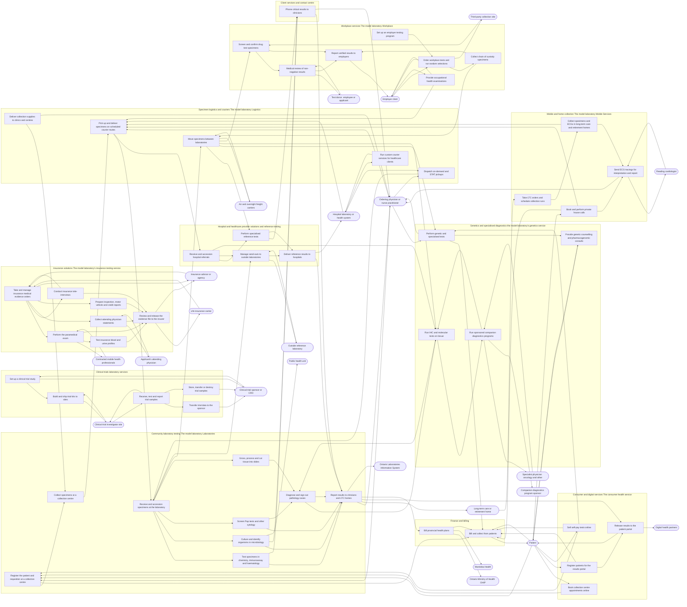

# Large Canadian medical laboratory and health services company

`diagnostic-lab-services-co` · health care: medical laboratory testing and health services · modelled on public information about A large Ontario community laboratory company owned by a US laboratory group (name withheld), from its public web pages and filings

This file models a large Canadian medical laboratory and health services company, built from public information about the model laboratory, a Ontario-based subsidiary of a US laboratory group with about 3,300 employees in 2022. Its largest business is community laboratory testing: about 200 collection centres in Ontario, Quebec and Manitoba take specimens from patients sent by community clinicians, couriers carry them to regional laboratories, and results go back to clinicians' EMRs and to a patient portal. Ontario pays for insured tests per test up to a company cap, Manitoba pays for its residents, and patients pay for uninsured tests and most Quebec community testing. Around this core the company runs separate business lines: a courier network, mobile collection in long-term care and retirement homes, specialised reference testing for more than 500 hospitals, medical evidence for life insurers (paramedical exams, tele-interviews, physician statements and lab tests), workplace drug testing and occupational health for employers, central laboratory services for clinical trials, genetic testing and sponsored companion diagnostics programs, and consumer services such as the results portal and self-pay tests. Insurers, employers, hospitals and drug companies pay by contract. Shared corporate functions (quality and accreditation, laboratory information systems and IT, finance and billing, the client contact centre, sales, supply chain, HR, legal and privacy, and facilities) support every line.

| | |
|---|---|
| Employees | 3,300 |
| Country | Canada |
| Ownership | Private subsidiary of a US-listed laboratory company (The US parent majority owner since 2002); Canadian head office in Brampton, Ontario |
| Regulators | Ontario Ministry of Health (community laboratory and specimen collection centre licensing and OHIP funding), Manitoba Health and the College of Physicians and Surgeons of Manitoba (MANQAP accreditation), Quebec health ministry and Sante Quebec (laboratory operating licences), Accreditation Canada Diagnostics (ISO 15189 Plus), College of American Pathologists, Standards Council of Canada (ISO 15189 and ISO/IEC 17025), US SAMHSA National Laboratory Certification Program (workplace drug testing), College of Medical Laboratory Technologists of Ontario and other provincial colleges, Information and Privacy Commissioner of Ontario and other provincial privacy commissioners, Transport Canada (Transportation of Dangerous Goods), Health Canada (clinical trials and medical devices) |
| Employees (February 2022) | 3,300 people (A) |
| Tests performed per year | 52,500,000 tests (A) |
| Specimens tested per day | 40,000 specimens (A) |
| Patients served per year | 10,000,000 patients (A) |
| Healthcare professionals served | 15,000 ordering clinicians (A) |
| Laboratories | 9 laboratories (A) |
| Laboratory and Health Services Centres | 200 collection centres (A) |
| Hospitals served | 500 hospitals (A) |
| Pathologists | 60 pathologists (A) |
| Mobile health professionals (employed and contracted) | 1,200 people (A) |
| Workplace drug tests per year | 300,000 tests (A) |
| Workplace testing clients | 500 employers (A) |
| Ontario government funding received | 188,100,000 CAD per year (A) |
| Annual revenue | 550,000,000 CAD (C) |

## Units

- **Executive office** (11 people, department): Chief executive, chief operating officer, chief medical officer and the corporate client solutions executive; strategy, communications and dealings with the parent company and governments.
- **Community laboratory testing (The model laboratory Laboratories)** (1,333 people, division): Collects specimens from patients sent by community clinicians, tests them in the regional laboratories and reports results; funded mainly by provincial plans and patient payments.
  - **Laboratory and Health Services Centres network** (646 people, site network): About 200 collection centres where lab assistants register patients, check requisitions and collect blood, urine and other specimens.
    - **Ontario collection centres** (400 people, site network): Collection centres across Ontario, the largest part of the network.
    - **Quebec collection centres** (110 people, site network): Collection centres in the Montreal area and elsewhere in Quebec, staffed largely by auxiliary nurses.
    - **Manitoba collection centres** (70 people, site network): Collection centres in Winnipeg and Manitoba (Saskatchewan centres closed).
  - **Specimen receiving and processing** (158 people, team): Receives courier totes, checks labels against requisitions, accessions orders, centrifuges and sorts specimens to benches and sends specimens to other sites.
  - **Core laboratory (chemistry, immunoassay, haematology, urinalysis)** (210 people, department): Automated high-volume testing in the regional laboratories.
  - **Microbiology laboratory** (105 people, department): Cultures, identification, susceptibility and molecular infectious disease testing.
  - **Cytology laboratory** (40 people, department): Screening of Pap tests and non-gynaecological cytology by cytotechnologists.
  - **Histology and anatomic pathology** (124 people, department): Processes tissue biopsies into slides and provides pathologist diagnosis and transcription.
- **Specimen logistics and couriers (The model laboratory Logistics)** (268 people, division): Moves specimens, reports and supplies between collection centres, clinics, hospitals, homes and laboratories, and sells courier services to healthcare clients.
  - **Logistics dispatch centre** (24 people, team): 24/7 dispatch of routes and on-demand pickups with web tracking.
  - **Courier operations** (232 people, team): Driving and walking couriers on scheduled routes and line hauls.
  - **Commercial logistics** (5 people, team): Custom courier service sold to hospitals and healthcare organisations.
- **Mobile and home collection (The model laboratory Mobile Services)** (147 people, division): Blood and ECG collections in long-term care and retirement homes and private house calls.
  - **Mobile collection teams** (128 people, team): Mobile lab assistants who visit homes and residences on daily runs.
  - **Mobile scheduling desk** (14 people, team): Takes standing orders and bookings and builds daily collection schedules.
- **Hospital and healthcare provider solutions and reference testing** (122 people, division): Specialised and esoteric testing for hospital laboratories, send-out management and result delivery into hospital systems.
  - **Reference laboratory** (105 people, department): Specialised chemistry, endocrinology and toxicology testing (London reference laboratory heritage).
  - **Hospital client services** (16 people, team): Handles hospital referrals, manifests, result queries and interface issues.
- **Insurance solutions (The model laboratory's insurance testing service)** (286 people, division): Collects medical evidence for life insurers: paramedical exams, tele-interviews, attending physician statements, inspections and laboratory testing, ordered by insurers and advisors.
  - **Insurance order desk and case management** (97 people, team): Takes orders, assigns health professionals, tracks status and reviews files before release.
  - **Tele-interview team** (65 people, team): Telephone health history interviews of insurance applicants.
  - **APS collection team** (35 people, team): Requests and chases attending physician statements.
  - **Health professional network** (64 people, site network): Employed and contracted mobile examiners across Canada.
  - **Inspection and records reports** (10 people, team): Inspection reports, motor vehicle records and credit reports.
- **Workplace services (The model laboratory Workplace)** (127 people, division): Workplace drug and alcohol testing programs and occupational health services for employers.
  - **Forensic toxicology laboratories** (58 people, department): SAMHSA-certified drug testing laboratories in London and Edmonton.
  - **Chain of custody collections** (35 people, team): Collectors at centres and on employer sites.
  - **Workplace program management** (20 people, team): Program set-up, ordering, random selection, reporting and employer service.
  - **Occupational health services** (10 people, team): Pre-employment, periodic and return-to-work examinations and testing.
- **Clinical trials laboratory services** (33 people, division): Central laboratory services for Phase I to IV trials run by pharmaceutical sponsors and CROs.
  - **Trial project management** (8 people, team): Project managers who run each study from set-up to close-out.
  - **Trial kit, sample and data operations** (24 people, team): Kit building, sample receipt and storage, data transfer.
- **Genetics and specialised diagnostics (the model laboratory's genetics service)** (109 people, division): Genetic testing, pharmacogenomics, molecular pathology and companion diagnostics programs.
  - **Genetics laboratories** (60 people, department): Molecular genetics testing in the Brampton (Impact Genetics) and Laval genetics and specialty laboratories.
  - **Molecular and cellular pathology** (20 people, team): IHC, ISH and mutation testing on tissue.
  - **Companion diagnostics programs** (20 people, team): Sponsored biomarker testing programs for pharmaceutical clients.
  - **Genetic counselling and pharmacogenomics consults** (8 people, team): Genetic counsellors and clinical pharmacists.
- **Consumer and digital services (The consumer health service)** (23 people, division): Patient results portal, online self-pay tests and appointment booking.
  - **Patient digital support** (14 people, team): Helps patients with registration, purchases and portal questions.
  - **Digital product and marketing** (8 people, team): Manages the portal, online shop and digital campaigns.
- **Quality and accreditation** (45 people, department): Runs the quality management system, accreditation, proficiency testing, validation and licensing.
  - **Quality assurance operations** (34 people, team): Site quality managers and specialists, audits, CAPA, EQA and training.
  - **Validation** (8 people, team): Method and computerized system validation.
  - **Licensing and regulatory affairs** (2 people, team): Provincial licences and certifications.
- **Laboratory information systems and IT** (109 people, department): Runs the LIS, interfaces, portals, infrastructure, security and the service desk.
  - **LIS and integration** (58 people, team): LIS configuration, interfaces and application development.
  - **Infrastructure and security** (26 people, team): Networks, servers, backups and information security.
  - **IT service desk** (24 people, team): Internal and client technical support.
- **Finance and billing** (141 people, department): Billing provincial plans, patients and clients, collections, payables, payroll, accounting and planning.
  - **Billing and revenue cycle** (100 people, team): Provincial claims, patient and client billing, receivables.
  - **Accounting, payables and payroll** (31 people, team): General ledger, close, payables and payroll.
  - **Financial planning and analysis** (9 people, team): Budget, forecast and reporting to the parent.
- **Client services and contact centre** (150 people, department): Bilingual contact centre for patients, clinicians and clients, critical result calls and patient relations.
  - **Customer care contact centre** (126 people, team): Customer care representatives and team leads.
  - **Results and after-hours call desk** (18 people, team): Call attendants who phone critical results and cover after hours.
  - **Patient relations** (5 people, team): Complaints and incident follow-up.
- **Sales and account management** (49 people, department): Physician territory sales, hospital and corporate sales, bids and marketing.
  - **Physician and clinic sales** (26 people, team): Territory account managers for physician practices.
  - **Hospital, corporate and specialty sales** (16 people, team): National sales for hospitals, genetics and oncology, employers and sponsors.
  - **Marketing** (6 people, team): Marketing and communications to clinicians.
- **Supply chain** (69 people, department): Procurement of reagents and instruments, warehouse, kitting and distribution of collection supplies.
  - **Procurement** (13 people, team): Contracts, purchase orders and inventory control.
  - **Warehouse, mailroom and kitting** (55 people, team): Picks and packs supplies and kits.
- **Human resources** (35 people, department): Recruitment, onboarding, employee relations, health and safety.
  - **HR business partners and employee relations** (10 people, team): Advises managers by region and business line.
  - **Talent acquisition** (9 people, team): Recruiting about 140 open roles at a time.
  - **HR services and health and safety** (15 people, team): Onboarding, records and safety.
- **Legal and privacy** (12 people, department): Contracts, regulatory compliance and the privacy program.
  - **Legal and compliance** (6 people, team): Legal counsel, compliance and contracts.
  - **Privacy office** (5 people, team): Privacy incidents, audits and access requests.
- **Facilities** (26 people, department): Collection centre and laboratory premises, fit-outs and biomedical equipment support.
  - **Building operations and real estate** (19 people, team): Maintenance, leases and site openings.
  - **Biomedical engineering** (6 people, team): Instrument maintenance coordination and calibration.

## Demand drivers

| Driver | Per month | Unit | Evidence |
|---|---:|---|---|
| Patient visits at Laboratory and Health Services Centres | 560,000 | visits | C [src1], [src4] |
| Community requisitions received (centres, physician offices, LTC, house calls) | 690,000 | requisitions | C [src4], [src10] |
| Specimens received by the laboratories | 1,200,000 | specimens | A [src10] |
| Tests performed | 4,400,000 | tests | A [src4], [src13], [src14] |
| Cytology and surgical pathology cases | 45,000 | cases | C [src15] |
| Long-term care and retirement home collections | 24,000 | resident collections | C [src35], [src3] |
| Scheduled courier stops | 150,000 | stops | C [src16], [src32] |
| Private house call collections | 2,500 | visits | C [src3] |
| Hospital reference referrals | 50,000 | requisitions | C [src15] |
| Insurance medical evidence orders | 38,000 | orders | C [src11], [src34] |
| Workplace drug tests | 25,000 | tests | A [src12] |
| Occupational health examinations | 2,500 | exams | C [src17] |
| Clinical trial sample receipts | 5,000 | visit samples | C [src6] |
| Genetic and specialised test orders | 6,000 | orders | C [src20] |
| Companion diagnostics program patients | 1,500 | patients | C [src14] |
| Results released to the patient portal | 250,000 | result releases | C [src18] |
| Self-pay tests bought online | 5,000 | orders | C [src37] |
| Active employees | 3,300 | employees | A [src22] |
| Supplier and contractor invoices | 3,500 | invoices | C |
| New or changed client accounts | 250 | accounts | C |

## How the core processes connect

## Process map

### Executive office

| Process | Owner | Type | Unit of work | Per month | Priority | Receives from | Sends to |
|---|---|---|---|---:|---:|---|---|
| **Negotiate provincial funding agreements.** Executives negotiate community laboratory funding agreements, price changes and cap allocations with the Ontario Ministry of Health, sign the agreement and pass the terms to billing and planning. Funding is set per company and changes rarely. | Executive office | management | one agreement cycle | 0.1 | 3 | Ontario Ministry of Health (OHIP) | Bill provincial health plans, Ontario Ministry of Health (OHIP) |
| **Review monthly business performance.** Each month the executive team and business line leaders review volumes, turnaround, quality, compliance and financial results against budget, agree corrective actions, and send a performance report to the parent company. | Executive office | management | one monthly review | 1 | 3 | Close the books each month, Handle record requests and privacy audits, Maintain licences and certifications | Parent company, Set strategy and annual plan |
| **Set strategy and annual plan.** The executive team reviews performance, quality, market changes and parent company targets and sets priorities such as acquisitions, new tests and site changes for the coming years. | Executive office | management | one annual plan | 0.083 | 3 | Hold quality management review, Parent company, Review monthly business performance | Open, move or refit collection centres, Prepare the annual budget and forecasts, Validate and introduce new tests |

### Community laboratory testing (The model laboratory Laboratories)

| Process | Owner | Type | Unit of work | Per month | Priority | Receives from | Sends to |
|---|---|---|---|---:|---:|---|---|
| **Collect specimens at a collection centre.** The lab assistant confirms identity with two identifiers, draws blood by venipuncture, collects or receives urine and other specimens, labels them at the chair and stores them at the required temperature for the next courier pickup. Difficult draws, fasting errors and mislabelled tubes are the main sources of recollection. | Laboratory and Health Services Centres network | core | one patient collection | 560,000 | 1 | Deliver collection supplies to clinics and centres, Register the patient and requisition at a collection centre, Train staff and assess competency | Manage workplace injuries and return to work, Pick and pack collection supplies and kits, Pick up and deliver specimens on scheduled courier routes |
| **Receive and accession specimens at the laboratory.** Processing lab assistants open courier totes, reconcile them against manifests, check each specimen label against its requisition, complete accessioning in the LIS, centrifuge and aliquot, and sort tubes to benches or to other sites. Unlabelled, leaking, haemolysed or wrong-temperature specimens are rejected and logged, which triggers a recollection. | Specimen receiving and processing | core | one requisition with its specimens | 690,000 | 1 | Dispatch on-demand and STAT pickups, Pick up and deliver specimens on scheduled courier routes | Culture and identify organisms in microbiology, Gross, process and cut tissue into slides, Manage nonconformances and corrective actions, Manage send-outs to outside laboratories, Move specimens between laboratories, Screen Pap tests and other cytology, Test specimens in chemistry, immunoassay and haematology |
| **Register the patient and requisition at a collection centre.** A lab assistant greets the patient, checks the requisition and health card, enters the ordering clinician, tests and patient details into the LIS and prints specimen labels. Uninsured tests are explained and paid at the counter. Handwritten or incomplete requisitions, unknown test names and expired health cards cause calls to the clinic and rework. | Laboratory and Health Services Centres network | core | one patient visit with its requisition | 560,000 | 1 | Book collection centre appointments online, Open, move or refit collection centres, Ordering physician or nurse practitioner, Patient, Sell self-pay tests online | Bill and collect from patients, Collect specimens at a collection centre, Resolve IT incidents and requests |
| **Report results to clinicians and LTC homes.** Verified results flow from the LIS to clinicians' EMRs over HL7, to the eResults portal, or by fax and print, as interim and final cumulative reports, and are queued for the patient portal and billing. Staff work failed-delivery queues, amended reports and report copy requests. | Community laboratory testing (The model laboratory Laboratories) | core | one final report | 690,000 | 1 | Answer patient and clinician inquiries, Build and change the LIS and interfaces, Culture and identify organisms in microbiology, Deliver reference results to hospitals, Diagnose and sign out pathology cases, Phone critical results to clinicians, Screen Pap tests and other cytology, Test specimens in chemistry, immunoassay and haematology | Bill provincial health plans, Long-term care or retirement home, Ontario Laboratories Information System, Ordering physician or nurse practitioner, Release results to the patient portal, Respond to privacy incidents |
| **Test specimens in chemistry, immunoassay and haematology.** Technologists load specimens onto track-connected analysers, the middleware autoverifies most results against rules, and technologists review flagged results, reruns, delta checks and smears before release. Runs are released only after QC passes. Instrument downtime and reagent lots drive delays. | Core laboratory (chemistry, immunoassay, haematology, urinalysis) | core | one requisition with core laboratory tests (about five to six tests) | 640,000 | 1 | Build and change the LIS and interfaces, Receive and accession specimens at the laboratory, Run and review daily quality control, Train staff and assess competency | Maintain and repair laboratory instruments, Phone critical results to clinicians, Replenish inventory and receive goods, Report results to clinicians and LTC homes, Resolve IT incidents and requests |
| **Culture and identify organisms in microbiology.** Lab assistants plate urine, swab and stool specimens; technologists read cultures over one to three days, identify organisms, run susceptibility tests and molecular panels, and report preliminary and final results. Positive reportable diseases are notified to public health. | Microbiology laboratory | core | one microbiology specimen | 110,000 | 2 | Receive and accession specimens at the laboratory, Run and review daily quality control | Phone critical results to clinicians, Public health unit, Report results to clinicians and LTC homes |
| **Diagnose and sign out pathology cases.** A pathologist reviews the slides with the clinical history, orders special stains or immunohistochemistry when needed, dictates the diagnosis, and signs the report after transcription. Second opinions and pending IHC lengthen turnaround. | Histology and anatomic pathology | core | one pathology case | 16,000 | 2 | Gross, process and cut tissue into slides, Run IHC and molecular tests on tissue, Screen Pap tests and other cytology | Report results to clinicians and LTC homes, Run IHC and molecular tests on tissue |
| **Gross, process and cut tissue into slides.** Pathologists' assistants gross biopsies, then histotechnologists process, embed, cut and stain the tissue and match slides to cases before delivery to the pathologist. Overnight processing sets a one-day minimum and recuts add time. | Histology and anatomic pathology | core | one surgical pathology case | 13,000 | 2 | Receive and accession specimens at the laboratory | Diagnose and sign out pathology cases |
| **Run and review daily quality control.** Technologists run control materials on every analyser and test at the start of each run and at set intervals, the QC software applies rules, and failures stop patient reporting until troubleshooting, recalibration or repair. Charge technologists review shifts and trends monthly. | Community laboratory testing (The model laboratory Laboratories) | management | one analyser-day of QC | 4,500 | 2 | Maintain and repair laboratory instruments | Culture and identify organisms in microbiology, Manage nonconformances and corrective actions, Test specimens in chemistry, immunoassay and haematology |
| **Screen Pap tests and other cytology.** Liquid-based cytology slides are prepared and screened by cytotechnologists; negative cases are reported by the cytotechnologist and abnormal or unsatisfactory cases go to a pathologist. Screening rate limits and rescreening rules set the workload. | Cytology laboratory | core | one cytology case | 32,000 | 2 | Receive and accession specimens at the laboratory | Diagnose and sign out pathology cases, Report results to clinicians and LTC homes |

### Specimen logistics and couriers (The model laboratory Logistics)

| Process | Owner | Type | Unit of work | Per month | Priority | Receives from | Sends to |
|---|---|---|---|---:|---:|---|---|
| **Pick up and deliver specimens on scheduled courier routes.** Couriers run fixed routes several times a day, collecting specimen bags from collection centres, physician offices, LTC teams and hospitals, scanning them into the tracking system and delivering them at the right temperature to the laboratory. Late stops, missed pickups and traffic cause specimens to miss the run. | Specimen logistics and couriers (The model laboratory Logistics) | core | one stop pickup | 150,000 | 1 | Book and perform private house calls, Collect specimens and ECGs in long-term care and retirement homes, Collect specimens at a collection centre, Hospital laboratory or health system, Onboard new clients, Ordering physician or nurse practitioner, Provide occupational health examinations | Manage workplace injuries and return to work, Receive and accession hospital referrals, Receive and accession specimens at the laboratory |
| **Deliver collection supplies to clinics and centres.** Couriers deliver packed orders of tubes, containers, kits and requisitions to physician offices and collection centres on their routes. Wrong or short deliveries lead to calls and repeat runs. | Specimen logistics and couriers (The model laboratory Logistics) | core | one supply drop | 15,000 | 3 | Pick and pack collection supplies and kits | Collect specimens at a collection centre, Ordering physician or nurse practitioner |
| **Dispatch on-demand and STAT pickups.** Dispatchers take calls and web requests for urgent pickups, assign the nearest courier, track the pickup to delivery and escalate delays. The service runs 24 hours a day, 7 days a week. | Logistics dispatch centre | core | one on-demand pickup | 6,000 | 3 | Hospital laboratory or health system, Ordering physician or nurse practitioner | Receive and accession specimens at the laboratory |
| **Move specimens between laboratories.** Specimens needing tests done at another site (reference, genetics, toxicology, pathology) are packed to dangerous goods rules and moved by line haul or air freight with manifests and temperature control. Lost or delayed totes and temperature excursions are investigated. | Specimen logistics and couriers (The model laboratory Logistics) | core | one inter-site shipment | 4,000 | 3 | Air and overnight freight carriers, Collect chain of custody specimens, Receive and accession specimens at the laboratory | Air and overnight freight carriers, Perform genetic and specialised tests, Perform specialised reference tests, Run IHC and molecular tests on tissue, Screen and confirm drug test specimens |
| **Run custom courier services for healthcare clients.** Hospitals and health organisations book custom deliveries of specimens, products and records through the web ordering system; dispatch assigns a courier, proof of delivery is captured, and the client is billed. Service level terms and after-hours requests make planning hard. | Commercial logistics | core | one commercial delivery | 3,000 | 3 | Hospital laboratory or health system | Hospital laboratory or health system, Invoice clients and collect receivables |

### Mobile and home collection (The model laboratory Mobile Services)

| Process | Owner | Type | Unit of work | Per month | Priority | Receives from | Sends to |
|---|---|---|---|---:|---:|---|---|
| **Collect specimens and ECGs in long-term care and retirement homes.** A mobile lab assistant drives to each home, works with nursing staff to identify residents, draws blood, collects other specimens and records resting ECGs, labels specimens at the bedside and hands them to a courier or brings them to a drop point. Residents who refuse, are asleep or are not fasting cause missed draws. | Mobile collection teams | core | one resident collection | 24,000 | 1 | Take LTC orders and schedule collection runs | Pick up and deliver specimens on scheduled courier routes, Send ECG tracings for interpretation and report |
| **Take LTC orders and schedule collection runs.** Schedulers receive standing orders and new requisitions from long-term care and retirement homes, check them, enter or update them in the LIS, and build the next day's route of homes and residents for each mobile lab assistant. Late orders and changes from homes cause rescheduling. | Mobile and home collection (The model laboratory Mobile Services) | core | one resident collection request | 24,000 | 2 | Long-term care or retirement home | Collect specimens and ECGs in long-term care and retirement homes |
| **Book and perform private house calls.** A patient or family books a home visit and pays a fee; the scheduler books a slot and a mobile lab assistant visits, registers the patient, collects specimens or an ECG and sends them to the laboratory. Travel time dominates the cost. | Mobile and home collection (The model laboratory Mobile Services) | core | one house call | 2,500 | 3 | Patient | Bill and collect from patients, Pick up and deliver specimens on scheduled courier routes, Send ECG tracings for interpretation and report |
| **Send ECG tracings for interpretation and report.** ECG tracings recorded in homes are transmitted to a contracted reading cardiologist, the interpretation is matched to the order and the report is delivered to the ordering physician. Missing patient data and late reads are the main issues. | Mobile and home collection (The model laboratory Mobile Services) | core | one ECG | 3,000 | 3 | Book and perform private house calls, Collect specimens and ECGs in long-term care and retirement homes, Reading cardiologist | Ordering physician or nurse practitioner, Reading cardiologist |

### Hospital and healthcare provider solutions and reference testing

| Process | Owner | Type | Unit of work | Per month | Priority | Receives from | Sends to |
|---|---|---|---|---:|---:|---|---|
| **Perform specialised reference tests.** Technologists run specialised chemistry, endocrinology, drug level and toxicology assays in batches on a schedule, review results with clinical scientists and release them. Batch schedules set turnaround, and low-volume assays need careful QC. | Reference laboratory | core | one reference requisition | 60,000 | 1 | Move specimens between laboratories, Receive and accession hospital referrals | Deliver reference results to hospitals, Maintain and repair laboratory instruments, Phone critical results to clinicians |
| **Deliver reference results to hospitals.** Results are sent to hospital LIS systems over bi-directional interfaces or through eResults, with reports for community-origin tests passed back to community reporting, and the work is queued for client billing. Coordinators chase interface errors and answer hospital result queries. | Hospital client services | core | one reference report | 60,000 | 2 | Manage send-outs to outside laboratories, Perform specialised reference tests | Hospital laboratory or health system, Invoice clients and collect receivables, Report results to clinicians and LTC homes |
| **Receive and accession hospital referrals.** Hospital laboratories send referral specimens with manifests or electronic orders; lab assistants check them against the manifest, accession them (often from the hospital LIS interface) and route them to the reference benches, molecular pathology or send-outs. Missing manifests and mismatched identifiers cause holds and calls. | Reference laboratory | core | one hospital referral requisition | 50,000 | 2 | Pick up and deliver specimens on scheduled courier routes | Manage send-outs to outside laboratories, Perform specialised reference tests, Run IHC and molecular tests on tissue |
| **Manage send-outs to outside laboratories.** Tests not done in-house are packaged and shipped to outside reference laboratories with requisitions, tracked until results return, and the results are entered or interfaced back for reporting. Outside invoices are matched and paid. | Reference laboratory | core | one send-out test | 6,000 | 3 | Outside reference laboratory, Receive and accession hospital referrals, Receive and accession specimens at the laboratory | Deliver reference results to hospitals, Outside reference laboratory, Pay suppliers and contractors |

### Insurance solutions (The model laboratory's insurance testing service)

| Process | Owner | Type | Unit of work | Per month | Priority | Receives from | Sends to |
|---|---|---|---|---:|---:|---|---|
| **Conduct insurance tele-interviews.** A tele-interviewer calls the applicant at the booked time, asks the insurer's health, lifestyle and family history questions with reflex questions, records the answers in the questionnaire software and releases the report. A typical interview lasts about 25 minutes, and missed calls cause rebooking. | Tele-interview team | core | one tele-interview | 13,000 | 1 | Take and manage insurance medical evidence orders | Review and release the evidence file to the insurer, Take and manage insurance medical evidence orders |
| **Perform the paramedical exam.** A health professional calls the applicant within 24 to 48 hours, books within 72 hours, visits the home or workplace, takes the health history, vitals, blood and urine and ECG as ordered, records it in ePara and ships the specimen kit. No-shows, rebookings and missing ECG equipment delay files. | Health professional network | core | one paramedical exam | 16,000 | 1 | Contracted mobile health professionals, Take and manage insurance medical evidence orders | Contracted mobile health professionals, Recruit, credential and pay health professionals, Review and release the evidence file to the insurer, Test insurance blood and urine profiles |
| **Take and manage insurance medical evidence orders.** Advisors and insurers place orders online, by email or phone; a case coordinator checks the requirements, creates the case in the Order Management System, assigns a health professional, books a tele-interview, requests the APS or inspection, and keeps iCARE status current. Incomplete applicant details and changing insurer requirements cause rework. | Insurance order desk and case management | core | one insurance order | 38,000 | 1 | Conduct insurance tele-interviews, Insurance advisor or agency, Life insurance carrier | Collect attending physician statements, Conduct insurance tele-interviews, Insurance advisor or agency, Perform the paramedical exam, Prepare inspection, motor vehicle and credit reports |
| **Collect attending physician statements.** An APS coordinator sends the insurer's request and the applicant's authorization to the attending physician by fax or portal, chases the clinic until the statement arrives, pays the physician's fee and releases the document. Waits on busy clinics make this the slowest evidence item. | APS collection team | core | one APS | 8,000 | 2 | Applicant's attending physician, Take and manage insurance medical evidence orders | Applicant's attending physician, Pay suppliers and contractors, Review and release the evidence file to the insurer |
| **Review and release the evidence file to the insurer.** When the ordered items are complete, a reviewer checks the file for missing signatures, values and documents, and the system transmits it to the insurer in ACORD or custom format, updates the advisor and queues the order for billing. Missing items reopen the case. | Insurance order desk and case management | core | one completed insurance order | 38,000 | 2 | Collect attending physician statements, Conduct insurance tele-interviews, Perform the paramedical exam, Prepare inspection, motor vehicle and credit reports, Test insurance blood and urine profiles | Insurance advisor or agency, Invoice clients and collect receivables, Life insurance carrier |
| **Test insurance blood and urine profiles.** Insurance specimen kits are received, matched to the Lab ID slip and order, tested on insurer profiles in the core laboratory, and results are reviewed and transmitted to the insurer within about 48 hours. Specimens are kept five weeks for repeat testing. | Insurance solutions (The model laboratory's insurance testing service) | core | one insurance specimen kit | 15,000 | 2 | Perform the paramedical exam | Review and release the evidence file to the insurer |
| **Prepare inspection, motor vehicle and credit reports.** Specialists interview applicants about finances, occupation and lifestyle, or obtain motor vehicle and credit records as the insurer requires, then write and release the report to the case. Waits on third-party record providers set the pace. | Inspection and records reports | core | one inspection or records report | 1,500 | 3 | Take and manage insurance medical evidence orders | Review and release the evidence file to the insurer |
| **Recruit, credential and pay health professionals.** Network managers recruit and credential nurses and examiners, issue contracts, kits and equipment, monitor quality, and submit pay statements for completed visits to payables. Coverage gaps in rural areas are hard to fill. | Health professional network | support | one health professional pay statement | 1,800 | 3 | Contracted mobile health professionals, Perform the paramedical exam | Pay suppliers and contractors |

### Workplace services (The model laboratory Workplace)

| Process | Owner | Type | Unit of work | Per month | Priority | Receives from | Sends to |
|---|---|---|---|---:|---:|---|---|
| **Collect chain of custody specimens.** A certified collector verifies the donor's identity, follows the chain of custody procedure for urine or oral fluid with temperature and tamper checks, splits and seals the specimen, completes the custody form, and runs breath alcohol tests when ordered. Shy bladder cases and refusals follow set rules. | Chain of custody collections | core | one chain of custody collection | 15,000 | 1 | Order workplace tests and run random selections | Move specimens between laboratories, Report verified results to employers |
| **Screen and confirm drug test specimens.** The toxicology lab checks seals and custody forms, screens specimens by immunoassay, confirms non-negatives by GC-MS or LC-MS/MS, and a certifying scientist reviews the custody chain and data before release. Negatives are released within 6 to 24 hours and non-negatives need another 48 to 72 hours. | Forensic toxicology laboratories | core | one drug test specimen | 25,000 | 1 | Move specimens between laboratories, Third-party collection site | Maintain and repair laboratory instruments, Medical review of non-negative results, Report verified results to employers |
| **Medical review of non-negative results.** A medical review officer reviews each non-negative or invalid result, contacts the donor to ask about prescriptions or other explanations, and verifies the result as negative or positive before it goes to the employer. Reaching donors takes repeated attempts. | Workplace services (The model laboratory Workplace) | core | one non-negative result | 1,800 | 2 | Screen and confirm drug test specimens, Test donor (employee or applicant) | Report verified results to employers, Test donor (employee or applicant) |
| **Order workplace tests and run random selections.** Employers request pre-employment, post-incident and reasonable cause tests, and coordinators run random selections; the coordinator issues a donor authorization and directs the donor to a centre, an on-site collector or a third-party site. Urgent post-incident tests must be collected within hours. | Workplace program management | core | one drug or alcohol test request | 25,000 | 2 | Employer client, Set up an employer testing program | Collect chain of custody specimens, Employer client, Third-party collection site |
| **Report verified results to employers.** Final results are posted to the employer's web reports or sent by secure fax to the designated representative, with periodic statistical and activity reports, and each test is queued for billing. Confidentiality rules limit who can receive results. | Workplace program management | core | one reported test | 25,000 | 2 | Collect chain of custody specimens, Medical review of non-negative results, Screen and confirm drug test specimens | Employer client, Invoice clients and collect receivables |
| **Provide occupational health examinations.** Occupational health nurses perform pre-employment, periodic and return-to-work examinations and collect specimens for trace metal, allergy and TB testing at centres or on site, then send the employer a fitness report. Results from the laboratory must arrive before the report is complete. | Occupational health services | core | one occupational health exam | 2,500 | 3 | Employer client | Employer client, Invoice clients and collect receivables, Pick up and deliver specimens on scheduled courier routes |
| **Set up an employer testing program.** After a contract is signed, the program coordinator records the employer's policy, testing reasons, panels, cut-offs, random rates, designated contacts and reporting rules, and sets up accounts and collection sites. Scientists advise on panels and specimen types. | Workplace program management | core | one new or renewed program | 25 | 3 | Win hospital, insurer, employer and sponsor contracts | Order workplace tests and run random selections |

### Clinical trials laboratory services

| Process | Owner | Type | Unit of work | Per month | Priority | Receives from | Sends to |
|---|---|---|---|---:|---:|---|---|
| **Receive, test and report trial samples.** Samples arrive from sites by courier, are reconciled against the requisition and visit schedule, tested in the core or specialty laboratory, and reported to the site, with queries raised for missing or mismatched data. Protocol-specific alerts must be phoned to investigators. | Trial kit, sample and data operations | core | one trial visit sample set | 5,000 | 1 | Build and change the LIS and interfaces, Clinical trial investigator site | Clinical trial investigator site, Store, transfer or destroy trial samples, Transfer trial data to the sponsor |
| **Build and ship trial kits to sites.** Technicians assemble pre-labelled visit kits with tubes, requisitions and shipping materials, track expiry, and ship them to investigator sites on resupply requests. Expired kits and site stock-outs are the main issues. | Trial kit, sample and data operations | core | one trial kit | 5,000 | 3 | Clinical trial investigator site, Set up a clinical trial study | Clinical trial investigator site |
| **Set up a clinical trial study.** A project manager reviews the protocol, prepares the quote and lab manual, designs visit kits, has the LIS and trial system built for the study's tests and reference ranges, and agrees data formats with the sponsor. Protocol amendments restart parts of the build. | Trial project management | core | one new study | 3 | 3 | Clinical trial sponsor or CRO, Win hospital, insurer, employer and sponsor contracts | Build and change the LIS and interfaces, Build and ship trial kits to sites, Clinical trial sponsor or CRO, Invoice clients and collect receivables |
| **Store, transfer or destroy trial samples.** Retained samples are logged into freezers by study and visit, shipped to the sponsor or another lab on request, or destroyed at the end of retention as the protocol allows. Freezer space and reconciliation take effort. | Trial kit, sample and data operations | core | one stored sample set | 3,500 | 3 | Receive, test and report trial samples | Clinical trial sponsor or CRO |
| **Transfer trial data to the sponsor.** Data coordinators produce cumulative data files in the sponsor's format on the agreed schedule, reconcile them with the sponsor's database, resolve queries and close out the study, and the work is queued for billing. Format changes and reconciliation queries cause rework. | Trial project management | core | one monthly data transfer for one study | 45 | 3 | Receive, test and report trial samples | Clinical trial sponsor or CRO, Invoice clients and collect receivables |

### Genetics and specialised diagnostics (the model laboratory's genetics service)

| Process | Owner | Type | Unit of work | Per month | Priority | Receives from | Sends to |
|---|---|---|---|---:|---:|---|---|
| **Perform genetic and specialised tests.** Orders for prenatal screening, carrier screening, hereditary and pharmacogenomic tests are checked for consent and payment, DNA is extracted, tests are run and analysed, and a laboratory geneticist signs the report. Private-pay tests are invoiced to patients, and complex variants take longer to interpret. | Genetics laboratories | core | one genetic test order | 6,000 | 1 | Move specimens between laboratories, Ordering physician or nurse practitioner, Sell self-pay tests online | Bill and collect from patients, Ordering physician or nurse practitioner, Provide genetic counselling and pharmacogenomic consults |
| **Run IHC and molecular tests on tissue.** Technologists cut and stain tissue blocks for immunohistochemistry, ISH and mutation tests such as KRAS, and the results are interpreted and reported to the pathologist or the program. Block retrieval from other labs and repeat staining add delays. | Molecular and cellular pathology | core | one tissue biomarker case | 4,000 | 2 | Diagnose and sign out pathology cases, Move specimens between laboratories, Receive and accession hospital referrals, Run sponsored companion diagnostics programs | Diagnose and sign out pathology cases, Run sponsored companion diagnostics programs |
| **Run sponsored companion diagnostics programs.** For each sponsor program, coordinators enrol patients referred by specialists, arrange appointments and specimen pickup, track testing, deliver the biomarker report to the physician and send the sponsor de-identified program reports and invoices. Each program has its own rules and reporting. | Companion diagnostics programs | core | one enrolled patient | 1,500 | 2 | Companion diagnostics program sponsor, Run IHC and molecular tests on tissue, Specialist physician (oncology and other) | Companion diagnostics program sponsor, Invoice clients and collect receivables, Run IHC and molecular tests on tissue, Specialist physician (oncology and other), Validate and introduce new tests |
| **Provide genetic counselling and pharmacogenomic consults.** Genetic counsellors and clinical pharmacists explain results and options to patients and clinicians by phone or video, and send a summary letter. Booking and reaching patients takes time. | Genetic counselling and pharmacogenomics consults | core | one counselling session | 500 | 3 | Patient, Perform genetic and specialised tests | Patient |

### Consumer and digital services (The consumer health service)

| Process | Owner | Type | Unit of work | Per month | Priority | Receives from | Sends to |
|---|---|---|---|---:|---:|---|---|
| **Release results to the patient portal.** Results for registered patients are published to the portal with plain-language explanations and trends after release rules (such as delays for sensitive tests) are applied; patients with questions are routed to support or their clinician, and the portal offers referrals to virtual care and therapy partners. | Consumer and digital services (The consumer health service) | core | one result release | 250,000 | 1 | Register patients for the results portal, Report results to clinicians and LTC homes | Answer patient and clinician inquiries, Digital health partners, Patient, Respond to privacy incidents |
| **Book collection centre appointments online.** Patients book a time at a collection centre online or by phone, receive reminders, and may upload their requisition in advance; the booking feeds the centre's queue. No-shows and walk-ins make capacity planning hard. | Consumer and digital services (The consumer health service) | core | one booking | 320,000 | 2 | Patient | Register the patient and requisition at a collection centre |
| **Register patients for the results portal.** A patient signs up for the consumer health service, verifies identity, pays the subscription, and the account is matched to the patient's laboratory record. Identity mismatches need agent help. | Patient digital support | core | one registration | 12,000 | 3 | Patient | Bill and collect from patients, Release results to the patient portal |
| **Sell self-pay tests online.** A patient buys a test online, pays by card, receives a requisition and visits a centre for collection, or receives an at-home kit; genetic and pharmacogenomic tests go to the genetics lab. Results go to the portal. | Consumer and digital services (The consumer health service) | core | one online order | 5,000 | 3 | Patient | Bill and collect from patients, Perform genetic and specialised tests, Register the patient and requisition at a collection centre |

### Quality and accreditation

| Process | Owner | Type | Unit of work | Per month | Priority | Receives from | Sends to |
|---|---|---|---|---:|---:|---|---|
| **Manage nonconformances and corrective actions.** Staff log QC failures, rejected specimens, complaints, proficiency failures and audit findings; quality specialists assign investigation, root cause and corrective action, check effectiveness and close the record. | Quality assurance operations | management | one nonconformance | 900 | 2 | Handle complaints and patient relations, Prepare for and host accreditation assessments, Receive and accession specimens at the laboratory, Respond to privacy incidents, Run and review daily quality control, Run proficiency testing | Hold quality management review |
| **Prepare for and host accreditation assessments.** Quality managers prepare documents and self-assessments, host the assessors on site, and submit corrective action evidence for findings by the deadline. Each laboratory faces several programs (Accreditation Canada Diagnostics, CAP, MANQAP, SAMHSA). | Quality assurance operations | management | one assessment | 0.5 | 2 | Accreditation bodies | Accreditation bodies, Maintain licences and certifications, Manage nonconformances and corrective actions |
| **Run proficiency testing.** Quality staff receive blind samples from proficiency testing programs, technologists test them like patient samples, results are submitted on time, and graded reports are reviewed with any failure investigated. | Quality assurance operations | management | one proficiency testing event | 40 | 2 | Proficiency testing providers, SAMHSA National Laboratory Certification Program | Manage nonconformances and corrective actions, Proficiency testing providers |
| **Validate and introduce new tests.** When a new test or method is approved, the validation analyst and technologists plan and run accuracy, precision and reference interval studies, the medical director approves the report, and the LIS build and procedures are completed before go-live. | Validation | management | one new or changed test | 4 | 2 | Manage physician and clinic accounts, Run sponsored companion diagnostics programs, Set strategy and annual plan | Build and change the LIS and interfaces |
| **Hold quality management review.** Each quarter, quality and operations leaders review quality indicators such as specimen rejection and turnaround, CAPA status, audit and proficiency results and complaints, and agree actions and resources that feed the strategic plan. Gathering data from many sites takes most of the effort. | Quality and accreditation | management | one quarterly review | 0.33 | 3 | Manage nonconformances and corrective actions | Set strategy and annual plan |
| **Train staff and assess competency.** New and existing staff are trained on procedures and assessed yearly for each task they perform, with records kept in the QMS. Staff cannot work unsupervised until signed off. | Quality assurance operations | management | one competency assessment | 350 | 3 | Onboard new employees | Collect specimens at a collection centre, Test specimens in chemistry, immunoassay and haematology |

### Laboratory information systems and IT

| Process | Owner | Type | Unit of work | Per month | Priority | Receives from | Sends to |
|---|---|---|---|---:|---:|---|---|
| **Build and change the LIS and interfaces.** LIS analysts build new tests, rules, client codes and EMR or hospital interfaces from approved requests, test them in a validation environment and move them to production under change control. Backlogs delay new tests and client go-lives. | LIS and integration | support | one LIS change request | 180 | 2 | Onboard new clients, Resolve IT incidents and requests, Set up a clinical trial study, Validate and introduce new tests | Receive, test and report trial samples, Report results to clinicians and LTC homes, Test specimens in chemistry, immunoassay and haematology |
| **Grant and review system access.** New users get accounts and roles in the LIS and other systems on request from HR, leavers are removed, and access logs are reviewed for inappropriate viewing of patient records. | IT service desk | support | one access request | 550 | 3 | Onboard new employees | Handle record requests and privacy audits |
| **Operate infrastructure and security monitoring.** Engineers patch and back up servers and networks across about 200 sites, monitor security alerts and handle escalated incidents; suspected breaches go to the privacy office. | Infrastructure and security | support | one infrastructure change or security event | 450 | 3 | Resolve IT incidents and requests | Respond to privacy incidents |
| **Resolve IT incidents and requests.** The service desk logs calls from staff and clinics (printers, label printers, EMR result delivery, passwords), resolves what it can and escalates the rest to infrastructure or LIS teams. | IT service desk | support | one ticket | 4,500 | 3 | Ordering physician or nurse practitioner, Register the patient and requisition at a collection centre, Test specimens in chemistry, immunoassay and haematology | Build and change the LIS and interfaces, Operate infrastructure and security monitoring |

### Finance and billing

| Process | Owner | Type | Unit of work | Per month | Priority | Receives from | Sends to |
|---|---|---|---|---:|---:|---|---|
| **Bill provincial health plans.** Completed community requisitions are coded and submitted electronically to OHIP and Manitoba Health; billing clerks fix rejected claims (invalid health numbers, unlicensed tests), reconcile remittances, and track billing against the company's annual Ontario funding cap. | Billing and revenue cycle | core | one billable requisition | 580,000 | 1 | Manitoba Health, Negotiate provincial funding agreements, Ontario Ministry of Health (OHIP), Report results to clinicians and LTC homes | Bill and collect from patients, Close the books each month, Manitoba Health, Ontario Ministry of Health (OHIP) |
| **Bill and collect from patients.** Patients pay at centres or online for uninsured tests, Quebec community tests, house calls, private-pay genetics and portal subscriptions; clerks reconcile point-of-sale and online payments, issue receipts for private insurance claims and chase unpaid invoices. | Billing and revenue cycle | core | one patient charge | 140,000 | 2 | Bill provincial health plans, Book and perform private house calls, Patient, Perform genetic and specialised tests, Register patients for the results portal, Register the patient and requisition at a collection centre, Sell self-pay tests online | Close the books each month, Patient |
| **Invoice clients and collect receivables.** Billable work for hospitals, insurers, employers, trial sponsors, program sponsors and courier clients is priced by contract, invoiced monthly or per case, and collected, with disputes and credit notes handled by collections clerks. | Billing and revenue cycle | support | one client invoice | 10,000 | 2 | Clinical trial sponsor or CRO, Deliver reference results to hospitals, Employer client, Hospital laboratory or health system, Life insurance carrier, Provide occupational health examinations, Report verified results to employers, Review and release the evidence file to the insurer, Run custom courier services for healthcare clients, Run sponsored companion diagnostics programs, Set up a clinical trial study, Transfer trial data to the sponsor | Clinical trial sponsor or CRO, Close the books each month, Companion diagnostics program sponsor, Employer client, Hospital laboratory or health system, Life insurance carrier |
| **Close the books each month.** Accountants post accruals for unbilled tests and unpaid invoices, reconcile billing, receivables, payables and payroll, estimate provincial cap adjustments, and produce monthly results in the parent company's format and tight timetable. | Accounting, payables and payroll | management | one monthly close | 1 | 3 | Bill and collect from patients, Bill provincial health plans, Invoice clients and collect receivables, Pay suppliers and contractors, Run payroll | Parent company, Prepare the annual budget and forecasts, Review monthly business performance |
| **Pay suppliers and contractors.** Payables clerks match supplier invoices to purchase orders and receipts, process contractor, outside laboratory and physician fee statements, route exceptions for approval and pay in weekly runs. Invoices without a purchase order or receipt wait for approvers. | Accounting, payables and payroll | support | one supplier invoice | 3,500 | 3 | Collect attending physician statements, Manage send-outs to outside laboratories, Reagent, consumable and instrument suppliers, Recruit, credential and pay health professionals, Replenish inventory and receive goods | Close the books each month, Contracted mobile health professionals, Reagent, consumable and instrument suppliers |
| **Prepare the annual budget and forecasts.** FP&A builds the annual budget and quarterly forecasts by business line, including volumes, the Ontario funding cap, headcount and capital, and submits it to the parent. | Financial planning and analysis | management | one annual budget | 0.083 | 3 | Close the books each month, Set strategy and annual plan | Contract with reagent and instrument suppliers, Parent company, Recruit staff |
| **Run payroll.** Payroll administrators process hires, changes, hours and leave from the HRIS and scheduling system every two weeks, run payroll and post it to the ledger. | Accounting, payables and payroll | support | one payroll run | 2.2 | 3 | Onboard new employees | Bank, Close the books each month |

### Client services and contact centre

| Process | Owner | Type | Unit of work | Per month | Priority | Receives from | Sends to |
|---|---|---|---|---:|---:|---|---|
| **Phone critical results to clinicians.** When a result passes critical limits, the technologist confirms it and a call attendant phones the ordering clinician or on-call physician, documents read-back, time and person, and escalates to a medical director if no one can be reached. After-hours calls to clinics that are closed are the hard part. | Results and after-hours call desk | core | one critical result | 2,500 | 1 | Culture and identify organisms in microbiology, Perform specialised reference tests, Test specimens in chemistry, immunoassay and haematology | Ordering physician or nurse practitioner, Report results to clinicians and LTC homes |
| **Answer patient and clinician inquiries.** Customer care representatives answer calls and messages in English and French about results, locations, requisitions, preparation and billing, look up records in the LIS, request report copies and pass complaints to patient relations. Peaks in the morning drive wait times. | Customer care contact centre | support | one inquiry | 120,000 | 2 | Ordering physician or nurse practitioner, Patient, Release results to the patient portal | Handle complaints and patient relations, Report results to clinicians and LTC homes |
| **Handle complaints and patient relations.** Patient relations specialists log complaints about service, billing or results, investigate with the site or department, respond in writing or by phone, and open nonconformances for system problems. | Patient relations | support | one complaint | 600 | 3 | Answer patient and clinician inquiries | Manage nonconformances and corrective actions, Patient |

### Sales and account management

| Process | Owner | Type | Unit of work | Per month | Priority | Receives from | Sends to |
|---|---|---|---|---:|---:|---|---|
| **Manage physician and clinic accounts.** Territory account managers visit physician practices and clinics, set up new accounts, resolve service problems, promote tests and pass requests for new tests to the medical team. | Physician and clinic sales | support | one account visit | 3,500 | 3 | Ordering physician or nurse practitioner | Onboard new clients, Validate and introduce new tests |
| **Onboard new clients.** A new client is set up with an LIS client code, EMR or hospital interface, eResults access, courier stop and starter supplies. Delays in interface work hold up go-live. | Sales and account management | support | one new client account | 250 | 3 | Manage physician and clinic accounts, Win hospital, insurer, employer and sponsor contracts | Build and change the LIS and interfaces, Pick and pack collection supplies and kits, Pick up and deliver specimens on scheduled courier routes |
| **Win hospital, insurer, employer and sponsor contracts.** National sales teams answer RFPs and negotiate contracts with hospitals, insurers, employers and trial sponsors, with legal review of terms and pricing approval before signing. | Hospital, corporate and specialty sales | management | one bid or contract | 10 | 3 | Clinical trial sponsor or CRO, Employer client, Hospital laboratory or health system, Life insurance carrier | Hospital laboratory or health system, Onboard new clients, Set up a clinical trial study, Set up an employer testing program |

### Supply chain

| Process | Owner | Type | Unit of work | Per month | Priority | Receives from | Sends to |
|---|---|---|---|---:|---:|---|---|
| **Contract with reagent and instrument suppliers.** Procurement runs tenders and negotiates multi-year reagent rental, instrument and consumables agreements within the budget, often aligned with parent company contracts, with laboratory and quality staff judging technical fit. Changing a supplier needs new test validation. | Procurement | support | one supply contract | 5 | 3 | Prepare the annual budget and forecasts | Reagent, consumable and instrument suppliers, Replenish inventory and receive goods |
| **Pick and pack collection supplies and kits.** Distribution clerks pick and pack orders of tubes, containers, requisitions and insurance kits for clinics, centres and contracted health professionals, and hand them to couriers or mail. | Warehouse, mailroom and kitting | support | one supply order | 17,000 | 3 | Collect specimens at a collection centre, Onboard new clients, Ordering physician or nurse practitioner | Contracted mobile health professionals, Deliver collection supplies to clinics and centres, Replenish inventory and receive goods |
| **Replenish inventory and receive goods.** Buyers raise purchase orders from stock requisitions and minimum levels, warehouse staff receive and inspect deliveries, and receipts are passed to payables. Backorders force substitutions that need validation. | Procurement | support | one purchase order | 2,000 | 3 | Contract with reagent and instrument suppliers, Pick and pack collection supplies and kits, Reagent, consumable and instrument suppliers, Test specimens in chemistry, immunoassay and haematology | Pay suppliers and contractors, Reagent, consumable and instrument suppliers |

### Human resources

| Process | Owner | Type | Unit of work | Per month | Priority | Receives from | Sends to |
|---|---|---|---|---:|---:|---|---|
| **Manage workplace injuries and return to work.** Needlestick, lifting and vehicle incidents are reported, investigated and filed with the compensation board, and injured staff are supported back to work with modified duties; employee relations cases follow a similar path. | HR services and health and safety | support | one incident or case | 25 | 3 | Collect specimens at a collection centre, Pick up and deliver specimens on scheduled courier routes | Workers' compensation board |
| **Onboard new employees.** HR coordinators set up the employee in the HRIS and payroll, collect forms and credentials, request system access, and schedule orientation, privacy training and job training so the person can be signed off as competent. | HR services and health and safety | support | one new employee | 65 | 3 | Recruit staff | Grant and review system access, Run payroll, Train staff and assess competency |
| **Recruit staff.** Recruiters post approved positions, screen applicants, arrange interviews with hiring managers, check credentials such as CMLTO registration, driving abstracts and vulnerable sector checks, and issue offers. Shortages of technologists and lab assistants keep many roles open. | Talent acquisition | support | one hire | 65 | 3 | Job applicants, Prepare the annual budget and forecasts | Job applicants, Onboard new employees |

### Legal and privacy

| Process | Owner | Type | Unit of work | Per month | Priority | Receives from | Sends to |
|---|---|---|---|---:|---:|---|---|
| **Handle record requests and privacy audits.** Privacy analysts respond to patient requests for copies of their records within legal time limits, review access audit logs for inappropriate viewing, and complete privacy impact assessments for new systems and partners, reporting status to leadership. | Privacy office | management | one request or audit | 120 | 3 | Grant and review system access, Patient | Patient, Review monthly business performance |
| **Maintain licences and certifications.** Compliance and regulatory staff file licence renewals and changes for laboratories and collection centres, keep SAMHSA and other certifications current, and report compliance status to leadership. | Legal and compliance | management | one filing | 8 | 3 | Open, move or refit collection centres, Prepare for and host accreditation assessments | Ontario Ministry of Health (OHIP), Review monthly business performance, SAMHSA National Laboratory Certification Program |
| **Respond to privacy incidents.** Suspected breaches such as misdirected reports, lost specimens with labels or inappropriate access are contained, investigated and assessed; affected people are notified and reportable breaches are filed with the privacy commissioner. | Privacy office | management | one privacy incident | 20 | 3 | Operate infrastructure and security monitoring, Release results to the patient portal, Report results to clinicians and LTC homes | Information and Privacy Commissioner, Manage nonconformances and corrective actions, Patient |

### Facilities

| Process | Owner | Type | Unit of work | Per month | Priority | Receives from | Sends to |
|---|---|---|---|---:|---:|---|---|
| **Maintain and repair laboratory instruments.** Technologists do daily and weekly maintenance, biomedical technicians coordinate preventive maintenance, calibration and repairs with vendor field service, and instruments return to service only after QC passes. | Biomedical engineering | support | one maintenance or repair event | 550 | 2 | Instrument manufacturer field service, Perform specialised reference tests, Screen and confirm drug test specimens, Test specimens in chemistry, immunoassay and haematology | Instrument manufacturer field service, Run and review daily quality control |
| **Open, move or refit collection centres.** Facilities lease and fit out new or relocated centres, arrange licensing with the regulator and hand the site to operations. Landlord delays and licence approvals set the timeline. | Building operations and real estate | management | one site project | 0.5 | 3 | Set strategy and annual plan | Landlords, Maintain licences and certifications, Register the patient and requisition at a collection centre |

## Roles

| Role | Unit | Layer | Reports to | Headcount | Loaded cost per hour |
|---|---|---|---|---:|---:|
| Chief executive officer | Executive office | executive |  | 1 | 420 CAD |
| Chief operating officer | Executive office | executive | Chief executive officer | 1 | 200 CAD |
| Chief medical and scientific officer | Executive office | executive | Chief executive officer | 1 | 250 CAD |
| Vice president, corporate client solutions | Executive office | executive | Chief executive officer | 1 | 185 CAD |
| Executive assistant | Executive office | individual contributor | Chief executive officer | 3 | 45 CAD |
| Director, strategy and corporate development | Executive office | director | Chief executive officer | 2 | 110 CAD |
| Manager, communications | Executive office | manager | Chief executive officer | 2 | 72 CAD |
| Vice president, laboratory operations | Community laboratory testing (The model laboratory Laboratories) | executive | Chief operating officer | 1 | 180 CAD |
| Laboratory medical director or clinical scientist (clinical pathologist, biochemist, microbiologist) | Community laboratory testing (The model laboratory Laboratories) | senior specialist | Chief medical and scientific officer | 10 | 230 CAD |
| Director, laboratory operations (regional laboratory) | Community laboratory testing (The model laboratory Laboratories) | director | Vice president, laboratory operations | 4 | 105 CAD |
| Laboratory manager (discipline) | Community laboratory testing (The model laboratory Laboratories) | manager | Director, laboratory operations (regional laboratory) | 7 | 72 CAD |
| Charge technologist | Community laboratory testing (The model laboratory Laboratories) | supervisor | Laboratory manager (discipline) | 28 | 58 CAD |
| Director, Laboratory and Health Services Centres | Laboratory and Health Services Centres network | director | Vice president, laboratory operations | 1 | 105 CAD |
| Regional manager, collection centres | Laboratory and Health Services Centres network | manager | Director, Laboratory and Health Services Centres | 10 | 66 CAD |
| Collection centre team lead | Laboratory and Health Services Centres network | supervisor | Regional manager, collection centres | 55 | 40 CAD |
| Laboratory assistant, collection centre (Ontario) | Ontario collection centres | individual contributor | Collection centre team lead | 400 | 31 CAD |
| Auxiliary nurse, collection centre (Quebec) | Quebec collection centres | individual contributor | Collection centre team lead | 110 | 35 CAD |
| Laboratory technician, collection centre (Manitoba) | Manitoba collection centres | individual contributor | Collection centre team lead | 70 | 31 CAD |
| Supervisor, specimen processing | Specimen receiving and processing | supervisor | Director, laboratory operations (regional laboratory) | 8 | 42 CAD |
| Laboratory assistant, specimen processing | Specimen receiving and processing | individual contributor | Supervisor, specimen processing | 150 | 30 CAD |
| Medical laboratory technologist, chemistry and haematology | Core laboratory (chemistry, immunoassay, haematology, urinalysis) | individual contributor | Charge technologist | 150 | 52 CAD |
| Clinical laboratory assistant, core laboratory | Core laboratory (chemistry, immunoassay, haematology, urinalysis) | individual contributor | Charge technologist | 60 | 30 CAD |
| Medical laboratory technologist, microbiology | Microbiology laboratory | individual contributor | Charge technologist | 80 | 52 CAD |
| Laboratory assistant, microbiology (plating and set-up) | Microbiology laboratory | individual contributor | Charge technologist | 25 | 30 CAD |
| Cytotechnologist | Cytology laboratory | individual contributor | Charge technologist | 40 | 53 CAD |
| Medical laboratory technologist, histology | Histology and anatomic pathology | individual contributor | Charge technologist | 45 | 52 CAD |
| Laboratory assistant, histology | Histology and anatomic pathology | individual contributor | Charge technologist | 14 | 30 CAD |
| Pathologists' assistant | Histology and anatomic pathology | senior specialist | Laboratory manager (discipline) | 8 | 62 CAD |
| Anatomic pathologist | Histology and anatomic pathology | senior specialist | Laboratory medical director or clinical scientist (clinical pathologist, biochemist, microbiologist) | 45 | 230 CAD |
| Medical transcriptionist (pathology) | Histology and anatomic pathology | individual contributor | Laboratory manager (discipline) | 12 | 32 CAD |
| Director, logistics | Specimen logistics and couriers (The model laboratory Logistics) | director | Chief operating officer | 1 | 100 CAD |
| Logistics operations manager | Specimen logistics and couriers (The model laboratory Logistics) | manager | Director, logistics | 6 | 60 CAD |
| Logistics dispatcher | Logistics dispatch centre | individual contributor | Logistics operations manager | 24 | 34 CAD |
| Courier route supervisor | Courier operations | supervisor | Logistics operations manager | 12 | 38 CAD |
| Courier (driving and walking routes) | Courier operations | individual contributor | Courier route supervisor | 220 | 27 CAD |
| Logistics account coordinator (commercial clients) | Commercial logistics | individual contributor | Logistics operations manager | 5 | 36 CAD |
| Director, mobile health services | Mobile and home collection (The model laboratory Mobile Services) | director | Chief operating officer | 1 | 100 CAD |
| Mobile services regional manager | Mobile and home collection (The model laboratory Mobile Services) | manager | Director, mobile health services | 4 | 60 CAD |
| Mobile collection scheduler | Mobile scheduling desk | individual contributor | Mobile services regional manager | 14 | 30 CAD |
| Team lead, mobile collections | Mobile collection teams | supervisor | Mobile services regional manager | 8 | 40 CAD |
| Mobile laboratory assistant (long-term care, retirement homes and house calls) | Mobile collection teams | individual contributor | Team lead, mobile collections | 120 | 32 CAD |
| Director, hospital and reference services | Hospital and healthcare provider solutions and reference testing | director | Chief operating officer | 1 | 105 CAD |
| Manager, reference laboratory | Reference laboratory | manager | Director, hospital and reference services | 2 | 72 CAD |
| Charge technologist, reference laboratory | Reference laboratory | supervisor | Manager, reference laboratory | 8 | 58 CAD |
| Medical laboratory technologist, specialised chemistry and toxicology | Reference laboratory | individual contributor | Charge technologist, reference laboratory | 70 | 53 CAD |
| Laboratory assistant, referral accessioning and send-outs | Reference laboratory | individual contributor | Charge technologist, reference laboratory | 25 | 30 CAD |
| Manager, hospital client services | Hospital client services | manager | Director, hospital and reference services | 2 | 72 CAD |
| Hospital referral coordinator | Hospital client services | individual contributor | Manager, hospital client services | 14 | 32 CAD |
| Vice president and general manager, insurance solutions | Insurance solutions (The model laboratory's insurance testing service) | executive | Chief executive officer | 1 | 185 CAD |
| Director, insurance operations | Insurance solutions (The model laboratory's insurance testing service) | director | Vice president and general manager, insurance solutions | 2 | 105 CAD |
| Manager, insurance case management | Insurance solutions (The model laboratory's insurance testing service) | manager | Director, insurance operations | 6 | 66 CAD |
| Account manager, insurance carriers and advisors | Insurance solutions (The model laboratory's insurance testing service) | individual contributor | Vice president and general manager, insurance solutions | 6 | 60 CAD |
| Team lead, insurance customer care | Insurance order desk and case management | supervisor | Manager, insurance case management | 12 | 40 CAD |
| Case coordinator (insurance orders and examiner assignment) | Insurance order desk and case management | individual contributor | Team lead, insurance customer care | 70 | 30 CAD |
| Medical evidence quality reviewer | Insurance order desk and case management | individual contributor | Team lead, insurance customer care | 15 | 36 CAD |
| Tele-interviewer | Tele-interview team | individual contributor | Team lead, insurance customer care | 65 | 29 CAD |
| APS coordinator | APS collection team | individual contributor | Team lead, insurance customer care | 35 | 30 CAD |
| Manager, health professional network | Health professional network | manager | Director, insurance operations | 4 | 66 CAD |
| Mobile health professional (paramedical examiner, employed) | Health professional network | individual contributor | Manager, health professional network | 60 | 38 CAD |
| Inspection and records report specialist | Inspection and records reports | individual contributor | Manager, insurance case management | 10 | 33 CAD |
| Director, workplace services | Workplace services (The model laboratory Workplace) | director | Vice president, corporate client solutions | 1 | 105 CAD |
| Medical review officer (contracted physician, part time) | Workplace services (The model laboratory Workplace) | senior specialist | Director, workplace services | 3 | 190 CAD |
| Manager, forensic toxicology laboratory | Forensic toxicology laboratories | manager | Director, workplace services | 2 | 78 CAD |
| Certifying scientist, forensic toxicology | Forensic toxicology laboratories | senior specialist | Manager, forensic toxicology laboratory | 6 | 70 CAD |
| Forensic toxicology technologist | Forensic toxicology laboratories | individual contributor | Manager, forensic toxicology laboratory | 35 | 47 CAD |
| Laboratory assistant, forensic toxicology accessioning | Forensic toxicology laboratories | individual contributor | Manager, forensic toxicology laboratory | 15 | 30 CAD |
| Manager, workplace testing operations | Workplace program management | manager | Director, workplace services | 2 | 66 CAD |
| Workplace testing program coordinator | Workplace program management | individual contributor | Manager, workplace testing operations | 18 | 36 CAD |
| Occupational testing collector | Chain of custody collections | individual contributor | Manager, workplace testing operations | 35 | 31 CAD |
| Occupational health nurse | Occupational health services | individual contributor | Manager, workplace testing operations | 10 | 58 CAD |
| Director, clinical trial services | Clinical trials laboratory services | director | Vice president, corporate client solutions | 1 | 105 CAD |
| Clinical trial project manager | Trial project management | senior specialist | Director, clinical trial services | 8 | 65 CAD |
| Supervisor, clinical trial operations | Trial kit, sample and data operations | supervisor | Director, clinical trial services | 2 | 47 CAD |
| Kit production and sample management technician | Trial kit, sample and data operations | individual contributor | Supervisor, clinical trial operations | 14 | 31 CAD |
| Clinical data coordinator | Trial kit, sample and data operations | individual contributor | Supervisor, clinical trial operations | 8 | 42 CAD |
| Director, the model laboratory's genetics service genetics and specialised diagnostics | Genetics and specialised diagnostics (the model laboratory's genetics service) | director | Vice president, corporate client solutions | 1 | 110 CAD |
| Manager, genetics and molecular laboratory | Genetics laboratories | manager | Director, the model laboratory's genetics service genetics and specialised diagnostics | 2 | 78 CAD |
| Clinical laboratory geneticist or molecular pathologist | Genetics laboratories | senior specialist | Chief medical and scientific officer | 6 | 140 CAD |
| Molecular genetics technologist | Genetics laboratories | individual contributor | Manager, genetics and molecular laboratory | 40 | 53 CAD |
| Laboratory assistant, genetics (accessioning and DNA extraction) | Genetics laboratories | individual contributor | Manager, genetics and molecular laboratory | 12 | 30 CAD |
| Immunohistochemistry and molecular pathology technologist | Molecular and cellular pathology | individual contributor | Manager, genetics and molecular laboratory | 20 | 53 CAD |
| Companion diagnostics program manager | Companion diagnostics programs | senior specialist | Director, the model laboratory's genetics service genetics and specialised diagnostics | 5 | 70 CAD |
| Companion diagnostics patient coordinator | Companion diagnostics programs | individual contributor | Companion diagnostics program manager | 15 | 34 CAD |
| Genetic counsellor | Genetic counselling and pharmacogenomics consults | senior specialist | Director, the model laboratory's genetics service genetics and specialised diagnostics | 6 | 65 CAD |
| Clinical pharmacist, pharmacogenomics | Genetic counselling and pharmacogenomics consults | senior specialist | Director, the model laboratory's genetics service genetics and specialised diagnostics | 2 | 75 CAD |
| Director, consumer and digital health | Consumer and digital services (The consumer health service) | director | Chief operating officer | 1 | 105 CAD |
| Product manager, patient portal | Digital product and marketing | senior specialist | Director, consumer and digital health | 4 | 65 CAD |
| Digital marketing specialist | Digital product and marketing | individual contributor | Director, consumer and digital health | 4 | 48 CAD |
| Patient digital support agent | Patient digital support | individual contributor | Director, consumer and digital health | 14 | 29 CAD |
| Vice president, quality and regulatory affairs | Quality and accreditation | executive | Chief executive officer | 1 | 170 CAD |
| Quality assurance manager | Quality assurance operations | manager | Vice president, quality and regulatory affairs | 8 | 72 CAD |
| Quality assurance specialist | Quality assurance operations | individual contributor | Quality assurance manager | 20 | 52 CAD |
| Training and competency coordinator | Quality assurance operations | individual contributor | Quality assurance manager | 6 | 46 CAD |
| System and method validation analyst | Validation | individual contributor | Quality assurance manager | 8 | 56 CAD |
| Licensing and regulatory affairs specialist | Licensing and regulatory affairs | senior specialist | Vice president, quality and regulatory affairs | 2 | 65 CAD |
| Chief information officer | Laboratory information systems and IT | executive | Chief executive officer | 1 | 170 CAD |
| Director, IT infrastructure and service | Infrastructure and security | director | Chief information officer | 2 | 105 CAD |
| Manager, laboratory information systems | LIS and integration | manager | Chief information officer | 3 | 85 CAD |
| LIS analyst | LIS and integration | individual contributor | Manager, laboratory information systems | 25 | 60 CAD |
| Interface analyst (EMR and hospital LIS) | LIS and integration | individual contributor | Manager, laboratory information systems | 12 | 62 CAD |
| Application developer (portals and integrations) | LIS and integration | individual contributor | Manager, laboratory information systems | 18 | 68 CAD |
| Manager, IT service desk | IT service desk | manager | Director, IT infrastructure and service | 2 | 72 CAD |
| IT service desk analyst | IT service desk | individual contributor | Manager, IT service desk | 22 | 36 CAD |
| Infrastructure and network engineer | Infrastructure and security | individual contributor | Director, IT infrastructure and service | 18 | 65 CAD |
| Information security analyst | Infrastructure and security | individual contributor | Director, IT infrastructure and service | 6 | 72 CAD |
| Chief financial officer | Finance and billing | executive | Chief executive officer | 1 | 200 CAD |
| Controller | Accounting, payables and payroll | director | Chief financial officer | 1 | 110 CAD |
| Manager, accounting | Accounting, payables and payroll | manager | Controller | 2 | 78 CAD |
| Accountant | Accounting, payables and payroll | individual contributor | Manager, accounting | 12 | 55 CAD |
| Accounts payable clerk | Accounting, payables and payroll | individual contributor | Manager, accounting | 10 | 32 CAD |
| Payroll administrator | Accounting, payables and payroll | individual contributor | Manager, accounting | 6 | 38 CAD |
| Manager, financial planning and analysis | Financial planning and analysis | manager | Chief financial officer | 1 | 85 CAD |
| Financial analyst | Financial planning and analysis | individual contributor | Manager, financial planning and analysis | 8 | 55 CAD |
| Director, revenue cycle and billing | Billing and revenue cycle | director | Chief financial officer | 1 | 105 CAD |
| Billing manager | Billing and revenue cycle | manager | Director, revenue cycle and billing | 4 | 66 CAD |
| Senior billing clerk and billing supervisor | Billing and revenue cycle | supervisor | Billing manager | 10 | 38 CAD |
| Billing clerk | Billing and revenue cycle | individual contributor | Senior billing clerk and billing supervisor | 60 | 33 CAD |
| Accounts receivable and collections clerk | Billing and revenue cycle | individual contributor | Senior billing clerk and billing supervisor | 25 | 33 CAD |
| Director, client services | Client services and contact centre | director | Chief operating officer | 1 | 100 CAD |
| Contact centre manager | Customer care contact centre | manager | Director, client services | 4 | 60 CAD |
| Contact centre team lead | Customer care contact centre | supervisor | Contact centre manager | 12 | 38 CAD |
| Customer care representative | Customer care contact centre | individual contributor | Contact centre team lead | 110 | 29 CAD |
| Call attendant (results and after-hours line) | Results and after-hours call desk | individual contributor | Contact centre team lead | 18 | 29 CAD |
| Patient relations specialist | Patient relations | individual contributor | Contact centre manager | 5 | 42 CAD |
| Vice president, sales and marketing | Sales and account management | executive | Chief executive officer | 1 | 170 CAD |
| National sales director or manager | Hospital, corporate and specialty sales | director | Vice president, sales and marketing | 4 | 110 CAD |
| Regional sales manager | Physician and clinic sales | manager | Vice president, sales and marketing | 4 | 85 CAD |
| Territory account manager (physician practices) | Physician and clinic sales | individual contributor | Regional sales manager | 22 | 55 CAD |
| Corporate account manager (employers, sponsors, insurers) | Hospital, corporate and specialty sales | individual contributor | National sales director or manager | 8 | 60 CAD |
| Proposal and contract specialist | Hospital, corporate and specialty sales | individual contributor | National sales director or manager | 4 | 54 CAD |
| Marketing specialist | Marketing | individual contributor | Vice president, sales and marketing | 6 | 48 CAD |
| Director, supply chain | Supply chain | director | Chief operating officer | 1 | 100 CAD |
| Procurement manager | Procurement | manager | Director, supply chain | 1 | 78 CAD |
| Buyer | Procurement | individual contributor | Procurement manager | 8 | 45 CAD |
| Inventory control analyst | Procurement | individual contributor | Procurement manager | 4 | 42 CAD |
| National manager, mailroom, warehouse and kitting | Warehouse, mailroom and kitting | manager | Director, supply chain | 1 | 72 CAD |
| Warehouse lead | Warehouse, mailroom and kitting | supervisor | National manager, mailroom, warehouse and kitting | 4 | 35 CAD |
| Distribution clerk and kitting associate | Warehouse, mailroom and kitting | individual contributor | Warehouse lead | 50 | 28 CAD |
| Vice president, human resources | Human resources | executive | Chief executive officer | 1 | 160 CAD |
| HR business partner | HR business partners and employee relations | senior specialist | Vice president, human resources | 8 | 65 CAD |
| Labour and employee relations specialist | HR business partners and employee relations | senior specialist | Vice president, human resources | 2 | 66 CAD |
| Talent acquisition manager | Talent acquisition | manager | Vice president, human resources | 1 | 78 CAD |
| Talent acquisition specialist | Talent acquisition | individual contributor | Talent acquisition manager | 8 | 48 CAD |
| Manager, HR services | HR services and health and safety | manager | Vice president, human resources | 1 | 78 CAD |
| HR services coordinator | HR services and health and safety | individual contributor | Manager, HR services | 10 | 36 CAD |
| Health and safety specialist | HR services and health and safety | individual contributor | Manager, HR services | 4 | 54 CAD |
| General counsel and chief privacy officer | Legal and privacy | executive | Chief executive officer | 1 | 200 CAD |
| Legal counsel | Legal and compliance | senior specialist | General counsel and chief privacy officer | 3 | 125 CAD |
| Compliance manager | Legal and compliance | manager | General counsel and chief privacy officer | 1 | 85 CAD |
| Contract administrator | Legal and compliance | individual contributor | Legal counsel | 2 | 45 CAD |
| Privacy officer | Privacy office | senior specialist | General counsel and chief privacy officer | 2 | 78 CAD |
| Privacy and access request analyst | Privacy office | individual contributor | Privacy officer | 3 | 50 CAD |
| Director, facilities and real estate | Facilities | director | Chief financial officer | 1 | 100 CAD |
| Facilities manager | Building operations and real estate | manager | Director, facilities and real estate | 3 | 65 CAD |
| Building maintenance technician | Building operations and real estate | individual contributor | Facilities manager | 12 | 38 CAD |
| Facilities and lease coordinator | Building operations and real estate | individual contributor | Facilities manager | 4 | 36 CAD |
| Biomedical equipment technician | Biomedical engineering | individual contributor | Facilities manager | 6 | 47 CAD |

## Systems

- **Laboratory information system (orders, accessioning, results, autoverification rules)** (system of record)
- **Instrument middleware with autoverification and rerun rules** (workflow)
- **Automated chemistry and immunoassay analysers on track lines** (instrument)
- **Haematology analysers, slide makers and coagulation analysers** (instrument)
- **Microbiology instruments (automated plating, MALDI-TOF identification, susceptibility, molecular panels)** (instrument)
- **Liquid-based cytology processors and slide imaging** (instrument)
- **Tissue processors, embedding centres, microtomes, stainers and coverslippers** (instrument)
- **PCR, FISH, array and sequencing platforms; automated IHC stainers** (instrument)
- **Immunoassay drug screening analysers and GC-MS / LC-MS/MS confirmation instruments** (instrument)
- **Anatomic pathology case management with dictation and synoptic reporting** (system of record)
- **Quality control data management software (rules, peer comparison)** (analytics)
- **Quality management system software (document control, CAPA, training records)** (workflow)
- **Interface engine for HL7 orders and results with EMRs and hospital LIS** (workflow)
- **eResults provider portal and EMR results delivery** (external portal)
- **The consumer health service patient portal and online test shop** (external portal)
- **Online appointment booking and centre queue management** (workflow)
- **Requisition scanning and document imaging** (document store)
- **Laboratory billing and accounts receivable system (provincial claims, patient, client invoices)** (system of record)
- **ERP for general ledger, payables, procurement and inventory** (system of record)
- **HRIS, scheduling and payroll** (system of record)
- **Applicant tracking system (Jobvite)** (workflow)
- **CRM for client accounts, sales pipeline and service cases** (workflow)
- **Contact centre telephony with IVR, queues and call recording** (communication)
- **Courier routing, dispatch and web-based order and tracking system** (workflow)
- **Insurance Order Management System with Paraweb ordering and iCARE status hub** (workflow)
- **ePara electronic medical evidence collection on examiner laptops** (workflow)
- **Tele-interview scheduler and interview questionnaire software** (workflow)
- **Electronic results delivery to insurers (ACORD and custom formats)** (communication)
- **Drug testing case management (chain of custody, MRO review, employer web reports)** (system of record)
- **Clinical trial central lab system (study build, kit inventory, sample tracking, data transfer)** (system of record)
- **Companion diagnostics client portal (shipping and specimen status)** (external portal)
- **IT service management ticketing** (workflow)
- **Equipment maintenance and calibration log** (workflow)
- **Fax server** (communication)
- **Email and office suite** (communication)
- **Spreadsheets** (spreadsheet)
- **Data warehouse and management dashboards** (analytics)
- **Bench centrifuge in the collection centre** (instrument)
- **Specimen refrigerator and freezer with temperature log** (instrument)
- **Ontario Ministry of Health Health Card Validation service (real-time, through the LIS)** (external portal)
- **Debit and credit card payment terminal at the counter** (other)
- **Pre-analytical automation and track input modules (centrifuge, decapper, aliquotter, sorter)** (instrument)
- **Stand-alone laboratory centrifuges** (instrument)
- **Study-specific paper requisition shipped with the visit kit** (document store)
- **Centrifuges, aliquoting stations and temporary sample freezers** (instrument)
- **Health professional portal and examiner availability calendar (part of OMS)** (workflow)
- **Overnight courier waybill and tracking (Purolator)** (external portal)
- **Third-party telephone interpreter service** (external portal)
- **Courier handheld scanner or phone app with route sequence and GPS** (other)
- **Vehicle with ambient, refrigerated and frozen transport containers and temperature indicators** (instrument)
- **Printed daily collection list, requisitions and LIS specimen labels** (document store)
- **Portable 12-lead ECG recorder with transmission to the reading service** (instrument)
- **Mobile phone (calls and texts with the scheduling desk and couriers)** (communication)
- **Federal or non-regulated custody and control form (multi-part paper form)** (document store)
- **Evidential breath testing device and alcohol screening devices** (instrument)
- **Secure refrigerated and -20 C frozen specimen storage** (other)
- **Laboratory desk telephone** (communication)
- **Screening light microscope** (instrument)
- **Slide and residual vial storage and filing** (other)
- **Microbiology incubators with temperature and CO2 monitoring** (instrument)
- **Public website test directory and location finder** (external portal)
- **Vendor technical support line and remote diagnostics connection** (external portal)
- **Client supplier and accounts payable portals (hospital shared services, insurers)** (external portal)
- **Bank online reporting with EFT and lockbox remittance files** (external portal)
- **Card processor and bank online reporting (settlement, deposits, chargebacks)** (external portal)
- **Hosted online card payment page and gateway** (external portal)
- **LIS and interface engine test (validation) environment** (system of record)
- **Accreditation body client portals (Accreditation Canada Diagnostics QView, CAP e-LAB Solutions Suite)** (external portal)
- **Proficiency testing provider portals (CAP, QMP-LS)** (external portal)
- **Proficiency testing provider web portals (CAP e-LAB Solutions, IQMH, SAMHSA program contractor)** (external portal)

## Outside parties

- **Ordering physician or nurse practitioner**: Community physicians, nurse practitioners and clinics who write laboratory requisitions and receive reports; more than 15,000 order from the company.
- **Patient**: A person who brings a requisition to a collection centre, books a house call, buys a self-pay test or uses the results portal.
- **Ontario Ministry of Health (OHIP)**: Licenses community laboratories and collection centres, pays for insured tests from a price list up to a company cap and sets funding agreements.
- **Manitoba Health**: Provincial payer for insured community laboratory tests performed in Manitoba.
- **Hospital laboratory or health system**: One of more than 500 hospitals that refer specialised tests, buy courier services or tender laboratory contracts.
- **Outside reference laboratory**: A laboratory outside the company (including the parent company's US labs) that performs rare tests sent out.
- **Long-term care or retirement home**: A residence whose physicians order collections for residents; Ontario has 626 long-term care homes with over 78,000 residents.
- **Reading cardiologist**: A contracted physician who interprets ECG tracings collected by mobile staff.
- **Public health unit**: Receives reports of diseases of public health significance found in laboratory results.
- **Life insurance carrier**: An insurer that orders medical evidence for underwriting and pays for it; the company works with every Canadian carrier.
- **Insurance advisor or agency**: Sells policies and places orders for paramedicals, tele-interviews and APS on behalf of applicants.
- **Applicant's attending physician**: Provides the attending physician statement from the applicant's medical record for a fee.
- **Contracted mobile health professionals**: Independent nurses, phlebotomists and examiners paid per visit who perform paramedical exams and mobile collections across Canada.
- **Employer client**: One of more than 500 employers who order workplace drug and alcohol tests and occupational health services.
- **Test donor (employee or applicant)**: The person who gives a specimen for a workplace drug or alcohol test.
- **Third-party collection site**: One of more than 2,000 independent clinics that collect chain of custody specimens for the company.
- **Clinical trial sponsor or CRO**: A pharmaceutical company or contract research organisation that contracts central laboratory services for a study.
- **Clinical trial investigator site**: A hospital or clinic enrolling trial participants that collects samples with the company's kits.
- **Companion diagnostics program sponsor**: A pharmaceutical company that funds biomarker testing so patients can access a targeted drug.
- **Specialist physician (oncology and other)**: Orders biomarker or genetic tests through a sponsored program.
- **Accreditation bodies**: Accreditation Canada Diagnostics, College of American Pathologists, MANQAP and the Standards Council of Canada, which assess the laboratories.
- **Proficiency testing providers**: External quality assessment programs (CAP, QMP-LS and others) that send blind samples and grade results.
- **SAMHSA National Laboratory Certification Program**: US federal program that certifies the workplace drug testing laboratories, sends performance testing samples and inspects.
- **Information and Privacy Commissioner**: Provincial privacy regulator that receives breach reports and handles complaints.
- **Workers' compensation board**: WSIB in Ontario and equivalents elsewhere; receives reports of workplace injuries such as needlestick injuries.
- **Reagent, consumable and instrument suppliers**: Diagnostic manufacturers and distributors that supply reagents, tubes, kits and analysers under contract.
- **Instrument manufacturer field service**: Vendor engineers who repair analysers and perform scheduled preventive maintenance.
- **Parent company**: The US parent that sets targets and receives budgets, monthly results and performance reports.
- **Bank**: Receives payroll files and pays employees.
- **Job applicants**: People applying for open positions.
- **Landlords**: Owners of leased collection centre and laboratory premises.
- **Air and overnight freight carriers**: Commercial carriers that move specimen shipments between distant sites when a line haul is too slow.
- **Digital health partners**: Virtual care and digital therapy providers offered to portal users (Tia Health and MindBeacon in 2020).
- **Ontario Laboratories Information System**: The provincial repository that receives laboratory orders and results for Ontario patients.

## Things that pass between processes

- **Laboratory requisition**: A paper or electronic order from a clinician listing tests, patient identity and health card number.
- **Appointment request**: A patient's request for a collection centre time slot, made online or by phone.
- **Booked appointment**: A confirmed collection centre time slot with patient details.
- **Self-pay test order**: A test bought by a patient online, with a requisition issued under the company's ordering arrangement.
- **Registered visit**: A patient visit with the requisition entered in the LIS, insurance checked and specimen labels printed.
- **Patient invoice**: A charge to a patient for uninsured tests, house calls, private-pay genetics or portal subscriptions.
- **Patient payment**: Card or online payment from a patient.
- **Specimen shipment**: Labelled specimens in a sealed bag or tote with a manifest, carried by courier between sites.
- **Accessioned specimen**: A specimen received, checked against its requisition and logged in the LIS with tests assigned.
- **Send-out request**: A specimen and order referred to another laboratory for a test not done in-house.
- **Verified test result**: A result released by autoverification or a technologist, ready for reporting.
- **Critical result**: A result outside critical limits that must be phoned to the clinician quickly.
- **Critical result notification record**: Who was called, when, read-back confirmation and any failed attempts.
- **Pathology case**: A tissue or cytology case with slides ready for pathologist review.
- **IHC or molecular request**: A pathologist's order for immunohistochemistry or molecular tests on a tissue block.
- **Biomarker report**: Result of IHC, ISH or mutation testing used for diagnosis or treatment selection.
- **Pathology report**: A signed surgical pathology or cytology diagnosis.
- **Laboratory report**: The final or interim report delivered to the ordering clinician, LTC home or hospital.
- **Reportable disease report**: Notice to public health of a disease of public health significance.
- **Billable order**: A completed order with test codes and payer, ready to bill.
- **Provincial claim**: An electronic claim to a provincial health plan for insured tests.
- **Payment remittance**: Payment with a remittance advice from a payer listing paid, adjusted and rejected items.
- **Funding agreement**: Provincial agreement setting the company's community laboratory funding cap and terms.
- **Signed agreement**: The company's executed copy of a funding or service agreement.
- **Client invoice**: An invoice to a hospital, insurer, employer, trial sponsor or program sponsor.
- **Ledger postings**: Journal entries posted to the general ledger.
- **Quality control record**: Daily QC results and the decision to accept or reject an analytical run.
- **Maintenance request**: A request to repair or service an instrument after a fault or QC failure.
- **Maintenance record**: Record of maintenance or repair and return of an instrument to service.
- **Vendor service report**: Field service engineer's report of work done on an instrument.
- **Nonconformance report**: A recorded deviation (QC failure, complaint, mislabelled specimen, PT failure, audit finding).
- **CAPA summary**: Summary of nonconformances, root causes and corrective actions with status.
- **Quality report**: Quarterly quality indicators and management review outputs.
- **Proficiency testing challenge**: Blind samples sent by a proficiency testing provider.
- **Proficiency testing results**: Results submitted to the provider and the graded report returned.
- **Accreditation assessment report**: Findings from an accreditation or certification assessment.
- **Corrective action evidence**: Evidence submitted to clear accreditation findings.
- **Licence filing**: Application or renewal filed with a licensing authority.
- **Certification filing**: Submissions to keep a certification such as SAMHSA.
- **Compliance report**: Status of licences, certifications, privacy and billing compliance.
- **New test request**: A request to add or change a test, from clinicians, sales, sponsors or strategy.
- **Validation report**: Method verification or validation evidence approved by a medical director.
- **LIS change**: A configured and tested change to the LIS or an interface (test build, rule, client code).
- **IT ticket**: An incident or service request logged with the service desk.
- **Security incident**: A detected information security event needing investigation.
- **Access request**: A request for system access for a new or changed user, or a patient's request for their records.
- **Access audit log**: Logs of who viewed patient records, reviewed for inappropriate access.
- **Privacy incident**: A suspected privacy breach such as a misdirected report.
- **Breach report**: A report to a privacy commissioner.
- **Breach notification**: A letter to an affected person.
- **Copy of records**: Records released to a patient on request.
- **Competency record**: Evidence that a staff member is trained and assessed for a task.
- **New hire**: An accepted offer with the employee's details for onboarding and payroll.
- **Job application**: An applicant's application for a posted job.
- **Job offer**: An offer letter to a selected applicant.
- **Budget**: Approved annual budget and headcount plan.
- **Monthly financial statements**: Monthly results with variance to budget.
- **Performance report**: Monthly operating and commercial indicators by business line.
- **Corporate targets**: Targets set by the parent company.
- **Strategic plan**: Multi-year priorities, investments and growth plans.
- **Site plan**: Decision to open, move or close a collection centre or laboratory.
- **New collection site**: A fitted-out, licensed site ready to see patients.
- **Lease agreement**: A lease for premises.
- **Payroll run**: Payroll file with net pay for each employee.
- **Safety incident**: A workplace injury or near miss such as a needlestick or vehicle incident.
- **Injury report**: Report of a workplace injury to the compensation board.
- **Supply order**: An order for tubes, collection kits, requisitions and containers.
- **Supply shipment**: Picked and packed supplies for delivery.
- **Stock requisition**: A request to replenish stock in the warehouse or a laboratory.
- **Supply contract**: Pricing and terms agreed with a supplier.
- **Purchase order**: An order sent to a supplier.
- **Supplier delivery**: Goods delivered by a supplier.
- **Goods receipt**: Record that ordered goods were received.
- **Supplier invoice**: An invoice from a supplier, contractor, outside lab or physician.
- **Supplier payment**: Payment of an approved invoice.
- **Insurance collection kit**: Blood and urine kit with Lab ID slip for paramedical exams.
- **LTC collection request**: Standing or one-time orders for residents of a long-term care or retirement home.
- **Collection schedule**: The day's list of homes and residents to collect, with requisitions printed.
- **House call booking**: A booked private home collection visit.
- **ECG tracing**: A resting ECG recorded by mobile staff.
- **ECG report**: A cardiologist's interpretation of an ECG.
- **Reference referral**: Specimens and a manifest sent by a hospital laboratory for specialised testing.
- **Pickup request**: An on-demand or STAT courier pickup request.
- **Courier order**: A booked delivery for a commercial logistics client.
- **Delivered shipment**: A completed commercial delivery with proof of delivery.
- **Insurance order**: An order for medical evidence (paramedical, tele-interview, APS, labs, inspections) on an applicant.
- **Exam assignment**: An order assigned to a health professional with applicant contact details and requirements.
- **Tele-interview booking**: A scheduled tele-interview with the applicant.
- **APS request**: Request and authorization sent to the attending physician.
- **Inspection request**: Order for an inspection report, motor vehicle record or credit report.
- **Order status update**: Status of an insurance order shown to the advisor and insurer.
- **Paramedical file**: Completed questionnaire, measurements and ECG from a paramedical exam.
- **Insurance specimen**: Blood and urine collected at a paramedical with a Lab ID slip.
- **Tele-interview report**: Applicant's recorded health history from a tele-interview.
- **Attending physician statement**: The physician's statement or chart copy.
- **Insurance lab result**: Results of the insurance blood and urine profile.
- **Inspection report**: Completed inspection, motor vehicle or credit report.
- **Medical evidence package**: The reviewed set of evidence transmitted electronically to the insurer.
- **Completed visit record**: Record of a completed exam used to pay the health professional.
- **Health professional application**: Credentials and contract of a health professional joining the network.
- **Sales contract**: A signed contract or RFP award with a hospital, employer, insurer or sponsor.
- **Request for proposal**: A client's tender or request for a quote.
- **Proposal**: The company's bid in response to a request for proposal.
- **Testing program profile**: Employer's panels, testing reasons, random rates, contacts and reporting rules.
- **Drug test request**: Employer's request to test a named donor for a stated reason.
- **Donor authorization**: Authorization telling the donor where and by when to provide a specimen.
- **Random selection list**: Employees selected at random for testing in a period.
- **Chain of custody specimen**: Sealed specimen with its custody and control form.
- **Breath alcohol result**: Result of a screening and confirmation breath alcohol test.
- **Toxicology result**: Negative or non-negative laboratory drug test result released by a certifying scientist.
- **Donor medical explanation**: Prescriptions or other explanation the donor gives the MRO.
- **MRO contact**: The MRO's request to interview the donor.
- **MRO-verified result**: Final verified result after medical review.
- **Verified result report**: Final result sent to the employer's designated representative.
- **Occupational health request**: Employer's request for a pre-employment, periodic or return-to-work exam.
- **Occupational health report**: Exam results and fitness statement for the employer.
- **Trial protocol**: Study protocol and laboratory requirements from the sponsor.
- **Laboratory manual**: Study-specific instructions for sites on collection and shipping.
- **Kit specification**: Visit-by-visit kit contents and labels for a study.
- **Kit resupply request**: A site's request for more kits.
- **Trial kit**: Pre-labelled visit kit with tubes, requisition and shipping materials.
- **Trial sample**: Samples from a trial visit with requisition, shipped to the central lab.
- **Trial data transfer**: Cumulative results file in the sponsor's format.
- **Genetic test order**: A genetic or specialised test order with signed consent.
- **Genetic report**: Signed genetic or specialised diagnostic report.
- **Counselling request**: Patient or clinician request for genetic counselling.
- **Counselling summary**: Summary letter from a genetic counselling session.
- **CDx program contract**: Agreement with a sponsor defining eligible patients, tests and reporting.
- **CDx enrolment**: A patient enrolled in a sponsored biomarker testing program.
- **Program report**: De-identified program metrics for the sponsor.
- **Portal registration**: A patient's sign-up for the results portal.
- **Portal account**: A verified portal account linked to the patient's LIS record.
- **Patient result release**: Results published to a patient's portal account.
- **Client inquiry**: A call, email or web message from a patient, clinician or client.
- **Report request**: Request for a copy, reprint or redirection of a report.
- **Complaint**: A complaint about service, billing or a result.
- **Complaint response**: Written or phone response closing a complaint.
- **Service request**: A clinician's request for an account, supplies, EMR connection or service change.
- **Partner referral**: A portal user's referral to a partner's virtual care or therapy service.
- **Client account**: A new or changed client set up with codes, interfaces, courier stop and supplies.

## Assumptions

- Reference period 2019-2022. The British Columbia laboratories acquired in 2023 and the 2026 Laval laboratory and at-home tests are outside the period and are not modelled. COVID-19 testing volumes in 2020-2022 are not modelled as a separate process; they would raise collection, logistics, testing and billing volumes temporarily.
- Employees are set at 3,300 (February 2022, src22). Role headcounts sum to about 3,100; the gap stands for casual, float and student staff not assigned to a role.
- Most of the 1,200+ mobile health professionals (src13) are treated as contractors paid per visit and shown as an outside party; only about 60 employed examiners are counted as staff.
- Loaded cost per hour is hourly wage times 1.35 (benefits, payroll taxes and overhead). Wages come from Job Bank Ontario medians and ranges (src28 to src31) and one posted the model laboratory range (src33); other wages are the author's estimates.
- Unit headcounts are computed from the role headcounts in each subtree, so they always add up; they are estimates, not published figures.
- Monthly volumes are derived from the stated scale (10 million patients a year, 40,000 specimens a day, 50 to 55 million tests a year, 300,000 drug tests a year) and divided among processes by the author's judgement. Only the drivers marked tier A rest directly on a stated number.
- Quebec community laboratory testing at private labs is assumed to be paid by patients (often reimbursed by private insurance); no opened source confirmed this, so the patient billing process is tier C.
- Laboratory testing for insurers and clinical trials is done by technologists in the shared core laboratory; those processes are owned by their business lines and list core laboratory roles.
- The medical review officer is modelled as a contracted, part-time physician role in workplace services. The website does not describe MRO services, so this is tier C common practice.
- Critical result calls are assigned to the client services results call desk (call attendants), with technologists and medical directors involved; the actual split in the company is not public.
- One executive (vice president, corporate client solutions) is assumed to oversee workplace, clinical trials and genetics; the real reporting lines above director level are not public.
- Insurance specimens and trial samples arrive by commercial or overnight courier directly to the laboratory; only community, hospital and inter-site movements are routed through the company's own courier processes.

## Sources

- [src1] About us (link withheld) (The model laboratory, undated). Headquarters in Brampton, Ontario; operations in Quebec, Ontario, Manitoba, Alberta and British Columbia; serves more than 10 million Canadians every year; business lines include mobile health services, insurance paramedical and laboratory services, workplace and drug testing and the model laboratory's genetics service.
- [src2] Our history (link withheld) (The model laboratory, undated). The US parent became majority owner in 2002; Accuro Health Services logistics business and Maxxam drug and alcohol testing business added in 2012; Impact Genetics and MedAxio insurance medical services in 2013; Edmonton lab became an instrumented initial test facility for workplace drug screening in 2014; renamed the model laboratory in 2015.
- [src3] Services (the five brands) (link withheld) (The model laboratory, undated). Five brands: The model laboratory Laboratories, the consumer health service, the model laboratory's insurance testing service, the model laboratory Workplace and the model laboratory's genetics service; the model laboratory Mobile Services does blood and ECG collections in long-term care and retirement homes and private house calls.
- [src4] News and media (backgrounder) (link withheld) (The model laboratory, undated). Backgrounder: 2,400 employees perform more than 50 million tests each year; more than 200 Laboratory and Health Services Centres in Ontario, Quebec, Manitoba, Saskatchewan and Alberta; 10 million patients and more than 15,000 healthcare professionals. News list: CEO appointed 2019, Hooper-Holmes Canada acquired 2017, Valley Medical Laboratories acquired 2023.
- [src5] Healthcare provider solutions (link withheld) (The model laboratory, undated). Orders and results through EMR systems, free eResults web service, requisition upload and printed forms, collections in long-term care, homes and workplaces, logistics team, clinical pathologists and customer care, genetic counselling, English and French service.
- [src6] Clinical trial services (link withheld) (The model laboratory, undated). Central laboratory testing for Phase I to IV trials, dedicated project team per study, protocol review, data in multiple electronic formats, transport of samples, supplies and documents, sample storage and transfer per protocol, TDG and IATA trained staff.
- [src7] Insurance carriers (link withheld) (The model laboratory, undated). Services for carriers: paramedicals, tele-interviews, attending physician statements, ePara, inspection reports, motor vehicle records, credit reports, laboratory testing, order management system; results generally reported within 48 hours; sample retention five weeks; ACORD data downloads.
- [src8] Tele-interviews (link withheld) (The model laboratory, undated). Tele-interview of health, lifestyle and family history by a trained professional, approximately 25 minutes; self-serve portal booking reduces turnaround by 2 business days on average.
- [src9] Paramedical services (link withheld) (The model laboratory, undated). Paramedical 25 to 35 minutes, MD exam 30 to 40, blood profile 20 to 25, resting ECG 20; client contacted within 24 to 48 hours of the order and booked within 72 hours; sterile lab kit and signed Lab ID slip; insurer notified when complete.
- [src10] Insurance advisors (link withheld) (The model laboratory, undated). Advisors order online, by email or phone through the Order Management System; a Customer Care Representative assigns a Health Professional and contacts the applicant; iCARE status tracking; labs test 40,000 specimens every day; works with every insurance carrier in Canada; results within 48 hours.
- [src11] Acquisition announcement: Hooper-Holmes Canada (link withheld) (The model laboratory, 2017). In September 2017, with Hooper-Holmes Canada, the model laboratory became the largest medical evidence provider to Canadian insurers; services include paramedical exams, inspections, APS collection and tele-interviews.
- [src12] Drug testing services (link withheld) (The model laboratory, undated). More than 300,000 drug tests a year; more than 2,000 collection sites including 70+ company-owned centres and 2,000+ third-party sites; certified chain of custody collectors; SAMHSA-certified laboratory; negatives usually released within 24 hours, non-negatives need an additional 48 to 72 hours; pre-employment, random, post-accident and reasonable suspicion testing.
- [src13] The model laboratory Workplace (link withheld) (The model laboratory, undated). 500+ workplace testing clients, 1,200+ mobile health professionals, 55+ million tests a year; wellness clinics, drug and alcohol testing, biometric screening, mobile collection.
- [src14] Companion and complementary diagnostics programs (link withheld) (The model laboratory, undated). Program services for pharmaceutical clients: testing, consultations, appointment management, patient support, reporting, client portal to track shipping and specimen status; more than 250 laboratory and health service centres, over 1,200 mobile health professionals, over 300 third party providers, more than 55 million tests a year.
- [src15] Hospital solutions (link withheld) (The model laboratory, undated). More than 2,000 tests and test combinations, nine Canadian laboratories, more than 60 pathologists, more than 500 teaching and community hospitals served, bi-directional interfaces with hospital LIS (Meditech, SCC Soft, QuadraMed, Sunquest), TDG-certified logistics.
- [src16] The model laboratory Logistics (link withheld) (The model laboratory, undated). Climate-controlled transport of specimens, TDG-certified bonded drivers, Ontario Laboratory Accreditation standards, 24 hours a day, 7 days a week dispatch, secure web-based order and tracking system, customised courier solutions.
- [src17] Occupational services (link withheld) (The model laboratory, undated). Pre-employment, periodic, return-to-work and termination examinations; substance abuse, trace metal and industrial allergy testing; mobile or on-site collections of blood, urine, biometrics and ECG.
- [src18] The consumer health service (link withheld) (The model laboratory, undated). Secure online consumer health portal available in Quebec and Ontario: results with explanations, trends over time, appointment tracking.
- [src19] eResults (link withheld) (The model laboratory, undated). Free online results service for healthcare providers and corporate clients; web viewing and EMR batch delivery; HL7 and ACORD connectivity; IT service desk for EMR conformance.
- [src20] Genetics (link withheld) (The model laboratory, undated). Non-invasive prenatal testing, carrier screening, genetic counselling, pharmacogenomic tests, hemoglobinopathy screening, somatic tumour profiling, paternity testing.
- [src21] Molecular and cellular pathology (link withheld) (The model laboratory, undated). Immunohistochemistry, in situ hybridization, KRAS and other mutation testing, PCR, FISH, CISH and array CGH in support of pathology and genetics centres of excellence.
- [src22] The model laboratory named one of Canada's Best Employers 2022 (link withheld) (The model laboratory, 2022). February 2022: 3,300 the model laboratory employees across Canada; the model laboratory is a the US parent company; CEO Vito Ciciretto; operations in Quebec, Ontario, Manitoba, Alberta and British Columbia.
- [src23] The US parent Form 10-K for 2018 (link withheld) (U.S. Securities and Exchange Commission (EDGAR), 2019). The Ontario Ministry of Health and Long-Term Care licenses community laboratories and caps what each can bill the government plan; capitated revenue from the Ontario government-sponsored plan was CAD 188.1 million in 2018.
- [src24] There's a lot we don't know about Ontario's private medical labs (link withheld) (TVO, 2017). Reporting on the 2017 Auditor General report: The model laboratory received more than 30 per cent ($195.7 million) of Ministry community lab funding in 2015-16; labs paid fee-for-service from a price list largely unchanged since 1999; community labs do 46 per cent of Ontario testing; companies choose where to locate collection centres.
- [src25] [Accreditation Canada Diagnostics](https://diagnostics.accreditation.ca/) (Accreditation Canada, undated). Accredits medical laboratories and specimen collection against ISO 15189 Plus requirements; facilities receive an external evaluation at the 2-year mark.
- [src26] [Model drug and alcohol testing policy](https://hrinsider.ca/model-drug-alcohol-testing-policy/) (HR Insider, undated). Pre-employment, post-incident, reasonable cause, random and post-rehabilitation testing; split samples; strict written chain of custody; positive screens confirmed by GC-MS; retest of split sample may be requested within 24 hours.
- [src27] Drug testing solutions (link withheld) (The model laboratory, undated). Canada's only SAMHSA-certified laboratories; London forensic toxicology lab accredited to ISO/IEC 17025:2017; negatives generally released within 6 to 24 hours, non-negatives an additional 48 to 72 hours; 70 company-owned centres and 2,000 third-party collection facilities.
- [src28] [Wages: Medical Technologist - Medical Laboratory in Ontario (NOC 32120)](https://www.jobbank.gc.ca/marketreport/wages-occupation/4203/ON) (Job Bank, Government of Canada, 2025). Ontario hourly wages low $23.00, median $42.00, high $50.00 (2023-2024 Labour Force Survey).
- [src29] [Wages: Medical Laboratory Technical Assistant in Ontario (NOC 33101)](https://www.jobbank.gc.ca/marketreport/wages-occupation/4210/ON) (Job Bank, Government of Canada, 2025). Ontario hourly wages low $17.95, median $26.25, high $36.00.
- [src30] [Wages: Delivery Driver in Ontario (NOC 75201)](https://www.jobbank.gc.ca/marketreport/wages-occupation/21667/ON) (Job Bank, Government of Canada, 2025). Ontario hourly wages low $17.95, median $20.00, high $30.00.
- [src31] [Wages: Customer Service Representative - Call Centre in Ontario (NOC 64409)](https://www.jobbank.gc.ca/marketreport/wages-occupation/15201/ON) (Job Bank, Government of Canada, 2025). Ontario hourly wages low $17.95, median $21.50, high $33.17.
- [src32] The model laboratory careers (open positions) (link withheld) (The model laboratory via Jobvite, 2026). About 140 open positions by department: lab assistants (LHSC, specimen processing), auxiliary nurses (Quebec), technicians (Winnipeg), team leads, charge technologist, MLTs, cytotechnologists, histology manager, pathology assistant, medical transcriptionist, couriers, walking courier, logistics dispatchers, distribution clerks, warehouse lead, national manager mailroom warehouse and kitting, customer care representatives, call attendants, case coordinator, tele-interviewers, occupational testing collector, senior billing clerks, HR business partner, system validation analyst, national sales roles.
- [src33] Medical Laboratory Technologist (Histology), Brampton (link withheld) (The model laboratory via Jobvite, 2026). Brampton laboratory (115 Midair Court); grossing, embedding, microtomy and staining, specimen identification checks, quality control and routine equipment maintenance; CMLTO registration required; $35.00 to $38.75 an hour.
- [src34] [Canadians received a record $113 billion in life and health insurance benefits, 2021 data shows](https://www.newswire.ca/news-releases/canadians-received-a-record-113-billion-in-life-and-health-insurance-benefits-2021-data-shows-814774989.html) (Canadian Life and Health Insurance Association via Newswire, 2022). 22 million Canadians had life insurance coverage in 2021; nearly 27 million had health benefits.
- [src35] [Long-Term Care Homes Program: A Review of the Plan to Create 15,000 New Long-Term Care Beds in Ontario](https://fao-on.org/en/report/ontario-long-term-care-program/) (Financial Accountability Office of Ontario, 2019). 626 long-term care homes in Ontario housing over 78,000 residents; 78,664 beds in operation in 2018-19.
- [src36] Licences and quality commitment (link withheld) (The model laboratory, undated). Licensed and accredited laboratories in Brampton, London, Ottawa, Peterborough, Laval, Winnipeg and Edmonton (ISO 15189, CAP, SAMHSA, ISO 17025, MANQAP, provincial licences); QMS covers management review, internal audits, specimen acceptability, equipment control, QC software, CAPA, change control and computerized systems validation, document control, purchasing, EQA (CAP, QMP-LS), KPIs, training and competency.
- [src37] The consumer health service expands digital offerings with access to mental health therapy and virtual care (link withheld) (The model laboratory, 2020). The consumer health service at $9.99 per year; virtual care with Tia Health and digital therapy with MindBeacon through the portal.
- [src38] The model laboratory acquires Hooper-Holmes Canada Ltd. (link withheld) (The model laboratory, 2017). Hooper-Holmes Canada provided paramedical exams, medical examinations, inspections, APS collection and tele-interview services to all Canadian life insurers.
- [src39] [Private medical labs in Ontario](https://healthydebate.ca/2015/02/topic/private-medical-labs-ontario/) (Healthy Debate, 2015). Ontario spends about $600 million a year on private community labs divided among seven companies; each company's annual cap is based on its 1996 market share; payment per test up to the cap; 8 per cent of funding tied to patient access benchmarks.

Written by claude-opus on 2026-11-17.
