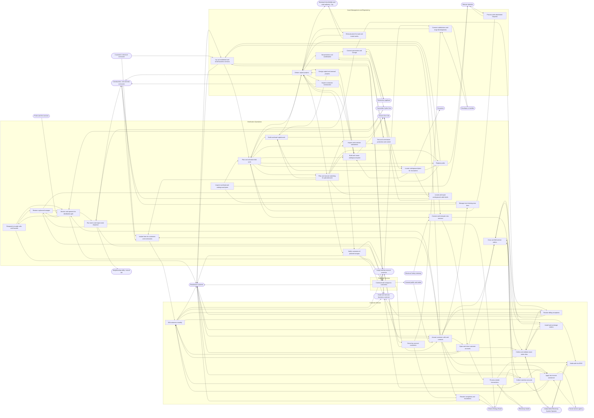

# Municipally owned electricity distribution company in Ontario (about 350,000 customers)

`electric-distribution-utility` · electric utilities: power distribution (regulated local distribution company) · modelled on public information about Hydro Ottawa Limited (City of Ottawa, through Hydro Ottawa Holding Inc.), using its OEB scorecard, OEB yearbook data, 2021-2025 rate application summaries, annual report and news releases; OEB yearbook peers (Elexicon Energy, London Hydro) checked for scale only

This is a local electricity distribution company owned by a city through a holding company, serving about 346,000 residential, commercial and industrial customers over 1,116 square kilometres of urban, suburban and rural territory in Ontario. It takes power from the transmitter's transformer stations and delivers it through 91 substations, about 5,900 circuit kilometres of overhead and underground line, 47,000 transformers and 49,000 poles to homes and businesses. Customers pay one bill that includes the commodity, transmission and regulatory charges, but the company keeps only the distribution charge, under 20% of the bill, which the Ontario Energy Board sets through five-year rate applications and annual updates; the rest passes through to the IESO and others. Its revenue is about $184M a year of distribution revenue on $1.17B of total billings, with about $83M of operating costs and over $100M a year of capital investment. It is organised into distribution operations (line, cable and station crews and a 24-hour control room), asset management and engineering, customer service (contact centre, billing, collections and metering), finance and regulatory affairs, and corporate services, with about 570 employees, most of the trades and inside staff in one union. Its work is driven by customer growth, aging assets, storms and the Distribution System Code's service standards.

| | |
|---|---|
| Employees | 658 |
| Country | Canada |
| Ownership | 100% owned by a municipality through a municipally owned holding company; the holding company also owns generation and energy services businesses that are outside this file |
| Regulators | Ontario Energy Board, Electrical Safety Authority (Ontario Regulation 22/04), Independent Electricity System Operator (market rules and settlement), Measurement Canada, Ontario Ministry of Energy, Ontario Ministry of Labour (Occupational Health and Safety Act), Ontario One Call (Ontario Underground Infrastructure Notification System Act, 2012) |
| Customers (2020) | 346,347 customers (A) |
| Residential customers (2020) | 317,918 customers (A) |
| Service area | 1,116 square kilometres (A) |
| Circuit length (2020) | 5,913 circuit km (A) |
| Substations | 91 stations (A) |
| Distribution transformers | 47,282 transformers (A) |
| Poles | 48,789 poles (A) |
| Energy delivered (2020) | 7,071,852,991 kWh (A) |
| Summer peak demand (2020) | 1,437,824 kW (A) |
| Distribution revenue (2020) | 183,816,506 CAD (A) |
| Power and distribution revenue including pass-through cost of power (2020) | 1,167,709,237 CAD (A) |
| OM&A (2020) | 83,800,000 CAD (A) |
| Net income (2020) | 34,589,258 CAD (A) |
| Total assets (2020) | 1,373,367,274 CAD (A) |
| Gross capital additions (2020) | 122,921,829 CAD (A) |
| Planned capital 2021-2025 | 503,500,000 CAD (A) |
| Rate base (2021 test year) | 1,230,736,000 CAD (A) |
| Bills issued (2021) | 4,200,000 bills (A) |
| Calls to agents (2021) | 186,632 calls (A) |
| New low-voltage services connected (2021) | 5,024 connections (A) |
| Full-time equivalent employees (2020, distribution company) | 581 FTE (A) |

## Units

- **Office of the President and CEO** (10 people, department): Leads the company, supports the board of directors, reports to the municipal shareholder and runs internal audit and enterprise risk.
- **Distribution Operations** (310 people, division): Builds, maintains and operates the overhead, underground and station plant, runs the 24-hour system control centre and dispatches field work.
  - **Overhead Lines** (113 people, department): Power line crews who build and repair pole lines, replace poles and transformers and answer trouble calls around the clock.
  - **Underground and Cable** (48 people, department): Cable crews who install, splice and repair underground cable, padmount transformers and vaults, and locate cable faults.
  - **Stations and Protection and Control** (33 people, department): Maintains the 91 substations, their breakers, transformers, batteries and protection relays, and commissions new station equipment.
  - **System Control Centre** (46 people, department): Operates the distribution grid 24 hours a day: watches SCADA, issues switching orders, directs crews during outages and coordinates with the transmitter.
  - **Work Planning and Dispatch** (31 people, department): Plans, schedules and dispatches field work orders, books customer appointments and issues planned outage notices.
  - **Field Services** (37 people, department): Cable locators, field service representatives for disconnections and service checks, and the coordinators who manage tree-trimming contractors.
- **Asset Management and Engineering** (87 people, division): Plans the system, assesses asset condition, builds the capital plan, designs new connections and capital projects, and keeps the GIS and standards.
  - **System Planning and Asset Management** (15 people, department): Forecasts load, studies capacity, assesses asset condition and reliability, and prepares the Distribution System Plan.
  - **Distribution Design and Customer Connections** (39 people, department): Designs service layouts, subdivisions, large customer connections, generator connections and capital projects.
  - **Capital Project Delivery** (16 people, department): Manages capital projects and contractors from release to close-out, including civil and construction inspection.
  - **Standards and Records** (11 people, department): Maintains construction standards, approved materials and the GIS asset records, including as-built updates.
- **Customer Service** (134 people, division): Answers customers, opens and closes accounts, bills about 350,000 customers monthly, collects payments and arrears, and manages metering and meter data.
  - **Customer Contact Centre** (44 people, department): Handles calls, emails, web forms and chat on billing, moves, outages and service requests, including Saturday hours.
  - **Billing and Settlement** (40 people, department): Runs the monthly billing cycle, clears billing exceptions, processes retailer transactions and settles with the IESO.
  - **Credit and Collections** (10 people, department): Follows up overdue accounts, sets payment arrangements, applies assistance credits and orders disconnections within OEB rules.
  - **Metering Services** (31 people, department): Installs, tests and exchanges meters, runs the meter shop and validates smart meter data sent to and returned from the provincial meter data repository.
  - **Key Accounts** (5 people, team): Serves large commercial, institutional and government customers with a named representative.
- **Finance and Regulatory Affairs** (48 people, division): Keeps the books, budgets, buys and stores materials, and prepares rate applications and regulatory reporting for the OEB.
  - **Accounting, Payables and Payroll** (20 people, department): Closes the books monthly, pays suppliers and staff, capitalises work orders and prepares budgets.
  - **Regulatory Affairs** (8 people, department): Prepares rate applications and annual updates, answers interrogatories, files OEB reporting and tracks variance accounts.
  - **Supply Chain and Stores** (19 people, department): Buys materials and services, runs the warehouses and issues poles, cable, transformers and hardware to crews.
- **Corporate Services** (69 people, division): Provides human resources, health and safety, information and operational technology, fleet and facilities, communications and legal services.
  - **Human Resources and Training** (12 people, department): Recruits staff, runs apprenticeship and trades training, and administers the IBEW collective agreement.
  - **Health, Safety and Environment** (7 people, department): Investigates incidents, audits work sites, handles spills and manages compliance with the electrical distribution safety regulation.
  - **Information and Operational Technology** (29 people, department): Supports the CIS, ERP, GIS, outage management, SCADA and metering systems, the service desk and cyber security.
  - **Fleet and Facilities** (12 people, department): Maintains the vehicle fleet of bucket trucks, digger derricks and light vehicles, and the operations and office buildings.
  - **Communications and Public Affairs** (6 people, department): Issues outage and safety messages, handles media and runs public electrical safety campaigns.
  - **Legal and Claims** (3 people, department): Handles contracts, claims against the utility and recovery of damage caused by third parties.

## Demand drivers

| Driver | Per month | Unit | Evidence |
|---|---:|---|---|
| Customers served | 346,347 | customer accounts | A [src2], [src11] |
| New and upgraded service requests | 420 | low-voltage service connections | A [src1] |
| Unplanned outage events in ordinary weather | 180 | outage events | C |
| Trouble calls and hazard reports | 900 | trouble orders | C |
| Customer calls to agents | 15,550 | calls | A [src1] |
| Locate requests from Ontario One Call | 7,500 | locate requests | C |
| Capital construction jobs released | 170 | capital work orders | B [src5], [src2] |
| Meters in service | 352,000 | meters | C |
| Generation connection applications | 5 | applications | A [src1] |

## How the core processes connect

## Process map

### Office of the President and CEO

| Process | Owner | Type | Unit of work | Per month | Priority | Receives from | Sends to |
|---|---|---|---|---:|---:|---|---|
| **Manage enterprise risk.** The risk advisor maintains the enterprise risk register with named owners: severe weather, cyber attack, workforce retirements, aging assets, regulatory decisions and the pandemic, and reports ratings and mitigations to executives and the audit committee. Major incidents and audit findings update the register between reviews. | Office of the President and CEO | management | one risk register review | 0.33 | 3 | Investigate incidents and audit safety, Monitor and respond to cyber threats | Run internal audits, Set strategy and govern through the board |
| **Run internal audits.** Internal auditors run a risk-based audit plan covering billing, procurement, payroll, capital project controls and IT access, test controls and report findings and agreed actions to the audit committee. Follow-up of overdue actions is a standing agenda item. | Office of the President and CEO | management | one audit | 1 | 3 | Manage enterprise risk | Set strategy and govern through the board |
| **Set strategy and govern through the board.** The executive team prepares the strategic direction, business plan and budget for the board of directors, which answers to the municipal shareholder; the board approves the capital plan, rate applications, financing and dividends. Board cycles run quarterly with committee meetings in between. Shareholder expectations on dividends and rates frame every plan; the City received a $23.7M dividend in 2021. | Office of the President and CEO | management | one board meeting cycle | 0.33 | 3 | Analyze reliability, Answer customer calls and contacts, Build the capital plan and Distribution System Plan, Close the books, File OEB reporting and scorecard, Manage enterprise risk, Prepare the budget and forecasts, Prepare the rebasing rate application, Run internal audits | Build the capital plan and Distribution System Plan, Communicate with the public and media, Municipal shareholder and road authority (City), Prepare the rebasing rate application, Recruit staff |

### Distribution Operations

| Process | Owner | Type | Unit of work | Per month | Priority | Receives from | Sends to |
|---|---|---|---|---:|---:|---|---|
| **Build overhead capital work.** Line crews build the overhead part of capital projects: new pole lines for growth, rebuilds of aging rear-lot and rural lines, and transformer and switch replacements. A typical job takes a four-person crew with a bucket truck and a digger derrick from one to several days, under a work protection permit and after locates. Weather, road occupancy permits, customer access and missing materials hold jobs up. | Overhead Lines | core | one overhead construction work order | 90 | 1 | Design capital and renewal projects, Locate underground plant for excavators, Maintain the vehicle fleet, Plan and execute switching for planned work, Plan and schedule field work, Run stores and issue materials | Deliver capital projects, Investigate incidents and audit safety, Maintain the vehicle fleet, Ontario One Call, Run payroll |
| **Connect and energize new services.** Once the customer has paid, the electrician's wiring has passed ESA inspection and the meter is ready, a crew connects and energizes the service: an overhead drop from a pole or an underground service from a padmount transformer. The Distribution System Code requires a low-voltage connection within five business days of all conditions being met at least 90% of the time; 5,024 were connected in 2021, all on time. Missing ESA authorizations and unfinished customer work are the usual reasons a booking moves. | Overhead Lines | core | one service connection | 420 | 1 | Electrical Safety Authority, Lay out residential and small business services, Maintain construction standards and approved materials, Plan and schedule field work | Install and exchange meters, Investigate incidents and audit safety, Open and close customer accounts, Post as-builts and maintain the GIS, Run payroll |
| **Locate underground plant for excavators.** Ontario One Call sends every dig notification in the service area to the utility; requests clear of plant are screened out and cable locators mark the rest with paint and flags or issue a clearance, within five business days for standard requests. Spring and summer volumes exceed in-house capacity, so overflow goes to a locate contractor. Late locates hold up excavators and the utility's own crews, and wrong marks lead to cable strikes and public contacts. | Field Services | core | one locate request | 7,500 | 1 | Ontario One Call, Plan and schedule field work | Build and renew underground plant, Build overhead capital work, Excavator, Handle claims and damage recovery, Investigate incidents and audit safety, Locate and repair underground cable faults, Replace poles |
| **Plan and execute switching for planned work.** Every planned job on energized or isolatable plant needs a switching order: a switching planner writes the sequence from the GIS network model, a second person checks it, and on the day the system operator directs field staff step by step and issues a work protection permit before anyone works. Orders are booked days ahead around load limits and customer outages. Errors can injure workers or drop customers, so steps are checked twice and recorded. | System Control Centre | core | one switching order | 350 | 1 | Deliver capital projects, Plan and schedule field work, Post as-builts and maintain the GIS | Build and renew underground plant, Build overhead capital work, Inspect and maintain substations, Isolate lines for customers and contractors, Locate and repair underground cable faults, Notify customers of planned outages, Replace poles |
| **Plan and schedule field work.** Work planners take released capital, maintenance and customer work orders, check that design, materials, permits, locates and switching are ready, and build weekly and daily crew schedules. They rebalance the plan every day as trouble, storms, absences and customer delays pull crews away. Jobs that are not ready when the crew arrives are the main source of lost crew time. | Work Planning and Dispatch | core | one work order scheduled | 2,000 | 1 | Build the capital plan and Distribution System Plan, Comply with the distribution safety regulation, Connect generation and storage, Deliver capital projects, Inspect overhead and underground plant, Lay out residential and small business services, Process pole attachment requests, Run stores and issue materials, Train apprentices and keep qualifications current | Build and renew underground plant, Build overhead capital work, Connect and energize new services, Inspect and maintain substations, Investigate incidents and audit safety, Locate underground plant for excavators, Plan and execute switching for planned work, Replace poles, Run stores and issue materials |
| **Respond to trouble calls and hazards.** A trouble responder on a single-person truck is dispatched by the control room to every outage or hazard report: no power at one home, a wire down, a tree on a line, a car into a pole. The responder makes the site safe, fixes simple problems such as a blown transformer fuse or a damaged service drop, and calls for a crew when the damage is larger. Calls cluster at night and in storms, when trouble trucks are the first and often only resource on the road. | Overhead Lines | core | one trouble order | 900 | 1 | Monitor and operate the distribution grid | Analyze reliability, Maintain the vehicle fleet, Monitor and operate the distribution grid, Residential customer, Restore unplanned outages |
| **Restore unplanned outages.** When an outage needs more than a trouble responder, the control room isolates the damaged section and transfers customers to other feeders where it can, and a line or cable crew repairs broken poles, failed transformers and downed conductors. The OMS tracks customers out and estimated restoration times, and each event is closed with a cause code for reliability reporting. Defective equipment, loss of supply from the transmitter and foreign interference caused most customer interruptions in 2020. | Overhead Lines | core | one outage event needing a crew | 100 | 1 | Maintain the vehicle fleet, Monitor and operate the distribution grid, Respond to trouble calls and hazards, Run stores and issue materials, Run storm and major event response | Analyze reliability, Assess asset condition and risk, Communicate outages to customers, Handle claims and damage recovery, Investigate incidents and audit safety, Locate and repair underground cable faults, Maintain the vehicle fleet, Monitor and operate the distribution grid, Post as-builts and maintain the GIS, Respond to spills and manage environmental compliance, Run payroll, Run stores and issue materials |
| **Build and renew underground plant.** Cable crews install and replace underground primary cable, padmount transformers, switchgear and vaults, splice and terminate cable after contractors have built the ducts, and energize new subdivisions. Cable replacement is a large share of renewal spending. Jobs depend on civil contractors finishing on time, on locates, on switching and on booked customer outages. | Underground and Cable | core | one underground work order | 45 | 2 | Design capital and renewal projects, Inspect contractor construction, Locate underground plant for excavators, Maintain the vehicle fleet, Plan and execute switching for planned work, Plan and schedule field work, Run stores and issue materials | Deliver capital projects, Investigate incidents and audit safety, Maintain the vehicle fleet, Ontario One Call, Respond to spills and manage environmental compliance, Run payroll |
| **Carry out field service orders.** Field service representatives carry out disconnections and reconnections for non-payment and move-outs where remote switching is not available, investigate high-bill and voltage complaints, check suspected tampering and do service checks. Appointments that need the customer present must be offered in a four-hour window and kept at least 90% of the time; 9,001 were booked in 2021. Disconnections for arrears stop for residential customers from mid-November to the end of April. | Field Services | core | one field service order | 1,300 | 2 | Answer customer calls and contacts, Collect and validate smart meter data, Collect overdue accounts, Open and close customer accounts, Resolve billing exceptions | Collect and validate smart meter data, Collect overdue accounts, Maintain the vehicle fleet, Resolve billing exceptions, Run payroll, Run stores and issue materials |
| **Inspect and maintain substations.** Station electricians inspect the 91 substations monthly and maintain power transformers, breakers, switchgear, batteries and buildings on time-based and condition-based cycles, with oil sampling and infrared scans. Major work needs a station or transformer out of service, often backed by a mobile substation, and is booked around seasonal peaks. About half of the stations had passed their expected service life when the 2021-2025 plan was written. | Stations and Protection and Control | core | one station maintenance work order | 120 | 2 | Assess asset condition and risk, Plan and execute switching for planned work, Plan and schedule field work, Run stores and issue materials | Assess asset condition and risk, Buy materials and services, Investigate incidents and audit safety, Respond to spills and manage environmental compliance, Run payroll, Test and commission protection and control |
| **Inspect overhead and underground plant.** Overhead lines, poles, padmount transformers and underground equipment are inspected on a fixed multi-year cycle by patrol, pole testing and infrared scans. Inspectors record deficiencies on tablets with photos and a priority, and urgent hazards such as a leaning pole or an open padmount go straight to a crew. The findings drive maintenance work orders, ESA due diligence records and the asset condition data. | Field Services | core | one asset inspected (a pole with its overhead equipment, or one ground-level unit such as a pad-mounted transformer, switchgear or vault) | 2,500 | 2 | Assess asset condition and risk, Build the capital plan and Distribution System Plan, Post as-builts and maintain the GIS | Assess asset condition and risk, Comply with the distribution safety regulation, Manage tree trimming near lines, Plan and schedule field work, Post as-builts and maintain the GIS, Telecom attacher |
| **Locate and repair underground cable faults.** When an underground cable fails, the control room isolates the section and a cable crew finds the fault with time-domain reflectometry and a thumper, excavates or calls a hydrovac contractor, and splices or replaces the cable. Many faults are on aging direct-buried cable in older subdivisions, where customers can be out for hours while the fault is found. Repeated faults on the same cable feed the renewal program. | Underground and Cable | core | one cable fault | 20 | 2 | Locate underground plant for excavators, Plan and execute switching for planned work, Restore unplanned outages, Run stores and issue materials | Analyze reliability, Assess asset condition and risk, Construction, civil and tree contractor, Ontario One Call, Post as-builts and maintain the GIS, Run payroll |
| **Manage tree trimming near lines.** Tree contractors trim around overhead lines on a multi-year cycle by circuit, with a coordinator planning circuits, notifying property owners, handling refusals and checking completed work before the invoice is paid. Tree contacts caused 18,548 customer interruptions in 2020 outside major events, and falling trees caused most damage in the 2022 storm. Urgent trims after patrols or customer calls are dispatched outside the cycle. | Field Services | core | one circuit-kilometre trimmed on cycle, or one urgent tree request between cycles | 125 | 2 | Answer customer calls and contacts, Build the capital plan and Distribution System Plan, Buy materials and services, Inspect overhead and underground plant, Post as-builts and maintain the GIS | Assess asset condition and risk, Construction, civil and tree contractor, Pay suppliers and contractors |
| **Monitor and operate the distribution grid.** System operators watch SCADA alarms, feeder loading and the OMS around the clock, group incoming outage calls into predicted outages, dispatch trouble responders and crews, and operate remote switches to restore customers. They coordinate with the transmitter's control centre when a transformer station or supply circuit trips. Night and weekend shifts carry the same desk with fewer people, and storms flood the desk with hundreds of events. | System Control Centre | core | one control room shift | 61 | 2 | Answer customer calls and contacts, Police and fire services, Post as-builts and maintain the GIS, Respond to trouble calls and hazards, Restore unplanned outages, Transmitter (Hydro One) | Analyze reliability, Communicate outages to customers, Forecast load and plan capacity, Respond to trouble calls and hazards, Restore unplanned outages, Run storm and major event response, Support SCADA, OMS and metering systems |
| **Replace poles.** Poles found in poor condition by inspection and testing are replaced in a planned program of about 325 to 350 poles a year: the crew sets a new pole beside the old one, transfers conductors and equipment, and removes the old pole once telecom attachers have moved their cables. Attacher transfers often leave stub poles standing for months. Storms add hundreds of broken poles in a few days. | Overhead Lines | core | one pole replaced | 28 | 2 | Assess asset condition and risk, Locate underground plant for excavators, Plan and execute switching for planned work, Plan and schedule field work, Run stores and issue materials | Assess asset condition and risk, Deliver capital projects, Ontario One Call, Run payroll, Telecom attacher |
| **Run storm and major event response.** When a storm overwhelms normal restoration, the utility declares a major event, opens an emergency operations centre, calls in all line, cable and support staff, contractors and crews from other utilities, and restores in priority order: hazards, hospitals and critical services, whole feeders and then single customers. The May 2022 derecho affected 180,000 customers with more than 1,000 outages and about 400 damaged poles, and restoration took about ten days with 600 workers in the field. Materials, vehicles, meals, lodging and customer communications all scale up at once. In 2019 to 2022 there were nine major events: five were losses of supply from Hydro One, three opened the incident command centre, and only the May 2022 derecho used mutual aid. | Distribution Operations | core | one major event | 0.19 | 2 | Monitor and operate the distribution grid, Transmitter (Hydro One) | Analyze reliability, Communicate outages to customers, Construction, civil and tree contractor, Neighbouring utility (mutual aid), Ontario Energy Board, Restore unplanned outages, Run stores and issue materials |
| **Isolate lines for customers and contractors.** Builders, roofers, tree companies and sign installers ask the utility to disconnect a service or cover lines so they can work safely near them. Dispatch books the job, the control room issues protection where needed, and a crew installs line covers or opens the service and restores it on the agreed date. Charges follow the specific service charges in the tariff. | Overhead Lines | core | one isolation request | 250 | 3 | Answer customer calls and contacts, Construction, civil and tree contractor, Customer's electrical contractor, Plan and execute switching for planned work | Bill customers monthly |
| **Notify customers of planned outages.** For each planned outage the dispatch team identifies affected customers from the GIS connectivity model, delivers notices or sends calls and emails several days ahead, and books critical customers such as medical equipment users and businesses around the work. Rescheduling for weather means repeating the notices. Scheduled outages caused 22,520 customer interruptions in 2020. | Work Planning and Dispatch | core | one planned outage | 45 | 3 | Deliver capital projects, Plan and execute switching for planned work | Communicate outages to customers, Large and key account customer, Residential customer, Small and mid-size business customer |
| **Test and commission protection and control.** Protection and control technologists test and commission relays, reclosers, station RTUs and feeder automation devices, apply the settings issued by engineering, and investigate misoperations after faults. New stations and automation projects add commissioning peaks. Settings errors can cause wide outages or leave faults uncleared, so test records are kept for every device. | Stations and Protection and Control | core | one protection test or commissioning job | 15 | 3 | Inspect and maintain substations, Set protection and coordination | Assess asset condition and risk, Post as-builts and maintain the GIS, Set protection and coordination |

### Asset Management and Engineering

| Process | Owner | Type | Unit of work | Per month | Priority | Receives from | Sends to |
|---|---|---|---|---:|---:|---|---|
| **Build the capital plan and Distribution System Plan.** Each year engineering turns planning studies, asset condition, connection forecasts, city road works and general plant needs into a capital program by OEB investment category, paced to the rate plan and to crew and contractor capacity. Every five years the program becomes the Distribution System Plan filed with the rate application; the 2021-2025 plan averaged about $100.8M net a year. Executive and board approval fix the budget, and progress is reported as DSP implementation on the scorecard (92% in 2021). | System Planning and Asset Management | management | one annual capital program (and, one year in five, the Distribution System Plan) | 0.083 | 1 | Analyze reliability, Assess asset condition and risk, Deliver capital projects, Forecast load and plan capacity, Independent Electricity System Operator, Municipal shareholder and road authority (City), Prepare the budget and forecasts, Relocate plant for road and transit works, Set strategy and govern through the board, Transmitter (Hydro One) | Deliver capital projects, Forecast load and plan capacity, Inspect overhead and underground plant, Manage tree trimming near lines, Plan and schedule field work, Prepare the budget and forecasts, Prepare the rebasing rate application, Set strategy and govern through the board |
| **Connect subdivisions and large developments.** Developers of subdivisions, condominiums and commercial buildings apply for supply. Engineering checks feeder and station capacity, designs the distribution layout, runs the economic evaluation required by the Distribution System Code to set the customer's capital contribution, and negotiates the connection or subdivision agreement. After payment the developer's contractor builds civil works under inspection, and utility crews install and energize cable and transformers. | Distribution Design and Customer Connections | core | one development project | 25 | 1 | Developer or builder, File the annual rate update and load tariffs, Forecast load and plan capacity, Large and key account customer, Maintain construction standards and approved materials, Serve key account customers | Capitalize completed work, Deliver capital projects, Developer or builder, Forecast load and plan capacity |
| **Deliver capital projects.** Project managers turn released capital projects into designs, permits, contracts, materials, outage bookings and crew time, track cost and schedule, and close projects so they can be capitalized. Projects compete with customer connections and trouble work for the same crews, and in 2021 labour and material shortages and pandemic outage limits deferred part of the plan. Civil work is mostly contracted and inspected; electrical work is done by in-house crews. | Capital Project Delivery | core | one capital project | 18 | 1 | Build and renew underground plant, Build overhead capital work, Build the capital plan and Distribution System Plan, Buy materials and services, Connect subdivisions and large developments, Design capital and renewal projects, Inspect contractor construction, Maintain construction standards and approved materials, Relocate plant for road and transit works, Replace poles, Run stores and issue materials | Build the capital plan and Distribution System Plan, Buy materials and services, Capitalize completed work, Construction, civil and tree contractor, Design capital and renewal projects, Inspect contractor construction, Municipal shareholder and road authority (City), Notify customers of planned outages, Plan and execute switching for planned work, Plan and schedule field work, Post as-builts and maintain the GIS, Set protection and coordination |
| **Lay out residential and small business services.** A residential or small business customer, or their electrician, applies for a new, upgraded or relocated service. A design technologist checks transformer and secondary capacity, visits the site if needed, issues a service layout with any customer charges, and once the customer pays and the site is ready creates the work order for the crew. Waiting for the customer's electrician and the ESA inspection takes most of the elapsed time. | Distribution Design and Customer Connections | core | one service request | 450 | 1 | Answer customer calls and contacts, Customer's electrical contractor, File the annual rate update and load tariffs, Maintain construction standards and approved materials, Post as-builts and maintain the GIS, Residential customer, Small and mid-size business customer | Connect and energize new services, Plan and schedule field work, Residential customer, Small and mid-size business customer |
| **Assess asset condition and risk.** Asset analysts combine inspection results, test data, age, failure history and loading into a health index for each asset class, estimate failure risk and rank renewal candidates. In 2019 about 19% of assets had reached expected service life, including 51% of stations and 23% of overhead assets, and 17% were in poor or very poor condition. The ranking drives the renewal budget and the pole, cable and station programs. | System Planning and Asset Management | management | one annual asset condition assessment across 12 major asset classes | 0.083 | 2 | Analyze reliability, Inspect and maintain substations, Inspect overhead and underground plant, Locate and repair underground cable faults, Manage tree trimming near lines, Post as-builts and maintain the GIS, Replace poles, Restore unplanned outages, Test and commission protection and control | Build the capital plan and Distribution System Plan, Inspect and maintain substations, Inspect overhead and underground plant, Prepare the rebasing rate application, Replace poles |
| **Connect generation and storage.** Customers and developers apply to connect rooftop solar, battery storage and larger generators. Micro-embedded projects of 10 kW or less must be connected within five business days once conditions are met; larger projects get a connection impact assessment within 60 to 90 days and then an offer to connect. In 2021 the utility connected 52 micro-embedded generators and completed six assessments totalling 11.6 MW, all on time. | Distribution Design and Customer Connections | core | one generation application | 5 | 2 | Forecast load and plan capacity, Generation applicant, Set protection and coordination | File OEB reporting and scorecard, Forecast load and plan capacity, Generation applicant, Install and exchange meters, Plan and schedule field work, Transmitter (Hydro One) |
| **Forecast load and plan capacity.** Planning engineers forecast feeder and station loads from growth, development applications and electrification, compare them with planning capacity, and propose new feeders, station expansions and load transfers. They take part in regional planning with the transmitter and the IESO for transformer station capacity. Their studies feed the Distribution System Plan and set where new customers can connect. | System Planning and Asset Management | management | one planning study (area, station, feeder or regional planning input) | 5 | 2 | Analyze reliability, Build the capital plan and Distribution System Plan, Connect generation and storage, Connect subdivisions and large developments, Independent Electricity System Operator, Monitor and operate the distribution grid, Municipal shareholder and road authority (City), Post as-builts and maintain the GIS, Transmitter (Hydro One) | Build the capital plan and Distribution System Plan, Connect generation and storage, Connect subdivisions and large developments, Independent Electricity System Operator, Prepare the rebasing rate application, Transmitter (Hydro One) |
| **Analyze reliability.** An engineer validates outage records from the OMS, checks cause codes, separates loss of supply and major events, and calculates SAIDI, SAIFI and worst-performing feeders each month and for the annual filing. In 2021 customers averaged 0.83 hours and 0.62 interruptions, excluding loss of supply and major events. Findings go to capital planning and targeted maintenance. | System Planning and Asset Management | management | one monthly reliability report | 1 | 3 | Locate and repair underground cable faults, Monitor and operate the distribution grid, Respond to trouble calls and hazards, Restore unplanned outages, Run storm and major event response | Assess asset condition and risk, Build the capital plan and Distribution System Plan, File OEB reporting and scorecard, Forecast load and plan capacity, Set strategy and govern through the board |
| **Design capital and renewal projects.** Design technologists produce construction drawings, bills of materials and estimates for capital and renewal projects from field surveys and the GIS model, apply construction standards, and obtain municipal consents and road permits. Designs are reviewed by a supervisor and, for complex work, sealed by an engineer. Changes found in the field come back for redesign. | Distribution Design and Customer Connections | core | one design package | 60 | 3 | Deliver capital projects, Maintain construction standards and approved materials, Post as-builts and maintain the GIS | Build and renew underground plant, Build overhead capital work, Deliver capital projects |
| **Inspect contractor construction.** Construction inspectors visit contractor sites building ducts, vaults, transformer pads and pole lines, check work against standards and drawings, and accept or reject it before utility crews install cable and equipment. Deficiencies go back to the contractor. Accepted quantities support contractor progress payments. | Capital Project Delivery | core | one site inspection | 120 | 3 | Deliver capital projects | Build and renew underground plant, Construction, civil and tree contractor, Deliver capital projects, Pay suppliers and contractors |
| **Maintain construction standards and approved materials.** Standards engineers maintain construction standards and approved material specifications, evaluate new products, respond to field feedback and ESA findings, and approve design changes. Approved designs and equipment are a requirement of O. Reg. 22/04. Supply problems often force quick approval of substitute materials. | Standards and Records | management | one standard revision | 4 | 3 | Comply with the distribution safety regulation, Investigate incidents and audit safety | Buy materials and services, Comply with the distribution safety regulation, Connect and energize new services, Connect subdivisions and large developments, Deliver capital projects, Design capital and renewal projects, Investigate incidents and audit safety, Lay out residential and small business services |
| **Post as-builts and maintain the GIS.** GIS technicians post as-built drawings from completed jobs into the GIS and ERP asset register, update the network connectivity used by the OMS and control room, and fix data errors reported from the field. Backlogs of unposted as-builts mean the control room and designers work from out-of-date maps. Every new service, transformer, pole and cable section passes through this queue. | Standards and Records | support | one as-built posted | 450 | 3 | Connect and energize new services, Deliver capital projects, Inspect overhead and underground plant, Locate and repair underground cable faults, Restore unplanned outages, Test and commission protection and control | Assess asset condition and risk, Capitalize completed work, Design capital and renewal projects, Forecast load and plan capacity, Inspect overhead and underground plant, Lay out residential and small business services, Manage tree trimming near lines, Monitor and operate the distribution grid, Plan and execute switching for planned work |
| **Process pole attachment requests.** Telecom companies apply to attach fibre and cable to poles. A technologist checks pole loading and clearances, specifies make-ready work such as taller poles or rearranged equipment, bills the attacher and issues a permit, and transfers after pole replacements are tracked until the old pole can be removed. Fibre and wireless rollouts produce bursts of applications. | Standards and Records | core | one attachment application | 40 | 3 | Telecom attacher | Close the books, Plan and schedule field work, Telecom attacher |
| **Relocate plant for road and transit works.** When the city widens roads, renews sewers or builds light rail, the utility must move poles, cable and equipment, with costs shared under provincial rules for utilities on public roads. Project managers agree scope, cost sharing and timing, then run the relocation like a capital project. City schedules change often, which leaves crews and materials waiting. | Capital Project Delivery | core | one relocation project | 4 | 3 | Municipal shareholder and road authority (City) | Build the capital plan and Distribution System Plan, Deliver capital projects, Municipal shareholder and road authority (City) |
| **Set protection and coordination.** Protection engineers run coordination studies and issue relay and recloser settings for new stations, feeder changes and generator connections, and review misoperations reported by technologists. Generator connections increasingly change fault levels and need new settings. Settings are kept in a protection database with version control. | System Planning and Asset Management | core | one settings package | 10 | 3 | Deliver capital projects, Test and commission protection and control | Connect generation and storage, Test and commission protection and control |

### Customer Service

| Process | Owner | Type | Unit of work | Per month | Priority | Receives from | Sends to |
|---|---|---|---|---:|---:|---|---|
| **Answer customer calls and contacts.** Customer service representatives answer calls, emails, web forms and chat about bills, payments, moves, outages, new services and complaints, using the CIS, the OMS and the web portal. The OEB standard is 65% of calls answered within 30 seconds; in 2021 agents took 186,632 calls, answered 83.14% on time and resolved 89% at first contact. Storms and rate changes bring call spikes that the IVR and outage map only partly absorb. | Customer Contact Centre | core | one customer call answered by an agent | 15,550 | 1 | Change and release business systems, Communicate outages to customers, File the annual rate update and load tariffs, General public and media, Residential customer, Small and mid-size business customer | Apply low-income assistance, Carry out field service orders, Collect overdue accounts, File OEB reporting and scorecard, Isolate lines for customers and contractors, Lay out residential and small business services, Manage tree trimming near lines, Monitor and operate the distribution grid, Open and close customer accounts, Resolve billing exceptions, Resolve complaints and escalations, Set strategy and govern through the board |
| **Bill customers monthly.** The CIS bills about 350,000 customers monthly in daily cycles, applying OEB-approved distribution rates, the commodity price under the Regulated Price Plan or a retailer contract, transmission and regulatory charges, rebates and HST to the validated reads. Bills that pass validation are printed or posted online; more than 60% of customers were paperless by 2021. The OEB standard is 98% billing accuracy, and the utility reported 99.88% on more than 4.2 million bills in 2021. | Billing and Settlement | core | one customer bill | 350,000 | 1 | Apply low-income assistance, Change and release business systems, Collect and validate smart meter data, File the annual rate update and load tariffs, Isolate lines for customers and contractors, Open and close customer accounts, Process retailer transactions | Close the books, Large and key account customer, Residential customer, Resolve billing exceptions, Settle with the IESO, Small and mid-size business customer |
| **Collect and validate smart meter data.** Each day the AMI head-end collects hourly reads from about 350,000 smart meters and sends them to the provincial Meter Data Management/Repository, which validates, estimates and edits the data and returns billing quantities. Meter data analysts work the exceptions: meters not communicating, failed validations and register mismatches, and send field orders when a meter must be visited. Unresolved exceptions become estimated bills. | Metering Services | core | one daily read cycle | 30.4 | 1 | Carry out field service orders, Independent Electricity System Operator, Install and exchange meters, Open and close customer accounts | Bill customers monthly, Carry out field service orders, Independent Electricity System Operator, Install and exchange meters, Resolve billing exceptions, Support SCADA, OMS and metering systems |
| **Collect overdue accounts.** The CIS ages unpaid balances and issues reminders and disconnection notices under the OEB's customer service rules, which require notice periods, offers of arrears payment agreements and extra protection for eligible low-income customers. Collections representatives call customers, set up payment agreements, assess security deposits, and order disconnections or load limiters, which are barred for residential customers from November 15 to April 30. Disconnections were suspended for long periods during the pandemic, so arrears grew in 2020 and 2021. | Credit and Collections | core | one account in arrears (one overdue bill episode) | 12,000 | 1 | Answer customer calls and contacts, Apply customer payments, Apply low-income assistance, Carry out field service orders | Apply low-income assistance, Carry out field service orders, Close the books, File OEB reporting and scorecard, Residential customer, Small and mid-size business customer |
| **Open and close customer accounts.** When a customer moves in or out, the account is closed or opened in the CIS with a reading on the move date from the smart meter, a security deposit is assessed for new non-residential customers or those without good credit history, and landlords' default accounts pick up vacant units. New services energized by crews also create accounts. Late or missing move notices produce bills to the wrong person and later corrections. | Customer Contact Centre | core | one move request (move-out, move-in or both at one premise) or new-service account | 5,500 | 1 | Answer customer calls and contacts, Connect and energize new services, Residential customer | Bill customers monthly, Carry out field service orders, Collect and validate smart meter data, Process retailer transactions |
| **Resolve billing exceptions.** Bills that fail validation are held: very high or low consumption, estimated reads, missing meter changes, rate class or retailer mismatches. Billing analysts investigate in the CIS and meter data, correct and release the bill, cancel and rebill earlier periods when needed, and send field orders when a meter must be checked. Holds that age past the billing window break the monthly billing requirement and generate calls. | Billing and Settlement | core | one held bill or billing investigation | 6,000 | 1 | Answer customer calls and contacts, Bill customers monthly, Carry out field service orders, Collect and validate smart meter data | Carry out field service orders, Close the books, Residential customer, Small and mid-size business customer |
| **Install and exchange meters.** Meter technicians install meters for new services, exchange failed and non-communicating meters, replace meters whose Measurement Canada seal period has expired, and install bidirectional meters for generators. Each exchange records old and new meter numbers and readings, which must reach the CIS and the provincial repository before the next bill. Large commercial meters with instrument transformers need two technicians and an outage or bypass. | Metering Services | core | one meter installation or exchange | 2,000 | 2 | Collect and validate smart meter data, Connect and energize new services, Connect generation and storage, Run stores and issue materials, Test and sample meters | Collect and validate smart meter data, Residential customer, Test and sample meters |
| **Settle with the IESO.** Each month the settlement analyst pays the IESO invoice for wholesale energy, global adjustment and market charges, and submits the Regulated Price Plan settlement and global adjustment allocations that reconcile what customers were billed with what the market charged. Errors flow into retail settlement variance accounts that the OEB later reviews. Cost of power, about $984M in 2020, passes through to customers but must be reconciled exactly. | Billing and Settlement | core | one monthly settlement | 1 | 2 | Bill customers monthly, Independent Electricity System Operator, Process retailer transactions | Close the books, Independent Electricity System Operator, Manage cash, financing and insurance, Track variance and deferral accounts |
| **Apply customer payments.** Payments arrive daily from banks, pre-authorized debits, card processors, cheques and payment agents. The CIS loads remittance files automatically, and a billing analyst reconciles totals to the bank deposit and applies unidentified, misdirected and returned payments by hand. Errors here trigger wrong collection notices. | Billing and Settlement | support | one daily payment file and its exceptions | 30 | 3 | Banks and payment processors | Close the books, Collect overdue accounts |
| **Apply low-income assistance.** Customers in hardship are referred to the Ontario Electricity Support Program, whose approved credits are applied to their monthly bills, and to LEAP emergency financial assistance, which social agencies administer partly with distributor funds. Collections staff apply credits, hold collection action while applications are pending and offer longer payment agreements. Pandemic relief programs added temporary credits in 2020 and 2021. | Credit and Collections | core | one assistance application or credit | 250 | 3 | Answer customer calls and contacts, Collect overdue accounts, Ontario Energy Board, Social service agency | Bill customers monthly, Collect overdue accounts, File OEB reporting and scorecard, Social service agency |
| **Process retailer transactions.** When a customer signs with a licensed retailer, the retailer sends an enrolment through the EBT hub; the billing team validates it, switches the account at the next read and bills the retailer's price, and drops, changes and rejections follow the same route. Retailer amounts are settled monthly. Only a small share of customers buy from retailers. | Billing and Settlement | core | one retailer transaction | 500 | 3 | Electricity retailer, Open and close customer accounts | Bill customers monthly, Electricity retailer, Settle with the IESO |
| **Resolve complaints and escalations.** Complaints that front-line agents cannot resolve go to a supervisor or customer relations specialist, who investigates billing, outage, damage or service issues, replies in writing and tracks the case to closure. Complaints referred by the OEB have fixed response times and are reported. Recurring themes go to the business areas concerned. | Customer Contact Centre | core | one complaint | 120 | 3 | Answer customer calls and contacts, Ontario Energy Board, Serve key account customers | Handle claims and damage recovery, Ontario Energy Board, Residential customer |
| **Serve key account customers.** Key account representatives look after large users, federal and institutional campuses and large commercial customers: they coordinate planned outages, explain bills and global adjustment, follow up outages and power quality complaints, and bring large load additions to engineering early. The formal Key Accounts program is one of the utility's regular engagement channels. | Key Accounts | core | one key account request | 100 | 3 | Large and key account customer | Connect subdivisions and large developments, Large and key account customer, Resolve complaints and escalations |
| **Test and sample meters.** The meter shop receives new meters, tests samples from each shipment, and runs Measurement Canada sampling of in-service meter groups so a group's seal can be extended instead of replacing every meter. Groups that fail sampling must be replaced, which creates a large exchange program. Failed meters returned from the field are tested before disposal or warranty claims. | Metering Services | support | one meter lot or sample test | 4 | 3 | Install and exchange meters, Run stores and issue materials | Install and exchange meters, Measurement Canada |

### Finance and Regulatory Affairs

| Process | Owner | Type | Unit of work | Per month | Priority | Receives from | Sends to |
|---|---|---|---|---:|---:|---|---|
| **Prepare the rebasing rate application.** Every five years the utility files a Custom Incentive Rate-setting application covering its business plan, Distribution System Plan, OM&A, rate base, cost of capital, load forecast, cost allocation and rate design. Intervenors and OEB staff send written interrogatories, the parties hold a settlement conference, and the OEB issues a decision and rate order; the 2021-2025 application asked for a 2021 service revenue requirement of $216.6M. Nearly every department works on it for more than a year. | Regulatory Affairs | management | one rate application | 0.0167 | 1 | Assess asset condition and risk, Build the capital plan and Distribution System Plan, Close the books, Forecast load and plan capacity, Ontario Energy Board, Prepare the budget and forecasts, Set strategy and govern through the board, Track variance and deferral accounts | Communicate with the public and media, File the annual rate update and load tariffs, Ontario Energy Board, Set strategy and govern through the board |
| **Buy materials and services.** Buyers source poles, cable, transformers, meters and hardware under multi-year agreements and tenders, and contract civil, tree, locate and construction services. Requisitions come from stores replenishment and project managers; long lead times for transformers and switchgear, which grew in 2021 and 2022, force early ordering. Public-sector style tendering rules apply to a municipally owned company. | Supply Chain and Stores | support | one purchase order or contract | 600 | 2 | Deliver capital projects, Inspect and maintain substations, Maintain construction standards and approved materials, Maintain the vehicle fleet, Run stores and issue materials | Construction, civil and tree contractor, Deliver capital projects, Manage tree trimming near lines, Materials supplier, Pay suppliers and contractors, Run stores and issue materials |
| **File OEB reporting and scorecard.** Under the OEB's Reporting and Record-keeping Requirements the utility files service quality and reliability data during the year and financial statements, customer and asset statistics annually, which the OEB publishes in its yearbook and scorecard. Regulatory analysts gather the data from the CIS, OMS, ERP and HR systems, reconcile it, file through the OEB portal and write the scorecard commentary. Late or inconsistent filings draw OEB compliance follow-up. | Regulatory Affairs | management | one RRR return (one section due on one deadline, or the scorecard MD&A) | 1.75 | 2 | Analyze reliability, Answer customer calls and contacts, Apply low-income assistance, Close the books, Collect overdue accounts, Comply with the distribution safety regulation, Connect generation and storage, Track variance and deferral accounts | Ontario Energy Board, Set strategy and govern through the board |
| **Run stores and issue materials.** Stores attendants receive deliveries, stage materials for scheduled jobs, issue materials to crews early in the morning and after hours for trouble, and trigger replenishment at minimum stock. During storms stores run around the clock and poles, transformers and conductor can run short. Issues are charged to work orders in the ERP. | Supply Chain and Stores | support | one material issue line | 4,500 | 2 | Buy materials and services, Carry out field service orders, Materials supplier, Plan and schedule field work, Restore unplanned outages, Run storm and major event response | Build and renew underground plant, Build overhead capital work, Buy materials and services, Close the books, Deliver capital projects, Inspect and maintain substations, Install and exchange meters, Locate and repair underground cable faults, Maintain the vehicle fleet, Plan and schedule field work, Replace poles, Restore unplanned outages, Test and sample meters |
| **Capitalize completed work.** Accountants review completed capital work orders, check that labour, materials, contractor costs and capital contributions are coded correctly, and capitalize assets into the fixed asset register when they go into service. As-built records and work order completion often arrive months after energization, which delays capitalization and rate base. | Accounting, Payables and Payroll | support | one work order capitalized | 250 | 3 | Connect subdivisions and large developments, Deliver capital projects, Post as-builts and maintain the GIS | Close the books |
| **Close the books.** Accountants post billing, settlement, payables, payroll, inventory and work order entries, accrue unbilled revenue and unbilled power costs, reconcile the bank and regulatory accounts, and produce monthly results for management and the parent company. Year-end adds the external audit. Late cost postings from field work orders are a frequent cause of adjustments. | Accounting, Payables and Payroll | support | one monthly close | 1 | 3 | Apply customer payments, Bill customers monthly, Capitalize completed work, Collect overdue accounts, Pay suppliers and contractors, Process pole attachment requests, Resolve billing exceptions, Run payroll, Run stores and issue materials, Settle with the IESO, Track variance and deferral accounts | External auditor, File OEB reporting and scorecard, Holding company and lenders, Prepare the budget and forecasts, Prepare the rebasing rate application, Set strategy and govern through the board |
| **File the annual rate update and load tariffs.** Between rebasing applications the utility files an annual update that applies the approved escalation, updates retail transmission service rates and disposes of variance account balances, then loads the new tariff into the CIS for the effective date. Rate changes must be tested in the CIS before they go live, and customers are told about bill impacts. | Regulatory Affairs | management | one annual rate update | 0.083 | 3 | Ontario Energy Board, Prepare the rebasing rate application, Track variance and deferral accounts | Answer customer calls and contacts, Bill customers monthly, Change and release business systems, Connect subdivisions and large developments, Lay out residential and small business services, Ontario Energy Board |
| **Manage cash, financing and insurance.** Finance forecasts cash needs for capital and the monthly IESO payment, draws on credit facilities and long-term debt arranged through the parent company, pays dividends to the shareholder and renews insurance. The large IESO payment each month makes cash timing tight. | Accounting, Payables and Payroll | support | one monthly cash and financing cycle | 1 | 3 | Prepare the budget and forecasts, Settle with the IESO | Holding company and lenders, Insurer |
| **Pay suppliers and contractors.** Supplier and contractor invoices are matched to purchase orders and receipts or to certified progress quantities, coded to work orders, approved and paid by EFT. Contractor invoices for civil work, tree trimming and storm support need field certification before payment, which is the usual cause of delay. | Accounting, Payables and Payroll | support | one supplier invoice | 3,500 | 3 | Buy materials and services, Construction, civil and tree contractor, Inspect contractor construction, Maintain the vehicle fleet, Manage tree trimming near lines, Materials supplier | Close the books, Construction, civil and tree contractor, Materials supplier |
| **Prepare the budget and forecasts.** Each autumn finance builds the next year's OM&A and capital budget with each division, within the rate plan and the board's dividend and debt targets, and refreshes forecasts quarterly. The capital plan from engineering is the largest input. Gaps between rates and costs are closed by deferring programs or finding productivity savings. | Accounting, Payables and Payroll | management | one annual budget | 0.083 | 3 | Build the capital plan and Distribution System Plan, Close the books | Build the capital plan and Distribution System Plan, Maintain buildings and yards, Manage cash, financing and insurance, Prepare the rebasing rate application, Set strategy and govern through the board |
| **Run payroll.** Payroll clerks process biweekly pay for about 570 staff from crew time entries, which include overtime, standby, call-out and shift premiums under the IBEW collective agreement. Storms create heavy overtime that must be keyed and checked within the pay period. Labour charges are posted to work orders for capitalization. | Accounting, Payables and Payroll | support | one payroll run | 2.17 | 3 | Administer the collective agreement, Build and renew underground plant, Build overhead capital work, Carry out field service orders, Connect and energize new services, Inspect and maintain substations, Locate and repair underground cable faults, Recruit staff, Replace poles, Restore unplanned outages | Banks and payment processors, Close the books |
| **Track variance and deferral accounts.** Regulatory analysts track the variance and deferral accounts the OEB allows, including retail settlement variances for power and global adjustment and pandemic-related costs in 2020 to 2022, with monthly carrying charges. Balances are tested for disposition in the annual rate update. Errors in these accounts can reverse millions of dollars of revenue later. | Regulatory Affairs | management | one monthly variance account update | 1 | 3 | Settle with the IESO | Close the books, File OEB reporting and scorecard, File the annual rate update and load tariffs, Prepare the rebasing rate application |

### Corporate Services

| Process | Owner | Type | Unit of work | Per month | Priority | Receives from | Sends to |
|---|---|---|---|---:|---:|---|---|
| **Comply with the distribution safety regulation.** Under Ontario Regulation 22/04 the utility must use approved designs and equipment, inspect construction, keep records and report serious electrical incidents to the Electrical Safety Authority. Each year the utility hires an ESA-approved auditor, ESA reviews the auditor's report, and a professional engineer, director or officer signs the Declaration of Compliance. Staff prepare due diligence inspection records, answer ESA audits and public safety concerns, and report every contact with utility plant; in 2021 the utility reported 20 public contacts, none serious, and was found compliant. | Health, Safety and Environment | management | one ESA reportable item (incident report, ESA finding or concern, or the annual audit and declaration) | 3 | 2 | Electrical Safety Authority, Inspect overhead and underground plant, Investigate incidents and audit safety, Maintain construction standards and approved materials | Electrical Safety Authority, File OEB reporting and scorecard, Maintain construction standards and approved materials, Plan and schedule field work |
| **Investigate incidents and audit safety.** Every injury, near miss, vehicle incident and electrical contact is reported, investigated by the supervisor with a safety advisor, and closed with corrective actions; advisors also audit crews in the field and support the joint health and safety committee. High-voltage work, traffic and heavy equipment make field work hazardous, and serious incidents are reported to the Ministry of Labour. The custom scorecard tracks the all injury frequency rate and lost workday severity. | Health, Safety and Environment | management | one incident or one field safety audit | 35 | 2 | Build and renew underground plant, Build overhead capital work, Connect and energize new services, Inspect and maintain substations, Locate underground plant for excavators, Maintain construction standards and approved materials, Plan and schedule field work, Restore unplanned outages | Comply with the distribution safety regulation, Maintain construction standards and approved materials, Manage enterprise risk, Train apprentices and keep qualifications current |
| **Maintain the vehicle fleet.** Fleet mechanics run preventive maintenance and annual safety inspections on about 220 vehicles, repair breakdowns, and keep aerial devices dielectric-tested and certified. A bucket truck out of service can idle a whole crew, so repairs are prioritized by crew impact. Vehicles are replaced on age and condition through the capital plan. | Fleet and Facilities | support | one fleet work order | 220 | 2 | Build and renew underground plant, Build overhead capital work, Carry out field service orders, Maintain the vehicle fleet, Respond to trouble calls and hazards, Restore unplanned outages, Run stores and issue materials | Build and renew underground plant, Build overhead capital work, Buy materials and services, Maintain the vehicle fleet, Materials supplier, Pay suppliers and contractors, Restore unplanned outages |
| **Administer the collective agreement.** HR administers the collective agreement with the IBEW, which represents about 390 trades and inside staff: grievances, overtime and call-out disputes, seniority-based postings and bargaining. Storm overtime and call-out lists generate many disputes. The agreement in force through the period expired in March 2023. | Human Resources and Training | support | one grievance or labour issue | 3 | 3 | Union (IBEW) | Run payroll, Union (IBEW) |
| **Change and release business systems.** Business systems analysts configure and release changes to the CIS, ERP, GIS and web portal: new rates each year, regulatory billing changes such as pandemic price changes, new programs and fixes. Every billing change needs testing against sample bills before release, and errors reach thousands of customers at once. | Information and Operational Technology | support | one system change | 25 | 3 | File the annual rate update and load tariffs, Run the IT service desk | Answer customer calls and contacts, Bill customers monthly, Monitor and respond to cyber threats |
| **Communicate outages to customers.** Outage information from the OMS feeds the outage map, IVR messages and social media, and during large outages communications advisors post regular updates with estimated restoration times and safety warnings. Accurate estimates depend on crews reporting damage assessments promptly. During the 2022 storm the utility issued several updates a day for more than a week. | Communications and Public Affairs | core | one outage communication | 180 | 3 | Monitor and operate the distribution grid, Notify customers of planned outages, Restore unplanned outages, Run storm and major event response | Answer customer calls and contacts, General public and media, Residential customer |
| **Communicate with the public and media.** Communications advisors run public safety campaigns about overhead and underground lines, digging and tree planting, answer media questions, publish news releases, and support rate application engagement. Public awareness of electrical safety is measured by a survey (72% in 2021). | Communications and Public Affairs | management | one public communication | 30 | 3 | Prepare the rebasing rate application, Set strategy and govern through the board | General public and media |
| **Handle claims and damage recovery.** Legal staff handle claims against the utility for damage from outages, voltage events, vehicle accidents and construction, working with the insurer, and recover repair costs from drivers and excavators who damage poles and cable. Recovery needs complete crew cost records and police or locate evidence. | Legal and Claims | support | one claim | 25 | 3 | Locate underground plant for excavators, Resolve complaints and escalations, Respond to spills and manage environmental compliance, Restore unplanned outages | Excavator, Insurer |
| **Maintain buildings and yards.** Facilities coordinators maintain the operations centres, office buildings, stores yards and control centre, manage cleaning, security and building systems, and handle moves and space changes through contractors. The control centre and stores need backup power and access around the clock. | Fleet and Facilities | support | one facilities request | 120 | 3 | Prepare the budget and forecasts | Construction, civil and tree contractor |
| **Monitor and respond to cyber threats.** Cyber analysts monitor security alerts across corporate and operational networks, review access to SCADA and the CIS, track patching, and report against the OEB's cyber security framework. Phishing and ransomware attempts are constant, and an incident in the control network could stop remote switching. | Information and Operational Technology | management | one security alert investigated | 10 | 3 | Change and release business systems, Support SCADA, OMS and metering systems | Manage enterprise risk, Ontario Energy Board |
| **Recruit staff.** HR posts approved vacancies, screens applicants, runs aptitude tests for apprentices and interviews, checks references and driver's licences, and onboards new staff. Retirements in trades and control room roles drive a steady flow of apprentice and journeyperson hiring; the pandemic froze hiring in 2020. | Human Resources and Training | support | one job requisition | 7 | 3 | Set strategy and govern through the board | Job applicant, Run payroll, Run the IT service desk, Train apprentices and keep qualifications current |
| **Respond to spills and manage environmental compliance.** Leaking or storm-damaged transformers spill mineral oil onto roads, lawns and storm drains, and some older equipment may contain PCBs. Advisors respond with spill contractors, report to the provincial spills line when required, arrange clean-up and testing, and manage disposal of oil and old equipment. | Health, Safety and Environment | support | one spill or environmental event | 6 | 3 | Build and renew underground plant, Inspect and maintain substations, Restore unplanned outages | Construction, civil and tree contractor, Handle claims and damage recovery |
| **Run the IT service desk.** The service desk logs incidents and requests from staff, sets up accounts for new hires, supports laptops, field tablets and phones, and routes problems in the CIS, ERP and GIS to business systems analysts. Field tablet problems at the start of a shift hold up crews, so they get priority. | Information and Operational Technology | support | one IT ticket | 1,200 | 3 | Recruit staff | Change and release business systems |
| **Support SCADA, OMS and metering systems.** OT specialists keep SCADA, the OMS, the AMI head-end and the field communications network running, add new stations and devices to SCADA, and are on call when the control room loses visibility. OMS model updates from GIS have to be loaded and tested without disrupting live operations. | Information and Operational Technology | support | one OT ticket | 60 | 3 | Collect and validate smart meter data, Monitor and operate the distribution grid | Monitor and respond to cyber threats |
| **Train apprentices and keep qualifications current.** Trades apprentices follow a multi-year program of college blocks, on-the-job hours and in-house training, and all field staff keep current qualifications in work protection, first aid, rescue and equipment operation. The coordinator tracks hours and expiry dates, and an expired qualification takes a worker off a crew. In 2020 the program had 44 apprentices, 26% of the trades workforce. | Human Resources and Training | support | one training course or qualification record | 35 | 3 | Investigate incidents and audit safety, Recruit staff | Plan and schedule field work |

## Roles

| Role | Unit | Layer | Reports to | Headcount | Loaded cost per hour |
|---|---|---|---|---:|---:|
| President and Chief Executive Officer | Office of the President and CEO | executive |  | 1 | 230 CAD |
| Vice-President (operations, engineering, customer service, finance, corporate services) | Office of the President and CEO | executive | President and Chief Executive Officer | 5 | 160 CAD |
| Executive assistant and corporate secretary | Office of the President and CEO | individual contributor | President and Chief Executive Officer | 2 | 48 CAD |
| Internal auditor and enterprise risk advisor | Office of the President and CEO | senior specialist | President and Chief Executive Officer | 2 | 72 CAD |
| Director, distribution operations | Distribution Operations | director | Vice-President (operations, engineering, customer service, finance, corporate services) | 2 | 120 CAD |
| Overhead lines supervisor | Overhead Lines | supervisor | Director, distribution operations | 9 | 80 CAD |
| Power line technician (journeyperson) | Overhead Lines | individual contributor | Overhead lines supervisor | 69 | 65 CAD |
| Apprentice power line technician | Overhead Lines | individual contributor | Overhead lines supervisor | 22 | 46 CAD |
| Trouble response power line technician | Overhead Lines | individual contributor | Overhead lines supervisor | 13 | 70 CAD |
| Underground and cable supervisor | Underground and Cable | supervisor | Director, distribution operations | 4 | 80 CAD |
| Cable splicer / underground power line technician | Underground and Cable | individual contributor | Underground and cable supervisor | 34 | 66 CAD |
| Apprentice cable splicer | Underground and Cable | individual contributor | Underground and cable supervisor | 10 | 46 CAD |
| Stations and protection supervisor | Stations and Protection and Control | supervisor | Director, distribution operations | 3 | 82 CAD |
| Station electrician (power system electrician) | Stations and Protection and Control | individual contributor | Stations and protection supervisor | 22 | 67 CAD |
| Protection and control technologist | Stations and Protection and Control | senior specialist | Stations and protection supervisor | 8 | 65 CAD |
| Manager, system control centre | System Control Centre | manager | Director, distribution operations | 1 | 105 CAD |
| Control room shift supervisor | System Control Centre | supervisor | Manager, system control centre | 6 | 85 CAD |
| Distribution system operator (control room) | System Control Centre | individual contributor | Control room shift supervisor | 30 | 72 CAD |
| Switching and outage planner | System Control Centre | senior specialist | Manager, system control centre | 9 | 70 CAD |
| Work planning and dispatch supervisor | Work Planning and Dispatch | supervisor | Director, distribution operations | 2 | 72 CAD |
| Work planner and scheduler | Work Planning and Dispatch | individual contributor | Work planning and dispatch supervisor | 19 | 55 CAD |
| Field service dispatcher | Work Planning and Dispatch | individual contributor | Work planning and dispatch supervisor | 10 | 50 CAD |
| Field services supervisor | Field Services | supervisor | Director, distribution operations | 3 | 72 CAD |
| Cable locator | Field Services | individual contributor | Field services supervisor | 10 | 45 CAD |
| Field service representative | Field Services | individual contributor | Field services supervisor | 20 | 50 CAD |
| Vegetation management coordinator | Field Services | senior specialist | Field services supervisor | 4 | 56 CAD |
| Director, asset management and engineering | Asset Management and Engineering | director | Vice-President (operations, engineering, customer service, finance, corporate services) | 2 | 120 CAD |
| Engineering manager (planning, design, projects, standards) | Asset Management and Engineering | manager | Director, asset management and engineering | 4 | 100 CAD |
| System planning engineer | System Planning and Asset Management | senior specialist | Engineering manager (planning, design, projects, standards) | 8 | 72 CAD |
| Asset management engineer / analyst | System Planning and Asset Management | senior specialist | Engineering manager (planning, design, projects, standards) | 7 | 68 CAD |
| Distribution design supervisor | Distribution Design and Customer Connections | supervisor | Engineering manager (planning, design, projects, standards) | 4 | 78 CAD |
| Distribution design technologist | Distribution Design and Customer Connections | individual contributor | Distribution design supervisor | 30 | 57 CAD |
| Customer and generation connections engineer | Distribution Design and Customer Connections | senior specialist | Distribution design supervisor | 5 | 72 CAD |
| Capital project manager | Capital Project Delivery | senior specialist | Engineering manager (planning, design, projects, standards) | 8 | 74 CAD |
| Construction inspector | Capital Project Delivery | individual contributor | Capital project manager | 8 | 56 CAD |
| GIS and records technician | Standards and Records | individual contributor | Engineering manager (planning, design, projects, standards) | 8 | 50 CAD |
| Standards engineer | Standards and Records | senior specialist | Engineering manager (planning, design, projects, standards) | 3 | 72 CAD |
| Director, customer service | Customer Service | director | Vice-President (operations, engineering, customer service, finance, corporate services) | 1 | 115 CAD |
| Customer service manager (contact centre, billing and credit, metering) | Customer Service | manager | Director, customer service | 3 | 88 CAD |
| Contact centre supervisor | Customer Contact Centre | supervisor | Customer service manager (contact centre, billing and credit, metering) | 4 | 58 CAD |
| Customer service representative | Customer Contact Centre | individual contributor | Contact centre supervisor | 40 | 42 CAD |
| Billing supervisor | Billing and Settlement | supervisor | Customer service manager (contact centre, billing and credit, metering) | 2 | 60 CAD |
| Billing analyst | Billing and Settlement | individual contributor | Billing supervisor | 34 | 47 CAD |
| Settlement and retailer analyst | Billing and Settlement | senior specialist | Billing supervisor | 4 | 56 CAD |
| Credit and collections supervisor | Credit and Collections | supervisor | Customer service manager (contact centre, billing and credit, metering) | 1 | 58 CAD |
| Credit and collections representative | Credit and Collections | individual contributor | Credit and collections supervisor | 9 | 44 CAD |
| Metering supervisor | Metering Services | supervisor | Customer service manager (contact centre, billing and credit, metering) | 2 | 70 CAD |
| Meter technician | Metering Services | individual contributor | Metering supervisor | 19 | 60 CAD |
| Meter data analyst | Metering Services | individual contributor | Metering supervisor | 10 | 52 CAD |
| Key account representative | Key Accounts | senior specialist | Customer service manager (contact centre, billing and credit, metering) | 5 | 65 CAD |
| Director, finance (controller) | Finance and Regulatory Affairs | director | Vice-President (operations, engineering, customer service, finance, corporate services) | 1 | 115 CAD |
| Accountant / financial analyst | Accounting, Payables and Payroll | individual contributor | Director, finance (controller) | 10 | 60 CAD |
| Budget and forecasting analyst | Accounting, Payables and Payroll | individual contributor | Director, finance (controller) | 4 | 60 CAD |
| Accounts payable and payroll clerk | Accounting, Payables and Payroll | individual contributor | Director, finance (controller) | 6 | 42 CAD |
| Manager, regulatory affairs | Regulatory Affairs | manager | Vice-President (operations, engineering, customer service, finance, corporate services) | 1 | 100 CAD |
| Regulatory analyst | Regulatory Affairs | senior specialist | Manager, regulatory affairs | 7 | 66 CAD |
| Supply chain supervisor | Supply Chain and Stores | supervisor | Director, finance (controller) | 2 | 64 CAD |
| Buyer / procurement specialist | Supply Chain and Stores | individual contributor | Supply chain supervisor | 6 | 53 CAD |
| Stores attendant | Supply Chain and Stores | individual contributor | Supply chain supervisor | 11 | 45 CAD |
| Manager, human resources and labour relations | Human Resources and Training | manager | Vice-President (operations, engineering, customer service, finance, corporate services) | 1 | 95 CAD |
| HR advisor / recruiter | Human Resources and Training | individual contributor | Manager, human resources and labour relations | 8 | 60 CAD |
| Trades training and apprenticeship coordinator | Human Resources and Training | senior specialist | Manager, human resources and labour relations | 3 | 64 CAD |
| Manager, health, safety and environment | Health, Safety and Environment | manager | Vice-President (operations, engineering, customer service, finance, corporate services) | 1 | 95 CAD |
| Health and safety / environment advisor | Health, Safety and Environment | individual contributor | Manager, health, safety and environment | 6 | 65 CAD |
| IT / OT manager | Information and Operational Technology | manager | Vice-President (operations, engineering, customer service, finance, corporate services) | 2 | 100 CAD |
| Business systems analyst (CIS, ERP, GIS) and service desk | Information and Operational Technology | individual contributor | IT / OT manager | 18 | 66 CAD |
| Operational technology specialist (SCADA, OMS, AMI, telecom) | Information and Operational Technology | senior specialist | IT / OT manager | 6 | 70 CAD |
| Cyber security analyst | Information and Operational Technology | senior specialist | IT / OT manager | 3 | 74 CAD |
| Fleet and facilities supervisor | Fleet and Facilities | supervisor | Vice-President (operations, engineering, customer service, finance, corporate services) | 1 | 67 CAD |
| Heavy-duty fleet mechanic | Fleet and Facilities | individual contributor | Fleet and facilities supervisor | 7 | 53 CAD |
| Facilities coordinator | Fleet and Facilities | individual contributor | Fleet and facilities supervisor | 4 | 50 CAD |
| Communications advisor | Communications and Public Affairs | individual contributor | Vice-President (operations, engineering, customer service, finance, corporate services) | 6 | 60 CAD |
| Legal counsel and claims specialist | Legal and Claims | senior specialist | Vice-President (operations, engineering, customer service, finance, corporate services) | 3 | 105 CAD |
| Contract cable locator (locate service provider) | Field Services | individual contributor | Field services supervisor | 40 | 50 CAD |

## Systems

- **Customer information and billing system (CIS)** (system of record)
- **ERP: general ledger, work orders, purchasing, inventory, fixed assets** (system of record)
- **Geographic information system (asset and network model)** (system of record)
- **Outage management system** (workflow)
- **SCADA for stations and feeder devices** (system of record)
- **Smart meter (AMI) head-end and network** (system of record)
- **Local meter data management and validation tool** (system of record)
- **Provincial Meter Data Management/Repository (IESO Smart Metering Entity) portal** (external portal)
- **Mobile workforce management and field tablets** (workflow)
- **Contact centre telephony, IVR and call recording** (communication)
- **Customer web portal, MyAccount, mobile app and outage map** (external portal)
- **Electronic business transaction (EBT) hub for retailer transactions** (external portal)
- **Ontario One Call member portal and locate management** (external portal)
- **OEB RRR and regulatory e-filing portal** (external portal)
- **Document management and engineering drawing repository** (document store)
- **Email, calendar and Teams** (communication)
- **Spreadsheets** (spreadsheet)
- **HR information system and payroll** (system of record)
- **Time entry for crews and staff** (workflow)
- **Fleet maintenance and telematics system** (system of record)
- **Health, safety and environment incident system** (workflow)
- **Asset condition and health index analytics** (analytics)
- **Business intelligence and regulatory reporting** (analytics)
- **IT service management ticketing** (workflow)
- **Security monitoring (SIEM) tools** (analytics)
- **Protection settings database and relay software** (system of record)
- **Cable locating transmitters and receivers** (instrument)
- **Cable fault locating equipment (TDR, thumper)** (instrument)
- **Meter test bench (Measurement Canada accredited)** (instrument)
- **PowerDB substation test and maintenance database** (system of record)
- **Copperleaf C55 asset investment planning (AIP) software** (analytics)
- **City of Ottawa right-of-way Municipal Consent and road cut permit applications** (external portal)
- **Distribution power-flow and contingency analysis software (CYME-type) with a model exported from GIS** (analytics)
- **Online IESO settlement and participant reports portal** (external portal)
- **Paper material issue slips (after hours)** (other)
- **Electronic tendering portal or bid mailbox** (external portal)
- **ISNetworld contractor prequalification service** (external portal)

## Outside parties

- **Residential customer**: One of about 318,000 households served (src2).
- **Small and mid-size business customer**: General service customers below and above 50 kW, about 28,000 accounts (src2).
- **Large and key account customer**: Large users, federal and institutional campuses and large commercial customers.
- **Developer or builder**: Builds subdivisions, condominiums and commercial buildings that need new supply.
- **Customer's electrical contractor**: Licensed electrical contractor who applies for service and arranges ESA inspection.
- **Generation applicant**: A customer or developer applying to connect solar, storage or other generation.
- **Ontario Energy Board**: Licenses distributors, sets rates, sets the Distribution System Code and receives RRR filings and complaints.
- **Electrical Safety Authority**: Inspects customer wiring, enforces O. Reg. 22/04 for distributors and receives incident reports.
- **Independent Electricity System Operator**: Runs the wholesale market, invoices the distributor for power and runs the provincial smart meter data repository.
- **Transmitter (Hydro One)**: Owns the transformer stations and transmission lines that supply the distributor.
- **Municipal shareholder and road authority (City)**: Sole shareholder through a holding company; also issues road permits and requests relocations.
- **Ontario One Call**: Provincial notification system that sends locate requests to underground infrastructure owners.
- **Excavator**: Contractor or homeowner planning to dig who needs locates.
- **Electricity retailer**: Licensed retailer selling commodity contracts to some customers, billed through the distributor.
- **Materials supplier**: Supplies poles, cable, transformers, meters and hardware.
- **Construction, civil and tree contractor**: Builds civil works, overhead and underground plant, trims trees and adds crews in storms.
- **Neighbouring utility (mutual aid)**: Other distributors that lend crews during major events.
- **Measurement Canada**: Federal regulator of meter accuracy, seals and reverification.
- **General public and media**: Residents, media and social media audiences.
- **Telecom attacher**: Telecom and cable companies that attach to poles.
- **Social service agency**: Agencies that take LEAP emergency assistance applications.
- **Banks and payment processors**: Collect customer payments and pay suppliers and staff.
- **Holding company and lenders**: Parent company that raises debt, receives dividends and provides some shared services.
- **External auditor**: Audits the annual financial statements.
- **Union (IBEW)**: Represents about 390 trades and inside employees (src8).
- **Job applicant**: Candidates for apprentice, trade and office positions.
- **Insurer**: Insures property and liability claims.
- **Police and fire services**: Report wires down and vehicle-pole collisions and stand by at hazards.

## Things that pass between processes

- **Outage or hazard report**: A customer, the public, police or a sensor reporting no power, a wire down, a tree on a line or a flickering supply.
- **Trouble order**: An OMS ticket that sends a trouble responder to a reported problem, grouped by the OMS into a predicted outage.
- **Outage event record**: The OMS record of an outage: device, customers affected, start, restoration times and cause code.
- **Emergency repair work order**: Work order for the crew, materials and switching needed to repair damage and restore supply.
- **Switching order**: Step-by-step instructions for opening and closing devices to isolate and restore equipment, written by the control room.
- **Work protection permit**: The control room's guarantee that equipment is isolated and grounded so a crew can work on it.
- **Interruption data**: Validated outage records with cause codes used for SAIDI, SAIFI and worst-feeder reports.
- **Customer outage update**: Outage map, IVR, social media and text updates with cause and estimated restoration time.
- **Planned outage notice**: Letter, door card or message telling customers the date and time of a planned interruption.
- **Major event declaration**: Decision to stand up the emergency operations centre, call in staff, contractors and mutual aid.
- **Mutual aid request**: Request to other utilities and contractors for crews during a major event.
- **Service request**: A customer or electrician's request for a new, upgraded, relocated or temporary service.
- **Offer to connect**: Service layout, design and quote or offer-to-connect with customer cost and conditions.
- **Signed connection agreement and payment**: Accepted offer, subdivision or connection cost agreement, capital contribution and expansion deposit.
- **ESA connection authorization**: The Electrical Safety Authority's authorization that the customer's wiring has passed inspection.
- **Service energization notice**: Record that a new service has been energized, with meter number and date, sent to set up billing.
- **Design package**: Drawings, bill of materials, estimate and permits for a construction job.
- **Capital work order**: Released construction job with budget, design and required in-service date.
- **Maintenance or inspection work order**: Planned maintenance, inspection or deficiency repair job.
- **Crew schedule**: Weekly and daily assignment of work orders to crews, vehicles and dates.
- **As-built record**: Marked-up drawing and asset data showing what was actually installed or removed.
- **Asset register and network model**: GIS and ERP record of every pole, transformer, cable, switch and station asset and how they connect.
- **Inspection findings**: Deficiencies and condition ratings found during line, station or vegetation inspections.
- **Asset condition assessment**: Health index, failure risk and replacement priorities by asset class.
- **Planning study and load forecast**: Feeder and station load forecast, capacity constraints and recommended projects.
- **Capital plan**: The five-year Distribution System Plan and the approved annual capital program by investment category.
- **Reliability report**: Monthly and annual SAIDI, SAIFI, cause analysis and worst-performing feeders.
- **Construction standards and approved materials**: Standard drawings, specifications and approved materials list.
- **Protection settings**: Relay and recloser settings with coordination study.
- **Generation connection application**: An application to connect solar, storage or other generation, with single-line diagram.
- **Connection impact assessment and offer**: Study of a generator's impact on the system with required upgrades and cost.
- **Locate request**: Ontario One Call notification that someone plans to dig at a site.
- **Locate result**: Paint marks and a locate sheet, or a clearance, given to the excavator.
- **Customer isolation request**: Request to disconnect or cover lines temporarily so a contractor can work safely near them.
- **Plant relocation request**: City or transit request to move poles, cable or equipment for road or rail works.
- **Pole attachment application**: A telecom company's request to attach cable or equipment to poles.
- **Pole attachment permit**: Approval with make-ready work and charges.
- **Tree trimming work order**: Circuit section released to a tree contractor for trimming or removal.
- **Account move-in or move-out**: A request to open, close or transfer an account at a premise.
- **Customer inquiry**: A call, email, web form or chat with a question or request.
- **Complaint**: An escalated dissatisfaction, including complaints referred by the OEB.
- **Meter order**: Order to install, exchange, test or remove a meter.
- **Meter change record**: Meter numbers, readings and dates for an install, exchange or removal.
- **Meter test and sampling result**: Accuracy test or Measurement Canada lot sampling result.
- **Billing-quality meter reads**: Hourly smart meter reads validated, estimated and edited, returned as billing determinants.
- **Read exception**: Missing, failed or suspicious read that needs investigation or a field visit.
- **Customer bill**: Monthly electricity bill covering commodity, delivery, regulatory charges and HST.
- **Billing exception**: A bill held by validation rules: high or low consumption, estimated reads, rate or meter mismatches.
- **Customer payment**: Payment received through bank, pre-authorized debit, card or cheque.
- **Arrears or disconnection notice**: Overdue reminder or disconnection notice issued under OEB rules.
- **Arrears payment agreement**: Instalment plan for arrears agreed with a customer.
- **Disconnect or reconnect order**: Field order to disconnect, load-limit or reconnect a service.
- **Field order result**: Completion details of a field service order: reads, findings, photos.
- **Low-income assistance credit**: OESP credit or LEAP emergency payment to apply to an account.
- **Retailer service transaction**: Enrolment, drop or change for a customer buying from an electricity retailer.
- **IESO invoice**: Monthly wholesale market invoice for energy, global adjustment and charges.
- **Settlement submission**: Monthly RPP settlement claim, global adjustment class data and retailer settlement to the IESO.
- **Tariff of rates and charges**: Approved distribution rates, rate riders and specific service charges loaded in the CIS.
- **Rate application**: Custom IR or annual update application with evidence, models and interrogatory responses.
- **OEB decision and rate order**: The OEB's decision approving rates.
- **RRR filing**: Reporting and Record-keeping Requirements data: service quality, reliability, financial and general statistics.
- **Journal entries**: Postings to the general ledger from billing, payables, payroll, inventory and work orders.
- **Financial statements**: Monthly management accounts and audited annual statements.
- **Variance and deferral account balances**: Regulatory account balances for later disposition through rates.
- **Budget and forecast**: Annual OM&A and capital budget with quarterly forecasts.
- **Purchase requisition**: Request to buy materials or services.
- **Purchase order or contract**: Order or standing agreement with a supplier or contractor.
- **Supplier invoice**: Invoice from a supplier or contractor.
- **Supplier payment**: EFT or cheque to a supplier.
- **Delivered materials**: Poles, cable, transformers, meters and hardware received into stores.
- **Material issue**: Materials picked and charged to a work order.
- **Attachment transfer notice**: Notice to telecom attachers to move their cables to a new pole so the old pole can be removed.
- **Time and labour charges**: Hours by employee and work order, including overtime and standby.
- **Payroll run**: Biweekly pay with deductions and remittances.
- **Available vehicles**: Serviced, inspected vehicles ready for crews.
- **Vehicle defect report**: Circle check or breakdown report for a vehicle.
- **Safety incident report**: Injury, near miss, contact or property damage report.
- **ESA report**: Report to the Electrical Safety Authority under O. Reg. 22/04: incidents, due diligence and audit responses.
- **Spill report**: Transformer oil spill report and clean-up record.
- **Qualified worker**: A trained, authorized employee with current safety and trade qualifications.
- **New hire**: A recruited employee ready to start.
- **Job requisition**: Approved request to fill a position.
- **Grievance**: A union grievance under the collective agreement.
- **IT ticket**: Incident or service request for IT.
- **System change**: Configuration change or release to a business or operational system.
- **Security alert**: A cyber security event that needs investigation.
- **OT ticket**: Incident or request on SCADA, OMS, AMI or telecom.
- **Claim**: Claim against the utility or for damage to utility plant.
- **Damage recovery invoice**: Invoice to a third party who damaged utility plant.
- **Public message**: Media statement, safety campaign or news release.
- **Risk register**: Enterprise risks with owners, ratings and mitigations.
- **Board decision**: Board approval of plans, budgets, applications or policies.
- **Audit report**: Internal audit findings and management actions.
- **Customer survey results**: Satisfaction and engagement survey results.
- **Key account request**: A large customer's request on service, outages, billing or projects.
- **Cash and financing forecast**: Cash needs and borrowing through the parent company.

## Assumptions

- The organisation is a composite modelled mainly on Hydro Ottawa Limited in 2019-2022. Customer, asset, financial, service quality and reliability figures are that company's published numbers; the organisation chart, role split, headcounts, wages and most process volumes are the author's estimates.
- Corporate functions (HR, IT, finance, legal, communications, fleet and facilities) are shown inside the distribution company. Hydro Ottawa reported 581 FTE for 2020 (668 in the holding company). Role headcounts were about 570 until 2026-11-24, when roles were raised to the work the workflows record, giving 658 employees, about 13% above the reported FTE. Either some workflow volumes and step times are high, or more work is contracted out than the file shows; locates are already shown as contracted.
- Loaded cost per hour = 2019-2022 hourly wage x 1.40 for benefits, OMERS pension, payroll taxes and overhead. Lineworker rates start from the Job Bank 2024-2025 Ontario median (src9) scaled back about 8% to the reference period; other wages are estimates for Ottawa-area utilities.
- Volumes with no published figure (outage events, trouble calls, locates, move-ins, billing exceptions, arrears accounts, inspections) are tier C estimates and should be replaced with company data where available.
- Distribution System Code inspection cycles, the Ontario One Call five-business-day locate deadline, OESP and LEAP rules and Measurement Canada sampling rules are described from general knowledge; their source pages were not opened.
- The model uses monthly billing of all customers, consistent with more than 4.2 million bills for about 350,000 customers in 2021 (src1).
- Storm surges use the May 2022 derecho (180,000 customers affected, more than 1,000 outages, about 400 poles, ten days) as the large ordinary case and assume one to four declared major events a year; 2021 had one (src1).
- Pandemic effects in 2020-2022 (remote office work, hiring freeze, suspended non-critical projects, disconnection pauses and relief credits) are mentioned where they changed a process but are not modelled as a separate state.

## Sources

- [src1] [Scorecard - Hydro Ottawa Limited (2017-2021) and 2021 Scorecard Management Discussion and Analysis](https://www.oeb.ca/documents/scorecard/2021/Scorecard%20-%20Hydro%20Ottawa%20Limited.pdf) (Ontario Energy Board, 2022). Service quality and reliability results 2017-2021; 5,024 new low-voltage connections, 9,001 appointments, 186,632 calls (83.14% answered in 30 s), more than 4.2 million bills, 52 micro-embedded generation connections and 6 CIAs in 2021; Distribution System Code standards (5 business days, 4-hour appointment window, 65% calls in 30 s, 98% billing accuracy); 20 public contact incidents reported to ESA; DSP implementation 92%; emergency spend $8.57M vs $6.73M budget; deemed ROE 8.34%.
- [src2] [2020 Yearbook of Electricity Distributors](https://www.oeb.ca/oeb/_Documents/RRR/2020_Yearbook_of_Electricity_Distributors.pdf) (Ontario Energy Board, 2021). Hydro Ottawa Limited 2020: 346,347 customers by class, 1,116 km2 service area, 5,913 circuit km (2,746 overhead, 3,167 underground), 581 FTE, distribution revenue $183.8M, OM&A $241.99 per customer, net income $34.6M, total assets $1,373M, gross capital additions $122.9M, 7.07 TWh delivered, SAIDI/SAIFI and customer interruptions by cause code; peer distributors' customer counts.
- [src3] [Hydro Ottawa Holding Inc. 2020 Annual Report](https://hydroottawa.com/sites/default/files/2021-06/HydroOttawa_2020_AR_ENG.pdf) (Hydro Ottawa Holding Inc., 2021). 668 employees across the enterprise at end of 2020, 85% in the distribution company; 44 apprentices = 26% of trades workforce; 91 substations, 47,282 transformers, 48,789 poles, 5,912 circuit km; $63M to maintain and $49M to expand the distribution system in 2020; systems in use (CIS and billing, advanced metering, GIS, system control, outage management, mobile workforce management); approximately 346,000 customers; COVID-19 hiring freeze and suspended non-critical projects.
- [src4] [Understanding Hydro Ottawa's 2021-2025 Rate Application (customer summary)](https://hydroottawa.com/sites/default/files/2020-02/Customer-Summary_EN.pdf) (Hydro Ottawa, 2020). Third largest municipally owned distributor in Ontario, about 340,000 customers, 100% owned by the City of Ottawa; 50,000 poles, 2,700 km overhead, 3,000 km underground, 45,000 transformers; 2021-2025 capital $503.5M by category and operations budget $493.8M; distribution is under 20% of the bill; nearly 21,000 customers responded to the rate engagement survey.
- [src5] [Hydro Ottawa 2021-2025 Custom IR Application, Updated Executive Summary (EB-2019-0261)](https://hydroottawa.com/sites/default/files/2020-05/Updated%20Executive%20Summary.pdf) (Hydro Ottawa Limited, 2020). OM&A by category 2016-2021 (2019 actual $83.1M; 2021 test $93.9M); capital by investment category 2021-2025 (average $100.8M net per year); 2021 rate base $1,231M and service revenue requirement $216.6M; 19% of assets past expected service life (51% of stations, 23% of overhead assets), 17% in poor or very poor condition; Saturday contact centre hours, custom scorecard measures, customer engagement phases; no net increase in permanent headcount 2016-2020.
- [src6] [Hydro Ottawa restores power to 94 per cent of customers - 2:00 PM update (May 2022 storm)](https://hydroottawa.com/en/news-releases/hydro-ottawa-restores-power-94-cent-customers-200-pm-update) (Hydro Ottawa, 2022). 180,000 customers affected by the May 21, 2022 derecho; more than 1,000 outages, five times the 2018 tornadoes; about 400 poles to repair or replace against a normal 325-350 per year; nearly a year's construction in nine days.
- [src7] [600 skilled field workers dispersed across city to restore remaining 29,000 customers - 3:00 PM update](https://hydroottawa.com/en/news-releases/600-skilled-field-workers-dispersed-across-city-restore-remaining-29000-customers-300) (Hydro Ottawa, 2022). 151,000 customers restored six days after the storm, 29,000 still out, 600 employees and crews in the field including outside help.
- [src8] [Hydro Ottawa IBEW employees initiate strike action](https://hydroottawa.com/en/news-releases/hydro-ottawa-ibew-employees-initiate-strike-action) (Hydro Ottawa, 2023). The IBEW represents about 390 Hydro Ottawa employees; the collective agreement expired March 31, 2023; a contingency plan keeps essential service running.
- [src9] [Wages: Lineworker - Electrical Power Systems in Ontario (NOC 72203)](https://www.jobbank.gc.ca/marketreport/wages-occupation/27095/ON) (Government of Canada, Job Bank, 2025). NOC 72203 hourly wages, reference period 2024-2025: Ontario low $29.70, median $49.48, high $62.90; Ottawa region low $32.93, median $50.63, high $63.29.
- [src10] [Winter Disconnection Ban](https://oeb.ca/node/5400) (Ontario Energy Board, 2025). Residential customers cannot be disconnected for non-payment from November 15 to April 30; customers disconnected before the ban are reconnected; late fees continue to accrue.
- [src11] [Hydro Ottawa releases 2021 Annual Report](https://hydroottawa.com/en/news-releases/hydro-ottawa-releases-2021-annual-report) (Hydro Ottawa, 2022). Approximately 353,000 homes and businesses; power available 99.987% of the time in 2021; 94% overall satisfaction; more than 60% of customers paperless; $23.7M dividend to the City.
- [ho_cir2022] [Hydro Ottawa 2022 OEB Custom Incentive Rate Progress Report](https://www.rds.oeb.ca/CMWebDrawer/Record/827771/File/document) (Hydro Ottawa Limited (OEB Regulatory Document Search), 2023). Capital spending tracked against approved amounts by budget program (about 35 programs across System Access, System Renewal and Service, General Plant); 2021-2022 cumulative gross capital $276.4M actual vs $282.3M approved; System Service 26% under approved (capacity upgrades, SCADA, communications deferred) while System Renewal ran over; May 2022 derecho damaged more than 500 poles, cost $24M including $15.3M capital, the equivalent of four years of emergency replacements in two weeks; fleet replacement delayed by supply chain; wood pole replacement unit cost $8,415 (2021) and $9,951 (2022) against an $8,510 target.
- [mto2021] [Commercial vehicle safety requirements (archived 2021-08-28)](https://bac-lac.wayback.archive-it.org/web/20210828184642/http://www.mto.gov.on.ca/english/trucks/commercial-vehicle-safety-requirements.shtml) (Ontario Ministry of Transportation, via Library and Archives Canada web archive, 2021). Trucks over 4,500 kg need an annual inspection valid for 12 months, done by a licensed motor vehicle inspection mechanic at an MTO-licensed inspection station; drivers do a daily inspection within 24 hours before driving and report defects to the operator; a vehicle with a major defect cannot be operated; the operator repairs defects immediately or before the next dispatch and keeps repair records.
- [applus] [Dielectric testing of aerial devices and digger derricks](https://www.applus.com/ca/en/what-we-do/service-sheet/dielectric-testing-of-aerial-devices--digger-derricks) (Applus+ Canada, 2025). Dielectric testing is required annually for all aerial devices and digger derricks operating in Canada under provincially mandated standards including CSA C225; the insulating booms, extensions, bucket and liners are tested indoors at the tester's facility, with mobile testing available.
- [src-ban2020] [The OEB's extended Disconnection Ban will end on July 31, 2020](https://oeb.ca/node/2675) (Ontario Energy Board, 2020). On March 19, 2020 the OEB extended the winter disconnection ban to July 31, 2020 and widened it to small business customers; after it ended, the account overdue notice, 14-day disconnection notice and LEAP rules applied; COVID-19 Energy Assistance Program (CEAP) one-time on-bill credit applied for through the utility; LEAP emergency assistance and OESP credits.
- [src-csr2020] [New Ontario Energy Board customer service rules strengthen consumer protection (news release)](https://www.oeb.ca/sites/default/files/news-release-csr-20200305.pdf) (Ontario Energy Board, 2020). Rules in force March 1, 2020: minimum payment period raised from 16 to 20 calendar days; an account overdue notice 7 days before a disconnection notice; disconnection notice period raised from 10 to 14 days, mailed notice deemed received on the fifth calendar day, disconnection within 14 days after the notice period; no disconnection on a day the utility is closed or the day before; winter ban November 15 to April 30 with reconnection by December 1; residential deposits returned after one year of good payment, small business after three; deposits waived for new residential customers enrolling in equal or pre-authorized payment; APA offered to small business; no late charges on APA amounts.
- [e26] [Bulletin E-26 (rev. 5): Reverification periods for electricity meters and metering installations](https://ised-isde.canada.ca/site/measurement-canada/sites/default/files/attachments/2022/E-26-eng.pdf) (Measurement Canada, 2010). Initial and subsequent reverification periods for electronic meters (10/8 years qualifying, 6/4 years other); extension of a lot's period after sampling; reverification or removal from service at the end of the period.
- [s3] [Scorecard - Hydro Ottawa Limited (2017-2021) and 2021 Scorecard Management Discussion and Analysis](https://www.oeb.ca/documents/scorecard/2021/Scorecard%20-%20Hydro%20Ottawa%20Limited.pdf) (Ontario Energy Board, 2022). In 2021 the utility completed 92% of planned project spending, short of target because of deferrals caused by labour availability, material availability and pandemic outage restrictions; emergency spending was $8.57M against a $6.73M budget, mainly for poles and underground transformers.
- [s1] [Electricity Reporting and Record Keeping Requirements (RRR), revised March 31, 2020](https://www.oeb.ca/sites/default/files/RRR-Electricity-20200331.pdf) (Ontario Energy Board, 2020). Distributor filing sections and deadlines: market monitoring summary by the end of February (2.1.2); about fifteen annual returns due April 30 (2.1.4 service quality and reliability by month, 2.1.5 performance-based regulation data including FTEs and regulated ROE, 2.1.6 audited financial statements, 2.1.7 trial balance in uniform system of accounts and Group 1 deferral and variance account balances, 2.1.8 arrears and disconnections, 2.1.9 OESP, 2.1.13 USoA balances reconciled to audited statements, 2.1.14 net metering, 2.1.16 LEAP, 2.1.17 large customers, 2.1.19 scorecard measures, 2.1.20 publicly traded status, 2.1.22 cyber security readiness, 2.2.1 Affiliate Relationships Code certification); quarterly generation connection data due on the last day of the second month after quarter end (2.1.15); CEO certification of the scorecard and MD&A (2.2.2); quarterly and annual certification by the CEO or RRR signing officer that filings are complete and accurate and that controls are adequate (2.2.3); immediate reporting of material load loss (2.1.18).
- [s2] [Scorecard - Hydro Ottawa Limited (2017-2021) and 2021 Scorecard Management Discussion and Analysis](https://www.oeb.ca/documents/scorecard/2021/Scorecard%20-%20Hydro%20Ottawa%20Limited.pdf) (Ontario Energy Board, 2022). The scorecard page is dated August 31, 2022 and is followed by an 11-page utility-written Scorecard MD&A explaining each measure (service quality, customer satisfaction, safety, reliability, asset management, cost control, connection of renewable generation, financial ratios); a footnote notes a measure whose RRR filing requirement was removed in 2021; the utility commissioned a research firm for its public awareness of electrical safety survey.
- [epri_fail] [Failure Rates of Underground Cable Systems](https://distribution.epri.com/underground/public/failures) (EPRI Distribution (P180.002 Underground), n.d.). Median failure rates per 100 conductor miles per year: cable 1.3 (most utilities 0.7 to 2), joints 0.4, terminations 0.2; third-party damage excluded.
- [tdw2016] [Utility Proactively Tests Underground Cable (Alana Jones and Bill Bennett)](https://www.tdworld.com/electric-utility-operations/article/20966290/utility-proactively-tests-underground-cable) (T&D World, 2016). Hydro Ottawa has nearly 5,000 km of underground cable, more than 90% XLPE, much installed from the mid-1970s to 1990 and at or past its 30-year expected life; replacing on faults is a lagging approach; injection versus replacement depends on splice count and feasibility.
- [mb_cable] [How we fix underground cable faults](https://www.hydro.mb.ca/articles/2025/07/how-we-fix-underground-cable-faults/) (Manitoba Hydro, 2025). Cable faults mostly from age and dig-ins, more frequent in spring and summer; fuse operates, crew uses a thumper to find the fault, customers switched to an alternate feed where possible, return visit a day or two later, other utilities located before digging, excavation with high-pressure water, cut out and splice, backfill; full repair takes several days depending on locates and excavation.
- [ho_grids2024] [With great grids comes great reliability](https://hydroottawa.com/en/blog/great-grids-comes-great-reliability) (Hydro Ottawa, 2024). All 49,000 poles are inspected at 10-year intervals; 38,946 transformers are regularly inspected; crews trim more than 60,000 trees in a typical year; customers get 24 to 72 hours notice of planned outages, with letters for outages over six hours.
- [ho_grid2024] [An in-depth look at Hydro Ottawa's grid maintenance](https://hydroottawa.com/en/blog/depth-look-hydro-ottawas-grid-maintenance) (Hydro Ottawa, 2024). Routine inspections of transformers, switches and breakers follow a three-year cycle across the service territory; a critical pole program tests thousands of poles a year; maintenance holes are graded A to E; work often needs the area de-energized, which may need a planned outage; vegetation management units are on two- or three-year cycles; satellite imaging twice a year (introduced after the reference period).
- [oeb-ban-2022] [End of Disconnection Ban (news release, April 18, 2022)](https://www.oeb.ca/newsroom/2022/end-disconnection-ban) (Ontario Energy Board, 2022). The winter disconnection ban runs November 15 to April 30 and was coming to an end in 2022; distributors must follow a step-by-step notice process before disconnecting for non-payment.
- [oeb-rules] [Rules for electricity utilities](https://www.oeb.ca/consumer-information-and-protection/oebs-consumer-protection-role/rules-electricity-utilities) (Ontario Energy Board, 2026). Overdue notice at least 7 days before a disconnection notice; at least 14 days' notice (60 with a doctor's letter); disconnection any time in the following 14 days; a last contact attempt at least 48 hours before; staff available to take payment; winter ban for residential non-payment disconnection from November 15 to April 30 with reconnection by December 1; reconnection generally within 2 business days of payment or an arrears agreement; up to 21 days' delay while an agency checks low-income assistance eligibility.
- [me-index] [Major events (list of Hydro Ottawa major event reports)](https://hydroottawa.com/en/about-us/regulatory-affairs/major-events) (Hydro Ottawa, 2026). Major events listed by date: three in 2019 (April 15, July 5, November 1), two in 2020 (March 7, October 18), one in 2021 (June 14), three in 2022 (May 21, June 18, December 23); after a major event the utility files a report with the OEB normally within 60 days of occurrence.
- [me-2019-04] [Hydro Ottawa Limited Major Event: April 15, 2019](https://www.hydroottawa.com/en/about-us/regulatory-affairs/major-events/April-15-2019) (Hydro Ottawa, 2019). Lightning, flooding and a transformer-station loss of supply; 44,511 customers (13%); station outage restored in 2 h 41 min; no Emergency Response Organization activation; 84.2% of callers used the IVR and 15.8% reached an agent; daily SAIDI 6.14 against 5.3.
- [me-2019-07] [Hydro Ottawa Limited Major Event: July 5, 2019](https://www.hydroottawa.com/en/about-us/regulatory-affairs/major-events/July-5-2019) (Hydro Ottawa, 2019). Lightning and loss of supply at four stations; 70,069 customers (21%); longest outage 6 h 35 min; on-call staff, four extra PLTs and control room staff held past end of day; standing service agreements with forestry, civil and lines contractors (not used); Electrical Emergency Response Plan activated with an Incident Command Centre staffed 7:30 pm to 2:00 am; daily SAIDI 12.11 against 5.3.
- [me-2019-11] [Hydro Ottawa Limited Major Event: November 1, 2019](https://www.hydroottawa.com/en/about-us/regulatory-affairs/major-events/November-1-2019) (Hydro Ottawa, 2019). Wind storm tree contacts; 14,228 customers (4%); wind damage from 9 am with 90% restored by 3 pm; 100% of on-call staff used and one outside contractor; member of the Hydro One Mutual Assistance Agreement and the North Atlantic Mutual Aid Group; daily SAIDI 5.97 against a threshold of 5.3 based on five years of daily SAIDI.
- [me-2020-03] [Hydro Ottawa Limited Major Event: March 7, 2020](https://www.hydroottawa.com/en/about-us/regulatory-affairs/major-events/March-7-2020) (Hydro Ottawa, 2020). Pothead failure and station fire at a municipal station; 11,686 customers (3%); 26 hours to restore all customers of the station; no warning; full on-shift and on-call roster; shortage of CO2 extinguishers covered from another station.
- [me-2020-10] [Hydro Ottawa Limited Major Event: October 18, 2020](https://www.hydroottawa.com/en/about-us/regulatory-affairs/major-events/October-18-2020) (Hydro Ottawa, 2020). Planned Hydro One loss of supply to three stations plus a defective-equipment outage; 9,186 customers; 90% restored in 6.8 h; customers notified four days before; dedicated switching crew; weekly preparation meeting for on-call managers; daily SAIDI 12.1 against a threshold of 5.14.
- [me-2021-06] [Hydro Ottawa Limited Major Event: June 14, 2021](https://www.hydroottawa.com/en/about-us/regulatory-affairs/major-events/June-14-2021) (Hydro Ottawa, 2021). Lightning; 17,441 customers (5%); 90% restored by 1:04 am the next day (about 8.5 h); storms forecast; full on-shift staffing and on-call roster; no mutual aid; ETRs through the OMS, outage line and email alerts from one minute after the start.
- [me-2022-05] [Hydro Ottawa Limited Major Event: May 21, 2022](https://hydroottawa.com/en/about-us/regulatory-affairs/major-events/may-21-2022) (Hydro Ottawa, 2022). Derecho began 3:36 pm May 21, 2022; 90% of interrupted customers restored by 6:00 pm May 28; 180,946 customers interrupted on the day plus 11,528 on later days (54% of customers); about 450 workers including four high-voltage lines contractors, four neighbouring utilities, three forestry, three civil and one communications contractor; mutual assistance through Electricity Canada and EDA channels; no equipment or material shortages; outage map withdrawn and relaunched May 30 with restoration estimates in days; daily SAIDI 2,308.27 against an IEEE 1366 threshold of 5.05; only a Severe Thunderstorm Watch at 2:12 pm before outages began; company-wide debrief under way.
- [me-2022-06] [Hydro Ottawa Limited Major Event: June 18, 2022](https://www.hydroottawa.com/en/about-us/regulatory-affairs/major-events/June-18-2022) (Hydro Ottawa, 2022). Cable fault on a Hydro One 115 kV supply; 27,405 customers (8%); 90% restored in 2 h 40 min; no warning; full on-shift complement and on-call roster; no mutual aid; first tweet 26 minutes and OMS ETRs 34 minutes after the start.
- [me-2022-12] [Hydro Ottawa Limited Major Event: December 23, 2022](https://www.hydroottawa.com/en/about-us/regulatory-affairs/major-events/December-23-2022) (Hydro Ottawa, 2023). Winter storm with a Hydro One supply circuit trip and loss of supply to four stations; 67,710 customers interrupted (19%); 90% restored in 12 h 30 min; weather statement, watch and warning issued days ahead; on-call staff reported at 18:00 the evening before and all line and underground staff at 06:00; Incident Command Centre activated; no mutual aid; ETRs on outage map, outage line and email alerts.
- [after-storm] [Hydro Ottawa releases its After the Storm report](https://newswire.ca/news-releases/hydro-ottawa-releases-its-after-the-storm-report-815321222.html) (Hydro Ottawa (via Cision Newswire), 2022). May 2022 derecho: winds up to 190 km/h; damage across the entire service territory; 1,000 individual outages against 200 after the 2018 tornadoes; more than 1,500 known or reported tree contacts; 180,000 customers out at the peak; estimated cost $23.8M.
- [ho_storm2022] [Hydro Ottawa restores power to 94 per cent of customers - 2:00 PM update](https://hydroottawa.com/en/news-releases/hydro-ottawa-restores-power-94-cent-customers-200-pm-update) (Hydro Ottawa, 2022). About 400 poles to repair or replace after the May 2022 storm, against 325 to 350 poles replaced through planned work in a normal year; nearly a year's construction done in nine days.
- [oeb-scorecard-2021] [Scorecard - Hydro Ottawa Limited (2017-2021) and 2021 Scorecard Management Discussion and Analysis](https://www.oeb.ca/documents/scorecard/2021/Scorecard%20-%20Hydro%20Ottawa%20Limited.pdf) (Ontario Energy Board, 2022). 5,024 new residential and small business services connected in 2021, 100% within five business days of conditions being met or as scheduled with the customer (DSC s.7.2, 90% minimum); 9,001 appointments for service upgrades, meter checks and service layouts in 2021 (98.86% on time, four-hour window under DSC s.7.4); missed appointments mainly caused by emergencies and weather; 6 CIAs totalling 11,635.8 kW in 2021 all on time, timelines 60 to 90 days, all CIA work done internally; 52 micro-embedded generators (10 kW or less) connected in 2021, 100% within five business days.
- [hol-dsp-2026] [Distribution System Plan Overview, 2026-2030 Custom IR (EB-2024-0115), Exhibit 2-5-1](https://static.hydroottawa.com/documents/corporate/regulatory-affairs/2025/Distribution%20System%20Plan%20Overview.pdf) (Hydro Ottawa Limited, 2025). Residential customer connection volumes averaged 6,067 a year in 2021-2023 against a budgeted 3,190; 2021-2025 System Access spending of $293M including $157M customer connections, $89M system expansion and $1M generation connections, with $158M of capital contributions; customer connections cover subdivisions, commercial developments and infill.
- [ho_stations2021] [The not-so-secret life of power stations](https://hydroottawa.com/en/blog/not-so-secret-life-power-stations) (Hydro Ottawa, 2021). 92 substations across the city in 2021; distribution substations step voltage down to under 10,000 volts; station transformers weigh up to 70,000 pounds and need a crane; stations use switchgear, fuses and breakers to isolate circuits.
- [tdw2026] [The Trees Are Winning: Hydro Ottawa Is Using Remote Sensing to Fight Back (A. Kemp)](https://www.tdworld.com/vegetation-management/article/55373019/the-trees-are-winning-hydro-ottawa-is-using-remote-sensing-to-fight-back) (T&D World, 2026). Before the 2022 pilot Hydro Ottawa trimmed on fixed cycles under OEB direction, rural circuits every three years and urban circuits every two; planning relied on ground patrols and outage history; contractor work was verified with small field samples; the May 2022 derecho put more than 180,000 customers out and compressed about four years of emergency repairs into 14 days.

Written by claude-opus on 2026-11-24.
