# Mid-size independent equipment leasing and finance company (Canada)

`equipment-finance-co` · financial services: commercial equipment leasing and finance

This is a mid-size, privately owned independent equipment leasing and finance company in Canada, not modelled on any one firm. It leases and lends against commercial equipment such as trucks and trailers, construction and agricultural machinery, industrial and printing equipment, computers and office equipment, and medical and dental equipment, mostly to small and mid-sized businesses. About 54% of applications come from equipment dealers and manufacturers who offer its financing at the point of sale, about 32% from independent lease brokers and about 14% from its own account executives, who handle most of the larger mid-ticket deals. It funds about 1,400 contracts a month, roughly $925 million a year, and services about 55,000 active contracts with a net investment of about $1.5 billion. It earns the spread between lease and loan yields and its cost of funds, plus fees and residual gains, and funds itself by warehousing new contracts on a bank credit line and then selling pools of leases each month to bank-sponsored securitisation conduits. Its 340 staff sit in sales and origination, credit and risk, operations (documentation, funding, billing, customer service, insurance tracking and lease administration), collections and recoveries, asset management, finance, legal and compliance, internal audit, IT and HR, led from a head office in the Toronto area with sales staff across Canada.

| | |
|---|---|
| Employees | 340 |
| Country | Canada |
| Ownership | Privately owned independent (non-bank) finance company, backed by a private equity sponsor and management |
| Regulators | Canada Revenue Agency (GST/HST, income tax), Revenu Quebec (QST, Quebec income tax), British Columbia, Saskatchewan and Manitoba ministries of finance (PST and RST on leases), Office of the Privacy Commissioner of Canada and Quebec Commission d'acces a l'information (privacy), Office quebecois de la langue francaise (French-language contracts in Quebec), Canadian Radio-television and Telecommunications Commission (anti-spam law for marketing), No prudential regulator: non-bank lessors are not supervised by OSFI |
| Annual new business volume (equipment cost financed) | 925,000,000 CAD per year (C) |
| Net investment in leases and loans | 1,500,000,000 CAD (C) |
| Active contracts | 55,000 contracts (C) |
| Contracts funded per month | 1,400 contracts per month (C) |
| Annual revenue (finance and lease income, fees, residual gains) | 160,000,000 CAD per year (C) |
| Share of receivables funded through securitisation conduits | 0.65 share (C) |
| Sites | 4 offices (C) |
| Canadian equipment and commercial vehicle new business, 2019 (market) | 35,000,000,000 CAD per year (A) |
| Total assets financed by the Canadian asset-based finance industry, 2019 (market) | 440,500,000,000 CAD (A) |
| Lease share of equipment and commercial vehicle finance, 2019 (market) | 0.45 share (A) |
| People directly employed by the asset-based finance industry (market) | 50,000 employees (A) |
| Equipment finance share of assets backing Canadian ABCP (market, January 2024) | 0.08 share (A) |

## Units

- **Executive office** (4 people, department): Sets strategy, runs the leadership team and prepares board reporting for the owners.
- **Sales and origination** (78 people, division): Brings in credit applications through vendor and dealer programs, independent brokers and a direct sales force.
  - **Vendor and dealer programs** (37 people, department): Signs up equipment dealers and manufacturers and supports them with point-of-sale quotes and financing.
    - **Vendor account management** (23 people, team): Regional account managers who recruit, train and visit dealers and track their volume.
    - **Vendor sales desk** (13 people, team): Inside sales coordinators who give dealers payment quotes, key applications and chase status.
  - **Broker channel** (12 people, department): Manages the panel of independent lease brokers who refer customers and submit applications.
  - **Direct and mid-ticket sales** (19 people, department): Account executives who sell directly to established businesses, mostly larger mid-ticket transactions.
  - **Sales operations and pricing** (9 people, department): Runs pricing and rate cards, partner onboarding, the CRM, marketing and sales commission data.
- **Credit and risk** (50 people, division): Decides which applications to approve, sets credit policy, monitors the portfolio and oversees collections and asset risk.
  - **Credit adjudication** (42 people, department): Reviews and decides credit applications within delegated authority limits.
    - **Small-ticket credit** (20 people, team): Analysts who decide applications up to $250,000, many with help from a scoring and rules engine.
    - **Mid-ticket credit** (9 people, team): Senior analysts who underwrite applications above $250,000 using financial statements and asset values.
    - **Credit support** (12 people, team): Coordinators who set up applications, pull bureau reports and verify identity and fraud flags.
  - **Risk and portfolio management** (7 people, department): Monitors delinquency, losses and concentrations, maintains credit policy and scorecards and runs enterprise risk.
- **Operations** (89 people, division): Turns approvals into funded contracts and services them: documents, funding, billing, payments, customer service, insurance and lease administration.
  - **Documentation and funding** (32 people, department): Prepares lease documents, registers security, audits signed packages and pays vendors.
    - **Documentation team** (16 people, team): Prepares lease and loan document packages and sends them for signature.
    - **Funding and booking team** (15 people, team): Searches and registers security, audits signed packages, releases vendor payments and books contracts.
  - **Customer service** (24 people, department): Answers calls and emails from customers, vendors and brokers about existing contracts.
  - **Billing and payment processing** (14 people, department): Runs daily billing and pre-authorised debit files, applies payments and handles returned payments.
  - **Insurance tracking** (5 people, team): Checks that leased equipment is insured with the company as loss payee and enrols uninsured customers in the protection program.
  - **Lease administration** (11 people, department): Handles mid-term changes and the end of the lease: payouts, assumptions, restructures, end-of-term options and title transfers.
- **Collections and recoveries** (34 people, division): Collects late payments, repossesses equipment when needed and recovers deficiency balances.
  - **Early-stage collections** (18 people, team): Calls customers who are 1 to 30 days late, mostly after a returned pre-authorised debit.
  - **Late-stage collections** (10 people, team): Works accounts more than 30 days late, issues default notices and recommends repossession.
  - **Recoveries and insolvency** (5 people, team): Manages repossessions through bailiffs, deficiency recovery, write-offs and insolvency claims.
- **Asset management and remarketing** (10 people, department): Values equipment, sets residuals and sells repossessed and returned equipment.
- **Finance** (30 people, division): Treasury and securitisation, accounting, tax and planning under the chief financial officer.
  - **Treasury and securitisation** (6 people, department): Funds new contracts through securitisation conduits and a bank credit line, and reports to funders.
  - **Financial and lease accounting** (15 people, department): Keeps the ledger, accounts for leases under IFRS 16 and IFRS 9, pays suppliers and closes the books.
  - **Tax** (4 people, department): Files sales tax returns, prepares income tax and capital cost allowance schedules and handles property tax assessments.
  - **Financial planning and analysis** (4 people, department): Builds the budget and forecasts and produces monthly management reporting.
- **Legal and compliance** (8 people, department): Provides legal advice, contract templates and litigation support, and runs the compliance and privacy program.
  - **Legal** (4 people, team): In-house counsel and paralegals for contracts, insolvencies and court actions.
  - **Compliance and privacy** (3 people, team): Handles complaints, privacy requests, policy attestations and compliance monitoring.
- **Internal audit** (2 people, department): Independent audits of key processes, reporting to the audit committee of the board.
- **Information technology** (28 people, shared service): Runs the lease management system, portals, data warehouse, infrastructure and security.
  - **Applications and development** (12 people, team): Maintains and changes the lease system, origination portal, decision engine and integrations.
  - **Infrastructure and service desk** (9 people, team): Runs servers, network, telephony and the employee service desk.
  - **Data and reporting** (4 people, team): Runs the data warehouse and scheduled reports used by risk, treasury and finance.
  - **Information security** (2 people, team): Manages access, security monitoring and disaster recovery testing.
- **Human resources** (7 people, department): Recruits staff, runs payroll and benefits and manages performance and training.

## Demand drivers

| Driver | Per month | Unit | Evidence |
|---|---:|---|---|
| Credit applications received, all channels | 3,430 | applications | C [src_cfla_cmo2020] |
| Credit applications from vendor and dealer programs | 1,850 | applications | C [src_nl_marketbook], [src_mhcc_partners] |
| Credit applications from brokers | 1,100 | applications | C [src_nl_marketbook], [src_eq_credit_coord] |
| Credit applications from direct sales | 480 | applications | C |
| Contracts funded and booked | 1,400 | contracts | C [src_cfla_cmo2020], [src_cfla_cmo2024] |
| Active contracts billed | 55,000 | contracts | C [src_chesswood_fy2021] |
| Accounts newly past due | 2,700 | accounts | C [src_elfa_sefa2021], [src_cfla_cmo2020] |
| Contracts reaching end of term | 1,000 | contracts | C |
| Service contacts on existing contracts | 11,000 | contacts | C [src_cfla_cmo2020] |
| New dealer and broker applications | 28 | partners | C |
| Employees | 340 | employees | C |

## How the core processes connect

```mermaid
flowchart LR
    subgraph g0["Sales and origination"]
        p1["Design vendor and broker programs and rate cards"]
        p2["Price non-standard and mid-ticket deals"]
        p3["Provide point-of-sale payment quotes to dealers"]
        p6["Originate and structure direct deals"]
        p7["Communicate credit decisions and negotiate conditions"]
    end
    subgraph g1["Credit and risk"]
        p9["Receive and set up credit applications"]
        p10["Verify identity and investigate fraud flags"]
        p11["Adjudicate small-ticket credit applications"]
        p12["Underwrite mid-ticket credit applications"]
    end
    subgraph g2["Operations"]
        p18["Prepare lease and loan documents"]
        p19["Search registries and register security interests"]
        p20["Audit signed packages and fund vendors"]
        p21["Book contracts and set up billing"]
        p22["Track equipment insurance"]
        p23["Run daily billing and debit files"]
        p24["Apply customer payments"]
        p25["Process returned debits"]
        p26["Handle customer, dealer and broker service requests"]
        p27["Quote and process early buyouts"]
        p28["Transfer leases to new lessees"]
        p29["Restructure and defer payments"]
        p30["Manage end of term"]
        p31["Transfer title and discharge registrations"]
        p32["Settle casualty losses"]
    end
    subgraph g3["Collections and recoveries"]
        p33["Collect early-stage delinquencies"]
        p34["Collect late-stage delinquencies"]
        p35["Repossess equipment"]
        p36["Recover deficiencies and approve write-offs"]
    end
    subgraph g4["Asset management and remarketing"]
        p37["Value equipment and set residuals"]
        p38["Recover off-lease equipment"]
        p39["Remarket repossessed and returned equipment"]
    end
    subgraph g5["Finance"]
        p40["Select and sell securitisation pools"]
    end
    x0(["Equipment vendors and dealers"])
    x1(["Independent lease brokers"])
    x2(["Business customers and guarantors"])
    x3(["Credit bureaus"])
    x4(["Personal property registries"])
    x5(["Clearing bank"])
    x6(["Customers' insurers and insurance brokers"])
    x7(["Equipment protection program insurer"])
    x8(["Bailiffs and recovery agents"])
    x9(["Transport and storage providers"])
    x10(["Equipment appraisers and inspectors"])
    x11(["Auction houses and equipment buyers"])
    x12(["Collection agencies and law firms"])
    x14(["Securitisation conduits"])
    p1 --> p3
    p1 --> p2
    p1 --> x0
    p2 --> p6
    p2 --> p7
    p3 --> x0
    p3 --> p9
    p3 --> p2
    x0 --> p3
    p6 --> p9
    p6 --> p2
    p6 --> p37
    x2 --> p6
    p7 --> p11
    p7 --> p12
    p7 --> x0
    p7 --> x1
    p7 --> x2
    p7 --> p2
    p7 --> p18
    p9 --> x3
    p9 --> p10
    p9 --> p11
    p9 --> p12
    x0 --> p9
    x1 --> p9
    p10 --> p11
    p10 --> p12
    p10 --> p20
    p11 --> p10
    p11 --> p7
    p12 --> p37
    p12 --> p7
    p18 --> x2
    p18 --> p19
    p18 --> p22
    p19 --> x4
    p19 --> p20
    p20 --> p10
    p20 --> p21
    x2 --> p20
    x0 --> p20
    p21 --> p23
    p21 --> p22
    p21 --> p40
    p21 --> x2
    p22 --> p20
    p22 --> x2
    p22 --> p23
    p22 --> x7
    p22 --> p32
    x2 --> p22
    x6 --> p22
    p23 --> x2
    p23 --> x5
    p23 --> p30
    p23 --> p24
    p24 --> p33
    p24 --> p25
    x5 --> p24
    x2 --> p24
    p25 --> p33
    p25 --> p23
    x5 --> p25
    p26 --> x2
    p26 --> p27
    p26 --> p28
    p26 --> p29
    p26 --> p23
    p26 --> p22
    p26 --> p32
    p26 --> p30
    p26 --> p33
    x2 --> p26
    x0 --> p26
    x1 --> p26
    p27 --> x2
    p27 --> p23
    p27 --> p31
    x0 --> p27
    p28 --> p9
    p28 --> p23
    p28 --> p19
    p28 --> x2
    p29 --> p23
    p29 --> x2
    p30 --> x2
    p30 --> p37
    p30 --> p31
    p30 --> p23
    p30 --> p38
    x2 --> p30
    p31 --> x2
    p31 --> x4
    p32 --> p23
    p32 --> p31
    x6 --> p32
    p33 --> p29
    p33 --> p34
    p33 --> x2
    p33 --> p23
    p34 --> p29
    p34 --> p35
    p34 --> p36
    p34 --> x2
    p35 --> x8
    p35 --> x9
    p35 --> p39
    p35 --> x2
    x8 --> p35
    p36 --> x12
    p37 --> p6
    p37 --> p12
    p37 --> p30
    p37 --> p1
    x10 --> p37
    p38 --> x9
    p38 --> p39
    p38 --> p23
    x9 --> p38
    p39 --> x11
    p39 --> p36
    p39 --> p31
    p40 --> x14
```

## Process map

### Executive office

| Process | Owner | Type | Unit of work | Per month | Priority | Receives from | Sends to |
|---|---|---|---|---:|---:|---|---|
| **Report to the board.** The executive office assembles quarterly board and committee packs from management, risk, audit, compliance and financial reports, records decisions and passes board direction to management. | Executive office | management | one board cycle | 0.33 | 3 | Board of directors and shareholders, Budget and forecast, Complete the annual audit, Handle complaints and monitor compliance, Manage enterprise risk, Manage interest rate and funding risk, Monitor portfolio credit risk, Perform internal audits, Produce monthly management reporting | Board of directors and shareholders, Budget and forecast, Maintain credit policy and scorecards |

### Sales and origination

| Process | Owner | Type | Unit of work | Per month | Priority | Receives from | Sends to |
|---|---|---|---|---:|---:|---|---|
| **Provide point-of-sale payment quotes to dealers.** A dealer calls, emails or uses the portal to ask what a customer's monthly payment would be. The vendor desk coordinator applies the program rate card, offers term and end-of-term options and, when the customer is ready, keys or uploads the credit application. Speed matters because the dealer is often with the customer. | Vendor sales desk | core | one quote request | 3,600 | 1 | Design vendor and broker programs and rate cards, Equipment vendors and dealers, Manage system changes and releases | Equipment vendors and dealers, Price non-standard and mid-ticket deals, Receive and set up credit applications |
| **Communicate credit decisions and negotiate conditions.** Vendor desk, broker desk and account executives tell the dealer, broker or customer the decision and any conditions such as a larger down payment, guarantee or shorter term. They negotiate counter-offers, send appeals back to credit and, once the customer accepts, ask documentation to prepare contracts. | Sales and origination | core | one credit decision | 3,300 | 2 | Adjudicate small-ticket credit applications, Price non-standard and mid-ticket deals, Underwrite mid-ticket credit applications | Adjudicate small-ticket credit applications, Business customers and guarantors, Equipment vendors and dealers, Independent lease brokers, Prepare lease and loan documents, Price non-standard and mid-ticket deals, Underwrite mid-ticket credit applications |
| **Originate and structure direct deals.** Account executives find and meet established businesses, gather equipment quotes and financial statements, structure the lease or loan (term, residual, seasonal payments) and submit the application. Larger deals need equipment valuations and deal desk pricing before submission. | Direct and mid-ticket sales | core | one direct opportunity | 750 | 2 | Business customers and guarantors, Price non-standard and mid-ticket deals, Value equipment and set residuals | Price non-standard and mid-ticket deals, Receive and set up credit applications, Value equipment and set residuals |
| **Calculate sales commissions.** Each month the CRM administrator pulls funded volume and margin by salesperson, applies the incentive plan, resolves disputes about deal credit and sends approved statements to payroll. Plan exceptions and split credits cause manual work. | Sales operations and pricing | support | one monthly commission run | 1 | 3 | Book contracts and set up billing | Run payroll and benefits |
| **Design vendor and broker programs and rate cards.** The director of vendor programs and pricing analysts set rates, terms, end-of-term options and fees for each program from cost of funds, residual tables and budget targets, then load rate cards to the portal. Each change needs approval from sales and finance and a system load, and dealers push for special rates. | Vendor and dealer programs | core | one program or rate card change | 15 | 3 | Budget and forecast, Manage interest rate and funding risk, Manage the broker panel, Review dealer program performance, Value equipment and set residuals | Equipment vendors and dealers, Manage system changes and releases, Price non-standard and mid-ticket deals, Provide point-of-sale payment quotes to dealers |
| **Manage the broker panel.** The broker channel manager and relationship managers review each broker's submissions, approval rates, early defaults and fraud flags, adjust commission and buy rates and remove brokers whose deals perform badly. Brokers send the same deal to several lessors, so look-to-book rates are low. | Broker channel | management | one broker review | 22 | 3 | Monitor portfolio credit risk | Design vendor and broker programs and rate cards, Independent lease brokers |
| **Onboard vendor and broker partners.** A dealer or broker applies to join a program. Sales operations collects ownership, licences and banking details, credit support runs bureau and fraud checks on the business and its owners, legal approves any changes to the program agreement, and the partner is set up in the CRM and portal. Dealer fraud and incomplete paperwork make this slow. | Sales operations and pricing | support | one partner application | 28 | 3 | Equipment vendors and dealers, Independent lease brokers, Maintain contract templates and review legal terms, Verify identity and investigate fraud flags | Equipment vendors and dealers, Independent lease brokers, Maintain contract templates and review legal terms, Verify identity and investigate fraud flags |
| **Price non-standard and mid-ticket deals.** Account executives and the vendor desk send deals that fall outside the rate card to the deal desk. A pricing analyst models yield, residual and cost of funds, and the sales operations manager or vice-president approves rates below the floor. Waiting for approval while a competitor quotes is the main delay. | Sales operations and pricing | core | one pricing request | 350 | 3 | Communicate credit decisions and negotiate conditions, Design vendor and broker programs and rate cards, Originate and structure direct deals, Provide point-of-sale payment quotes to dealers | Communicate credit decisions and negotiate conditions, Originate and structure direct deals |
| **Review dealer program performance.** Vendor account managers and regional managers review each active dealer's volume, approval and booking rates, delinquency and any fraud or documentation problems, using portfolio reports. Poor performers get training, restricted programs or termination. Data by dealer often needs manual cleaning. | Vendor account management | management | one dealer review | 40 | 3 | Monitor portfolio credit risk | Design vendor and broker programs and rate cards, Equipment vendors and dealers |

### Credit and risk

| Process | Owner | Type | Unit of work | Per month | Priority | Receives from | Sends to |
|---|---|---|---|---:|---:|---|---|
| **Adjudicate small-ticket credit applications.** For applications up to $250,000 the scoring engine grades the bureau and application data. A credit analyst reviews the result, checks time in business, guarantor credit and equipment type, and approves, declines or counter-offers within delegated limits. Files above an analyst's limit go to a senior analyst or manager. | Small-ticket credit | core | one small-ticket application | 3,000 | 1 | Approve credit above delegated authority, Communicate credit decisions and negotiate conditions, Maintain credit policy and scorecards, Manage system changes and releases, Receive and set up credit applications, Verify identity and investigate fraud flags | Approve credit above delegated authority, Communicate credit decisions and negotiate conditions, Verify identity and investigate fraud flags |
| **Receive and set up credit applications.** Applications arrive through the portal, email and the broker desk inbox. A credit coordinator checks they are complete, matches the customer to existing exposure, pulls commercial and personal bureau reports, runs preliminary checks and routes the file to small-ticket or mid-ticket credit or to fraud review. Missing information is the most common delay. | Credit support | core | one credit application | 3,430 | 1 | Credit bureaus, Equipment vendors and dealers, Independent lease brokers, Originate and structure direct deals, Provide point-of-sale payment quotes to dealers, Transfer leases to new lessees | Adjudicate small-ticket credit applications, Credit bureaus, Underwrite mid-ticket credit applications, Verify identity and investigate fraud flags |
| **Underwrite mid-ticket credit applications.** Applications above $250,000 get a full credit memo: financial statement spreading, cash flow coverage, industry and management review, guarantor strength and equipment valuation. Senior analysts recommend a structure and send the memo for approval at the right level. Waiting for financial statements and valuations stretches the cycle to days. | Mid-ticket credit | core | one mid-ticket application | 430 | 1 | Approve credit above delegated authority, Business customers and guarantors, Communicate credit decisions and negotiate conditions, Maintain credit policy and scorecards, Receive and set up credit applications, Value equipment and set residuals, Verify identity and investigate fraud flags | Approve credit above delegated authority, Communicate credit decisions and negotiate conditions, Value equipment and set residuals |
| **Monitor portfolio credit risk.** Portfolio analysts build the monthly risk report: delinquency and losses by channel, vintage, industry, region and dealer, concentrations, restructures and watch list. The report goes to credit policy, partner reviews, lenders, accounting for loss allowances and the board. | Risk and portfolio management | management | one monthly risk report | 1 | 2 | Collect early-stage delinquencies, Collect late-stage delinquencies, Maintain the data warehouse and reports, Recover deficiencies and approve write-offs, Restructure and defer payments, Review large customer exposures annually | Account for leases and expected credit losses, Budget and forecast, Maintain credit policy and scorecards, Manage enterprise risk, Manage the broker panel, Produce monthly management reporting, Report borrowing base and covenants to banks, Report to the board, Review dealer program performance, Review large customer exposures annually |
| **Approve credit above delegated authority.** Credit memos above an analyst's or manager's limit go to the director of credit, the chief credit and risk officer or the credit committee for the largest exposures. Approvers question the structure, add conditions or decline. Approver availability is the main wait. | Credit and risk | management | one credit submission | 60 | 3 | Adjudicate small-ticket credit applications, Maintain credit policy and scorecards, Underwrite mid-ticket credit applications | Adjudicate small-ticket credit applications, Underwrite mid-ticket credit applications |
| **Maintain credit policy and scorecards.** The credit policy manager reviews performance against policy, adjusts scorecard cut-offs, industry limits and delegated authorities, gets approval from the chief credit and risk officer or the board, and asks IT to change the decision engine. | Risk and portfolio management | management | one policy or rule change | 2 | 3 | Monitor portfolio credit risk, Report to the board | Adjudicate small-ticket credit applications, Approve credit above delegated authority, Manage system changes and releases, Underwrite mid-ticket credit applications |
| **Manage enterprise risk.** Each quarter the enterprise risk analyst updates the risk register and appetite measures with credit, funding, operational, compliance and cyber risks, using audit, compliance and security reports, and prepares the risk committee report. | Risk and portfolio management | management | one quarterly risk review | 0.33 | 3 | Handle complaints and monitor compliance, Manage information security and disaster recovery, Monitor portfolio credit risk, Perform internal audits | Perform internal audits, Report to the board |
| **Review large customer exposures annually.** Customers with total exposure above about $500,000 or on the watch list get an annual review. A senior analyst collects new financial statements, checks payment history and covenants and updates the risk rating, which feeds portfolio monitoring. Chasing customers for statements takes weeks. | Mid-ticket credit | management | one exposure review | 40 | 3 | Business customers and guarantors, Monitor portfolio credit risk | Monitor portfolio credit risk |
| **Verify identity and investigate fraud flags.** Applications, funding packages and new partners flagged for mismatched identity, inflated invoices, unknown dealers or altered documents go to a fraud analyst. The analyst checks corporate registries, calls the dealer and customer, confirms serial numbers and clears or declines the file. | Credit support | core | one flagged file | 220 | 3 | Adjudicate small-ticket credit applications, Audit signed packages and fund vendors, Onboard vendor and broker partners, Receive and set up credit applications | Adjudicate small-ticket credit applications, Audit signed packages and fund vendors, Onboard vendor and broker partners, Underwrite mid-ticket credit applications |

### Operations

| Process | Owner | Type | Unit of work | Per month | Priority | Receives from | Sends to |
|---|---|---|---|---:|---:|---|---|
| **Apply customer payments.** Most payments arrive by pre-authorised debit and post automatically. Clerks apply the rest: cheques from the lockbox, EFT and wires with unclear references, partial payments and payments for several contracts, and clear unapplied cash. Daily totals go to treasury, funders and the ledger. | Billing and payment processing | core | one payment item needing manual application | 9,000 | 1 | Business customers and guarantors, Clearing bank, Run daily billing and debit files | Close the books each month, Collect early-stage delinquencies, Maintain the data warehouse and reports, Manage daily cash and release payments, Prepare servicer reports for funders, Process returned debits |
| **Audit signed packages and fund vendors.** A funding specialist checks the signed package against the approval: signatures, guarantees, the vendor invoice and serial numbers, registration, insurance evidence and a delivery and acceptance call to the customer. Exceptions go back to sales or credit, and cleared files are approved for vendor payment. Missing or wrong documents are the main cause of rework. | Funding and booking team | core | one contract funding | 1,400 | 1 | Business customers and guarantors, Equipment vendors and dealers, Search registries and register security interests, Track equipment insurance, Verify identity and investigate fraud flags | Book contracts and set up billing, Manage daily cash and release payments, Resolve IT service requests, Verify identity and investigate fraud flags |
| **Book contracts and set up billing.** The funding specialist sets the contract up in the lease system: payment schedule, tax jurisdiction and codes, asset records, accounting classification and insurance requirement, then sends a welcome package. A billing specialist checks a sample. Wrong tax codes or dates found later cause rebills. | Funding and booking team | core | one booked contract | 1,400 | 1 | Audit signed packages and fund vendors | Account for leases and expected credit losses, Business customers and guarantors, Calculate sales commissions, Close the books each month, Maintain the data warehouse and reports, Prepare income tax and capital cost allowance, Run daily billing and debit files, Select and sell securitisation pools, Track equipment insurance |
| **Handle customer, dealer and broker service requests.** Representatives answer calls and emails about invoices, payment dates, copies of contracts, address and banking changes, insurance and payouts. They resolve simple requests on the call and route payouts, assumptions, restructures, complaints and casualty losses to the right team. Call peaks follow billing dates. | Customer service | core | one service contact | 11,000 | 1 | Business customers and guarantors, Equipment vendors and dealers, Independent lease brokers | Business customers and guarantors, Collect early-stage delinquencies, Handle complaints and monitor compliance, Manage end of term, Quote and process early buyouts, Resolve IT service requests, Restructure and defer payments, Run daily billing and debit files, Settle casualty losses, Track equipment insurance, Transfer leases to new lessees |
| **Manage end of term.** About 60 to 90 days before expiry the lease system lists maturing contracts and a notice of options goes to the customer: buy at the stated option or fair market value, renew, return or upgrade. Specialists price fair market value purchases with asset management, process elections, start month-to-month billing when the customer does not reply and arrange returns. | Lease administration | core | one maturing contract | 1,000 | 1 | Business customers and guarantors, Handle customer, dealer and broker service requests, Run daily billing and debit files, Value equipment and set residuals | Business customers and guarantors, Close the books each month, File sales tax returns, Recover off-lease equipment, Run daily billing and debit files, Transfer title and discharge registrations, Value equipment and set residuals |
| **Prepare lease and loan documents.** A documentation specialist generates the master lease or loan agreement, schedule, guarantee, pre-authorised debit form and delivery and acceptance certificate from the approval, adds approval conditions and sends the package for electronic or wet signature. Quebec contracts need French versions, and non-standard wording goes to legal. Changes to equipment or price after the documents are sent cause rework. | Documentation team | core | one document package | 2,000 | 1 | Communicate credit decisions and negotiate conditions, Maintain contract templates and review legal terms | Business customers and guarantors, Maintain contract templates and review legal terms, Search registries and register security interests, Track equipment insurance |
| **Quote and process early buyouts.** A lease administration specialist calculates the payout (remaining payments discounted per the contract, residual or purchase option and taxes), sends the quote and, when paid, terminates billing, notifies treasury if the contract was sold to a conduit and requests title transfer. Dealer trade-ups need quick quotes. | Lease administration | core | one payout request | 800 | 1 | Equipment vendors and dealers, Handle customer, dealer and broker service requests | Business customers and guarantors, Close the books each month, File sales tax returns, Prepare servicer reports for funders, Run daily billing and debit files, Transfer title and discharge registrations |
| **Run daily billing and debit files.** Each business day the lease system produces invoices for contracts due, adds GST/HST, QST or PST by province and fees, and builds the pre-authorised debit file. Billing specialists review exceptions, apply amendments and adjustments, release the debit file to the bank and post the billing to the ledger. About 55,000 contracts are billed each month. | Billing and payment processing | core | one daily billing run with its exceptions | 22 | 1 | Book contracts and set up billing, Collect early-stage delinquencies, Handle customer, dealer and broker service requests, Handle property tax assessments, Manage end of term, Manage system changes and releases, Process returned debits, Quote and process early buyouts, Recover off-lease equipment, Restructure and defer payments, Settle casualty losses, Track equipment insurance, Transfer leases to new lessees | Apply customer payments, Business customers and guarantors, Clearing bank, Close the books each month, File sales tax returns, Manage end of term |
| **Process returned debits.** The bank returns debits for insufficient funds, stopped payments and closed accounts. A clerk reverses the payment, adds the returned payment fee and places the account in the early collections queue the same day. | Billing and payment processing | core | one returned payment | 1,300 | 2 | Apply customer payments, Clearing bank | Collect early-stage delinquencies, Run daily billing and debit files |
| **Restructure and defer payments.** Customers in difficulty, referred by service or collections, ask to defer payments or extend the term. A senior credit analyst approves the change, lease administration documents and rebooks it, and treasury reports the modification to funders. In 2020 many lessors handled waves of COVID deferral requests. | Lease administration | core | one restructure request | 90 | 2 | Collect early-stage delinquencies, Collect late-stage delinquencies, Handle customer, dealer and broker service requests | Business customers and guarantors, Monitor portfolio credit risk, Prepare servicer reports for funders, Run daily billing and debit files |
| **Search registries and register security interests.** Registration clerks search the provincial personal property registry or Quebec's RDPRM for the customer and serial numbers, then register a financing statement or publish the lease and file the verification. Leases over one year must be registered or published to protect the company against third parties, and timing matters for priority. | Funding and booking team | core | one contract's searches and registration | 1,900 | 2 | Personal property registries, Prepare lease and loan documents, Transfer leases to new lessees | Audit signed packages and fund vendors, Personal property registries |
| **Track equipment insurance.** Coordinators record certificates naming the company as loss payee, check coverage and expiry dates, send letters when insurance lapses and enrol uninsured customers in the protection program, which adds a monthly charge. Certificates that list the wrong insured or omit equipment are common. | Insurance tracking | core | one certificate or lapse case | 4,400 | 2 | Book contracts and set up billing, Business customers and guarantors, Customers' insurers and insurance brokers, Handle customer, dealer and broker service requests, Prepare lease and loan documents | Audit signed packages and fund vendors, Business customers and guarantors, Equipment protection program insurer, Run daily billing and debit files, Settle casualty losses |
| **Settle casualty losses.** When leased equipment is destroyed or stolen, the specialist calculates the stipulated loss value, files or follows the insurance claim with the insurance team, applies the insurer's payment and closes the contract. | Lease administration | core | one casualty claim | 40 | 3 | Customers' insurers and insurance brokers, Handle customer, dealer and broker service requests, Track equipment insurance | Close the books each month, Run daily billing and debit files, Transfer title and discharge registrations |
| **Transfer leases to new lessees.** When a customer sells its business or equipment, the buyer may take over the lease. The new lessee goes through credit, lease administration prepares an assumption agreement, registrations are amended and billing is moved. The original lessee is released only if credit agrees. | Lease administration | core | one assumption request | 45 | 3 | Handle customer, dealer and broker service requests | Business customers and guarantors, Prepare servicer reports for funders, Receive and set up credit applications, Run daily billing and debit files, Search registries and register security interests |
| **Transfer title and discharge registrations.** After a payout, purchase option, casualty settlement or remarketing sale, a specialist issues a bill of sale and a registration clerk discharges the PPSA or RDPRM registration. Customers and their banks chase late discharges. | Lease administration | core | one title transfer | 1,250 | 3 | Manage end of term, Quote and process early buyouts, Remarket repossessed and returned equipment, Settle casualty losses | Business customers and guarantors, Personal property registries |

### Collections and recoveries

| Process | Owner | Type | Unit of work | Per month | Priority | Receives from | Sends to |
|---|---|---|---|---:|---:|---|---|
| **Collect early-stage delinquencies.** Collectors work queues of accounts 1 to 30 days late, call and email customers, take promises to pay, re-run debits and refer customers who cannot pay to restructuring. Most accounts cure within two weeks. | Early-stage collections | core | one newly delinquent account | 2,700 | 1 | Apply customer payments, Handle customer, dealer and broker service requests, Process returned debits | Business customers and guarantors, Collect late-stage delinquencies, Monitor portfolio credit risk, Resolve IT service requests, Restructure and defer payments, Run daily billing and debit files |
| **Collect late-stage delinquencies.** Accounts more than 30 days late move to senior collectors who contact owners and guarantors, issue default notices, negotiate settlements and recommend repossession or write-off. Each file needs judgement on the customer's prospects and the equipment's value. | Late-stage collections | core | one late-stage account | 650 | 1 | Collect early-stage delinquencies | Business customers and guarantors, Manage legal actions and insolvency claims, Monitor portfolio credit risk, Recover deficiencies and approve write-offs, Repossess equipment, Restructure and defer payments |
| **Recover deficiencies and approve write-offs.** After sale proceeds are applied, the recovery officer pursues the remaining balance from the customer and guarantors, places files with agencies or lawyers and recommends write-off. Write-offs need approval from the director or the chief credit and risk officer and are reported to funders. | Recoveries and insolvency | core | one deficiency file | 70 | 2 | Collect late-stage delinquencies, Manage legal actions and insolvency claims, Remarket repossessed and returned equipment | Close the books each month, Collection agencies and law firms, Manage legal actions and insolvency claims, Monitor portfolio credit risk, Prepare servicer reports for funders |
| **Repossess equipment.** A recovery officer confirms the registration and default, instructs a bailiff, tracks the seizure, arranges transport and storage and sends the required notice of intended disposition to the customer and guarantors. | Recoveries and insolvency | core | one repossession | 45 | 2 | Bailiffs and recovery agents, Collect late-stage delinquencies | Bailiffs and recovery agents, Business customers and guarantors, Pay operating suppliers, Remarket repossessed and returned equipment, Transport and storage providers |

### Asset management and remarketing

| Process | Owner | Type | Unit of work | Per month | Priority | Receives from | Sends to |
|---|---|---|---|---:|---:|---|---|
| **Remarket repossessed and returned equipment.** Remarketing specialists choose a channel (auction, dealer, online listing or direct buyer), set reserve prices, arrange repairs and sell the equipment, then apply the proceeds and issue the bill of sale. | Asset management and remarketing | core | one asset sale | 110 | 2 | Auction houses and equipment buyers, Recover off-lease equipment, Repossess equipment | Auction houses and equipment buyers, Close the books each month, File sales tax returns, Recover deficiencies and approve write-offs, Transfer title and discharge registrations |
| **Recover off-lease equipment.** When a customer returns equipment at end of term, coordinators book transport to a storage yard, get a condition report and bill excess wear or missing parts. | Asset management and remarketing | core | one returned asset | 70 | 3 | Manage end of term, Transport and storage providers | Pay operating suppliers, Remarket repossessed and returned equipment, Run daily billing and debit files, Transport and storage providers |
| **Value equipment and set residuals.** Asset managers value equipment for mid-ticket deals, used equipment and fair market value options, order third-party inspections when needed and maintain residual tables by equipment type and term. | Asset management and remarketing | core | one valuation request | 280 | 3 | Equipment appraisers and inspectors, Manage end of term, Originate and structure direct deals, Underwrite mid-ticket credit applications | Account for leases and expected credit losses, Design vendor and broker programs and rate cards, Manage end of term, Originate and structure direct deals, Underwrite mid-ticket credit applications |

### Finance

| Process | Owner | Type | Unit of work | Per month | Priority | Receives from | Sends to |
|---|---|---|---|---:|---:|---|---|
| **Close the books each month.** Accountants reconcile the lease subledger, cash, securitisation balances and suppliers to the general ledger, post accruals and the loss allowance and produce monthly financial statements within about eight business days. | Financial and lease accounting | support | one monthly close | 1 | 1 | Account for leases and expected credit losses, Apply customer payments, Book contracts and set up billing, File sales tax returns, Handle property tax assessments, Manage daily cash and release payments, Manage end of term, Pay operating suppliers, Prepare income tax and capital cost allowance, Quote and process early buyouts, Recover deficiencies and approve write-offs, Remarket repossessed and returned equipment, Run daily billing and debit files, Run payroll and benefits, Select and sell securitisation pools, Settle casualty losses | Budget and forecast, Complete the annual audit, Prepare income tax and capital cost allowance, Prepare servicer reports for funders, Produce monthly management reporting, Report borrowing base and covenants to banks |
| **Select and sell securitisation pools.** Each month a securitisation analyst selects eligible new contracts against each conduit's criteria and concentration limits, builds the data tape and schedule, calculates the advance and reserves and settles the sale. Conduit funding pays down the bank line used to warehouse new contracts. | Treasury and securitisation | core | one pool sale to a conduit | 3 | 1 | Book contracts and set up billing, Manage daily cash and release payments, Securitisation conduits | Close the books each month, Manage daily cash and release payments, Prepare servicer reports for funders, Securitisation conduits |
| **Account for leases and expected credit losses.** Lease accountants check the IFRS 16 classification of new contracts, review residual values, calculate finance income and the IFRS 9 expected credit loss allowance using portfolio risk data, and post the entries. | Financial and lease accounting | support | one monthly lease accounting cycle | 1 | 2 | Book contracts and set up billing, Monitor portfolio credit risk, Value equipment and set residuals | Close the books each month |
| **File sales tax returns.** Sales tax analysts reconcile tax billed and collected by province from billing, buyouts and asset sales, prepare GST/HST, QST and BC, Saskatchewan and Manitoba returns and remit the tax. | Tax | support | one sales tax return | 6 | 2 | Manage end of term, Quote and process early buyouts, Remarket repossessed and returned equipment, Run daily billing and debit files | Canada Revenue Agency, Close the books each month, Provincial sales tax authorities, Revenu Quebec |
| **Manage daily cash and release payments.** Each morning the treasury analyst reviews cash, collections and the funding queue, draws on the credit line if needed and releases approved vendor and broker payments by EFT. | Treasury and securitisation | support | one business day | 22 | 2 | Apply customer payments, Audit signed packages and fund vendors, Bank lending syndicate, Report borrowing base and covenants to banks, Select and sell securitisation pools | Bank lending syndicate, Close the books each month, Equipment vendors and dealers, Independent lease brokers, Select and sell securitisation pools |
| **Prepare servicer reports for funders.** Analysts reconcile collections, payouts, modifications and defaults for each securitised pool, calculate triggers and reserves and send the monthly servicer report and data file to each conduit. | Treasury and securitisation | support | one monthly servicer report | 4 | 2 | Apply customer payments, Close the books each month, Maintain the data warehouse and reports, Quote and process early buyouts, Recover deficiencies and approve write-offs, Restructure and defer payments, Select and sell securitisation pools, Transfer leases to new lessees | Securitisation conduits |
| **Report borrowing base and covenants to banks.** Treasury calculates the monthly borrowing base of eligible receivables and the quarterly covenant ratios, and the chief financial officer signs the compliance certificate for the bank syndicate. | Treasury and securitisation | support | one borrowing base or compliance report | 2 | 2 | Close the books each month, Maintain the data warehouse and reports, Monitor portfolio credit risk | Bank lending syndicate, Manage daily cash and release payments |
| **Budget and forecast.** The planning team builds the annual budget and quarterly reforecasts of originations, margins, losses, funding and headcount with each executive, and the board approves the budget. | Financial planning and analysis | management | one budget or reforecast | 0.33 | 3 | Close the books each month, Monitor portfolio credit risk, Report to the board | Design vendor and broker programs and rate cards, Recruit and onboard staff, Report to the board |
| **Complete the annual audit.** After year end the controller's team prepares schedules and evidence for the external auditor, answers questions on allowances, residuals and securitisation, and issues audited statements to the board, banks and conduits. | Financial and lease accounting | support | one annual audit | 0.08 | 3 | Close the books each month, External auditor | Bank lending syndicate, External auditor, Report to the board, Securitisation conduits |
| **Handle property tax assessments.** A few assessments arrive each month, mainly on leased equipment at designated industrial sites in Alberta. The analyst checks the assessment, pays or appeals it and rebills the lessee under the contract. | Tax | support | one assessment notice | 2 | 3 | Provincial and municipal property assessors | Close the books each month, Provincial and municipal property assessors, Run daily billing and debit files |
| **Manage interest rate and funding risk.** Each month the treasurer compares fixed-rate lease cash flows with floating-rate bank and conduit funding, reviews interest rate hedges and remaining funding capacity, and updates the cost of funds that pricing uses. Rate moves between approval and funding squeeze margins. | Treasury and securitisation | management | one monthly review | 1 | 3 | Maintain the data warehouse and reports | Design vendor and broker programs and rate cards, Report to the board |
| **Pay operating suppliers.** Clerks match and code supplier invoices for rent, software, bailiffs, storage, legal and registry fees, route them for approval under the signing authority policy and pay them in weekly runs. Bailiff and storage invoices must be charged back to customer accounts. | Financial and lease accounting | support | one supplier invoice | 900 | 3 | Operating suppliers, Recover off-lease equipment, Repossess equipment | Close the books each month, Operating suppliers |
| **Prepare income tax and capital cost allowance.** The tax accountant groups leased assets by capital cost allowance class, applies the specified leasing property rules to non-exempt assets, prepares quarterly tax provisions and instalments and files federal and Quebec corporate returns with the auditors' review. | Tax | support | one quarterly provision or annual return | 0.33 | 3 | Book contracts and set up billing, Close the books each month | Canada Revenue Agency, Close the books each month, Revenu Quebec |
| **Produce monthly management reporting.** After the close, planning analysts combine financial results, origination volumes by channel, approval rates, portfolio delinquency and operating metrics into the monthly management report, and collect variance explanations from each executive. | Financial planning and analysis | management | one monthly management report | 1 | 3 | Close the books each month, Maintain the data warehouse and reports, Monitor portfolio credit risk | Report to the board |

### Legal and compliance

| Process | Owner | Type | Unit of work | Per month | Priority | Receives from | Sends to |
|---|---|---|---|---:|---:|---|---|
| **Handle complaints and monitor compliance.** Compliance analysts log and investigate complaints, answer privacy access requests, track training attestations and test controls such as French-language contract rules and anti-spam consent, and report results. | Compliance and privacy | management | one complaint, request or monitoring test | 45 | 3 | Business customers and guarantors, Handle customer, dealer and broker service requests, Manage performance and training, Privacy regulators | Business customers and guarantors, Manage enterprise risk, Privacy regulators, Report to the board |
| **Maintain contract templates and review legal terms.** Legal counsel maintains lease, loan, guarantee and partner agreement templates in English and French, reviews non-standard terms that customers, dealers and brokers ask for, and advises documentation on unusual security or multi-province situations. | Legal | support | one legal review | 60 | 3 | Onboard vendor and broker partners, Prepare lease and loan documents | Onboard vendor and broker partners, Prepare lease and loan documents |
| **Manage legal actions and insolvency claims.** Legal counsel and paralegals manage court actions against customers and guarantors, file proofs of claim with trustees, defend the company's ownership in insolvencies and instruct external lawyers. | Legal | support | one legal file | 25 | 3 | Collect late-stage delinquencies, Licensed insolvency trustees and receivers, Recover deficiencies and approve write-offs | Collection agencies and law firms, Licensed insolvency trustees and receivers, Recover deficiencies and approve write-offs |

### Internal audit

| Process | Owner | Type | Unit of work | Per month | Priority | Receives from | Sends to |
|---|---|---|---|---:|---:|---|---|
| **Perform internal audits.** Internal audit runs a risk-based plan of about twelve audits a year (funding, collections, securitisation, access, close), tests controls and reports findings and action plans to the audit committee. | Internal audit | management | one audit | 1 | 3 | Manage enterprise risk, Provision and review system access | Manage enterprise risk, Report to the board |

### Information technology

| Process | Owner | Type | Unit of work | Per month | Priority | Receives from | Sends to |
|---|---|---|---|---:|---:|---|---|
| **Maintain the data warehouse and reports.** Each night data loads from the lease system, collections and payments into the warehouse. Data developers fix failed loads and maintain the reports used by risk, treasury and planning. | Data and reporting | support | one daily data load and report cycle | 22 | 3 | Apply customer payments, Book contracts and set up billing | Manage interest rate and funding risk, Monitor portfolio credit risk, Prepare servicer reports for funders, Produce monthly management reporting, Report borrowing base and covenants to banks |
| **Manage information security and disaster recovery.** Security staff patch and scan systems after supplier advisories, monitor alerts, handle incidents such as phishing and account compromise, run disaster recovery tests of the lease system and report results to risk management. | Information security | management | one security cycle or incident | 4 | 3 | Provision and review system access, Technology suppliers | Manage enterprise risk |
| **Manage system changes and releases.** Business analysts and developers specify, build and test changes to the lease system, partner portal, decision engine rules, rate tables and integrations, and release them after business sign-off. Testing billing and tax changes is the slowest part. | Applications and development | support | one change request | 40 | 3 | Design vendor and broker programs and rate cards, Maintain credit policy and scorecards, Resolve IT service requests, Technology suppliers | Adjudicate small-ticket credit applications, Provide point-of-sale payment quotes to dealers, Run daily billing and debit files |
| **Provision and review system access.** Security and service desk staff grant, change and remove access to the lease system, portals and bank portal from approved requests and run quarterly access reviews with managers. | Information security | support | one access request | 25 | 3 | Recruit and onboard staff | Manage information security and disaster recovery, Perform internal audits |
| **Resolve IT service requests.** Service desk analysts log incidents and requests from staff, such as password resets, printer and phone problems and lease system errors, fix what they can and escalate problems that need code or configuration changes. | Infrastructure and service desk | support | one IT ticket | 600 | 3 | Audit signed packages and fund vendors, Collect early-stage delinquencies, Handle customer, dealer and broker service requests | Manage system changes and releases |

### Human resources

| Process | Owner | Type | Unit of work | Per month | Priority | Receives from | Sends to |
|---|---|---|---|---:|---:|---|---|
| **Manage performance and training.** HR runs annual performance reviews, onboarding training for new collectors and service staff, required compliance and privacy training and industry courses, and keeps training records that compliance uses for attestations. | Human resources | support | one training or review record | 30 | 3 | Recruit and onboard staff | Handle complaints and monitor compliance |
| **Recruit and onboard staff.** Recruiters post approved roles, screen candidates, coordinate interviews and offers and set up new hires for payroll, system access and training. Collections and customer service turnover drives most hiring. | Human resources | support | one hire | 5 | 3 | Budget and forecast, Job candidates | Job candidates, Manage performance and training, Provision and review system access, Run payroll and benefits |
| **Run payroll and benefits.** Payroll specialists collect hires, leavers, changes and commission statements, process bi-weekly pay and deductions, send the file to the payroll provider, reconcile government remittances and send the cost journal to accounting. | Human resources | support | one payroll run | 2.2 | 3 | Calculate sales commissions, Recruit and onboard staff | Close the books each month, Payroll service provider |

## Roles

| Role | Unit | Layer | Reports to | Headcount | Loaded cost per hour |
|---|---|---|---|---:|---:|
| Chief executive officer | Executive office | executive |  | 1 | 260 CAD |
| Executive assistant | Executive office | individual contributor | Chief executive officer | 2 | 38 CAD |
| Strategy and corporate development manager | Executive office | manager | Chief executive officer | 1 | 80 CAD |
| Vice-president, sales and origination | Sales and origination | executive | Chief executive officer | 1 | 140 CAD |
| Director, vendor programs | Vendor and dealer programs | director | Vice-president, sales and origination | 1 | 95 CAD |
| Regional sales manager, vendor programs | Vendor account management | manager | Director, vendor programs | 3 | 75 CAD |
| Vendor account manager | Vendor account management | individual contributor | Regional sales manager, vendor programs | 20 | 64 CAD |
| Vendor desk supervisor | Vendor sales desk | supervisor | Director, vendor programs | 1 | 51 CAD |
| Vendor desk sales coordinator | Vendor sales desk | individual contributor | Vendor desk supervisor | 12 | 30 CAD |
| Manager, broker channel | Broker channel | manager | Vice-president, sales and origination | 1 | 75 CAD |
| Broker relationship manager | Broker channel | individual contributor | Manager, broker channel | 7 | 62 CAD |
| Broker desk coordinator | Broker channel | individual contributor | Manager, broker channel | 4 | 30 CAD |
| Manager, direct and mid-ticket sales | Direct and mid-ticket sales | manager | Vice-president, sales and origination | 1 | 85 CAD |
| Account executive, direct sales | Direct and mid-ticket sales | individual contributor | Manager, direct and mid-ticket sales | 14 | 72 CAD |
| Sales support analyst, direct sales | Direct and mid-ticket sales | individual contributor | Manager, direct and mid-ticket sales | 4 | 36 CAD |
| Manager, sales operations and pricing | Sales operations and pricing | manager | Vice-president, sales and origination | 1 | 75 CAD |
| Pricing and deal desk analyst | Sales operations and pricing | individual contributor | Manager, sales operations and pricing | 3 | 50 CAD |
| Marketing specialist | Sales operations and pricing | individual contributor | Manager, sales operations and pricing | 3 | 47 CAD |
| CRM and partner onboarding administrator | Sales operations and pricing | individual contributor | Manager, sales operations and pricing | 2 | 37 CAD |
| Chief credit and risk officer | Credit and risk | executive | Chief executive officer | 1 | 175 CAD |
| Director, credit adjudication | Credit adjudication | director | Chief credit and risk officer | 1 | 98 CAD |
| Credit manager, small-ticket | Small-ticket credit | manager | Director, credit adjudication | 1 | 75 CAD |
| Credit analyst, small-ticket | Small-ticket credit | individual contributor | Credit manager, small-ticket | 16 | 39 CAD |
| Senior credit analyst, small-ticket | Small-ticket credit | senior specialist | Credit manager, small-ticket | 3 | 48 CAD |
| Credit manager, mid-ticket | Mid-ticket credit | manager | Director, credit adjudication | 1 | 80 CAD |
| Senior credit analyst, mid-ticket | Mid-ticket credit | senior specialist | Credit manager, mid-ticket | 8 | 56 CAD |
| Credit support supervisor | Credit support | supervisor | Director, credit adjudication | 1 | 51 CAD |
| Credit coordinator | Credit support | individual contributor | Credit support supervisor | 9 | 30 CAD |
| Fraud and verification analyst | Credit support | individual contributor | Credit support supervisor | 2 | 42 CAD |
| Director, risk and portfolio management | Risk and portfolio management | director | Chief credit and risk officer | 1 | 100 CAD |
| Portfolio risk analyst | Risk and portfolio management | individual contributor | Director, risk and portfolio management | 4 | 53 CAD |
| Credit policy and scorecard manager | Risk and portfolio management | manager | Director, risk and portfolio management | 1 | 80 CAD |
| Enterprise risk analyst | Risk and portfolio management | individual contributor | Director, risk and portfolio management | 1 | 52 CAD |
| Vice-president, operations | Operations | executive | Chief executive officer | 1 | 135 CAD |
| Operations process and reporting analyst | Operations | individual contributor | Vice-president, operations | 2 | 46 CAD |
| Manager, documentation and funding | Documentation and funding | manager | Vice-president, operations | 1 | 74 CAD |
| Documentation supervisor | Documentation team | supervisor | Manager, documentation and funding | 1 | 49 CAD |
| Documentation specialist | Documentation team | individual contributor | Documentation supervisor | 15 | 33 CAD |
| Funding supervisor | Funding and booking team | supervisor | Manager, documentation and funding | 1 | 49 CAD |
| Funding and booking specialist | Funding and booking team | individual contributor | Funding supervisor | 11 | 34 CAD |
| Registration and search clerk | Funding and booking team | individual contributor | Funding supervisor | 3 | 30 CAD |
| Manager, customer service | Customer service | manager | Vice-president, operations | 1 | 70 CAD |
| Customer service supervisor | Customer service | supervisor | Manager, customer service | 2 | 45 CAD |
| Customer service representative | Customer service | individual contributor | Customer service supervisor | 20 | 27 CAD |
| Quality and training specialist, customer service | Customer service | individual contributor | Manager, customer service | 1 | 36 CAD |
| Manager, billing and payments | Billing and payment processing | manager | Vice-president, operations | 1 | 70 CAD |
| Billing specialist | Billing and payment processing | individual contributor | Manager, billing and payments | 6 | 32 CAD |
| Cash application and payment processing clerk | Billing and payment processing | individual contributor | Manager, billing and payments | 7 | 30 CAD |
| Insurance tracking supervisor | Insurance tracking | supervisor | Vice-president, operations | 1 | 47 CAD |
| Insurance tracking coordinator | Insurance tracking | individual contributor | Insurance tracking supervisor | 4 | 30 CAD |
| Manager, lease administration | Lease administration | manager | Vice-president, operations | 1 | 70 CAD |
| Lease administration specialist | Lease administration | individual contributor | Manager, lease administration | 10 | 33 CAD |
| Director, collections and recoveries | Collections and recoveries | director | Chief credit and risk officer | 1 | 90 CAD |
| Early-stage collections supervisor | Early-stage collections | supervisor | Director, collections and recoveries | 2 | 47 CAD |
| Early-stage collector | Early-stage collections | individual contributor | Early-stage collections supervisor | 16 | 30 CAD |
| Late-stage collections supervisor | Late-stage collections | supervisor | Director, collections and recoveries | 1 | 50 CAD |
| Late-stage collector | Late-stage collections | individual contributor | Late-stage collections supervisor | 9 | 34 CAD |
| Recovery and insolvency manager | Recoveries and insolvency | manager | Director, collections and recoveries | 1 | 72 CAD |
| Recovery officer | Recoveries and insolvency | senior specialist | Recovery and insolvency manager | 4 | 42 CAD |
| Manager, asset management and remarketing | Asset management and remarketing | manager | Chief credit and risk officer | 1 | 75 CAD |
| Asset manager, valuation and residuals | Asset management and remarketing | senior specialist | Manager, asset management and remarketing | 3 | 56 CAD |
| Remarketing specialist | Asset management and remarketing | individual contributor | Manager, asset management and remarketing | 4 | 40 CAD |
| Asset logistics coordinator | Asset management and remarketing | individual contributor | Manager, asset management and remarketing | 2 | 32 CAD |
| Chief financial officer | Finance | executive | Chief executive officer | 1 | 175 CAD |
| Treasurer | Treasury and securitisation | director | Chief financial officer | 1 | 105 CAD |
| Securitisation and funding analyst | Treasury and securitisation | individual contributor | Treasurer | 3 | 56 CAD |
| Treasury and cash analyst | Treasury and securitisation | individual contributor | Treasurer | 2 | 48 CAD |
| Controller | Financial and lease accounting | director | Chief financial officer | 1 | 98 CAD |
| Accounting manager | Financial and lease accounting | manager | Controller | 2 | 72 CAD |
| Lease accountant | Financial and lease accounting | individual contributor | Accounting manager | 6 | 50 CAD |
| Financial reporting analyst | Financial and lease accounting | individual contributor | Accounting manager | 2 | 52 CAD |
| Accounts payable and ledger clerk | Financial and lease accounting | individual contributor | Accounting manager | 4 | 30 CAD |
| Tax manager | Tax | manager | Chief financial officer | 1 | 85 CAD |
| Sales and commodity tax analyst | Tax | individual contributor | Tax manager | 2 | 48 CAD |
| Income tax accountant | Tax | individual contributor | Tax manager | 1 | 54 CAD |
| Manager, financial planning and analysis | Financial planning and analysis | manager | Chief financial officer | 1 | 82 CAD |
| Financial planning analyst | Financial planning and analysis | individual contributor | Manager, financial planning and analysis | 3 | 50 CAD |
| General counsel and corporate secretary | Legal and compliance | executive | Chief executive officer | 1 | 160 CAD |
| Legal counsel | Legal | senior specialist | General counsel and corporate secretary | 2 | 95 CAD |
| Paralegal | Legal | individual contributor | Legal counsel | 2 | 42 CAD |
| Compliance and privacy manager | Compliance and privacy | manager | General counsel and corporate secretary | 1 | 72 CAD |
| Compliance analyst | Compliance and privacy | individual contributor | Compliance and privacy manager | 2 | 47 CAD |
| Head of internal audit | Internal audit | director | Chief executive officer | 1 | 100 CAD |
| Internal auditor | Internal audit | individual contributor | Head of internal audit | 1 | 53 CAD |
| Chief information officer | Information technology | executive | Chief executive officer | 1 | 150 CAD |
| Manager, applications and development | Applications and development | manager | Chief information officer | 1 | 88 CAD |
| Developer and systems analyst | Applications and development | individual contributor | Manager, applications and development | 9 | 62 CAD |
| IT business analyst | Applications and development | individual contributor | Manager, applications and development | 2 | 56 CAD |
| Manager, infrastructure and service desk | Infrastructure and service desk | manager | Chief information officer | 1 | 82 CAD |
| Systems and network administrator | Infrastructure and service desk | individual contributor | Manager, infrastructure and service desk | 4 | 52 CAD |
| Service desk analyst | Infrastructure and service desk | individual contributor | Manager, infrastructure and service desk | 4 | 34 CAD |
| Data and reporting manager | Data and reporting | manager | Chief information officer | 1 | 85 CAD |
| Data and business intelligence developer | Data and reporting | individual contributor | Data and reporting manager | 3 | 56 CAD |
| Information security specialist | Information security | senior specialist | Chief information officer | 2 | 68 CAD |
| Director, human resources | Human resources | director | Chief executive officer | 1 | 96 CAD |
| HR business partner | Human resources | senior specialist | Director, human resources | 2 | 56 CAD |
| Talent acquisition specialist | Human resources | individual contributor | Director, human resources | 1 | 46 CAD |
| Payroll and benefits specialist | Human resources | individual contributor | Director, human resources | 2 | 38 CAD |
| Learning and development specialist | Human resources | individual contributor | Director, human resources | 1 | 46 CAD |

## Systems

- **Lease management system (contracts, schedules, billing, tax codes, asset records, servicing)** (system of record)
- **Vendor and broker application portal with origination workflow and document generation** (workflow)
- **Rule-based credit scoring and decision engine** (other)
- **Customer relationship management system (partner accounts, pipeline, commissions data)** (workflow)
- **Commercial and consumer credit bureau portals (Equifax, PayNet)** (external portal)
- **Provincial personal property registry and Quebec RDPRM search and registration portals** (external portal)
- **Electronic signature service** (workflow)
- **Document imaging and contract file store** (document store)
- **General ledger and accounts payable (mid-market ERP)** (system of record)
- **Bank cash management portal for pre-authorised debit files, EFT payments and wires** (external portal)
- **Collections queue manager and dialer** (workflow)
- **Contact centre telephony and shared mailboxes** (communication)
- **Insurance certificate tracking database** (workflow)
- **Data warehouse and business intelligence reports** (analytics)
- **Spreadsheet models (pool cuts, borrowing base, covenants, budget, tax workpapers)** (spreadsheet)
- **Email, calendars and team chat** (communication)
- **HR information and payroll system** (system of record)
- **IT service management ticketing** (workflow)
- **Corporate tax return software** (other)
- **Online auction and equipment listing platforms** (external portal)
- **Conduit and lender reporting portals** (external portal)
- **Used equipment value guides, auction results and dealer listings** (external portal)
- **Federal and provincial corporate registry searches (web and search-provider portals)** (external portal)

## Outside parties

- **Equipment vendors and dealers**: Dealers, distributors and manufacturers who offer the company's financing at the point of sale and are paid when deals fund.
- **Independent lease brokers**: Small firms that find customers, package applications and earn a commission on funded deals.
- **Business customers and guarantors**: Small and mid-sized businesses that lease or borrow, and the owners who personally guarantee.
- **Credit bureaus**: Equifax Canada and PayNet, which supply commercial and personal credit reports.
- **Personal property registries**: Provincial PPSA registries and Quebec's RDPRM, reached through registry portals or registration service firms.
- **Clearing bank**: The bank that processes pre-authorised debits, EFT payments and lockbox cheques.
- **Customers' insurers and insurance brokers**: Issue certificates of insurance and pay claims on leased equipment.
- **Equipment protection program insurer**: Underwrites the protection program for customers who do not provide their own insurance.
- **Bailiffs and recovery agents**: Licensed bailiffs who seize equipment under the lessor's instructions.
- **Transport and storage providers**: Carriers and storage yards that move and hold returned or seized equipment.
- **Equipment appraisers and inspectors**: Third parties who value and inspect equipment.
- **Auction houses and equipment buyers**: Auctions, dealers and end buyers who purchase remarketed equipment.
- **Collection agencies and law firms**: External agencies and lawyers who pursue deficiencies and court actions.
- **Licensed insolvency trustees and receivers**: Administer customer bankruptcies, proposals and receiverships.
- **Securitisation conduits**: Bank-sponsored asset-backed commercial paper conduits and funding platforms that buy pools of leases.
- **Bank lending syndicate**: Banks providing the revolving credit facility used to warehouse new contracts.
- **Canada Revenue Agency**: Receives GST/HST and federal income tax returns.
- **Revenu Quebec**: Receives QST and Quebec income tax returns.
- **Provincial sales tax authorities**: British Columbia, Saskatchewan and Manitoba ministries that collect PST or RST on leases.
- **Provincial and municipal property assessors**: Issue property tax assessments, for example on designated industrial property in Alberta.
- **External auditor**: Audits the annual financial statements.
- **Board of directors and shareholders**: Private equity and management owners and the board, including the audit and risk committees.
- **Privacy regulators**: Office of the Privacy Commissioner of Canada and Quebec's Commission d'acces a l'information.
- **Job candidates**: People applying for positions.
- **Payroll service provider**: Processes payroll payments and government remittances.
- **Operating suppliers**: Landlords, software vendors, professional firms and other suppliers.
- **Technology suppliers**: Suppliers of the lease system, portals, cloud services and security tools.

## Things that pass between processes

- **Payment quote request**: A dealer's request for monthly payment options on equipment a customer wants to buy.
- **Payment quote**: Monthly payment options by term and end-of-term option sent to the dealer.
- **Financing request**: A business customer's direct request to finance equipment, often with a supplier quote.
- **Credit application**: Customer identity, owners, equipment, cost, term and structure, plus financial statements for larger amounts.
- **Credit appeal or change request**: A resubmission asking credit to reconsider a decline or change terms, with new information.
- **Credit bureau inquiry**: A request for commercial and personal bureau reports on the applicant and guarantors.
- **Credit bureau report**: Commercial payment history and scores and personal guarantor bureau data.
- **Fraud or verification flag**: An application, partner or funding package flagged for identity, ownership or equipment checks.
- **Partner due diligence request**: Checks on a new dealer or broker: ownership, registrations, bureau and reputation.
- **Fraud clearance**: The outcome of a verification review: cleared, cleared with conditions or declined for fraud.
- **Customer financial statements**: Annual and interim financial statements and tax returns provided by the customer.
- **Valuation request**: A request to value equipment, inspect used assets or price a fair market value option.
- **Equipment valuation**: Current and future value of the equipment, recommended advance rate and residual.
- **Appraisal or inspection report**: A third-party appraiser's or inspector's report on equipment condition and value.
- **Credit submission above authority**: A credit memo sent for approval to a higher authority or the credit committee.
- **Credit decision**: Approval with conditions, counter-offer or decline recorded in the origination system.
- **Credit policy and scorecard rules**: Policy, delegated authorities, scorecard cut-offs and rules used in adjudication.
- **Decision notice**: Approval, conditions or decline sent to the dealer, broker or customer.
- **Pricing request**: A request to price a non-standard deal or approve a rate below the rate card.
- **Pricing approval**: The approved rate, fees and structure for a non-standard deal.
- **Document request**: An accepted approval with the final structure, asking documentation to prepare contracts.
- **Lease document package**: Master lease or loan agreement, schedule, guarantee, pre-authorised debit form and delivery and acceptance certificate.
- **Legal review request**: Non-standard terms, partner agreements or template changes sent to legal.
- **Approved contract wording**: Legal's approved template or clause changes.
- **Insurance requirement**: The insurance the contract requires: coverage, amount and loss payee wording.
- **Registration request**: A request to search registries and register or amend the company's interest.
- **Registration filing**: A PPSA financing statement or Quebec RDPRM publication.
- **Registry search result**: Search results showing prior registrations against the customer and serial numbers.
- **Registration confirmation**: Verification statement confirming the registration number and details.
- **Signed document package**: Executed contracts, guarantee, pre-authorised debit form and signed delivery and acceptance.
- **Vendor invoice**: The dealer's invoice for the equipment, made out to the company, with serial numbers.
- **Certificate of insurance**: Evidence of property insurance naming the company as loss payee and additional insured.
- **Insurance confirmation**: Confirmation that insurance evidence is on file or the customer is enrolled in the protection program.
- **Funding approval**: A cleared funding audit authorising payment to the vendor and broker.
- **Funded contract file**: The audited, paid contract file handed to booking.
- **Vendor payment**: EFT payment to the dealer for the equipment, net of any holdbacks.
- **Broker commission**: Payment of the broker's fee on a funded deal.
- **Booked contract**: The contract set up in the lease system with payment schedule, tax codes, asset records and accounting class.
- **Asset additions for tax**: New leased assets tagged with capital cost allowance class and cost.
- **Welcome package**: Welcome letter, payment schedule and customer service contacts.
- **Customer invoice**: Monthly or periodic lease invoice with GST/HST, QST or PST and any fees.
- **Pre-authorised debit file**: The daily file of customer debits sent to the clearing bank.
- **Open receivables**: Billed amounts due by contract, used to match incoming payments.
- **Payment settlement file**: The bank's file of settled debits, EFT receipts and lockbox cheques.
- **Customer payment**: A cheque, EFT or wire payment received from a customer.
- **Returned payment**: A pre-authorised debit returned for insufficient funds, stop payment or closed account.
- **Collections data**: Daily cash applied by contract and pool, used by treasury, reporting and funders.
- **Delinquent account**: A contract with a missed or returned payment, placed in a collection queue.
- **Billing adjustment**: A credit, rebill or fee change on a customer's invoice.
- **Maturity list**: Contracts reaching end of term in the coming 90 days.
- **Service request**: A call, email or portal request about an existing contract.
- **Service response**: The answer, document or confirmation sent back to the requester.
- **Payout request**: A request to buy out a contract early, including trade-ups through dealers.
- **Payout quote**: The amount to settle a contract early, with taxes and expiry date.
- **Assumption request**: A request to transfer a lease to a new business, for example after a sale of the business.
- **Restructure or deferral request**: A request to defer payments, extend the term or change the payment amount.
- **Contract amendment**: A signed change to the contract: restructure, assumption, renewal or termination.
- **Pool change notice**: Notice that a securitised contract was paid out, modified, assumed or defaulted.
- **Portfolio data**: Contract-level balances, delinquency, losses and modifications from the data warehouse and operations.
- **Complaint**: A customer expression of dissatisfaction that needs a recorded response.
- **IT ticket**: An incident or service request logged with the IT service desk.
- **Casualty notice**: Notice that leased equipment was destroyed, stolen or damaged beyond repair.
- **Insurance claim payment**: Insurer's payment of a loss claim on leased equipment.
- **Insurance lapse notice**: A letter asking for proof of insurance or confirming protection program enrolment.
- **Insurance charge**: A protection program fee to be added to the customer's invoice.
- **Premium bordereau**: Monthly list of enrolled contracts and premiums sent to the program insurer.
- **Title transfer request**: A request to issue a bill of sale and discharge registrations after payout, purchase or sale.
- **Bill of sale**: The document passing ownership of the equipment to the buyer.
- **Registration discharge**: A discharge of a PPSA or RDPRM registration.
- **End-of-term notice**: A letter about 60 to 90 days before expiry setting out the customer's options.
- **End-of-term election**: The customer's choice to buy, renew, return or upgrade.
- **Return instruction**: Instructions to return equipment, with location and condition standards.
- **Transport and storage order**: An order to carriers and storage yards to move and hold equipment.
- **Condition report**: Inspection report on returned equipment with photos and damage notes.
- **Off-lease asset**: Returned equipment ready for remarketing.
- **Collection notice**: A reminder letter, email or text about a missed payment.
- **Default notice**: A formal notice of default and demand for payment of arrears or the full balance.
- **Repossession order**: An instruction to a bailiff to seize equipment, with contract and registration evidence.
- **Bailiff report**: The bailiff's report on the seizure, location, condition and costs.
- **Repossessed asset**: Seized equipment held in storage awaiting sale.
- **Notice of intended disposition**: The notice to the debtor and guarantors required before selling seized collateral.
- **Consignment or sale order**: Equipment consigned to an auction or offered to a dealer or buyer.
- **Remarketing proceeds**: Net sale proceeds after commissions and costs.
- **Write-off request**: A recommendation to charge off an unrecoverable balance.
- **Legal referral**: A file sent for a court action, guarantor claim or insolvency proceeding.
- **Legal recovery**: Amounts recovered or judgments obtained through legal action.
- **Collection agency placement**: A deficiency account placed with an external agency on contingency.
- **Insolvency notice**: Notice of a customer's bankruptcy, proposal or receivership.
- **Proof of claim**: The company's claim filed with the trustee or receiver.
- **Securitisation pool**: A cut of eligible contracts sold to a conduit, with the data tape and schedule.
- **Funding proceeds**: Cash advanced by a conduit or the bank line.
- **Cash forecast**: Daily cash position and expected funding needs for the coming weeks.
- **Drawdown request**: A request to draw on the revolving credit facility.
- **Servicer report**: Monthly report to a conduit on collections, delinquencies, defaults and pool balances.
- **Borrowing base report**: Monthly calculation of eligible receivables supporting the credit line.
- **Covenant compliance certificate**: Quarterly certificate showing leverage, interest cover and portfolio covenants.
- **Journal entries**: Ledger postings from the lease system and operations to the general ledger.
- **Financial statements**: Monthly and annual financial statements.
- **Audit evidence**: Schedules and documents requested by the external auditor.
- **Audit opinion**: The external auditor's report on the annual financial statements.
- **Audited financial statements**: Annual audited statements sent to the board, lenders and conduits.
- **Sales tax data**: Taxable amounts and tax charged by province from billing and asset sales.
- **Sales tax return**: GST/HST, QST and provincial PST or RST returns and remittances.
- **Income tax return**: Federal and provincial corporate returns with capital cost allowance schedules.
- **Property tax assessment**: An assessment or tax notice on leased equipment or premises.
- **Property tax payment**: Payment of an assessed property tax.
- **Budget and forecast**: Annual budget and quarterly reforecast of volumes, margins, costs and headcount.
- **Management report**: Monthly report on originations, portfolio, credit, operations and profit.
- **Board pack**: Quarterly board and committee materials.
- **Board resolution**: A decision or direction from the board.
- **Risk report**: Monthly portfolio risk report or quarterly enterprise risk report.
- **Credit review**: An annual review of a large exposure with an updated risk rating.
- **Program terms and rate cards**: Rates, terms, end-of-term options and fees for vendor and broker programs.
- **Program change request**: A request to change, restrict or end a dealer or broker program.
- **Partner notice**: Feedback, restriction or termination notice sent to a dealer or broker.
- **Residual schedule**: Residual value table by equipment type and term.
- **Cost of funds**: Current funding rates and spreads used in pricing.
- **Partner application**: A dealer's or broker's application to join a program.
- **Partner agreement**: The signed vendor or broker program agreement.
- **Commission statement**: Monthly sales incentive calculations for payroll.
- **Audit report**: Internal audit findings and management action plans.
- **Compliance report**: Complaint log, privacy requests and compliance monitoring results.
- **Training records**: Completion of required policy, privacy and conduct training.
- **Privacy request**: A request to access or correct personal information.
- **Regulator inquiry**: A question or complaint referral from a privacy regulator.
- **Regulator response**: The company's response to a regulator.
- **Security report**: Results of vulnerability scans, incidents and disaster recovery tests.
- **Security advisory**: A vulnerability or patch notice from a technology supplier.
- **Software release**: A new release or patch of a licensed system.
- **System change request**: A request to change system rules, rate tables, reports or code.
- **System release**: A tested change deployed to production.
- **Access request**: A request to grant, change or remove a user's system access.
- **Access review**: Quarterly review of user access rights.
- **Job requisition**: An approved request to fill a position.
- **Job application**: A candidate's application.
- **Offer letter**: An employment offer.
- **New hire record**: Employee data for payroll, access and training.
- **Payroll file**: Bi-weekly pay and deductions sent to the payroll provider.
- **Supplier invoice**: An invoice for operating expenses such as rent, software, bailiffs or legal fees.
- **Supplier payment**: Payment of an approved supplier invoice.
- **Billing dispute**: A charge the customer disputes, raised during a collection contact.
- **Closed month balances**: General ledger and sub-ledger balances after the month-end close.

## Assumptions

- Scale was chosen, not observed: about 1,400 fundings a month, 55,000 active contracts, $1.5 billion net investment and 340 staff. Ratios between these were checked against Chesswood and CWB disclosures but no single company was copied.
- Channel mix by application count is about 54% vendor and dealer, 32% broker and 14% direct; by dollars direct and broker mid-ticket deals weigh more. These shares are estimates.
- Small-ticket means up to $250,000 and is about 87% of applications. Average funded amount is about $36,000 for small-ticket and about $380,000 for mid-ticket.
- About 66% of decided applications are approved and about 62% of approvals fund, because dealers and brokers shop deals to several lessors. These ratios are estimates; the ELFA survey tracks approval ratios but the figures were not available to cite.
- Delinquency and losses are sized from ELFA's 2020 US figures (2.3% over 30 days, 0.48% net losses) adjusted upward for a small-ticket independent; Canadian lessor-level figures could not be sourced.
- Loaded cost per hour is 2019-2022 wage times 1.35. 2019-2022 wages were taken as about 90% of Job Bank 2023-2024 Ontario figures, because Job Bank shows only current survey periods.
- About 85% of customers pay by pre-authorised debit. Billing is modelled as one daily run with exceptions, not as single invoices.
- Funding: new contracts are warehoused on a syndicated bank revolving facility and sold monthly to three bank-sponsored ABCP conduits. Some independents also used BDC's F-PIL platform described by CFLA; it is treated as one of the conduits.
- Contracts sold to conduits stay on the balance sheet, as CWB's note 8 describes for its own securitisations, so accounting books a securitisation liability.
- Property tax on movable equipment is minor in Canada; the process covers occasional assessments such as Alberta designated industrial property. Personal property tax compliance of the kind US lessors run is out of scope.
- Non-bank lessors had no prudential regulator and were not FINTRAC reporting entities in 2019-2022; identity and fraud checks are done for credit and fraud reasons.
- High ends of volume ranges reflect 2020: CFLA reported surging COVID calls and payment deferral requests and a rise in delinquency to levels like 2009-10.
- Ranges for cases per month on annual or quarterly processes are expressed as fractions (0.08 is one a year, 0.33 is one a quarter).
- Some functions are outsourced: bailiffs, auctions, transport and storage, registry filings through service firms, external collections and law firms, payroll processing and the protection program insurer.
- Job postings used as evidence are from after 2022; the roles they describe existed in the reference period, but pay was adjusted.

## Sources

- [src_cfla_cmo2020] [Asset-based finance in Canada: the 2019-2020 year (Canadian Market Overview)](https://cfla-acfl.ca/files/Industry-Intelligence/CMO-2020.pdf) (Canadian Finance and Leasing Association, prepared by Quantitative Economic Decisions Inc., 2020). 2019 new business of $132.8 billion of which $35 billion equipment and commercial vehicles; total assets financed $440.5 billion; leases 45% of equipment and commercial vehicle finance and banks 39% of supply; 36% finance penetration; about 50,000 direct industry jobs; over 200 CFLA members; F-PIL securitisation platform for independent lessors; 2020 deferral surveys; rising delinquency in 2020; professional services 35% and manufacturing 15% of equipment new business; Ontario 38% and Alberta 20% of equipment new business.
- [src_cfla_cmo2024] [Canadian Market Overview 2023-24 highlights](https://cfla-acfl.ca/files/Industry-Intelligence/CMO%202024%20Highlights.pdf) (Canadian Finance and Leasing Association, 2024). Equipment and commercial vehicle new business of $42.2 billion in 2022 and $43.4 billion in 2023; machinery and equipment assets financed $71-72 billion; penetration 38-39%.
- [src_chesswood_fy2021] [Chesswood announces fiscal year 2021 results](https://www.newswire.ca/news-releases/chesswood-announces-fiscal-year-2021-results-834803822.html) (Chesswood Group Limited via Cision Newswire, 2022). Canadian equipment finance segment revenue $32.8 million in 2021; interest revenue yield 10% (2020: 8%); group gross finance receivables $1.7 billion; Vault Credit leases and loans across Canada; group personnel expense $32.3 million; formation of a revolver syndicate and an off-balance-sheet funding arm.
- [src_cwb_ar2021_note8] [CWB Financial Group Annual Report 2021, note 8 securitization](https://publications.cwb.com/view/902877744/89) (CWB Financial Group, 2021). Bank securitized equipment financing leases and loans of $1.07 billion in fiscal 2021 ($1.25 billion in 2020) for cash proceeds of $963 million; the leases stay on balance sheet because risks are retained; transferred assets carried at $1.93 billion.
- [src_eq_credit_coord] [Credit Coordinator, Bennington Financial (posting)](https://jobs.lever.co/eqbank/c1b4e9a7-8406-44f8-b482-eaf231c17a11) (EQ Bank / EQB Inc. on Lever, 2025). Equipment leasing credit coordinator: monitors the broker desk inbox and online applications, sets up applications, pulls Equifax and PayNet reports, does preliminary risk assessment, escalates to the credit analyst, creates lease documents on broker request, runs searches, prepares packages for funding review, processes vendor approvals; salary $42,000 to $46,000; reports to the director of credit or manager.
- [src_elfa_sefa2021] [New data reveals market insights (2021 Survey of Equipment Finance Activity)](https://www.elfaonline.org/communications/july-august-sept/new-data-reveals-market-insights) (Equipment Leasing and Finance Association, 2021). US equipment finance in 2020: new business volume down 7.0%; receivables over 30 days past due 2.3%; net losses 0.48% of average receivables; COVID deferrals approved on 7.4% of portfolio; small-ticket volume flat; 104 respondents.
- [src_cra_cca] [Classes of depreciable property](https://www.canada.ca/en/revenue-agency/services/tax/businesses/topics/sole-proprietorships-partnerships/report-business-income-expenses/claiming-capital-cost-allowance/classes-depreciable-property.html) (Canada Revenue Agency, 2025). CCA classes and rates: class 8 at 20%, class 10 at 30%, class 16 at 40% for freight trucks over 11,788 kg, class 43 at 30%, class 50 at 55%, class 53 at 50%, classes 54 and 55 for zero-emission vehicles; accelerated investment incentive.
- [src_elfa_quebec_pub] [State law compendium: Quebec, publication](https://www.elfaonline.org/advocacy/state-issues/state-law-compendium/quebec-canada/publication) (Equipment Leasing and Finance Association, 2024). Civil Code of Quebec article 1852: rights under a lease of more than one year of a road vehicle or of movable property needed to operate an enterprise must be published to be set up against third persons; late publication is effective only from its date.
- [src_bc_ppsa] [Personal Property Security Act [RSBC 1996] chapter 359](https://www.bclaws.gov.bc.ca/civix/document/id/complete/statreg/96359_01) (Government of British Columbia (BC Laws), 2024). Act applies to a lease for a term of more than one year; registration of a financing statement perfects a security interest; purchase-money security interest priority if perfected within 15 days of the debtor obtaining possession; sections 58 and 59 on seizure and disposition.
- [src_jb_collector] [Wages: Collector in Ontario (NOC 14202)](https://www.jobbank.gc.ca/marketreport/wages-occupation/19300/ON) (Job Bank, Government of Canada, 2025). Ontario hourly wages low $17.95, median $25.38, high $36.69 (2023-2024 Labour Force Survey).
- [src_jb_credit_officer] [Wages: Credit officer in Ontario (NOC 63102)](https://www.jobbank.gc.ca/marketreport/wages-occupation/27008/ON) (Job Bank, Government of Canada, 2025). Ontario hourly wages low $20.00, median $31.79, high $56.41 (2023-2024).
- [src_jb_ops_mgr] [Wages: Operations manager, banking, credit and investment in Ontario (NOC 10021)](https://www.jobbank.gc.ca/marketreport/wages-occupation/17461/ON) (Job Bank, Government of Canada, 2025). Ontario hourly wages low $38.46, median $58.97, high $96.15 (2023-2024).
- [src_jb_credit_admin] [Wages: Finance and credit administrator in Ontario (NOC 11109)](https://www.jobbank.gc.ca/marketreport/wages-occupation/186/ON) (Job Bank, Government of Canada, 2025). Ontario hourly wages low $23.00, median $36.92, high $66.46 (2023-2024).
- [src_jb_csr] [Wages for customer services representatives, financial institutions (NOC 64400)](https://www.jobbank.gc.ca/wagereport/occupation/14140) (Job Bank, Government of Canada, 2025). Ontario hourly wages low $17.95, median $22.00, high $30.39; Quebec median $24.04 (2023-2024).
- [src_jb_acct_clerk] [Wages for accounting and related clerks (NOC 14200)](https://www.jobbank.gc.ca/wagereport/occupation/27033) (Job Bank, Government of Canada, 2025). Ontario hourly wages low $18.12, median $25.00, high $37.00 (2023-2024).
- [src_jb_fin_analyst] [Wages: Financial analyst in Canada (NOC 11101)](https://www.jobbank.gc.ca/marketreport/wages-occupation/12417/ca) (Job Bank, Government of Canada, 2025). Ontario hourly wages low $28.21, median $43.27, high $72.36 (2023-2024).
- [src_boc_abcp] [A primer on the Canadian asset-backed commercial paper market](https://www.bankofcanada.ca/wp-content/uploads/2024/06/primer-canadian-abcp.pdf) (Bank of Canada, 2024). Bank-sponsored multi-seller ABCP conduits buy assets including equipment leases; equipment finance 8% of assets backing Canadian ABCP (January 2024); seller credit enhancement through overcollateralization, excess spread and cash reserves; liquidity facilities; monthly disclosure reports (Form 45-106F8).
- [src_nl_marketbook] [CWB National Leasing becomes exclusive financing partner for MarketBook Canada](https://www.newswire.ca/news-releases/cwb-national-leasing-becomes-exclusive-financing-partner-for-marketbook-canada-835411791.html) (CWB National Leasing via Cision Newswire, 2020). Largest Canadian equipment lessor: 42 years, over 324,000 business customers, over $11 billion funded, 60 sales agents plus a broker network, head office in Winnipeg; agriculture, construction, transportation, forestry, health care, commercial and golf and turf equipment; dealer partners.
- [src_torys_legal500] [Asset/equipment finance and leasing (Canada)](https://www.legal500.com/intelligence/canada/finance-and-banking/asset-equipment-finance-and-leasing) (Torys LLP via Legal 500, 2007). Specified leasing property rules split the market into small-ticket leasing of exempt assets (office equipment, computers, light vehicles) and other assets; finance companies securitize to reduce funding cost; about 60% of industry customers are small and medium-sized businesses.
- [src_mhcc_servicing] [Leasing service (outsourced credit, documentation, funding and collections)](https://www.mhccna.com/en-ca/industries-and-solutions/financing-solutions/leasing-service) (Mitsubishi HC Capital Canada, 2025). A Canadian lessor offers other lenders credit analysis, documentation, legal validation, funding, customer support and collections across the contract life cycle, with bilingual staff.
- [src_mhcc_partners] [Vendor and broker financing](https://mhccna.com/en-ca/solutions/broker-partners) (Mitsubishi HC Capital Canada, 2025). Vendor and broker programs for OEMs, dealers, distributors, franchisors and brokers: loans, leases and lines of credit, quick approvals and payments, end-of-term options; construction, healthcare, industrial, IT and office, transportation (class 1-8 vehicles).
- [src_ifrs16] [IFRS 16 Leases](https://www.ifrs.org/issued-standards/list-of-standards/ifrs-16-leases/) (IFRS Foundation, 2016). IFRS 16 effective for annual periods beginning on or after 1 January 2019.
- [src_bdo_ifrs16] [IFRS 16 (accounting news, October 2018)](https://www.bdo.com.au/en-au/content/accounting-news/accounting-news-october-2018/ifrs-16) (BDO Australia, 2018). Lessor accounting under IFRS 16: finance or operating classification by substance; finance lease receivable at net investment with finance income at a constant periodic rate; IFRS 9 impairment applies to lease receivables; operating lease income straight-line.
- [src_bc_pst_pt8] [PST Tax Interpretation Manual, Part 8 registration and collection](https://www2.gov.bc.ca/gov/content/taxes/tim/pst/parts/pt-8) (Government of British Columbia, 2025). Lessors that enter leases in BC, lease property located in BC or deliver to BC lessees must register and collect PST (section 169); collectors file returns and hold tax in trust.
- [src_dbrs_method2019] [Rating Canadian Equipment Finance Securitization Transactions (archived methodology)](https://dbrs.morningstar.com/research/351620/rating-canadian-equipment-finance-securitization-transactions-archived) (Morningstar DBRS, 2019). A rating agency methodology dedicated to Canadian equipment finance securitizations was in force in October 2019.
- [src_dbrs_puregrove] [DBRS Morningstar updates Pure Grove Funding transaction 102](https://dbrs.morningstar.com/research/407173/dbrs-morningstar-updates-pure-grove-funding-transaction-102) (Morningstar DBRS, 2022). An ABCP conduit transaction backed by fixed-rate equipment lease contracts on commercial trucks; program limit raised to $500 million; additional conduit lenders added; rated under the Canadian equipment finance securitization methodology.
- [src_nbc_end_of_lease] [Equipment financing: end or cancellation of a lease](https://www.nbc.ca/en/business/help-centre/manage-business/financing/equipment-financing-end-lease.html) (National Bank of Canada, 2025). End-of-lease options: buy at fair market value or the stated purchase option, renew at the original rate, return, or trade up subject to credit; leases are non-cancellable; letter of options about 60 days before expiry.
- [src_bdc_vendor] [Pros and cons of vendor financing for equipment purchases](https://www.bdc.ca/en/articles-tools/money-finance/get-financing/pros-cons-vendor-financing-equipment-purchase) (Business Development Bank of Canada, 2024). Vendor financing is arranged by the seller at the point of sale through manufacturer captives or third-party leasing companies; often first and last payment upfront; financing depends on resale value and buyer credit.
- [src_ab_dip] [Designated industrial property assessment](https://www.alberta.ca/designated-industrial-property-assessment) (Government of Alberta, 2025). Alberta prepares annual provincial assessments of designated industrial property that form the basis of municipal taxation, with notices to assessed persons.

Written by claude-opus on 2026-11-17.
