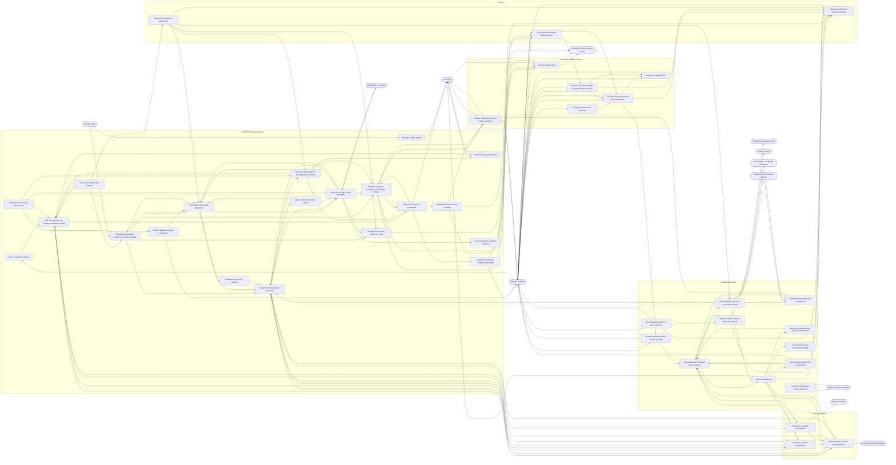

# Canadian LTL and truckload freight carrier

`freight-carrier-co` · trucking and freight transportation · modelled on public information about Mullen Group Ltd. (LTL segment, including Gardewine) and TFI International Inc. (Canadian LTL and truckload operations), from their public results; scaled to a single mid-sized carrier

This is a Canadian trucking company of about 3,600 employees that moves freight for manufacturers, distributors and retailers. Its largest business is less-than-truckload (LTL) freight: it collects many small shipments from shippers with city trucks, sorts them overnight through 38 terminals and five hub cross-docks in Ontario, Quebec and western Canada, and delivers them to consignees, usually in one to four days. Company drivers and about 70 contracted owner-operators pull the linehaul trailers between terminals. A truckload division hauls full trailer loads within Canada and to and from the United States, using about 430 company drivers, 310 contracted owner-operators and brokered carriers when its own fleet is full. Customers pay per shipment or per load at negotiated rates, plus a weekly fuel surcharge and charges for extras such as detention, appointments and liftgates. The company runs its own maintenance shops, recruits and trains its drivers, and must follow federal and provincial rules on hours of service, electronic logging, vehicle inspection, dangerous goods and customs reporting. Head-office departments handle sales and pricing, customer service and claims, billing and settlements, safety, HR and IT, and the company reports to a TSX-listed transportation group that owns it.

| | |
|---|---|
| Employees | 3,603 |
| Country | Canada |
| Ownership | Operating subsidiary of a TSX-listed transportation holding company |
| Regulators | Transport Canada (Motor Vehicle Transport Act, hours of service and ELD rules, TDG Regulations), Ontario Ministry of Transportation (CVOR), Societe de l'assurance automobile du Quebec and Controle routier Quebec, Manitoba, Saskatchewan, Alberta and British Columbia transport ministries, Canada Border Services Agency, US Federal Motor Carrier Safety Administration, US Customs and Border Protection, Provincial workers' compensation boards (WSIB, CNESST, WCBs) |
| Annual revenue including fuel surcharge (2021) | 650,000,000 CAD (C) |
| Annual revenue including fuel surcharge (2022) | 760,000,000 CAD (B) |
| Fuel surcharge as share of revenue before surcharge (2021) | 15 percent (B) |
| LTL terminals | 38 terminals (B) |
| Company power units | 1,460 tractors and trucks (C) |
| Owner-operator tractors under contract | 380 tractors (B) |
| Trailers | 4,120 trailers (B) |
| LTL shipments per year | 1,800,000 shipments (C) |
| Truckload loads per year | 90,000 loads (C) |

## Units

- **Executive office and corporate services** (14 people, department): Leads the company, reports to the parent group, and runs legal, real estate and corporate procurement.
- **Less-than-truckload division** (2,327 people, division): Runs the scheduled LTL network: pickups, terminals, hub cross-docks, linehaul and deliveries in Ontario, Quebec and western Canada.
  - **LTL network planning and linehaul control** (41 people, team): Plans the linehaul schedule and trailer loads each night and dispatches linehaul drivers around the clock.
  - **Linehaul driver pool** (295 people, team): Company linehaul drivers who move trailers between terminals and hubs overnight, including team and relay runs.
  - **LTL terminal network** (1,988 people, site network): Thirty-eight terminals, five of them hub cross-docks, that pick up, sort and deliver freight.
    - **Ontario and Quebec terminals** (0 people, site network): Twenty-two terminals including hubs in the Greater Toronto Area and Montreal.
    - **Western Canada terminals** (0 people, site network): Sixteen terminals including hubs in Winnipeg, Calgary and Metro Vancouver.
- **Truckload division** (592 people, division): Moves full trailer loads for shippers in Canada and across the US border with company drivers, owner-operators and brokered carriers.
  - **Truckload fleet operations** (534 people, team): Driver managers, load planners and company truckload drivers.
  - **Truckload customer service and brokerage** (43 people, team): Books customer loads, handles tenders and brokers overflow loads to third-party carriers.
  - **Cross-border and customs desk** (14 people, team): Sends eManifests to Canadian and US customs and clears holds at the border.
- **Fleet maintenance** (249 people, department): Maintains tractors, trailers, straight trucks, forklifts and yard tractors in twelve company shops and manages the fleet's purchase and disposal.
- **Safety, compliance and driver services** (68 people, department): Recruits and qualifies drivers, audits hours of service, handles collisions and insurance claims, trains staff and prepares for regulator audits.
- **Sales and customer service** (153 people, department): Wins and prices accounts, answers trace calls and settles freight claims.
  - **Customer service centre** (80 people, team): Central customer service, tracing and freight claims staff.
- **Finance** (130 people, department): Enters and rates freight bills, invoices customers, collects cash, pays drivers, owner-operators and suppliers, and closes the books.
  - **Billing centre** (76 people, shared service): Keys bills of lading, rates shipments and corrects bills for all divisions.
- **Human resources** (27 people, department): Hires non-driving staff, runs payroll, manages benefits and leaves and deals with the unions.
- **Information technology** (43 people, department): Runs the transportation management system, handhelds, ELDs, EDI links and the service desk.

## Demand drivers

| Driver | Per month | Unit | Evidence |
|---|---:|---|---|
| LTL shipments picked up | 150,000 | shipments | C |
| Truckload loads delivered | 7,500 | loads | C |
| Loaded cross-border crossings | 3,000 | crossings | C |
| Accounts invoiced in the month | 9,000 | accounts | C |
| Power units and trailers in the company fleet | 5,580 | units | C |
| Company driver hires | 45 | drivers | B [src-ata-turnover] |
| Employees on payroll | 3,603 | employees | C |
| Company drivers on payroll | 1,510 | drivers | C |

## How the core processes connect

## Process map

### Executive office and corporate services

| Process | Owner | Type | Unit of work | Per month | Priority | Receives from | Sends to |
|---|---|---|---|---:|---:|---|---|
| **Handle legal matters and litigation.** Legal staff defend lawsuits from collisions and cargo losses with outside counsel, review customer and supplier contracts, and advise on regulatory matters. Collision lawsuits can run for years and their reserves move the company's results. | Executive office and corporate services | management | one legal matter | 10 | 3 | Manage insurance and liability claims | Manage insurance and liability claims, Pay suppliers and carriers |
| **Manage terminal real estate.** The facilities manager finds, leases or buys terminal sites, manages expansions, and handles building maintenance and landlord relations. Industrial land shortages in the GTA and Vancouver drove rents up sharply. | Executive office and corporate services | support | one property action | 1 | 3 | Plan the LTL network and service standards | Close the books each month, Landlords and property sellers |
| **Negotiate corporate supply contracts and insurance.** Procurement specialists tender and negotiate national contracts for fuel, tires, parts, telecom and services, and run the annual insurance renewal with the broker. Insurance premiums for trucking rose sharply over 2019 to 2022. | Executive office and corporate services | support | one contract or renewal | 4 | 3 | Budget and forecast | Buy and stock parts, Insurers, Manage fuel purchasing and fuel cards |
| **Report to the parent group and govern risk.** The president and CFO report monthly results, safety performance and risks to the parent group's leadership, and get approval for capital and major contracts. A conditional safety rating, a large claim or a missed budget leads to closer oversight from the parent. | Executive office and corporate services | management | one governance report | 1 | 3 | Budget and forecast, Close the books each month, Monitor and coach driver safety performance, Prepare for regulator facility audits, Process roadside inspection results | Parent transportation group |
| **Set strategy and pursue acquisitions.** The executive team sets the three-year plan within the parent group's targets, decides network expansion and acquisitions of regional carriers, and sets priorities for sales and capital. Acquisition integration is a recurring load on every department. | Executive office and corporate services | management | one annual plan | 0.08 | 3 | Close the books each month, Parent transportation group | Budget and forecast, Plan the LTL network and service standards, Prospect and win new accounts |

### Less-than-truckload division

| Process | Owner | Type | Unit of work | Per month | Priority | Receives from | Sends to |
|---|---|---|---|---:|---:|---|---|
| **Cross-dock freight at hub terminals.** Overnight at the five hubs, dock workers strip inbound linehaul trailers, scan shipments, and reload them on outbound trailers for each destination terminal and partner carrier. Door assignment, forklift travel and tight departure cut-offs make labour productivity and damage control the main problems. | LTL terminal network | core | one shipment handled at a hub | 105,000 | 1 | Dispatch linehaul drivers and trailers, Maintain forklifts and yard tractors, Move trailers in terminal yards, Plan linehaul loads and departures, Schedule dock and city driver labour, US partner LTL carrier | Dispatch linehaul drivers and trailers, Maintain forklifts and yard tractors, Manage workplace health and safety, Plan linehaul loads and departures, Resolve overages, shortages and damage (OS&D), Review terminal performance daily, Reweigh and inspect shipments (W&I), Transfer freight to interline partners, US partner LTL carrier |
| **Deliver LTL freight to consignees.** The city driver delivers each shipment in route order, gets the consignee's signature on the handheld or paper delivery receipt and notes any shortage or damage. Closed receivers, missed appointments, refused freight and long waits at docks cause redeliveries and extra cost. | LTL terminal network | core | one delivery stop | 140,000 | 1 | Plan and dispatch city pickup and delivery routes, Resolve overages, shortages and damage (OS&D), Strip and stage freight at the destination terminal | Capture and index delivery receipts, Consignee, Handle refused and undeliverable freight, Resolve overages, shortages and damage (OS&D), Respond to and investigate collisions, Review terminal performance daily, Run the IT service desk |
| **Dispatch linehaul drivers and trailers.** Linehaul dispatchers assign drivers and tractors to each scheduled departure, checking hours remaining under the 13-hour driving and 14-hour on-duty limits, relay points and equipment condition. They follow the trucks overnight, react to storms, breakdowns and border delays, and recover late trailers. | LTL network planning and linehaul control | core | one linehaul trip | 14,000 | 1 | Carry out periodic mandatory vehicle inspections, Cross-dock freight at hub terminals, File eManifests and clear cross-border loads, Perform preventive maintenance, Plan linehaul loads and departures, Rebalance empty LTL trailers, Repair defects found on trip inspections, Unload, scan and load freight at the origin terminal | Audit hours of service and ELD logs, Calculate company driver pay, Cross-dock freight at hub terminals, Move trailers in terminal yards, Perform preventive maintenance, Repair defects found on trip inspections, Respond to and investigate collisions, Respond to roadside breakdowns, Settle owner-operators weekly, Strip and stage freight at the destination terminal |
| **Pick up LTL freight from shippers.** The city driver arrives at the shipper, checks the pieces against the bill of lading, notes any damage or wrong count, loads the freight and scans or photographs the bill on the handheld. Waiting at docks, freight not ready and missing paperwork are the common delays. | LTL terminal network | core | one pickup stop | 100,000 | 1 | Plan and dispatch city pickup and delivery routes, Shipper customer | Enter bills of lading as freight bills, Plan and dispatch city pickup and delivery routes, Unload, scan and load freight at the origin terminal |
| **Plan and dispatch city pickup and delivery routes.** Each morning the city dispatcher builds delivery routes from staged freight and appointments, then inserts pickups through the day as requests arrive and the drivers report progress. The dispatcher balances driver hours, truck size, liftgate needs, appointment windows and traffic, and re-routes when trucks break down or a delivery is refused. | LTL terminal network | core | one terminal-day of city routes | 825 | 1 | Book delivery appointments, Perform preventive maintenance, Pick up LTL freight from shippers, Qualify and onboard new drivers, Repair defects found on trip inspections, Schedule dock and city driver labour, Strip and stage freight at the destination terminal, Take LTL pickup requests | Calculate company driver pay, Deliver LTL freight to consignees, Perform preventive maintenance, Pick up LTL freight from shippers, Repair defects found on trip inspections, Review terminal performance daily |
| **Plan linehaul loads and departures.** Linehaul planners look at freight on the dock and in transit by destination each evening, decide which trailers to build, which to close early or hold for more freight, and which schedules run as doubles or relays. Their choices set trailer fill, linehaul cost and on-time service for the next day. | LTL network planning and linehaul control | core | one linehaul trailer departure | 21,000 | 1 | Change and release systems, Cross-dock freight at hub terminals, Enter bills of lading as freight bills, Handle dangerous goods shipments, Move trailers in terminal yards, Plan peak season and storm capacity, Plan the LTL network and service standards, Strip and stage freight at the destination terminal, Unload, scan and load freight at the origin terminal | Cross-dock freight at hub terminals, Dispatch linehaul drivers and trailers, Plan the LTL network and service standards, Rebalance empty LTL trailers, Unload, scan and load freight at the origin terminal |
| **Resolve overages, shortages and damage (OS&D).** OS&D clerks investigate exceptions reported by drivers and dock workers: they search terminals for missing pieces, match overages to their shipments using labels and photos, inspect and photograph damage, and update the shipment record so customers and claims staff see the facts. Unresolved exceptions become freight claims. | LTL terminal network | core | one exception | 3,800 | 1 | Answer shipment trace and status questions, Cross-dock freight at hub terminals, Deliver LTL freight to consignees, Process freight claims, Strip and stage freight at the destination terminal, Unload, scan and load freight at the origin terminal | Answer shipment trace and status questions, Deliver LTL freight to consignees, Prevent and respond to cargo theft, Process freight claims |
| **Unload, scan and load freight at the origin terminal.** In the evening dock workers unload city trucks, scan each piece, weigh or dimension shipments where equipment exists, and load them onto linehaul trailers by destination following the load plan. Mis-loads, unscanned pieces and poorly stacked trailers lead to damage, shortages and missed service days. | LTL terminal network | core | one shipment | 150,000 | 1 | Cartage agent, Pick up LTL freight from shippers, Plan linehaul loads and departures, Schedule dock and city driver labour | Dispatch linehaul drivers and trailers, Handle dangerous goods shipments, Maintain forklifts and yard tractors, Manage workplace health and safety, Plan linehaul loads and departures, Resolve overages, shortages and damage (OS&D), Reweigh and inspect shipments (W&I) |
| **Handle dangerous goods shipments.** Dock workers and drivers check that dangerous goods shipments carry correct shipping documents, labels and placards, keep incompatible classes apart on trailers, and placard linehaul trailers. Missing paperwork stops the shipment, and every person handling these goods must hold a current TDG training certificate. | LTL terminal network | core | one dangerous goods shipment | 7,500 | 2 | Train drivers and dock staff, Unload, scan and load freight at the origin terminal | Plan linehaul loads and departures, Shipper customer |
| **Reweigh and inspect shipments (W&I).** Weight and inspection auditors pull shipments flagged by dimensioners, dock workers or billing as possibly under-declared, reweigh and measure them, inspect the commodity against the freight class, and record corrections with photos. Billing then rebills the customer, who often disputes the change. | LTL terminal network | core | one inspected shipment | 12,000 | 2 | Cross-dock freight at hub terminals, Enter bills of lading as freight bills, Unload, scan and load freight at the origin terminal | Correct bills and resolve billing disputes |
| **Strip and stage freight at the destination terminal.** Early morning dock workers unload arriving linehaul trailers, scan each shipment, flag shortages and damage, and stage freight by city route and stop order. Freight that arrives late or misses its scan delays the day's delivery routes. | LTL terminal network | core | one shipment | 150,000 | 2 | Dispatch linehaul drivers and trailers, Enter bills of lading as freight bills, Schedule dock and city driver labour | Book delivery appointments, Deliver LTL freight to consignees, Plan and dispatch city pickup and delivery routes, Plan linehaul loads and departures, Resolve overages, shortages and damage (OS&D), Review terminal performance daily |
| **Take LTL pickup requests.** Terminal service clerks and the customer portal capture pickup requests by phone, email, portal and EDI, check the account is not on credit hold, and add each request to the terminal's pickup list for the day. Late afternoon calls and missing details such as dock hours or liftgate needs cause failed pickups. | LTL terminal network | core | one pickup request | 100,000 | 2 | Collect receivables and apply cash, Set up new customer accounts, Shipper customer | Plan and dispatch city pickup and delivery routes |
| **Book delivery appointments.** Terminal service clerks phone or email consignees, especially retailers and distribution centres, to book delivery windows, and record the appointment in the TMS so dispatch can plan the route. Receivers with full calendars push freight back several days and it sits on the dock. | LTL terminal network | core | one appointment | 42,000 | 3 | Consignee, Strip and stage freight at the destination terminal | Consignee, Plan and dispatch city pickup and delivery routes |
| **Capture and index delivery receipts.** Delivery receipts captured on handhelds are attached to the shipment automatically, while paper receipts from cartage agents and some drivers are scanned and indexed at terminals. Missing or unreadable receipts hold up invoices for customers who require proof of delivery and weaken the carrier in claims. | LTL terminal network | core | one delivery receipt | 140,000 | 3 | Deliver LTL freight to consignees | Answer shipment trace and status questions, Collect receivables and apply cash, Process freight claims, Rate freight bills and invoice customers |
| **Handle refused and undeliverable freight.** When a consignee refuses or cannot receive freight, the terminal stores it, asks the shipper for disposition, and either redelivers, returns or disposes of it, adding storage and redelivery charges. Slow shipper responses leave freight occupying dock space for weeks. | LTL terminal network | core | one refused shipment | 1,050 | 3 | Deliver LTL freight to consignees | Correct bills and resolve billing disputes, Shipper customer |
| **Manage cartage agents.** Terminal managers contract local cartage agents to pick up and deliver in small towns without a terminal, check their service, and approve their monthly bills against shipments handled. Agents' paper receipts and slow status updates cause tracing gaps. | LTL terminal network | core | one agent-month | 15 | 3 | Cartage agent, Plan the LTL network and service standards | Consignee, Pay suppliers and carriers |
| **Move trailers in terminal yards.** Yard shunt drivers move trailers between yard spots and dock doors on instructions from dock supervisors and linehaul dispatch, and record trailer positions. Congested yards at hubs during peak lead to search time and late departures. | LTL terminal network | core | one trailer move | 60,000 | 3 | Dispatch linehaul drivers and trailers | Cross-dock freight at hub terminals, Plan linehaul loads and departures |
| **Plan peak season and storm capacity.** Ahead of the autumn peak and winter, operations leaders plan extra trailers, casual dock labour, owner-operators and purchased linehaul, and set storm protocols for closing lanes and holding freight. Poor plans show up as freight stuck on docks and overtime. | Less-than-truckload division | management | one capacity plan | 1 | 3 | Budget and forecast | Broker overflow loads to third-party carriers, Plan linehaul loads and departures, Schedule dock and city driver labour |
| **Plan the LTL network and service standards.** The network team reviews lane volumes, linehaul costs and terminal coverage quarterly, sets service standards and schedules, and proposes terminal openings, closures or cartage agents for thin areas. Changes ripple into pricing, staffing and real estate. | LTL network planning and linehaul control | management | one network review | 0.33 | 3 | Plan linehaul loads and departures, Review terminal performance daily, Set strategy and pursue acquisitions | Manage cartage agents, Manage terminal real estate, Plan linehaul loads and departures, Price quotes and customer rate agreements |
| **Rebalance empty LTL trailers.** Linehaul planners compare empty trailer counts against tomorrow's needs at each terminal and schedule empty moves on linehaul runs with spare capacity. Freight imbalances, westbound heavier than eastbound for example, make some moves unavoidable deadhead. | LTL network planning and linehaul control | core | one daily rebalancing plan | 22 | 3 | Plan linehaul loads and departures | Dispatch linehaul drivers and trailers |
| **Review terminal performance daily.** Each morning terminal managers review the previous day's service failures, dock productivity, exceptions and overtime, and explain misses on a regional call. The review drives staffing changes and escalations to the regional director. | LTL terminal network | management | one terminal-day review | 825 | 3 | Cross-dock freight at hub terminals, Deliver LTL freight to consignees, Plan and dispatch city pickup and delivery routes, Strip and stage freight at the destination terminal | Plan the LTL network and service standards, Schedule dock and city driver labour |
| **Schedule dock and city driver labour.** Terminal supervisors set next week's dock and city driver shifts from expected volume, union seniority rules and absences, call in casual workers during peaks, approve timecards and request new hires. Under-staffing causes missed cut-offs, over-staffing wastes paid hours. | LTL terminal network | core | one terminal-week schedule | 165 | 3 | Manage union relations and grievances, Plan peak season and storm capacity, Review terminal performance daily | Cross-dock freight at hub terminals, Hire dock, shop and office staff, Plan and dispatch city pickup and delivery routes, Run payroll, Strip and stage freight at the destination terminal, Unload, scan and load freight at the origin terminal |
| **Transfer freight to interline partners.** Shipments for points beyond the network, such as Atlantic Canada, the territories or smaller US towns, are handed to partner carriers at hubs with a transfer manifest. Staff track the handoff, chase partners for delivery receipts and resolve disputes about damage at the transfer point. | LTL terminal network | core | one interline shipment | 9,000 | 3 | Cross-dock freight at hub terminals | Canadian interline partner carrier, Settle interline and partner carrier revenue |

### Truckload division

| Process | Owner | Type | Unit of work | Per month | Priority | Receives from | Sends to |
|---|---|---|---|---:|---:|---|---|
| **Accept truckload tenders and book loads.** Truckload customer service representatives review tenders from EDI, portals and email, check capacity in the pickup area and the rate on file, accept or reject within the shipper's time limit, and book the load with appointments. Rejected tenders lose freight to competitors, and wrong details cause missed pickups. | Truckload customer service and brokerage | core | one load tender | 9,500 | 1 | Price quotes and customer rate agreements, Set up and maintain EDI links, Shipper customer | Broker overflow loads to third-party carriers, Plan and assign truckload loads to drivers, Shipper customer |
| **File eManifests and clear cross-border loads.** The customs desk builds the ACI or ACE eManifest from the load and driver details, sends it at least one hour before the truck reaches the border, passes the PARS or PAPS number to the customs broker and confirms release before the driver arrives. Wrong plates, vague commodity descriptions or a broker who has not filed the entry hold trucks at the border. | Cross-border and customs desk | core | one border crossing | 3,000 | 1 | Enter bills of lading as freight bills, Plan and assign truckload loads to drivers | Canada Border Services Agency, Customs broker, Dispatch linehaul drivers and trailers, Resolve border holds and examinations, Run a truckload trip, US Customs and Border Protection |
| **Plan and assign truckload loads to drivers.** Load planners and driver managers match booked loads to drivers and tractors using location, hours of service remaining, home-time requests, equipment type and border credentials, aiming to cut empty miles and get drivers home on time. Late changes by shippers and breakdowns force reassignments. | Truckload fleet operations | core | one load assignment | 7,700 | 1 | Accept truckload tenders and book loads, Carry out periodic mandatory vehicle inspections, Manage drop-trailer pools at customers, Manage truckload drivers' hours and home time, Perform preventive maintenance, Repair collision damage, Repair defects found on trip inspections, Resolve border holds and examinations, Respond to roadside breakdowns | Broker overflow loads to third-party carriers, File eManifests and clear cross-border loads, Run a truckload trip |
| **Run a truckload trip.** The driver does the daily trip inspection, drives to the shipper, waits to be loaded, checks and seals the load, then drives to the consignee within hours-of-service limits, reporting status through the ELD and messaging. Detention at docks, weather, border waits and breakdowns are the main sources of delay. | Truckload fleet operations | core | one truckload trip | 7,500 | 1 | File eManifests and clear cross-border loads, Plan and assign truckload loads to drivers | Audit hours of service and ELD logs, Calculate company driver pay, Consignee, File fuel tax and apportioned registration reports, Manage drop-trailer pools at customers, Manage truckload drivers' hours and home time, Monitor and coach driver safety performance, Perform preventive maintenance, Prevent and respond to cargo theft, Rate freight bills and invoice customers, Repair defects found on trip inspections, Respond to and investigate collisions, Respond to roadside breakdowns, Run the IT service desk, Settle owner-operators weekly, Track detention and accessorial charges |
| **Broker overflow loads to third-party carriers.** When the fleet cannot cover a load, brokerage agents find a third-party carrier on load boards or from a vetted list, check its authority and insurance, agree a rate and track the load to delivery. Margins are thin and carrier fraud and no-shows are real risks. | Truckload customer service and brokerage | core | one brokered load | 600 | 2 | Accept truckload tenders and book loads, Plan and assign truckload loads to drivers, Plan peak season and storm capacity | Pay suppliers and carriers, Prevent and respond to cargo theft, Rate freight bills and invoice customers, Third-party truckload carrier |
| **Contract and manage owner-operators.** The owner-operator coordinator reviews applications, checks the tractor's inspection and insurance, signs the lease agreement and plates the unit. A case is any contract event: a new lease, a renewal, a tractor change, a termination or a declined application. Pay terms, fuel surcharge pass-through and chargebacks are frequent sources of disputes. | Truckload fleet operations | core | one owner-operator contract action | 50 | 2 | Owner-operator business, Update fuel surcharge tables weekly | Owner-operator business, Qualify and onboard new drivers, Settle owner-operators weekly |
| **Manage truckload drivers' hours and home time.** Driver managers keep in contact with 30 to 45 drivers each, track hours available and home-time commitments, handle pay questions and personal issues, and warn recruiting of drivers likely to quit. Missed home time is a leading cause of truckload driver turnover. | Truckload fleet operations | core | one driver-week | 1,850 | 2 | Qualify and onboard new drivers, Run a truckload trip | Plan and assign truckload loads to drivers, Recruit drivers |
| **Manage drop-trailer pools at customers.** Planners keep pools of empty and loaded trailers at large shippers, audit counts weekly against GPS, and schedule empties in and loads out. Lost or idle trailers in customer yards tie up capital and cause shortages elsewhere. | Truckload fleet operations | core | one pool audit | 100 | 3 | Run a truckload trip | Plan and assign truckload loads to drivers, Shipper customer |
| **Resolve border holds and examinations.** When customs refers a truck for examination or refuses entry, the customs coordinator works with the broker and the shipper to fix documents, books the exam, tells the customer and replans the driver's next load. Holds cost driver hours and can break delivery appointments. | Cross-border and customs desk | core | one border hold | 90 | 3 | Canada Border Services Agency, File eManifests and clear cross-border loads, US Customs and Border Protection | Answer shipment trace and status questions, Plan and assign truckload loads to drivers |
| **Run dedicated fleets for key customers.** A few large shippers contract dedicated tractors and drivers that serve only their sites. Dedicated supervisors plan the daily runs with the customer, report service and cost each month and manage the drivers on site. | Truckload fleet operations | core | one dedicated account-month | 6 | 3 | Shipper customer | Rate freight bills and invoice customers, Shipper customer |
| **Track detention and accessorial charges.** Customer service representatives check ELD and arrival data for detention beyond free time and other extras such as layovers or extra stops, gather proof and add the charges to the load for billing and driver pay. Customers often dispute detention without timestamps. | Truckload customer service and brokerage | core | one accessorial event | 1,800 | 3 | Run a truckload trip | Calculate company driver pay, Rate freight bills and invoice customers |

### Fleet maintenance

| Process | Owner | Type | Unit of work | Per month | Priority | Receives from | Sends to |
|---|---|---|---|---:|---:|---|---|
| **Perform preventive maintenance.** The maintenance planner schedules tractors and trailers for service by kilometres, engine hours or days, technicians do the inspection, oil service and lubrication in a shop bay and record findings in the work order. Getting units off the road when operations need them is the hard part. | Fleet maintenance | core | one preventive maintenance service | 1,200 | 1 | Acquire and dispose of tractors and trailers, Buy and stock parts, Dispatch linehaul drivers and trailers, Plan and dispatch city pickup and delivery routes, Run a truckload trip | Buy and stock parts, Carry out periodic mandatory vehicle inspections, Dispatch linehaul drivers and trailers, Manage tires, Plan and assign truckload loads to drivers, Plan and dispatch city pickup and delivery routes, Prepare for regulator facility audits, Repair defects found on trip inspections |
| **Repair defects found on trip inspections.** Drivers report defects on their daily trip inspection; the shop foreman decides whether the unit is out of service, technicians diagnose and repair it, and the unit is released back to dispatch. Waiting for parts and bay space keeps units down while operations ask for them. | Fleet maintenance | core | one repair work order | 2,500 | 1 | Buy and stock parts, Carry out periodic mandatory vehicle inspections, Dispatch linehaul drivers and trailers, Perform preventive maintenance, Plan and dispatch city pickup and delivery routes, Process roadside inspection results, Respond to roadside breakdowns, Run a truckload trip | Buy and stock parts, Dispatch linehaul drivers and trailers, File warranty claims, Plan and assign truckload loads to drivers, Plan and dispatch city pickup and delivery routes, Prepare for regulator facility audits, Tractor and trailer dealers |
| **Buy and stock parts.** Partspersons issue parts to work orders, reorder stock, buy from dealers and distributors at negotiated prices, receive deliveries and reconcile invoices. Stock-outs keep units in the shop, and parts lead times grew sharply in 2021 and 2022. | Fleet maintenance | support | one purchase order | 1,200 | 2 | Maintain forklifts and yard tractors, Negotiate corporate supply contracts and insurance, Perform preventive maintenance, Repair collision damage, Repair defects found on trip inspections | Parts suppliers, Pay suppliers and carriers, Perform preventive maintenance, Repair defects found on trip inspections, Tractor and trailer dealers |
| **Carry out periodic mandatory vehicle inspections.** Licensed technicians inspect each tractor and trailer at least once a year against the National Safety Code periodic inspection standard and provincial rules, fix defects, and issue the certificate and decal. Units with expired inspections cannot be dispatched and are a facility audit finding. Quebec-plated units are maintained under the SAAQ preventive maintenance program, which replaces the separate annual inspection with scheduled maintenance checks. | Fleet maintenance | management | one periodic inspection | 445 | 2 | Perform preventive maintenance | Dispatch linehaul drivers and trailers, Plan and assign truckload loads to drivers, Prepare for regulator facility audits, Repair defects found on trip inspections |
| **Respond to roadside breakdowns.** When a driver calls in a breakdown, the shop dispatcher decides whether a road service technician, a third-party repair shop or a tow is needed, sends help and arranges a replacement tractor or trailer. Night and winter breakdowns on remote highways take the longest. | Fleet maintenance | core | one breakdown call | 300 | 2 | Dispatch linehaul drivers and trailers, Run a truckload trip | Pay suppliers and carriers, Plan and assign truckload loads to drivers, Repair defects found on trip inspections, Towing company |
| **Acquire and dispose of tractors and trailers.** The fleet asset manager plans replacements by age and repair cost, writes specifications, obtains quotes from dealers within the capital budget, receives and commissions new units with ELD, telematics and plates, and sells or trades in retired units. Long OEM delivery times in 2021 and 2022 forced older units to stay in service. | Fleet maintenance | management | one unit acquired or disposed | 50 | 3 | Budget and forecast, Tractor and trailer dealers | Finance equipment, Perform preventive maintenance, Tractor and trailer dealers |
| **File warranty claims.** The warranty clerk identifies repairs on units under warranty, gathers the failed part, work order and fault codes, files the claim with the dealer or OEM and follows up on credits. Missed claims are lost money. | Fleet maintenance | support | one warranty claim | 60 | 3 | Repair defects found on trip inspections | Pay suppliers and carriers, Tractor and trailer dealers |
| **Maintain forklifts and yard tractors.** Technicians repair forklifts and yard tractors reported faulty by dock supervisors and do their scheduled services, often at night between dock shifts. A shortage of working forklifts slows hub cross-docking directly. | Fleet maintenance | support | one equipment work order | 250 | 3 | Cross-dock freight at hub terminals, Unload, scan and load freight at the origin terminal | Buy and stock parts, Cross-dock freight at hub terminals |
| **Manage fuel purchasing and fuel cards.** The fuel clerk manages bulk diesel deliveries to terminal fuel islands and the retail fuel card network, checks card transactions for misuse and tank readings against deliveries, and passes the data to finance for fuel tax and payables. Fuel is the largest single operating cost after labour. | Fleet maintenance | support | one fuel exception or delivery reconciliation | 300 | 3 | Fuel supplier and card network, Negotiate corporate supply contracts and insurance | File fuel tax and apportioned registration reports, Pay suppliers and carriers, Settle owner-operators weekly |
| **Manage tires.** Technicians record tread depth at every service, replace or retread tires to company limits, and the parts team orders tires under the national supply contract. Tires are one of the largest maintenance costs and a frequent roadside inspection defect. | Fleet maintenance | support | one tire service event | 900 | 3 | Perform preventive maintenance | Tire supplier |
| **Repair collision damage.** After a collision the shop writes a repair estimate for the insurer or the claims file, repairs minor damage in house and sends major body work to outside shops. Long body-shop queues keep units out of service. | Fleet maintenance | support | one collision repair | 40 | 3 | Respond to and investigate collisions | Buy and stock parts, Manage insurance and liability claims, Plan and assign truckload loads to drivers |

### Safety, compliance and driver services

| Process | Owner | Type | Unit of work | Per month | Priority | Receives from | Sends to |
|---|---|---|---|---:|---:|---|---|
| **Recruit drivers.** Driver recruiters advertise, screen applications, pull driver abstracts and work history, check criminal records and border eligibility, and pass qualified candidates to road testing. Truckload turnover far above LTL turnover keeps recruiters busy all year. | Safety, compliance and driver services | support | one driver application | 450 | 1 | Budget and forecast, Driver applicants, Driving schools, Manage truckload drivers' hours and home time | Qualify and onboard new drivers |
| **Audit hours of service and ELD logs.** Compliance specialists review ELD exceptions such as unassigned driving, edits and limit violations, compare logs with fuel and toll records, and send violations to managers for coaching. Before June 2021 many drivers still used paper logs, which took longer to audit. | Safety, compliance and driver services | management | one hours-of-service exception | 1,500 | 2 | Dispatch linehaul drivers and trailers, Qualify and onboard new drivers, Run a truckload trip, Run the IT service desk | Monitor and coach driver safety performance, Prepare for regulator facility audits, Run the IT service desk |
| **Qualify and onboard new drivers.** Driver trainers road-test candidates, the compliance specialist builds the driver qualification file with licence, abstract, medical and training certificates, and new drivers go through orientation and, for newer drivers, a finishing program with a trainer. Gaps in the file are a facility audit finding. | Safety, compliance and driver services | support | one new driver | 53 | 2 | Contract and manage owner-operators, Recruit drivers | Audit hours of service and ELD logs, Manage truckload drivers' hours and home time, Plan and dispatch city pickup and delivery routes, Prepare for regulator facility audits, Run payroll, Train drivers and dock staff |
| **Respond to and investigate collisions.** When a driver reports a collision, the safety manager guides the driver, arranges towing and reporting, collects photos, dash camera and ELD data, decides preventability and opens the insurance claim. Serious collisions bring police, regulators and lawyers. | Safety, compliance and driver services | management | one collision | 25 | 2 | Deliver LTL freight to consignees, Dispatch linehaul drivers and trailers, Run a truckload trip | Manage insurance and liability claims, Monitor and coach driver safety performance, Provincial transport ministries, Repair collision damage |
| **Manage insurance and liability claims.** The claims specialist reports collisions and large cargo losses to insurers, manages adjusters and lawyers, reserves and settles claims within the deductible and recovers from third parties. Large deductibles mean the company carries much of the cost itself. | Safety, compliance and driver services | management | one liability or insurance claim | 15 | 3 | Handle legal matters and litigation, Insurers, Prevent and respond to cargo theft, Process freight claims, Repair collision damage, Respond to and investigate collisions | Close the books each month, Handle legal matters and litigation, Insurers |
| **Manage workplace health and safety.** OHS specialists investigate dock and shop injuries, file workers' compensation reports, run joint health and safety committees and arrange modified duties. Forklift strikes and manual handling injuries are the common cases. | Safety, compliance and driver services | management | one injury or near-miss report | 20 | 3 | Cross-dock freight at hub terminals, Unload, scan and load freight at the origin terminal | Manage benefits, leaves and disability, Workers' compensation boards |
| **Monitor and coach driver safety performance.** Safety managers review telematics alerts, log violations, inspections and collisions by driver, decide on coaching, retraining or discipline, and report trends to leadership. Inconsistent follow-up weakens both safety and union relations. | Safety, compliance and driver services | management | one driver safety event | 800 | 3 | Audit hours of service and ELD logs, Process roadside inspection results, Respond to and investigate collisions, Run a truckload trip | Manage union relations and grievances, Report to the parent group and govern risk, Train drivers and dock staff |
| **Prepare for regulator facility audits.** When a provincial regulator schedules a facility audit, compliance staff pull samples of driver files, hours-of-service records, maintenance records and inspection certificates and fix gaps. A failed audit leads to a conditional safety rating and closer monitoring. | Safety, compliance and driver services | management | one facility audit | 0.2 | 3 | Audit hours of service and ELD logs, Carry out periodic mandatory vehicle inspections, Perform preventive maintenance, Provincial transport ministries, Qualify and onboard new drivers, Repair defects found on trip inspections, Train drivers and dock staff | Provincial transport ministries, Report to the parent group and govern risk |
| **Prevent and respond to cargo theft.** The security coordinator investigates cargo thefts, trailer break-ins and seal tampering with police and insurers, and maintains trusted-trader security programs needed for fast border clearance. Theft of loaded trailers in the Greater Toronto Area is a recurring risk. | Safety, compliance and driver services | management | one security incident or program review | 6 | 3 | Broker overflow loads to third-party carriers, Resolve overages, shortages and damage (OS&D), Run a truckload trip | Canada Border Services Agency, Manage insurance and liability claims |
| **Process roadside inspection results.** Safety analysts record every roadside inspection from Canadian and US enforcement, track violations and out-of-service orders against the carrier's safety rating thresholds, and send defects to maintenance and drivers to coaching. Rising rates trigger regulator warning letters and audits. | Safety, compliance and driver services | management | one roadside inspection | 150 | 3 | Provincial transport ministries, US Federal Motor Carrier Safety Administration | Monitor and coach driver safety performance, Repair defects found on trip inspections, Report to the parent group and govern risk |
| **Train drivers and dock staff.** Driver trainers run orientation, winter driving and defensive driving courses, coach drivers referred for poor safety events, and renew TDG certificates before their 36-month expiry for drivers and dock workers. Records feed audits. | Safety, compliance and driver services | support | one training completion | 150 | 3 | Monitor and coach driver safety performance, Qualify and onboard new drivers | Handle dangerous goods shipments, Prepare for regulator facility audits |

### Sales and customer service

| Process | Owner | Type | Unit of work | Per month | Priority | Receives from | Sends to |
|---|---|---|---|---:|---:|---|---|
| **Answer shipment trace and status questions.** Customer service representatives answer calls and emails asking where freight is, look up scans, ELD positions and delivery receipts, call terminals for missing freight and send proof of delivery. Volume rises sharply when storms or peak delay freight. | Customer service centre | core | one trace inquiry | 30,000 | 1 | Capture and index delivery receipts, Consignee, Resolve border holds and examinations, Resolve overages, shortages and damage (OS&D), Shipper customer | Consignee, Resolve overages, shortages and damage (OS&D), Shipper customer |
| **Price quotes and customer rate agreements.** Pricing analysts price spot quotes and account proposals using freight density, lane balance, linehaul cost and competitor rates, then load approved pricing into the rating system as a tariff discount or contract. Pricing errors flow straight into billing errors and disputes. | Sales and customer service | core | one quote or pricing request | 2,500 | 1 | Correct bills and resolve billing disputes, Plan the LTL network and service standards, Prospect and win new accounts, Renew contracts and apply the general rate increase, Shipper customer, Update fuel surcharge tables weekly | Accept truckload tenders and book loads, Rate freight bills and invoice customers, Respond to shipper RFPs, Shipper customer |
| **Process freight claims.** Claims analysts register claims for loss and damage, gather the bill of lading, delivery receipt, OS&D report and invoice, decide carrier liability under the bill of lading terms, and pay, decline or negotiate within authority limits. Slow decisions frustrate customers, and large losses go to insurers. | Customer service centre | core | one freight claim | 900 | 1 | Capture and index delivery receipts, Consignee, Resolve overages, shortages and damage (OS&D), Shipper customer | Canadian interline partner carrier, Manage insurance and liability claims, Pay suppliers and carriers, Resolve overages, shortages and damage (OS&D) |
| **Renew contracts and apply the general rate increase.** Each year sales and pricing review account profitability, negotiate renewals and the general rate increase, and update pricing in the rating system before the effective date. Late updates cause months of rebills. | Sales and customer service | core | one contract renewal | 100 | 2 | Close the books each month, Correct bills and resolve billing disputes, Shipper customer, Update fuel surcharge tables weekly | Price quotes and customer rate agreements, Rate freight bills and invoice customers, Respond to shipper RFPs, Shipper customer |
| **Prospect and win new accounts.** Account executives prospect shippers, visit them to learn their lanes, volumes and freight profile, ask pricing for a proposal and close the account. They work long cycles and compete mainly on price, coverage and service record. | Sales and customer service | core | one sales opportunity | 120 | 3 | Set strategy and pursue acquisitions, Shipper customer | Price quotes and customer rate agreements, Set up new customer accounts |
| **Respond to shipper RFPs.** For large shippers' requests for proposal, pricing analysts cost each lane using linehaul and terminal data, the sales manager decides the bid and submits it through the shipper's portal. Bids are due in weeks and award decisions take months. | Sales and customer service | core | one RFP | 8 | 3 | Price quotes and customer rate agreements, Renew contracts and apply the general rate increase, Shipper customer | Set up new customer accounts, Shipper customer |
| **Set up new customer accounts.** The onboarding coordinator creates the customer record with bill-to addresses, billing rules and pricing link, arranges a credit check, and requests EDI or portal set-up. Incomplete set-up sends invoices to the wrong address and delays payment. | Sales and customer service | support | one new account | 150 | 3 | Prospect and win new accounts, Respond to shipper RFPs | Collect receivables and apply cash, Rate freight bills and invoice customers, Set up and maintain EDI links, Take LTL pickup requests |

### Finance

| Process | Owner | Type | Unit of work | Per month | Priority | Receives from | Sends to |
|---|---|---|---|---:|---:|---|---|
| **Enter bills of lading as freight bills.** Billing clerks key shipper bills of lading from images into the TMS each evening, or check EDI bills, capturing shipper, consignee, pieces, weight, class and special instructions so the freight bill exists before linehaul planning. Handwritten bills, wrong classes and missing consignee details cause errors that surface later as rebills. | Billing centre | core | one bill of lading | 150,000 | 1 | Pick up LTL freight from shippers, Set up and maintain EDI links | File eManifests and clear cross-border loads, Plan linehaul loads and departures, Rate freight bills and invoice customers, Reweigh and inspect shipments (W&I), Run the IT service desk, Strip and stage freight at the destination terminal |
| **Calculate company driver pay.** Settlements clerks calculate pay for mileage-paid drivers from trip records and for hourly drivers from timecards, add detention, stop and layover pay, check exceptions against ELD data and send the totals to payroll. Driver pay errors are a common reason drivers quit. | Finance | support | one driver pay record | 3,250 | 2 | Dispatch linehaul drivers and trailers, Plan and dispatch city pickup and delivery routes, Run a truckload trip, Track detention and accessorial charges | Run payroll |
| **Correct bills and resolve billing disputes.** Billing auditors process reweigh corrections, accessorial additions and customer disputes, issue rebills or credit notes, and send pricing errors back to pricing. Disputed invoices sit unpaid until resolved. | Billing centre | core | one billing correction | 9,000 | 2 | Collect receivables and apply cash, Handle refused and undeliverable freight, Reweigh and inspect shipments (W&I), Shipper customer | Close the books each month, Price quotes and customer rate agreements, Renew contracts and apply the general rate increase, Shipper customer |
| **Rate freight bills and invoice customers.** The rating engine prices each freight bill and truckload trip from the customer's agreement, fuel surcharge table and accessorials; billing clerks work the exceptions it cannot rate, and invoices go out daily or on weekly statements by EDI, email or mail. Missing pricing and POD requirements hold invoices. | Billing centre | core | one freight bill rated and invoiced | 158,000 | 2 | Broker overflow loads to third-party carriers, Capture and index delivery receipts, Change and release systems, Enter bills of lading as freight bills, Price quotes and customer rate agreements, Renew contracts and apply the general rate increase, Run a truckload trip, Run dedicated fleets for key customers, Set up new customer accounts, Track detention and accessorial charges, Update fuel surcharge tables weekly | Close the books each month, Collect receivables and apply cash, Shipper customer |
| **Settle owner-operators weekly.** Settlements clerks calculate each owner-operator's weekly pay from completed trips at contract rates, add fuel surcharge pass-through, deduct fuel advances, insurance and other chargebacks, and issue the statement and payment. Missing trip paperwork and deduction disputes cause manual adjustments. | Finance | support | one weekly settlement statement | 1,650 | 2 | Contract and manage owner-operators, Dispatch linehaul drivers and trailers, Manage fuel purchasing and fuel cards, Run a truckload trip, Update fuel surcharge tables weekly | Close the books each month, Owner-operator business |
| **Budget and forecast.** The planning team builds the annual budget and quarterly forecasts with division leaders, covering volumes, rates, driver headcount, fuel and capital, and agrees them with the parent group. Freight swings in 2020 and 2021 made forecasts unreliable. | Finance | management | one budget or forecast cycle | 0.33 | 3 | Close the books each month, Set strategy and pursue acquisitions | Acquire and dispose of tractors and trailers, Hire dock, shop and office staff, Negotiate corporate supply contracts and insurance, Plan peak season and storm capacity, Recruit drivers, Report to the parent group and govern risk |
| **Close the books each month.** Finance cuts off postings, accrues unbilled freight, purchased transportation and claims, reconciles accounts and produces monthly results with operating ratio by division for the parent group. Late billing and settlement data delay the close. | Finance | management | one monthly close | 1 | 3 | Collect receivables and apply cash, Correct bills and resolve billing disputes, Finance equipment, Manage insurance and liability claims, Manage terminal real estate, Pay suppliers and carriers, Rate freight bills and invoice customers, Run payroll, Settle interline and partner carrier revenue, Settle owner-operators weekly | Budget and forecast, Renew contracts and apply the general rate increase, Report to the parent group and auditors, Report to the parent group and govern risk, Set strategy and pursue acquisitions |
| **Collect receivables and apply cash.** Collections clerks apply customer payments to invoices, chase overdue accounts, place accounts over their limit on credit hold, and route disputes to billing. Short payments without remittance detail are slow to apply. | Finance | support | one customer payment | 12,000 | 3 | Capture and index delivery receipts, Rate freight bills and invoice customers, Set up new customer accounts, Shipper customer | Close the books each month, Correct bills and resolve billing disputes, Take LTL pickup requests |
| **File fuel tax and apportioned registration reports.** Accountants compile kilometres by jurisdiction from ELD data and fuel purchases by jurisdiction, prepare the quarterly IFTA return and the IRP renewal, and keep records for audit. Gaps in GPS data lead to estimates and audit risk. | Finance | management | one quarterly filing | 0.33 | 3 | Manage fuel purchasing and fuel cards, Run a truckload trip | IFTA and IRP base jurisdiction |
| **Finance equipment.** The treasury lead arranges loans and leases for new tractors and trailers within limits set by the parent group, and posts the financing. Rate rises in 2022 raised equipment cost. | Finance | support | one financing transaction | 3 | 3 | Acquire and dispose of tractors and trailers, Banks and equipment lessors | Banks and equipment lessors, Close the books each month |
| **Pay suppliers and carriers.** AP clerks match supplier, partner carrier and agent invoices to purchase orders, rate confirmations or settlements, get approvals and pay on terms. Brokered carrier invoices without proof of delivery are held. | Finance | support | one supplier or carrier invoice | 7,000 | 3 | Broker overflow loads to third-party carriers, Buy and stock parts, File warranty claims, Handle legal matters and litigation, Manage cartage agents, Manage fuel purchasing and fuel cards, Parts suppliers, Process freight claims, Respond to roadside breakdowns, Third-party truckload carrier, Tire supplier, Towing company | Cartage agent, Close the books each month, Parts suppliers, Shipper customer, Third-party truckload carrier |
| **Report to the parent group and auditors.** The controller prepares quarterly reporting packages for the listed parent and the year-end audit file, and answers auditor questions. Purchase accounting for acquisitions adds work in some years. | Finance | management | one quarterly package | 0.33 | 3 | Close the books each month, External auditor | External auditor, Parent transportation group |
| **Settle interline and partner carrier revenue.** Accountants reconcile freight exchanged with interline and US partners each month, agree revenue splits per shipment and pay or bill the net amount. Disagreements over unmatched shipments drag on for months. | Finance | support | one partner-month | 60 | 3 | Canadian interline partner carrier, Transfer freight to interline partners, US partner LTL carrier | Canadian interline partner carrier, Close the books each month, US partner LTL carrier |
| **Update fuel surcharge tables weekly.** Each week a finance analyst takes the published average diesel price, looks up the surcharge percentage in each customer's table and loads it into the rating system and owner-operator settlements. A missed update misprices a whole week of shipments. | Finance | support | one weekly update | 4.33 | 3 | Natural Resources Canada fuel price survey | Contract and manage owner-operators, Price quotes and customer rate agreements, Rate freight bills and invoice customers, Renew contracts and apply the general rate increase, Settle owner-operators weekly, Shipper customer |

### Human resources

| Process | Owner | Type | Unit of work | Per month | Priority | Receives from | Sends to |
|---|---|---|---|---:|---:|---|---|
| **Hire dock, shop and office staff.** HR coordinators post jobs, screen applicants, arrange interviews with terminal and shop managers, run checks and complete hiring paperwork. Dock turnover is high, and peak season adds casual hiring. | Human resources | support | one hire | 40 | 3 | Budget and forecast, Job applicants, Schedule dock and city driver labour | Run payroll |
| **Manage benefits, leaves and disability.** Benefits specialists enrol new employees, process life events, manage short and long-term disability and coordinate return-to-work plans for injured workers with the workers' compensation board. | Human resources | support | one benefits or leave case | 120 | 3 | Manage workplace health and safety | Group benefits provider, Run payroll |
| **Manage union relations and grievances.** Labour relations managers bargain collective agreements at unionised terminals, answer grievances over discipline, seniority and overtime, and advise managers on contract terms. Grievances that are not settled at the terminal go to arbitration, which takes months. | Human resources | management | one grievance | 15 | 3 | Monitor and coach driver safety performance, Unions | Run payroll, Schedule dock and city driver labour, Unions |
| **Run payroll.** Payroll administrators load approved timecards and driver pay records, process new hires, leaves and terminations, run weekly and biweekly payrolls and remit deductions. Several provinces, union rules and mixed pay methods make payroll error-prone. | Human resources | support | one payroll cycle | 6.5 | 3 | Calculate company driver pay, Hire dock, shop and office staff, Manage benefits, leaves and disability, Manage union relations and grievances, Qualify and onboard new drivers, Schedule dock and city driver labour | Canada Revenue Agency, Close the books each month, Employees' banks |

### Information technology

| Process | Owner | Type | Unit of work | Per month | Priority | Receives from | Sends to |
|---|---|---|---|---:|---:|---|---|
| **Change and release systems.** Developers and analysts take change requests, configure or code changes in the TMS and other systems, test them with users and release them, and install vendor updates. Changes to rating and billing need careful testing. | Information technology | support | one system change | 40 | 3 | Run the IT service desk, Software vendors | Plan linehaul loads and departures, Rate freight bills and invoice customers |
| **Run the IT service desk.** Service desk technicians fix handheld, ELD, printer and account problems for drivers, dock workers and office staff, replace devices and escalate system faults. ELD malfunctions must be resolved quickly because drivers fall back on paper logs. | Information technology | support | one ticket | 1,400 | 3 | Audit hours of service and ELD logs, Deliver LTL freight to consignees, Enter bills of lading as freight bills, Run a truckload trip | Audit hours of service and ELD logs, Change and release systems |
| **Set up and maintain EDI links.** EDI analysts map and test tender, bill of lading, status and invoice messages with customers and partners, and fix failed transmissions. Failed status messages trigger customer complaints and chargebacks. | Information technology | support | one EDI connection or change | 25 | 3 | Set up new customer accounts | Accept truckload tenders and book loads, Enter bills of lading as freight bills, Shipper customer |

## Roles

| Role | Unit | Layer | Reports to | Headcount | Loaded cost per hour |
|---|---|---|---|---:|---:|
| President and chief executive officer | Executive office and corporate services | executive |  | 1 | 230 CAD |
| General counsel | Executive office and corporate services | director | President and chief executive officer | 1 | 150 CAD |
| Legal and contracts specialist | Executive office and corporate services | senior specialist | General counsel | 2 | 90 CAD |
| Real estate and facilities manager | Executive office and corporate services | manager | President and chief executive officer | 1 | 85 CAD |
| Facilities coordinator | Executive office and corporate services | individual contributor | Real estate and facilities manager | 4 | 45 CAD |
| Procurement specialist | Executive office and corporate services | senior specialist | Chief financial officer | 3 | 55 CAD |
| Corporate development analyst | Executive office and corporate services | senior specialist | President and chief executive officer | 2 | 70 CAD |
| Vice-president, LTL operations | Less-than-truckload division | executive | President and chief executive officer | 1 | 170 CAD |
| Regional LTL operations director | Less-than-truckload division | director | Vice-president, LTL operations | 2 | 120 CAD |
| Linehaul and network planning manager | LTL network planning and linehaul control | manager | Vice-president, LTL operations | 1 | 95 CAD |
| Linehaul load planner | LTL network planning and linehaul control | individual contributor | Linehaul and network planning manager | 17 | 45 CAD |
| Linehaul dispatcher | LTL network planning and linehaul control | individual contributor | Linehaul and network planning manager | 19 | 43 CAD |
| Network and pricing-cost analyst | LTL network planning and linehaul control | senior specialist | Linehaul and network planning manager | 4 | 58 CAD |
| Linehaul driver supervisor | Linehaul driver pool | supervisor | Linehaul and network planning manager | 8 | 58 CAD |
| Linehaul driver | Linehaul driver pool | individual contributor | Linehaul driver supervisor | 357 | 39 CAD |
| Terminal manager | LTL terminal network | manager | Regional LTL operations director | 38 | 72 CAD |
| Terminal operations supervisor | LTL terminal network | supervisor | Terminal manager | 40 | 54 CAD |
| City pickup and delivery dispatcher | LTL terminal network | individual contributor | Terminal operations supervisor | 101 | 39 CAD |
| Pickup and delivery driver | LTL terminal network | individual contributor | Terminal operations supervisor | 785 | 35 CAD |
| Dock supervisor | LTL terminal network | supervisor | Terminal operations supervisor | 87 | 47 CAD |
| Hub dock worker and forklift operator | LTL terminal network | individual contributor | Dock supervisor | 330 | 30 CAD |
| Terminal dock worker | LTL terminal network | individual contributor | Dock supervisor | 387 | 29 CAD |
| Yard shunt driver | LTL terminal network | individual contributor | Dock supervisor | 40 | 32 CAD |
| OS&D clerk | LTL terminal network | individual contributor | Terminal operations supervisor | 39 | 33 CAD |
| Terminal service clerk | LTL terminal network | individual contributor | Terminal manager | 121 | 32 CAD |
| Weight and inspection auditor | LTL terminal network | individual contributor | Terminal operations supervisor | 20 | 34 CAD |
| Vice-president, truckload | Truckload division | executive | President and chief executive officer | 1 | 160 CAD |
| Truckload operations manager | Truckload fleet operations | manager | Vice-president, truckload | 6 | 82 CAD |
| Driver manager (fleet manager) | Truckload fleet operations | individual contributor | Truckload operations manager | 49 | 43 CAD |
| Truckload load planner | Truckload fleet operations | individual contributor | Truckload operations manager | 25 | 44 CAD |
| After-hours dispatcher | Truckload fleet operations | individual contributor | Truckload operations manager | 8 | 41 CAD |
| Long-haul truckload driver (company) | Truckload fleet operations | individual contributor | Driver manager (fleet manager) | 308 | 37 CAD |
| Regional truckload driver (company) | Truckload fleet operations | individual contributor | Driver manager (fleet manager) | 130 | 36 CAD |
| Owner-operator, truckload (contracted, not an employee) | Truckload fleet operations | external party | Truckload operations manager | 310 | 65 CAD |
| Dedicated fleet supervisor | Truckload fleet operations | supervisor | Truckload operations manager | 4 | 56 CAD |
| Owner-operator relations coordinator | Truckload fleet operations | individual contributor | Truckload operations manager | 4 | 42 CAD |
| Truckload customer service representative | Truckload customer service and brokerage | individual contributor | Truckload operations manager | 31 | 36 CAD |
| Freight brokerage agent | Truckload customer service and brokerage | individual contributor | Truckload operations manager | 12 | 42 CAD |
| Cross-border customs coordinator | Cross-border and customs desk | individual contributor | Truckload operations manager | 14 | 38 CAD |
| Director of maintenance | Fleet maintenance | director | President and chief executive officer | 1 | 120 CAD |
| Shop manager | Fleet maintenance | manager | Director of maintenance | 12 | 70 CAD |
| Shop foreman | Fleet maintenance | supervisor | Shop manager | 14 | 57 CAD |
| Heavy-duty truck and trailer technician | Fleet maintenance | individual contributor | Shop foreman | 165 | 46 CAD |
| Road service technician | Fleet maintenance | individual contributor | Shop foreman | 14 | 48 CAD |
| Partsperson | Fleet maintenance | individual contributor | Shop manager | 22 | 34 CAD |
| Maintenance planner | Fleet maintenance | individual contributor | Director of maintenance | 8 | 44 CAD |
| Fleet asset manager | Fleet maintenance | senior specialist | Director of maintenance | 3 | 72 CAD |
| Warranty and fuel clerk | Fleet maintenance | individual contributor | Director of maintenance | 5 | 35 CAD |
| Vice-president, safety and compliance | Safety, compliance and driver services | executive | President and chief executive officer | 1 | 145 CAD |
| Regional safety manager | Safety, compliance and driver services | manager | Vice-president, safety and compliance | 6 | 78 CAD |
| Driver recruiting manager | Safety, compliance and driver services | manager | Vice-president, safety and compliance | 1 | 70 CAD |
| Driver recruiter | Safety, compliance and driver services | individual contributor | Driver recruiting manager | 14 | 40 CAD |
| Driver trainer and road tester | Safety, compliance and driver services | individual contributor | Regional safety manager | 18 | 42 CAD |
| Compliance specialist (hours of service and driver files) | Safety, compliance and driver services | individual contributor | Regional safety manager | 12 | 40 CAD |
| Insurance and liability claims specialist | Safety, compliance and driver services | senior specialist | Vice-president, safety and compliance | 5 | 54 CAD |
| Occupational health and safety specialist | Safety, compliance and driver services | senior specialist | Vice-president, safety and compliance | 4 | 54 CAD |
| Cargo security coordinator | Safety, compliance and driver services | senior specialist | Vice-president, safety and compliance | 2 | 50 CAD |
| Dangerous goods compliance specialist | Safety, compliance and driver services | senior specialist | Vice-president, safety and compliance | 2 | 53 CAD |
| Safety data analyst | Safety, compliance and driver services | individual contributor | Vice-president, safety and compliance | 3 | 47 CAD |
| Vice-president, sales and marketing | Sales and customer service | executive | President and chief executive officer | 1 | 160 CAD |
| Regional sales manager | Sales and customer service | manager | Vice-president, sales and marketing | 5 | 90 CAD |
| Account executive | Sales and customer service | individual contributor | Regional sales manager | 32 | 62 CAD |
| Pricing manager | Sales and customer service | manager | Vice-president, sales and marketing | 1 | 95 CAD |
| Pricing analyst | Sales and customer service | senior specialist | Pricing manager | 28 | 54 CAD |
| Customer onboarding coordinator | Sales and customer service | individual contributor | Pricing manager | 6 | 38 CAD |
| Customer service supervisor | Customer service centre | supervisor | Vice-president, sales and marketing | 6 | 48 CAD |
| Customer service representative | Customer service centre | individual contributor | Customer service supervisor | 62 | 32 CAD |
| Freight claims manager | Customer service centre | manager | Vice-president, sales and marketing | 1 | 70 CAD |
| Freight claims analyst | Customer service centre | individual contributor | Freight claims manager | 11 | 36 CAD |
| Chief financial officer | Finance | executive | President and chief executive officer | 1 | 185 CAD |
| Controller | Finance | director | Chief financial officer | 1 | 120 CAD |
| Billing supervisor | Billing centre | supervisor | Controller | 6 | 49 CAD |
| Billing clerk (bill entry and rating) | Billing centre | individual contributor | Billing supervisor | 47 | 29 CAD |
| Billing auditor (rebills and corrections) | Billing centre | individual contributor | Billing supervisor | 23 | 34 CAD |
| Credit and collections manager | Finance | manager | Controller | 1 | 76 CAD |
| Accounts receivable and collections clerk | Finance | individual contributor | Credit and collections manager | 12 | 32 CAD |
| Accounts payable clerk | Finance | individual contributor | Finance operations manager | 10 | 32 CAD |
| Driver pay and owner-operator settlements clerk | Finance | individual contributor | Finance operations manager | 12 | 33 CAD |
| Accountant | Finance | senior specialist | Controller | 10 | 55 CAD |
| Financial planning analyst | Finance | senior specialist | Chief financial officer | 4 | 60 CAD |
| Finance operations manager | Finance | manager | Controller | 2 | 82 CAD |
| Treasury and equipment finance lead | Finance | senior specialist | Chief financial officer | 1 | 90 CAD |
| Vice-president, human resources | Human resources | executive | President and chief executive officer | 1 | 135 CAD |
| HR business partner | Human resources | senior specialist | Vice-president, human resources | 7 | 60 CAD |
| HR and hiring coordinator | Human resources | individual contributor | Vice-president, human resources | 6 | 38 CAD |
| Labour relations manager | Human resources | manager | Vice-president, human resources | 2 | 90 CAD |
| Benefits and disability specialist | Human resources | individual contributor | Vice-president, human resources | 4 | 42 CAD |
| Payroll administrator | Human resources | individual contributor | Vice-president, human resources | 7 | 38 CAD |
| Director of information technology | Information technology | director | Chief financial officer | 1 | 130 CAD |
| IT manager | Information technology | manager | Director of information technology | 3 | 88 CAD |
| Service desk and device technician | Information technology | individual contributor | IT manager | 12 | 38 CAD |
| Developer and business analyst | Information technology | senior specialist | IT manager | 14 | 66 CAD |
| EDI analyst | Information technology | senior specialist | IT manager | 5 | 57 CAD |
| Infrastructure and network administrator | Information technology | individual contributor | IT manager | 8 | 54 CAD |
| Breakdown and road call coordinator | Fleet maintenance | individual contributor | Shop manager | 5 | 43 CAD |

## Systems

- **Transportation management system (LTL and truckload operations, billing, rating)** (system of record)
- **Dock and driver handheld scanning** (instrument)
- **Electronic logging devices and telematics platform** (system of record)
- **Linehaul load planning tool and planning spreadsheets** (spreadsheet)
- **City route planning and dispatch board** (workflow)
- **Fleet maintenance management system (work orders, PM schedules, parts)** (system of record)
- **Document imaging for bills of lading and delivery receipts** (document store)
- **Rating engine and tariff tables** (system of record)
- **ERP general ledger, payables and receivables** (system of record)
- **HR information and payroll system** (system of record)
- **Customer web portal (pickup requests, tracing, documents)** (external portal)
- **EDI gateway (204 tenders, 211 bills of lading, 214 status, 210 invoices)** (workflow)
- **eManifest service provider (CBSA ACI and US CBP ACE)** (external portal)
- **Safety management system (driver files, collisions, roadside inspections)** (system of record)
- **Driver recruiting applicant tracking system** (workflow)
- **Learning management system and training records** (document store)
- **Freight claims module in the TMS** (workflow)
- **Customer relationship management system** (workflow)
- **Fuel card portal** (external portal)
- **Business intelligence reporting** (analytics)
- **Email, phone system and contact centre software** (communication)
- **Spreadsheets** (spreadsheet)
- **IT service desk ticketing** (workflow)
- **Provincial inspection certificate systems (Ontario inspection station certificates, Alberta eFacility)** (external portal)
- **Dealer and distributor online parts ordering portals** (external portal)
- **Shippers' TMS tendering and dock-scheduling web portals** (external portal)

## Outside parties

- **Shipper customer**: A manufacturer, distributor or retailer that pays to move freight; most LTL customers ship several times a week.
- **Consignee**: The business or person receiving the freight.
- **Canadian interline partner carrier**: A regional carrier that delivers freight to points beyond the company's network, such as Atlantic Canada and the north.
- **US partner LTL carrier**: A US LTL carrier that exchanges cross-border freight at border gateways.
- **Third-party truckload carrier**: A carrier that hauls brokered loads.
- **Cartage agent**: A local trucking firm that picks up and delivers for the company in small towns without a terminal.
- **Owner-operator business**: The incorporated business of an owner-operator that leases a tractor and driver to the company.
- **Customs broker**: The importer's broker that files the customs entry and obtains release.
- **Canada Border Services Agency**: Canadian customs, which receives ACI eManifests and examines freight.
- **US Customs and Border Protection**: US customs, which receives ACE eManifests and examines freight.
- **Provincial transport ministries**: Ontario MTO, Quebec SAAQ and Controle routier Quebec, Manitoba, Saskatchewan, Alberta and BC: carrier safety ratings, roadside inspections and facility audits.
- **US Federal Motor Carrier Safety Administration**: US safety regulator for cross-border operations and roadside inspections in the US.
- **Natural Resources Canada fuel price survey**: Publishes the weekly average diesel prices that fuel surcharge tables follow.
- **IFTA and IRP base jurisdiction**: The home province that collects fuel tax and apportioned registration fees for all jurisdictions.
- **Tractor and trailer dealers**: OEM dealers that sell, warranty and take trade-ins of equipment.
- **Parts suppliers**: Heavy-duty parts distributors.
- **Tire supplier**: Supplies new and retread tires and road tire service.
- **Fuel supplier and card network**: Supplies bulk diesel to terminals and retail fuel through a fuel card.
- **Towing company**: Tows disabled units.
- **Insurers**: Auto liability, cargo and property insurers.
- **Banks and equipment lessors**: Finance tractors and trailers.
- **Driver applicants**: Licensed drivers applying for jobs.
- **Driving schools**: Train new Class 1 and Class A/Z drivers, often under mandatory entry-level training.
- **Job applicants**: Applicants for dock, shop and office jobs.
- **Unions**: Unions representing dock workers and drivers at some terminals.
- **Workers' compensation boards**: WSIB, CNESST and provincial WCBs.
- **Group benefits provider**: Insurer running health, dental and disability plans.
- **Employees' banks**: Receive payroll deposits.
- **Canada Revenue Agency**: Receives payroll source deductions and taxes.
- **Parent transportation group**: The TSX-listed holding company that owns the carrier and allocates capital.
- **External auditor**: Audits the annual financial statements.
- **Landlords and property sellers**: Own or sell terminal property.
- **Software vendors**: Supply the TMS, ELD and other systems.

## Things that pass between processes

- **Sales lead**: A prospective shipper identified by an account executive or an inbound enquiry.
- **Rfp bid**: A shipper's request for proposal listing lanes, volumes and service needs.
- **Rate proposal**: The carrier's bid in reply to an RFP, with lane rates and discounts.
- **Quote request**: A request for a price on a shipment or an account's lanes.
- **Rate quote**: A priced quote for a shipment or a set of lanes.
- **Rate agreement**: The customer's negotiated pricing: tariff discount, minimum charge, accessorials and fuel surcharge terms.
- **Account profitability report**: Revenue, cost and operating ratio by customer account.
- **Customer account**: The customer master record: bill-to, credit terms, billing rules and pricing link.
- **Edi request**: A request to set up or change an EDI link with a customer.
- **Edi connection**: A live EDI link exchanging tenders, bills of lading, status and invoices with a customer.
- **Pickup request**: A shipper's request to collect freight on a given day, by phone, portal, email or EDI.
- **Credit hold**: An instruction to stop service to an account over its credit limit.
- **Pd route**: The day's sequence of pickups and deliveries assigned to one city driver and truck.
- **Delivery appointment**: A booked delivery time slot at a consignee's receiving dock.
- **Appointment request**: A request to book a delivery slot with a consignee.
- **Bill of lading**: The shipper's shipping document listing pieces, weight, class, consignee and special instructions.
- **Picked up freight**: Freight collected from shippers and brought back to the origin terminal.
- **Driver timecard**: Hours worked by an hourly driver for one day.
- **Freight bill**: The carrier's pro-numbered record of a shipment created from the bill of lading.
- **Shipment scan data**: Dock scans, weights and dimensions of shipments loaded at a terminal.
- **Wi referral**: A shipment flagged for weight and inspection because its weight, density or class looks wrong.
- **Reweigh correction**: A weight or class correction with supporting certificate and photos.
- **Dg shipping document**: The dangerous goods shipping document and placarding requirement for a shipment.
- **Loaded trailer**: A sealed trailer loaded for a linehaul departure, with its manifest.
- **Linehaul load plan**: The nightly plan of which shipments go on which trailer to which terminal and the departure schedule.
- **Empty trailer request**: A need for empty trailers at a terminal.
- **Empty trailer move**: A planned move of empty trailers to rebalance equipment.
- **Trailer move request**: An instruction to shunt a trailer to a door or yard spot.
- **Trailer move**: A completed shunt of a trailer to a dock door.
- **Yard status**: The list of trailers in the yard, at doors and their load status.
- **Network plan**: Service standards, linehaul lanes, schedules and terminal coverage.
- **Terminal kpi data**: Daily operating data: on-time service, dock productivity, exceptions.
- **Terminal kpi report**: Daily and weekly terminal performance report.
- **Labour schedule**: Shift schedule for dock workers and city drivers.
- **Approved timecards**: Supervisor-approved hours for hourly dock and terminal staff.
- **Staff requisition**: A request to hire non-driving staff.
- **Capacity plan**: Extra trailers, drivers, casual labour and purchased transportation for a peak or storm.
- **Volume forecast**: Forecast of shipments and loads by month and region.
- **Staged freight**: Freight unloaded at the destination terminal and staged by delivery route.
- **Delivered freight**: Freight handed over to the consignee.
- **Delivery receipt**: The signed delivery receipt or electronic proof of delivery with any exceptions noted.
- **Refused shipment**: A shipment the consignee refused or that could not be delivered.
- **Disposition request**: A request to the shipper for instructions on refused or undeliverable freight.
- **Accessorial charge**: An extra charge such as storage, redelivery, detention, liftgate or appointment.
- **Osd report**: An overage, shortage or damage exception report.
- **Recovered freight**: Freight found and re-matched to its shipment after an exception.
- **Trace request**: An internal request to search terminals for missing freight.
- **Interline shipment**: A shipment handed to or received from a partner carrier.
- **Interline waybill**: The record of freight handed to an interline partner and the agreed revenue split.
- **Carrier invoice**: An invoice from a partner, agent or third-party carrier.
- **Agent settlement**: The monthly payment calculation for a cartage agent.
- **Load tender**: A shipper's offer of a full truckload, by EDI 204, portal or email.
- **Load confirmation**: Acceptance of a tender with pickup appointment.
- **Booked load**: An accepted truckload order in the TMS.
- **Trip assignment**: A load assigned to a driver and tractor with the trip plan.
- **Driver availability**: The drivers available by location with their hours remaining and home-time needs.
- **Trip record**: A completed trip with miles, stops, times and charges.
- **Hos record**: The driver's electronic record of duty status.
- **Detention record**: Time a driver waited at a shipper or consignee beyond the free time.
- **Trailer status**: Location and load status of trailers at customer sites.
- **Trailer pool report**: Count and condition of drop trailers at a customer's pool.
- **Dedicated service report**: Service and cost report for a dedicated fleet customer.
- **Emanifest**: Advance cargo and conveyance data sent to the CBSA (ACI) or US CBP (ACE).
- **Customs entry request**: The shipment's PARS or PAPS number sent to the customs broker for release.
- **Customs release**: Customs release of the goods so the truck can cross.
- **Border hold**: A customs examination, hold or refusal at the border.
- **Brokered load**: A load given to a third-party carrier with a rate confirmation.
- **Carrier rate confirmation**: The agreed rate and terms with a third-party carrier for a brokered load.
- **Owner operator application**: An owner-operator's request to contract with the carrier.
- **Owner operator agreement**: The lease agreement setting the owner-operator's pay, fuel surcharge and deductions.
- **Settlement statement**: The weekly owner-operator statement of trips, pay, fuel surcharge and deductions.
- **Settlement payment**: The weekly payment to an owner-operator's business.
- **Driver pay record**: Calculated pay for a company driver for one pay period.
- **Payroll payment**: Net pay deposited to an employee.
- **Payroll remittance**: Source deductions remitted to the CRA.
- **Customer invoice**: The invoice for a shipment or load, often on a weekly statement.
- **Billing dispute**: A customer's challenge to a charge.
- **Corrected invoice**: A rebill or credit note correcting a charge.
- **Customer payment**: A cheque, EFT or card payment from a customer.
- **Pricing error report**: A list of rating errors traced to wrong pricing set-up.
- **Vendor invoice**: An invoice from a parts, tire, towing, fuel or service supplier.
- **Vendor payment**: A payment to a supplier or partner carrier.
- **Claim payment request**: An approved claim or settlement for payment.
- **Claim payment**: Payment of an approved freight or liability claim.
- **Freight claim**: A customer's claim for lost, damaged or delayed freight.
- **Trace inquiry**: A customer's question on where a shipment is or when it will deliver.
- **Trace response**: The status, ETA or proof of delivery given to a customer.
- **Ledger postings**: Journal lines posted to the general ledger.
- **Financial statements**: Monthly income statement, balance sheet and operating ratios.
- **Budget**: Annual operating budget.
- **Capital budget**: Approved capital spending on tractors, trailers, terminals and IT.
- **Staffing plan**: Planned headcount and driver hiring by month.
- **Fuel price index**: The weekly average retail diesel price published by Natural Resources Canada or the US EIA.
- **Fuel surcharge table**: The weekly fuel surcharge percentages applied to rates.
- **Fuel transaction**: Fuel purchases by card or bulk delivery, with jurisdiction and litres.
- **Jurisdiction mileage**: Kilometres driven by jurisdiction, from ELD and GPS data.
- **Fuel tax return**: Quarterly IFTA return and IRP mileage report.
- **Financing request**: A request to finance or lease equipment.
- **Financing agreement**: A loan, lease or line of credit for equipment.
- **External report**: Quarterly and annual financial reporting to the parent group.
- **Audit package**: Schedules and support provided to the external auditor.
- **Audit opinion**: The external auditor's opinion and management letter.
- **Odometer data**: Engine hours and odometer readings from telematics.
- **Pm schedule**: Preventive maintenance and inspection due list by unit.
- **Work order**: A maintenance work order for a unit.
- **Dvir**: The driver's daily trip inspection report, with any defects.
- **Equipment availability**: Units returned to service or held out of service.
- **Inspection certificate**: The annual or semi-annual periodic inspection certificate and decal record.
- **Maintenance record**: The unit's maintenance history kept for audits.
- **Breakdown call**: A driver's call reporting a breakdown on the road.
- **Tow request**: A request to a towing company.
- **Tire record**: Tire tread readings and replacements by unit.
- **Parts requisition**: A request for parts for a work order.
- **Purchase order**: An order to a supplier.
- **Parts delivery**: Parts received from a supplier.
- **Parts issue**: Parts issued from stock to a work order.
- **Warranty claim**: A claim to the OEM or dealer for a failed component.
- **Warranty credit**: A credit received for an accepted warranty claim.
- **Equipment unit**: A new tractor or trailer delivered and put in service.
- **Disposal unit**: A retired tractor or trailer sold or traded in.
- **Forklift fault**: A forklift or yard tractor fault report.
- **Collision report**: A report of a collision or incident involving a company vehicle.
- **Repair estimate**: A collision repair estimate.
- **Insurance claim**: A claim against the company's insurance or a third party.
- **Claim settlement**: Settlement of an insurance or liability claim.
- **Litigation notice**: A statement of claim or lawyer's demand letter.
- **Legal advice**: Counsel's advice and defence strategy for a claim.
- **Driver application**: An application from a prospective driver.
- **Qualified candidate**: A driver applicant who passed screening, abstract and reference checks.
- **Driver hire**: A newly qualified driver ready to be dispatched.
- **Dq file**: The driver qualification file: licence, abstract, medical, road test, training certificates.
- **New employee**: A new employee record for payroll and benefits.
- **Driver vacancy**: A forecast of open driver seats by location.
- **Training record**: Proof of training such as TDG certificates, orientation and coaching.
- **Coaching referral**: A referral of a driver for coaching or retraining.
- **Hos violation**: An hours-of-service or log falsification exception.
- **Hos audit report**: Results of hours-of-service audits kept for regulator audits.
- **Eld malfunction record**: An ELD malfunction or data diagnostic event that switches the driver to paper logs.
- **Roadside inspection report**: A CVSA roadside inspection report with any violations or out-of-service orders.
- **Telematics event**: A hard braking, speeding or following-distance alert from the vehicle.
- **Safety performance report**: Collision, inspection and conviction trends against the carrier's safety rating thresholds.
- **Discipline notice**: A disciplinary letter to a driver or employee.
- **Audit notice**: A regulator's notice of a facility audit.
- **Audit findings**: The result of a regulator or internal safety audit.
- **Injury report**: A workplace injury report.
- **Return to work plan**: A modified-duty plan for an injured worker.
- **Security incident**: A cargo theft, break-in or seal tampering report.
- **Security profile**: The carrier's trusted-trader security profile (PIP, C-TPAT, FAST).
- **Grievance**: A union grievance under a collective agreement.
- **Grievance response**: The company's reply or settlement of a grievance.
- **Collective agreement**: The negotiated terms for unionised dock workers and drivers.
- **Benefit enrolment**: An enrolment or change in group benefits.
- **Job application**: An application for a non-driving job.
- **It ticket**: A request or fault report to the IT service desk.
- **System change request**: A request to change a system.
- **System release**: A tested change released to a system.
- **Software update**: A vendor release of a software product.
- **Strategic direction**: Targets and capital allocation set by the parent group.
- **Strategic plan**: The company's three-year plan, including network and acquisition priorities.
- **Board report**: Monthly and quarterly report to the parent group's leadership.
- **Facility requirement**: A need for a new, larger or relocated terminal.
- **Facility lease**: A lease or purchase of terminal property.
- **Supplier contract**: A negotiated supply contract for fuel, parts, tires or services.
- **Insurance program**: The annual insurance renewal: auto liability, cargo and property.

## Assumptions

- The company is a composite, not a real carrier. Scale and structure are drawn from Mullen Group's LTL segment (including Gardewine) and TFI International's Canadian operations, at about CAD 650 million of revenue in 2021. Headcounts were first set at about 3,000 and revised on 2026-11-24 to 3,603 to cover the work the workflows record; Old Dominion's driver and dock staff per shipment are the outside check.
- Employees exclude 380 owner-operators, who are contractors: 310 in truckload (role owner-operator, layer external_party) and 70 who pull LTL linehaul, counted in linehaul-driver as contractor_headcount. Neither group is in the employee count.
- Loaded cost = hourly wage x 1.30 for hourly field and dock staff, x 1.35 for salaried office staff (benefits, statutory costs, WSIB/CNESST premiums and overhead). Driver wages come from Job Bank 2024-25 figures for NOC 73300 deflated by about 12% to the 2019-2022 period; other wages are the author's estimates.
- US cost benchmarks (ATRI) are converted at about 1.25 CAD per USD and used only to size vehicle running costs; Canadian costs may differ.
- Driver turnover is assumed near 15% a year for LTL drivers and near 50% for truckload drivers, below the US figures of 13% and 90% (ATA 2020) for truckload because TFI reports relatively low turnover in Canada.
- The ELD mandate took effect in June 2021 with enforcement phased in by provinces afterwards; for 2019 to mid-2021 many drivers used paper logs or unmandated electronic recorders, which made log audits slower.
- National Safety Code standards (trip inspection, periodic inspection, facility audit) and Ontario CVOR rules are described from general knowledge; their texts could not be opened, so processes depending on them are tier C.
- Process volumes are per month averages over 2019-2022; 2020 volumes fell in the second quarter during COVID-19 lockdowns and 2021-2022 were above average.
- Some business units at real carriers are unionised (often Teamsters or Unifor at LTL terminals); this carrier is assumed partly unionised.
- Drivers' on-duty hours are nearly all route time, so pickup and delivery drivers are sized at 195 productive hours a month and linehaul drivers at 210 (productive_hours_per_month), not the 130 or 150 the shift-pattern defaults give office and shift staff.

## Sources

- [src-hos] [Commercial Vehicle Drivers Hours of Service Regulations (SOR/2005-313)](https://laws-lois.justice.gc.ca/eng/regulations/SOR-2005-313/FullText.html) (Government of Canada, Justice Laws Website, 2005). South of 60 degrees: 13 h driving and 14 h on duty per day, 10 h off duty per day with 8 consecutive, cycle 1 of 70 h in 7 days and cycle 2 of 120 h in 14 days; s.77 requires an ELD in each commercial vehicle, with exemptions and a 160 km radius condition.
- [src-eld] [Regulations Amending the Commercial Vehicle Drivers Hours of Service Regulations (Electronic Logging Devices and Other Amendments), SOR/2019-165](https://gazette.gc.ca/rp-pr/p2/2019/2019-06-12/html/sor-dors165-eng.html) (Canada Gazette, Part II, 2019). Certified ELDs required for federally regulated carriers beyond 160 km of the home terminal from June 2021; 157,424 Canada-based CMVs need a daily log, 87,849 of them run into the US; device cost about $600 plus $220 installation and about $30 a month monitoring; 2.81% of inspections end in an HOS out-of-service order with average detention of 34 hours; about 3.5 minutes of clerical time saved per log; drivers must forward records within 20 days and carriers keep them at the principal place of business.
- [src-mullen21] [Mullen Group Ltd. Reports 2021 Financial Results including Record Revenue](https://newswire.ca/news-releases/mullen-group-ltd-reports-2021-financial-results-including-record-revenue-817157471.html) (Mullen Group Ltd. via Cision Newswire, 2022). Less-Than-Truckload segment revenue of $585.3 million in 2021, up $141.5 million or 31.9%; adjusted OIBDA $93.9 million, adjusted operating margin 16.0% (15.8% in 2020); LTL fuel surcharge revenue up $17.5 million; total company revenue $1,477.4 million.
- [src-mullen22] [Mullen Group Ltd. Reports Record 2022 Financial Results](https://www.newswire.ca/news-releases/mullen-group-ltd-reports-record-2022-financial-results-830040070.html) (Mullen Group Ltd. via Cision Newswire, 2023). LTL segment revenue $778.7 million in 2022, direct operating expenses $536.8 million, adjusted OIBDA $138.4 million; Q4 2022 LTL revenue up 13.0% largely from fuel surcharge; December working days reduced by inclement weather and holidays; direct operating expenses are mainly the use of contractors; tight labour market and equipment shortages.
- [src-tfi21] [TFI International Inc. Management's Discussion and Analysis, year ended December 31, 2021 (Form 40-F exhibit 99.3)](https://www.sec.gov/Archives/edgar/data/1588823/000119312522074819/d291674dex993.htm) (TFI International Inc., filed with the US SEC, 2022). 29,539 employees, 13,384 tractors, 50,091 trailers, 9,428 independent contractors and 576 facilities (246 in Canada) at end of 2021; LTL revenue before fuel surcharge US$2,440.6 million and fuel surcharge US$374.8 million in 2021; driver recruitment and retention named as a risk; relatively low employee turnover in Canada.
- [src-tfi22] [TFI International Announces 2022 Fourth Quarter and Full-Year Results](https://finance.yahoo.com/news/tfi-international-announces-2022-fourth-210500534.html) (TFI International Inc. press release via Yahoo Finance, 2023). LTL revenue before fuel surcharge US$3,243.6 million (2022) and US$2,440.6 million (2021); Truckload US$1,986.3 million and US$1,901.2 million; adjusted EBITDA margin LTL 17.5% and Truckload 28.0% in 2022.
- [src-gardewine] [Mullen Group buys Gardewine](https://www.trucknews.com/business-management/mullen-group-buys-gardewine/1003062080) (Trucknews.com, 2014). Gardewine, a Manitoba-based LTL carrier: about 1,500 employees (750 drivers and 750 dock, maintenance, operations and administrative staff), 34 terminals (23 owned, 11 leased) plus 9 partner sites, 660 power units of which 140 owner-operators, 1,300 trailers, more than 500 communities served, expected revenue above $225 million.
- [src-ttnews-mullen] [Top 100 For-Hire Carriers: Mullen Group](https://ttnews.com/top100/companies/mullen/2020) (Transport Topics, 2020). Mullen Group equipment: 1,371 company tractors, 607 owner-operator tractors, 487 straight trucks, 5,139 trailers (the data year shown on the page is unclear).
- [src-atri22] [ATRI's Newest Operational Costs Research Documents Costliest Year Ever in Trucking](https://truckingresearch.org/2022/08/atris-newest-operational-costs-research-documents-costliest-year-ever-in-trucking/) (American Transportation Research Institute, 2022). US marginal cost of trucking US$1.855 per mile in 2021, US$74.65 per hour; total driver compensation US$0.809 per mile; repair and maintenance up 18.2%; deadhead 14.8%; fuel economy 6.65 mpg.
- [src-atri23] [ATRI's Newest Operational Costs Research Details Spikes in Equipment, Wage, and Total Costs in Trucking](https://truckingresearch.org/2023/06/atris-newest-operational-costs-research-details-spikes-in-equipment-wage-and-total-costs-in-trucking/) (American Transportation Research Institute, 2023). US marginal cost US$2.251 per mile in 2022; driver wages US$0.724 per mile (+15.5%); repair and maintenance US$0.196 per mile; truck and trailer payments US$0.331 per mile; fuel 53.7% higher than 2021; turnover and detention improved.
- [src-ata-turnover] [Turnover Remained Unchanged at Large Truckload Fleets in Fourth Quarter](https://trucking.org/news-insights/turnover-remained-unchanged-large-truckload-fleets-fourth-quarter) (American Trucking Associations, 2021). US annualized driver turnover in 2020: large truckload 90%, small truckload 69%, LTL 13%; Q4 2020 LTL 12%.
- [src-cbsa-aci] [Highway mode: Transmit electronic commercial data (Advance Commercial Information / eManifest)](https://www.cbsa-asfc.gc.ca/prog/aci-manif-ipec/hcc-ctr-eng.html) (Canada Border Services Agency, 2022). Highway carriers must transmit cargo and conveyance data at least 1 hour before arrival at a port of entry; tractor and trailer plates and cargo descriptions must be accurate; late or inaccurate data leads to delays and monetary penalties.
- [src-tdg] [TDG Bulletin: TDG Training](https://tc.canada.ca/en/dangerous-goods/tdg-bulletin-tdg-training) (Transport Canada, 2021). Anyone who handles, offers or transports dangerous goods must be trained and hold an employer-issued certificate, or work under direct supervision; road certificates expire after 36 months; records kept until two years after expiry.
- [src-jobbank] [Wages for Transport truck drivers (NOC 73300)](https://www.jobbank.gc.ca/wagereport/occupation/10555) (Government of Canada, Job Bank, 2026). Hourly wages for NOC 73300 (reference period 2024-2025): Canada low 20.00, median 27.97, high 38.46; Ontario median 27.00; Quebec 27.00; Alberta 31.00; British Columbia 32.00.
- [src-tc2020] [Transportation in Canada 2020: Canada's road system](https://tc.canada.ca/en/corporate-services/transparency/corporate-management-reporting/transportation-canada-annual-reports/2020-2021/canada-s-road-system) (Transport Canada, 2021). 232,680 businesses with trucking as primary activity in December 2020 (72,369 with employees); concentrated in Ontario 45.5%, Quebec 17.9%, Alberta 13.8%, British Columbia 12.3%.
- [src-odfl21] [Old Dominion Freight Line, Inc. Form 10-K for the fiscal year ended December 31, 2021](https://www.sec.gov/Archives/edgar/data/878927/000156459022006303/odfl-10k_20211231.htm) (Old Dominion Freight Line, Inc. (SEC EDGAR), 2022). At 31 December 2021 Old Dominion employed 23,663 full-time staff: 5,644 pickup and delivery drivers, 6,158 linehaul drivers, 5,350 platform (dock) employees and 609 fleet technicians. It handled 12,880 thousand LTL shipments in 2021.
- [src-fw-gri] [LTL: How do general rate increases work?](https://www.freightwaves.com/news/ltl-how-do-general-rate-increases-work) (FreightWaves (Todd Maiden), 2022). General rate increases are announced in Q3 or Q4 and take effect in Q1; only about 20% to 25% of LTL carriers' business is subject to them, the rest being under contract or individual pricing.

Written by claude-opus on 2026-11-24.
