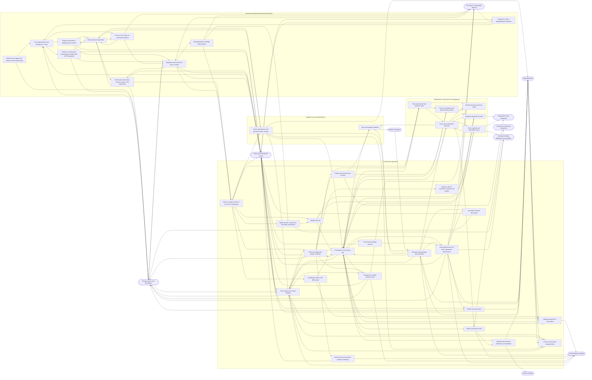

# Canadian national general contractor (commercial, institutional and industrial buildings)

`general-contractor-co` · construction - non-residential general contracting · modelled on public information about ['Bird Construction Inc. (TSX: BDT), from its 2019-2022 annual results releases and company web pages']

The organisation is a Canadian general contractor that builds hospitals, schools, universities, offices, warehouses, plants and other non-residential buildings for public institutions, private owners and P3 consortia. It earns money by winning contracts and building them for more than they cost: stipulated price (lump-sum) bids for public tenders, construction management and design-build contracts for a fee, and the design-build role in public-private partnerships. Most of the work, such as mechanical, electrical, steel and envelope, is subcontracted to trade contractors that the company prequalifies, hires and pays; its own union crews self-perform structural concrete, carpentry and general labour using company cranes, formwork and yards. Owners pay monthly against certified progress draws, and Ontario's Construction Act sets prompt payment deadlines, a 10% holdback and lien rights that run down to every subcontractor. The head office is in Ontario and regional offices in Western and Atlantic Canada run about 220 active projects at a time with salaried project managers, superintendents and engineers. Central business development, finance, safety, supply chain, HR, IT and legal departments support the regions, and the company is listed on the TSX and reports quarterly.

| | |
|---|---|
| Employees | 2,880 |
| Country | Canada |
| Ownership | Publicly listed on the Toronto Stock Exchange |
| Regulators | Ontario Ministry of Labour, Training and Skills Development (Occupational Health and Safety Act, O. Reg. 213/91 Construction Projects), Provincial OHS regulators in Alberta, Saskatchewan, British Columbia and Atlantic provinces, Workplace Safety and Insurance Board (Ontario) and provincial workers' compensation boards, Ontario Construction Act (prompt payment, holdback, liens) and ODACC as authorized nominating authority, Municipal building departments (Ontario Building Code), Ontario Securities Commission and the Toronto Stock Exchange, Ontario Labour Relations Board (ICI construction bargaining), Ministry of the Environment, Conservation and Parks (excess soil, spills), Canada Revenue Agency |
| Annual construction revenue of this organisation type | 1,500,000,000 CAD per year (C) |
| Bird Construction construction revenue 2019 | 1,376,400,000 CAD (A) |
| Bird Construction construction revenue 2020 | 1,504,400,000 CAD (A) |
| Bird Construction construction revenue 2021 | 2,220,000,000 CAD (A) |
| Bird Construction construction revenue 2022 | 2,377,500,000 CAD (A) |
| Bird Construction backlog at 31 December 2019 | 1,547,400,000 CAD (A) |
| Bird Construction backlog at 31 December 2021 | 3,002,500,000 CAD (A) |
| Bird Construction adjusted EBITDA margin 2019 | 2.4 % of revenue (A) |
| Bird Construction adjusted EBITDA margin 2021 | 4.9 % of revenue (A) |
| Backlog of this organisation type | 2,200,000,000 CAD (C) |
| Active projects | 220 projects (C) |
| Regional offices | 9 offices (C) |
| Revolving credit facility (Bird, 2022) | 220,000,000 CAD (A) |
| Bird Construction salaried employees at 31 December 2019 | 880 people (A) |
| Bird Construction hourly employees at 31 December 2019 | 1,578 people (A) |

## Units

- **Executive office** (15 people, department): Chief executive, chief operating officer and their staff; sets strategy, approves large bids and reports to the board.
- **Business development and preconstruction** (127 people, division): Finds and wins work: tracks opportunities, estimates and tenders stipulated price bids, writes CM, design-build and P3 proposals and runs preconstruction services.
  - **Estimating** (82 people, team): Quantity take-off, pricing, trade tendering and bid closing for stipulated price and CM bids.
  - **Preconstruction and design management** (30 people, team): Budgets, constructability and value engineering under CM preconstruction agreements, and design management on design-build work.
  - **P3 and alternative finance pursuits** (5 people, team): Leads the contractor's role in public-private partnership consortia and coordinates with equity partners and lenders.
- **Construction operations** (1,054 people, division): Builds the projects: project managers, superintendents, field engineers and coordinators deployed from regional offices, plus operations support.
  - **Ontario region (head office in Greater Toronto, offices in Ottawa and southwestern Ontario)** (505 people, site network): Project teams for commercial, institutional and industrial projects in Ontario; the largest region.
  - **Western region (Alberta, Saskatchewan, British Columbia)** (347 people, site network): Project teams working from offices in Calgary, Edmonton, Regina and Vancouver.
  - **Atlantic region (Nova Scotia, New Brunswick, Newfoundland and Labrador)** (147 people, site network): Project teams for institutional and commercial projects in Atlantic Canada.
  - **Operations support (project controls, scheduling, VDC, quality)** (55 people, shared service): Central specialists who set cost-control, scheduling, BIM and quality standards and support project teams.
- **Self-perform construction and equipment** (1,344 people, division): Hourly union crews that self-perform concrete forming and placing, carpentry and general labour, plus the cranes, equipment and yards that support them.
  - **Concrete and formwork crews** (912 people, team): Forming, reinforcing coordination, placing and finishing of structural concrete on the company's own projects.
  - **Carpentry and general labour crews** (318 people, team): Rough and finish carpentry, hoarding, winter protection, site services and clean-up.
  - **Equipment and yards** (114 people, team): Owns, maintains and dispatches cranes, telehandlers, formwork systems and small tools from regional yards.
- **Health, safety and environment** (60 people, department): Sets the safety program, supports sites with coordinators, investigates incidents and manages regulatory notices and certification.
- **Supply chain and subcontracts** (38 people, shared service): Prequalifies subcontractors, awards subcontracts and purchase orders and maintains the vendor list.
- **Finance** (110 people, department): Project accounting, payables, billing and collections, payroll, treasury and surety, financial reporting and tax.
  - **Finance transactions (AP, billing, payroll)** (45 people, team): Processes subcontractor and supplier invoices, owner billings and weekly union payroll.
- **People and labour relations** (45 people, department): Recruiting, union dispatch and labour relations, HR records, compensation and benefits.
- **Information technology** (35 people, department): Supports the ERP, project management platform, site connectivity and end-user devices.
- **Legal, risk and insurance** (22 people, department): Reviews prime contracts, manages claims, liens, adjudication and the insurance program.

## Demand drivers

| Driver | Per month | Unit | Evidence |
|---|---:|---|---|
| Active projects under construction | 220 | projects | C |
| Bid invitations and RFPs screened | 90 | opportunities | C |
| New projects started | 10 | projects | C |
| Hourly field workers on payroll | 1,344 | workers | C |
| Active subcontracts invoicing | 3,000 | subcontracts | C |
| Salaried staff | 1,516 | people | C |

## How the core processes connect

## Process map

### Executive office

| Process | Owner | Type | Unit of work | Per month | Priority | Receives from | Sends to |
|---|---|---|---|---:|---:|---|---|
| **Approve large bids and proposals.** Bids above a threshold (for example $25M, or any P3 or unusual contract terms) go to an executive risk review of cost, fee, contingency, contract terms and resourcing before submission. Reviews happen on short notice in the last days before bid close. | Executive office | management | one bid approval review | 10 | 3 | Prepare a construction management, design-build or IPD proposal, Prepare and submit a stipulated price tender, Pursue a P3 project as construction partner | Prepare a construction management, design-build or IPD proposal, Prepare and submit a stipulated price tender, Pursue a P3 project as construction partner |
| **Report to and support the board.** Management prepares quarterly board and committee packs on results, backlog, safety, major project risks and dividends, and records board decisions. Audit and risk committees review the large fixed-price projects and claims. | Executive office | management | one board meeting cycle | 0.33 | 3 | Board of directors, Prepare the annual budget, Publish quarterly and annual financial reports, Review the project portfolio each month | Board of directors, Set the strategic plan, Shareholders and securities regulators |
| **Review the project portfolio each month.** Executives and regional vice-presidents review each region's cost forecasts, margin fade, claims, safety statistics and cash, and agree corrective actions on troubled projects. Results feed the quarterly outlook. | Executive office | management | one monthly portfolio review | 1 | 3 | Manage cash and the credit facility, Prepare the monthly cost report and forecast, Report and investigate incidents | Report to and support the board |
| **Set the strategic plan.** The executive team reviews markets, backlog, margins and risk appetite each year and sets target sectors, regions, delivery models and growth or acquisition plans. Board approval is required. The hard part is balancing fixed-price exposure against collaborative contracts. | Executive office | management | one annual strategic plan | 0.083 | 3 | Report to and support the board | Prepare the annual budget, Track opportunities and decide go or no-go |

### Business development and preconstruction

| Process | Owner | Type | Unit of work | Per month | Priority | Receives from | Sends to |
|---|---|---|---|---:|---:|---|---|
| **Prepare and submit a stipulated price tender.** Estimators take off quantities, price self-performed concrete and general conditions, issue trade packages, carry the best compliant trade prices in the last hours before close, and submit a sealed lump-sum bid with a bid bond. Addenda, late trade prices and scope gaps make the final day error-prone. | Estimating | core | one stipulated price bid | 22 | 1 | Approve large bids and proposals, Maintain the historical cost database, Obtain bid and performance bonds, Review prime contract terms, Solicit and level trade bids, Track opportunities and decide go or no-go | Approve large bids and proposals, Negotiate and execute the prime contract, Obtain bid and performance bonds, Public and institutional owners, Review prime contract terms, Solicit and level trade bids |
| **Solicit and level trade bids.** For each bid or CM package, estimators send trade packages to prequalified subcontractors and suppliers, chase coverage, and level the quotes for scope so that the lowest compliant price is carried. Many trade prices arrive in the final hour, often with exclusions. | Estimating | core | one trade package on one bid | 650 | 1 | Award subcontracts and purchase orders (buyout), Deliver preconstruction services under a CM agreement, Material suppliers, Prepare a construction management, design-build or IPD proposal, Prepare and submit a stipulated price tender, Prequalify subcontractors, Pursue a P3 project as construction partner, Subcontractors | Award subcontracts and purchase orders (buyout), Deliver preconstruction services under a CM agreement, Prepare and submit a stipulated price tender, Prequalify subcontractors, Pursue a P3 project as construction partner |
| **Deliver preconstruction services under a CM agreement.** Under a preconstruction agreement the contractor prices each design stage, reviews constructability, proposes value engineering, plans phasing and tenders trade packages before the construction phase is priced. Owners compare budgets against their funding approvals. | Preconstruction and design management | core | one preconstruction engagement, from the signed preconstruction agreement to an agreed construction price | 1.3 | 2 | Maintain the historical cost database, Negotiate and execute the prime contract, Prequalify subcontractors, Prime design consultant, Private owners and developers, Solicit and level trade bids | Private owners and developers, Public and institutional owners, Solicit and level trade bids, Start up a project and turn it over from estimating |
| **Negotiate and execute the prime contract.** After award the business development lead, the project manager and contracts counsel negotiate supplementary conditions, insurance, bonding and schedule, then sign the CCDC or P3 contract. Unacceptable risk terms can delay signing for weeks. About half of the 10 awards a month come from the bid and proposal processes (about 3 from stipulated bids at a 1-in-7 hit rate and about 2 from CM and design-build proposals); the rest are negotiated work for repeat clients, contract extensions and work orders under master service agreements, which skip formal bidding. | Business development and preconstruction | core | one prime contract | 10 | 2 | Obtain bid and performance bonds, P3 Project Co and public sponsor, Prepare a construction management, design-build or IPD proposal, Prepare and submit a stipulated price tender, Private owners and developers, Public and institutional owners, Pursue a P3 project as construction partner, Review prime contract terms | Deliver preconstruction services under a CM agreement, Manage design on design-build projects, Obtain bid and performance bonds, Private owners and developers, Public and institutional owners, Review prime contract terms, Run the insurance program and claims, Start up a project and turn it over from estimating |
| **Prepare a construction management, design-build or IPD proposal.** For negotiated and best-value work the team writes a proposal with fee, general conditions, staffing, schedule and approach, and attends an interview. Design-build proposals also need a design team and a priced concept design. | Business development and preconstruction | core | one proposal | 5 | 2 | Approve large bids and proposals, Maintain the historical cost database, Obtain bid and performance bonds, Track opportunities and decide go or no-go | Approve large bids and proposals, Negotiate and execute the prime contract, Obtain bid and performance bonds, Private owners and developers, Public and institutional owners, Solicit and level trade bids |
| **Pursue a P3 project as construction partner.** In a consortium with equity investors, lenders and a facility manager, the contractor leads design development and the construction price and schedule for a P3 bid that can take 12 to 18 months. The pursuit costs millions and depends on a partial stipend if lost. | P3 and alternative finance pursuits | core | one P3 pursuit, from screening the opportunity to financial close or loss | 0.2 | 2 | Approve large bids and proposals, Maintain safety certification (COR), Maintain the historical cost database, Obtain bid and performance bonds, Solicit and level trade bids, Track opportunities and decide go or no-go | Approve large bids and proposals, Negotiate and execute the prime contract, Obtain bid and performance bonds, P3 Project Co and public sponsor, Solicit and level trade bids |
| **Track opportunities and decide go or no-go.** Business development and estimating screen public tenders on bid portals and private leads, record them in the CRM and decide whether to pursue based on fit, competition, workload, bonding and risk. Most invitations are declined; picking the right ones sets the hit rate. | Business development and preconstruction | core | one opportunity screened | 90 | 2 | Market the company and maintain client relationships, Private owners and developers, Public and institutional owners, Respond to owner prequalification requests, Set the strategic plan | Prepare a construction management, design-build or IPD proposal, Prepare and submit a stipulated price tender, Pursue a P3 project as construction partner |
| **Maintain the historical cost database.** Estimators record final unit costs, productivity rates and trade prices from closed projects into the estimating database so that future bids price self-perform work realistically. | Estimating | support | one closed project's cost data | 9 | 3 | Close out the project financially | Deliver preconstruction services under a CM agreement, Prepare a construction management, design-build or IPD proposal, Prepare and submit a stipulated price tender, Pursue a P3 project as construction partner |
| **Manage design on design-build projects.** The design manager runs the design consultants hired by the contractor, holds design reviews with the owner, tracks compliance with the owner's statement of requirements and releases packages for permit and construction. | Preconstruction and design management | core | one design-build project-month | 5 | 3 | Negotiate and execute the prime contract, Prime design consultant | Obtain permits, inspections and utility connections, P3 Project Co and public sponsor, Start up a project and turn it over from estimating |
| **Market the company and maintain client relationships.** Business development managers meet owners and consultants, prepare qualifications brochures and award entries, and host client events to learn about upcoming projects early. Leads are logged in the CRM. | Business development and preconstruction | core | one client development activity | 30 | 3 |  | Private owners and developers, Track opportunities and decide go or no-go |
| **Respond to owner prequalification requests.** Public owners and P3 sponsors shortlist contractors through RFQs. Proposal coordinators assemble experience, key staff resumes, safety statistics, COR status, financial capacity and surety letters into a scored submission. | Business development and preconstruction | core | one prequalification submission | 8 | 3 | Maintain safety certification (COR), P3 Project Co and public sponsor, Public and institutional owners | Public and institutional owners, Track opportunities and decide go or no-go |

### Construction operations

| Process | Owner | Type | Unit of work | Per month | Priority | Receives from | Sends to |
|---|---|---|---|---:|---:|---|---|
| **Close deficiencies and reach substantial performance.** The consultant issues deficiency lists, trades fix them, and the contractor applies for substantial performance or Ready-for-Takeover with occupancy, manuals and training. Publication of the certificate starts the lien and holdback periods. | Construction operations | core | one project handover | 10 | 1 | Commission building systems, Coordinate the site day to day, Manage shop drawings and submittals, Prime design consultant | Assemble closeout documents, Close out the project financially, Dispatch equipment to sites, Handle warranty claims, Municipal building departments and utilities, P3 Project Co and public sponsor, Prime design consultant, Private owners and developers, Public and institutional owners, Subcontractors, Track and release holdback |
| **Coordinate the site day to day.** The superintendent runs the daily start-up, sequences trades, checks deliveries and manpower, walks the work, resolves conflicts and writes the daily report. Weather, late trades and missing information cause constant re-planning. | Construction operations | core | one project-day of site coordination | 4,600 | 1 | Award subcontracts and purchase orders (buyout), Build and update the project schedule, Carry out carpentry and general labour works, Change the ERP and project platform, Coordinate trades in the BIM model, Erect, operate and dismantle cranes, Form, place and finish concrete, Inspect sites and run the safety committee, Manage environmental compliance on sites, Manage requests for information, Manage shop drawings and submittals, Mobilize the site, Respond to ministry inspections and orders | Build and update the project schedule, Buy and expedite materials, Close deficiencies and reach substantial performance, Commission building systems, Complete daily hazard assessments and toolbox talks, Dispatch equipment to sites, Inspect and test the work, Manage claims and disputes, Manage requests for information, Manage subcontractor performance and default, Plan and allocate self-perform crews, Prepare the monthly progress draw, Price and process owner changes, Process subcontract change orders, Report and investigate incidents, Track and release holdback |
| **Manage requests for information.** Field engineers and trades raise questions about unclear or conflicting drawings; the project team writes the RFI in the project platform, sends it to the consultant, chases the answer and distributes it. Late answers stop work and many answers change scope. | Construction operations | core | one RFI | 2,200 | 1 | Coordinate the site day to day, Coordinate trades in the BIM model, Subcontractors | Coordinate the site day to day, Price and process owner changes, Prime design consultant, Subcontractors |
| **Manage shop drawings and submittals.** Trades send shop drawings, product data and samples; the project team checks them against the specifications, stamps and forwards them to the consultant, tracks review times and releases approved items for fabrication. Long consultant reviews delay procurement of long-lead items. | Construction operations | core | one submittal | 2,800 | 1 | Award subcontracts and purchase orders (buyout), Material suppliers, Subcontractors | Assemble closeout documents, Buy and expedite materials, Close deficiencies and reach substantial performance, Coordinate the site day to day, Form, place and finish concrete, Price and process owner changes, Prime design consultant, Subcontractors |
| **Prepare the monthly cost report and forecast.** The project manager and project controls reconcile committed and actual cost by cost code, estimate cost to complete, and report margin fade or gain. These forecasts drive revenue recognition, so optimistic forecasts become write-downs later. | Construction operations | management | one project cost report | 220 | 1 | Award subcontracts and purchase orders (buyout), Build and update the project schedule, Buy and expedite materials, Close the books each month, Dispatch equipment to sites, Price and process owner changes, Process subcontract change orders, Record crew time and cost codes, Run weekly hourly payroll, Start up a project and turn it over from estimating | Close the books each month, Hold owner and consultant progress meetings, Report to the P3 consortium, lenders and certifier, Review the project portfolio each month |
| **Prepare the monthly progress draw.** Each month the project manager values work done against the schedule of values, adds approved change orders, and the project accountant issues the proper invoice with the statutory declaration and WSIB clearance. The consultant certifies the amount and the 28-day prompt payment clock starts. | Construction operations | core | one monthly progress draw | 220 | 1 | Build and update the project schedule, Coordinate the site day to day, Price and process owner changes, Process and pay subcontractor progress invoices, Workers' compensation boards | Collect owner payments, P3 Project Co and public sponsor, Prime design consultant, Private owners and developers, Public and institutional owners |
| **Price and process owner changes.** When the consultant issues a proposed change or a site condition changes the work, the project team gathers trade prices, prices self-perform work, submits a quotation, negotiates and either gets a change order or proceeds on a change directive. Disputed changes and slow approvals tie up cash. | Construction operations | core | one change event | 900 | 1 | Award subcontracts and purchase orders (buyout), Build and update the project schedule, Coordinate the site day to day, Manage claims and disputes, Manage requests for information, Manage shop drawings and submittals, Prime design consultant, Private owners and developers, Process subcontract change orders, Public and institutional owners | Build and update the project schedule, Manage claims and disputes, Prepare the monthly cost report and forecast, Prepare the monthly progress draw, Private owners and developers, Process subcontract change orders, Public and institutional owners |
| **Start up a project and turn it over from estimating.** Estimating hands the project to the operations team in a turnover meeting; the project manager loads the budget by cost code, sets up the job in the ERP and project platform, assigns the team, and launches buyout, safety planning, permits and mobilization. Gaps between the bid and the contract surface here. | Construction operations | core | one new project | 10 | 1 | Deliver preconstruction services under a CM agreement, Manage design on design-build projects, Negotiate and execute the prime contract | Award subcontracts and purchase orders (buyout), Build and update the project schedule, Connect new site offices, Coordinate trades in the BIM model, Manage environmental compliance on sites, Mobilize the site, Obtain permits, inspections and utility connections, Plan and allocate self-perform crews, Plan site safety and file the notice of project, Prepare the monthly cost report and forecast, Public and institutional owners, Recruit salaried staff |
| **Build and update the project schedule.** Schedulers and superintendents build a baseline CPM schedule, update it monthly with site progress, analyse delays and issue look-ahead schedules for trades. Delay analysis supports extension of time requests. | Operations support (project controls, scheduling, VDC, quality) | core | one project schedule update | 220 | 2 | Coordinate the site day to day, Price and process owner changes, Start up a project and turn it over from estimating | Coordinate the site day to day, Hold owner and consultant progress meetings, Manage claims and disputes, Plan and allocate self-perform crews, Prepare the monthly cost report and forecast, Prepare the monthly progress draw, Price and process owner changes, Private owners and developers, Protect and heat the work in winter, Public and institutional owners, Report to the P3 consortium, lenders and certifier |
| **Process subcontract change orders.** Each owner change and many site instructions require pricing and issuing changes to the affected subcontracts, matched to the owner change so that cost and revenue stay aligned. Trade claims for extras not covered by an owner change are frequent. | Construction operations | core | one subcontract change | 1,500 | 2 | Award subcontracts and purchase orders (buyout), Coordinate the site day to day, Price and process owner changes, Subcontractors | Manage claims and disputes, Prepare the monthly cost report and forecast, Price and process owner changes, Process and pay subcontractor progress invoices, Subcontractors |
| **Assemble closeout documents.** Coordinators collect operation and maintenance manuals, as-built drawings, warranties and training records from every trade and hand them to the owner. Chasing trades for documents holds up the final holdback release. | Construction operations | core | one closeout package | 10 | 3 | Close deficiencies and reach substantial performance, Manage shop drawings and submittals | Close out the project financially, Private owners and developers, Public and institutional owners |
| **Close out the project financially.** After takeover the team settles final accounts with trades and the owner, releases unused contingency, closes the job in the ERP and records lessons learned. Open claims can keep jobs open for years. | Construction operations | management | one project closeout | 9 | 3 | Assemble closeout documents, Close deficiencies and reach substantial performance | Close the books each month, Maintain the historical cost database |
| **Commission building systems.** Near completion, mechanical, electrical and controls trades start up and test systems with the commissioning agent and owner staff. Defects found here delay takeover, especially in hospitals. | Construction operations | core | one project commissioning | 9 | 3 | Coordinate the site day to day | Close deficiencies and reach substantial performance, Public and institutional owners |
| **Coordinate trades in the BIM model.** On complex buildings such as hospitals, VDC coordinators combine trade models, run clash detection, and hold weekly coordination meetings until mechanical, electrical and structural routes fit. Unresolved clashes become RFIs. | Operations support (project controls, scheduling, VDC, quality) | core | one weekly coordination cycle | 180 | 3 | Start up a project and turn it over from estimating | Coordinate the site day to day, Manage requests for information |
| **Handle warranty claims.** During the one-year warranty period owners report defects; the warranty coordinator assigns them to the responsible trade, follows up and records completion. Trades that have left the market leave the contractor to fix the defect itself. | Construction operations | core | one warranty claim | 90 | 3 | Close deficiencies and reach substantial performance, Private owners and developers, Public and institutional owners | Public and institutional owners, Subcontractors |
| **Hold owner and consultant progress meetings.** Every two weeks the project manager meets the owner and consultant to review schedule, changes, RFIs and submittals, and issues minutes. Decisions taken here release changes and payments. | Construction operations | core | one progress meeting | 650 | 3 | Build and update the project schedule, Prepare the monthly cost report and forecast | Prime design consultant, Public and institutional owners |
| **Inspect and test the work.** Field engineers and superintendents run quality checklists before covering work, book third-party testing of concrete and soils, and record non-conformances for correction. Failed tests can mean demolishing and redoing work. | Operations support (project controls, scheduling, VDC, quality) | core | one inspection or test | 1,800 | 3 | Coordinate the site day to day, Form, place and finish concrete, Inspection and testing companies | Inspection and testing companies, Manage subcontractor performance and default, Prime design consultant |
| **Manage subcontractor performance and default.** When a trade falls behind, lacks manpower or fails quality or safety checks, the project manager issues notices, supplements its work and, if needed, declares default and calls on its bond. Default is rare but expensive. | Construction operations | core | one subcontractor performance issue | 25 | 3 | Coordinate the site day to day, Inspect and test the work, Inspect sites and run the safety committee | Prequalify subcontractors, Subcontractors, Surety company |
| **Mobilize the site.** The superintendent plans site logistics, installs hoarding, trailers and temporary power and water, sets crane and hoist locations and arranges site access before trades arrive. Permits and utility locates often hold up the start. | Construction operations | core | one site mobilization | 10 | 3 | Connect new site offices, Obtain permits, inspections and utility connections, Plan site safety and file the notice of project, Start up a project and turn it over from estimating | Coordinate the site day to day, Dispatch equipment to sites, Erect, operate and dismantle cranes |
| **Obtain permits, inspections and utility connections.** The project team applies for building, demolition, road occupancy and hoarding permits, books municipal inspections and coordinates utility connections. Municipal review times and utility schedules sit outside the contractor's control. | Construction operations | core | one permit or utility application | 25 | 3 | Manage design on design-build projects, Municipal building departments and utilities, Start up a project and turn it over from estimating | Mobilize the site, Municipal building departments and utilities |
| **Protect and heat the work in winter.** From November to March the team plans enclosures, temporary heat and concrete protection so work can continue, orders heaters and fuel, and sends carpentry crews to build hoarding. Cold snaps force sudden extra heat and can stop pours. | Construction operations | core | one project-month of winter protection | 60 | 3 | Build and update the project schedule | Buy and expedite materials, Carry out carpentry and general labour works, Equipment rental companies |
| **Report to the P3 consortium, lenders and certifier.** On P3 projects the construction team reports monthly to Project Co, the lenders' technical advisor and the independent certifier on progress, schedule and quality, because payment comes at substantial completion. Missing milestones costs the consortium financing. | Construction operations | core | one P3 monthly report | 4 | 3 | Build and update the project schedule, Prepare the monthly cost report and forecast | P3 Project Co and public sponsor |

### Self-perform construction and equipment

| Process | Owner | Type | Unit of work | Per month | Priority | Receives from | Sends to |
|---|---|---|---|---:|---:|---|---|
| **Form, place and finish concrete.** Crews set forms and shoring, coordinate rebar and embedded services with trades, pass the pre-pour inspection, place concrete from trucks by pump or crane bucket and finish and cure it. Weather, late ready-mix trucks and failed inspections stretch pours. | Concrete and formwork crews | core | one concrete pour | 600 | 1 | Dispatch equipment to sites, Erect, operate and dismantle cranes, Inspection and testing companies, Manage shop drawings and submittals, Manage the formwork and materials yard, Material suppliers, Plan and allocate self-perform crews | Buy and expedite materials, Complete daily hazard assessments and toolbox talks, Coordinate the site day to day, Dispatch equipment to sites, Erect, operate and dismantle cranes, Inspect and test the work, Manage the formwork and materials yard, Record crew time and cost codes |
| **Record crew time and cost codes.** Foremen record each worker's daily hours by cost code on paper or a tablet, general foremen approve them weekly, and payroll and cost reports use them. Wrong cost codes distort the cost forecast; late sheets delay payroll. | Self-perform construction and equipment | core | one crew weekly timesheet | 580 | 1 | Carry out carpentry and general labour works, Form, place and finish concrete, Manage collective agreements and grievances, Plan and allocate self-perform crews | Prepare the monthly cost report and forecast, Run weekly hourly payroll |
| **Dispatch equipment to sites.** Superintendents request equipment; the yard coordinator assigns owned units or rents them, books trucks and tracks where each unit is so that internal rates can be charged. Units left idle on sites cost money. | Equipment and yards | core | one equipment request | 450 | 2 | Close deficiencies and reach substantial performance, Coordinate the site day to day, Form, place and finish concrete, Maintain and inspect equipment, Mobilize the site | Close the books each month, Equipment rental companies, Form, place and finish concrete, Maintain and inspect equipment, Prepare the monthly cost report and forecast |
| **Erect, operate and dismantle cranes.** The equipment team plans tower crane erection and dismantle, mobile crane set-ups and critical lifts with an engineer, checks ground conditions, and assigns certified operators. Wind and permit windows decide the day. | Equipment and yards | core | one crane set-up, critical lift or dismantle | 25 | 2 | Form, place and finish concrete, Mobilize the site | Coordinate the site day to day, Equipment rental companies, Form, place and finish concrete, Maintain and inspect equipment, Municipal building departments and utilities |
| **Plan and allocate self-perform crews.** Each week the general foremen and the self-perform director match crew requests from projects against available foremen, trades and formwork, call extra trades from the union hall or lay them off. Pours compete for the same crews and weather shifts plans daily. | Self-perform construction and equipment | core | one weekly regional crew plan | 17 | 2 | Build and update the project schedule, Coordinate the site day to day, Start up a project and turn it over from estimating, Train and orient workers | Carry out carpentry and general labour works, Form, place and finish concrete, Hire trades through the union hall, Lay off and recall trades, Record crew time and cost codes |
| **Carry out carpentry and general labour works.** Carpentry and labour crews install hoarding, doors and frames, blocking and rough carpentry, temporary protection and clean-up, filling gaps between trades. Much of this work is billed as general conditions, so crews are moved often between projects at short notice. | Carpentry and general labour crews | core | one work order | 450 | 3 | Plan and allocate self-perform crews, Protect and heat the work in winter | Complete daily hazard assessments and toolbox talks, Coordinate the site day to day, Record crew time and cost codes |
| **Maintain and inspect equipment.** Mechanics carry out scheduled maintenance, annual crane and hoist inspections and breakdown repairs in the yards and on site. A broken crane stops a whole site. | Equipment and yards | support | one maintenance work order | 220 | 3 | Dispatch equipment to sites, Erect, operate and dismantle cranes | Buy and expedite materials, Dispatch equipment to sites |
| **Manage the formwork and materials yard.** Yard staff receive formwork and shoring back from sites, clean, repair and count it, and ship sets to the next project. Lost or damaged forms are charged to projects. | Equipment and yards | support | one yard shipment | 300 | 3 | Form, place and finish concrete | Form, place and finish concrete |

### Health, safety and environment

| Process | Owner | Type | Unit of work | Per month | Priority | Receives from | Sends to |
|---|---|---|---|---:|---:|---|---|
| **Complete daily hazard assessments and toolbox talks.** Every crew completes a field-level hazard assessment before starting work and the foreman holds a toolbox talk; the safety coordinator reviews the forms. Quality varies and copied forms are common. | Health, safety and environment | management | one crew-day hazard assessment | 2,900 | 1 | Carry out carpentry and general labour works, Coordinate the site day to day, Form, place and finish concrete, Plan site safety and file the notice of project | Inspect sites and run the safety committee, Report and investigate incidents |
| **Report and investigate incidents.** Injuries, near misses, property damage and spills are reported the same day, investigated for root cause, reported to the workers' compensation board and, for critical injuries, to the ministry, and injured workers return to modified work. Lost-time injuries affect bidding. | Health, safety and environment | management | one incident | 90 | 1 | Complete daily hazard assessments and toolbox talks, Coordinate the site day to day | Provincial and municipal environmental regulators, Provincial occupational health and safety regulators, Review the project portfolio each month, Run the insurance program and claims, Workers' compensation boards |
| **Inspect sites and run the safety committee.** Safety coordinators and committee members inspect each site weekly, record unsafe conditions and follow up corrective actions with trades. Repeat findings lead to notices and removal of workers. | Health, safety and environment | management | one site safety inspection | 950 | 2 | Complete daily hazard assessments and toolbox talks, Plan site safety and file the notice of project | Coordinate the site day to day, Maintain safety certification (COR), Manage subcontractor performance and default, Prequalify subcontractors, Subcontractors |
| **Plan site safety and file the notice of project.** Before work starts the safety manager and superintendent prepare the site-specific safety plan, emergency plan and hazard register, file the notice of project with the ministry and set up the joint health and safety committee where required. The contractor is the constructor and carries the legal duties. | Health, safety and environment | management | one project safety plan | 10 | 2 | Start up a project and turn it over from estimating | Complete daily hazard assessments and toolbox talks, Inspect sites and run the safety committee, Mobilize the site, Provincial occupational health and safety regulators, Subcontractors, Train and orient workers |
| **Maintain safety certification (COR).** Each year the safety program is audited against the Certificate of Recognition standard by internal and external auditors. Owners require COR to bid, so a failed audit would block the company from many public tenders; preparing evidence takes weeks. | Health, safety and environment | management | one annual COR audit | 0.083 | 3 | Inspect sites and run the safety committee, Train and orient workers | Pursue a P3 project as construction partner, Respond to owner prequalification requests, Safety certifying association |
| **Manage environmental compliance on sites.** The environmental specialist sets erosion, dust, dewatering, spill and waste diversion plans, checks sites and reports spills. Excavated soil and contamination rules add cost and delay. | Health, safety and environment | management | one environmental inspection or event | 25 | 3 | Start up a project and turn it over from estimating | Coordinate the site day to day, Provincial and municipal environmental regulators |
| **Respond to ministry inspections and orders.** When a ministry inspector visits a site the superintendent and safety coordinator accompany them, and any orders are fixed and confirmed in writing. Stop-work orders halt work immediately. | Health, safety and environment | management | one inspector visit | 10 | 3 | Provincial occupational health and safety regulators | Coordinate the site day to day, Provincial occupational health and safety regulators |
| **Train and orient workers.** New hires and trades get site orientation and required certifications such as working at heights, WHMIS and rigging, tracked in the training records. Spring hiring brings a rush of orientations. | Health, safety and environment | support | one worker trained | 250 | 3 | Hire trades through the union hall, Plan site safety and file the notice of project, Recruit salaried staff | Maintain safety certification (COR), Plan and allocate self-perform crews |

### Supply chain and subcontracts

| Process | Owner | Type | Unit of work | Per month | Priority | Receives from | Sends to |
|---|---|---|---|---:|---:|---|---|
| **Award subcontracts and purchase orders (buyout).** After award the project manager and subcontract administrator negotiate with the bidding trades, confirm scope, and issue subcontracts and purchase orders. Buyout savings or losses against the estimate set the project's early margin. | Supply chain and subcontracts | core | one subcontract award | 250 | 1 | Prequalify subcontractors, Solicit and level trade bids, Start up a project and turn it over from estimating | Coordinate the site day to day, Handle liens and adjudication, Manage shop drawings and submittals, Prepare the monthly cost report and forecast, Price and process owner changes, Process and pay subcontractor progress invoices, Process subcontract change orders, Set up and maintain vendors, Solicit and level trade bids, Subcontractors |
| **Prequalify subcontractors.** Analysts collect questionnaires, financials, insurance certificates, WSIB clearances and safety statistics from trades, set limits, and keep the approved list current. Expired insurance and clearance certificates are the usual gap. | Supply chain and subcontracts | support | one subcontractor prequalification | 110 | 2 | Inspect sites and run the safety committee, Insurers and broker, Manage subcontractor performance and default, Solicit and level trade bids, Subcontractors, Workers' compensation boards | Award subcontracts and purchase orders (buyout), Deliver preconstruction services under a CM agreement, Solicit and level trade bids, Subcontractors |
| **Buy and expedite materials.** Buyers issue purchase orders for self-perform materials such as ready-mix, rebar, lumber and consumables and for owner-direct long-lead items, expedite deliveries and match receipts. Long lead times and price escalation in 2021-22 made this harder. | Supply chain and subcontracts | core | one purchase order | 900 | 3 | Coordinate the site day to day, Form, place and finish concrete, Maintain and inspect equipment, Manage shop drawings and submittals, Protect and heat the work in winter | Material suppliers, Prepare the monthly cost report and forecast, Process supplier and rental invoices, Set up and maintain vendors |
| **Set up and maintain vendors.** Vendor requests are checked for tax numbers, banking details and duplicates and created in the ERP. Bank-detail changes are confirmed by phone because of fraud risk. | Supply chain and subcontracts | support | one vendor setup or change | 60 | 3 | Award subcontracts and purchase orders (buyout), Buy and expedite materials | Process and pay subcontractor progress invoices, Process supplier and rental invoices |

### Finance

| Process | Owner | Type | Unit of work | Per month | Priority | Receives from | Sends to |
|---|---|---|---|---:|---:|---|---|
| **Process and pay subcontractor progress invoices.** Subcontractors submit monthly progress invoices; the project manager approves the percentage complete, AP checks holdback, WSIB clearance and statutory declarations, and payment goes out within 7 days of receiving the owner's payment on Ontario contracts procured after 1 October 2019; older contracts and most work in other provinces pay when the owner pays. Disputed amounts need a notice of non-payment on time. | Finance transactions (AP, billing, payroll) | support | one subcontractor invoice | 3,000 | 1 | Award subcontracts and purchase orders (buyout), Collect owner payments, Handle liens and adjudication, Process subcontract change orders, Set up and maintain vendors, Subcontractors | Close the books each month, Handle liens and adjudication, Prepare the monthly progress draw, Subcontractors, Track and release holdback |
| **Run weekly hourly payroll.** Payroll loads approved timesheets, applies the rates, overtime and premiums of several collective agreements and provinces, pays workers weekly and remits union dues, benefits, pension and WCB premiums. Many agreements and late corrections make it error-prone. | Finance transactions (AP, billing, payroll) | support | one weekly payroll run | 4.3 | 1 | Hire trades through the union hall, Lay off and recall trades, Manage collective agreements and grievances, Record crew time and cost codes | Building trades unions, Canada Revenue Agency, Close the books each month, Employees, Prepare the monthly cost report and forecast, Workers' compensation boards |
| **Close the books each month.** Finance closes job cost, posts accruals and equipment charges, recognises revenue from project cost forecasts by percentage of completion and reports results by region. Late forecasts and unapproved changes hold up the close. | Finance | support | one monthly close | 1 | 2 | Close out the project financially, Collect owner payments, Dispatch equipment to sites, Prepare the monthly cost report and forecast, Process and pay subcontractor progress invoices, Process supplier and rental invoices, Run salaried payroll, Run weekly hourly payroll, Track and release holdback | File tax returns, Prepare the monthly cost report and forecast, Publish quarterly and annual financial reports |
| **Collect owner payments.** Billing specialists track certified draws against the 28-day deadline, chase late payments and notices of non-payment, apply receipts and flag disputed amounts for adjudication. Slow public owners stretch working capital. | Finance transactions (AP, billing, payroll) | support | one progress draw collected | 230 | 2 | P3 Project Co and public sponsor, Prepare the monthly progress draw, Prime design consultant, Private owners and developers, Public and institutional owners, Track and release holdback | Close the books each month, Handle liens and adjudication, Manage cash and the credit facility, Process and pay subcontractor progress invoices |
| **Obtain bid and performance bonds.** The treasury manager requests bid bonds for tenders and performance and labour and material payment bonds after award, and reports financial results to the surety to keep the bonding line. Public contracts in Ontario require both bonds above a prescribed value. | Finance | support | one bond request | 35 | 2 | Negotiate and execute the prime contract, Prepare a construction management, design-build or IPD proposal, Prepare and submit a stipulated price tender, Pursue a P3 project as construction partner, Surety company | Negotiate and execute the prime contract, Prepare a construction management, design-build or IPD proposal, Prepare and submit a stipulated price tender, Public and institutional owners, Pursue a P3 project as construction partner, Surety company |
| **Track and release holdback.** Finance tracks the 10% holdback owed by owners and to trades, bills it after substantial performance or phased release, checks for liens after the lien period, and pays trades. Unresolved liens delay release. | Finance | support | one holdback release | 16 | 2 | Close deficiencies and reach substantial performance, Coordinate the site day to day, Handle liens and adjudication, Process and pay subcontractor progress invoices, Workers' compensation boards | Close the books each month, Collect owner payments, P3 Project Co and public sponsor, Private owners and developers, Public and institutional owners, Subcontractors |
| **File tax returns.** Finance files HST, payroll and corporate tax returns in each province, including provincial sales tax in some provinces. Self-assessed sales tax on materials used on site is a common audit finding. | Finance | support | one tax filing | 4 | 3 | Close the books each month | Canada Revenue Agency |
| **Manage cash and the credit facility.** Treasury prepares a weekly cash forecast, manages draws on the revolving credit facility and letters of credit, and monitors covenants. Slow owner payments and holdback build-up drive draws, and the surety watches working capital closely. | Finance | support | one weekly cash forecast | 4.3 | 3 | Collect owner payments, Lending banks | Lending banks, Review the project portfolio each month |
| **Prepare the annual budget.** Finance builds the annual budget from backlog, expected awards, overhead and equipment capital, and executives approve it with the board. The budget depends on guessing which pending bids will be won and when they start. | Finance | management | one annual budget | 0.083 | 3 | Set the strategic plan | Report to and support the board, Run performance reviews and compensation |
| **Process supplier and rental invoices.** AP scans supplier, rental and ready-mix invoices, matches them to purchase orders and receipts, routes them to site for coding and pays them on terms. Missing receipts and wrong cost codes cause rework. | Finance transactions (AP, billing, payroll) | support | one supplier invoice | 6,500 | 3 | Buy and expedite materials, Equipment rental companies, Material suppliers, Set up and maintain vendors | Close the books each month, Equipment rental companies, Material suppliers |
| **Publish quarterly and annual financial reports.** The reporting team prepares financial statements, MD&A, backlog disclosure and the annual information form, supports the auditors and files with securities regulators. Judgements on loss projects and claims get the most audit attention. | Finance | management | one quarterly report | 0.33 | 3 | Close the books each month | Lending banks, Report to and support the board, Shareholders and securities regulators, Surety company |
| **Run salaried payroll.** Payroll pays salaried staff every two weeks, applies new hires, changes and terminations from the HRIS, and remits source deductions. Mid-cycle changes and project bonus payments are the usual sources of corrections. | Finance transactions (AP, billing, payroll) | support | one biweekly payroll run | 2.17 | 3 | Recruit salaried staff, Run performance reviews and compensation | Canada Revenue Agency, Close the books each month, Employees |

### People and labour relations

| Process | Owner | Type | Unit of work | Per month | Priority | Receives from | Sends to |
|---|---|---|---|---:|---:|---|---|
| **Hire trades through the union hall.** When crew planning needs more trades, foremen or HR call the union hall for dispatch or name-hire members, collect documents and certifications, and send them to orientation. Shortages in peak season delay crews. | People and labour relations | support | one hourly hire | 140 | 2 | Manage collective agreements and grievances, Plan and allocate self-perform crews | Building trades unions, Run weekly hourly payroll, Train and orient workers |
| **Lay off and recall trades.** At the end of a scope, or as winter slows work, trades are laid off with records of employment and returned to the hall; recalls follow in spring. | People and labour relations | support | one layoff or recall | 110 | 3 | Plan and allocate self-perform crews | Building trades unions, Run weekly hourly payroll |
| **Manage collective agreements and grievances.** The labour relations manager administers collective agreements with the trades, handles grievances and jurisdiction disputes, and takes part in province-wide ICI bargaining through employer associations. | People and labour relations | support | one grievance or bargaining issue | 6 | 3 | Building trades unions | Building trades unions, Hire trades through the union hall, Record crew time and cost codes, Run weekly hourly payroll |
| **Recruit salaried staff.** Recruiters fill project manager, superintendent, engineer and office roles from postings and referrals, and onboard new hires. Competition for experienced site staff is strong, and offer timing must match project start dates that often slip. | People and labour relations | support | one salaried hire | 25 | 3 | Job applicants, Start up a project and turn it over from estimating | Resolve IT tickets, Run salaried payroll, Train and orient workers |
| **Run performance reviews and compensation.** Once a year managers rate staff, HR calibrates ratings and pay increases against the budget, and bonuses tied to project results are paid. Project staff spread across many sites make timely reviews hard to complete. | People and labour relations | management | one annual review cycle | 0.083 | 3 | Prepare the annual budget | Run salaried payroll |

### Information technology

| Process | Owner | Type | Unit of work | Per month | Priority | Receives from | Sends to |
|---|---|---|---|---:|---:|---|---|
| **Change the ERP and project platform.** Business systems analysts configure the ERP and project platform for new cost codes, workflows and reports, test changes and release them. Changes are scheduled outside month-end close so that billing and payroll are not disrupted. | Information technology | support | one system change | 10 | 3 | Resolve IT tickets | Coordinate the site day to day |
| **Connect new site offices.** IT orders internet, sets up network equipment, printers and plotters in site trailers and removes them at closeout. Rural sites depend on cellular or satellite links. | Information technology | support | one site set-up | 10 | 3 | Start up a project and turn it over from estimating | Mobilize the site, Telecom and IT vendors |
| **Resolve IT tickets.** Analysts handle password resets, device set-ups, software and access requests from offices and sites. Remote sites make device swaps slow, and site staff often call with urgent problems on the platform during working hours. | Information technology | support | one IT ticket | 800 | 3 | Recruit salaried staff | Change the ERP and project platform |

### Legal, risk and insurance

| Process | Owner | Type | Unit of work | Per month | Priority | Receives from | Sends to |
|---|---|---|---|---:|---:|---|---|
| **Handle liens and adjudication.** Legal responds to liens registered by trades, vacates them by posting security, and starts or answers adjudications of payment disputes, which an adjudicator decides within 30 days. Liens must be preserved within 60 days. | Legal, risk and insurance | management | one lien or adjudication | 5 | 2 | Award subcontracts and purchase orders (buyout), Collect owner payments, Process and pay subcontractor progress invoices, Public and institutional owners, Subcontractors | Manage claims and disputes, Ontario Dispute Adjudication for Construction Contracts (ODACC) and courts, Process and pay subcontractor progress invoices, Surety company, Track and release holdback |
| **Manage claims and disputes.** The claims manager prepares delay and change claims with schedule analysis and cost records, negotiates with owners and runs mediation, arbitration or litigation. Large claims take years. | Legal, risk and insurance | management | one claim | 4 | 2 | Build and update the project schedule, Coordinate the site day to day, Handle liens and adjudication, Price and process owner changes, Process subcontract change orders, Subcontractors | Ontario Dispute Adjudication for Construction Contracts (ODACC) and courts, Price and process owner changes, Private owners and developers, Public and institutional owners |
| **Review prime contract terms.** Contracts counsel reviews supplementary conditions in tenders and draft contracts for liability, liquidated damages, consequential damages, indemnities and payment terms, and advises on exceptions. Review time is short because tender periods often allow only a few weeks. | Legal, risk and insurance | management | one contract review | 15 | 3 | Negotiate and execute the prime contract, Prepare and submit a stipulated price tender | Negotiate and execute the prime contract, Prepare and submit a stipulated price tender |
| **Run the insurance program and claims.** The risk manager places project insurance (wrap-up, builder's risk), issues certificates to owners and manages claims for damage, theft and third-party injury. Every owner contract and many subcontracts need certificates naming additional insureds. | Legal, risk and insurance | support | one insurance certificate or claim | 25 | 3 | Negotiate and execute the prime contract, Report and investigate incidents | Insurers and broker, Private owners and developers, Public and institutional owners |

## Roles

| Role | Unit | Layer | Reports to | Headcount | Loaded cost per hour |
|---|---|---|---|---:|---:|
| President and chief executive officer | Executive office | executive |  | 1 | 400 CAD |
| Chief operating officer | Executive office | executive | President and chief executive officer | 1 | 250 CAD |
| Chief financial officer | Finance | executive | President and chief executive officer | 1 | 250 CAD |
| General counsel | Legal, risk and insurance | executive | President and chief executive officer | 1 | 200 CAD |
| Regional vice-president | Construction operations | director | Chief operating officer | 4 | 160 CAD |
| Operations manager (construction manager) | Construction operations | manager | Regional vice-president | 20 | 115 CAD |
| Project manager | Construction operations | manager | Operations manager (construction manager) | 110 | 72 CAD |
| Assistant project manager / project coordinator | Construction operations | individual contributor | Project manager | 151 | 48 CAD |
| Site superintendent | Construction operations | supervisor | Operations manager (construction manager) | 156 | 75 CAD |
| Assistant superintendent | Construction operations | supervisor | Site superintendent | 90 | 58 CAD |
| Field engineer / project engineer | Construction operations | individual contributor | Project manager | 122 | 46 CAD |
| Site administrator / document controller | Construction operations | individual contributor | Project manager | 60 | 36 CAD |
| Commissioning and closeout coordinator | Construction operations | individual contributor | Project manager | 15 | 55 CAD |
| Warranty and service coordinator | Construction operations | individual contributor | Operations manager (construction manager) | 8 | 43 CAD |
| Project controls specialist (cost) | Operations support (project controls, scheduling, VDC, quality) | senior specialist | Operations manager (construction manager) | 25 | 62 CAD |
| Scheduler (CPM) | Operations support (project controls, scheduling, VDC, quality) | senior specialist | Operations manager (construction manager) | 17 | 68 CAD |
| VDC / BIM coordinator | Operations support (project controls, scheduling, VDC, quality) | senior specialist | Operations manager (construction manager) | 15 | 55 CAD |
| Quality manager | Operations support (project controls, scheduling, VDC, quality) | senior specialist | Chief operating officer | 6 | 68 CAD |
| Vice-president, business development and preconstruction | Business development and preconstruction | director | President and chief executive officer | 2 | 150 CAD |
| Business development manager | Business development and preconstruction | manager | Vice-president, business development and preconstruction | 10 | 90 CAD |
| Chief estimator | Estimating | manager | Vice-president, business development and preconstruction | 4 | 105 CAD |
| Estimator / senior estimator | Estimating | senior specialist | Chief estimator | 57 | 68 CAD |
| Bid coordinator | Estimating | individual contributor | Chief estimator | 15 | 40 CAD |
| Preconstruction manager | Preconstruction and design management | manager | Vice-president, business development and preconstruction | 12 | 95 CAD |
| Design manager (design-build and P3) | Preconstruction and design management | senior specialist | Preconstruction manager | 8 | 90 CAD |
| Proposal and marketing coordinator | Business development and preconstruction | individual contributor | Business development manager | 10 | 45 CAD |
| Director, P3 pursuits | P3 and alternative finance pursuits | director | Vice-president, business development and preconstruction | 3 | 150 CAD |
| Director of self-perform operations | Self-perform construction and equipment | director | Chief operating officer | 2 | 140 CAD |
| General foreman | Concrete and formwork crews | supervisor | Director of self-perform operations | 40 | 72 CAD |
| Foreman (concrete, formwork or carpentry crew) | Concrete and formwork crews | supervisor | General foreman | 135 | 65 CAD |
| Carpenter (formwork and general) | Concrete and formwork crews | individual contributor | Foreman (concrete, formwork or carpentry crew) | 455 | 62 CAD |
| Concrete finisher | Concrete and formwork crews | individual contributor | Foreman (concrete, formwork or carpentry crew) | 112 | 58 CAD |
| Construction labourer | Carpentry and general labour crews | individual contributor | Foreman (concrete, formwork or carpentry crew) | 368 | 50 CAD |
| Heavy equipment operator | Equipment and yards | individual contributor | Foreman (concrete, formwork or carpentry crew) | 60 | 63 CAD |
| Tower and mobile crane operator | Equipment and yards | individual contributor | Equipment and yard manager | 25 | 72 CAD |
| Heavy-duty mechanic | Equipment and yards | individual contributor | Equipment and yard manager | 15 | 60 CAD |
| Equipment and yard manager | Equipment and yards | manager | Director of self-perform operations | 3 | 85 CAD |
| Equipment dispatcher / yard coordinator | Equipment and yards | individual contributor | Equipment and yard manager | 10 | 42 CAD |
| Director of health, safety and environment | Health, safety and environment | director | Chief operating officer | 1 | 125 CAD |
| Regional safety manager | Health, safety and environment | manager | Director of health, safety and environment | 6 | 80 CAD |
| Site safety coordinator | Health, safety and environment | individual contributor | Regional safety manager | 45 | 50 CAD |
| Environmental specialist | Health, safety and environment | senior specialist | Director of health, safety and environment | 4 | 55 CAD |
| Safety training coordinator | Health, safety and environment | individual contributor | Regional safety manager | 4 | 46 CAD |
| Supply chain manager | Supply chain and subcontracts | manager | Chief operating officer | 3 | 85 CAD |
| Subcontract administrator / buyer | Supply chain and subcontracts | individual contributor | Supply chain manager | 22 | 47 CAD |
| Subcontractor prequalification analyst | Supply chain and subcontracts | individual contributor | Supply chain manager | 8 | 40 CAD |
| Corporate controller | Finance | director | Chief financial officer | 1 | 125 CAD |
| Regional finance manager | Finance | manager | Corporate controller | 6 | 88 CAD |
| Project accountant | Finance | individual contributor | Regional finance manager | 40 | 48 CAD |
| Financial reporting analyst | Finance | senior specialist | Corporate controller | 10 | 60 CAD |
| Treasury, surety and credit manager | Finance | manager | Chief financial officer | 2 | 95 CAD |
| Accounts payable clerk | Finance transactions (AP, billing, payroll) | individual contributor | Regional finance manager | 18 | 33 CAD |
| Billing and collections specialist | Finance transactions (AP, billing, payroll) | individual contributor | Regional finance manager | 10 | 39 CAD |
| Payroll specialist (union and salaried) | Finance transactions (AP, billing, payroll) | individual contributor | Regional finance manager | 10 | 40 CAD |
| Vice-president, people | People and labour relations | director | President and chief executive officer | 1 | 125 CAD |
| HR business partner | People and labour relations | senior specialist | Vice-president, people | 10 | 68 CAD |
| Recruiter | People and labour relations | individual contributor | Vice-president, people | 10 | 50 CAD |
| Labour relations manager | People and labour relations | manager | Vice-president, people | 3 | 95 CAD |
| HR and benefits administrator | People and labour relations | individual contributor | HR business partner | 8 | 37 CAD |
| Director of IT | Information technology | director | Chief financial officer | 1 | 120 CAD |
| IT support analyst | Information technology | individual contributor | Director of IT | 15 | 45 CAD |
| Business systems analyst (ERP and project platform) | Information technology | senior specialist | Director of IT | 8 | 62 CAD |
| Contracts counsel | Legal, risk and insurance | senior specialist | General counsel | 5 | 115 CAD |
| Claims manager | Legal, risk and insurance | manager | General counsel | 6 | 105 CAD |
| Risk and insurance manager | Legal, risk and insurance | manager | General counsel | 3 | 88 CAD |
| Yard truck driver (boom truck and flatbed) | Equipment and yards | individual contributor | Equipment and yard manager | 14 | 48 CAD |

## Systems

- **Construction ERP (job cost, general ledger, payables, receivables, payroll)** (system of record)
- **Project management platform (drawings, RFIs, submittals, daily logs, change events)** (workflow)
- **Take-off and estimating software with Excel bid sheets** (spreadsheet)
- **Public tender and bid portals (MERX, Bids&Tenders, Biddingo, provincial portals)** (external portal)
- **CPM scheduling software (Primavera P6, Microsoft Project)** (other)
- **BIM and clash detection tools (Revit, Navisworks)** (other)
- **CRM and opportunity tracker** (system of record)
- **Safety management system (hazard assessments, inspections, incidents, training records)** (workflow)
- **Field time capture (paper sheets or tablet app keyed to cost codes)** (workflow)
- **Equipment management (fleet register, rates, maintenance work orders)** (system of record)
- **AP invoice scanning and approval workflow** (workflow)
- **Document management (SharePoint and network drives)** (document store)
- **Email, Teams and mobile phones** (communication)
- **Reporting and dashboards (Excel cost reports, Power BI)** (analytics)
- **HRIS and learning records** (system of record)
- **Subcontractor prequalification database (questionnaires, insurance and WSIB certificates)** (system of record)
- **Government portals (WSIB clearance, Ministry of Labour notice of project, CRA, land registry)** (external portal)
- **IT service desk ticketing** (workflow)
- **Bank cash management portal (EFT and payment release)** (external portal)

## Outside parties

- **Public and institutional owners**: Hospitals, school boards, universities, municipalities, provincial and federal departments that tender stipulated price or CM contracts.
- **Private owners and developers**: Office, industrial, warehouse and plant owners that negotiate CM or design-build contracts.
- **P3 Project Co and public sponsor**: The P3 consortium company (equity, lenders, facilities manager) and the public sponsor such as Infrastructure Ontario, for which the contractor is the design-build partner.
- **Prime design consultant**: Architect or engineer who designs, answers RFIs, reviews submittals, certifies payment and declares substantial performance.
- **Subcontractors**: Mechanical, electrical, steel, envelope, finishing and other trade contractors who carry most of the work.
- **Material suppliers**: Ready-mix concrete, rebar, lumber, hardware and consumable suppliers.
- **Equipment rental companies**: Rent cranes, heaters, lifts and temporary services.
- **Inspection and testing companies**: Third-party testing of concrete, soils, welding and roofing.
- **Surety company**: Issues bid, performance and labour and material payment bonds.
- **Insurers and broker**: CGL, wrap-up, builder's risk, equipment and auto insurance.
- **Lending banks**: Revolving credit and letter of credit facility.
- **Shareholders and securities regulators**: TSX-listed shareholders, Ontario Securities Commission and other securities commissions.
- **Board of directors**: Oversees strategy, risk, audit and dividends.
- **Provincial occupational health and safety regulators**: Ontario Ministry of Labour, Training and Skills Development and equivalents in other provinces; receive notices of project and injury notices, inspect sites and issue orders.
- **Workers' compensation boards**: WSIB in Ontario and WCBs in other provinces; clearance certificates, injury claims and premiums.
- **Provincial and municipal environmental regulators**: Spill reporting, excavated soil, dewatering and waste rules.
- **Municipal building departments and utilities**: Issue building and road occupancy permits, do code inspections, connect utilities.
- **Building trades unions**: Carpenters, labourers, operating engineers and cement masons unions that dispatch members and hold collective agreements.
- **Canada Revenue Agency**: Source deductions, HST and corporate tax.
- **Ontario Dispute Adjudication for Construction Contracts (ODACC) and courts**: Appoints adjudicators for payment disputes; courts hear lien actions.
- **Job applicants**: Candidates for salaried roles.
- **Safety certifying association**: IHSA in Ontario and provincial construction safety associations that audit and grant COR.
- **Employees**: Receive pay and benefits.
- **Telecom and IT vendors**: Provide site internet, phones and hardware.

## Things that pass between processes

- **Tender package**: Invitation to tender or request for proposal with drawings, specifications, form of contract and bid form.
- **RFQ**: Owner's request for qualifications to shortlist contractors before a tender or P3 competition.
- **Prequal submission**: Contractor's or subcontractor's qualification response: experience, safety record, financials, bonding letter.
- **Opportunity**: A tracked project lead with owner, value, delivery model, timing and go/no-go status.
- **Strategic plan**: Three-to-five year plan with target markets, regions, margins and risk appetite.
- **Trade tender**: Trade package sent to subcontractors and suppliers for pricing (scope sheet, drawings, addenda).
- **Trade bid**: A subcontractor's or supplier's priced quotation for one trade package.
- **Levelled trade prices**: Scope-levelled comparison of trade bids with the carried price per trade.
- **Bid summary**: Bid recap: cost, fee, contingency, key risks and exclusions submitted for approval.
- **Bid approval**: Executive decision on whether and at what margin to submit.
- **Bond request**: Request to the surety for a bid bond, performance bond or labour and material payment bond.
- **Bond**: Bid, performance or labour and material payment bond issued by the surety.
- **Bid submission**: The sealed stipulated price bid or the submitted proposal.
- **Proposal**: CM, design-build or IPD proposal with fee, general conditions, team and approach.
- **Cost database**: Historical unit costs, productivity rates and trade prices from closed projects.
- **Award notice**: Owner's notice of award or letter of intent.
- **Draft contract**: Prime contract draft (CCDC 2, CCDC 5B, CCDC 14 or a P3 project agreement) with supplementary conditions.
- **Contract review**: Legal mark-up and risk memo on a draft prime contract.
- **Contract**: Executed prime contract with the owner.
- **Design package**: Drawings and specifications from the design consultants at a design stage.
- **Cost estimate**: Class C, B or A budget estimate prepared during preconstruction.
- **Startup package**: Turnover from estimating: estimate, budget by cost code, schedule assumptions, contract summary, team.
- **Project budget**: Budget loaded to the ERP by cost code at project start.
- **Hire request**: Request to fill a salaried position or to call trades from the union hall.
- **Labour request**: Request for a self-perform crew or added trades on a project for given dates.
- **IT request**: Request for IT accounts, devices or site connectivity.
- **Prequalification record**: Approved subcontractor file: limits, insurance, WSIB clearance, safety record, rating.
- **Subcontract**: Executed subcontract or purchase order for a trade scope.
- **Commitment**: Committed cost of an awarded subcontract or purchase order recorded in the ERP.
- **Vendor setup request**: Request to create or change a vendor in the ERP with banking and tax details.
- **Vendor record**: Approved vendor master record.
- **Material requisition**: Site request for materials, rentals or consumables.
- **Purchase order**: Purchase order to a supplier.
- **Vendor invoice**: Supplier or rental company invoice.
- **Supplier payment**: Payment to a supplier.
- **Schedule**: Baseline or updated CPM schedule.
- **Progress update**: Actual progress recorded from site for a schedule update.
- **Delay notice**: Written notice of delay or a claim for extension of contract time.
- **RFI**: Request for information to the design consultant.
- **RFI response**: Consultant's answer to an RFI, sometimes with a sketch or supplemental instruction.
- **Submittal**: Shop drawing, product data or sample from a subcontractor or supplier.
- **Reviewed submittal**: Submittal returned by the consultant as reviewed, revise and resubmit, or rejected.
- **Change request**: Proposed change notice, RFI answer or site condition that may change cost or time.
- **Change quotation**: Contractor's priced quotation for a change.
- **Change directive**: Owner's signed instruction to proceed with a change before price is agreed (CCDC change directive).
- **Change order**: Executed change order adjusting contract price or time.
- **Sub quote**: Subcontractor's price for a change.
- **Subcontract change order**: Executed change to a subcontract.
- **Disputed change**: A change the owner refuses or values lower than claimed.
- **Claim settlement**: Negotiated or adjudicated outcome of a claim.
- **Claim**: Formal claim for added cost or time.
- **Daily report**: Superintendent's daily log: weather, manpower by trade, work done, deliveries, incidents.
- **Work plan**: Day's work plan for a crew or site used for the hazard assessment.
- **Crew assignment**: Assignment of a self-perform crew to a project for given dates.
- **Equipment request**: Request for owned or rented equipment on site.
- **Equipment delivery**: Equipment delivered to site with inspection records.
- **Rental order**: Order to an equipment rental company.
- **Equipment charges**: Internal equipment rates charged to project cost codes.
- **Service work order**: Maintenance or repair work order for a piece of equipment.
- **Lift plan**: Crane set-up, critical lift plan or tower crane erection and dismantle plan.
- **Formwork delivery**: Formwork, shoring and small tools shipped from the yard to site.
- **Inspection request**: Request for a quality inspection or third-party test.
- **Test report**: Third-party test report (concrete cylinders, compaction, welding, roofing).
- **Nonconformance report**: Record of work not meeting specifications with corrective action.
- **Performance issue**: Subcontractor shortfall in manpower, schedule, quality or safety.
- **Default notice**: Written notice to a subcontractor to cure a default, copied to its surety.
- **Bond claim**: Claim on a subcontractor's performance or payment bond.
- **Timesheet**: Weekly crew timesheet with hours per worker per cost code.
- **Labour cost**: Payroll cost by project and cost code.
- **Payroll remittance**: Source deductions, union dues, benefit and pension contributions and WSIB premiums.
- **Union remittance**: Monthly union dues, benefit, pension and training fund remittances.
- **Pay**: Wage or salary payment to employees.
- **Progress draw**: Monthly application for payment or proper invoice against the schedule of values, with statutory declaration and WSIB clearance.
- **Payment certificate**: Consultant's certificate of the amount payable.
- **Owner payment**: Payment received from the owner.
- **Notice of non payment**: Statutory notice disputing all or part of a proper invoice.
- **Cash receipt**: Cash received and applied in the ERP.
- **Subcontractor invoice**: Subcontractor's monthly progress invoice with holdback shown.
- **Subcontractor payment**: Payment to a subcontractor less holdback.
- **Holdback ledger**: Holdback retained by project and subcontract.
- **Holdback invoice**: Invoice to release statutory holdback after substantial performance or phased release.
- **Holdback payment**: Release of holdback to subcontractors.
- **Lien claim**: Claim for lien registered on title or delivered to the owner.
- **Adjudication notice**: Notice of adjudication under the Construction Act.
- **Completion notice**: Notice from site that work or systems are ready for commissioning, inspection or takeover.
- **Commissioning report**: Start-up, testing and commissioning records for building systems.
- **Deficiency list**: Consultant's list of incomplete or defective work.
- **Substantial performance cert**: Certificate of substantial performance (or Ready-for-Takeover) and its publication.
- **Handover certificate**: Owner acceptance of takeover, start of warranty period.
- **Closeout package**: O&M manuals, as-built drawings, warranties, training records and attic stock.
- **Warranty claim**: Owner's report of a defect during the warranty period.
- **Warranty resolution**: Completed warranty repair and sign-off.
- **Final cost report**: Final project cost, margin and lessons learned.
- **Cost forecast**: Monthly cost report and forecast to complete with margin fade or gain.
- **Job cost report**: ERP job cost detail for the month.
- **Journal entries**: Postings to the general ledger.
- **Financial statements**: Monthly, quarterly or annual financial statements and MD&A.
- **Operations report**: Portfolio report of project margins, risks, safety and cash for executives and the board.
- **Budget plan**: Annual budget with revenue, margin, overhead and capital plan.
- **Board direction**: Board resolutions and direction on strategy, dividends and risk.
- **Cash forecast**: Rolling 13-week cash forecast.
- **Borrowing request**: Draw or letter of credit request under the credit facility.
- **Tax return**: HST, payroll and corporate tax filings.
- **Trial balance**: Closed trial balance for the period.
- **Site safety plan**: Project-specific safety plan, emergency plan and hazard register.
- **Notice of project**: Notice of project filed with the provincial ministry before work starts.
- **Hazard report**: Hazard, near miss or unsafe condition raised from a field assessment.
- **Incident report**: Report of an injury, property damage or environmental incident.
- **Injury report**: Employer's report of injury to the workers' compensation board or critical injury notice to the ministry.
- **Inspection report**: Safety inspection findings with corrective actions.
- **Ministry order**: Order issued by a provincial OHS inspector.
- **Compliance notice**: Notice to the ministry that an order has been complied with.
- **Training record**: Orientation and certification records (working at heights, WHMIS, rigging).
- **New hire**: A hired employee with onboarding documents.
- **Layoff notice**: Layoff of hourly trades at the end of a scope or season.
- **Termination record**: Record of employment and final pay instructions.
- **Collective agreement**: Collective agreement with a building trades union setting wages, benefits and hiring rules.
- **Grievance**: Union grievance.
- **Compensation change**: Salary change from the annual review.
- **WSIB clearance**: Workers' compensation clearance certificate for a contractor.
- **COR certificate**: Certificate of Recognition safety audit result.
- **Environmental plan**: Erosion, sediment, dust, spill and waste diversion plan.
- **Permit application**: Application for building, demolition, road occupancy or utility permits.
- **Building permit**: Issued permit or utility approval.
- **Mobilized site**: Site with hoarding, trailers, temporary services and logistics in place.
- **Coordinated model**: Clash-checked BIM model and coordination drawings.
- **Meeting minutes**: Minutes of owner-consultant-contractor progress meetings.
- **P3 report**: Monthly construction report to Project Co, lenders' technical advisor and independent certifier.
- **Insurance certificate**: Certificate of insurance (CGL, wrap-up, builder's risk) for an owner.
- **Insurance claim**: Claim to insurers under builder's risk, CGL or equipment policies.
- **IT ticket**: IT incident or service request.
- **System release**: Change or release to the ERP or project platform.
- **Hoarding work order**: Work order for hoarding, winter heat or protection.
- **Application for substantial performance**: The contractor's application to the payment certifier, with the deficiency status and cost to complete, asking for the certificate of substantial performance.

## Assumptions

- The organisation is a composite: it has the delivery models, markets and Ontario head office of Bird Construction before its 2020 Stuart Olson acquisition, scaled to about $1.5B revenue and 2,800 employees. Industrial maintenance, mining and heavy civil work that Bird also does are left out because the brief is a buildings general contractor.
- Bird's 2020 annual information form (src-bird-aif20) gives its staffing: about 880 salaried and 1,578 hourly employees at 31 December 2019, on 2019 revenue of $1,376.4 million. Office lists and self-perform shares remain tier C estimates.
- Ontario's statutes and regulations (Construction Act, O. Reg. 213/91) could not be opened on ontario.ca or CanLII; their prompt payment, holdback, lien and adjudication rules are cited from law firm summaries (src6, src7) and are tier B.
- Employees = about 1,536 salaried staff plus about 1,344 hourly union trades on average; hourly headcount swings from about 1,050 in winter to 1,700 in summer. Headcounts were first set at 2,800 and raised on 2026-11-24 to 2,880 to cover the work the workflows record. Bird's total at the end of 2019 (2,458 for $1.38 billion of revenue) scales to about 2,680 at this company's $1.5 billion, but Bird's split was about 36% salaried, against about half here.
- Loaded cost per hour uses a 1.35 loading factor for salaried staff and about 1.6 for union trades (benefit, pension and training fund contributions); Job Bank 2024-25 wages were deflated about 12% to 2019-22.
- Project staff roles are listed at the operations division level and deployed across the three regional site networks; regional headcounts show where they sit.
- Process volumes are tier C estimates derived from about 220 active projects, 10 project starts a month and about 3,000 active subcontracts.
- Shift pattern extended_hours on site roles reflects 10-hour days and Saturday work in the construction season; office roles have no shift pattern.
- The 2019-2022 period includes COVID-19 site protocols that lowered productivity in 2020-2021 (src2) and material price escalation in 2021-2022; process volumes describe an ordinary year.
- Superintendents, assistant superintendents and field engineers are sized at 180 productive hours a month (productive_hours_per_month): their paid time is nearly all on site, with 10-hour days and some Saturdays in season.

## Sources

- [src1] [Bird Construction Inc. Announces 2021 Fourth Quarter and Annual Financial Results](https://www.newswire.ca/news-releases/bird-construction-inc-announces-2021-fourth-quarter-and-annual-financial-results-885407121.html) (Bird Construction Inc. via Cision Newswire, 2022). 2021 and 2020 construction revenue ($2,220.0M, $1,504.4M), backlog ($3,002.5M, $2,682.5M), pending backlog, adjusted EBITDA margin 4.9%; head office in Mississauga, Ontario; coast-to-coast operations; industrial, buildings and infrastructure markets; progressive design-build and IPD contracts; Stuart Olson and Dagmar acquisitions.
- [src2] [Bird Construction Inc. Announces 2020 Fourth Quarter and Annual Financial Results](https://www.newswire.ca/news-releases/bird-construction-inc-announces-2020-fourth-quarter-and-annual-financial-results-801081011.html) (Bird Construction Inc. via Cision Newswire, 2021). 2019 construction revenue $1,376.4M and 2020 $1,504.4M; adjusted EBITDA margin 2.4% (2019) and 5.5% (2020); backlog $1,547.4M (2019) and $2,682.5M (2020); new awards and change orders $1,643.8M in 2020; COVID-19 tender delays and lower site productivity; design-build and PPP contracts; services in industrial, commercial and institutional construction.
- [src3] [Bird Construction Inc. Announces 2022 Fourth Quarter and Annual Financial Results, Declares 10% Dividend Increase](https://www.bird.ca/?p=3867) (Bird Construction Inc., 2023). 2022 construction revenue $2,377.5M; backlog $2.6B and pending backlog $2.5B at 31 December 2022; revolving credit facility $220.0M and letter of credit availability $115.0M.
- [src4] [Self-Perform](https://bird.ca/client-solutions/self-perform) (Bird Construction Inc., 2026). Self-performed trades: earthworks, concrete, process mechanical, electrical, instrumentation and fabrication.
- [src5] [What We Do](https://www.bird.ca/what-we-do/) (Bird Construction Inc., 2026). Services including preconstruction and early contractor involvement, BIM/VDC, delivery models, self-perform, safety and quality; several divisions ISO 9001:2015 certified.
- [src6] [Prompt Payment for Construction in Ontario](https://www.bennettjones.com/Insights/Blogs/Prompt-Payment-for-Construction-in-Ontario) (Bennett Jones LLP, 2019). Owner pays a proper invoice within 28 days; notice of non-payment within 14 days; contractor pays subcontractors within 7 days of receiving payment; contractor's notice of non-payment and undertaking to adjudicate within 21 days.
- [src7] [Prompt payment and adjudication have arrived in Ontario](https://www.dlapiper.com/en/insights/publications/2019/10/prompt-payment-and-adjudication-have-arrived-in-ontario) (DLA Piper, 2019). Prompt payment and adjudication in force 1 October 2019; adjudicator determination within 30 days; ODACC appointment steps; mandatory holdback release unless notice of non-payment of holdback; annual or phased holdback release; lien preservation 60 days and 90 days to perfect; performance and labour and material payment bonds required on public contracts above a prescribed value.
- [src8] [The new CCDC 2 - 2020: contract changes you need to know](https://www.mltaikins.com/insights/the-new-ccdc-2-2020-contract-changes-you-need-to-know/) (MLT Aikins LLP, 2020). Monthly applications for payment to consultant and owner; owner pays within 28 days; workers' compensation compliance evidence and CCDC 9A statutory declaration with each application; change directive cost rules (GC 6.3.7); Ready-for-Takeover requirements (occupancy, O&M manuals, as-builts, start-up testing, training) with a 10-day consultant response; holdback paid within 10 working days after the holdback period; contractor responsible for health and safety (GC 9.4).
- [src9] [FAQs - Public Private Partnerships (P3s)](https://www.infrastructureontario.ca/en/what-we-do/capital-delivery/faqs---public-private-partnerships-p3s/) (Infrastructure Ontario, 2022). Province completes payment only after the project is completed; private partner designs, builds and often finances; developers bear the cost of construction delays; 30-year maintenance terms on some projects; 78 projects at substantial completion by 31 March 2022, 94% on budget and 67% on time; progressive P3 and alliance models.
- [src10] [Wages: Construction Manager in Ontario (NOC 70010)](https://www.jobbank.gc.ca/marketreport/wages-occupation/24325/ON) (Government of Canada, Job Bank, 2026). Ontario hourly wage for construction managers 2024-2025: low $30.00, median $51.28, high $90.29.
- [src11] [Wages: Carpenter in Ontario (NOC 72310)](https://www.jobbank.gc.ca/marketreport/wages-occupation/6388/ON) (Government of Canada, Job Bank, 2026). Ontario hourly wage for carpenters 2024-2025: low $22.00, median $32.50, high $48.50; Toronto median $37.35.
- [src12] [Bird Construction home page](https://www.bird.ca/?p=14) (Bird Construction Inc., 2026). Canadian construction and maintenance company operating coast to coast; industrial, buildings and infrastructure markets; self-perform capability; more than 100 years of history.
- [src-bird-aif20] [Bird Construction Inc. Annual Information Form 2020](https://cdn.bird.ca/2025/03/20204424/annual-information-form-2020d55d64d06e724069900aa84fff156498.pdf) (Bird Construction Inc., 2021). Section 3.1.8: about 2,041 full-time salaried and 2,465 hourly employees (1,106 unionized) at 31 December 2020, after the Stuart Olson acquisition; about 880 salaried and 1,578 hourly (1,211 unionized) at 31 December 2019. Section 3.2.7: Bird secures contracts through competitive bids or negotiation. Backlog includes work orders under master service agreements.
- [ascc] [Request for Information (RFI) and Rework](https://ascconline.org/Home/News/articleType/ArticleView/articleId/121/Request-for-Information-RFI-and-Rework) (American Society of Concrete Contractors, The Voice newsletter (Bruce Suprenant), 2020). Summary of the Navigant Construction Forum study 'Impact & Control of RFIs on Construction Projects': 1,362 projects, an average of about 800 RFIs per project, about 8 hours on average to review and respond to an RFI, $1,080 average cost per RFI, 17.2 RFIs per $1 million of construction cost on $5M-$50M projects and 1.1 on $1B-$5B projects.
- [osler_odacc2] [Adjudication: ODACC releases second annual report](https://www.osler.com/en/insights/blogs/construction/adjudication-odacc-releases-second-annual-report/) (Osler, Hoskin & Harcourt LLP, 2021). ODACC fiscal 2021 (to 31 July 2021): 50 adjudications commenced (32 in fiscal 2020); 34 determinations (3 in fiscal 2020); 79% within the 30-day timeline, the rest extended; about $8.7 million claimed, average $174,193; $908,123 awarded, average $26,710; disputes mainly valuation of services and payment under a contract including change orders; none on holdback; commercial 10, public buildings 3, industrial 3 of 50.
- [osler_odacc3] [Adjudication: ODACC releases third annual report](https://www.osler.com/en/insights/blogs/construction/adjudication-odacc-releases-third-annual-report/) (Osler, Hoskin & Harcourt LLP, 2023). ODACC fiscal 2022 (1 August 2021 to 31 July 2022): 121 adjudications commenced; 24 terminated; 67 determinations, 75% within 30 days; about $33.5 million claimed, average $277,168; $3,449,619 awarded; mostly valuation and payment disputes including change orders; residential 52, transportation and infrastructure 30, commercial 23, public buildings 10, industrial 6.

Written by claude-opus on 2026-11-24.
