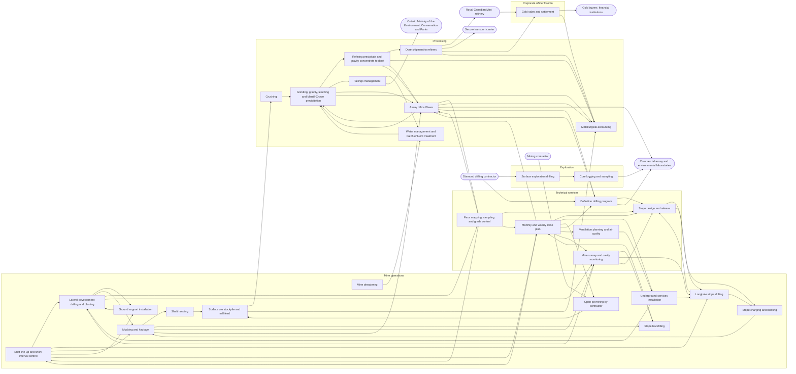

# Canadian single-mine gold producer (underground mine and mill in northern Ontario, Toronto head office)

`mining-operator-co` · metal mining (gold) · modelled on public information about Wesdome Gold Mines Ltd. (Eagle River underground mine, Mishi open pit and Eagle River mill near Wawa, Ontario; Toronto head office; Kiena property in Val-d'Or, Quebec), with site practice from the Island Gold (Alamos Gold) and Macassa (Kirkland Lake Gold) technical reports and open pit practice from the Hardrock (Greenstone Gold Mines) feasibility study. Mine, mill, fleet and underground labour corrected on 2026-11-24 from the Eagle River technical reports (SRK 2022, Wesdome 2016)

The company mines gold ore underground at one mine in northern Ontario, about 1.5 hours by road from the nearest town, and turns it into doré bars at its own mill 16.6 km by road from the mine portal. Ore is hoisted up a shaft to a dump near the top of the mine, trucked out the ramp to a surface pad and hauled to the mill by surface trucks. A small satellite open pit, mined by a contractor, added ore until 2020. The mine produces about 90,000 to 120,000 ounces of gold a year from roughly 600 to 800 tonnes of high-grade ore a day. The mill recovers gold by gravity concentration and cyanide leaching with zinc precipitation (the Merrill-Crowe process), filters its tailings and stacks them dry. The doré is trucked by a secure carrier to the Royal Canadian Mint and the refined gold is sold at spot to financial institutions, the company's only revenue, about C$165-290 million a year. About 250 company employees work at the site, underground crews on long rotations and mill crews on 12-hour shifts seven days on and seven off, living in camps while on shift; a mining contractor supplies about 36 more people underground. Production samples go by daily shuttle to the company's assay office in town. A head office of about 18 people in Toronto handles finance, gold sales, disclosure, legal and investor relations for the listed company. The site is organised into mine operations, technical services (engineering and geology), processing with the assay office, maintenance, health, safety and environment, and site administration under a general manager who reports to the chief operating officer. An exploration team drills near the mine and on a property in Quebec that is on care and maintenance. The mine is regulated by Ontario labour, mining and environment ministries, federal effluent rules and securities regulators.

| | |
|---|---|
| Employees | 266 |
| Country | Canada |
| Ownership | Publicly listed on the Toronto Stock Exchange, widely held |
| Regulators | Ontario Ministry of Labour, Training and Skills Development (mine inspections under the Occupational Health and Safety Act and Regulation 854), Ontario Ministry of Energy, Northern Development and Mines (Mining Act, closure plans and financial assurance, mining claims), Ontario Ministry of the Environment, Conservation and Parks (Environmental Compliance Approvals, Permits to Take Water), Ontario Ministry of Natural Resources and Forestry (dams, work permits on Crown land), Environment and Climate Change Canada (Metal and Diamond Mining Effluent Regulations), Natural Resources Canada, Explosives Regulatory Division (magazine licences), Ontario Ministry of Finance (Mining Tax Act), Canada Revenue Agency, Ontario Securities Commission and the Toronto Stock Exchange (continuous disclosure, NI 43-101), Quebec Ministère de l'Énergie et des Ressources naturelles (exploration claims and care-and-maintenance property) |
| Gold revenue 2019 | 163,800,000 CAD (A) |
| Gold revenue 2020 | 215,300,000 CAD (A) |
| Gold produced 2020 | 90,278 troy ounces (A) |
| Ore milled 2020 | 236,297 tonnes (A) |
| Underground head grade 2020 | 14.2 g/t gold (A) |
| Mill recovery 2020 (underground ore) | 97.7 percent (A) |
| Mill throughput, maximum day 2021-2022 | 1,027 tonnes per day (A) |
| Mineral reserve (end of 2019) | 1,200,000 tonnes at 14.4 g/t (550,000 oz) (A) |
| Cash cost 2019 | 825 CAD per ounce (A) |
| All-in sustaining cost 2019 | 1,293 CAD per ounce (A) |
| Mine capital guidance 2021 (sustaining plus growth) | 49,000,000 CAD (A) |
| Mine-site exploration budget 2021 | 16,000,000 CAD (A) |
| Sites | 3 sites (C) |
| Mill throughput, average 2021-2022 | 779 tonnes per day (A) |
| Mill availability 2021 | 86 percent (A) |
| Underground labour force 2022 | 147 people (111 company, 36 contractor) (A) |

## Units

- **Corporate office (Toronto)** (18 people, division): Executive leadership, finance and reporting, treasury, gold sales, legal, investor relations and corporate HR for the listed company.
  - **Executive and governance** (7 people, team): CEO, CFO, COO, VP exploration, VP investor relations, general counsel and corporate HR lead.
  - **Corporate finance and reporting** (11 people, team): Consolidation, quarterly reporting, treasury, tax, royalties, gold sales settlement and office administration.
- **Mine operations** (86 people, division): Underground development and production, hoisting, services and oversight of the contract-mined open pit.
  - **Underground production and development** (74 people, team): Company and contractor crews on rotation that drill, blast, support, muck and haul development headings and stopes reached by ramp and by raises.
  - **Shaft and hoisting** (10 people, team): Hoist operators who skip ore and waste and move people and materials in the shaft.
  - **Open pit oversight** (1 people, team): Owner supervision of the contractor that mines the satellite open pit.
- **Technical services** (21 people, department): Mine engineering, geology, grade control, survey, geotechnical and ventilation planning, reserve estimation.
  - **Mine engineering and survey** (10 people, team): Short- and long-range plans, stope and development design, survey, ventilation and ground control.
  - **Mine geology** (10 people, team): Face mapping and sampling, definition drilling, grade control models and resource estimates.
- **Processing** (43 people, department): Crushing, grinding, gravity concentration, cyanide leaching with Merrill-Crowe zinc precipitation, refining to doré, tailings filtration and water, and the assay office in Wawa.
  - **Mill operations** (28 people, team): Shift crews running the plant around the clock, the gold room and metallurgy.
  - **Assay office (Wawa)** (14 people, team): Fire assay of grade control, mill process and some definition samples at the company assay office in Wawa, 1.5 hours by road from the mine.
- **Maintenance** (45 people, department): Mobile equipment, fixed plant, electrical and hoist maintenance, planning and component rebuilds.
  - **Mobile equipment maintenance** (12 people, team): Heavy-duty mechanics servicing the underground fleet in the shop and in the mine.
  - **Fixed plant and electrical** (25 people, team): Millwrights, welders and electricians for the mill, hoist, pumps, fans and power distribution.
  - **Maintenance planning** (3 people, team): Planners who schedule preventive work, order parts and plan shutdowns.
- **Health, safety, environment and community** (14 people, department): Safety programs, training, incident management, environmental monitoring and permits, Indigenous and community relations.
- **Site management and administration** (26 people, department): General manager's office, site accounting, payroll, HR, supply chain, IT, security and camp coordination.
  - **Site finance and payroll** (6 people, team): Accounts payable, cost accounting, timekeeping and payroll.
  - **Supply chain and warehouse** (8 people, team): Purchasing, receiving, stores and inventory.
  - **Site services** (11 people, team): HR, IT, security, camp and rotation logistics, administrative support.
- **Exploration** (13 people, department): Near-mine and regional exploration in Ontario and Quebec, claims, core logging, data and project evaluation; care and maintenance of the Quebec property.

## Demand drivers

| Driver | Per month | Unit | Evidence |
|---|---:|---|---|
| Underground ore tonnes mined and hoisted | 16,400 | tonnes | A [src1] |
| Ore milled, all sources | 19,000 | tonnes | A [src1] |
| Lateral development advance | 550 | metres | C |
| Gold produced | 7,500 | troy ounces | A [src1] |
| Mobile equipment units in service | 40 | units | C |
| Purchase orders issued | 500 | purchase orders | C |
| People on the site roster (employees and contractors) | 380 | people | C |
| Diamond drilling metres | 14,000 | metres | B [src1] |
| Samples assayed on site | 8,000 | samples | C |

## How the core processes connect

## Process map

### Corporate office (Toronto)

| Process | Owner | Type | Unit of work | Per month | Priority | Receives from | Sends to |
|---|---|---|---|---:|---:|---|---|
| **Quarterly financial reporting.** Corporate finance consolidates site and head-office results, prepares IFRS statements and the MD&A with non-IFRS cost measures, supports the auditor's review, and files after audit committee approval. Deadlines are 45 days after each quarter and 90 days after year end. | Corporate finance and reporting | management | one quarterly report | 0.33 | 1 | Annual mineral resource and reserve estimate, Care and maintenance of the Quebec property, External auditor, Gold sales and settlement, Metallurgical accounting, Monthly site cost reporting and forecast | Annual information form and technical disclosure, Board and committee governance, Ontario Securities Commission and Toronto Stock Exchange, Shareholders and analysts |
| **Annual budget and guidance.** Head office combines the site plan, exploration program and corporate costs into a budget and public guidance, tests it against gold price and cost scenarios, and takes it to the board in December. Site and head office often iterate several times. | Executive and governance | management | one annual budget | 0.083 | 2 | Board and committee governance, Exploration program planning, Life-of-mine and annual production plan, Monthly site cost reporting and forecast | Board and committee governance, Exploration program planning, Monthly and weekly mine plan, Monthly site cost reporting and forecast, Ontario Securities Commission and Toronto Stock Exchange, Recruitment and onboarding, Shareholders and analysts |
| **Gold sales and settlement.** When the refinery credits ounces to the metal account, the treasury manager sells them at spot to a financial institution, checks the refinery outturn against the shipment, and the corporate controller matches the trade before it is recorded. The company had no gold forward contracts in 2020 or 2021. Timing and price decisions are approved by the CFO. | Corporate finance and reporting | core | one gold sale | 5 | 2 | Doré shipment to refinery, Royal Canadian Mint (refinery) | Gold buyers (financial institutions), Metallurgical accounting, Mining tax and royalties, Quarterly financial reporting, Treasury and cash management |
| **Annual information form and technical disclosure.** Legal and finance prepare the annual information form with reserves, risks and operations; qualified persons sign technical content and an NI 43-101 technical report is filed when results change materially. Consistency across documents is checked line by line. | Executive and governance | management | one annual filing cycle | 0.08 | 3 | Annual mineral resource and reserve estimate, Exploration project evaluation, Life-of-mine and annual production plan, Quarterly financial reporting | Board and committee governance, Ontario Securities Commission and Toronto Stock Exchange |
| **Board and committee governance.** The corporate secretary prepares board and committee packages, minutes and resolutions for quarterly statements, budgets, health and safety, and major projects, and organises the annual meeting. Late papers shorten review time. | Executive and governance | management | one board or committee meeting | 2 | 3 | Annual budget and guidance, Annual information form and technical disclosure, Corporate development, Incident reporting and investigation, Insurance and enterprise risk, Quarterly financial reporting, Treasury and cash management | Annual budget and guidance, Board of directors, Capital project approval and delivery |
| **Capital project approval and delivery.** The COO's team reviews proposals such as a ventilation upgrade, tailings raise or equipment replacement, seeks board approval above limits, secures permits and tracks spending and schedule. Permitting and contractor availability decide timing. | Executive and governance | management | one capital project | 1 | 3 | Board and committee governance, Exploration project evaluation, Life-of-mine and annual production plan, Permits, approvals and closure plan | Permits, approvals and closure plan, Purchasing |
| **Compensation, benefits and HR policy.** The HR director sets pay scales, bonus plans and benefits, benchmarks against northern Ontario mines, and updates HR policies used by the site. Tight labour markets for miners and trades push wage reviews. | Executive and governance | support | one compensation cycle | 0.1 | 3 |  | Recruitment and onboarding, Timekeeping and payroll |
| **Corporate development.** Executives screen acquisition, joint venture and royalty opportunities, visit properties, run due diligence on geology, permits and costs with consultants, and bring the few promising proposals to the board. Most screened opportunities are dropped after a desktop review. | Executive and governance | management | one opportunity screened | 1 | 3 |  | Board and committee governance |
| **Insurance and enterprise risk.** Legal and finance renew property, business interruption, liability and directors' insurance with a broker each year, and maintain the risk register reviewed by the board. Underwriter site surveys add work in renewal months. | Executive and governance | management | one renewal or risk review | 0.33 | 3 |  | Board and committee governance, Insurers and broker |
| **Investor relations and news releases.** Investor relations drafts production, results and exploration news releases with qualified person review, hosts calls and site visits, and answers shareholder and analyst questions. Selective disclosure rules shape every contact. | Executive and governance | management | one news release or event | 3 | 3 | Annual mineral resource and reserve estimate, Drill data QA/QC and database, Metallurgical accounting | Ontario Securities Commission and Toronto Stock Exchange, Shareholders and analysts |
| **Mining tax and royalties.** The treasury and tax manager calculates net smelter return royalties from sales each quarter, pays royalty holders, and prepares Ontario mining tax and income tax instalments and returns with outside advisers. Royalty boundaries and deductions need careful records. | Corporate finance and reporting | support | one royalty or tax filing | 2 | 3 | Gold sales and settlement | Canada Revenue Agency, Ontario Ministry of Finance, Royalty holders |
| **Treasury and cash management.** The treasury manager forecasts cash, funds site payment runs, manages the credit facility and covenants and invests surplus cash, reporting to the CFO and audit committee. Gold price swings move the forecast quickly. | Corporate finance and reporting | support | one weekly cash cycle | 4 | 3 | Accounts payable, Gold sales and settlement | Board and committee governance, Lenders |

### Mine operations

| Process | Owner | Type | Unit of work | Per month | Priority | Receives from | Sends to |
|---|---|---|---|---:|---:|---|---|
| **Ground support installation.** After the round is mucked, a bolter operator scales loose rock and installs rock bolts and mesh to the pattern in the ground control standard, adding shotcrete or cable bolts in poor ground. No one may work under unsupported ground, so a late bolter holds the whole heading. | Underground production and development | core | one heading supported | 160 | 1 | Ground control program and geotechnical review, Lateral development drilling and blasting, Receiving, stores and inventory, Shift line-up and short-interval control | Ground control program and geotechnical review, Incident reporting and investigation, Lateral development drilling and blasting |
| **Lateral development drilling and blasting.** A development crew scales and inspects the face, drills a 3.5-4 m round with a two-boom jumbo, charges it with explosives from the magazine and blasts at shift change. Advance depends on the jumbo being free, services reaching the face and the previous round being supported in time. | Underground production and development | core | one development round | 145 | 1 | Explosives receipt, storage and issue, Ground support installation, Mine survey and cavity monitoring, Shift line-up and short-interval control, Underground services installation | Face mapping, sampling and grade control, Ground support installation, Incident reporting and investigation, Mine survey and cavity monitoring, Mucking and haulage |
| **Longhole stope drilling.** Production miners set up a longhole drill on the released stope layout, drill the rings and the slot raise, and record hole depths and deviations for survey. Bad holes or squeezed ground mean redrills that delay the blast and can dilute the stope. | Underground production and development | core | one stope drilled off | 6 | 1 | Mine survey and cavity monitoring, Shift line-up and short-interval control, Stope design and release, Underground services installation | Breakdown repair, Stope charging and blasting, Stope design and release |
| **Mucking and haulage.** LHD operators muck development rounds and stopes, using remote control in open stopes, and load trucks that haul ore to the shaft loading pocket and waste to backfill or surface. Truck queues, ramp traffic and loader breakdowns set the daily tonnage. | Underground production and development | core | one shift of mucking and haulage | 60 | 1 | Fuel and lubricant supply, Lateral development drilling and blasting, Shift line-up and short-interval control, Stope charging and blasting | Assay office (Wawa), Breakdown repair, Mine survey and cavity monitoring, Mine-to-mill reconciliation, Shaft hoisting, Stope backfilling |
| **Shift line-up and short-interval control.** At the start of each 12-hour shift the supervisor reads the previous shift's report, checks which equipment is available, assigns crews to headings and stopes, and calls progress by radio during the shift. Missing equipment, a blocked ramp or an unsafe heading forces reassignments that ripple through the plan. | Underground production and development | core | one shift | 60 | 1 | Breakdown repair, Face mapping, sampling and grade control, Mandatory and task training, Mobile equipment preventive maintenance, Monthly and weekly mine plan | Breakdown repair, Ground control program and geotechnical review, Ground support installation, Incident reporting and investigation, Lateral development drilling and blasting, Longhole stope drilling, Maintenance planning and scheduling, Mandatory and task training, Mine-to-mill reconciliation, Monthly and weekly mine plan, Mucking and haulage, Timekeeping and payroll |
| **Shaft hoisting.** Hoist operators skip ore from the loading pocket below the 460 m level to a dump at the 70 m level, where underground trucks load at a chute and haul it out the ramp to the surface ore pad. A loading pocket operator runs the pocket by hand, and the cage carries up to six people and materials, though most people travel by ramp. A hoist breakdown stops ore delivery, so the hoist is checked before every shift and can run at most about 16 hours a day. | Shaft and hoisting | core | one hoisting day | 30 | 2 | Hoist and shaft inspections, Mucking and haulage, Planned mill and hoist shutdowns | Breakdown repair, Hoist and shaft inspections, Mine-to-mill reconciliation, Surface ore stockpile and mill feed |
| **Stope charging and blasting.** Production miners clean and measure the drilled holes, charge the slot and rings with explosives in a sequence designed by engineering, and blast at shift change after the area is cleared. Misfires, hung-up rings and overbreak are the main problems and some need re-drilling. | Underground production and development | core | one stope blast | 30 | 2 | Explosives receipt, storage and issue, Longhole stope drilling, Stope design and release | Mine-to-mill reconciliation, Mucking and haulage |
| **Explosives receipt, storage and issue.** The magazine attendant receives explosives and detonators from the licensed supplier, stores them in separate licensed magazines, issues them to crews against signed slips and reconciles stock daily. Federal licence conditions and inspections make record errors serious. | Underground production and development | support | one explosives delivery | 5 | 3 | Explosives supplier | Lateral development drilling and blasting, Natural Resources Canada Explosives Regulatory Division, Receiving, stores and inventory, Stope charging and blasting |
| **Mine dewatering.** Pump stations on several levels move water from sumps up the shaft to surface settling ponds; services workers clean sumps and electricians maintain pumps. Spring melt raises inflow and a pump failure can flood lower levels. | Shaft and hoisting | core | one day of pumping | 30 | 3 | Electrical and power distribution maintenance, Permits, approvals and closure plan | Environmental monitoring and effluent reporting, Water management and batch effluent treatment |
| **Open pit mining by contractor.** The mining contractor drills, blasts, loads and hauls ore and waste from the satellite pit to the plan, while the owner's supervisor checks ore boundaries, haul counts and safety and certifies quantities for payment. Dilution at ore contacts drives the grade delivered. | Open pit oversight | core | one month of pit operation | 1 | 3 | Mining contractor, Monthly and weekly mine plan | Accounts payable, Surface ore stockpile and mill feed |
| **Stope backfilling.** Services crews place waste rock, sometimes with cement, into mined-out stopes after the cavity survey, building fill fences and tipping or pushing the fill with LHDs. Delayed backfill holds up adjacent stopes and adds stability risk. | Underground production and development | core | one stope backfilled | 6 | 3 | Mine survey and cavity monitoring, Mucking and haulage | Monthly and weekly mine plan |
| **Surface ore stockpile and mill feed.** Ore from the shaft bin and the open pit is stockpiled by source and grade, then reclaimed with a loader to the crusher following the metallurgist's blend. Mixed or misreported piles distort the reconciliation between mine and mill. | Mine operations | core | one day of mill feed | 30 | 3 | Open pit mining by contractor, Shaft hoisting | Crushing, Metallurgical accounting, Mine-to-mill reconciliation |
| **Underground services installation.** A services crew extends compressed air, water, power, ventilation duct, leaky feeder radio and pumping to new headings, and builds refuge stations and electrical substations. Development stalls when services lag behind the face. | Underground production and development | core | one services installation | 45 | 3 | Monthly and weekly mine plan, Ventilation planning and air quality | Lateral development drilling and blasting, Longhole stope drilling, Receiving, stores and inventory |

### Technical services

| Process | Owner | Type | Unit of work | Per month | Priority | Receives from | Sends to |
|---|---|---|---|---:|---:|---|---|
| **Face mapping, sampling and grade control.** After each round in an ore heading a geologist maps the face, takes chip samples, marks ore and waste limits and updates the grade control model when assays return; miners take a muck sample from each truck they load. Waste development is not sampled. Assay turnaround and inconsistent sampling decide how much waste is sent to the mill. | Mine geology | core | one face mapped and sampled | 65 | 1 | Assay office (Wawa), Lateral development drilling and blasting | Assay office (Wawa), Mine-to-mill reconciliation, Monthly and weekly mine plan, Shift line-up and short-interval control, Stope design and release |
| **Monthly and weekly mine plan.** Mine engineers schedule next month's headings, stopes, backfill and development metres to meet tonnes and grade, using last month's reconciliation and equipment availability, then split it into weekly targets. Late stope releases and reconciliation surprises cause frequent revisions. | Mine engineering and survey | core | one monthly plan | 1 | 1 | Annual budget and guidance, Face mapping, sampling and grade control, Life-of-mine and annual production plan, Maintenance planning and scheduling, Mine-to-mill reconciliation, Shift line-up and short-interval control, Stope backfilling | Definition drilling program, Grinding, gravity, leaching and Merrill-Crowe precipitation, Maintenance planning and scheduling, Mine survey and cavity monitoring, Mine-to-mill reconciliation, Open pit mining by contractor, Shift line-up and short-interval control, Stope design and release, Underground services installation, Ventilation planning and air quality |
| **Stope design and release.** An engineer designs the stope shape and drill rings from the geology model, the geotechnical engineer reviews spans and support, and the package is signed by geology, engineering and operations before release. Rework when new assays change the ore outline is common. | Mine engineering and survey | core | one stope package | 6 | 1 | Definition drilling program, Face mapping, sampling and grade control, Ground control program and geotechnical review, Longhole stope drilling, Mine survey and cavity monitoring, Monthly and weekly mine plan | Ground control program and geotechnical review, Longhole stope drilling, Stope charging and blasting |
| **Annual mineral resource and reserve estimate.** Geology rebuilds the block model with the year's drilling, engineering applies stope shapes, costs and gold price, and an independent qualified person reviews before the statement is published. Tight disclosure deadlines and audit questions compress the work into a few weeks. | Mine geology | management | one annual estimate | 0.08 | 2 | Definition drilling program, Drill data QA/QC and database, Engineering and geological consultants, Mine survey and cavity monitoring, Mine-to-mill reconciliation, Monthly site cost reporting and forecast | Annual information form and technical disclosure, Investor relations and news releases, Life-of-mine and annual production plan, Quarterly financial reporting |
| **Ground control program and geotechnical review.** The geotechnical engineer maintains the ground control program, reviews stope designs and support records, inspects headings with supervisors and investigates falls of ground. Seismic events or poor ground at depth add urgent reviews. | Mine engineering and survey | management | one geotechnical review | 25 | 2 | Engineering and geological consultants, Ground support installation, Shift line-up and short-interval control, Stope design and release | Ground support installation, Incident reporting and investigation, Life-of-mine and annual production plan, Mandatory and task training, Stope design and release |
| **Life-of-mine and annual production plan.** Engineering turns the reserve estimate into a year-by-year schedule of development, stopes, tonnes, grade, capital and cost, and the annual production plan behind the budget. Changes in reserves, gold price or ventilation capacity force replanning. | Technical services | management | one annual plan | 0.1 | 2 | Annual mineral resource and reserve estimate, Board of directors, Ground control program and geotechnical review, Mine-to-mill reconciliation, Monthly site cost reporting and forecast | Annual budget and guidance, Annual information form and technical disclosure, Capital project approval and delivery, Monthly and weekly mine plan |
| **Mine survey and cavity monitoring.** Surveyors mark heading lines and grades, pick up as-built development, scan emptied stopes with a cavity monitoring system and measure monthly advance and stockpiles. Survey backlog delays backfill and month-end figures. | Mine engineering and survey | core | one survey task | 170 | 2 | Lateral development drilling and blasting, Monthly and weekly mine plan, Mucking and haulage | Annual mineral resource and reserve estimate, Lateral development drilling and blasting, Longhole stope drilling, Mine-to-mill reconciliation, Stope backfilling, Stope design and release |
| **Mine-to-mill reconciliation.** Each month engineering and geology compare planned, mined, hoisted and milled tonnes, grade and ounces using survey, tallies and the metallurgical balance, and explain differences. Large unexplained gaps point to dilution, sampling bias or tallies that do not match. | Technical services | management | one monthly reconciliation | 1 | 2 | Face mapping, sampling and grade control, Metallurgical accounting, Mine survey and cavity monitoring, Monthly and weekly mine plan, Mucking and haulage, Shaft hoisting, Shift line-up and short-interval control, Stope charging and blasting, Surface ore stockpile and mill feed | Annual mineral resource and reserve estimate, Life-of-mine and annual production plan, Monthly and weekly mine plan, Monthly site cost reporting and forecast |
| **Definition drilling program.** Mine geologists plan underground holes to firm up stopes a year or two ahead, supervise the drilling contractor, log and sample core and send samples to the lab. Drill rig access and assay turnaround limit how quickly new stopes are released. | Mine geology | core | one definition hole | 30 | 3 | Assay office (Wawa), Diamond drilling contractor, Monthly and weekly mine plan | Accounts payable, Annual mineral resource and reserve estimate, Assay office (Wawa), Commercial assay and environmental laboratories, Stope design and release |
| **Ventilation planning and air quality.** An engineer plans airflow for new headings and diesel equipment, runs ventilation surveys and gas checks with crews, and sets fan and regulator changes. Ventilation capacity limits how many diesel units can work at once. | Mine engineering and survey | core | one ventilation survey or change | 4 | 3 | Monthly and weekly mine plan | Occupational hygiene monitoring, Underground services installation |

### Processing

| Process | Owner | Type | Unit of work | Per month | Priority | Receives from | Sends to |
|---|---|---|---|---:|---:|---|---|
| **Assay office (Wawa).** A company shuttle brings face, muck, process and some definition samples 1.5 hours by road to the assay office in Wawa every day. Technicians dry, crush and pulverise them, fire assay them in furnace batches of 28 positions with gravimetric or AA finish, insert standards and blanks, and email results to geology and the mill. The office is not accredited and also assays a neighbouring mine's production samples. Backlogs delay grade decisions underground. | Assay office (Wawa) | core | one furnace batch of 28 positions | 300 | 1 | Definition drilling program, Face mapping, sampling and grade control, Grinding, gravity, leaching and Merrill-Crowe precipitation, Mucking and haulage, Refining precipitate and gravity concentrate to doré | Commercial assay and environmental laboratories, Definition drilling program, Face mapping, sampling and grade control, Grinding, gravity, leaching and Merrill-Crowe precipitation, Metallurgical accounting, Refining precipitate and gravity concentrate to doré |
| **Grinding, gravity, leaching and Merrill-Crowe precipitation.** Control room operators run the ball mills, the gravity concentrator and shaking table, the cyanide leach tanks, the drum filters that recover the gold-bearing solution and the Merrill-Crowe circuit, where zinc dust precipitates gold that is caught in sock presses. They adjust grind, density, cyanide and pH against shift samples around the clock. Gravity recovers about 43% of the gold and precipitation most of the rest, 97% overall. Feed changes, power dips and pump failures upset recovery. | Mill operations | core | one milling day | 30 | 1 | Assay office (Wawa), Breakdown repair, Crushing, Fixed plant maintenance, Mandatory and task training, Metallurgical testwork and process improvement, Monthly and weekly mine plan, Planned mill and hoist shutdowns, Reagent receiving and handling, Water management and batch effluent treatment | Assay office (Wawa), Breakdown repair, Incident reporting and investigation, Maintenance planning and scheduling, Mandatory and task training, Metallurgical accounting, Refining precipitate and gravity concentrate to doré, Tailings management, Timekeeping and payroll |
| **Metallurgical accounting.** The metallurgist compiles daily tonnes, head grade, tails grade and recovery from shift logs and assays, and at month end trues up gold in circuit and produced ounces against refinery outturns. Errors here change reported production and the reconciliation. | Mill operations | core | one daily balance | 30 | 1 | Assay office (Wawa), Doré shipment to refinery, Gold sales and settlement, Grinding, gravity, leaching and Merrill-Crowe precipitation, Refining precipitate and gravity concentrate to doré, Royal Canadian Mint (refinery), Surface ore stockpile and mill feed | Investor relations and news releases, Metallurgical testwork and process improvement, Mine-to-mill reconciliation, Monthly site cost reporting and forecast, Quarterly financial reporting |
| **Refining precipitate and gravity concentrate to doré.** Every two weeks the loaded press socks are taken out and burned in the sock oven, and about weekly the shaking table concentrate is collected. Gold room operators mix each concentrate with fluxes, smelt it in the furnace and pour doré bars of 80 to 94% gold under two-person rule and camera coverage. Each bar is weighed, sampled and recorded before going to the vault. | Mill operations | core | one smelt and pour batch (precipitate or table concentrate) | 6 | 1 | Assay office (Wawa), Grinding, gravity, leaching and Merrill-Crowe precipitation, Reagent receiving and handling, Site access and gold security | Assay office (Wawa), Doré shipment to refinery, Metallurgical accounting |
| **Crushing.** Surface trucks bring ore 16.6 km from the mine portal pad to the mill stockpile, and crusher operators feed it through the jaw and cone crushers and screens to the fine ore bin, removing tramp steel and clearing chokes. Crusher breakdowns are the most common cause of lost milling time. | Mill operations | core | one crushing day | 30 | 2 | Surface ore stockpile and mill feed | Breakdown repair, Grinding, gravity, leaching and Merrill-Crowe precipitation |
| **Doré shipment to refinery.** The mill superintendent and security prepare a shipment, seal the bars, hand them to the armed carrier against signed manifests and send the shipment advice to finance and the Royal Canadian Mint. The site controller records the doré in transit. Weather and carrier schedules set the timing. | Mill operations | core | one doré shipment | 3 | 2 | Refining precipitate and gravity concentrate to doré | Gold sales and settlement, Metallurgical accounting, Royal Canadian Mint (refinery), Secure transport carrier |
| **Tailings management.** Leached slurry is washed and dewatered on drum filters in the tailings building, and the filter cake is conveyed and trucked to the tailings area, where a dozer spreads it along the dam crest. Technicians read pond levels and piezometers, and the engineer of record inspects the dams yearly. Spring melt and heavy rain raise pond levels and inspection frequency. | Mill operations | core | one day of tailings deposition | 30 | 2 | Engineering and geological consultants, Grinding, gravity, leaching and Merrill-Crowe precipitation | Incident reporting and investigation, Ontario Ministry of the Environment, Conservation and Parks, Permits, approvals and closure plan, Water management and batch effluent treatment |
| **Metallurgical testwork and process improvement.** Metallurgists test grind, reagent and circuit changes on plant data and send samples for outside testwork when ore types change. Changes go through a trial and a written change before the plant adopts them. | Mill operations | support | one improvement trial | 1 | 3 | Metallurgical accounting | Commercial assay and environmental laboratories, Grinding, gravity, leaching and Merrill-Crowe precipitation |
| **Reagent receiving and handling.** Operators receive bulk sodium cyanide, zinc dust, lead nitrate, lime, flocculant, diatomaceous earth and hydrogen peroxide, mix and store them under the cyanide handling procedure, and track consumption. Cyanide deliveries need trained staff, emergency kits and a clear unloading area. | Mill operations | support | one reagent delivery | 6 | 3 | Reagent supplier | Grinding, gravity, leaching and Merrill-Crowe precipitation, Receiving, stores and inventory, Refining precipitate and gravity concentrate to doré |
| **Water management and batch effluent treatment.** Runoff from the tailings area collects in the reclaim pond, which supplies the mill. Operators add hydrogen peroxide to destroy cyanide, send excess water through the treatment plant (hydroxide, flocculant and geotube filtration) to the polishing pond, and in high-flow periods pump it to the mined-out Mishi pit for storage. Treated water leaves the polishing pond at controlled rates through most of the year. Freshet volumes and tighter limits from January 2021 strain the system. | Mill operations | core | one treatment batch | 1 | 3 | Environmental monitoring and effluent reporting, Mine dewatering, Permits, approvals and closure plan, Tailings management | Environmental monitoring and effluent reporting, Grinding, gravity, leaching and Merrill-Crowe precipitation |

### Maintenance

| Process | Owner | Type | Unit of work | Per month | Priority | Receives from | Sends to |
|---|---|---|---|---:|---:|---|---|
| **Breakdown repair.** Operators radio a breakdown, the supervisor sends a mechanic, electrician or millwright, who diagnoses the fault, waits for parts if needed and returns the unit to service. Underground access, parts on site and trade availability set the downtime. | Maintenance | support | one breakdown work order | 150 | 1 | Crushing, Grinding, gravity, leaching and Merrill-Crowe precipitation, Longhole stope drilling, Mucking and haulage, Shaft hoisting, Shift line-up and short-interval control | Component rebuilds, Grinding, gravity, leaching and Merrill-Crowe precipitation, Incident reporting and investigation, Maintenance planning and scheduling, Purchasing, Receiving, stores and inventory, Shift line-up and short-interval control |
| **Mobile equipment preventive maintenance.** Mechanics service jumbos, loaders, trucks and bolters every 250 hours in the underground or surface shop, following checklists, taking oil samples and logging defects. The unit is out of production while serviced, so PM competes with production for machines. | Mobile equipment maintenance | support | one PM work order | 65 | 1 | Maintenance planning and scheduling | Component rebuilds, Maintenance planning and scheduling, Purchasing, Receiving, stores and inventory, Shift line-up and short-interval control |
| **Maintenance planning and scheduling.** Planners turn preventive maintenance due dates, inspection findings and backlog work requests into a weekly schedule, kit parts and book shutdown windows with operations. Missing parts and urgent breakdowns break the schedule most weeks. | Maintenance planning | support | one weekly schedule | 4 | 2 | Breakdown repair, Grinding, gravity, leaching and Merrill-Crowe precipitation, Incident reporting and investigation, Mandatory and task training, Mobile equipment preventive maintenance, Monthly and weekly mine plan, Planned mill and hoist shutdowns, Shift line-up and short-interval control, Workplace inspections and health and safety committee | Electrical and power distribution maintenance, Fixed plant maintenance, Hoist and shaft inspections, Mandatory and task training, Mobile equipment preventive maintenance, Monthly and weekly mine plan, Planned mill and hoist shutdowns, Purchasing, Receiving, stores and inventory, Surface infrastructure and road maintenance, Timekeeping and payroll |
| **Planned mill and hoist shutdowns.** Once a year the mill stops for one to three weeks for major work, as in August 2021 when the cone crusher and trash screen were replaced and the secondary ball mill inspected, and several times a year the mill or hoist stops for one to four days to reline mills, replace pumps and complete inspections, with extra contractors on site. Scope creep, late parts and lockout coordination decide whether the plant restarts on time. | Maintenance | support | one shutdown | 0.42 | 2 | Contractor management, Crew rotation travel and camp booking, Maintenance planning and scheduling | Accounts payable, Grinding, gravity, leaching and Merrill-Crowe precipitation, Maintenance planning and scheduling, Purchasing, Shaft hoisting |
| **Component rebuilds.** Mechanics remove failed or end-of-life engines, transmissions and hydraulic parts, send them to OEM or rebuild shops and track the rotable spares back into stores. Long turnaround leaves units parked. | Mobile equipment maintenance | support | one component rebuild | 10 | 3 | Breakdown repair, Mobile equipment preventive maintenance, Receiving, stores and inventory | Receiving, stores and inventory, Suppliers and OEMs |
| **Electrical and power distribution maintenance.** Electricians maintain the substation, underground power cables, substations, motors and controls, test ground fault protection and restore power after outages from the grid line. Grid outages stop pumping and ventilation and trigger an emergency response. | Fixed plant and electrical | support | one electrical work order | 60 | 3 | Electricity utility, Maintenance planning and scheduling | Mine dewatering, Workplace inspections and health and safety committee |
| **Fixed plant maintenance.** Millwrights and welders maintain crushers, mills, pumps, tanks, fans and compressors to the weekly schedule, replacing liners and wear parts and doing condition checks. Wear parts with long lead times must be ordered well ahead. | Fixed plant and electrical | support | one fixed plant work order | 80 | 3 | Maintenance planning and scheduling | Grinding, gravity, leaching and Merrill-Crowe precipitation, Receiving, stores and inventory |
| **Hoist and shaft inspections.** Millwrights and electricians carry out daily, weekly and periodic hoist, rope, brake and shaft inspections required by regulation, record them and fix defects before the hoist returns to service. A failed test stops hoisting. | Fixed plant and electrical | management | one hoist inspection | 5 | 3 | Maintenance planning and scheduling, Shaft hoisting | Ontario Ministry of Labour, Training and Skills Development, Shaft hoisting |
| **Surface infrastructure and road maintenance.** Trades and contractors maintain buildings, the camp, the access road, ponds and pipelines, and plow snow so crews and deliveries can reach site. Winter storms and spring road damage take priority over planned work. | Maintenance | support | one surface work order | 30 | 3 | Maintenance planning and scheduling, Service contractors | Crew rotation travel and camp booking |

### Health, safety, environment and community

| Process | Owner | Type | Unit of work | Per month | Priority | Receives from | Sends to |
|---|---|---|---|---:|---:|---|---|
| **Environmental monitoring and effluent reporting.** Technicians sample the mill polishing pond discharge and the mine settling pond discharge to Lake C7 weekly and send monthly toxicity samples to an accredited lab; the coordinator checks results against federal and provincial limits and files quarterly and annual reports. Mill effluent leaves at controlled rates through most of the year. A failed toxicity test raises sampling frequency and must be reported at once. | Health, safety, environment and community | management | one weekly effluent sampling event at one final discharge point | 9 | 1 | Commercial assay and environmental laboratories, Mine dewatering, Permits, approvals and closure plan, Water management and batch effluent treatment | Commercial assay and environmental laboratories, Environment and Climate Change Canada, Ontario Ministry of the Environment, Conservation and Parks, Permits, approvals and closure plan, Water management and batch effluent treatment |
| **Incident reporting and investigation.** Workers report injuries, near misses, equipment damage and spills; the safety coordinator records them, leads investigations for serious events and tracks corrective actions. Critical injuries must be reported to the Ministry immediately and the scene preserved. | Health, safety, environment and community | management | one incident | 25 | 2 | Breakdown repair, Contractor management, Grinding, gravity, leaching and Merrill-Crowe precipitation, Ground control program and geotechnical review, Ground support installation, Lateral development drilling and blasting, Shift line-up and short-interval control, Tailings management | Board and committee governance, Maintenance planning and scheduling, Mandatory and task training, Ontario Ministry of Labour, Training and Skills Development, Ontario Ministry of the Environment, Conservation and Parks, Workplace Safety and Insurance Board |
| **Mandatory and task training.** Trainers deliver Ontario common core modules to new miners, task training and sign-offs on equipment, and refresher courses, and keep records that supervisors check before assigning work. Untrained workers cannot be lined up, so training backlogs limit crews. | Health, safety, environment and community | support | one training course | 30 | 2 | Grinding, gravity, leaching and Merrill-Crowe precipitation, Ground control program and geotechnical review, Incident reporting and investigation, Maintenance planning and scheduling, Recruitment and onboarding, Shift line-up and short-interval control | Grinding, gravity, leaching and Merrill-Crowe precipitation, Maintenance planning and scheduling, Shift line-up and short-interval control |
| **Emergency preparedness and mine rescue.** The HSE team maintains the emergency response plan, refuge stations and stench gas warning, runs evacuation drills, and trains volunteer mine rescue teams with Ontario Mine Rescue. Teams must be ready on every rotation. | Health, safety, environment and community | support | one drill or training session | 3 | 3 | Ontario Mine Rescue (Workplace Safety North) | Ontario Mine Rescue (Workplace Safety North) |
| **Indigenous and community relations.** The coordinator implements agreements with nearby First Nations, sharing hiring and contracting opportunities, reporting on commitments, and consulting on permits and plans. Missed notifications or commitments damage trust and can delay approvals. | Health, safety, environment and community | management | one engagement or commitment | 6 | 3 | First Nations and Métis communities, Surface exploration drilling | First Nations and Métis communities, Permits, approvals and closure plan, Recruitment and onboarding |
| **Occupational hygiene monitoring.** Safety staff measure diesel particulate, noise, silica dust and gases underground and in the mill, compare them with exposure limits and recommend ventilation or equipment changes. Results feed the ventilation plan and workplace inspections. | Health, safety, environment and community | management | one sampling campaign | 2 | 3 | Ventilation planning and air quality | Workplace inspections and health and safety committee |
| **Permits, approvals and closure plan.** The environmental coordinator tracks approvals and their conditions, prepares applications and amendments for new projects, files closure plan amendments with financial assurance, and answers ministry questions. Permit lead times often set project schedules. | Health, safety, environment and community | management | one permit application or amendment | 1 | 3 | Capital project approval and delivery, Environmental monitoring and effluent reporting, Indigenous and community relations, Ontario Ministry of the Environment, Conservation and Parks, Tailings management | Capital project approval and delivery, Environmental monitoring and effluent reporting, Mine dewatering, Ontario Ministry of Energy, Northern Development and Mines, Ontario Ministry of the Environment, Conservation and Parks, Water management and batch effluent treatment |
| **Workplace inspections and health and safety committee.** Supervisors examine each workplace every shift, the joint health and safety committee inspects monthly, and Ministry inspectors visit; hazards go into work requests and corrective actions are tracked to close. Overdue actions are a common audit finding. | Health, safety, environment and community | management | one inspection | 100 | 3 | Electrical and power distribution maintenance, Occupational hygiene monitoring, Ontario Ministry of Labour, Training and Skills Development | Maintenance planning and scheduling, Ontario Ministry of Labour, Training and Skills Development |

### Site management and administration

| Process | Owner | Type | Unit of work | Per month | Priority | Receives from | Sends to |
|---|---|---|---|---:|---:|---|---|
| **Accounts payable.** Site accountants match supplier invoices to purchase orders and receipts, route invoices without a match for approval, code contractor invoices to approved certificates and prepare weekly payment runs. Price and quantity mismatches and missing receipts cause rework. | Site finance and payroll | support | one supplier invoice | 1,600 | 1 | Commercial assay and environmental laboratories, Contractor management, Definition drilling program, Diamond drilling contractor, Electricity utility, Explosives supplier, Fuel and lubricant supply, Fuel supplier, Mining contractor, Open pit mining by contractor, Planned mill and hoist shutdowns, Purchasing, Reagent supplier, Receiving, stores and inventory, Service contractors, Suppliers and OEMs, Surface exploration drilling, Travel and bus providers | Monthly site cost reporting and forecast, Suppliers and OEMs, Treasury and cash management |
| **Purchasing.** Buyers turn approved requisitions into purchase orders, get quotes for larger items, expedite urgent parts to site, and keep contracts with key suppliers. Remote location and long lead times make expediting a large share of the work. | Supply chain and warehouse | support | one purchase order | 500 | 1 | Breakdown repair, Capital project approval and delivery, Maintenance planning and scheduling, Mobile equipment preventive maintenance, Planned mill and hoist shutdowns, Receiving, stores and inventory | Accounts payable, Explosives supplier, Fuel supplier, Reagent supplier, Suppliers and OEMs |
| **Monthly site cost reporting and forecast.** The site controller closes the month, accrues unbilled work, explains cost variances with department heads, calculates cost per tonne and per ounce, and updates the full-year forecast for head office. Late receipts and contractor accruals drive most adjustments. | Site finance and payroll | management | one monthly close | 1 | 2 | Accounts payable, Annual budget and guidance, Camp and catering services, Metallurgical accounting, Mine-to-mill reconciliation, Receiving, stores and inventory, Timekeeping and payroll | Annual budget and guidance, Annual mineral resource and reserve estimate, Life-of-mine and annual production plan, Quarterly financial reporting |
| **Receiving, stores and inventory.** Warehouse attendants receive deliveries against purchase orders, issue parts to mechanics and crews, store rotable components, and count inventory. Unrecorded issues and parts taken underground without a slip spoil inventory accuracy. | Supply chain and warehouse | support | one receipt or stores issue | 2,200 | 2 | Breakdown repair, Component rebuilds, Explosives receipt, storage and issue, Fixed plant maintenance, Fuel and lubricant supply, Maintenance planning and scheduling, Mobile equipment preventive maintenance, Reagent receiving and handling, Suppliers and OEMs, Underground services installation | Accounts payable, Component rebuilds, Ground support installation, Monthly site cost reporting and forecast, Purchasing, Suppliers and OEMs |
| **Timekeeping and payroll.** Supervisors submit crew timesheets with overtime, shift premiums and bonus metres; payroll administrators check them, enter them into the payroll service and process biweekly pay. Bonus calculations and rotation schedules cause most corrections. | Site finance and payroll | support | one pay period | 2.2 | 2 | Compensation, benefits and HR policy, Grinding, gravity, leaching and Merrill-Crowe precipitation, Maintenance planning and scheduling, Recruitment and onboarding, Shift line-up and short-interval control | Canada Revenue Agency, Employees' banks, Monthly site cost reporting and forecast |
| **Camp and catering services.** A catering contractor runs the camp kitchen, housekeeping and rooms; site administration allocates rooms, handles complaints and allocates occupancy costs to departments. Contractor surges can overflow the camp. | Site services | support | one camp-night block | 30 | 3 | Crew rotation travel and camp booking, Service contractors | Monthly site cost reporting and forecast |
| **Contractor management.** Site management prequalifies contractors, checks insurance and safety documents, orients crews on arrival, supervises their work and approves quantities for payment. Poor contractor safety performance is a frequent incident source. | Site management and administration | support | one contractor mobilisation | 8 | 3 | Service contractors | Accounts payable, Incident reporting and investigation, Planned mill and hoist shutdowns |
| **Crew rotation travel and camp booking.** Site administrators book buses, flights and camp rooms for each crew change and for contractors, issue the crew manifest to the gate and handle last-minute swaps. Weather and road closures disrupt crew changes. | Site services | support | one crew change | 5 | 3 | Recruitment and onboarding, Surface infrastructure and road maintenance | Camp and catering services, Planned mill and hoist shutdowns, Site access and gold security, Travel and bus providers |
| **Fuel and lubricant supply.** Fuel is delivered to surface tanks, transferred to underground fuel bays, and dispensed by unit with meter readings logged for cost allocation and equipment hours. Gaps in fuel records hide leaks and theft. | Supply chain and warehouse | support | one fuel delivery | 6 | 3 | Fuel supplier | Accounts payable, Mucking and haulage, Receiving, stores and inventory |
| **IT and communications support.** IT technicians set up accounts, computers and radios for new staff, fix network, leaky feeder and ERP access problems, and work with head office on backups and security. A single remote network link makes outages hard to fix. | Site services | support | one IT request | 150 | 3 | Recruitment and onboarding | Recruitment and onboarding |
| **Recruitment and onboarding.** HR coordinators post positions, screen and interview candidates with supervisors, run pre-employment medicals and references, and onboard new hires into training and rotation. Skilled trades and experienced miners are hard to find in the north. | Site services | support | one hire | 10 | 3 | Annual budget and guidance, Compensation, benefits and HR policy, IT and communications support, Indigenous and community relations, Job applicants | Crew rotation travel and camp booking, IT and communications support, Mandatory and task training, Timekeeping and payroll |
| **Site access and gold security.** Security officers control the gate against crew manifests, search vehicles and people leaving the mill area, monitor the gold room cameras, and log every entry to secure areas. Gold theft risk makes these logs a key control. | Site services | support | one shift of security cover | 62 | 3 | Crew rotation travel and camp booking | Refining precipitate and gravity concentrate to doré |

### Exploration

| Process | Owner | Type | Unit of work | Per month | Priority | Receives from | Sends to |
|---|---|---|---|---:|---:|---|---|
| **Surface exploration drilling.** Project geologists site holes, arrange access and permits, supervise contract rigs that drill around the clock, check daily drill reports and close holes with downhole surveys. Winter freeze-up gives access to swampy ground and drives a drilling peak. | Exploration | core | one exploration hole | 15 | 2 | Claims, permits and assessment filings, Diamond drilling contractor, Exploration program planning, Ontario Ministry of Energy, Northern Development and Mines | Accounts payable, Core logging and sampling, Drill data QA/QC and database, Indigenous and community relations |
| **Care and maintenance of the Quebec property.** A small team keeps the idle Quebec shaft, mill and tailings in safe condition, pumps water, completes required inspections and reports, and hosts the drilling program. Costs are reported to head office each month. | Exploration | support | one month of care and maintenance | 1 | 3 |  | Quarterly financial reporting, Quebec Ministère de l'Énergie et des Ressources naturelles |
| **Claims, permits and assessment filings.** The database geologist tracks claim anniversaries in the Ontario and Quebec online systems, applies for exploration permits and files assessment work reports so claims stay in good standing. A missed date can forfeit ground. | Exploration | support | one claim filing or permit | 4 | 3 | Ontario Ministry of Energy, Northern Development and Mines | Ontario Ministry of Energy, Northern Development and Mines, Quebec Ministère de l'Énergie et des Ressources naturelles, Surface exploration drilling |
| **Core logging and sampling.** Geologists log lithology, alteration and veining and mark sample intervals; core technicians photograph, saw and bag samples with standards and blanks and ship them to a commercial lab. Core backlogs build when several rigs run at once. | Exploration | core | one hole logged and sampled | 18 | 3 | Surface exploration drilling | Commercial assay and environmental laboratories, Drill data QA/QC and database |
| **Drill data QA/QC and database.** The database geologist loads logs, surveys and assay certificates, checks standards, blanks and duplicates, flags failures for re-assay and releases validated intercepts. Results cannot be disclosed until QA/QC passes. | Exploration | support | one assay certificate | 60 | 3 | Commercial assay and environmental laboratories, Core logging and sampling, Surface exploration drilling | Annual mineral resource and reserve estimate, Exploration program planning, Exploration project evaluation, Investor relations and news releases |
| **Exploration program planning.** The VP and exploration manager rank targets near the mine and on the Quebec and regional properties, set metres and budgets, and present the program with the annual budget. Results during the year shift money between targets. | Exploration | management | one annual program | 0.1 | 3 | Annual budget and guidance, Drill data QA/QC and database | Annual budget and guidance, Surface exploration drilling |
| **Exploration project evaluation.** Geologists model promising zones, estimate a first resource with consultants, and prepare a study proposal if the target could feed the mill or restart the Quebec property. Most targets do not reach this stage. | Exploration | management | one project evaluation | 0.25 | 3 | Drill data QA/QC and database, Engineering and geological consultants | Annual information form and technical disclosure, Capital project approval and delivery |

## Roles

| Role | Unit | Layer | Reports to | Headcount | Loaded cost per hour |
|---|---|---|---|---:|---:|
| President and chief executive officer | Executive and governance | executive |  | 1 | 330 CAD |
| Chief financial officer | Executive and governance | executive | President and chief executive officer | 1 | 230 CAD |
| Chief operating officer | Executive and governance | executive | President and chief executive officer | 1 | 230 CAD |
| Vice-president, exploration | Executive and governance | executive | President and chief executive officer | 1 | 190 CAD |
| Vice-president, investor relations and corporate development | Executive and governance | director | President and chief executive officer | 1 | 165 CAD |
| General counsel and corporate secretary | Executive and governance | director | President and chief executive officer | 1 | 185 CAD |
| Director, human resources | Executive and governance | director | President and chief executive officer | 1 | 125 CAD |
| Corporate controller | Corporate finance and reporting | manager | Chief financial officer | 1 | 115 CAD |
| Financial reporting accountant | Corporate finance and reporting | senior specialist | Corporate controller | 3 | 75 CAD |
| Treasury and tax manager | Corporate finance and reporting | manager | Chief financial officer | 1 | 105 CAD |
| Corporate accountant | Corporate finance and reporting | individual contributor | Corporate controller | 2 | 55 CAD |
| Investor relations analyst | Corporate finance and reporting | individual contributor | Vice-president, investor relations and corporate development | 1 | 62 CAD |
| Executive assistant and office administrator | Corporate finance and reporting | individual contributor | President and chief executive officer | 3 | 42 CAD |
| Mine general manager | Site management and administration | director | Chief operating officer | 1 | 150 CAD |
| Mine superintendent | Mine operations | manager | Mine general manager | 1 | 115 CAD |
| Mine captain (general foreman) | Underground production and development | supervisor | Mine superintendent | 2 | 95 CAD |
| Underground shift supervisor | Underground production and development | supervisor | Mine captain (general foreman) | 8 | 82 CAD |
| Development miner (jumbo operator) | Underground production and development | individual contributor | Underground shift supervisor | 24 | 56 CAD |
| Production miner (longhole driller and blaster) | Underground production and development | individual contributor | Underground shift supervisor | 10 | 56 CAD |
| Mechanized bolter operator | Underground production and development | individual contributor | Underground shift supervisor | 6 | 52 CAD |
| Scooptram (LHD) operator | Underground production and development | individual contributor | Underground shift supervisor | 8 | 51 CAD |
| Underground haul truck driver | Underground production and development | individual contributor | Underground shift supervisor | 24 | 49 CAD |
| Underground services and construction miner | Underground production and development | individual contributor | Underground shift supervisor | 21 | 47 CAD |
| Powder and magazine attendant | Underground production and development | individual contributor | Mine captain (general foreman) | 2 | 46 CAD |
| Hoist operator | Shaft and hoisting | individual contributor | Mine captain (general foreman) | 6 | 49 CAD |
| Open pit supervisor (contract oversight) | Open pit oversight | supervisor | Mine superintendent | 1 | 82 CAD |
| Technical services manager (chief engineer) | Technical services | manager | Mine general manager | 1 | 115 CAD |
| Mine planning engineer | Mine engineering and survey | senior specialist | Technical services manager (chief engineer) | 4 | 74 CAD |
| Geotechnical engineer | Mine engineering and survey | senior specialist | Technical services manager (chief engineer) | 2 | 78 CAD |
| Mine surveyor | Mine engineering and survey | individual contributor | Mine planning engineer | 4 | 50 CAD |
| Chief mine geologist | Mine geology | manager | Technical services manager (chief engineer) | 1 | 108 CAD |
| Mine geologist | Mine geology | senior specialist | Chief mine geologist | 5 | 68 CAD |
| Geology technician and sampler | Mine geology | individual contributor | Mine geologist | 4 | 43 CAD |
| Mill superintendent | Processing | manager | Mine general manager | 1 | 112 CAD |
| Mill metallurgist | Mill operations | senior specialist | Mill superintendent | 2 | 70 CAD |
| Mill shift supervisor | Mill operations | supervisor | Mill superintendent | 4 | 72 CAD |
| Mill process and control room operator | Mill operations | individual contributor | Mill shift supervisor | 16 | 46 CAD |
| Crusher operator | Mill operations | individual contributor | Mill shift supervisor | 4 | 43 CAD |
| Gold room and refining operator | Mill operations | individual contributor | Mill superintendent | 2 | 48 CAD |
| Assay lab superintendent or shift supervisor | Assay office (Wawa) | supervisor | Mill superintendent | 2 | 64 CAD |
| Assay technician | Assay office (Wawa) | individual contributor | Assay lab superintendent or shift supervisor | 11 | 40 CAD |
| Maintenance superintendent | Maintenance | manager | Mine general manager | 1 | 108 CAD |
| Maintenance planner | Maintenance planning | senior specialist | Maintenance superintendent | 3 | 60 CAD |
| Maintenance supervisor | Maintenance | supervisor | Maintenance superintendent | 4 | 76 CAD |
| Heavy-duty equipment mechanic | Mobile equipment maintenance | individual contributor | Maintenance supervisor | 16 | 53 CAD |
| Industrial electrician | Fixed plant and electrical | individual contributor | Maintenance supervisor | 12 | 55 CAD |
| Millwright | Fixed plant and electrical | individual contributor | Maintenance supervisor | 10 | 53 CAD |
| Welder-fabricator | Fixed plant and electrical | individual contributor | Maintenance supervisor | 3 | 49 CAD |
| Health, safety and environment manager | Health, safety, environment and community | manager | Mine general manager | 1 | 102 CAD |
| Safety coordinator | Health, safety, environment and community | senior specialist | Health, safety and environment manager | 3 | 57 CAD |
| Mine trainer | Health, safety, environment and community | individual contributor | Health, safety and environment manager | 2 | 53 CAD |
| Environmental coordinator | Health, safety, environment and community | senior specialist | Health, safety and environment manager | 2 | 58 CAD |
| Environmental technician | Health, safety, environment and community | individual contributor | Environmental coordinator | 2 | 40 CAD |
| Indigenous and community relations coordinator | Health, safety, environment and community | senior specialist | Mine general manager | 1 | 60 CAD |
| Industrial first aid attendant (EMR) | Health, safety, environment and community | individual contributor | Health, safety and environment manager | 3 | 42 CAD |
| Site controller | Site finance and payroll | manager | Mine general manager | 1 | 95 CAD |
| Site accountant (payables and cost) | Site finance and payroll | individual contributor | Site controller | 3 | 43 CAD |
| Payroll and timekeeping administrator | Site finance and payroll | individual contributor | Site controller | 2 | 40 CAD |
| Supply chain supervisor | Supply chain and warehouse | supervisor | Site controller | 1 | 70 CAD |
| Buyer | Supply chain and warehouse | individual contributor | Supply chain supervisor | 2 | 45 CAD |
| Warehouse attendant | Supply chain and warehouse | individual contributor | Supply chain supervisor | 5 | 37 CAD |
| Site HR coordinator | Site services | individual contributor | Director, human resources | 2 | 48 CAD |
| IT technician | Site services | individual contributor | Site controller | 2 | 45 CAD |
| Security officer | Site services | individual contributor | Health, safety and environment manager | 4 | 35 CAD |
| Site administrator (travel, camp and rotation) | Site services | individual contributor | Mine general manager | 3 | 37 CAD |
| Exploration manager | Exploration | manager | Vice-president, exploration | 1 | 108 CAD |
| Exploration project geologist | Exploration | senior specialist | Exploration manager | 5 | 64 CAD |
| Core technician | Exploration | individual contributor | Exploration project geologist | 6 | 38 CAD |
| GIS and database geologist | Exploration | individual contributor | Exploration manager | 1 | 55 CAD |
| Site services driver (daily Wawa sample shuttle) | Assay office (Wawa) | individual contributor |  | 1 | 35 CAD |
| Loading pocket operator and cagetender | Shaft and hoisting | individual contributor | Underground shift supervisor | 4 | 47 CAD |
| Mine production clerk | Underground production and development | individual contributor |  | 1 | 38 CAD |

## Systems

- **Mid-market ERP for finance, purchasing, inventory and fixed assets** (system of record)
- **Maintenance management system (ERP maintenance module or standalone)** (system of record)
- **Payroll and timekeeping service (outsourced payroll with site time entry)** (system of record)
- **Mine design and scheduling software (3D design, scheduling)** (analytics)
- **Geological drillhole and sample database** (system of record)
- **Assay laboratory information system** (system of record)
- **Mill distributed control system and process historian** (instrument)
- **Shift reports, line-up boards and production tallies (paper and spreadsheets)** (spreadsheet)
- **Metallurgical accounting and reconciliation workbooks** (spreadsheet)
- **Total stations, cavity monitoring scanner and survey software** (instrument)
- **Incident, inspection and training records system** (workflow)
- **Environmental monitoring data workbooks and lab certificates** (spreadsheet)
- **ECCC online effluent reporting system** (external portal)
- **Leaky feeder radio and surface radio network** (communication)
- **Email and calendar (Microsoft Outlook/Exchange)** (communication)
- **Shared drives and document library (procedures, permits, drawings)** (document store)
- **Consolidation, budget and reporting workbooks** (spreadsheet)
- **SEDAR securities filing system** (external portal)
- **Bank and bullion account portals** (external portal)
- **Mining Lands Administration System (Ontario) and GESTIM (Quebec) claim portals** (external portal)
- **Gate access, camp booking and gold room access logs** (workflow)
- **Newswire distribution service (guidance news release dissemination)** (external portal)
- **Statutory hoist log books (Hoist Operator's Log Book, Shaft Inspection Record, Rope Record Book; paper)** (other)
- **Magazine sign-out and blast log books (paper)** (other)

## Outside parties

- **Royal Canadian Mint (refinery)**: Refines doré into good-delivery gold and credits ounces to the company's metal account; named as the refiner in the 2016 technical report.
- **Gold buyers (financial institutions)**: Financial institutions that buy refined gold at spot and hold metal accounts. The company had no gold forward contracts in 2020 or 2021.
- **Secure transport carrier**: Collects doré from site under armed escort and delivers it to the refinery.
- **Suppliers and OEMs**: Sell parts, consumables, equipment and services; many are in Sudbury, Timmins and Sault Ste. Marie.
- **Explosives supplier**: Licensed supplier of emulsion, ANFO and detonators.
- **Reagent supplier**: Supplies sodium cyanide, zinc dust, lime and other mill reagents.
- **Fuel supplier**: Delivers diesel and lubricants to site tanks.
- **Diamond drilling contractor**: Provides surface and underground drill rigs and crews, paid by the metre.
- **Mining contractor**: Mined the satellite pit with its own fleet under a unit-rate contract, and supplies underground crews and equipment: 36 people in 2022, most of them development miners.
- **Service contractors**: Shaft, construction, catering, electrical and shutdown contractors working on site.
- **Commercial assay and environmental laboratories**: Accredited labs that assay drill core, check samples and test effluent.
- **Engineering and geological consultants**: Independent qualified persons, tailings engineers of record and design firms.
- **Ontario Ministry of Labour, Training and Skills Development**: Mining inspectors who enforce the OHSA and Regulation 854 and receive accident notices.
- **Ontario Ministry of Energy, Northern Development and Mines**: Administers the Mining Act: claims, closure plans and financial assurance.
- **Ontario Ministry of the Environment, Conservation and Parks**: Issues and enforces Environmental Compliance Approvals and Permits to Take Water.
- **Environment and Climate Change Canada**: Administers the Metal and Diamond Mining Effluent Regulations.
- **Natural Resources Canada Explosives Regulatory Division**: Licenses and inspects explosives magazines.
- **Ontario Ministry of Finance**: Collects Ontario mining tax.
- **Canada Revenue Agency**: Collects income tax and payroll remittances.
- **Workplace Safety and Insurance Board**: Ontario workplace injury insurance.
- **Ontario Mine Rescue (Workplace Safety North)**: Trains and supports mine rescue teams under the OHSA.
- **Quebec Ministère de l'Énergie et des Ressources naturelles**: Administers mining claims and closure obligations in Quebec.
- **Ontario Securities Commission and Toronto Stock Exchange**: Receive continuous disclosure filings and enforce listing rules.
- **Shareholders and analysts**: Investors who read disclosure and vote at the annual meeting.
- **Board of directors**: Independent directors who approve budgets, statements and major decisions.
- **External auditor**: Audits annual and reviews quarterly financial statements.
- **Lenders**: Bank providing a revolving credit facility.
- **Royalty holders**: Hold net smelter return royalties on parts of the property.
- **Insurers and broker**: Provide property, liability and directors' insurance.
- **First Nations and Métis communities**: Indigenous communities near the mine with agreements covering employment, contracting and consultation.
- **Job applicants**: People applying for site and office positions.
- **Travel and bus providers**: Airlines, charter buses and hotels used for crew changes.
- **Employees' banks**: Receive net pay deposits.
- **Electricity utility**: Supplies grid power to the site.

## Things that pass between processes

- **Monthly mine plan**: Headings, stopes, tonnes, grade and development metres scheduled for the month, broken into weekly targets.
- **Life-of-mine plan**: Year-by-year tonnes, grade, ounces, development, capital and operating cost to the end of reserves.
- **Approved annual budget**: Board-approved production, cost, capital, exploration and headcount targets for the year.
- **Headcount plan**: Approved positions by department for the year, used to open job requisitions.
- **Shift line-up**: The supervisor's assignment of crews, equipment and headings for one 12-hour shift.
- **Shift report**: End-of-shift record of rounds blasted, metres advanced, buckets and truckloads moved, delays and hazards.
- **Crew timesheet**: Hours, overtime, bonus metres and shift premiums by employee for a shift or rotation.
- **Maintenance work request**: A report of a breakdown, defect or hazard needing repair.
- **Weekly maintenance schedule**: Preventive and planned work orders assigned to trades, with parts kitted.
- **Shutdown plan**: Scope, sequence, contractors, parts and lockout plan for a planned mill or hoist shutdown.
- **Completed work order**: Labour hours, parts, failure code and findings for a closed maintenance job.
- **Equipment returned to service**: A machine or plant item released back to operations after maintenance.
- **Component for rebuild**: A failed or end-of-life engine, transmission, cylinder or pump sent for rebuild.
- **Rebuilt component**: A rebuilt major component returned to stores as a rotable spare.
- **Stores request**: A request to issue parts or consumables from the warehouse against a work order or cost centre.
- **Blasted development round**: A development heading just blasted, needing scaling, mucking and ground support.
- **Supported heading**: A heading with ground support installed and inspected, ready for the next round.
- **Ground support record**: Bolts, mesh and shotcrete installed by heading, with pull-test results.
- **Ground control standard**: Support patterns, classes and rules from the site ground control program.
- **Geotechnical assessment**: Stability review of a stope or heading with span limits and support requirements.
- **Exposed development face**: A freshly blasted face ready for geological mapping, sampling and survey.
- **Face and muck samples**: Bagged chip or muck samples with a sample sheet, sent to the assay lab.
- **Mill process samples**: Shift composite samples of feed, leach, solution and tailings.
- **Assay results**: Gold grades by sample from the laboratory, with QA/QC standards and blanks.
- **Grade control model**: Updated ore outlines and grades used to mark headings and design stopes.
- **Stope design**: Draft stope shape, drill rings, tonnes, grade and sequence for review.
- **Stope release package**: Approved drill layout, blast design, ground support and backfill plan for a stope.
- **Drilled stope**: A stope with longholes drilled and surveyed, ready to charge.
- **Broken ore in stope**: Blasted stope ore waiting to be mucked.
- **Development muck**: Blasted rock from a development round, ore or waste by face marking.
- **Ore at loading pocket**: Ore delivered by truck to the ore pass or shaft loading pocket.
- **Waste rock**: Development waste kept underground for backfill or hoisted to the waste pad.
- **Haulage tally**: Truckloads and buckets by source and destination per shift.
- **Mined-out stope**: An empty stope after mucking, needing a cavity survey and backfill.
- **Cavity survey**: Scanned shape of an emptied stope with overbreak and underbreak volumes.
- **Survey data**: As-built development, stope volumes and monthly measured advance.
- **Backfilled stope**: A stope filled with rock or cemented fill, releasing adjacent stopes.
- **Hoisted ore**: Ore skipped to surface and dumped to the ore bin or stockpile.
- **Hoist log**: Hoist operating hours, trips, rope and brake checks recorded by the hoistman.
- **Hoist clearance**: Sign-off that the hoist, shaft and conveyances passed required inspections.
- **Open pit ore**: Ore trucked from the satellite pit to the mill stockpile.
- **Open pit plan**: Monthly pit bench sequence, ore and waste tonnes for the contractor.
- **Mill feed**: Ore reclaimed from the bin or stockpile and fed to the crusher, with blend instructions.
- **Stockpile survey**: Measured tonnes on the ore stockpile at month end.
- **Explosives delivery**: Explosives and detonators delivered by a licensed supplier.
- **Explosives issue**: Explosives and detonators signed out from the magazine to a crew.
- **Magazine record**: Daily explosives receipts, issues and stock by magazine under the licence.
- **Underground services plan**: Pipe, power, ventilation duct and refuge-station installations needed for planned headings.
- **Installed services**: Air, water, power and ventilation extended to a working area.
- **Ventilation survey**: Airflows, fan settings and gas readings by level, and planned changes.
- **Mine water**: Water pumped from the mine to surface ponds.
- **Drill program**: Planned holes, metres and priorities for definition or exploration drilling.
- **Drill core**: Boxed diamond drill core delivered to the core shack.
- **Drill log**: Geological log, sample intervals and photos for a drill hole.
- **Drill results**: Assayed intercepts and interpretation from definition drilling.
- **Core samples**: Split core samples shipped to a commercial laboratory.
- **Assay certificate**: Commercial laboratory certificate of gold grades for a sample batch.
- **Check assay pulps**: Pulps sent to an outside lab to check the site lab's results.
- **Mine-to-mill reconciliation**: Comparison of planned, mined, hoisted and milled tonnes, grade and ounces for the month.
- **Mineral resource and reserve statement**: Annual estimate of tonnes, grade and ounces by category, signed by a qualified person.
- **Qualified person review**: Independent consultant audit or sign-off of an estimate or technical report.
- **Crushed ore**: Ore crushed to about 10-15 mm in the fine ore bin.
- **Gold precipitate and gravity concentrate**: Press socks holding zinc-gold precipitate from the Merrill-Crowe circuit, and shaking table concentrate from the gravity circuit, sent to the refinery for smelting.
- **Filtered tailings**: Detoxified tailings dewatered on drum filters and conveyed or trucked to the tailings area for dry stacking.
- **Mill shift log**: Tonnes milled, densities, reagent use, downtime and samples taken per shift.
- **Doré bar**: A poured bar of gold and silver with its weight and sample.
- **Gold room record**: Weights, assays and custody signatures for each pour.
- **Doré shipment**: Sealed doré bars handed to a secure carrier for the refinery.
- **Shipment advice**: Bar numbers, weights and estimated ounces in a shipment.
- **Refinery outturn**: The refinery's final assay and ounces credited to the bullion account.
- **Gold sale confirmation**: A spot sale of refined ounces to a financial institution.
- **Sales record**: Ounces sold, price, proceeds and royalty-bearing revenue for the period.
- **Sales proceeds**: Cash received from bullion sales.
- **Metallurgical balance**: Daily and monthly tonnes, grade, recovery and gold produced, adjusted to refinery outturn.
- **Production report**: Monthly ounces, tonnes, grade, recovery and unit costs for management and disclosure.
- **Tailings decant water**: Water from the tailings pond for reclaim or treatment.
- **Reclaim water**: Process water returned from the ponds to the mill.
- **Treated effluent batch**: A batch of treated water ready for sampling and release to the environment.
- **Reagent delivery**: Sodium cyanide, zinc dust, lead nitrate, lime, flocculant, diatomaceous earth and hydrogen peroxide delivered to site.
- **Reagent stock**: Reagents mixed and available to the plant.
- **Process change**: A tested change to grind, reagent dose or circuit set-up.
- **Metallurgical testwork samples**: Ore or tailings samples sent for outside testwork.
- **Effluent sample**: A water sample for chemistry or toxicity testing at an accredited lab.
- **Environmental lab results**: Accredited lab results for effluent chemistry and toxicity.
- **Environmental monitoring results**: Compiled effluent, surface water and groundwater results against permit limits.
- **Regulatory report**: A report required by a regulation or permit (effluent, closure, accident, training).
- **Permit application**: An application for a new or amended approval, permit or closure plan.
- **Permit or approval**: An issued approval with conditions (ECA, PTTW, closure plan, work permit).
- **Tailings inspection record**: Dam, pond level and seepage inspection results.
- **Workplace inspection record**: Hazards found and corrective actions from a supervisor, committee or inspector visit.
- **Incident report**: Report of an injury, near miss, equipment damage or environmental spill.
- **Investigation report**: Root cause and corrective actions for an incident.
- **Safety alert**: A lesson-learned bulletin shared with crews.
- **Injury claim**: A workplace injury report to the compensation board.
- **Inspector's order**: An order or report left by a Ministry mine inspector.
- **New hire**: A hired employee with start date, position and rotation.
- **Training record**: Completed common core, task and refresher training by worker.
- **Emergency drill record**: Results of a mine evacuation or mine rescue drill.
- **Mine rescue training standard**: Ontario Mine Rescue training requirements and course schedule.
- **Occupational hygiene results**: Diesel particulate, noise, dust and gas exposure measurements.
- **Community agreement obligation**: An employment, contracting, notification or consultation commitment under an agreement.
- **Consultation record**: Meeting notes and responses from engagement with First Nations and the community.
- **Purchase requisition**: A request to buy goods or services charged to a cost centre or work order.
- **Purchase order**: A commitment to a supplier for goods or services.
- **Purchase order record**: The approved PO in the ERP used for three-way matching.
- **Goods delivery**: Parts and consumables arriving by truck with a packing slip.
- **Goods receipt**: The warehouse's record of what arrived against a PO.
- **Supplier invoice**: An invoice from a supplier or contractor.
- **Contractor work certificate**: Owner-approved quantities or hours for contractor work in the period.
- **Supplier payment**: An EFT or cheque payment to a supplier.
- **Payment run**: A batch of approved payables released for payment.
- **Payables ledger**: Posted invoices and accruals by cost centre.
- **Stores issue record**: Parts issued from inventory charged to cost centres.
- **Payroll run**: Net pay deposits for one pay period.
- **Payroll journal**: Payroll costs by department posted to the ledger.
- **Payroll remittance**: Source deductions and employer contributions remitted to the government.
- **Job application**: A candidate's application and résumé.
- **Rotation travel booking**: Bus, flight and camp room bookings for a crew change.
- **Crew manifest**: List of people arriving and leaving at a crew change, used at the gate.
- **Access road status**: Condition of the site access road, plowing and closures.
- **Camp occupancy record**: Nightly room use by department and contractor for cost allocation.
- **System access**: User accounts, radios and equipment set up for a new worker.
- **Security log**: Gate entries, searches and gold room access records.
- **Contractor mobilization**: A contractor crew arriving to start work, with its safety documents.
- **Fuel delivery**: Diesel and lubricants delivered to site tanks.
- **Fuel issue**: Fuel dispensed to equipment, by unit.
- **Monthly site cost report**: Actual versus budget costs, accruals and unit costs for the month.
- **Site forecast**: Updated full-year cost and production forecast.
- **Exploration program**: Targets, metres, budget and schedule for the year's exploration.
- **Exploration results**: Validated drill intercepts and interpretations.
- **Exploration news draft**: Draft disclosure of drill results reviewed by a qualified person.
- **Exploration permit**: Ontario early exploration permit or plan, or Quebec authorisation, for drilling on claims.
- **Assessment work report**: Report of exploration spending filed to keep claims in good standing.
- **Claim anniversary notice**: Notice that claims need assessment work or payment by a due date.
- **Exploration resource estimate**: A first or updated resource for an exploration project.
- **Project proposal**: A capital or study proposal with costs, benefits and risks.
- **Approved capital project**: A capital project approved for spending with a budget.
- **Care and maintenance report**: Status, inspections and costs of the idle Quebec property.
- **Quarterly financial statements and MD&A**: Interim or annual statements and management discussion and analysis.
- **Auditor's report**: The external auditor's opinion or review on the financial statements.
- **Annual information form**: The annual disclosure document describing the business, mine, reserves and risks.
- **NI 43-101 technical report**: A qualified person's report on the mine, filed when required.
- **Disclosure draft**: Draft AIF, technical report or news release for review.
- **News release**: A public announcement of results, production or guidance.
- **Board package**: Papers for a board or committee meeting.
- **Board approval**: A board or committee resolution approving a budget, statements or project.
- **Treasury report**: Cash, liquidity and credit facility covenant position.
- **Bank transfer**: A funding transfer or debt payment through the bank.
- **Royalty payment**: Net smelter return royalty paid to a royalty holder.
- **Tax return**: Mining tax or income tax return with payment.
- **Insurance policy**: Property, business interruption, liability and directors' cover.
- **Risk register**: Top risks with owners and mitigations.
- **Compensation plan**: Pay scales, bonus plans and benefits for the year.
- **Grid power supply**: Electricity from the provincial grid over the site transmission line, with outage notices.
- **Outside repair order**: A component sent to an OEM or rebuild shop.

## Assumptions

- The file describes a composite single-mine producer for 2019-2022. It follows Wesdome before its Kiena restart: the Quebec property is treated as an exploration and care-and-maintenance project, not a second mine. Wesdome restarted Kiena in 2021-2022, which this file leaves out.
- Underground headcounts follow Table 16-10 of the 2022 technical report; other headcounts are the original author's estimates from crew sizes for a 600-1,100 tpd underground mine with 12-hour shifts. Mill crews rotate seven days in and seven out (er2016); the underground rotation is assumed to be 14 on and 14 off. A role's headcount includes contractor staff who do the same work, recorded in contractor_headcount and left out of the employee count. Contractors for drilling, catering, shutdowns and the open pit are external parties.
- Loaded cost per hour is base wage or salary times 1.30 for office and staff roles and 1.35 for hourly site roles (benefits, payroll taxes, rotation and northern allowances and production bonus); camp and travel costs are excluded. Executive rates use cash compensation only. 2024-2025 Job Bank wages were deflated by about 10% to the 2019-2022 period.
- Operating cost per tonne at comparable Ontario underground mines ranges from about C$170 to C$310 per tonne milled (src4, src5); site process volumes were sized to be consistent with that scale of spending.
- Regulatory duties under Ontario Regulation 854, the OHSA, the Mining Act and NI 51-102 are described from general knowledge because the e-Laws and OSC pages could not be opened; those processes carry tier C evidence.
- The mill averaged 779 t/d in 2021-2022, with a maximum day of 1,027 t/d (er2022, Table 17-1).
- Process volumes in cases_per_month for annual or quarterly processes are fractions (one annual cycle is about 0.08 a month).
- Occupation codes use NOC 2016, the version in force for most of 2019-2022.
- Corrected on 2026-11-24 from the Eagle River technical reports (er2022, er2016), after the workflow authors found the original file wrong: the mill uses gravity and Merrill-Crowe, not carbon-in-pulp; it is 16.6 km by road from the mine, with a surface truck haul; the shaft hoists to a dump at the 70 m level; tailings are filtered and stacked dry; the assay office is in Wawa; the fleet and underground labour follow Tables 16-9 and 16-10. Ids mill-elution-refining, loaded_carbon, tailings_slurry and elution-circuit were renamed. See tools/fixes_2026_11_24_mining.py.

## Sources

- [src1] [Wesdome Announces 2020 Fourth Quarter and Full Year Production Results; Provides 2021 Guidance](https://finance.yahoo.com/news/wesdome-announces-2020-fourth-quarter-213000875.html) (Wesdome Gold Mines Ltd. (news release, via Yahoo Finance), 2021). Eagle River and Mishi ore milled, head grade, recovery and ounces for 2019 and 2020; revenue and realised price; six days of December 2020 milling lost to cone crusher downtime; 2021 capital, exploration and drilling guidance; 600 tpd mining-rate target after a ventilation upgrade; Mishi open pit mined out in Q4 2020
- [src2] [GOLD: Wesdome grows production at Eagle River; advances Kiena](https://canadianminingjournal.com/news/gold-wesdome-grows-production-at-eagle-river-advances-kiena) (Canadian Mining Journal, 2020). 2019 production 91,688 oz, cash cost C$825/oz, AISC C$1,293/oz, reserve 1.2 Mt at 14.4 g/t; Eagle River the only producing asset; Kiena on care and maintenance since 2013 with a 2,000 tpd permitted mill and active drilling
- [src3] [Wesdome Gold Mines](https://en.wikipedia.org/wiki/Wesdome_Gold_Mines) (Wikipedia, 2026). Toronto head office; Eagle River underground mine and Mishi open pit near Wawa feeding one mill; 580 m shaft; 1,000 tpd mill; Val d'Or (Kiena) property with 2,000 tpd mill; TSX listing
- [src4] [Island Gold Mine NI 43-101 Technical Report (Phase III expansion), exhibit 99.1](https://www.sec.gov/Archives/edgar/data/1178819/000117881920000070/ex991technicalreportfo.htm) (Alamos Gold Inc. (filed on SEC EDGAR), 2020). Comparable Wawa-area underground gold mine: 1,200 tpd mill with two-stage crushing, two-stage grinding and CIP; longitudinal and transverse open stoping; operating cost per tonne processed (mining C$98, processing C$31, G&A C$39, royalties C$15); production samples assayed in a lab in Wawa and drill core at commercial labs; tailings ponds with batch treatment and discharge cycles of about 40 days and 12 compliance sampling points; NSR royalties; temporary accommodation and flexible schedules for non-local staff
- [src5] [Macassa Mine NI 43-101 Technical Report (April 2019), exhibit 99.20](https://www.sec.gov/Archives/edgar/data/1713443/000162828019003767/a2019macassani4310101apr.htm) (Kirkland Lake Gold Ltd. (filed on SEC EDGAR), 2019). Comparable Ontario underground gold mine: permit table (closure plan amendment with ENDM, ECAs for industrial sewage and air, Permits to Take Water); cyanide leach and CIP mill; longhole and cut-and-fill methods; one hole one bolt ground support policy on a 1.2 m pattern; underground fleet list dominated by LHDs, jumbos and trucks; mine, mill and site administration costs per tonne; on-site lab for chip and muck samples
- [src6] [Hardrock Project NI 43-101 Feasibility Study Update, exhibit 99.1](https://www.sec.gov/Archives/edgar/data/1756607/000127956922000390/ex991.htm) (Premier Gold Mines Limited / Greenstone Gold Mines (filed on SEC EDGAR), 2022). Ontario open pit gold practice: blasthole drilling, shovels and trucks, explosives manufacture and blasting outsourced to a contractor; operating departments mine, process and G&A; CIP flowsheet with elution, electrowinning and refining
- [src7] [Metal and Diamond Mining Effluent Regulations (SOR/2002-222)](https://laws-lois.justice.gc.ca/eng/regulations/SOR-2002-222/FullText.html) (Government of Canada, Justice Laws, 2021). Weekly effluent sampling at each final discharge point, monthly acute lethality tests, monthly effluent volume, quarterly reports within 45 days, annual report by March 31, environmental effects monitoring, five-year records
- [src8] [Development Miner (NOC 83100) wages in Ontario](https://www.jobbank.gc.ca/marketreport/wages-occupation/8707/ON) (Government of Canada, Job Bank, 2025). Ontario hourly wage for underground production and development miners: low 27.75, median 40.00, high 60.00 (2024-2025 reference period); Northeast region median 40.00
- [src9] [Wesdome Gold Mines Limited - Permit to take water (Eagle River Mine)](https://ero.ontario.ca/fr/node/1439) (Ontario Environmental Registry, 2024). Permit to Take Water under the Ontario Water Resources Act issued by MECP for Lake C3 cooling water (up to 1,136 L/min) and underground mine dewatering (up to 2,273 L/min), all year, 10-year term
- [src10] [About Ontario Mine Rescue](https://workplacesafetynorth.ca/en/ontario-mine-rescue) (Workplace Safety North, 2026). Ontario law requires every underground mine to have a mine rescue program and an emergency response plan; Ontario Mine Rescue is part of Workplace Safety North under the OHSA; training through closed courses at mine sites
- [er2022] [Independent Technical Report for the Eagle River Gold Mining Complex, Canada (NI 43-101), 22 April 2022](https://s203.q4cdn.com/643390454/files/doc_downloads/2022/11/ERtechnicalReport.pdf) (SRK Consulting (Canada) Inc. for Wesdome Gold Mines Ltd., 2022). Section 16.4: ramp access through a portal; shaft hoists ore from the loading pocket below the 460 m level to a skip dump at the 70 m level; cage limited to 6 people; underground trucks haul ore out the portal to a surface pad and surface trucks haul it 16.6 km to the mill; hoist realistic maximum 16 hours a day; loading pocket not automated. Table 16-9: mobile fleet (owner and contractor). Table 16-10: underground labour force, 111 owner and 36 contractor. Section 17: mill flowsheet with gravity, leach, Merrill-Crowe precipitation in sock presses (socks changed every two weeks), tailings filtration for dry stacking, refinery smelting table and precipitation concentrate; 2021-2022 average throughput 779 t/d, maximum 1,027 t/d; availability 93.3% planned and 86% in 2021 after an August shutdown. Section 18: 100-person camp at the mine and a smaller camp at the mill. Section 20: tailings filtered and trucked to the tailings area since 2007; reclaim pond, Mishi pit storage, treatment plant, polishing pond. Section 11: production samples assayed at the company's uncertified assay office in Wawa, delivered daily by company shuttle.
- [er2016] [Technical Report for the Eagle River Mining Complex including the Eagle River Gold Mine, the Mishi Gold Mine and related infrastructure (NI 43-101), 17 March 2016](https://minedocs.com/12/EagleRiver_TechnicalReport_03172016.pdf) (Wesdome Gold Mines Ltd. (G. Mannard, P. Ng), 2016). Merrill-Crowe solution mill; dore bars shipped to the Royal Canadian Mint in Ottawa for refining; mill runs 24 hours a day, seven days a week, two crews on 12-hour shifts on a seven days in, seven days out rotation; assay office in Wawa with shift supervisors and an Assay Lab Superintendent; Wawa to the mine about 1.5 hours by road.
- [wdofs2021] [Wesdome Gold Mines Ltd. consolidated financial statements for the years ended December 31, 2021 and 2020](https://s203.q4cdn.com/643390454/files/doc_financials/2021/q4/Wesdome-Q4-2021-Financial-Statements.pdf) (Wesdome Gold Mines Ltd., 2022). No gold price hedges or forward foreign exchange contracts in 2020 or 2021; gold sold exclusively to financial institutions (as read by the author of workflow mine-corp-gold-sales).

Written by claude-opus on 2026-11-24.
