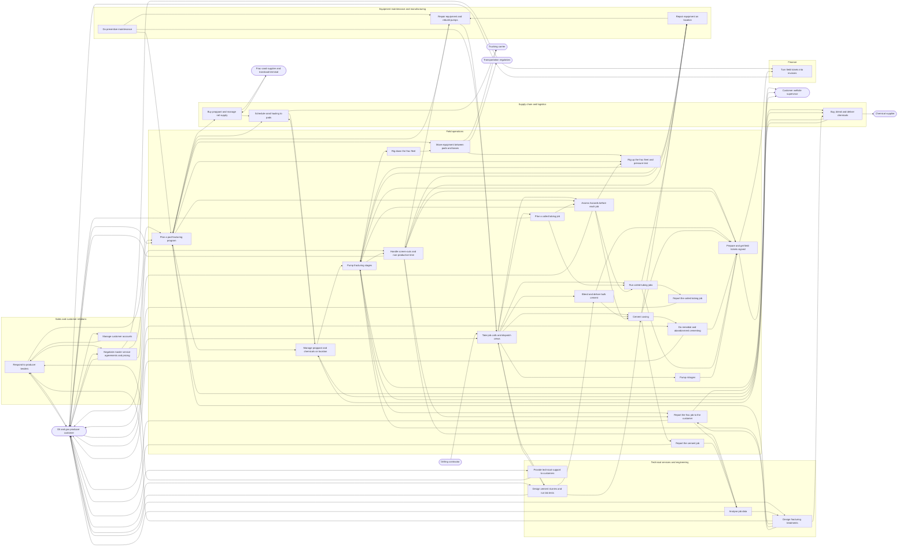

# Canadian pressure pumping oilfield services company (fracturing, cementing, coiled tubing)

`oilfield-services-co` · oil and gas services (pressure pumping) · modelled on public information about ['Trican Well Service Ltd. (Calgary; main model for scale, service lines, bases, fleet and activity 2019-2022)', 'STEP Energy Services Ltd., Canadian segment (fracturing and coiled tubing activity, workforce, seasonality)']

The company pumps fluids, sand and cement into oil and gas wells for producers in the Western Canada Sedimentary Basin, mainly in Alberta and northeast British Columbia. Its largest service is hydraulic fracturing, which cracks open tight rock along horizontal wells and props the cracks with sand; it also cements steel casing in newly drilled wells and runs coiled tubing units that mill out plugs and clean wells after fracturing. Customers are more than 60 oil and gas producers, a few of which provide a large share of revenue, and the company earns money per job under master service agreements and tendered programs, billing equipment time, crews and materials from signed field tickets. Revenue was about $560-870 million a year in 2019-2022, about three quarters of it from fracturing. The work follows the drilling cycle: it peaks in winter when frozen ground allows access, nearly stops during spring break-up road bans, and swings with commodity prices, which led to deep cuts in 2020 and a hiring scramble in 2021-2022. Field operations run from district bases in Red Deer, Grande Prairie, Whitecourt, Fort St. John and southern Alberta, supported by a sand and chemical supply chain, equipment maintenance and manufacturing shops, a cement and fluids laboratory and a Calgary head office for sales, engineering, finance, HR and HSE.

| | |
|---|---|
| Employees | 1,387 |
| Country | Canada |
| Ownership | Publicly listed on the Toronto Stock Exchange |
| Regulators | Alberta Energy Regulator, BC Oil and Gas Commission (BC Energy Regulator from September 2022), Alberta Occupational Health and Safety, WorkSafeBC, Workers' Compensation Board - Alberta, Alberta Transportation and municipal road authorities, Transport Canada (Transportation of Dangerous Goods), Alberta Securities Commission and Toronto Stock Exchange, Canada Revenue Agency |
| Revenue 2019 | 636,100,000 CAD (A) |
| Revenue 2021 | 562,479,000 CAD (A) |
| Revenue 2022 | 866,295,000 CAD (A) |
| Sales mix: fracturing / cementing / coiled tubing (2021 and 2022) | 75% / 16% / 8% share of revenue (A) |
| Jobs invoiced 2019 / 2021 / 2022 | 7,635 / 7,291 / 7,625 jobs per year (A) |
| Proppant pumped 2019 / 2021 / 2022 | 898,000 / 1,364,000 / 1,335,000 tonnes per year (A) |
| Hydraulic pumping capacity | 582,500 (end 2019); 529,000 (end 2022) HHP (A) |
| Active fracturing crews | 8 (end 2019); 6 (2021); 7 (2022) 24-hour crews (A) |
| Cementing units operating | 16 units (annual average 2021 and 2022) (A) |
| Coiled tubing crews | 6 24-hour crews (2021 and 2022) (A) |
| Customers | more than 60; largest 31% of revenue producers (A) |
| Operating bases (plus Calgary head office and R&D centre) | 9 bases (B) |
| Capital expenditures 2019 / 2021 / 2022 | 33.2 / 53.9 / 103.6 CAD millions (A) |
| Field personnel expenses in cost of sales 2021 / 2022 | 101.2 / 131.6 CAD millions (A) |
| Administrative expenses 2021 / 2022 | 28.2 / 39.8 CAD millions (A) |
| Employees | 1,387 people (C) |
| Trican employees at 31 December 2022 | 1,124 full and part time employees (A) |

## Units

- **Executive office** (6 people, department): Sets strategy, allocates capital between service lines and reports to the board and shareholders.
- **Field operations** (893 people, division): Delivers fracturing, cementing, coiled tubing and nitrogen services at customers' well sites from district bases in Alberta and northeast BC.
  - **Fracturing service line** (480 people, department): Plans and pumps multi-stage hydraulic fracturing treatments on horizontal wells, running six to eight 24-hour crews.
  - **Cementing service line** (203 people, department): Cements surface, intermediate and production casing for drilling rigs and does remedial and abandonment cementing.
  - **Coiled tubing and nitrogen service line** (130 people, department): Mills out frac plugs, cleans out wells and pumps nitrogen and fluids using coiled tubing units.
  - **District operations and dispatch** (80 people, site network): Runs the operating bases, takes job calls, dispatches crews and equipment, prepares field tickets and keeps the yards.
- **Technical services and engineering** (78 people, department): Designs fracturing, cementing and coiled tubing treatments, runs the cement and fluids laboratory and develops new products.
- **Supply chain and logistics** (73 people, department): Buys and moves proppant, chemicals, cement, fuel and parts, and runs warehouses and the chemical blending plant.
- **Equipment maintenance and manufacturing** (172 people, department): Maintains, repairs, rebuilds and upgrades pumps, blenders, cementing and coiled tubing units, trucks and treating iron in central and district shops.
- **Sales and customer relations** (20 people, department): Wins and keeps work with producers through tenders, master service agreements and price books.
- **Health, safety and environment** (35 people, department): Sets safety rules, trains and certifies staff, investigates incidents and handles customer safety prequalification and spill reporting.
- **Finance** (57 people, department): Bills customers from field tickets, pays suppliers and staff, closes the books and prepares public disclosure.
- **Human resources** (25 people, department): Recruits field staff, onboards them, runs compensation and benefits and manages layoffs and recalls.
- **Information technology** (20 people, department): Supports the ERP, field ticketing, data van and lab systems, networks at bases and on location, and the service desk.
- **Legal, risk and regulatory** (8 people, department): Reviews contracts, manages insurance and claims, and tracks regulatory changes that affect field work.

## Demand drivers

| Driver | Per month | Unit | Evidence |
|---|---:|---|---|
| Wells drilled in Canada (industry) | 390 | wells | A [src19], [src20] |
| Active drilling rigs in the WCSB | 160 | rigs (monthly average) | A [src1] |
| Jobs invoiced (all service lines) | 620 | jobs | A [src1], [src2] |
| Wells fractured | 50 | wells | C |
| Cementing jobs | 400 | jobs | C |
| Coiled tubing and nitrogen jobs | 140 | jobs | C |
| Proppant pumped | 112,000 | tonnes | A [src1] |
| Field employees on payroll | 893 | employees | C |
| Equipment operating hours | 14,000 | unit-hours | C |
| Supplier and carrier invoices | 4,500 | invoices | C |

## How the core processes connect

## Process map

### Executive office

| Process | Owner | Type | Unit of work | Per month | Priority | Receives from | Sends to |
|---|---|---|---|---:|---:|---|---|
| **Manage enterprise risk.** Executives and the general counsel review the risk register: customer concentration, labour shortage, cost inflation, safety and regulation, and agree mitigations. Each risk has an owner who reports progress to the board each quarter. | Executive office | management | one risk review | 0.33 | 3 | Report and investigate incidents, Track regulatory changes | Manage insurance and claims, Plan strategy and govern with the board |
| **Plan strategy and govern with the board.** Executives set fleet, market and capital strategy, prepare board materials and carry out board decisions on capital, dividends and buybacks. Plans hinge on producer spending and pipeline capacity, which the company cannot control. | Executive office | management | one board cycle | 0.33 | 3 | Board of directors, Manage cash and the credit facility, Manage enterprise risk, Plan and approve capital spending, Prepare quarterly and annual disclosure | Board of directors, Budget and forecast |
| **Review operating performance.** The COO and service line directors review utilization, pricing, safety and margins each month and decide to activate, park or move crews. Decisions lag the market because the data arrives after the month-end close. | Executive office | management | one monthly review | 1 | 3 | Audit and inspect field safety, Budget and forecast, Close the books monthly, Hold the daily operations call, Manage customer accounts, Supply natural gas to dual fuel fleets | Lay off and recall staff, Reactivate a parked frac fleet |

### Field operations

| Process | Owner | Type | Unit of work | Per month | Priority | Receives from | Sends to |
|---|---|---|---|---:|---:|---|---|
| **Blend and deliver bulk cement.** Bulk plant operators blend dry cement and additives to the lab-approved recipe, sample the blend and load bulk trucks that drive to the rig. Rigs often change the call time, so blends wait or trucks rush, and a wrong blend fails on the job. | Cementing service line | core | one cement blend and its delivery to the wellsite | 400 | 1 | Design cement slurries and run lab tests, Supply cement and additives to bulk plants, Take job calls and dispatch crews | Cement casing, Prepare and get field tickets signed, Ship dangerous goods, Supply cement and additives to bulk plants |
| **Cement casing.** A cementing crew rigs up to the rig's casing, pumps spacers and slurry to the program, displaces and bumps the plug and records returns. The job must start as soon as casing is landed, at any hour, and poor returns can mean remedial work and a regulatory issue for the licensee. | Cementing service line | core | one cement job (one casing string on one well) | 400 | 1 | Assess hazards before each job, Blend and deliver bulk cement, Design cement slurries and run lab tests, Inspect and certify treating iron, Take job calls and dispatch crews | Do remedial and abandonment cementing, Prepare and get field tickets signed, Repair equipment on location, Report and investigate incidents, Report the cement job, Run base yards and wash bays |
| **Plan a pad fracturing program.** Coordinators turn an awarded pad into a plan: fleet and crew dates, horsepower, proppant and chemical volumes, fuel, site layout and the interface with the producer's wireline and water suppliers. Customer schedule changes ripple into sand orders and other pads. | Fracturing service line | core | one pad program (a multi-well pad of typically two to six horizontal wells) | 18 | 1 | Design fracturing treatments, Do preventive maintenance, Negotiate master service agreements and pricing, Oil and gas producer (customer), Reactivate a parked frac fleet, Repair equipment and rebuild pumps, Respond to producer tenders, Schedule crews and rotations | Assess hazards before each job, Buy proppant and manage rail supply, Buy, blend and deliver chemicals, Manage proppant and chemicals on location, Move equipment between pads and bases, Rig up the frac fleet and pressure test, Schedule crews and rotations, Schedule sand hauling to pads, Supply diesel to locations, Supply natural gas to dual fuel fleets |
| **Prepare and get field tickets signed.** At the end of a job the supervisor enters services, equipment hours and materials into the field ticket app, the customer's wellsite supervisor reviews and signs it, and district administrators check it against the job file and price book. Missing signatures and quantity disputes hold up billing. | District operations and dispatch | core | one field ticket (one cementing job, one coiled tubing or nitrogen day, or one frac pumping day on a pad) | 750 | 1 | Blend and deliver bulk cement, Cement casing, Do remedial and abandonment cementing, Handle screen-outs and non-productive time, Maintain customer price books, Pump fracturing stages, Pump nitrogen, Run coiled tubing jobs, Support the ERP and business applications | Close the books monthly, Customer wellsite supervisor, Turn field tickets into invoices |
| **Pump fracturing stages.** The 24-hour crew pumps each stage to the design while the treater watches pressures from the data van, alternating with the producer's wireline crew that perforates the next stage. Screen-outs, pump failures, sand and fuel shortages and wireline delays stop the work while the whole fleet stands by. | Fracturing service line | core | one well fractured (all stages of one horizontal well) | 50 | 1 | Assess hazards before each job, Buy, blend and deliver chemicals, Customer wellsite supervisor, Design fracturing treatments, Manage proppant and chemicals on location, Rig up the frac fleet and pressure test, Supply diesel to locations, Supply natural gas to dual fuel fleets, Support field connectivity and data vans, Wireline and perforating contractor | Customer wellsite supervisor, Handle screen-outs and non-productive time, Prepare and get field tickets signed, Repair equipment on location, Report and investigate incidents, Report the frac job to the customer, Respond to and report spills, Rig down the frac fleet, Support field connectivity and data vans |
| **Rig up the frac fleet and pressure test.** The crew spots pumps, blender, data van and sand units on the pad, connects treating iron to the wellhead, holds the pre-job safety meeting and pressure tests the lines. Rig-up takes most of a day and cannot start until the lease is ready. | Fracturing service line | core | one pad rig-up | 18 | 1 | Assess hazards before each job, Inspect and certify treating iron, Move equipment between pads and bases, Plan a pad fracturing program | Pump fracturing stages |
| **Run coiled tubing jobs.** A 24-hour crew rigs up the injector and reel, runs in to mill frac plugs or clean out sand, circulates returns and pulls out. Stuck pipe, motor failures and slow plug drilling stretch jobs. | Coiled tubing and nitrogen service line | core | one coiled tubing job (usually one well's plug millout or cleanout) | 80 | 1 | Assess hazards before each job, Inspect and certify treating iron, Oil and gas producer (customer), Plan a coiled tubing job, Take job calls and dispatch crews | Prepare and get field tickets signed, Repair equipment on location, Report and investigate incidents, Report the coiled tubing job, Track coiled tubing string life |
| **Take job calls and dispatch crews.** Dispatchers take calls from drilling rigs and producers for cementing, coiled tubing and nitrogen jobs, check crew hours, unit availability and materials, and assign a crew with a call-out time. Rig timing changes by the hour, so jobs are rescheduled often and crews wait on location. | District operations and dispatch | core | one job request | 580 | 1 | Design cement slurries and run lab tests, Do preventive maintenance, Drilling contractor, Manage driver hours and fatigue, Oil and gas producer (customer), Repair equipment and rebuild pumps, Schedule crews and rotations | Assess hazards before each job, Blend and deliver bulk cement, Cement casing, Design cement slurries and run lab tests, Hold the daily operations call, Plan a coiled tubing job, Pump nitrogen, Run coiled tubing jobs, Schedule crews and rotations |
| **Assess hazards before each job.** Before each job or shift the supervisor leads a field level hazard assessment and safety meeting covering pressure, H2S, traffic and simultaneous operations, and records it for the customer. Short-cut assessments are a common audit finding. | Field operations | core | one field level hazard assessment (one job, or one shift on a fracturing pad) | 1,100 | 2 | Oil and gas producer (customer), Plan a coiled tubing job, Plan a pad fracturing program, Take job calls and dispatch crews, Train and certify field staff | Audit and inspect field safety, Cement casing, Oil and gas producer (customer), Pump fracturing stages, Report and investigate incidents, Rig up the frac fleet and pressure test, Run coiled tubing jobs |
| **Handle screen-outs and non-productive time.** When a stage screens out or equipment fails, the treater and supervisor decide whether to flush, call coiled tubing or swap a pump, record the lost time and agree with the customer who pays for it. Disputes over non-productive time hit field tickets. | Fracturing service line | core | one non-productive time event (a stoppage of pumping on a pad) | 25 | 2 | Customer wellsite supervisor, Negotiate master service agreements and pricing, Pump fracturing stages, Repair equipment on location | Analyse job data, Oil and gas producer (customer), Prepare and get field tickets signed, Repair equipment and rebuild pumps, Repair equipment on location, Report the frac job to the customer |
| **Manage proppant and chemicals on location.** Sand operators receive truckloads, check load tickets, fill wellsite storage by mesh size and track inventory against the stage schedule; blender operators manage chemical totes. Running short stops pumping, and trucks queue at the pad when storage is full. | Fracturing service line | core | one pad (all proppant and chemicals received and reconciled for one multi-well pad) | 18 | 2 | Buy, blend and deliver chemicals, Plan a pad fracturing program, Schedule sand hauling to pads, Ship dangerous goods | Buy, blend and deliver chemicals, Pump fracturing stages, Schedule sand hauling to pads, Test fluids, chemicals and proppant |
| **Move equipment between pads and bases.** Planners and supervisors plan routes and permits for moving a frac fleet of 30 to 50 heavy units, check road bans and lease access, and schedule tractors and drivers. Road bans, weather and lease road conditions decide when a move can start. | District operations and dispatch | core | one fleet move (pad to pad, or base to pad) | 18 | 2 | Plan a pad fracturing program, Rig down the frac fleet, Transportation regulators | Rig up the frac fleet and pressure test, Transportation regulators, Trucking carrier |
| **Plan a coiled tubing job.** Engineers and supervisors choose the string, tools and fluids, model forces and reach for long horizontal wells, and check string fatigue before the crew leaves. Deep laterals push strings near their limits. | Coiled tubing and nitrogen service line | core | one coiled tubing program (one well or one job) | 80 | 2 | Inspect and certify treating iron, Oil and gas producer (customer), Take job calls and dispatch crews, Track coiled tubing string life | Assess hazards before each job, Oil and gas producer (customer), Run coiled tubing jobs |
| **Report the frac job to the customer.** The treater and data technician compile the treatment report from data van records, list chemicals and concentrations for the licensee's fluid disclosure and send it with job charts. Late or wrong chemical data delays the licensee's regulatory filing. | Fracturing service line | core | one well report (treatment report and fluid disclosure data for one fractured well) | 50 | 2 | Chemical supplier, Design fracturing treatments, Handle screen-outs and non-productive time, Pump fracturing stages | Analyse job data, Customer wellsite supervisor, Oil and gas producer (customer) |
| **Schedule crews and rotations.** District managers and HR coordinators build rotation schedules for each crew, cover sickness and turnover, check tickets and driving hours, and record field time for payroll. Short-staffed crews delay jobs or need overtime. | District operations and dispatch | support | one weekly crew schedule for a service line in a district | 40 | 2 | Lay off and recall staff, Manage driver hours and fatigue, Manage field progression, Onboard new employees, Plan a pad fracturing program, Take job calls and dispatch crews, Train and certify field staff | Manage driver hours and fatigue, Plan a pad fracturing program, Recruit and hire field staff, Run payroll, Take job calls and dispatch crews, Train and certify field staff |
| **Do remedial and abandonment cementing.** Crews squeeze cement to repair poor primary jobs, surface casing vent flow or gas migration and set plugs for abandonment. Diagnosis is uncertain and repeat squeezes are common. | Cementing service line | core | one remedial or plug job | 50 | 3 | Cement casing, Oil and gas producer (customer) | Oil and gas producer (customer), Prepare and get field tickets signed |
| **Hold the daily operations call.** District and service line managers review yesterday's jobs, tomorrow's schedule, equipment down and crew gaps on a morning call and move units or crews between districts. Decisions rely on whiteboards and spreadsheets updated by each base. | District operations and dispatch | management | one daily call | 22 | 3 | Take job calls and dispatch crews | Review operating performance |
| **Pump nitrogen.** Nitrogen operators pump nitrogen for coiled tubing cleanouts, well kick-offs and purges, managing liquid nitrogen supply from gas suppliers. Supply trucks must arrive on time or the job stops. | Coiled tubing and nitrogen service line | core | one nitrogen job | 60 | 3 | Industrial gas and natural gas supplier, Take job calls and dispatch crews | Prepare and get field tickets signed |
| **Reactivate a parked frac fleet.** When managers decide to crew a parked fleet, the service line hires and trains a crew, recertifies equipment and adds it to the schedule. Hiring is the bottleneck; equipment can sit ready for weeks waiting for people. | Fracturing service line | management | one fleet reactivation | 0.1 | 3 | Build and upgrade equipment, Review operating performance | Plan a pad fracturing program, Plan and approve capital spending, Recruit and hire field staff |
| **Report the cement job.** The supervisor writes the cement job report with volumes, pressures, returns and plug bump and sends it with charts to the customer, who needs it for its well records. Missing returns data triggers follow-up questions. | Cementing service line | core | one cement job report | 400 | 3 | Cement casing | Analyse job data, Oil and gas producer (customer) |
| **Report the coiled tubing job.** The supervisor sends the customer a job record with depths, plugs milled, fluids and nitrogen pumped and any problems. Reports are written at the end of long shifts and sometimes late. | Coiled tubing and nitrogen service line | core | one coiled tubing job report | 80 | 3 | Run coiled tubing jobs | Oil and gas producer (customer) |
| **Rig down the frac fleet.** After the last stage the crew flushes lines, rigs down iron, inspects and loads units and sends equipment due for maintenance to the shop. Rig-down overlaps planning for the next pad. | Fracturing service line | core | one pad rig-down | 18 | 3 | Pump fracturing stages | Inspect and certify treating iron, Move equipment between pads and bases, Run base yards and wash bays |
| **Run base yards and wash bays.** Yard operators wash, fuel, stage and park returning equipment, keep the yard safe and log units for inspection. Units returning from muddy leases in spring and fall queue for the wash bay before shop work can start. | District operations and dispatch | support | one base-day | 270 | 3 | Cement casing, Rig down the frac fleet | Do preventive maintenance, Repair equipment and rebuild pumps |
| **Supply natural gas to dual fuel fleets.** Coordinators order CNG or LNG deliveries for fleets with dual fuel engines, track substitution rates and fuel savings and report emissions. Gas supply interruptions push pumps back to diesel. | Fracturing service line | support | one gas supply order | 80 | 3 | Industrial gas and natural gas supplier, Plan a pad fracturing program | Industrial gas and natural gas supplier, Pump fracturing stages, Review operating performance |
| **Track coiled tubing string life.** After each job, cycles and pressures are added to the string's fatigue record; strings are cut, inspected or retired and new strings ordered. Running a string past its life risks a failure downhole. | Coiled tubing and nitrogen service line | support | one string update | 80 | 3 | Run coiled tubing jobs | Buy parts and materials, Plan a coiled tubing job |

### Technical services and engineering

| Process | Owner | Type | Unit of work | Per month | Priority | Receives from | Sends to |
|---|---|---|---|---:|---:|---|---|
| **Design cement slurries and run lab tests.** Lab technologists test the proposed blend with field water at well temperature for thickening time, strength and fluid loss, and engineers issue the cement program. Rigs give short notice, so tests run overnight and a failed test delays the job. | Technical services and engineering | core | one cement design (one casing string for one well or a repeat design for a pad) | 250 | 1 | Develop new chemicals and blends, Oil and gas producer (customer), Take job calls and dispatch crews | Blend and deliver bulk cement, Cement casing, Oil and gas producer (customer), Take job calls and dispatch crews |
| **Design fracturing treatments.** Design engineers build the pump schedule per stage from the producer's completion design, offset results and lab data, choose fluids and proppant, and update designs when the producer changes plans. Designs feed bids, material orders and the treater's job plan. | Technical services and engineering | core | one pad design (pump schedules for all wells on a pad) | 25 | 1 | Analyse job data, Develop new chemicals and blends, Oil and gas producer (customer), Test fluids, chemicals and proppant, Track regulatory changes | Buy, blend and deliver chemicals, Plan a pad fracturing program, Pump fracturing stages, Report the frac job to the customer, Respond to producer tenders |
| **Test fluids, chemicals and proppant.** The lab runs sieve and crush tests on sand, checks chemical batches and tests producer water for compatibility with the fluid system. Out-of-spec sand or water forces design changes or rejected loads. | Technical services and engineering | support | one quality sample (a sand lot or railcar sample, a chemical batch or a water sample) | 150 | 2 | Buy proppant and manage rail supply, Buy, blend and deliver chemicals, Manage proppant and chemicals on location, Oil and gas producer (customer) | Buy proppant and manage rail supply, Buy, blend and deliver chemicals, Design fracturing treatments, Frac sand supplier and transload terminal |
| **Analyse job data.** Data analysts and engineers compare treatment data, non-productive time and cement results across wells and write analyses for customers and for design improvement. Data sits in data van files and spreadsheets. | Technical services and engineering | core | one analysis | 30 | 3 | Handle screen-outs and non-productive time, Report the cement job, Report the frac job to the customer | Design fracturing treatments, Develop new chemicals and blends, Oil and gas producer (customer) |
| **Develop new chemicals and blends.** Research chemists test new friction reducers, cement blends and lost circulation products, run field trials and release product specifications. Trials depend on customers willing to try them. | Technical services and engineering | support | one lab or field trial | 8 | 3 | Analyse job data, Provide technical support to customers | Buy, blend and deliver chemicals, Design cement slurries and run lab tests, Design fracturing treatments |
| **Provide technical support to customers.** Technical sales engineers answer producers' questions on designs, fluids, cement blends and coiled tubing reach, run quick models and bring lab or design work into bids. Requests arrive by phone and email at all hours and compete with field support. | Technical services and engineering | core | one technical request | 60 | 3 | Oil and gas producer (customer) | Develop new chemicals and blends, Respond to producer tenders |

### Supply chain and logistics

| Process | Owner | Type | Unit of work | Per month | Priority | Receives from | Sends to |
|---|---|---|---|---:|---:|---|---|
| **Buy proppant and manage rail supply.** Buyers release sand from term supply agreements to match pad schedules, track railcars to in-basin terminals and balance inventory across terminals and sizes. Rail delays and program changes leave sand short at one terminal and surplus at another. | Supply chain and logistics | core | one proppant release (sand for one pad or terminal top-up, typically 2,000 to 3,500 tonnes) | 40 | 1 | Frac sand supplier and transload terminal, Manage suppliers and supply contracts, Plan a pad fracturing program, Rail carrier, Test fluids, chemicals and proppant | Frac sand supplier and transload terminal, Pay suppliers and carriers, Schedule sand hauling to pads, Test fluids, chemicals and proppant |
| **Schedule sand hauling to pads.** Logistics coordinators turn the stage schedule into hourly truck orders from terminals to pads, dispatch carriers, track load tickets and react to road bans, weather and pump schedule changes. Trucks waiting at a full pad or a fleet waiting on sand both cost money. | Supply chain and logistics | core | one truckload of frac sand (about 38 tonnes on a B-train pneumatic trailer) | 3,000 | 1 | Buy proppant and manage rail supply, Manage proppant and chemicals on location, Plan a pad fracturing program, Transportation regulators, Trucking carrier | Manage proppant and chemicals on location, Pay suppliers and carriers, Trucking carrier |
| **Buy parts and materials.** Buyers turn requisitions from shops into purchase orders for fluid ends, valves, engines and coiled tubing strings, chase suppliers and expedite urgent parts. Long lead times in 2021-2022 left units waiting on parts. | Supply chain and logistics | support | one purchase order (or requisition filled by transfer) | 1,200 | 2 | Build and upgrade equipment, Do preventive maintenance, Inspect and certify treating iron, Manage suppliers and supply contracts, Repair equipment and rebuild pumps, Run warehouses and inventory, Track coiled tubing string life | Coiled tubing string mill, Equipment and parts suppliers, Pay suppliers and carriers, Repair equipment and rebuild pumps, Run warehouses and inventory |
| **Buy, blend and deliver chemicals.** Buyers order additives, the blending plant mixes and packages them, and deliveries go to pads and bases with dangerous goods documents. Long lead times on some additives and sudden design changes cause shortages. | Supply chain and logistics | core | one chemical order (the additives for one pad, or a base stock top-up) | 60 | 2 | Chemical supplier, Design fracturing treatments, Develop new chemicals and blends, Manage proppant and chemicals on location, Manage suppliers and supply contracts, Plan a pad fracturing program, Run warehouses and inventory, Test fluids, chemicals and proppant | Chemical supplier, Manage proppant and chemicals on location, Pay suppliers and carriers, Pump fracturing stages, Ship dangerous goods, Test fluids, chemicals and proppant |
| **Manage suppliers and supply contracts.** Supply chain managers negotiate term agreements for sand, chemicals, cement, fuel and parts, review supplier performance and handle price escalations. Inflation in 2022 reopened many agreements. | Supply chain and logistics | support | one supplier agreement or review | 10 | 3 | Frac sand supplier and transload terminal, Review contracts | Buy parts and materials, Buy proppant and manage rail supply, Buy, blend and deliver chemicals, Review contracts |
| **Run warehouses and inventory.** Warehouse staff receive goods, issue parts to work orders, cycle count and keep stock across bases. Parts taken without a transaction make the counts wrong, and shops then find a part missing when a unit is already torn down. | Supply chain and logistics | support | one stock receipt or issue | 5,000 | 3 | Buy parts and materials, Coiled tubing string mill, Equipment and parts suppliers | Buy parts and materials, Buy, blend and deliver chemicals, Close the books monthly, Do preventive maintenance, Pay suppliers and carriers, Repair equipment and rebuild pumps |
| **Ship dangerous goods.** Staff classify acids and chemicals, prepare shipping documents and placards and check driver training before loads leave. Errors bring roadside fines and can stop a load at a weigh scale while the pad waits for chemicals. | Supply chain and logistics | support | one dangerous goods shipment | 300 | 3 | Blend and deliver bulk cement, Buy, blend and deliver chemicals, Transportation regulators | Manage proppant and chemicals on location, Trucking carrier |
| **Supply cement and additives to bulk plants.** Buyers keep bulk plants stocked with oilwell cement and additives, ordering from cement suppliers and moving stock between plants. A plant running short cannot blend for the next rig call. | Supply chain and logistics | support | one replenishment order | 40 | 3 | Blend and deliver bulk cement, Oilwell cement supplier | Blend and deliver bulk cement, Oilwell cement supplier |
| **Supply diesel to locations.** Coordinators schedule diesel deliveries to pads and bases to keep pumps and trucks running around the clock and reconcile delivery tickets. A missed delivery shuts a fleet down. | Supply chain and logistics | support | one fuel delivery | 300 | 3 | Diesel supplier, Plan a pad fracturing program | Diesel supplier, Pump fracturing stages |

### Equipment maintenance and manufacturing

| Process | Owner | Type | Unit of work | Per month | Priority | Receives from | Sends to |
|---|---|---|---|---:|---:|---|---|
| **Do preventive maintenance.** Planners issue work orders by hours and pad cycles, and technicians service engines, transmissions, power ends and fluid ends between pads or in break-up. High-pressure pumping wears parts in hours, so maintenance competes with keeping fleets working. | Equipment maintenance and manufacturing | core | one preventive maintenance work order | 900 | 1 | Run base yards and wash bays, Run warehouses and inventory | Buy parts and materials, Inspect and certify treating iron, Inspect commercial vehicles, Plan a pad fracturing program, Repair equipment and rebuild pumps, Take job calls and dispatch crews |
| **Repair equipment and rebuild pumps.** Technicians diagnose failed units, replace fluid ends, valves and seats, rebuild power ends and engines and return units to service. Parts waits and mechanic shortages decide how many pumps a fleet can field. | Equipment maintenance and manufacturing | core | one repair work order | 500 | 1 | Buy parts and materials, Do preventive maintenance, Handle screen-outs and non-productive time, Repair equipment on location, Run base yards and wash bays, Run warehouses and inventory | Buy parts and materials, Plan a pad fracturing program, Plan and approve capital spending, Take job calls and dispatch crews |
| **Build and upgrade equipment.** Engineers and technicians upgrade pumps to dual fuel or Tier 4 engines, build or refurbish units and electrify equipment under approved capital projects. Engine and component lead times set the schedule. | Equipment maintenance and manufacturing | core | one unit build or upgrade (for example one frac pump converted to a Tier 4 DGB engine) | 4 | 2 | Plan and approve capital spending | Buy parts and materials, Reactivate a parked frac fleet, Sell surplus equipment |
| **Inspect and certify treating iron.** Technicians clean, inspect, thickness test and pressure test treating iron, valves and connections on a fixed cycle and tag each piece. Uncertified iron cannot go to location. | Equipment maintenance and manufacturing | support | one iron item certified | 600 | 2 | Do preventive maintenance, Rig down the frac fleet | Buy parts and materials, Cement casing, Plan a coiled tubing job, Rig up the frac fleet and pressure test, Run coiled tubing jobs |
| **Repair equipment on location.** Field mechanics are called out to pads and rigs to fix pumps, engines and controls during jobs. Travel to remote leases takes hours while the crew waits. | Equipment maintenance and manufacturing | core | one field call-out | 120 | 2 | Cement casing, Handle screen-outs and non-productive time, Pump fracturing stages, Run coiled tubing jobs | Handle screen-outs and non-productive time, Repair equipment and rebuild pumps |
| **Inspect commercial vehicles.** Mechanics perform annual commercial vehicle inspections and safety repairs on tractors, trailers and bulk trucks and keep the certificates. An expired inspection takes a unit off the road. | Equipment maintenance and manufacturing | support | one vehicle inspection | 50 | 3 | Do preventive maintenance | Transportation regulators |
| **Sell surplus equipment.** Equipment engineers and finance list idle or obsolete units, find buyers, often outside the WCSB, and close the sale. Prices depend on the US market. | Equipment maintenance and manufacturing | support | one equipment sale | 3 | 3 | Build and upgrade equipment | Close the books monthly, Equipment buyer |

### Sales and customer relations

| Process | Owner | Type | Unit of work | Per month | Priority | Receives from | Sends to |
|---|---|---|---|---:|---:|---|---|
| **Respond to producer tenders.** An account manager receives a producer's tender for a fracturing program or annual cementing and coiled tubing work, a pricing analyst builds the price from the price book and expected costs, and engineers add designs and equipment plans. Short deadlines, many line items and the need to price sand, fuel and trucking pass-throughs make bids slow and error-prone. | Sales and customer relations | core | one tender response | 8 | 1 | Design fracturing treatments, Keep customer safety prequalification current, Maintain customer price books, Manage customer accounts, Oil and gas producer (customer), Provide technical support to customers | Negotiate master service agreements and pricing, Oil and gas producer (customer), Plan a pad fracturing program |
| **Negotiate master service agreements and pricing.** After an award, sales and legal negotiate or renew the master service agreement and the customer-specific pricing schedule, including indemnities, insurance limits and cost escalation clauses. Producers push their own forms, so redlines go back and forth for weeks. | Sales and customer relations | core | one agreement or pricing schedule | 3 | 2 | Maintain customer price books, Manage insurance and claims, Oil and gas producer (customer), Respond to producer tenders, Review contracts | Handle screen-outs and non-productive time, Maintain customer price books, Oil and gas producer (customer), Plan a pad fracturing program, Review contracts, Turn field tickets into invoices |
| **Maintain customer price books.** Pricing analysts load agreed prices, discounts and pass-through rules for sand, fuel and trucking into the ERP and field ticket app, and update them when costs change. A wrong price book entry flows into every field ticket and invoice until a customer disputes it. | Sales and customer relations | support | one price book update | 20 | 3 | Negotiate master service agreements and pricing | Negotiate master service agreements and pricing, Prepare and get field tickets signed, Respond to producer tenders, Support the ERP and business applications, Turn field tickets into invoices |
| **Manage customer accounts.** Account managers hold regular reviews with producers on safety, efficiency and scorecards, track disputes and overdue invoices, and plan next year's work. Concentration matters: one customer gave 31% of revenue, so a lost relationship changes fleet plans. | Sales and customer relations | core | one account review | 20 | 3 | Collect customer payments, Oil and gas producer (customer) | Respond to producer tenders, Review operating performance |

### Health, safety and environment

| Process | Owner | Type | Unit of work | Per month | Priority | Receives from | Sends to |
|---|---|---|---|---:|---:|---|---|
| **Report and investigate incidents.** Workers report injuries, near misses, spills and vehicle incidents; HSE advisors investigate, assign corrective actions and notify the customer, regulators and the workers' compensation board when required. Investigations stall when crews rotate out. | Health, safety and environment | management | one incident or near miss (or one audit finding handled as a case) | 60 | 2 | Assess hazards before each job, Audit and inspect field safety, Cement casing, Pump fracturing stages, Run coiled tubing jobs | Keep customer safety prequalification current, Manage enterprise risk, Manage insurance and claims, Occupational health and safety regulators, Oil and gas producer (customer), Respond to and report spills, Train and certify field staff, Workers' compensation boards |
| **Train and certify field staff.** Trainers run orientation, H2S Alive, first aid, driving and service-line courses, track ticket expiries and sign off competencies. Hiring waves in 2021-2022 overloaded training, and new hires could not go to location until their tickets were complete. | Health, safety and environment | support | one training enrolment (one worker completing one course or competency module) | 300 | 2 | Energy Safety Canada, Onboard new employees, Recruit and hire field staff, Report and investigate incidents, Schedule crews and rotations, Track regulatory changes | Assess hazards before each job, Energy Safety Canada, Keep customer safety prequalification current, Manage field progression, Schedule crews and rotations |
| **Audit and inspect field safety.** HSE advisors audit jobs, bases and shops against company rules and customer requirements and report findings. Audits rely on advisors who also handle incidents and rotate with crews, so audit plans slip when field activity peaks. | Health, safety and environment | management | one audit | 60 | 3 | Assess hazards before each job, Oil and gas producer (customer) | Report and investigate incidents, Review operating performance |
| **Keep customer safety prequalification current.** HSE coordinators submit safety statistics, programs, insurance and training records to ISNetworld, ComplyWorks and customer forms so the company stays approved. A lapsed grade blocks work for that customer. | Health, safety and environment | support | one prequalification submission | 10 | 3 | Manage insurance and claims, Oil and gas producer (customer), Report and investigate incidents, Train and certify field staff | Oil and gas producer (customer), Prequalification portal providers, Respond to producer tenders |
| **Manage driver hours and fatigue.** Coordinators audit driver logs, manage oil well service vehicle permits and flag drivers near limits so schedules change. Long moves after 12-hour shifts are the main risk. | Health, safety and environment | management | one driver log audit | 400 | 3 | Schedule crews and rotations, Transportation regulators | Schedule crews and rotations, Take job calls and dispatch crews, Transportation regulators |
| **Respond to and report spills.** When fluid, fuel or chemical is released on location, the crew contains it, the environmental specialist reports to the licensee and, where required, the regulator, and arranges cleanup. Reporting duties sit mostly with the licensee. | Health, safety and environment | management | one spill | 3 | 3 | Pump fracturing stages, Report and investigate incidents, Track regulatory changes | Alberta Energy Regulator, BC Oil and Gas Commission (BC Energy Regulator from 2022), Oil and gas producer (customer) |

### Finance

| Process | Owner | Type | Unit of work | Per month | Priority | Receives from | Sends to |
|---|---|---|---|---:|---:|---|---|
| **Pay suppliers and carriers.** AP clerks match supplier and carrier invoices to purchase orders, receipts and load tickets, resolve differences with buyers and coordinators and run payments. Thousands of sand haul tickets make matching heavy. | Finance | support | one supplier or carrier invoice | 4,500 | 1 | Buy parts and materials, Buy proppant and manage rail supply, Buy, blend and deliver chemicals, Chemical supplier, Diesel supplier, Equipment and parts suppliers, Frac sand supplier and transload terminal, Industrial gas and natural gas supplier, Oilwell cement supplier, Run warehouses and inventory, Schedule sand hauling to pads, Trucking carrier | Chemical supplier, Close the books monthly, Diesel supplier, Equipment and parts suppliers, Frac sand supplier and transload terminal, Industrial gas and natural gas supplier, Manage cash and the credit facility, Oilwell cement supplier, Trucking carrier, Turn field tickets into invoices |
| **Run payroll.** Payroll specialists collect field time, day rates and job bonuses, process biweekly pay for about 1,350 employees, remit deductions and post the ledger. Late or wrong field time causes off-cycle corrections. | Finance | support | one biweekly payroll run (about 1,350 employees) | 2.17 | 1 | Lay off and recall staff, Onboard new employees, Schedule crews and rotations, Set pay and benefits | Canada Revenue Agency, Claim wage and rent subsidies, Close the books monthly, Employees' banks |
| **Turn field tickets into invoices.** Billing specialists match signed field tickets to the price book, build the invoice in the ERP and submit it through the customer's e-invoicing network, then rework rejections. Coding rules differ by customer and rejected invoices wait weeks. | Finance | core | one customer invoice (one job, one well or one pad, made of one or more field tickets) | 620 | 1 | Maintain customer price books, Negotiate master service agreements and pricing, Pay suppliers and carriers, Prepare and get field tickets signed, Support the ERP and business applications | Close the books monthly, Collect customer payments, Oil and gas producer (customer) |
| **Close the books monthly.** Accountants accrue unbilled work and uninvoiced costs, reconcile accounts and inventory and produce monthly results by service line. Field tickets not yet signed make revenue accruals uncertain. | Finance | management | one monthly close | 1 | 2 | Claim wage and rent subsidies, Collect customer payments, Pay suppliers and carriers, Prepare and get field tickets signed, Run payroll, Run warehouses and inventory, Sell surplus equipment, Turn field tickets into invoices | Budget and forecast, Prepare quarterly and annual disclosure, Review operating performance |
| **Collect customer payments.** Credit analysts apply payments, follow up overdue and disputed invoices with producers and set credit limits. One customer held 35-40% of receivables, so its payment timing moves cash. | Finance | support | one collection follow-up (an overdue, short-paid or disputed invoice taken up by the credit team) | 250 | 2 | Oil and gas producer (customer), Turn field tickets into invoices | Close the books monthly, Manage cash and the credit facility, Manage customer accounts, Oil and gas producer (customer) |
| **Budget and forecast.** Analysts build the annual budget and quarterly forecasts by service line from customer programs, crew plans and cost inflation. Forecasts change with commodity prices and customer budgets, so the plan is often redone within weeks. | Finance | management | one budget or forecast cycle | 0.33 | 3 | Close the books monthly, Plan strategy and govern with the board | Plan and approve capital spending, Review operating performance, Set pay and benefits |
| **Claim wage and rent subsidies.** In 2020 and 2021 finance and payroll prepared Canada Emergency Wage Subsidy and rent subsidy claims each period from payroll and revenue data. Claims needed careful eligibility calculations and audit files. | Finance | support | one subsidy claim period | 1 | 3 | Run payroll | Canada Revenue Agency, Close the books monthly |
| **Manage cash and the credit facility.** Treasury forecasts cash, draws or repays the revolving facility, monitors covenants and manages share buybacks and dividends approved by the board. Customer payment timing, with one customer holding up to 40% of receivables, drives the forecast. | Finance | management | one monthly treasury cycle | 1 | 3 | Collect customer payments, Pay suppliers and carriers | Bank lenders, Plan strategy and govern with the board |
| **Plan and approve capital spending.** Finance and operations rank capital requests for upgrades, reactivations and maintenance capital, and executives or the board approve them. Return hurdles decide which fleets get upgraded. | Finance | management | one capital request | 12 | 3 | Budget and forecast, Reactivate a parked frac fleet, Repair equipment and rebuild pumps | Build and upgrade equipment, Plan strategy and govern with the board |
| **Prepare quarterly and annual disclosure.** Finance prepares financial statements, MD&A, the annual information form and press releases, works with the auditor and the board and files them publicly. Deadlines are fixed by securities rules. | Finance | management | one quarterly filing | 0.33 | 3 | Close the books monthly, External auditor | Bank lenders, External auditor, Plan strategy and govern with the board, Shareholders and the Toronto Stock Exchange |

### Human resources

| Process | Owner | Type | Unit of work | Per month | Priority | Receives from | Sends to |
|---|---|---|---|---:|---:|---|---|
| **Recruit and hire field staff.** Recruiters post jobs, screen for Class 1 licences and tickets, interview with supervisors, check references and drug and alcohol tests, and make offers. Competition for experienced operators made hiring the bottleneck to adding crews. | Human resources | support | one hire (one field employee recruited and cleared to start) | 30 | 2 | Job applicant, Reactivate a parked frac fleet, Schedule crews and rotations, Set pay and benefits | Job applicant, Onboard new employees, Train and certify field staff |
| **Lay off and recall staff.** When activity drops, managers choose who to lay off, HR issues notices and records, and when work returns staff are recalled. The 2020 downturn and 2021-2022 recovery made this a large process. | Human resources | management | one layoff or recall | 5 | 3 | Review operating performance | Run payroll, Schedule crews and rotations |
| **Manage field progression.** Supervisors assess operators against level requirements, HR records promotions and pay changes. Progression keeps people from leaving for competitors, but sign-offs wait until supervisor and worker are on the same rotation. | Human resources | support | one progression assessment | 40 | 3 | Train and certify field staff | Schedule crews and rotations, Set pay and benefits |
| **Onboard new employees.** HR coordinators set up employee records, benefits, rotations and system access and book orientation and safety courses. Missing paperwork delays first pay and system access, and new field hires often start on short notice. | Human resources | support | one new hire | 30 | 3 | Recruit and hire field staff | Run payroll, Run the IT service desk, Schedule crews and rotations, Train and certify field staff |
| **Set pay and benefits.** Compensation specialists maintain field pay levels, day rates, job bonuses and benefits and set annual increases within the budget. Wage cuts in 2020 and restorations in 2022 changed every table. | Human resources | support | one pay table change | 2 | 3 | Budget and forecast, Manage field progression | Recruit and hire field staff, Run payroll |

### Information technology

| Process | Owner | Type | Unit of work | Per month | Priority | Receives from | Sends to |
|---|---|---|---|---:|---:|---|---|
| **Run the IT service desk.** Support technicians handle access requests, device issues and application problems from bases, shops and field crews, escalating system issues to analysts. Field users call at all hours. | Information technology | support | one IT ticket | 500 | 3 | Onboard new employees | Support the ERP and business applications |
| **Support field connectivity and data vans.** Network specialists keep satellite and cellular links, data van computers and tablet ticketing working on remote pads. A data van outage stops a frac job. | Information technology | support | one field support request | 80 | 3 | Pump fracturing stages | Pump fracturing stages |
| **Support the ERP and business applications.** ERP analysts configure price books, maintenance, procurement and billing, apply vendor releases and fix interface errors between field ticketing, ERP and customer e-invoicing. Interface failures hold invoices until fixed. | Information technology | support | one change or fix | 60 | 3 | Maintain customer price books, Run the IT service desk, Software vendors | Prepare and get field tickets signed, Turn field tickets into invoices |

### Legal, risk and regulatory

| Process | Owner | Type | Unit of work | Per month | Priority | Receives from | Sends to |
|---|---|---|---|---:|---:|---|---|
| **Manage insurance and claims.** The risk manager renews the insurance program, issues certificates for customers and portals and manages equipment, vehicle and liability claims. Customers ask for certificates with every new contract. | Legal, risk and regulatory | support | one claim or certificate batch | 6 | 3 | Insurers and brokers, Manage enterprise risk, Report and investigate incidents | Insurers and brokers, Keep customer safety prequalification current, Negotiate master service agreements and pricing |
| **Review contracts.** Legal counsel reviews customer master service agreements and supplier contracts, focusing on indemnities, insurance, liability caps and escalation, and returns markups. Producer forms and urgent awards compress review time. | Legal, risk and regulatory | support | one contract review | 15 | 3 | Manage suppliers and supply contracts, Negotiate master service agreements and pricing | Manage suppliers and supply contracts, Negotiate master service agreements and pricing |
| **Track regulatory changes.** Regulatory advisors watch AER, BC, OHS and transport rule changes, assess their effect on field work and brief operations, HSE and engineering. Most rules bind the licensee, so changes also reach the company through customer procedures. | Legal, risk and regulatory | management | one regulatory change assessed | 4 | 3 | Alberta Energy Regulator, BC Oil and Gas Commission (BC Energy Regulator from 2022), Occupational health and safety regulators | Design fracturing treatments, Manage enterprise risk, Respond to and report spills, Train and certify field staff |

## Roles

| Role | Unit | Layer | Reports to | Headcount | Loaded cost per hour |
|---|---|---|---|---:|---:|
| Chief executive officer | Executive office | executive |  | 1 | 330 CAD |
| Chief operating officer | Executive office | executive | Chief executive officer | 1 | 240 CAD |
| Chief financial officer | Executive office | executive | Chief executive officer | 1 | 230 CAD |
| Executive assistant | Executive office | individual contributor | Chief executive officer | 3 | 50 CAD |
| Director, fracturing service line | Fracturing service line | director | Chief operating officer | 1 | 150 CAD |
| Fracturing operations manager | Fracturing service line | manager | Director, fracturing service line | 4 | 120 CAD |
| Frac operations coordinator | Fracturing service line | senior specialist | Fracturing operations manager | 10 | 62 CAD |
| Frac field supervisor | Fracturing service line | supervisor | Fracturing operations manager | 24 | 82 CAD |
| Frac treater | Fracturing service line | senior specialist | Frac field supervisor | 24 | 70 CAD |
| Data van technician | Fracturing service line | individual contributor | Frac treater | 26 | 56 CAD |
| Frac pump operator (Class 1 equipment operator) | Fracturing service line | individual contributor | Frac field supervisor | 316 | 48 CAD |
| Blender and chemical operator | Fracturing service line | individual contributor | Frac field supervisor | 45 | 52 CAD |
| Sand operator | Fracturing service line | individual contributor | Frac field supervisor | 30 | 49 CAD |
| Director, cementing service line | Cementing service line | director | Chief operating officer | 1 | 145 CAD |
| Cementing operations manager | Cementing service line | manager | Director, cementing service line | 4 | 112 CAD |
| Cementing supervisor | Cementing service line | supervisor | Cementing operations manager | 40 | 78 CAD |
| Cementing pump operator | Cementing service line | individual contributor | Cementing supervisor | 77 | 48 CAD |
| Bulk cement truck driver | Cementing service line | individual contributor | Cementing supervisor | 60 | 44 CAD |
| Bulk plant operator | Cementing service line | individual contributor | Cementing operations manager | 21 | 42 CAD |
| Director, coiled tubing and nitrogen | Coiled tubing and nitrogen service line | director | Chief operating officer | 1 | 145 CAD |
| Coiled tubing operations manager | Coiled tubing and nitrogen service line | manager | Director, coiled tubing and nitrogen | 3 | 112 CAD |
| Coiled tubing supervisor | Coiled tubing and nitrogen service line | supervisor | Coiled tubing operations manager | 18 | 80 CAD |
| Coiled tubing unit operator | Coiled tubing and nitrogen service line | individual contributor | Coiled tubing supervisor | 62 | 50 CAD |
| Nitrogen and fluid pump operator | Coiled tubing and nitrogen service line | individual contributor | Coiled tubing supervisor | 46 | 47 CAD |
| District manager | District operations and dispatch | manager | Chief operating officer | 5 | 125 CAD |
| Service dispatcher | District operations and dispatch | individual contributor | District manager | 20 | 45 CAD |
| District administrator (field tickets and job files) | District operations and dispatch | individual contributor | District manager | 20 | 40 CAD |
| Yard and wash bay operator | District operations and dispatch | individual contributor | District manager | 35 | 38 CAD |
| Vice president, technical services | Technical services and engineering | director | Chief operating officer | 1 | 190 CAD |
| Technical sales engineer | Technical services and engineering | senior specialist | Vice president, technical services | 18 | 95 CAD |
| Completions design engineer | Technical services and engineering | senior specialist | Vice president, technical services | 24 | 90 CAD |
| Laboratory supervisor | Technical services and engineering | supervisor | Vice president, technical services | 3 | 74 CAD |
| Laboratory technologist | Technical services and engineering | individual contributor | Laboratory supervisor | 20 | 48 CAD |
| Research chemist | Technical services and engineering | senior specialist | Vice president, technical services | 7 | 88 CAD |
| Completions data analyst | Technical services and engineering | individual contributor | Vice president, technical services | 5 | 62 CAD |
| Director, supply chain | Supply chain and logistics | director | Chief financial officer | 1 | 150 CAD |
| Supply chain manager | Supply chain and logistics | manager | Director, supply chain | 3 | 112 CAD |
| Procurement specialist (buyer) | Supply chain and logistics | individual contributor | Supply chain manager | 13 | 54 CAD |
| Supplier contracts specialist | Supply chain and logistics | senior specialist | Director, supply chain | 3 | 75 CAD |
| Proppant logistics coordinator | Supply chain and logistics | individual contributor | Supply chain manager | 14 | 52 CAD |
| Warehouse and parts attendant | Supply chain and logistics | individual contributor | Supply chain manager | 25 | 38 CAD |
| Inventory controller | Supply chain and logistics | individual contributor | Supply chain manager | 6 | 45 CAD |
| Chemical blending plant operator | Supply chain and logistics | individual contributor | Supply chain manager | 8 | 43 CAD |
| Director, equipment maintenance and manufacturing | Equipment maintenance and manufacturing | director | Chief operating officer | 1 | 150 CAD |
| Maintenance shop manager | Equipment maintenance and manufacturing | manager | Director, equipment maintenance and manufacturing | 4 | 110 CAD |
| Maintenance planner | Equipment maintenance and manufacturing | senior specialist | Maintenance shop manager | 10 | 62 CAD |
| Heavy-duty equipment technician (shop) | Equipment maintenance and manufacturing | individual contributor | Maintenance shop manager | 75 | 57 CAD |
| Field service mechanic | Equipment maintenance and manufacturing | individual contributor | Maintenance shop manager | 20 | 62 CAD |
| Fluid end and power end technician | Equipment maintenance and manufacturing | individual contributor | Maintenance shop manager | 25 | 55 CAD |
| Welder and fabricator | Equipment maintenance and manufacturing | individual contributor | Maintenance shop manager | 15 | 53 CAD |
| Electrical and instrumentation technician | Equipment maintenance and manufacturing | individual contributor | Maintenance shop manager | 12 | 60 CAD |
| Equipment and asset engineer | Equipment maintenance and manufacturing | senior specialist | Director, equipment maintenance and manufacturing | 10 | 88 CAD |
| Vice president, sales and marketing | Sales and customer relations | director | Chief executive officer | 1 | 190 CAD |
| Account manager | Sales and customer relations | senior specialist | Vice president, sales and marketing | 10 | 90 CAD |
| Pricing and bid analyst | Sales and customer relations | individual contributor | Vice president, sales and marketing | 4 | 62 CAD |
| Sales contract administrator | Sales and customer relations | individual contributor | Vice president, sales and marketing | 5 | 50 CAD |
| Director, health, safety and environment | Health, safety and environment | director | Chief executive officer | 1 | 148 CAD |
| Field HSE advisor | Health, safety and environment | senior specialist | Director, health, safety and environment | 18 | 68 CAD |
| Field training instructor | Health, safety and environment | individual contributor | Director, health, safety and environment | 8 | 58 CAD |
| Environmental and regulatory specialist | Health, safety and environment | senior specialist | Director, health, safety and environment | 4 | 75 CAD |
| HSE data and compliance coordinator | Health, safety and environment | individual contributor | Director, health, safety and environment | 4 | 47 CAD |
| Corporate controller | Finance | manager | Chief financial officer | 1 | 135 CAD |
| Accountant | Finance | senior specialist | Corporate controller | 10 | 68 CAD |
| Revenue and billing specialist | Finance | individual contributor | Corporate controller | 14 | 45 CAD |
| Accounts payable clerk | Finance | individual contributor | Corporate controller | 13 | 40 CAD |
| Credit and collections analyst | Finance | individual contributor | Corporate controller | 5 | 50 CAD |
| Payroll specialist | Finance | individual contributor | Corporate controller | 6 | 47 CAD |
| Financial planning analyst | Finance | individual contributor | Corporate controller | 6 | 63 CAD |
| Treasury and investor relations manager | Finance | manager | Chief financial officer | 2 | 115 CAD |
| Director, human resources | Human resources | director | Chief executive officer | 1 | 140 CAD |
| HR business partner | Human resources | senior specialist | Director, human resources | 6 | 70 CAD |
| Field recruiter | Human resources | individual contributor | Director, human resources | 8 | 52 CAD |
| HR coordinator (onboarding and rotations) | Human resources | individual contributor | Director, human resources | 6 | 41 CAD |
| Compensation and benefits specialist | Human resources | senior specialist | Director, human resources | 3 | 68 CAD |
| HRIS analyst | Human resources | individual contributor | Director, human resources | 1 | 62 CAD |
| IT manager | Information technology | manager | Chief financial officer | 1 | 125 CAD |
| IT support technician | Information technology | individual contributor | IT manager | 10 | 45 CAD |
| ERP and business systems analyst | Information technology | senior specialist | IT manager | 6 | 76 CAD |
| Network and infrastructure specialist | Information technology | senior specialist | IT manager | 3 | 72 CAD |
| General counsel and corporate secretary | Legal, risk and regulatory | executive | Chief executive officer | 1 | 220 CAD |
| Legal counsel (contracts) | Legal, risk and regulatory | senior specialist | General counsel and corporate secretary | 3 | 120 CAD |
| Legal assistant | Legal, risk and regulatory | individual contributor | General counsel and corporate secretary | 1 | 47 CAD |
| Risk and insurance manager | Legal, risk and regulatory | manager | General counsel and corporate secretary | 1 | 112 CAD |
| Regulatory compliance advisor | Legal, risk and regulatory | senior specialist | General counsel and corporate secretary | 2 | 82 CAD |

## Systems

- **ERP (finance, procurement, inventory, plant maintenance, billing)** (system of record)
- **Electronic field ticketing on tablets, linked to the ERP price book** (workflow)
- **Customer e-invoicing and field ticket approval networks** (external portal)
- **Dispatch and crew scheduling board (scheduling module, whiteboards, spreadsheets)** (workflow)
- **Data van acquisition and treatment monitoring system** (instrument)
- **Fracture and cement placement modelling software** (analytics)
- **Coiled tubing force, hydraulics and fatigue modelling software** (analytics)
- **Laboratory test records (lab database and spreadsheets)** (system of record)
- **Maintenance work order and equipment history module** (system of record)
- **Vehicle telematics and electronic driver logs** (instrument)
- **HSE incident, hazard assessment and audit system** (workflow)
- **Learning management and safety ticket tracking** (system of record)
- **HRIS, field time capture and payroll** (system of record)
- **Contractor prequalification portals (ISNetworld, ComplyWorks)** (external portal)
- **Producer sourcing and tender portals** (external portal)
- **Rail carrier and sand supplier railcar tracking portals** (external portal)
- **Email, Microsoft Teams and mobile phones** (communication)
- **Document management (SharePoint and network drives)** (document store)
- **Business intelligence dashboards on ERP and job data** (analytics)
- **Excel workbooks** (spreadsheet)
- **IT ticketing and asset tracking** (workflow)
- **Invoice scanning and OCR capture into the ERP** (workflow)

## Outside parties

- **Oil and gas producer (customer)**: Exploration and production companies in the WCSB, from large public producers to small private ones; more than 60 customers (src1).
- **Customer wellsite supervisor**: The producer's consultant on location who directs the work and signs field tickets.
- **Drilling contractor**: Runs the drilling rig and calls cementing when casing is run.
- **Wireline and perforating contractor**: Hired by the producer to set plugs and perforate between frac stages.
- **Frac sand supplier and transload terminal**: Mines and terminals that sell sand and load it to trucks in the basin.
- **Trucking carrier**: Hauls sand, chemicals and water to pads under haul orders.
- **Rail carrier**: Moves sand in railcars to in-basin terminals.
- **Chemical supplier**: Sells friction reducers, surfactants, biocides, acids and other additives.
- **Oilwell cement supplier**: Supplies bulk oilwell cement and additives.
- **Industrial gas and natural gas supplier**: Supplies liquid nitrogen and CNG or LNG for dual fuel fleets.
- **Diesel supplier**: Delivers diesel to locations and bases.
- **Equipment and parts suppliers**: Pump, engine, transmission and consumable parts makers and distributors.
- **Coiled tubing string mill**: Makes coiled tubing strings.
- **Equipment buyer**: Buys surplus equipment, often outside the WCSB.
- **Alberta Energy Regulator**: Regulates oil and gas wells in Alberta, including fracturing and cementing rules.
- **BC Oil and Gas Commission (BC Energy Regulator from 2022)**: Regulates oil and gas activity in British Columbia.
- **Occupational health and safety regulators**: Alberta OHS and WorkSafeBC prevention officers.
- **Workers' compensation boards**: WCB Alberta and WorkSafeBC, which insure workplace injuries.
- **Transportation regulators**: Alberta Transportation, BC and municipal road authorities, Transport Canada (dangerous goods, hours of service).
- **Energy Safety Canada**: Industry safety association that sets training standards such as H2S Alive.
- **Prequalification portal providers**: ISNetworld and ComplyWorks, used by producers to vet contractors.
- **Job applicant**: People applying for field and office jobs.
- **Employees' banks**: Receive net pay deposits.
- **Canada Revenue Agency**: Receives payroll remittances and wage subsidy claims.
- **Bank lenders**: Banks providing the revolving credit facility.
- **Shareholders and the Toronto Stock Exchange**: Public investors who receive disclosure documents.
- **Board of directors**: Oversees the company and approves strategy, budgets and major capital.
- **External auditor**: Audits annual and reviews quarterly financial statements.
- **Insurers and brokers**: Provide liability, property, auto and equipment insurance.
- **Software vendors**: Supply ERP, field ticketing, design and other software and updates.

## Things that pass between processes

- **Tender or request for quotation**: A producer's request to price a fracturing, cementing or coiled tubing program, with well count, designs and dates.
- **Bid proposal**: The company's priced and technical response to a tender.
- **Technical proposal**: Engineering content prepared for a bid: designs, equipment and crew plans, case histories.
- **Contract award**: Notice that a producer has awarded a program or call-out work, with pricing and volume commitments.
- **Master service agreement**: Standing contract with a producer covering terms, indemnities, insurance and pricing schedules.
- **Contract review memo**: Legal markup and risk comments on a customer or supplier contract.
- **Supply agreement**: Term contract with a sand, chemical, cement, fuel or parts supplier.
- **Price book**: Customer-specific list prices, discounts and pass-through rules loaded into the ERP and field ticket app.
- **Account plan**: Targets, risks and actions for a customer account.
- **Customer feedback and scorecard**: A producer's scorecard or complaint about safety, service quality or efficiency.
- **Receivables aging**: Overdue invoices and disputes by customer.
- **Statement and collection notice**: Statement of overdue invoices sent to a customer.
- **Pad completion program**: A producer's list of wells on a pad, stage counts, design, dates and site details.
- **Fracturing treatment design**: Pump schedule per stage: fluid system, rates, proppant volumes and concentrations, chemical loadings.
- **Technical request**: A customer or field question needing engineering or lab work.
- **Technical analysis report**: Post-job analysis, offset comparison or failure investigation for a customer or internal use.
- **Product specification**: Formulation and approval of a new chemical, blend or procedure.
- **Job request**: A call for service from a producer or a drilling rig: well, casing or work, timing and location.
- **Dispatch order**: Assignment of a crew, unit and materials to a job with a call-out time.
- **Crew roster**: Who is on which crew and rotation, with tickets and qualifications.
- **Staffing change**: Layoff, recall or transfer that changes crew rosters.
- **Staffing plan**: Decision on how many crews to run, park or reactivate.
- **Fleet availability status**: Which units are ready, down for repair or parked.
- **Mobilization plan**: Equipment list, route, move dates and permits for moving a fleet.
- **Road ban order**: Seasonal weight restrictions on provincial and municipal roads.
- **Oversize or overweight move permit**: Permit to move heavy equipment on public roads.
- **Equipment move**: Equipment arriving at a site or returning to a base.
- **Rig-up and pressure test record**: Record that treating iron and wellhead connections passed the pressure test.
- **Field level hazard assessment**: The written hazard assessment and pre-job safety meeting record for one job or shift.
- **Customer site safety requirements**: A producer's site rules, orientations and emergency response plan.
- **Wireline stage handover**: Notice from the perforating crew that the next stage is perforated and ready to pump.
- **Stage instruction**: The customer wellsite supervisor's go-ahead or change for the next stage.
- **Proppant on location**: Proppant stored at the pad and ready to pump, by mesh size.
- **Treatment data**: Rates, pressures, volumes and proppant pumped per stage from the data van.
- **Non-productive time report**: Record of a screen-out, equipment failure or wait, with cause and hours lost.
- **Pad completion notice**: Notice that all stages on a pad are pumped.
- **Post-job report**: Summary of the work for the customer: volumes, pressures, events, materials used.
- **Fracturing fluid chemical data**: Additive names, purposes and concentrations the licensee files to the regulator and FracFocus.
- **Cement slurry design**: Blend recipe, density and additives with lab-tested thickening time and strength.
- **Cement program**: Volumes, pump schedule, spacers and placement plan for a casing job.
- **Lab test report**: Thickening time, compressive strength, fluid loss or compatibility results.
- **Blended bulk cement load**: Dry cement and additives blended at the bulk plant and loaded on bulk trucks.
- **Stock replenishment request**: Request to restock cement, additives or chemicals at a plant.
- **Bulk cement delivery**: Oilwell cement delivered by the supplier to a bulk plant.
- **Cement job report**: Record of a cement job: volumes, returns, plug bump, pressures.
- **Remedial cementing request**: Request for a squeeze or plug to fix poor returns, vent flow or for abandonment.
- **Coiled tubing program**: String, tools, fluids, nitrogen and modelled forces for a coiled tubing job.
- **Coiled tubing or nitrogen job record**: Depths, plugs milled, fluids and nitrogen pumped, times.
- **String usage record**: Trips, pressures and bending cycles added to a coiled tubing string.
- **String condition record**: Remaining fatigue life and inspection status of each coiled tubing string.
- **Field ticket**: Itemised record of services, equipment hours and materials for one job, priced from the price book.
- **Signed field ticket**: Field ticket approved by the customer's wellsite supervisor.
- **Customer invoice**: Invoice built from signed field tickets, submitted through the customer's e-invoicing network.
- **Customer payment**: Payment received from a producer.
- **Cash receipts**: Applied customer payments reported to treasury.
- **Proppant requirement**: Tonnes of each sand size needed by pad and date.
- **Purchase order**: Order to a supplier for sand, chemicals, cement, parts or tubing.
- **Railcar shipment**: Sand in transit by rail to an in-basin transload terminal.
- **Haul order**: Instruction to a trucking carrier to move sand from a terminal to a pad.
- **Load ticket**: Weigh scale and delivery ticket for one truckload of sand.
- **Proppant delivery**: Sand delivered to a pad.
- **Quality control sample**: Sample of sand, chemical or water sent to the lab.
- **Quality control result**: Sieve, crush, chemical or water compatibility test result.
- **Chemical requirement**: Chemicals and volumes needed by pad and date.
- **Chemical delivery**: Blended chemicals delivered to a pad or base.
- **Supplier shipment**: Goods shipped by a supplier to a plant or warehouse.
- **Dangerous goods shipment request**: Request to ship acids, chemicals or other dangerous goods.
- **Dangerous goods shipping document**: Shipping document and placarding for a dangerous goods load.
- **Fuel order**: Diesel or natural gas needed on location by date.
- **Fuel delivery**: Diesel, CNG or LNG delivered to a pad.
- **Parts requisition**: Request for parts or materials for a work order or build.
- **Parts issue**: Parts picked from stock and issued to a work order.
- **Goods receipt**: Record that ordered goods were received.
- **Supplier invoice**: Invoice from a supplier or carrier.
- **Supplier payment**: Payment run to suppliers.
- **Cash requirement**: Forecast of payments due.
- **Maintenance work order**: Planned maintenance or inspection task on a unit.
- **Repair request**: Report of an equipment fault needing repair.
- **Treating iron certificate**: Inspection and pressure certification for high-pressure iron and valves.
- **Equipment unit**: A built, upgraded or retired pump, blender or other unit.
- **Commercial vehicle inspection record**: Annual inspection certificate for a commercial vehicle.
- **Equipment sale**: Sale of idle equipment to a buyer.
- **Capital request**: Authorisation for expenditure for equipment builds, upgrades or reactivations.
- **Fleet activation decision**: Decision to reactivate a parked fleet or crew.
- **Incident report**: Report of an injury, near miss, equipment damage or vehicle incident.
- **Spill report**: Report of a release of fluid, fuel or chemical.
- **Regulatory notification**: Notice to a regulator of a reportable incident or release.
- **Injury claim**: Workers' compensation claim for an injured worker.
- **Audit finding**: Finding from a safety audit or inspection.
- **Customer audit request**: A producer's request to audit safety or quality systems.
- **Safety statistics**: Injury rates, incidents and leading indicators.
- **Training need**: Training required after an incident, a regulation change or a new role.
- **Training standard**: Industry course standards and certification rules.
- **Training enrolment**: Registration of a worker in an external course.
- **Training record**: Courses and tickets held by a worker with expiry dates.
- **Competency sign-off**: Supervisor's sign-off that a worker can do a job level.
- **Progression record**: Promotion to a higher field level with a pay change.
- **Prequalification request**: A producer's requirement to register and meet safety criteria.
- **Prequalification record**: Safety, insurance and training data submitted to a prequalification portal.
- **Insurance certificate**: Proof of insurance for a customer or portal.
- **Insurance policy**: Annual insurance program.
- **Insurance claim**: Claim for equipment damage, liability or vehicle loss.
- **Oil well service vehicle permit**: Hours of service permit for oil well service vehicles.
- **Hours of service exception**: Driver close to or over limits, needing roster change.
- **Inspection due list**: Commercial vehicles due for inspection.
- **Regulatory update**: New or changed regulation, directive or bulletin.
- **Risk register**: Enterprise risks, owners and mitigations.
- **Job requisition**: Approved request to hire field or office staff.
- **Job application**: Application from a candidate.
- **Offer letter**: Employment offer to a candidate.
- **New hire**: A hired employee with start date and role.
- **Employee record**: Employee master data: pay rate, rotation, bank, tax.
- **Pay rate tables**: Field level wage and day rate tables, bonuses and benefits.
- **Field time record**: Hours, day rates, job bonuses and travel for a pay period.
- **Pay deposit**: Net pay deposited to employees.
- **Payroll remittance**: Source deductions remitted to the Canada Revenue Agency.
- **Payroll register**: Gross pay by employee and period.
- **Wage subsidy claim**: Canada Emergency Wage Subsidy or rent subsidy claim.
- **Ledger postings**: Journal entries posted to the general ledger.
- **Inventory count**: Cycle count and valuation of stock.
- **Financial statements**: Monthly or quarterly statements.
- **Management report**: Monthly results, utilization and KPIs.
- **Utilization report**: Daily crew and equipment utilization.
- **Public disclosure documents**: Quarterly and annual MD&A, statements, AIF and press releases.
- **Covenant compliance certificate**: Quarterly certificate to lenders.
- **Borrowing request**: Draw or repayment on the credit facility.
- **Auditor's report**: External auditor's review or audit opinion.
- **Budget and forecast**: Annual budget and quarterly forecasts by service line.
- **Strategic plan**: Multi-year plan for fleet, markets and capital.
- **Board direction**: Board decisions and guidance.
- **Board package**: Materials prepared for the board.
- **IT ticket**: Request or incident for IT.
- **System change**: Configuration change, release or fix to a business system.

## Assumptions

- The organisation is a composite modelled mainly on Trican Well Service, the largest Canadian pressure pumper, using its 2019 and 2022 public results; STEP Energy Services' Canadian segment is used for workforce size and coiled tubing activity. Figures are averages over 2019-2022 unless a year is named; 2020 was a severe downturn (lower activity, layoffs, wage subsidy) and is covered by the low ends of ranges.
- Trican also has a base in Estevan, Saskatchewan and a cementing and acidizing business beyond the three main lines; the file keeps to Alberta and northeast BC and treats acidizing and nitrogen as part of coiled tubing.
- Headcount was first set at 1,350 (tier C) and revised on 2026-11-24 to 1,387 to cover the work the workflows record. Trican reported 1,124 full and part time employees at the end of 2022 (src-trican-aif23), so the file sits above the company it is modelled on; crew sizes, contracted trucking or workflow step times may explain the gap. Role headcounts are sized from crew counts at three rotating shift crews per 24-hour frac or coiled tubing crew.
- Loaded cost per hour = base wage x 1.35 (benefits, WCB premiums, CPP/EI, overtime premium on rotation, overhead). Field wages come from the 2023 Alberta Wage and Salary Survey reduced about 8% to 2019-2022 levels; office and executive costs are estimates.
- Job volumes by service line (about 50 frac wells, 400 cement jobs and 140 coiled tubing and nitrogen jobs a month) are tier C splits of the tier A annual job totals, using revenue shares and crew counts. A job is roughly one invoice, as the company defines it.
- Proppant is shown as bought and delivered by the company; some customers buy sand directly (src1), which reduces the company's procurement volume but not its on-site handling.
- Regulatory filings on fracturing (Directive 083 notifications, Directive 059 data, FracFocus disclosure) and cementing compliance (Directive 009) are the licensee's legal duties; the company supplies the data and follows customer procedures. Regulator web pages were opened in their current editions; the same directives were in force during 2019-2022 in earlier editions.
- Spring break-up is described as a surge on the maintenance processes and as a restart surge on mobilization; the drop in field volume during break-up is covered by the low end of field process volumes.
- Systems are generic for the period (ERP with plant maintenance, tablet field ticketing, customer e-invoicing networks, prequalification portals); vendor names are illustrative where given.

## Sources

- [src1] [Trican Well Service Ltd. Management's Discussion and Analysis for the year ended December 31, 2022](https://tricanwellservice.com/app/uploads/2023/02/TCW-Q4-2022-MDA-2023.02.22.pdf) (Trican Well Service Ltd., 2023). 2021 and 2022 revenue, cost of sales split (personnel vs direct costs), administrative expenses, job counts, revenue per job, proppant tonnes, hydraulic pumping capacity, active and parked frac crews, cementing units (16 average, 17 in Q4), six coiled tubing crews, sales mix, WCSB rig counts, capital expenditures, more than 60 customers and one customer at 31% of revenue, raw materials sourced (cement, proppant, industrial gases, coiled tubing, parts), labour shortage and cost inflation, definitions of a job as an invoice and of 24-hour crews, spring break-up remarks.
- [src2] [Trican Well Service Ltd. Reports Fourth Quarter and Annual Results for 2019 (press release)](https://tricanwellservice.com/app/uploads/2022/03/2019-Q4-Press-Release.pdf) (Trican Well Service Ltd., 2020). 2019 revenue, job count, proppant pumped, frac fleet of 221 pumps and 582,500 HHP, eight frac crews, 22 cementing units and nine coiled tubing spreads booked in Q1 2020, coiled tubing operating days, cementing tracking rig count, seasonal decline before spring break-up, sale of idle equipment, 2019 capital spending, sales mix.
- [src3] [Trican - Contact us (locations)](https://tricanwellservice.com/contact-us/) (Trican Well Service Ltd., 2026). Calgary head office and Research and Development Centre; operating bases in Red Deer (frac, training, workshop), Grande Prairie (Clairmont), Fort St. John, Whitecourt, Hinton, Brooks, Medicine Hat (Redcliff) and Estevan; separate dispatch lines for cement, fracturing, and coiled tubing with nitrogen.
- [src4] [Trican - Cementing](https://tricanwellservice.com/cementing/) (Trican Well Service Ltd., 2026). Cementing service types (surface, intermediate, production, liner, horizontal, plugs, remedial squeeze, lost circulation), cement design software and laboratory support.
- [src5] [Trican - Coiled Tubing](https://tricanwellservice.com/coiled-tubing/) (Trican Well Service Ltd., 2026). Coiled tubing services (milling frac plugs and ports, cleanouts, fracturing through coil, acidizing), nitrogen support, tubing sizes, force and hydraulic modelling with job data streamed to engineers.
- [src6] [Trican Well Service - home page](https://tricanwellservice.com/) (Trican Well Service Ltd., 2026). Service lines (fracturing, cementing, coiled tubing, acidizing, technical solutions) and a dedicated full service cement and fracturing lab.
- [src7] [STEP Energy Services Ltd. Reports Fourth Quarter and Year End 2021 Results](https://www.stepenergyservices.com/news-releases/step-energy-services-ltd-reports-fourth-quarter-and-year-end-2021-results) (STEP Energy Services Ltd., 2022). Canadian segment 2021: fracturing and coiled tubing operating days, proppant pumped, revenue per operating day, pumping HP, coiled tubing units, spring break-up restricting equipment moves.
- [src8] [STEP Energy Services Ltd. Reports Fourth Quarter and Year End 2022 Results](https://ca.finance.yahoo.com/news/step-energy-services-ltd-reports-014900880.html) (Yahoo Finance (STEP news release), 2023). Canadian segment 2022: revenue, operating days, proppant, more than 800 Canadian employees after a 15% workforce increase, weather and break-up effects, wage increases and input inflation passed to clients.
- [src9] [Directive 083: Hydraulic Fracturing - Subsurface Integrity](https://www.aer.ca/regulating-development/rules-and-directives/directives/directive-083) (Alberta Energy Regulator, 2026). Requirements to manage wellbore integrity, offset well control and protection of nonsaline aquifers during fracturing; notification and communication event reporting channels.
- [src10] [Directive 059: Well Drilling and Completion Data Filing Requirements](https://www.aer.ca/regulating-development/rules-and-directives/directives/directive-059) (Alberta Energy Regulator, 2025). Licensees file daily drilling and completion records and well data, including hydraulic fracture fluid data.
- [src11] [Directive 009: Casing Cementing Minimum Requirements](https://www.aer.ca/regulating-development/rules-and-directives/directives/directive-009) (Alberta Energy Regulator, 2025). Minimum casing cementing requirements, required cement tops, special cements, under the Oil and Gas Conservation Rules.
- [src12] [Road bans](https://www.alberta.ca/road-bans) (Government of Alberta, 2026). Seasonal road bans that reduce allowed weights during thaw; set by the province for highways and by municipalities for local roads.
- [src13] [FracFocus.ca - Hydraulic Fracturing Chemical Registry](https://fracfocus.ca/) (BC Energy Regulator, 2026). Fracturing fluid disclosure registry covering BC (from 2012) and Alberta (from 2013) wells; records submitted within 30 days of completion.
- [src14] [H2S Alive course](https://energysafetycanada.com/course/10490) (Energy Safety Canada, 2026). One-day H2S Alive course, certificate valid three years, topics and prerequisites.
- [src15] [OHS Act, Regulation and Code](https://www.alberta.ca/ohs-act-regulation-code) (Government of Alberta, 2026). Alberta Occupational Health and Safety Act, Regulation and Code set workplace health and safety rules.
- [src16] [Wages and salaries in Alberta: Oil and gas well drilling and related workers and services operators (NOC 84101)](https://alis.alberta.ca/occinfo/wages-and-salaries-in-alberta/oil-and-gas-well-drilling-and-related-workers-and-services-operators/84101/) (Government of Alberta (alis), 2024). 2023 Alberta Wage and Salary Survey: average $37.83 per hour, median $40.00, 43 hours a week.
- [src17] [Wages and salaries in Alberta: Contractors and supervisors, oil and gas drilling and services (NOC 82021)](https://alis.alberta.ca/occinfo/wages-and-salaries-in-alberta/contractors-and-supervisors-oil-and-gas-drilling-and-services/82021/) (Government of Alberta (alis), 2024). 2023 Alberta Wage and Salary Survey: average $56.74 per hour, median $50.60.
- [src18] [Commercial Vehicle Drivers Hours of Service Regulations (SOR/2005-313), section 63, version in force 2019-06-12 to 2021-06-11](https://laws-lois.justice.gc.ca/eng/regulations/SOR-2005-313/section-63-20190612.html) (Justice Laws Website, Government of Canada, 2019). Oil well service vehicle permits: three 24-hour off-duty periods in any 24 days, 72 hours off after permit driving, waiting time at well sites.
- [src19] [Oilpatch drilling activity to rise in 2022, new PSAC forecast suggests](https://boereport.com/2021/11/10/oilpatch-drilling-activity-to-rise-in-2022-new-psac-forecast-suggests/) (BOE Report (Canadian Press), 2021). PSAC forecast of 5,400 wells in Canada in 2022; 2021 revised to 4,650 from 3,350.
- [src20] [ST98 Table S4.2: Alberta new crude oil wells placed on production by PSAC area](https://static.aer.ca/prd/documents/sts/ST98/2023/Table-S4-2.htm) (Alberta Energy Regulator, 2023). New crude oil wells placed on production in Alberta: about 1,745 (2019), 1,061 (2020), 1,765 (2021), 3,466 (2022), summed over PSAC areas.
- [src21] [Source Energy Services - home page](https://www.sourceenergyservices.com/) (Source Energy Services Ltd., 2026). Frac sand supply in the WCSB through unit-train capable in-basin terminals, last-mile logistics and wellsite proppant storage.
- [src22] [Trican - About us](https://tricanwellservice.com/about-us/) (Trican Well Service Ltd., 2026). Trican described as the largest pressure pumping service company in Canada, headquartered in Calgary.
- [src-trican-aif23] [Trican Well Service Ltd. Annual Information Form for the year ended December 31, 2023](https://tricanwellservice.com/app/uploads/2024/02/2023-Trican-AIF.pdf) (Trican Well Service Ltd., 2024). As at December 31, 2023, Trican had 1,195 full and part time employees (2022: 1,124).
- [step-2021] [STEP Energy Services Ltd. Reports Fourth Quarter and Year End 2021 Results](https://www.stepenergyservices.com/news-releases/step-energy-services-ltd-reports-fourth-quarter-and-year-end-2021-results) (STEP Energy Services Ltd., 2022). Tight supply of field staff, limits on how fast recruits can be added safely, rising labour cost; prices raised for all clients in Q4 2021 and Q1 2022 to offset inflation; crews booked through Q1; spring break-up affects Canadian operations; extreme cold caused delays.
- [worldoil-2018] [Canadian fracer rivalry heating up amid plunging share prices](https://worldoil.com/news/2018/11/9/canadian-fracer-rivalry-heating-up-amid-plunging-share-prices/) (World Oil (Bloomberg), 2018). Canadian fracturing is a commoditised, price-competitive business; customers switched between Trican and STEP; STEP secured firm commitments for over half its fleets for 2019 ahead of the year, some tied to producers' work programs.
- [trican-mda-2022] [Trican Well Service Ltd. Management's Discussion and Analysis for the year ended December 31, 2022](https://tricanwellservice.com/app/uploads/2023/02/TCW-Q4-2022-MDA-2023.02.22.pdf) (Trican Well Service Ltd., 2023). A job is typically represented by an invoice and invoice frequency depends on how often the customer asks to be billed during a project; 7,625 jobs in 2022 and 7,291 in 2021; Q4 2022 revenue $236.5 million and Q4 2021 $156.4 million; trade and other receivables $175.4 million at December 31, 2022 and $127.8 million at December 31, 2021; trade and other payables $90.9 million at December 31, 2022; Q4 2022 direct costs $133.4 million; more than 60 customers; one customer 40% of accounts receivable in 2022 (35% in 2021) and 31% of revenue; expected credit losses measured with a provision matrix; working capital and credit facilities cover timing differences between cash collections and payments.
- [step_2021] [STEP Energy Services Ltd. Reports Fourth Quarter and Year End 2021 Results](https://www.stepenergyservices.com/news-releases/step-energy-services-ltd-reports-fourth-quarter-and-year-end-2021-results) (STEP Energy Services Ltd., 2022). Canadian fracturing: 1,012,000 tonnes of proppant in 2021 (776,000 in 2020), 977 operating days, proppant per stage 54 tonnes (Q4 2021) to 83 tonnes (2021); product and hauling costs rose with company-supplied proppant; costs rose late in 2021 with supply chain disruptions; weather delays in late December 2021 and extreme cold in January 2022; spring break-up restricts equipment moves; US segment cites inflation on chemicals, proppant and spare parts.

Written by claude-opus on 2026-11-24.
