# National pension fund investment manager (single global fund, mostly internal management)

`pension-investment-manager` · asset management (public pension fund investment) · modelled on public information about A large Canadian national public pension fund manager (name withheld), public information for fiscal years 2020 to 2022

This organisation invests one national public pension fund, worth about C$539 billion at March 31, 2022, on behalf of the contributors and beneficiaries of a national pension plan. It does not sell products: its income is the investment return on the fund, and its single objective set in law is to maximise returns without undue risk of loss, while its own operating costs of about C$1.4 billion a year are paid out of the fund. About 2,050 employees work from a Toronto head office and eight offices in London, Luxembourg, Hong Kong, Mumbai, Sydney, New York, San Francisco and Sao Paulo. Six investment departments do the investing: Total Fund Management designs the portfolio and manages exposures, leverage and liquidity; Capital Markets and Factor Investing runs public market strategies, external managers, funding and the central trading desk; and Active Equities, Credit Investments, Private Equity and Real Assets invest in public and private companies, loans, real estate, infrastructure and energy, mostly with internal teams and alongside partners. Corporate functions under the Chief Financial and Risk Officer, General Counsel, Chief Technology and Data Officer and Chief Talent Officer, plus an investment operations group, process trades and private cash flows, value holdings, report results and oversee risk. An independent Board of Directors governs the organisation and it reports to the federal and provincial finance ministers who act as stewards.

| | |
|---|---|
| Employees | 2,052 |
| Country | Canada (head office Toronto, eight international offices) |
| Ownership | Federal Crown corporation operating at arm's length from governments under the fund's governing act; accountable to Parliament and the federal and provincial finance ministers |
| Regulators | Federal Minister of Finance and provincial finance ministers (stewards under the fund's governing act), Independent special examiner appointed under the fund's governing act, Foreign securities and market regulators in the markets where it invests and has offices, Foreign tax authorities |
| Net assets | 539,000,000,000 CAD (A) |
| Net income fiscal 2022 | 34,000,000,000 CAD (A) |
| Employees at March 31, 2022 | 2,052 employees (A) |
| Employees at March 31, 2021 | 1,936 employees (A) |
| Employees at March 31, 2020 | 1,824 employees (A) |
| Employees in international offices, March 31, 2021 | 486 employees (A) |
| Offices | 9 offices (A) |
| Countries with investments | 64 countries (A) |
| Global investment partners | 318 partners (A) |
| Private equity fund manager relationships | 160 fund managers (A) |
| External public market managers | 60 managers (A) |
| Operating expenses fiscal 2022 | 1,428,000,000 CAD (A) |
| Personnel expenses fiscal 2022 | 1,013,000,000 CAD (A) |
| External management and performance fees fiscal 2022 | 3,680,000,000 CAD (A) |
| Transaction-related expenses fiscal 2022 | 567,000,000 CAD (A) |
| Recourse leverage | 122,000,000,000 CAD (A) |
| Unfunded commitments of investment holding subsidiaries | 54,064,000,000 CAD (A) |
| Shareholder meetings voted (year to June 30, 2022) | 3,817 meetings (A) |
| Bonds issued since 2015 | 49 bonds (A) |
| Share of assets managed in-house by very large Canadian funds | 0.8 share (A) |

## Units

- **Executive office and board secretariat** (32 people, department): Supports the President and CEO, runs the Senior Management Team and the Investment Strategy and Risk Committee, and serves the Board of Directors.
  - **Office of the President and CEO** (8 people, team): Chief executive, executive advisors and assistants; runs management committees.
  - **Board secretariat** (7 people, team): Prepares Board and committee meetings, minutes and governance records under the General Counsel and Corporate Secretary.
  - **Enterprise strategy** (10 people, team): Develops the enterprise strategy (2025 strategy) and tracks strategic initiatives.
  - **Chief Investment Strategist's office** (7 people, team): Long-horizon investment research and investment beliefs.
- **Total Fund Management** (80 people, department): Designs the Investment Portfolios, allocates capital to programs and manages the Balancing Portfolio, exposures, leverage and liquidity day to day.
  - **Portfolio design** (20 people, team): Reference Portfolio reviews, asset-liability modelling and Strategic Portfolio targets.
  - **Active portfolio management and capital allocation** (12 people, team): Sets program allocations and annual deployment guidance for active programs.
  - **Balancing portfolio management** (18 people, team): Rebalances public exposures, currency and Core Pool weights daily.
  - **Balancing, liquidity and collateral (treasury)** (18 people, team): Liquidity forecasting, leverage, collateral optimisation and plan transfers.
  - **Strategy and portfolio engineering** (12 people, team): Total portfolio analytics, attribution of value-added and CIO projects.
- **Capital Markets and Factor Investing** (158 people, department): Runs internal systematic and discretionary public market strategies, external hedge fund mandates, financing, collateral and centralised trading for all public assets except credit.
  - **External Portfolio Management** (30 people, team): Selects and oversees external fund managers and co-investments.
  - **Financing, Collateral and Trading** (50 people, team): Funding, term debt, collateral sourcing and global trade execution.
    - **Global trading and execution** (30 people, team): Central trading desk executing public equity, rates, FX and derivative orders for all departments and the Balancing Portfolio.
    - **Funding and term debt (treasury)** (20 people, team): Commercial paper, repo and secured financing and the global term debt programme.
  - **Macro strategies** (22 people, team): Discretionary macro and strategic positioning programs.
  - **Quantitative strategies and risk premia** (30 people, team): Systematic alpha and risk premia portfolios.
  - **Research and innovation** (16 people, team): Research agenda, novel data and portfolio construction techniques.
  - **CMF business management** (10 people, team): Department planning, controls and reporting.
- **Active Equities** (137 people, department): Builds concentrated long-short public equity portfolios from fundamental research and makes relationship and pre-IPO investments.
  - **Active fundamental equities** (35 people, team): Developed market North American and European fundamental long-short equities.
  - **Relationship investments** (20 people, team): Significant minority stakes in public and pre-IPO companies.
  - **Fundamental equities Asia** (30 people, team): Developed and emerging Asian public equities.
  - **Direct equity investments Latin America** (15 people, team): Public and private equities across Latin America.
  - **Thematic investing** (22 people, team): Top-down thematic public and early-stage private portfolios.
  - **AE strategy and business management** (15 people, team): Department planning, data and controls.
- **Credit Investments** (137 people, department): Invests in public and private credit globally across corporate, consumer, structured and real asset credit.
  - **Americas leveraged finance** (30 people, team): Sub-investment grade corporate loans and bonds in the Americas.
  - **Americas structured credit and financials** (22 people, team): Loan portfolios, consumer credit, CLOs and royalties.
  - **APAC credit** (20 people, team): Corporate, structured and real asset credit in Asia Pacific.
  - **European credit** (18 people, team): Corporate and structured credit in Europe.
  - **Public credit** (20 people, team): Liquid credit, balancing credit portfolio and execution of CI public trades.
  - **Real assets credit** (17 people, team): Lending against real estate, infrastructure and energy assets.
  - **CI business management** (10 people, team): Department planning and controls.
- **Private Equity** (166 people, department): Invests in private equity globally through direct investments, fund commitments, secondaries and co-investments.
  - **Direct private equity** (55 people, team): Direct investments in private companies in North America and Europe.
  - **Funds, secondaries and co-investments** (60 people, team): Fund commitments, secondary purchases, venture capital and co-investments.
    - **Fund investments and co-investments** (30 people, team): Primary fund commitments and passive co-investments alongside fund partners.
    - **Secondaries** (20 people, team): Purchases of LP interests and GP-led secondary transactions.
    - **Venture capital** (10 people, team): Venture fund commitments and co-investments from San Francisco.
  - **Private equity Asia** (40 people, team): Funds, secondaries and direct investments in Asia Pacific.
  - **PE strategy, portfolio and business management** (11 people, team): Department planning, portfolio analytics and controls.
- **Real Assets** (252 people, department): Invests in real estate, infrastructure and conventional and renewable energy, runs portfolio value creation and houses the Sustainable Investing group.
  - **Real estate** (75 people, team): Private real estate joint ventures and listed real estate.
  - **Infrastructure** (60 people, team): Utilities, transport, telecommunications and energy infrastructure.
  - **Sustainable energies** (55 people, team): Conventional energy, power and renewables and energy technology (formed from Energy and Resources and Power and Renewables).
  - **Portfolio value creation** (25 people, team): Asset management support and value creation across material direct equity investments.
  - **Sustainable investing** (20 people, team): ESG integration, proxy voting and engagement for the whole fund.
  - **RA strategy and business management** (17 people, team): Department planning and controls.
- **Finance, Analytics and Risk** (300 people, division): Led by the Chief Financial and Risk Officer: accounting, financial reporting, valuations, tax, planning and expense management, performance measurement and independent risk oversight.
  - **CFRO office** (5 people, team): CFRO and business management.
  - **Finance** (210 people, department): Fund accounting, valuations, tax, planning and performance.
    - **Fund accounting and financial reporting** (75 people, team): Investment accounting, monthly close, financial statements and audit.
    - **Valuations** (40 people, team): Independent valuation of private investments each quarter.
    - **Tax** (30 people, team): Tax structuring of investments and foreign tax compliance.
    - **Financial planning, expense management and analytics** (35 people, team): Business plan, operating budget, accounts payable and cost analytics.
    - **Performance, reporting and analytics** (30 people, team): Fund and program returns, benchmarks and value-added attribution.
  - **Risk** (85 people, department): Second line oversight of market, credit, liquidity, leverage and operational risk.
    - **Total fund and market risk** (30 people, team): Potential loss measures, limits and stress tests.
    - **Credit, counterparty and liquidity risk** (20 people, team): Counterparty limits, credit exposure and liquidity risk.
    - **Investment risk oversight** (25 people, team): Department-level risk oversight and transaction risk reviews.
    - **Operational and enterprise risk** (10 people, team): Operational incidents, risk and control assessments.
- **Investment operations** (230 people, shared service): Supports public and private investing through trade support, settlements, cash and collateral, corporate actions, reconciliations, private investment operations, pricing and investment data.
  - **Investment operations leadership and controls** (5 people, team): Head of investment operations and operational controls.
  - **Public markets operations** (125 people, department): Post-trade processing for listed and OTC instruments.
    - **Middle office and trade support** (38 people, team): Trade capture, allocation, enrichment and confirmation.
    - **Cash, collateral and settlements** (42 people, team): Settlement, cash management and margin calls.
    - **Corporate actions and asset servicing** (20 people, team): Corporate actions, income and tax reclaims.
    - **Transaction control and reconciliation** (25 people, team): Daily position and cash reconciliation with custodians and brokers.
  - **Private investment operations** (60 people, department): Closings, fund cash flows, fees and private investment records.
    - **Funds operations** (22 people, team): Capital calls, distributions, hedge fund subscriptions and fees.
    - **Direct private investment operations** (35 people, team): Set-up, funding and servicing of direct private investments and loans.
  - **Pricing, valuation and performance operations** (20 people, team): Daily pricing, daily fund valuation and return calculation inputs.
  - **Investment data management** (20 people, team): Security master, reference data and data quality.
- **Technology and data** (300 people, department): Builds and runs investment, data and corporate technology, cloud infrastructure and information security under the Chief Technology and Data Officer.
  - **CTDO office, architecture and vendor management** (15 people, team): Architecture, vendor management and technology planning.
  - **Investment technology** (110 people, team): Public markets, alternatives, total fund and risk technology.
  - **Data and analytics platforms** (55 people, team): Cloud data ecosystem, data engineering and data science.
  - **Infrastructure, cloud and service desk** (60 people, team): Cloud infrastructure, change and release, end-user support.
  - **Information security** (30 people, team): Access management, threat detection and security monitoring.
  - **Corporate technology** (30 people, team): Finance, HR, legal and collaboration applications.
- **Legal and compliance** (88 people, department): Legal advice and documentation for investments and the enterprise, regulatory compliance, Code of Conduct and personal trading.
  - **General Counsel's office and legal operations** (8 people, team): General Counsel and legal operations.
  - **Legal** (55 people, team): Investment transactions, fund documents, trading agreements, entities and corporate law.
  - **Compliance** (25 people, team): Regulatory filings, Code of Conduct, attestations and personal trading.
- **Assurance and advisory (internal audit)** (25 people, department): Third line of defence: independent assurance over risk governance and internal controls, reporting to the Audit Committee.
- **Talent (human resources)** (75 people, department): Recruiting, total rewards, HR business partnering, HR operations and payroll, and workplace services under the Chief Talent Officer.
  - **Talent acquisition** (17 people, team): Recruiting and onboarding.
  - **Total rewards** (15 people, team): Compensation design and annual compensation cycle.
  - **HR business partners and employee relations** (20 people, team): Advice to departments, performance management.
  - **HR operations and payroll** (12 people, team): HR records, payroll and benefits.
  - **Workplace services** (10 people, team): Toronto office facilities and workplace support.
- **Public affairs and communications** (40 people, department): Corporate communications, government and stakeholder relations, investor relations and public reporting.
  - **Corporate communications** (18 people, team): Media, results releases and annual report content.
  - **Government and stakeholder relations** (10 people, team): Relations with federal and provincial stewards and public meetings.
  - **Investor relations** (11 people, team): Debt investor relations and results engagement.
- **International offices** (32 people, site network): Office leadership, administration and local governance for the eight offices outside Toronto; investment staff in those offices are counted in their departments.
  - **Head of International office** (4 people, team): International strategy and local governance.
  - **London and Luxembourg offices** (10 people, site network): Office management for Europe.
  - **Hong Kong, Sydney and Mumbai offices** (12 people, site network): Office management for Asia Pacific.
  - **New York, San Francisco and Sao Paulo offices** (6 people, site network): Office management for the Americas outside Toronto.

## Demand drivers

| Driver | Per month | Unit | Evidence |
|---|---:|---|---|
| Public market orders sent to the central trading desk | 25,000 | orders | C [src1], [src2] |
| Public market transactions to settle (securities, FX, repo, lending) | 48,000 | transactions | C [src1], [src12] |
| Public market positions priced and reconciled daily | 18,000 | positions | C [src1] |
| Private holdings to value each quarter (direct, fund, co-investment, loans, joint ventures) | 1,600 | holdings | C [src1], [src2] |
| Direct private opportunities considered | 330 | opportunities | C [src23] |
| Private transactions closed (new, follow-on and dispositions) | 20 | transactions | C [src1] |
| Capital call and distribution notices received | 460 | notices | C [src1], [src17] |
| External managers under monitoring | 65 | managers | A [src2] |
| Employees | 2,052 | employees | A [src1], [src2] |
| New hires | 28 | hires | C [src1] |
| Margin and collateral calls | 1,400 | calls | C [src1] |
| Shareholder meetings voted | 318 | meetings | A [src4] |
| Technology changes and releases | 280 | changes | C |
| Technology incidents and service requests | 2,500 | tickets | C |
| Vendor and advisor invoices | 1,200 | invoices | C [src1] |
| Personal trade pre-clearance requests | 700 | requests | C [src1] |
| Foreign tax filings | 110 | filings | C [src1] |
| Foreign regulatory and ownership filings | 90 | filings | C [src1] |
| Term debt issues | 0.6 | bonds | A [src5] |

## How the core processes connect

```mermaid
flowchart LR
    subgraph g0["Total Fund Management"]
        p3["Rebalance the Balancing Portfolio to target exposures"]
        p4["Manage foreign currency exposure and hedges"]
        p8["Receive plan transfers and return funds for benefits"]
    end
    subgraph g1["Investment operations"]
        p7["Process margin calls and manage collateral"]
        p16["Book, allocate and enrich executed trades"]
        p17["Confirm and affirm trades with brokers and counterparties"]
        p18["Instruct and settle trades with the custodian"]
        p19["Reconcile positions and cash with custodians and brokers"]
        p20["Process corporate actions and income"]
        p22["Price securities and produce the daily fund valuation"]
        p38["Settle private investment cash flows at closing"]
        p49["Process capital calls from general partners"]
        p50["Process distributions from funds and partnerships"]
        p52["Calculate, review and pay external management and performance fees"]
        p54["Process subscriptions and redemptions with external funds"]
    end
    subgraph g2["Capital Markets and Factor Investing"]
        p9["Issue term debt under the global debt issuance programme"]
        p10["Run commercial paper, repo and other short-term funding"]
        p12["Run systematic and discretionary capital markets strategies"]
        p14["Capture orders and run pre-trade compliance checks"]
        p15["Execute public market orders through brokers and venues"]
        p53["Select external managers and negotiate mandates"]
        p55["Monitor external managers' performance and risk"]
    end
    subgraph g3["Active Equities"]
        p11["Research companies and make active equity portfolio decisions"]
        p31["Source and diligence relationship and pre-IPO equity investments"]
    end
    subgraph g4["Credit Investments"]
        p13["Make public credit decisions and execute credit trades"]
        p29["Originate and screen private credit opportunities"]
        p30["Underwrite private credit investments"]
        p41["Monitor private credit loans and process amendments and drawdowns"]
    end
    subgraph g5["Finance, Analytics and Risk"]
        p21["Account for investment transactions and income daily"]
        p45["Value private investments each quarter"]
        p61["Close the month and produce the fund's net asset value"]
        p62["Calculate performance and attribution against benchmarks"]
        p63["Prepare quarterly financial statements"]
        p64["Prepare the annual report and audited financial statements"]
    end
    subgraph g6["Real Assets"]
        p23["Vote proxies and engage with listed companies"]
        p27["Source and screen real estate, infrastructure and energy opportunities"]
        p28["Conduct due diligence on real estate, infrastructure and energy investments"]
        p40["Asset-manage real estate, infrastructure and energy holdings with partners"]
        p42["Run value creation programs with portfolio companies"]
        p44["Plan and execute real asset dispositions"]
    end
    subgraph g7["Private Equity"]
        p25["Source and screen direct private equity opportunities"]
        p26["Conduct due diligence on direct private equity investments"]
        p39["Monitor and manage direct private equity portfolio companies"]
        p43["Plan and execute private equity exits"]
        p46["Select private funds and commit capital"]
        p47["Buy and sell fund interests on the secondary market"]
        p48["Evaluate co-investments offered by fund partners"]
        p51["Monitor fund investments and general partner reporting"]
    end
    subgraph g8["Legal and compliance"]
        p37["Negotiate documents and close private transactions"]
    end
    x1(["Board of Directors and its committees"])
    x2(["Federal and provincial finance ministers  stewards"])
    x3(["Plan administration  Employment and Social Development Canada and the Receiver General"])
    x4(["Canadian public and media"])
    x5(["Global custodian bank"])
    x6(["Prime brokers"])
    x7(["Executing brokers and trading venues"])
    x8(["OTC derivative, repo and securities lending counterparties"])
    x9(["Central counterparties and clearing brokers"])
    x10(["Market and reference data vendors"])
    x11(["Listed companies in the portfolio"])
    x12(["Outside proxy voting advisor"])
    x13(["Sellers, investment banks and deal advisors"])
    x14(["General partners of private funds"])
    x15(["Joint venture and operating partners"])
    x16(["Portfolio companies, assets and borrowers"])
    x17(["External hedge fund and public market managers"])
    x18(["External law firms, tax advisors and diligence consultants"])
    x19(["Third-party appraisers and valuation firms"])
    x23(["Bond investors and dealers"])
    p3 --> p14
    p3 --> p13
    p4 --> p14
    p7 --> x8
    p7 --> x5
    p7 --> p21
    x8 --> p7
    x9 --> p7
    p8 --> x3
    p8 --> p21
    x3 --> p8
    p9 --> x23
    p9 --> p21
    p10 --> x8
    p10 --> p16
    p11 --> p14
    x10 --> p11
    x11 --> p11
    p12 --> p14
    x10 --> p12
    p13 --> x7
    p13 --> p16
    p14 --> p15
    p15 --> x7
    p15 --> p16
    p16 --> p17
    p17 --> x7
    p17 --> p18
    x7 --> p17
    x8 --> p17
    p18 --> x5
    p18 --> p19
    x5 --> p18
    p19 --> p21
    p19 --> p22
    x5 --> p19
    x6 --> p19
    p20 --> p19
    p20 --> x5
    p20 --> p21
    x5 --> p20
    x10 --> p20
    p21 --> p61
    p22 --> p3
    p22 --> p4
    p22 --> p61
    x10 --> p22
    p23 --> x11
    x12 --> p23
    x11 --> p23
    p25 --> p26
    x13 --> p25
    x14 --> p25
    x18 --> p26
    p27 --> p28
    x13 --> p27
    x15 --> p27
    p29 --> p30
    x13 --> p29
    p30 --> p37
    x13 --> p31
    p37 --> x13
    p37 --> x14
    p37 --> p54
    p37 --> p38
    p37 --> p39
    p37 --> p40
    p37 --> p41
    p37 --> p51
    p37 --> p14
    p38 --> x5
    p38 --> p21
    p39 --> p42
    p39 --> p45
    p39 --> p43
    x16 --> p39
    p40 --> p42
    p40 --> p45
    p40 --> p44
    x15 --> p40
    x16 --> p40
    p41 --> p38
    p41 --> p45
    x16 --> p41
    p42 --> x16
    p42 --> p39
    p42 --> p40
    p45 --> x19
    p45 --> p61
    p45 --> p64
    x14 --> p46
    x13 --> p47
    x14 --> p48
    p49 --> x5
    p49 --> p21
    x14 --> p49
    p50 --> p21
    x14 --> p50
    x5 --> p50
    p51 --> p46
    p51 --> p45
    p51 --> p52
    x14 --> p51
    p52 --> x5
    p52 --> p21
    x17 --> p52
    x17 --> p53
    p54 --> x17
    p54 --> x5
    p54 --> p21
    p55 --> p52
    p55 --> p54
    p55 --> p61
    x17 --> p55
    p61 --> p62
    p61 --> p63
    p61 --> p64
    p62 --> p64
    p63 --> x2
    p64 --> x1
    p64 --> x2
    p64 --> x4
```

## Process map

### Executive office and board secretariat

| Process | Owner | Type | Unit of work | Per month | Priority | Receives from | Sends to |
|---|---|---|---|---:|---:|---|---|
| **Prepare Board and committee meeting packages.** The board secretariat collects risk, performance, financial, audit, plan and compensation papers from owners, checks them, publishes packages on the board portal and records minutes and actions. Eight Board and 28 committee meetings a year create a steady cycle. | Board secretariat | management | one Board or committee meeting | 3 | 2 | Calculate performance and attribution against benchmarks, Escalate and resolve risk limit breaches, Measure market, credit and leverage risk and monitor limits, Plan and perform internal audit engagements, Prepare quarterly financial statements, Prepare the annual business plan and operating budget, Run Code of Conduct training and compliance attestations, Run stress tests and scenario analysis | Board of Directors and its committees |
| **Develop enterprise strategy and track initiatives.** Enterprise strategy staff refresh the multi-year strategy, set initiative milestones with department heads and report progress to the Senior Management Team each quarter. Initiatives compete with daily investing work for the same people, so milestones slip. | Enterprise strategy | management | one strategy review | 0.33 | 3 | Run the Investment Strategy and Risk Committee and management committees | Build and enhance investment and operations systems, Prepare the annual business plan and operating budget, Run the Investment Strategy and Risk Committee and management committees |
| **Obtain Board approval for large transactions and manager engagements.** Transactions above set amounts and engagements of external managers go to the Board's Investment Strategy Committee. The board secretariat schedules the item, assembles papers and records the decision. Special meetings are called for time-critical deals. | Board secretariat | management | one Board-level investment approval | 3 | 3 | Approve investments and dispositions at the Portfolio Execution Committee, Board of Directors and its committees | Board of Directors and its committees, Negotiate documents and close private transactions, Select external managers and negotiate mandates |
| **Research long-term investment strategy and beliefs.** The Chief Investment Strategist's team researches long-horizon themes, investment beliefs and total portfolio questions, debates them with TFM and department heads, and publishes notes that inform portfolio design and management committees. | Chief Investment Strategist's office | management | one research note | 2 | 3 | Market and reference data vendors | Design the Strategic Portfolio and annual target exposures, Run the Investment Strategy and Risk Committee and management committees |
| **Run the Investment Strategy and Risk Committee and management committees.** The CEO chairs the ISRC of the Senior Management Team, supported by subcommittees chaired by the CIO, CFRO and General Counsel. Papers come from departments and Risk; decisions go to portfolio design and planning. | Office of the President and CEO | management | one committee meeting | 6 | 3 | Develop enterprise strategy and track initiatives, Record operational incidents and assess operational risk, Research long-term investment strategy and beliefs | Design the Strategic Portfolio and annual target exposures, Develop enterprise strategy and track initiatives, Prepare the annual business plan and operating budget |

### Total Fund Management

| Process | Owner | Type | Unit of work | Per month | Priority | Receives from | Sends to |
|---|---|---|---|---:|---:|---|---|
| **Approve investments and dispositions at the Portfolio Execution Committee.** The Portfolio Execution Committee, chaired by the CIO, reviews memos for new investments, follow-ons, fund commitments, manager engagements and dispositions within Investment Management Authorities, with risk opinions. It approves, declines or asks for changes; large items go to the Board. Busy periods create scheduling queues. | Total Fund Management | management | one investment decision submitted | 45 | 1 | Buy and sell fund interests on the secondary market, Conduct due diligence on direct private equity investments, Conduct due diligence on real estate, infrastructure and energy investments, Evaluate co-investments offered by fund partners, Give an independent risk view on proposed transactions, Plan and execute private equity exits, Plan and execute real asset dispositions, Select external managers and negotiate mandates, Select private funds and commit capital, Source and diligence relationship and pre-IPO equity investments, Underwrite private credit investments | Negotiate documents and close private transactions, Obtain Board approval for large transactions and manager engagements, Settle private investment cash flows at closing |
| **Forecast liquidity and monitor the 10-day liquidity coverage ratio.** The liquidity team builds a daily cash forecast from capital calls, closings, distributions, margin, plan transfers and maturing debt, and computes the 10-day liquidity coverage ratio. It flags shortfalls to rebalancing and funding and reports the ratio to Risk. Forecasts depend on uncertain private fund call timing. | Balancing, liquidity and collateral (treasury) | management | one daily liquidity forecast | 21 | 1 | Process capital calls from general partners, Process distributions from funds and partnerships, Process margin calls and manage collateral, Receive plan transfers and return funds for benefits, Reconcile positions and cash with custodians and brokers, Settle private investment cash flows at closing | Manage leverage and the funding plan, Measure market, credit and leverage risk and monitor limits, Rebalance the Balancing Portfolio to target exposures, Run commercial paper, repo and other short-term funding |
| **Rebalance the Balancing Portfolio to target exposures.** Every trading day the balancing team compares total fund exposures from the daily valuation with targets and decides when and how far to rebalance. It builds a trade list of futures, ETFs, swaps and cash securities and sends it to the central trading desk, and sends credit adjustments to Public Credit. Large private fundings and market moves force unplanned rebalancing. | Balancing portfolio management | core | one trading day's rebalancing review | 21 | 1 | Allocate capital and set program mandates and deployment guidance, Escalate and resolve risk limit breaches, Forecast liquidity and monitor the 10-day liquidity coverage ratio, Price securities and produce the daily fund valuation | Capture orders and run pre-trade compliance checks, Make public credit decisions and execute credit trades |
| **Allocate capital and set program mandates and deployment guidance.** TFM sets each active program's target size, factor and regional characteristics and deployment range, and the CIO approves written program mandates. Guidance is refreshed quarterly as markets and pipelines change. Department heads negotiate allocations, so the work needs several rounds. | Active portfolio management and capital allocation | management | one program allocation round | 0.33 | 2 | Calculate performance and attribution against benchmarks, Design the Strategic Portfolio and annual target exposures | Buy and sell fund interests on the secondary market, Capture orders and run pre-trade compliance checks, Make public credit decisions and execute credit trades, Originate and screen private credit opportunities, Rebalance the Balancing Portfolio to target exposures, Research companies and make active equity portfolio decisions, Run systematic and discretionary capital markets strategies, Select external managers and negotiate mandates, Select private funds and commit capital, Source and diligence relationship and pre-IPO equity investments, Source and screen direct private equity opportunities, Source and screen real estate, infrastructure and energy opportunities, Underwrite private credit investments |
| **Design the Strategic Portfolio and annual target exposures.** Each year TFM translates the Reference Portfolio and risk appetite into Strategic Portfolio weights for six asset classes and regions five years out, plus current-year target exposures. Departments and Risk give input on opportunity sets. Agreement across departments with competing ambitions makes it iterative. | Portfolio design | management | one annual portfolio design cycle | 0.083 | 2 | Board of Directors and its committees, Research long-term investment strategy and beliefs, Review Reference Portfolios and risk appetite, Run the Investment Strategy and Risk Committee and management committees | Allocate capital and set program mandates and deployment guidance, Measure market, credit and leverage risk and monitor limits, Prepare the annual business plan and operating budget |
| **Manage leverage and the funding plan.** Each month TFM reviews recourse leverage against the Board limit and sets the mix of term debt, commercial paper, repo and synthetic financing for the funding team. The CIO approves the plan with Risk input. The trade-off between cost, tenor and liquidity under stress makes it judgment heavy. | Balancing, liquidity and collateral (treasury) | management | one monthly leverage and funding review | 1 | 2 | Forecast liquidity and monitor the 10-day liquidity coverage ratio, Measure market, credit and leverage risk and monitor limits | Issue term debt under the global debt issuance programme, Run commercial paper, repo and other short-term funding |
| **Manage foreign currency exposure and hedges.** TFM sets the fund's overall foreign currency exposure and reviews hedge ratios weekly against target, then sends FX forward and swap orders to the trading desk. Hedges must roll before expiry and their cash settlement affects liquidity. Emerging market currencies are costly to hedge. | Balancing portfolio management | core | one weekly currency hedge review | 4.3 | 3 | Price securities and produce the daily fund valuation | Capture orders and run pre-trade compliance checks |
| **Receive plan transfers and return funds for benefits.** Each week the fund receives plan contributions not needed to pay benefits and, when needed, returns funds for benefit payments. Liquidity and accounting staff agree amounts with the plan administration, record the cash and update the forecast. Base and additional plan accounts are tracked separately. | Balancing, liquidity and collateral (treasury) | core | one monthly transfer | 5 | 3 | Plan administration (Employment and Social Development Canada and the Receiver General) | Account for investment transactions and income daily, Forecast liquidity and monitor the 10-day liquidity coverage ratio, Plan administration (Employment and Social Development Canada and the Receiver General) |
| **Review Reference Portfolios and risk appetite.** Portfolio design staff model the plan's assets and liabilities using the Chief Actuary's report, test candidate equity-bond mixes and recommend the Reference Portfolios and targeted market risk. The CIO, CFRO and CEO review the proposal before the Board decides. The work is slow because it combines actuarial projections, long-horizon return assumptions and stress results. | Portfolio design | management | one Reference Portfolio and risk appetite review | 0.083 | 3 | Office of the Chief Actuary, Run stress tests and scenario analysis | Board of Directors and its committees, Design the Strategic Portfolio and annual target exposures |

### Capital Markets and Factor Investing

| Process | Owner | Type | Unit of work | Per month | Priority | Receives from | Sends to |
|---|---|---|---|---:|---:|---|---|
| **Execute public market orders through brokers and venues.** Central traders choose brokers, algorithms and venues, work orders across time zones and report fills. They manage market impact on large balancing trades and check execution against benchmarks. Global coverage and many order types make it demanding. | Global trading and execution | core | one order | 25,000 | 1 | Capture orders and run pre-trade compliance checks | Book, allocate and enrich executed trades, Executing brokers and trading venues |
| **Capture orders and run pre-trade compliance checks.** Portfolio managers and the balancing team enter orders in the order management system, which checks restricted lists, limits and mandate rules. Traders accept the order and plan execution. Failed checks go back to the portfolio manager or Compliance. | Global trading and execution | core | one order | 25,000 | 2 | Allocate capital and set program mandates and deployment guidance, Assess counterparty credit exposure and set limits, Maintain investment reference data and the security master, Manage foreign currency exposure and hedges, Negotiate documents and close private transactions, Rebalance the Balancing Portfolio to target exposures, Research companies and make active equity portfolio decisions, Run systematic and discretionary capital markets strategies | Execute public market orders through brokers and venues |
| **Select external managers and negotiate mandates.** External Portfolio Management screens managers, runs investment and operational diligence with Investment Operations, Risk, Legal and Compliance, and negotiates fee terms aligned with performance. Engagements need committee and Board approval. | External Portfolio Management | core | one manager engagement | 1 | 2 | Allocate capital and set program mandates and deployment guidance, External hedge fund and public market managers, Obtain Board approval for large transactions and manager engagements | Approve investments and dispositions at the Portfolio Execution Committee, Give an independent risk view on proposed transactions |
| **Issue term debt under the global debt issuance programme.** The funding team picks currency, tenor and timing, mandates dealers, and issues bonds through the model fund Capital with a model fund guarantee, including green bonds. Legal, tax, investor relations and accounting take part. Each issue needs documentation and market windows. | Funding and term debt (treasury) | core | one bond issue | 0.6 | 3 | Manage leverage and the funding plan | Account for investment transactions and income daily, Bond investors and dealers |
| **Monitor external managers' performance and risk.** EPM reviews monthly manager returns, exposures and risk reports, holds manager meetings and decides on additions, reductions or redemptions. Risk checks exposure overlap with internal programs. | External Portfolio Management | core | one manager-month | 65 | 3 | External hedge fund and public market managers | Calculate, review and pay external management and performance fees, Close the month and produce the fund's net asset value, Process subscriptions and redemptions with external funds |
| **Run commercial paper, repo and other short-term funding.** Funding staff issue commercial paper and arrange repo and secured financing each day to meet the funding plan and liquidity forecast. Trades are booked into the investment book of record for settlement. Rolling maturities daily leaves little room for errors. | Funding and term debt (treasury) | core | one funding trade | 400 | 3 | Forecast liquidity and monitor the 10-day liquidity coverage ratio, Manage leverage and the funding plan | Book, allocate and enrich executed trades, OTC derivative, repo and securities lending counterparties |
| **Run systematic and discretionary capital markets strategies.** Quantitative and macro teams run models and research each day, produce target portfolios and send portfolio decisions to the trading desk. Researchers maintain models, data and backtests. Data errors and model drift are the main risks. | Quantitative strategies and risk premia | core | one strategy run (strategy-day) | 420 | 3 | Allocate capital and set program mandates and deployment guidance, Market and reference data vendors | Capture orders and run pre-trade compliance checks |

### Active Equities

| Process | Owner | Type | Unit of work | Per month | Priority | Receives from | Sends to |
|---|---|---|---|---:|---:|---|---|
| **Research companies and make active equity portfolio decisions.** Analysts and portfolio managers research companies, meet management, model earnings and propose buys, sells and position changes for concentrated long-short portfolios. Decisions pass through portfolio construction to remove unwanted factor exposure before orders go to trading. Getting conviction while controlling factor risk is the hard part. | Active Equities | core | one portfolio decision (new position, add, trim or exit) | 350 | 2 | Allocate capital and set program mandates and deployment guidance, Listed companies in the portfolio, Market and reference data vendors | Capture orders and run pre-trade compliance checks |
| **Source and diligence relationship and pre-IPO equity investments.** Relationship investment and Latin America teams source significant minority stakes and pre-IPO placements, diligence the company and governance, and write the investment memo. Timing is tied to market windows and company transactions. | Relationship investments | core | one opportunity in diligence | 8 | 3 | Allocate capital and set program mandates and deployment guidance, Assess sustainability and climate factors in investment decisions, Sellers, investment banks and deal advisors, Structure and review tax for investment transactions | Approve investments and dispositions at the Portfolio Execution Committee, Assess sustainability and climate factors in investment decisions, Give an independent risk view on proposed transactions, Structure and review tax for investment transactions |

### Credit Investments

| Process | Owner | Type | Unit of work | Per month | Priority | Receives from | Sends to |
|---|---|---|---|---:|---:|---|---|
| **Underwrite private credit investments.** The team underwrites borrower credit, collateral and structure, negotiates terms and covenants, and writes a credit memo with tax and ESG input for risk review and approval. Bespoke structures raise legal and operational risk. | Credit Investments | core | one credit in underwriting | 18 | 2 | Allocate capital and set program mandates and deployment guidance, Assess sustainability and climate factors in investment decisions, External law firms, tax advisors and diligence consultants, Originate and screen private credit opportunities, Structure and review tax for investment transactions | Approve investments and dispositions at the Portfolio Execution Committee, Assess sustainability and climate factors in investment decisions, Give an independent risk view on proposed transactions, Negotiate documents and close private transactions, Structure and review tax for investment transactions |
| **Make public credit decisions and execute credit trades.** Public credit managers manage liquid credit and the balancing credit portfolio, decide trades and execute them with dealers, then pass fills to trade support for booking. They also execute public trades for other CI strategies. Bond liquidity varies and pricing is dealer-quoted. | Public credit | core | one credit trade decision | 400 | 3 | Allocate capital and set program mandates and deployment guidance, Rebalance the Balancing Portfolio to target exposures | Book, allocate and enrich executed trades, Executing brokers and trading venues |
| **Monitor private credit loans and process amendments and drawdowns.** Credit staff review borrower compliance certificates and financials, track covenants and ratings, approve amendments and waivers, and request drawdowns or record repayments. Watch-list loans get restructuring plans. | Credit Investments | core | one loan-quarter | 100 | 3 | Negotiate documents and close private transactions, Portfolio companies, assets and borrowers | Settle private investment cash flows at closing, Value private investments each quarter |
| **Originate and screen private credit opportunities.** Credit teams source loans, structured credit and real asset financings from sponsors, banks and platforms such as Antares Capital and screen them against the mandate. Screening memos go to underwriting. Sponsors expect quick answers. | Credit Investments | core | one opportunity | 70 | 3 | Allocate capital and set program mandates and deployment guidance, Sellers, investment banks and deal advisors | Underwrite private credit investments |

### Private Equity

| Process | Owner | Type | Unit of work | Per month | Priority | Receives from | Sends to |
|---|---|---|---|---:|---:|---|---|
| **Conduct due diligence on direct private equity investments.** The deal team models the business, reviews the data room, hires advisors for commercial, financial, legal and environmental work, and gets tax, ESG and value creation input. It writes the investment memo for risk review and committee approval. Competitive auctions compress timelines. | Private Equity | core | one deal in deep diligence | 28 | 1 | Assess sustainability and climate factors in investment decisions, External law firms, tax advisors and diligence consultants, Source and screen direct private equity opportunities, Structure and review tax for investment transactions | Approve investments and dispositions at the Portfolio Execution Committee, Assess sustainability and climate factors in investment decisions, Give an independent risk view on proposed transactions, Structure and review tax for investment transactions |
| **Select private funds and commit capital.** Fund teams meet general partners, review track records and terms using the ILPA questionnaire, run operational due diligence with Investment Operations, and write a commitment memo. Legal negotiates the partnership agreement and side letter. Popular funds close quickly, so decisions are rushed. | Fund investments and co-investments | core | one fund commitment | 8 | 1 | Allocate capital and set program mandates and deployment guidance, General partners of private funds, Monitor fund investments and general partner reporting, Structure and review tax for investment transactions | Approve investments and dispositions at the Portfolio Execution Committee, Give an independent risk view on proposed transactions, Structure and review tax for investment transactions |
| **Monitor and manage direct private equity portfolio companies.** Deal teams sit on boards, review monthly and quarterly results, approve budgets and add-ons, and track value creation plans. They supply valuation inputs and propose exits. Minority positions limit control. | Private Equity | core | one portfolio company-quarter | 50 | 2 | Negotiate documents and close private transactions, Portfolio companies, assets and borrowers, Run value creation programs with portfolio companies | Plan and execute private equity exits, Run value creation programs with portfolio companies, Value private investments each quarter |
| **Source and screen direct private equity opportunities.** Deal teams in North America, Europe and Asia receive sale processes and partner deals, check fit with the program mandate and write short screening memos. Most opportunities are declined early. Relationships with fund partners bring co-control and minority deals. | Private Equity | core | one opportunity | 120 | 2 | Allocate capital and set program mandates and deployment guidance, General partners of private funds, Sellers, investment banks and deal advisors | Conduct due diligence on direct private equity investments |
| **Buy and sell fund interests on the secondary market.** The secondaries team prices portfolios of LP interests and GP-led deals using fund-level data, bids through advisors and brings memos to committee. Transfers need general partner consent. | Secondaries | core | one secondary transaction | 2 | 3 | Allocate capital and set program mandates and deployment guidance, Sellers, investment banks and deal advisors | Approve investments and dispositions at the Portfolio Execution Committee, Give an independent risk view on proposed transactions |
| **Evaluate co-investments offered by fund partners.** General partners offer minority co-investments alongside their funds. The team checks the deal and partner, does focused diligence and brings a memo to committee, often within two to three weeks. | Fund investments and co-investments | core | one co-investment offer evaluated | 6 | 3 | General partners of private funds | Approve investments and dispositions at the Portfolio Execution Committee, Give an independent risk view on proposed transactions |
| **Monitor fund investments and general partner reporting.** Fund teams and operations review quarterly reports and capital account statements, track performance against expectations, attend annual meetings and advisory committees, and recommend re-ups. Reports arrive up to 90 days after quarter end. | Fund investments and co-investments | core | one fund interest-quarter | 233 | 3 | General partners of private funds, Negotiate documents and close private transactions | Calculate, review and pay external management and performance fees, Select private funds and commit capital, Value private investments each quarter |
| **Plan and execute private equity exits.** Deal teams decide when to sell or list a company with partners, run or join a sale process with advisors and bring the exit memo to committee. Proceeds are settled through operations. Market windows drive timing. | Private Equity | core | one exit | 3 | 3 | Monitor and manage direct private equity portfolio companies | Approve investments and dispositions at the Portfolio Execution Committee, Give an independent risk view on proposed transactions |

### Real Assets

| Process | Owner | Type | Unit of work | Per month | Priority | Receives from | Sends to |
|---|---|---|---|---:|---:|---|---|
| **Asset-manage real estate, infrastructure and energy holdings with partners.** Real asset teams oversee joint ventures and platforms through boards and partner meetings, approve business plans and capital projects, and monitor operating and ESG performance. They supply valuation inputs and propose dispositions. Many assets are run by partners. | Real Assets | core | one asset-quarter | 83 | 2 | Joint venture and operating partners, Negotiate documents and close private transactions, Portfolio companies, assets and borrowers, Run value creation programs with portfolio companies | Plan and execute real asset dispositions, Run value creation programs with portfolio companies, Value private investments each quarter |
| **Conduct due diligence on real estate, infrastructure and energy investments.** Deal teams review technical, regulatory, environmental and partner diligence, model long-term cash flows and agree governance rights. Tax, ESG and climate scenario input is required. The memo goes to risk review and committee approval. | Real Assets | core | one deal in deep diligence | 25 | 2 | Assess sustainability and climate factors in investment decisions, External law firms, tax advisors and diligence consultants, Source and screen real estate, infrastructure and energy opportunities, Structure and review tax for investment transactions | Approve investments and dispositions at the Portfolio Execution Committee, Assess sustainability and climate factors in investment decisions, Give an independent risk view on proposed transactions, Structure and review tax for investment transactions |
| **Assess sustainability and climate factors in investment decisions.** Sustainable Investing specialists review material ESG and climate risks for proposed investments, apply the climate security selection framework where material, and add findings to the memo. They also advise during ownership. | Sustainable investing | management | one investment assessed | 40 | 3 | Conduct due diligence on direct private equity investments, Conduct due diligence on real estate, infrastructure and energy investments, Source and diligence relationship and pre-IPO equity investments, Underwrite private credit investments | Conduct due diligence on direct private equity investments, Conduct due diligence on real estate, infrastructure and energy investments, Source and diligence relationship and pre-IPO equity investments, Underwrite private credit investments |
| **Plan and execute real asset dispositions.** Real asset teams review holdings for sale and capital recycling, agree with partners, run sales and bring disposition memos to committee. Joint venture terms constrain timing. | Real Assets | core | one disposition | 3 | 3 | Asset-manage real estate, infrastructure and energy holdings with partners | Approve investments and dispositions at the Portfolio Execution Committee, Give an independent risk view on proposed transactions |
| **Run value creation programs with portfolio companies.** Portfolio Value Creation works with deal teams and management to diagnose operations, agree value creation plans and run digital and data projects in material direct investments. Results feed board reviews. | Portfolio value creation | core | one value creation engagement | 15 | 3 | Asset-manage real estate, infrastructure and energy holdings with partners, Monitor and manage direct private equity portfolio companies | Asset-manage real estate, infrastructure and energy holdings with partners, Monitor and manage direct private equity portfolio companies, Portfolio companies, assets and borrowers |
| **Source and screen real estate, infrastructure and energy opportunities.** Real asset teams source assets and platforms through partners, auctions and existing portfolio companies, and screen them for mandate fit, partner quality and returns. Most real estate is done with joint venture partners. Screening memos go to deep diligence. | Real Assets | core | one opportunity | 110 | 3 | Allocate capital and set program mandates and deployment guidance, Joint venture and operating partners, Sellers, investment banks and deal advisors | Conduct due diligence on real estate, infrastructure and energy investments |
| **Vote proxies and engage with listed companies.** The Sustainable Investing group reviews the outside advisor's customised recommendations against the voting guidelines, decides contentious votes with portfolio managers and casts votes. It engages companies on governance and climate. Peak season from April to June compresses the work. | Sustainable investing | core | one shareholder meeting | 318 | 3 | Listed companies in the portfolio, Outside proxy voting advisor | Listed companies in the portfolio |

### Finance, Analytics and Risk

| Process | Owner | Type | Unit of work | Per month | Priority | Receives from | Sends to |
|---|---|---|---|---:|---:|---|---|
| **Account for investment transactions and income daily.** Fund accountants review daily postings from the investment book of record, private cash flows, fees, collateral and plan transfers, clear suspense items and approve the daily ledger. Investment holding subsidiaries are not consolidated: the fund is an investment entity under IFRS 10 and carries them at fair value. Late private transaction data creates manual journals. | Fund accounting and financial reporting | core | one business day's investment accounting cycle | 21 | 1 | Calculate, review and pay external management and performance fees, Issue term debt under the global debt issuance programme, Prepare and file tax returns in foreign jurisdictions, Process capital calls from general partners, Process corporate actions and income, Process distributions from funds and partnerships, Process margin calls and manage collateral, Process subscriptions and redemptions with external funds, Receive plan transfers and return funds for benefits, Reconcile positions and cash with custodians and brokers, Settle private investment cash flows at closing | Close the month and produce the fund's net asset value, Prepare and file tax returns in foreign jurisdictions |
| **Calculate performance and attribution against benchmarks.** Performance staff calculate fund, department and program returns, compare them with Reference Portfolio and program benchmarks, and attribute dollar value-added. Results feed Board reporting and incentive compensation. Private benchmarks and currency effects need care. | Performance, reporting and analytics | core | one monthly performance cycle | 1 | 1 | Close the month and produce the fund's net asset value | Allocate capital and set program mandates and deployment guidance, Prepare Board and committee meeting packages, Prepare the annual report and audited financial statements, Run the annual performance and compensation cycle |
| **Close the month and produce the fund's net asset value.** Fund accounting closes the month: reconciles sub-ledgers, books accruals, takes month-end prices, external fund values and the latest private valuations, and produces the net asset value of the base and additional plan accounts. Late values and reconciliation breaks push the close. | Fund accounting and financial reporting | core | one monthly close | 1 | 1 | Account for investment transactions and income daily, Monitor external managers' performance and risk, Price securities and produce the daily fund valuation, Process vendor invoices and manage operating expenses, Run payroll and benefits administration, Value private investments each quarter | Calculate performance and attribution against benchmarks, Prepare quarterly financial statements, Prepare the annual report and audited financial statements |
| **Measure market, credit and leverage risk and monitor limits.** Risk runs daily and monthly potential loss, leverage, credit and liquidity measures, compares them with Board and management limits cascaded to departments, and publishes risk reports. Data gaps from private holdings require proxies. | Total fund and market risk | management | one daily risk run | 21 | 1 | Design the Strategic Portfolio and annual target exposures, Forecast liquidity and monitor the 10-day liquidity coverage ratio, Price securities and produce the daily fund valuation | Escalate and resolve risk limit breaches, Give an independent risk view on proposed transactions, Manage leverage and the funding plan, Prepare Board and committee meeting packages, Run stress tests and scenario analysis |
| **Value private investments each quarter.** Deal teams propose quarter-end values with models and comparables; the independent valuation group challenges them, engages third-party appraisers for the most subjective assets and loads GP net asset values for funds. The Valuation Committee approves results. Late GP reports and judgment-heavy assets slow the close. | Valuations | core | one private holding valued | 533 | 1 | Asset-manage real estate, infrastructure and energy holdings with partners, Monitor and manage direct private equity portfolio companies, Monitor fund investments and general partner reporting, Monitor private credit loans and process amendments and drawdowns, Third-party appraisers and valuation firms | Close the month and produce the fund's net asset value, Prepare the annual report and audited financial statements, Support the external audit and special examination, Third-party appraisers and valuation firms |
| **Escalate and resolve risk limit breaches.** When a limit or threshold is exceeded, Risk notifies the accountable department head and CIO, agrees a remediation plan and deadline, tracks it and reports to the Investment Risk Committee and Board where required. | Investment risk oversight | management | one breach or threshold exception | 6 | 2 | Assess counterparty credit exposure and set limits, Measure market, credit and leverage risk and monitor limits | Prepare Board and committee meeting packages, Rebalance the Balancing Portfolio to target exposures |
| **Give an independent risk view on proposed transactions.** Risk staff review the memo for market, credit, liquidity and concentration effects on the total fund and write a risk opinion for the committee. Short deal timetables limit review time. | Investment risk oversight | management | one transaction reviewed | 45 | 2 | Buy and sell fund interests on the secondary market, Conduct due diligence on direct private equity investments, Conduct due diligence on real estate, infrastructure and energy investments, Evaluate co-investments offered by fund partners, Measure market, credit and leverage risk and monitor limits, Plan and execute private equity exits, Plan and execute real asset dispositions, Select external managers and negotiate mandates, Select private funds and commit capital, Source and diligence relationship and pre-IPO equity investments, Underwrite private credit investments | Approve investments and dispositions at the Portfolio Execution Committee |
| **Prepare quarterly financial statements.** After quarter close Finance prepares condensed financial statements and results commentary, gets CFRO and Audit Committee review, sends them to the stewards within 45 days and supports the results release. | Fund accounting and financial reporting | core | one quarterly statement | 0.25 | 2 | Close the month and produce the fund's net asset value | Communicate quarterly and annual results, Federal and provincial finance ministers (stewards), Prepare Board and committee meeting packages |
| **Prepare the annual report and audited financial statements.** Finance, Public Affairs, Talent and Legal draft the MD&A, compensation discussion, governance and audited statements; the auditor issues its opinion; directors approve and sign; the report goes to stewards within 60 days and is published. | Fund accounting and financial reporting | core | one annual report | 0.083 | 2 | Calculate performance and attribution against benchmarks, Close the month and produce the fund's net asset value, Run the annual performance and compensation cycle, Support the external audit and special examination, Value private investments each quarter | Board of Directors and its committees, Canadian public and media, Communicate quarterly and annual results, Federal and provincial finance ministers (stewards), Report to government stewards and hold public meetings |
| **Assess counterparty credit exposure and set limits.** Credit risk analysts review counterparty financials and ratings, set exposure limits, monitor daily exposure after collateral and approve new counterparties before Legal signs trading agreements. Rating downgrades and market stress trigger unscheduled reviews and can force exposure cuts. | Credit, counterparty and liquidity risk | management | one counterparty review | 30 | 3 | Onboard trading counterparties and negotiate trading agreements, Process margin calls and manage collateral | Capture orders and run pre-trade compliance checks, Escalate and resolve risk limit breaches, Onboard trading counterparties and negotiate trading agreements |
| **Prepare and file tax returns in foreign jurisdictions.** Tax staff gather income and withholding data for holding entities and investments, work with local advisors to prepare returns and reclaims, file them and book tax accruals. Deadlines differ by country. | Tax | support | one tax filing | 110 | 3 | Account for investment transactions and income daily | Account for investment transactions and income daily, Foreign tax authorities |
| **Prepare the annual business plan and operating budget.** Planning staff collect department plans, headcount and cost requests, align them with the Strategic Portfolio and strategy, and draft the business plan and budget for the CEO and Board. Several rounds cut requests to target. | Financial planning, expense management and analytics | management | one annual plan | 0.083 | 3 | Design the Strategic Portfolio and annual target exposures, Develop enterprise strategy and track initiatives, Run the Investment Strategy and Risk Committee and management committees | Board of Directors and its committees, Prepare Board and committee meeting packages, Process vendor invoices and manage operating expenses, Recruit, hire and onboard employees, Run the annual performance and compensation cycle |
| **Process vendor invoices and manage operating expenses.** Accounts payable checks invoices against contracts and budget, routes them to budget holders for approval, pays them and books expenses; analysts report spend against budget each month. | Financial planning, expense management and analytics | support | one invoice | 1,200 | 3 | External law firms, tax advisors and diligence consultants, Onboard and manage third-party vendors, Prepare the annual business plan and operating budget, Run international office operations and local governance, Technology, data and service vendors | Close the month and produce the fund's net asset value, Technology, data and service vendors |
| **Record operational incidents and assess operational risk.** Operational risk staff log incidents from operations and technology, analyse causes, track fixes and run risk and control self-assessments with departments. Results go to the Operational and Legal Risk Committee. | Operational and enterprise risk | management | one operational incident | 15 | 3 | Instruct and settle trades with the custodian, Manage technology changes and releases, Manage user access and security monitoring, Plan and perform internal audit engagements | Plan and perform internal audit engagements, Run the Investment Strategy and Risk Committee and management committees |
| **Run stress tests and scenario analysis.** Risk runs historical and hypothetical scenarios, including inflation, geopolitical and climate scenarios, estimates fund losses and liquidity effects and reports to management and the Board. | Total fund and market risk | management | one stress test run | 3 | 3 | Measure market, credit and leverage risk and monitor limits | Prepare Board and committee meeting packages, Review Reference Portfolios and risk appetite |
| **Structure and review tax for investment transactions.** Tax staff design holding structures, assess withholding and local taxes, review advisor opinions and sign off the tax section of investment memos and documents. Each country has different treaty rules. Late changes to deal structure force rework. | Tax | support | one transaction reviewed | 35 | 3 | Conduct due diligence on direct private equity investments, Conduct due diligence on real estate, infrastructure and energy investments, Select private funds and commit capital, Source and diligence relationship and pre-IPO equity investments, Underwrite private credit investments | Conduct due diligence on direct private equity investments, Conduct due diligence on real estate, infrastructure and energy investments, Negotiate documents and close private transactions, Select private funds and commit capital, Source and diligence relationship and pre-IPO equity investments, Underwrite private credit investments |
| **Support the external audit and special examination.** Finance prepares evidence, valuation support and control documentation for the external auditor's year-end audit and interim reviews, and supports the special examination at least every six years. | Fund accounting and financial reporting | support | one audit cycle | 0.083 | 3 | External auditor and special examiner, Value private investments each quarter | External auditor and special examiner, Prepare the annual report and audited financial statements |

### Investment operations

| Process | Owner | Type | Unit of work | Per month | Priority | Receives from | Sends to |
|---|---|---|---|---:|---:|---|---|
| **Book, allocate and enrich executed trades.** Trade support captures executions in the investment book of record, allocates them across portfolios and accounts, and adds settlement details from reference data. Breaks between the order system and the book of record are fixed the same day. Manual re-keying for unusual instruments causes errors. | Middle office and trade support | core | one trade allocation | 40,000 | 1 | Execute public market orders through brokers and venues, Make public credit decisions and execute credit trades, Run commercial paper, repo and other short-term funding | Confirm and affirm trades with brokers and counterparties |
| **Confirm and affirm trades with brokers and counterparties.** Staff match allocations with brokers on the central matching platform and confirm OTC trades with counterparties, chasing unmatched trades before the market deadline. Matched trades are released for settlement. Late or wrong broker details cause most exceptions. | Middle office and trade support | core | one trade allocation | 40,000 | 1 | Book, allocate and enrich executed trades, Executing brokers and trading venues, OTC derivative, repo and securities lending counterparties | Executing brokers and trading venues, Instruct and settle trades with the custodian |
| **Instruct and settle trades with the custodian.** Settlement staff send instructions to the custodian over SWIFT, monitor pending trades, and resolve fails with brokers and the custodian before the T+2 deadline. Failed trades are reported and cash positions updated. Cross-market holidays and missing instructions cause fails. | Cash, collateral and settlements | core | one transaction | 48,000 | 1 | Confirm and affirm trades with brokers and counterparties, Global custodian bank | Global custodian bank, Reconcile positions and cash with custodians and brokers, Record operational incidents and assess operational risk |
| **Price securities and produce the daily fund valuation.** Pricing staff load vendor prices, check stale and outlier prices, apply fair value rules and produce the daily valuation of public holdings with the latest private values. TFM and Risk use the result for exposures the next morning. Illiquid bonds and derivatives need challenge. | Pricing, valuation and performance operations | core | one daily valuation | 21 | 1 | Maintain investment reference data and the security master, Market and reference data vendors, Reconcile positions and cash with custodians and brokers | Close the month and produce the fund's net asset value, Manage foreign currency exposure and hedges, Measure market, credit and leverage risk and monitor limits, Rebalance the Balancing Portfolio to target exposures |
| **Process capital calls from general partners.** Funds operations staff receive call notices, check amounts against commitment, fees and prior calls, verify wire instructions, obtain approvals and pay through the custodian before the due date. Records go to accounting and liquidity. Inconsistent notice formats slow review. | Funds operations | core | one capital call notice | 260 | 1 | General partners of private funds | Account for investment transactions and income daily, Forecast liquidity and monitor the 10-day liquidity coverage ratio, Global custodian bank |
| **Process margin calls and manage collateral.** Collateral staff agree daily exposure with each derivative, repo and clearing counterparty, check incoming margin calls, issue calls where the fund is owed, and instruct collateral through the custodian. Disputes are escalated, and the liquidity team receives a daily margin summary. Volumes spike in volatile markets. | Cash, collateral and settlements | core | one margin call | 1,400 | 1 | Central counterparties and clearing brokers, OTC derivative, repo and securities lending counterparties | Account for investment transactions and income daily, Assess counterparty credit exposure and set limits, Forecast liquidity and monitor the 10-day liquidity coverage ratio, Global custodian bank, OTC derivative, repo and securities lending counterparties |
| **Reconcile positions and cash with custodians and brokers.** Each day reconciliation staff compare the book of record with custodian and prime broker statements, investigate breaks and fix the side that is wrong. Clean positions go to accounting, pricing and liquidity. Timing differences and corporate actions cause many breaks. | Transaction control and reconciliation | core | one reconciliation break | 3,000 | 1 | Global custodian bank, Instruct and settle trades with the custodian, Prime brokers, Process corporate actions and income | Account for investment transactions and income daily, Forecast liquidity and monitor the 10-day liquidity coverage ratio, Make regulatory and ownership filings in foreign jurisdictions, Price securities and produce the daily fund valuation |
| **Settle private investment cash flows at closing.** Direct operations set up the investment in the private investments system, verify wire instructions with call-backs, obtain two authorised approvals and send payments or receive proceeds through the custodian. Records go to accounting. Wire fraud risk requires strict checks. | Direct private investment operations | core | one closing or follow-on cash flow | 40 | 2 | Approve investments and dispositions at the Portfolio Execution Committee, Monitor private credit loans and process amendments and drawdowns, Negotiate documents and close private transactions | Account for investment transactions and income daily, Forecast liquidity and monitor the 10-day liquidity coverage ratio, Global custodian bank |
| **Calculate, review and pay external management and performance fees.** Funds operations recalculate management and performance fees from agreements and reports, compare them with manager invoices and GP statements, resolve differences and arrange payment. Fees are large and terms vary by manager. | Funds operations | core | one fee invoice or statement | 80 | 3 | External hedge fund and public market managers, Monitor external managers' performance and risk, Monitor fund investments and general partner reporting | Account for investment transactions and income daily, Global custodian bank |
| **Maintain investment reference data and the security master.** Data operations staff set up new securities, counterparties, accounts and standing settlement instructions, fix data exceptions flagged by downstream teams and keep reference data consistent across the order, accounting and risk systems. | Investment data management | support | one reference data request or exception | 2,500 | 3 | Onboard trading counterparties and negotiate trading agreements, Operate the enterprise data platform and data feeds | Capture orders and run pre-trade compliance checks, Price securities and produce the daily fund valuation |
| **Process corporate actions and income.** Asset servicing staff capture custodian and vendor notices, calculate entitlements, collect elections from portfolio managers for voluntary events, instruct the custodian and record income. Missed elections cost money. Events in many markets have different rules. | Corporate actions and asset servicing | core | one corporate action event per holding | 4,500 | 3 | Global custodian bank, Market and reference data vendors | Account for investment transactions and income daily, Global custodian bank, Reconcile positions and cash with custodians and brokers |
| **Process distributions from funds and partnerships.** Staff match distribution notices to cash received at the custodian, split proceeds into return of capital, gains, income and fees, and record them. Unexplained receipts are chased with the general partner. | Funds operations | core | one distribution notice | 200 | 3 | General partners of private funds, Global custodian bank | Account for investment transactions and income daily, Forecast liquidity and monitor the 10-day liquidity coverage ratio |
| **Process subscriptions and redemptions with external funds.** Operations staff complete subscription documents, wire subscriptions, submit redemption notices before notice deadlines and record units and cash. Notice periods and gates make timing matter. | Funds operations | core | one subscription or redemption | 10 | 3 | Monitor external managers' performance and risk, Negotiate documents and close private transactions | Account for investment transactions and income daily, External hedge fund and public market managers, Global custodian bank |

### Technology and data

| Process | Owner | Type | Unit of work | Per month | Priority | Receives from | Sends to |
|---|---|---|---|---:|---:|---|---|
| **Build and enhance investment and operations systems.** Investment technology teams build and change trading, collateral, private markets, risk and accounting systems with business analysts and operations users, test them and release through change management. Legacy interfaces between systems make changes risky. | Investment technology | support | one software release | 20 | 3 | Develop enterprise strategy and track initiatives | Manage technology changes and releases |
| **Manage technology changes and releases.** Change requests from development and data teams are risk-assessed, tested, approved at a change board and released in windows outside trading hours. Failed changes become incidents. | Infrastructure, cloud and service desk | support | one change | 280 | 3 | Build and enhance investment and operations systems, Operate the enterprise data platform and data feeds, Resolve technology incidents and service requests | Record operational incidents and assess operational risk, Resolve technology incidents and service requests |
| **Manage user access and security monitoring.** Security staff grant and remove system access for starters, movers and leavers after manager approval, run periodic access recertifications with system owners and monitor threats, escalating incidents to operational risk. | Information security | support | one access request | 900 | 3 | Recruit, hire and onboard employees | Record operational incidents and assess operational risk |
| **Onboard and manage third-party vendors.** Vendor management runs due diligence on new vendors with Information Security, Legal, Compliance and Finance, negotiates contracts and sets up the vendor for payment. Security questionnaires and contract negotiation are the slowest steps. | CTDO office, architecture and vendor management | support | one vendor onboarded | 15 | 3 | Technology, data and service vendors | Process vendor invoices and manage operating expenses, Technology, data and service vendors |
| **Operate the enterprise data platform and data feeds.** Data engineers ingest vendor and internal data into the cloud platform, monitor feed quality, publish curated data and onboard new datasets for investment and analytics teams. | Data and analytics platforms | support | one data feed onboarded or changed | 30 | 3 | Market and reference data vendors | Maintain investment reference data and the security master, Manage technology changes and releases |
| **Resolve technology incidents and service requests.** The service desk logs incidents and requests, resolves common issues and routes the rest to engineering. Problems that need code or configuration changes become change requests. | Infrastructure, cloud and service desk | support | one ticket | 2,500 | 3 | Manage technology changes and releases | Manage technology changes and releases |

### Legal and compliance

| Process | Owner | Type | Unit of work | Per month | Priority | Receives from | Sends to |
|---|---|---|---|---:|---:|---|---|
| **Negotiate documents and close private transactions.** Legal counsel with external law firms negotiates purchase, shareholder, credit and fund documents, manages signing and conditions, and coordinates regulatory approvals and filings. The deal team and Tax confirm final terms. Multi-jurisdiction closings need many signatures and funds flow checks. | Legal | core | one closing | 30 | 1 | Approve investments and dispositions at the Portfolio Execution Committee, External law firms, tax advisors and diligence consultants, Obtain Board approval for large transactions and manager engagements, Structure and review tax for investment transactions, Underwrite private credit investments | Asset-manage real estate, infrastructure and energy holdings with partners, Capture orders and run pre-trade compliance checks, General partners of private funds, Make regulatory and ownership filings in foreign jurisdictions, Monitor and manage direct private equity portfolio companies, Monitor fund investments and general partner reporting, Monitor private credit loans and process amendments and drawdowns, Pre-clear employees' personal trades, Process subscriptions and redemptions with external funds, Sellers, investment banks and deal advisors, Settle private investment cash flows at closing |
| **Make regulatory and ownership filings in foreign jurisdictions.** Compliance monitors holdings against ownership, short position and registration thresholds in each market, prepares filings with Legal and submits them on time. Thresholds and aggregation rules differ by country. | Compliance | management | one regulatory filing | 90 | 3 | Negotiate documents and close private transactions, Reconcile positions and cash with custodians and brokers | Foreign securities and market regulators |
| **Onboard trading counterparties and negotiate trading agreements.** Legal negotiates ISDA master agreements, credit support annexes, repo and lending agreements, while Risk approves credit limits and Compliance completes know-your-counterparty checks. Settlement instructions are set up in reference data. Negotiation over collateral terms can take months. | Legal | support | one counterparty agreement | 3 | 3 | Assess counterparty credit exposure and set limits, OTC derivative, repo and securities lending counterparties | Assess counterparty credit exposure and set limits, Maintain investment reference data and the security master, OTC derivative, repo and securities lending counterparties |
| **Pre-clear employees' personal trades.** Employees submit trade requests in the compliance system, which checks the restricted list and holding rules; compliance officers review exceptions and approve or deny. Records feed attestations. | Compliance | management | one pre-clearance request | 700 | 3 | Negotiate documents and close private transactions | Run Code of Conduct training and compliance attestations |
| **Run Code of Conduct training and compliance attestations.** Every six months Compliance asks each director and employee to reconfirm compliance with the Code of Conduct and complete an online module, chases late responses and reports results to the Governance Committee. | Compliance | management | one employee attestation | 342 | 3 | Pre-clear employees' personal trades, Recruit, hire and onboard employees | Prepare Board and committee meeting packages |

### Assurance and advisory (internal audit)

| Process | Owner | Type | Unit of work | Per month | Priority | Receives from | Sends to |
|---|---|---|---|---:|---:|---|---|
| **Plan and perform internal audit engagements.** Assurance and Advisory builds a risk-based annual plan approved by the Audit Committee, tests controls in each engagement, agrees findings with management and tracks remediation. | Assurance and advisory (internal audit) | management | one audit engagement | 2.5 | 3 | Board of Directors and its committees, Record operational incidents and assess operational risk | Prepare Board and committee meeting packages, Record operational incidents and assess operational risk |

### Talent (human resources)

| Process | Owner | Type | Unit of work | Per month | Priority | Receives from | Sends to |
|---|---|---|---|---:|---:|---|---|
| **Recruit, hire and onboard employees.** Recruiters open approved requisitions, source and screen candidates, run interviews with hiring managers, make offers and run background and Code of Conduct onboarding. Specialist investment roles take months to fill. | Talent acquisition | support | one hire | 28 | 3 | Job candidates, Prepare the annual business plan and operating budget | Job candidates, Manage user access and security monitoring, Run Code of Conduct training and compliance attestations, Run payroll and benefits administration |
| **Run payroll and benefits administration.** Payroll staff process starters, leavers and pay changes, run semi-monthly payroll, reconcile results and send payment files and ledger entries. Multi-country payroll adds local rules. | HR operations and payroll | support | one payroll run | 2 | 3 | Recruit, hire and onboard employees, Run the annual performance and compensation cycle | Close the month and produce the fund's net asset value, Payroll bank and benefit providers |
| **Run the annual performance and compensation cycle.** Total rewards calculates incentive pools from five-year fund results and department scorecards, managers assess individuals, HR business partners calibrate, and the HRCC approves pay. Awards are loaded to payroll. | Total rewards | support | one annual compensation cycle | 0.083 | 3 | Board of Directors and its committees, Calculate performance and attribution against benchmarks, Prepare the annual business plan and operating budget | Board of Directors and its committees, Prepare the annual report and audited financial statements, Run payroll and benefits administration |

### Public affairs and communications

| Process | Owner | Type | Unit of work | Per month | Priority | Receives from | Sends to |
|---|---|---|---|---:|---:|---|---|
| **Communicate quarterly and annual results.** Communications and investor relations draft news releases, presentations and media material on results, the CEO and CFRO brief media, and releases are published. Messages must match the financial statements. | Corporate communications | support | one results release | 0.33 | 3 | Prepare quarterly financial statements, Prepare the annual report and audited financial statements | Canadian public and media |
| **Report to government stewards and hold public meetings.** Stakeholder relations brief federal and provincial finance officials, deliver statutory reports and organise public meetings every two years in each participating province with notice published at least 10 days ahead. | Government and stakeholder relations | management | one stewardship briefing or public meeting | 0.5 | 3 | Prepare the annual report and audited financial statements | Canadian public and media, Federal and provincial finance ministers (stewards) |

### International offices

| Process | Owner | Type | Unit of work | Per month | Priority | Receives from | Sends to |
|---|---|---|---|---:|---:|---|---|
| **Run international office operations and local governance.** Office leads manage premises, local licences and registrations, local entity governance and office budgets for eight offices outside Toronto, working with Legal, Compliance and Finance. Each country has its own filing and employment rules. | International offices | support | one office-month | 8 | 3 | Foreign securities and market regulators | Foreign securities and market regulators, Process vendor invoices and manage operating expenses |

## Roles

| Role | Unit | Layer | Reports to | Headcount | Loaded cost per hour |
|---|---|---|---|---:|---:|
| President and Chief Executive Officer | Office of the President and CEO | executive |  | 1 | 3397 CAD |
| Executive advisor, office of the CEO | Office of the President and CEO | senior specialist | President and Chief Executive Officer | 4 | 311 CAD |
| Executive assistant | Office of the President and CEO | individual contributor | President and Chief Executive Officer | 3 | 78 CAD |
| Managing Director, Associate Corporate Secretary | Board secretariat | director | Senior Managing Director, General Counsel and Corporate Secretary | 1 | 623 CAD |
| Governance and board secretariat specialist | Board secretariat | individual contributor | Managing Director, Associate Corporate Secretary | 6 | 111 CAD |
| Managing Director, Enterprise Strategy | Enterprise strategy | director | President and Chief Executive Officer | 1 | 1108 CAD |
| Enterprise strategy principal or associate | Enterprise strategy | senior specialist | Managing Director, Enterprise Strategy | 9 | 249 CAD |
| Senior Managing Director and Chief Investment Strategist | Chief Investment Strategist's office | executive | President and Chief Executive Officer | 1 | 1603 CAD |
| Principal, investment strategy research | Chief Investment Strategist's office | senior specialist | Senior Managing Director and Chief Investment Strategist | 6 | 444 CAD |
| Senior Managing Director and Chief Investment Officer | Total Fund Management | executive | President and Chief Executive Officer | 1 | 2564 CAD |
| Managing Director, TFM group head | Total Fund Management | director | Senior Managing Director and Chief Investment Officer | 5 | 1662 CAD |
| Director, Total Fund Management | Total Fund Management | manager | Managing Director, TFM group head | 12 | 1080 CAD |
| Principal, Total Fund Management | Total Fund Management | supervisor | Director, Total Fund Management | 14 | 571 CAD |
| Senior Associate, Total Fund Management | Total Fund Management | senior specialist | Principal, Total Fund Management | 16 | 293 CAD |
| Associate, Total Fund Management | Total Fund Management | individual contributor | Principal, Total Fund Management | 16 | 155 CAD |
| Analyst, Total Fund Management | Total Fund Management | individual contributor | Principal, Total Fund Management | 8 | 104 CAD |
| Principal, liquidity and collateral management | Balancing, liquidity and collateral (treasury) | supervisor | Director, Total Fund Management | 8 | 540 CAD |
| Senior Managing Director and Global Head of Capital Markets and Factor Investing | Capital Markets and Factor Investing | executive | President and Chief Executive Officer | 1 | 1923 CAD |
| Managing Director, CMF group head | Capital Markets and Factor Investing | director | Senior Managing Director and Global Head of Capital Markets and Factor Investing | 6 | 1662 CAD |
| Director, portfolio management, CMF | Capital Markets and Factor Investing | manager | Managing Director, CMF group head | 14 | 1080 CAD |
| Principal and portfolio manager, CMF | Capital Markets and Factor Investing | supervisor | Director, portfolio management, CMF | 24 | 571 CAD |
| Senior Associate, CMF | Capital Markets and Factor Investing | senior specialist | Principal and portfolio manager, CMF | 25 | 293 CAD |
| Associate, CMF | Capital Markets and Factor Investing | individual contributor | Principal and portfolio manager, CMF | 30 | 155 CAD |
| Analyst, CMF | Capital Markets and Factor Investing | individual contributor | Principal and portfolio manager, CMF | 20 | 104 CAD |
| Director, head of trading desk | Global trading and execution | manager | Managing Director, CMF group head | 4 | 1080 CAD |
| Trader, global trading and execution | Global trading and execution | senior specialist | Director, head of trading desk | 26 | 373 CAD |
| Principal, funding and term debt | Funding and term debt (treasury) | supervisor | Director, portfolio management, CMF | 8 | 540 CAD |
| Senior Managing Director and Global Head of Active Equities | Active Equities | executive | President and Chief Executive Officer | 1 | 1923 CAD |
| Managing Director, AE group head | Active Equities | director | Senior Managing Director and Global Head of Active Equities | 6 | 1662 CAD |
| Director, Active Equities | Active Equities | manager | Managing Director, AE group head | 14 | 1080 CAD |
| Principal and portfolio manager, Active Equities | Active Equities | supervisor | Director, Active Equities | 20 | 571 CAD |
| Senior Associate, Active Equities | Active Equities | senior specialist | Principal and portfolio manager, Active Equities | 28 | 293 CAD |
| Associate, Active Equities | Active Equities | individual contributor | Principal and portfolio manager, Active Equities | 34 | 155 CAD |
| Analyst, Active Equities | Active Equities | individual contributor | Principal and portfolio manager, Active Equities | 22 | 104 CAD |
| Associate, AE strategy and business management | AE strategy and business management | individual contributor | Director, Active Equities | 12 | 148 CAD |
| Senior Managing Director and Global Head of Credit Investments | Credit Investments | executive | President and Chief Executive Officer | 1 | 1923 CAD |
| Managing Director, CI group head | Credit Investments | director | Senior Managing Director and Global Head of Credit Investments | 7 | 1662 CAD |
| Director, Credit Investments | Credit Investments | manager | Managing Director, CI group head | 16 | 1080 CAD |
| Principal, Credit Investments | Credit Investments | supervisor | Director, Credit Investments | 22 | 571 CAD |
| Senior Associate, Credit Investments | Credit Investments | senior specialist | Principal, Credit Investments | 26 | 293 CAD |
| Associate, Credit Investments | Credit Investments | individual contributor | Principal, Credit Investments | 32 | 155 CAD |
| Analyst, Credit Investments | Credit Investments | individual contributor | Principal, Credit Investments | 20 | 104 CAD |
| Trader, public credit | Public credit | senior specialist | Director, Credit Investments | 8 | 373 CAD |
| Associate, CI business management | CI business management | individual contributor | Director, Credit Investments | 5 | 148 CAD |
| Senior Managing Director and Global Head of Private Equity | Private Equity | executive | President and Chief Executive Officer | 1 | 2115 CAD |
| Managing Director, PE group head | Private Equity | director | Senior Managing Director and Global Head of Private Equity | 9 | 1662 CAD |
| Director, Private Equity | Private Equity | manager | Managing Director, PE group head | 20 | 1080 CAD |
| Principal, Private Equity | Private Equity | supervisor | Director, Private Equity | 26 | 571 CAD |
| Senior Associate, Private Equity | Private Equity | senior specialist | Principal, Private Equity | 30 | 293 CAD |
| Associate, Private Equity | Private Equity | individual contributor | Principal, Private Equity | 40 | 155 CAD |
| Analyst, Private Equity | Private Equity | individual contributor | Principal, Private Equity | 30 | 104 CAD |
| Associate, PE portfolio and business management | PE strategy, portfolio and business management | individual contributor | Director, Private Equity | 10 | 148 CAD |
| Senior Managing Director, Global Head of Real Assets and Chief Sustainability Officer | Real Assets | executive | President and Chief Executive Officer | 1 | 2308 CAD |
| Managing Director, RA group head | Real Assets | director | Senior Managing Director, Global Head of Real Assets and Chief Sustainability Officer | 12 | 1662 CAD |
| Director, Real Assets | Real Assets | manager | Managing Director, RA group head | 30 | 1080 CAD |
| Principal, Real Assets | Real Assets | supervisor | Director, Real Assets | 38 | 571 CAD |
| Senior Associate, Real Assets | Real Assets | senior specialist | Principal, Real Assets | 45 | 293 CAD |
| Associate, Real Assets | Real Assets | individual contributor | Principal, Real Assets | 55 | 155 CAD |
| Analyst, Real Assets | Real Assets | individual contributor | Principal, Real Assets | 35 | 104 CAD |
| Principal, portfolio value creation | Portfolio value creation | supervisor | Director, Real Assets | 10 | 571 CAD |
| Managing Director, Head of Sustainable Investing | Sustainable investing | director | Senior Managing Director, Global Head of Real Assets and Chief Sustainability Officer | 1 | 1039 CAD |
| Sustainable investing principal or associate | Sustainable investing | senior specialist | Managing Director, Head of Sustainable Investing | 19 | 267 CAD |
| Associate, RA business management | RA strategy and business management | individual contributor | Director, Real Assets | 6 | 148 CAD |
| Senior Managing Director and Chief Financial and Risk Officer | CFRO office | executive | President and Chief Executive Officer | 1 | 1603 CAD |
| Associate, FAR business management | CFRO office | individual contributor | Senior Managing Director and Chief Financial and Risk Officer | 4 | 148 CAD |
| Managing Director, Finance (controller) | Finance | director | Senior Managing Director and Chief Financial and Risk Officer | 1 | 1108 CAD |
| Director, fund accounting and financial reporting | Fund accounting and financial reporting | manager | Managing Director, Finance (controller) | 4 | 512 CAD |
| Senior Associate, fund accounting | Fund accounting and financial reporting | senior specialist | Director, fund accounting and financial reporting | 25 | 196 CAD |
| Associate or analyst, fund accounting | Fund accounting and financial reporting | individual contributor | Director, fund accounting and financial reporting | 45 | 96 CAD |
| Managing Director, Valuations | Valuations | director | Managing Director, Finance (controller) | 1 | 900 CAD |
| Director, Valuations | Valuations | manager | Managing Director, Valuations | 4 | 625 CAD |
| Senior Associate or Principal, Valuations | Valuations | senior specialist | Director, Valuations | 15 | 267 CAD |
| Associate, Valuations | Valuations | individual contributor | Director, Valuations | 20 | 126 CAD |
| Managing Director, Tax | Tax | director | Managing Director, Finance (controller) | 1 | 900 CAD |
| Director, Tax | Tax | manager | Managing Director, Tax | 5 | 625 CAD |
| Senior Associate or Principal, Tax | Tax | senior specialist | Director, Tax | 10 | 258 CAD |
| Associate or analyst, Tax | Tax | individual contributor | Director, Tax | 14 | 111 CAD |
| Director, financial planning and analytics | Financial planning, expense management and analytics | manager | Managing Director, Finance (controller) | 3 | 512 CAD |
| Senior Associate, financial planning | Financial planning, expense management and analytics | senior specialist | Director, financial planning and analytics | 10 | 187 CAD |
| Analyst, financial planning | Financial planning, expense management and analytics | individual contributor | Director, financial planning and analytics | 12 | 100 CAD |
| Accounts payable and expense specialist | Financial planning, expense management and analytics | individual contributor | Director, financial planning and analytics | 10 | 67 CAD |
| Director, performance, reporting and analytics | Performance, reporting and analytics | manager | Managing Director, Finance (controller) | 3 | 512 CAD |
| Senior Associate, performance and attribution | Performance, reporting and analytics | senior specialist | Director, performance, reporting and analytics | 10 | 204 CAD |
| Analyst, performance and attribution | Performance, reporting and analytics | individual contributor | Director, performance, reporting and analytics | 17 | 104 CAD |
| Managing Director, Head of Risk | Risk | director | Senior Managing Director and Chief Financial and Risk Officer | 1 | 1246 CAD |
| Director, Risk | Risk | manager | Managing Director, Head of Risk | 8 | 739 CAD |
| Principal, Risk | Risk | supervisor | Director, Risk | 16 | 467 CAD |
| Senior Associate, Risk | Risk | senior specialist | Principal, Risk | 20 | 267 CAD |
| Associate, Risk | Risk | individual contributor | Principal, Risk | 24 | 141 CAD |
| Analyst, Risk | Risk | individual contributor | Principal, Risk | 14 | 100 CAD |
| Senior Associate, operational risk | Operational and enterprise risk | senior specialist | Director, Risk | 2 | 178 CAD |
| Managing Director, Head of Investment Operations | Investment operations leadership and controls | director | Senior Managing Director and Chief Financial and Risk Officer | 1 | 900 CAD |
| Associate, operations controls and analytics | Investment operations leadership and controls | individual contributor | Managing Director, Head of Investment Operations | 4 | 130 CAD |
| Director, middle office and trade support | Middle office and trade support | manager | Managing Director, Head of Investment Operations | 2 | 432 CAD |
| Senior Associate, trade support | Middle office and trade support | senior specialist | Director, middle office and trade support | 10 | 156 CAD |
| Analyst or Associate, trade support | Middle office and trade support | individual contributor | Director, middle office and trade support | 26 | 81 CAD |
| Director, cash, collateral and settlements | Cash, collateral and settlements | manager | Managing Director, Head of Investment Operations | 2 | 432 CAD |
| Senior Associate, settlements | Cash, collateral and settlements | senior specialist | Director, cash, collateral and settlements | 10 | 156 CAD |
| Analyst or Associate, settlements | Cash, collateral and settlements | individual contributor | Director, cash, collateral and settlements | 20 | 78 CAD |
| Associate, collateral and margin | Cash, collateral and settlements | individual contributor | Director, cash, collateral and settlements | 10 | 89 CAD |
| Director, corporate actions and asset servicing | Corporate actions and asset servicing | manager | Managing Director, Head of Investment Operations | 1 | 432 CAD |
| Senior Associate, corporate actions | Corporate actions and asset servicing | senior specialist | Director, corporate actions and asset servicing | 5 | 156 CAD |
| Analyst, corporate actions | Corporate actions and asset servicing | individual contributor | Director, corporate actions and asset servicing | 14 | 78 CAD |
| Director, transaction control and reconciliation | Transaction control and reconciliation | manager | Managing Director, Head of Investment Operations | 1 | 432 CAD |
| Senior Associate, reconciliation | Transaction control and reconciliation | senior specialist | Director, transaction control and reconciliation | 6 | 156 CAD |
| Analyst, reconciliation | Transaction control and reconciliation | individual contributor | Director, transaction control and reconciliation | 18 | 74 CAD |
| Director, private investment operations | Private investment operations | manager | Managing Director, Head of Investment Operations | 3 | 478 CAD |
| Senior Associate, funds operations | Funds operations | senior specialist | Director, private investment operations | 8 | 169 CAD |
| Analyst or Associate, funds operations | Funds operations | individual contributor | Director, private investment operations | 14 | 89 CAD |
| Senior Associate, direct private investment operations | Direct private investment operations | senior specialist | Director, private investment operations | 10 | 169 CAD |
| Analyst or Associate, direct private investment operations | Direct private investment operations | individual contributor | Director, private investment operations | 25 | 89 CAD |
| Senior Associate, pricing and valuation operations | Pricing, valuation and performance operations | senior specialist | Managing Director, Head of Investment Operations | 6 | 164 CAD |
| Analyst, pricing and valuation operations | Pricing, valuation and performance operations | individual contributor | Senior Associate, pricing and valuation operations | 14 | 85 CAD |
| Senior Associate, investment data management | Investment data management | senior specialist | Managing Director, Head of Investment Operations | 6 | 156 CAD |
| Analyst, investment data management | Investment data management | individual contributor | Senior Associate, investment data management | 14 | 81 CAD |
| Senior Managing Director and Chief Technology and Data Officer | CTDO office, architecture and vendor management | executive | President and Chief Executive Officer | 1 | 1731 CAD |
| Vendor management specialist | CTDO office, architecture and vendor management | individual contributor | Senior Managing Director and Chief Technology and Data Officer | 6 | 118 CAD |
| Enterprise and solution architect | CTDO office, architecture and vendor management | senior specialist | Senior Managing Director and Chief Technology and Data Officer | 8 | 284 CAD |
| Managing Director, investment technology | Investment technology | director | Senior Managing Director and Chief Technology and Data Officer | 2 | 900 CAD |
| Director, investment technology | Investment technology | manager | Managing Director, investment technology | 8 | 546 CAD |
| Software engineering lead | Investment technology | supervisor | Director, investment technology | 20 | 301 CAD |
| Software developer, investment systems | Investment technology | individual contributor | Software engineering lead | 50 | 141 CAD |
| Business analyst, investment technology | Investment technology | individual contributor | Director, investment technology | 30 | 122 CAD |
| Director, data and analytics platforms | Data and analytics platforms | manager | Senior Managing Director and Chief Technology and Data Officer | 3 | 546 CAD |
| Data engineer | Data and analytics platforms | individual contributor | Director, data and analytics platforms | 30 | 148 CAD |
| Data scientist | Data and analytics platforms | senior specialist | Director, data and analytics platforms | 12 | 213 CAD |
| Data governance and quality analyst | Data and analytics platforms | individual contributor | Director, data and analytics platforms | 10 | 122 CAD |
| Director, infrastructure and cloud | Infrastructure, cloud and service desk | manager | Senior Managing Director and Chief Technology and Data Officer | 3 | 489 CAD |
| Cloud and infrastructure engineer | Infrastructure, cloud and service desk | individual contributor | Director, infrastructure and cloud | 25 | 133 CAD |
| Service desk and end-user support analyst | Infrastructure, cloud and service desk | individual contributor | Director, infrastructure and cloud | 20 | 67 CAD |
| Change and release analyst | Infrastructure, cloud and service desk | individual contributor | Director, infrastructure and cloud | 12 | 115 CAD |
| Director, information security | Information security | manager | Senior Managing Director and Chief Technology and Data Officer | 2 | 546 CAD |
| Information security analyst | Information security | individual contributor | Director, information security | 28 | 137 CAD |
| Director, corporate technology | Corporate technology | manager | Senior Managing Director and Chief Technology and Data Officer | 2 | 455 CAD |
| Corporate applications analyst | Corporate technology | individual contributor | Director, corporate technology | 28 | 115 CAD |
| Senior Managing Director, General Counsel and Corporate Secretary | General Counsel's office and legal operations | executive | President and Chief Executive Officer | 1 | 1603 CAD |
| Legal operations analyst | General Counsel's office and legal operations | individual contributor | Senior Managing Director, General Counsel and Corporate Secretary | 7 | 93 CAD |
| Managing Director, Legal | Legal | director | Senior Managing Director, General Counsel and Corporate Secretary | 4 | 1039 CAD |
| Director, senior legal counsel | Legal | manager | Managing Director, Legal | 14 | 739 CAD |
| Legal counsel | Legal | senior specialist | Director, senior legal counsel | 25 | 373 CAD |
| Paralegal and legal coordinator | Legal | individual contributor | Director, senior legal counsel | 12 | 89 CAD |
| Managing Director, Chief Compliance Officer | Compliance | director | Senior Managing Director, General Counsel and Corporate Secretary | 1 | 762 CAD |
| Director, Compliance | Compliance | manager | Managing Director, Chief Compliance Officer | 3 | 478 CAD |
| Compliance officer | Compliance | individual contributor | Director, Compliance | 21 | 122 CAD |
| Managing Director, Head of Assurance and Advisory | Assurance and advisory (internal audit) | director | President and Chief Executive Officer | 1 | 762 CAD |
| Director, internal audit | Assurance and advisory (internal audit) | manager | Managing Director, Head of Assurance and Advisory | 4 | 478 CAD |
| Senior Associate, internal audit | Assurance and advisory (internal audit) | senior specialist | Director, internal audit | 8 | 196 CAD |
| Associate, internal audit | Assurance and advisory (internal audit) | individual contributor | Director, internal audit | 12 | 107 CAD |
| Senior Managing Director and Chief Talent Officer | Talent (human resources) | executive | President and Chief Executive Officer | 1 | 1282 CAD |
| Director, talent acquisition | Talent acquisition | manager | Senior Managing Director and Chief Talent Officer | 1 | 375 CAD |
| Talent acquisition partner | Talent acquisition | individual contributor | Director, talent acquisition | 16 | 96 CAD |
| Managing Director, Head of Total Rewards | Total rewards | director | Senior Managing Director and Chief Talent Officer | 1 | 623 CAD |
| Total rewards specialist | Total rewards | senior specialist | Managing Director, Head of Total Rewards | 14 | 151 CAD |
| Director, HR business partner | HR business partners and employee relations | manager | Senior Managing Director and Chief Talent Officer | 4 | 432 CAD |
| HR business partner | HR business partners and employee relations | senior specialist | Director, HR business partner | 16 | 156 CAD |
| HR operations specialist | HR operations and payroll | individual contributor | Director, HR business partner | 8 | 74 CAD |
| Payroll and benefits specialist | HR operations and payroll | individual contributor | Director, HR business partner | 4 | 70 CAD |
| Workplace services coordinator | Workplace services | individual contributor | Senior Managing Director and Chief Talent Officer | 10 | 63 CAD |
| Senior Managing Director and Global Head of Public Affairs and Communications | Public affairs and communications | executive | President and Chief Executive Officer | 1 | 1282 CAD |
| Managing Director, Corporate Communications | Corporate communications | director | Senior Managing Director and Global Head of Public Affairs and Communications | 1 | 623 CAD |
| Communications specialist | Corporate communications | individual contributor | Managing Director, Corporate Communications | 17 | 111 CAD |
| Director, government and stakeholder relations | Government and stakeholder relations | manager | Senior Managing Director and Global Head of Public Affairs and Communications | 2 | 455 CAD |
| Stakeholder relations specialist | Government and stakeholder relations | individual contributor | Director, government and stakeholder relations | 8 | 118 CAD |
| Managing Director, Investor Relations | Investor relations | director | Senior Managing Director and Global Head of Public Affairs and Communications | 1 | 623 CAD |
| Investor relations specialist | Investor relations | individual contributor | Managing Director, Investor Relations | 10 | 130 CAD |
| Senior Managing Director and Head of International | Head of International office | executive | President and Chief Executive Officer | 1 | 1923 CAD |
| International strategy and governance associate | Head of International office | senior specialist | Senior Managing Director and Head of International | 3 | 231 CAD |
| Office manager, international office | International offices | manager | Senior Managing Director and Head of International | 8 | 250 CAD |
| Office administrator, international office | International offices | individual contributor | Office manager, international office | 20 | 67 CAD |

## Systems

- **SimCorp Dimension investment book of record (portfolio accounting, treasury, performance)** (system of record)
- **Order and execution management system with pre-trade compliance rules** (workflow)
- **Bloomberg terminals, market data and trade messaging** (analytics)
- **DTCC Central Trade Manager trade matching** (external portal)
- **SWIFT messaging to custodians and banks** (communication)
- **Global custodian web portal and statements** (external portal)
- **Collateral and margin management system** (workflow)
- **Risk analytics platform (potential loss, limits, stress tests)** (analytics)
- **Cloud enterprise data platform and data warehouse** (analytics)
- **Deal pipeline and relationship management system** (workflow)
- **Private investments administration and cash flow system** (system of record)
- **Virtual data rooms run by sellers and advisors** (external portal)
- **General partner and fund administrator investor portals** (external portal)
- **Document management and investment committee memo repository** (document store)
- **Board portal for meeting packages** (document store)
- **Corporate ERP (general ledger, accounts payable, budgeting)** (system of record)
- **HR information, payroll and recruiting system** (system of record)
- **Compliance system for personal trading, attestations and restricted lists** (workflow)
- **IT service management and change ticketing tool** (workflow)
- **Tax compliance and provision software** (other)
- **Spreadsheets (models, valuations, reconciliations, forecasts)** (spreadsheet)
- **Email, chat and video conferencing** (communication)
- **Audit management and working paper tool** (workflow)
- **Proxy voting platform provided with the outside advisor** (external portal)
- **Electronic margin call messaging network (industry utility)** (external portal)
- **Vendor end-of-day price and evaluated pricing feeds (exchange prices, evaluated bond prices, FX rates, broker quotes)** (external portal)
- **Rule-based reconciliation matching tool (vendor reconciliation software fed by custodian, prime broker and bank files)** (workflow)

## Outside parties

- **Office of the Chief Actuary**: Produces the triennial actuarial report on the plan used for Reference Portfolio reviews.
- **Board of Directors and its committees**: Approves investment policies, Reference Portfolios, risk limits, business plan, large transactions, manager engagements and compensation.
- **Federal and provincial finance ministers (stewards)**: Receive quarterly statements, the annual report and special examination results under the fund's governing act.
- **Plan administration (Employment and Social Development Canada and the Receiver General)**: Transfers plan contributions not needed for benefits and receives funds for benefit payments.
- **Canadian public and media**: Plan contributors and beneficiaries, media and public meeting attendees.
- **Global custodian bank**: Holds securities and cash, settles trades, reports positions and processes corporate actions.
- **Prime brokers**: Finance and hold positions for long-short strategies and report positions.
- **Executing brokers and trading venues**: Execute orders and confirm trades.
- **OTC derivative, repo and securities lending counterparties**: Banks facing the fund in swaps, FX forwards, repo and lending; exchange margin calls and confirmations.
- **Central counterparties and clearing brokers**: Clear futures and cleared swaps and issue margin calls.
- **Market and reference data vendors**: Provide prices, indexes, corporate actions and reference data.
- **Listed companies in the portfolio**: Publish disclosures and hold shareholder meetings.
- **Outside proxy voting advisor**: Prepares customised vote recommendations based on the fund's voting guidelines.
- **Sellers, investment banks and deal advisors**: Bring sale processes and deal opportunities and receive signed documents.
- **General partners of private funds**: Manage funds the fund commits to; issue capital calls, distributions and quarterly reports; offer co-investments.
- **Joint venture and operating partners**: Co-own and manage real estate and infrastructure assets with the fund.
- **Portfolio companies, assets and borrowers**: Companies, assets and borrowers the fund owns or lends to.
- **External hedge fund and public market managers**: Run externally managed funds and separate accounts.
- **External law firms, tax advisors and diligence consultants**: Provide due diligence, legal drafting and tax advice.
- **Third-party appraisers and valuation firms**: Provide independent valuations of the most subjective private assets.
- **External auditor and special examiner**: Audits the financial statements and performs the statutory special examination (Deloitte LLP in the period).
- **Foreign tax authorities**: Receive tax returns and withholding filings in countries where the fund invests.
- **Foreign securities and market regulators**: Receive ownership, position and registration filings in foreign markets.
- **Bond investors and dealers**: Buy term debt issued under the global debt issuance programme.
- **Job candidates**: Apply for roles and receive offers.
- **Payroll bank and benefit providers**: Pay salaries and administer benefits.
- **Technology, data and service vendors**: Supply software, cloud, data and professional services and send invoices.

## Things that pass between processes

- **Actuarial report**: Triennial actuarial report on the plan from the Office of the Chief Actuary, used for asset-liability modelling.
- **Reference portfolio proposal**: Management's recommendation on Reference Portfolios and risk appetite, sent to the Board.
- **Reference portfolio decision**: Board-approved Reference Portfolios and targeted level of market risk.
- **Board approval**: A decision of the Board or one of its committees (policy, plan, transaction, compensation or audit plan).
- **Board package**: Materials for a Board or committee meeting.
- **Research note**: Long-horizon investment research or investment beliefs paper.
- **Strategic portfolio**: Strategic Portfolio asset class and geographic targets and current-year target exposures.
- **Department mandate**: Program mandate, capital allocation and deployment guidance for an investment group.
- **Performance report**: Fund, department and program returns, benchmark returns and value-added attribution.
- **Net asset value**: Daily or monthly valuation of the fund and its portfolios.
- **Liquidity forecast**: Forecast of cash needs and liquid assets with the 10-day liquidity coverage ratio.
- **Rebalancing trade list**: List of trades needed to bring exposures, currency or credit back to target.
- **Remediation plan**: Agreed actions to cure a risk limit breach.
- **Portfolio decision**: A portfolio manager's decision to buy, sell or resize a public market position.
- **Trade order**: An order staged in the order management system after pre-trade checks.
- **Execution report**: Fills from a broker or venue for an executed order.
- **Trade ticket**: A booked and allocated trade in the investment book of record.
- **Trade confirmation**: Matched and affirmed trade details agreed with the broker or counterparty.
- **Settlement instruction**: Instruction to the custodian to deliver or receive securities or cash.
- **Settlement status**: Settled, pending or failed status of a trade from the custodian.
- **Custodian statement**: Daily custodian or prime broker position and cash statement.
- **Position record**: Reconciled positions and cash after breaks are resolved.
- **Corporate action notice**: Notice of a dividend, coupon, split, merger, tender or other corporate event.
- **Corporate action entitlement**: Calculated entitlement and election for a corporate action.
- **Accounting entries**: Journal entries for investment transactions, income, fees and cash movements.
- **Ledger postings**: Posted general ledger and sub-ledger balances for a period.
- **Price data**: Validated end-of-day prices for public securities and derivatives.
- **Market data**: Prices, index, reference and alternative data from data vendors.
- **Reference data**: Security master, counterparty, account and standing settlement instruction data.
- **Margin call**: A margin or collateral call from a counterparty, clearing broker or central counterparty.
- **Collateral transfer**: Collateral delivered or received to meet a margin call.
- **Margin summary**: Daily summary of collateral posted, received and available.
- **Cash forecast**: Expected cash inflows and outflows from investments, calls, distributions and transfers.
- **Plan transfer**: Monthly transfer of plan contributions not needed for benefits, or return of funds for benefits.
- **Funding plan**: Plan for term debt, commercial paper and secured funding volumes and tenors.
- **Term debt issue**: A bond issued under the global debt issuance programme.
- **Financing trade**: A commercial paper, repo or secured financing trade.
- **Company information**: Company disclosures and meeting materials from listed companies.
- **Proxy vote**: Votes cast at a shareholder meeting.
- **Vote recommendation**: Customised vote recommendation from the outside proxy advisor.
- **KYC package**: Counterparty documents for onboarding (legal entity data, financials, KYC).
- **ISDA agreement**: Executed ISDA master agreement, credit support annex or other trading agreement.
- **Credit approval**: Counterparty credit limit approval.
- **Deal opportunity**: An investment opportunity received from a seller, advisor, partner or found by the team.
- **Screening memo**: Short memo recommending whether to pursue an opportunity.
- **Due diligence report**: Third-party commercial, financial, legal, technical or environmental diligence report.
- **Term sheet**: Proposed deal terms and structure shared with tax, ESG and legal reviewers.
- **Tax structure memo**: Tax structuring recommendation for a transaction.
- **ESG assessment**: Assessment of material sustainability and climate factors for an investment.
- **Investment memo**: Investment committee memo recommending a new investment, follow-on, commitment, manager engagement or disposition.
- **Risk opinion**: Independent risk view on a proposed transaction.
- **Approval decision**: Approval or decline from the Portfolio Execution Committee or the Board.
- **Transaction documents**: Signed purchase, shareholder, credit or partnership agreements.
- **Subscription documents**: Fund subscription agreement, side letter or investment management agreement.
- **Closing funds request**: Request to wire funds for a closing, follow-on or loan drawdown, or to receive proceeds.
- **Cash movement**: A wire or cash transfer through the custodian or bank.
- **Portfolio company report**: Periodic financials, KPIs and board materials of a portfolio company, asset or borrower.
- **Value creation plan**: Agreed operational improvement plan for a portfolio company.
- **Exit proposal**: Proposal to sell or list all or part of an investment.
- **Appraisal request**: Engagement of a third-party appraiser for a private asset.
- **Appraisal report**: Independent appraisal or valuation report.
- **Valuation**: Quarter-end fair value of a private investment approved through the valuation process.
- **Fund offering memo**: Private placement memorandum or manager pitch for a fund or mandate.
- **Capital call notice**: General partner's notice requesting a contribution of committed capital.
- **Distribution notice**: General partner's notice of a distribution of proceeds.
- **GP quarterly report**: Quarterly fund report and capital account statement from a general partner.
- **Manager report**: Monthly performance, exposure and risk report from an external manager.
- **Allocation change**: Decision to add to, reduce or redeem an external manager allocation.
- **Invoice**: A vendor, advisor or manager fee invoice.
- **Limit breach notice**: Notice that a risk limit or threshold has been exceeded.
- **Risk report**: Daily, monthly or quarterly risk report on exposures and limit use.
- **Stress test report**: Results of stress tests and scenario analysis.
- **Incident report**: Record of an operational or technology incident.
- **Financial statements**: Quarterly or annual consolidated financial statements.
- **Annual report**: Annual report with audited financial statements and MD&A.
- **Audit request**: External auditor's or special examiner's request for evidence.
- **Audit report**: Internal or external audit report or opinion.
- **News release**: Public news release or results announcement.
- **Stakeholder briefing**: Briefing to stewards, officials or a public meeting.
- **Tax filing**: Tax return or information return filed in a foreign jurisdiction.
- **Regulatory filing**: Ownership, position or registration filing with a foreign regulator.
- **Regulatory filing request**: Request to make a filing triggered by a transaction or holding.
- **Regulatory notice**: Regulatory requirement or licence condition for an office or entity.
- **Committee decision**: Decision or guidance from the ISRC or a management committee.
- **Strategy plan**: Enterprise strategy and strategic initiative plan.
- **Business plan**: Annual business plan with capital and operating budgets.
- **Operating budget**: Approved operating budget and headcount plan by department.
- **Compensation decision**: Approved salary changes and incentive awards.
- **Job application**: A candidate application.
- **Offer letter**: Employment offer.
- **New hire record**: New employee record for payroll, access and compliance onboarding.
- **Access request**: Request to grant, change or remove system access.
- **Payroll file**: Payroll payment file.
- **Vendor proposal**: A vendor's proposal or contract request.
- **Vendor contract**: Executed vendor contract with risk assessment.
- **Change request**: IT change or release request.
- **Compliance report**: Report on Code of Conduct attestations and compliance matters.
- **Preclearance record**: Approved or denied personal trade pre-clearance request.
- **Restricted list update**: Addition or removal of a security on the restricted trading list.

## Assumptions

- The snapshot is fiscal 2022 (April 2021 to March 2022) at the end of the 2019 to 2022 reference period; headcounts, costs and the committee structure (ISRC with Portfolio Execution, Portfolio Strategy, Investment Risk and Operational and Legal Risk committees) are taken from the F2022 annual report, and department groups mostly from the F2021 report because the F2022 report does not list groups.
- Investment department headcounts (TFM 80, CMF 158, AE 137, CI 137, PE 166, RA 252) are stated; all corporate function headcounts and every split below department level are estimates that make units add to 2,052 employees.
- Investment operations is modelled as its own shared service reporting to the CFRO. Its teams come from job postings after 2022 and its reporting line in 2019 to 2022 is not published; it may have sat with technology or finance.
- Valuations sit in Finance (independent review) and pricing and daily valuation inputs in Investment Operations, following the annual report statement that Finance oversees valuations independently of investment departments.
- Treasury activities are split as described in the F2021 report: liquidity, leverage and collateral optimisation in TFM; funding, term debt and commercial paper in CMF Financing, Collateral and Trading; margin call processing in Investment Operations.
- The Sustainable Investing group is placed in Real Assets because the 2022 Report on Sustainable Investing says so; in F2021 it was in Active Equities.
- Loaded cost per hour = estimated total compensation (base, incentive, benefits) by level, scaled so that role headcounts times pay equal F2022 personnel expenses of C$1,013 million, times an overhead factor of 1.25 for premises, technology seats and travel, divided by 1,950 paid hours. The resulting averages are far above Job Bank market medians because incentive pay is a large share at this employer.
- Public market volumes (about 25,000 orders and 48,000 settlements a month) are estimates; the organisation does not publish trade counts.
- Private deal volumes are derived from an assumed 20 closings a month and the published private equity deal funnel (6.1% close rate, 23.7% reach deep diligence) and applied to PE, RA, CI and AE relationship investing alike.
- Fund cash flow volumes assume about 800 fund and co-investment interests issuing four to eight notices a year each.
- Quarterly processes list average monthly cases; in practice valuation and GP monitoring work is concentrated in the six weeks after quarter end, and proxy voting peaks in April to June.
- Vendor names for the order management, collateral, risk, private markets and HR systems are not public and are named generically; SimCorp Dimension as the investment book of record is sourced to 2010 and to later job postings.
- Board members, the external auditor and other outside bodies are external parties, not roles; the CEO's reports_to is null because the CEO reports to the Board.

## Sources

- [src1] The model fund F2022 Annual Report (fiscal year ended March 31, 2022) (link withheld) (The model fund, 2022). Net assets, 2,052 employees, nine offices, 64 countries, 318 partners, full-time employees by investment department, cost profile, committee structure (ISRC, PEC, PSC, IRC), three lines of defence, Assurance & Advisory group, leverage and 10-day liquidity coverage ratio, valuation governance, personal trading pre-clearance and semiannual attestations, Board meeting counts, unfunded commitments, NEO compensation
- [src2] The model fund F2021 Annual Report (fiscal year ended March 31, 2021) (link withheld) (The model fund, 2021). Investment department and group structure and mandates (TFM, CMF incl. External Portfolio Management and Financing, Collateral & Trading, AE, CI, PE, RA, Sustainable Investing), 1,936 employees, 486 employees in international offices, more than 60 external managers, 160 PE fund managers, Investment Management Authorities and Investment Decision Committee, valuation process, operating expense breakdown, Deloitte as auditor
- [src3] The model fund 2020 Annual Report (link withheld) (The model fund, 2020). 1,661 (F2019) and 1,824 (F2020) full-time employees, almost 450 employees in international offices, CEM Benchmarking cost and staffing comparison, technology and data spending
- [src4] 2022 Report on Sustainable Investing (link withheld) (The model fund, 2022). Sustainable Investing group of 20 professionals within Real Assets; proxy voting at 3,817 meetings and 41,288 agenda items in the year to June 30, 2022; use of an outside proxy advisor; Sustainable Investing Committee
- [src5] The model fund Debt Issuance Program, Spring 2022 investor presentation (link withheld) (The model fund, 2022). Issuer since 2015 with 49 bonds totalling about C$60 billion; C$50 billion multi-currency programme; green bonds; AAA ratings
- [src6] The model fund Announces Executive Team Structure Changes (news release, June 28, 2022) (link withheld) (The model fund, 2022). Combined CFRO role split into CFO and CRO; office list (Toronto, Hong Kong, London, Luxembourg, Mumbai, New York City, San Francisco, Sao Paulo, Sydney)
- [src7] The model fund Announces Senior Executive Appointment (news release, July 28, 2021) (link withheld) (The model fund, 2021). Global Head of Private Equity role; PE relationships with 160 private equity fund managers; Managing Director titles for investor relations and corporate communications
- [src8] The model fund Announces Senior Executive Change (news release, September 28, 2021) (link withheld) (The model fund, 2021). Head of International role and interim oversight of international operations
- [src9] the fund's governing act (S.C. 1997, c. 40), sections 1 to 10 (link withheld) (Justice Laws Website, Government of Canada, 2024). Objects of the Board (maximum rate of return without undue risk of loss), written investment policies set by the board, federal and provincial finance ministers
- [src10] the fund's governing act, sections 47 to 52 (link withheld) (Justice Laws Website, Government of Canada, 2024). Special examination at least every six years; quarterly statements within 45 days; annual report within 60 days; public meetings every two years in each participating province
- [src11] The model fund Goes Live with SimCorp to Support Growth (link withheld) (SimCorp via Cision, 2010). SimCorp Dimension used for portfolio accounting, treasury and performance measurement after insourcing these functions
- [src12] [Associate, Cash, Collateral & Settlements Operations (job posting)](https://builtintoronto.com/job/associate-cash-collateral-settlements-operations/7434948) (Built In Toronto, 2025). Settlements team in Investment Operations: affirmation, confirmation and settlement of listed trades, repo, securities lending and FX; work with brokers, custodians and prime brokers; Bloomberg and SimCorp
- [src13] [Senior Analyst, Investment Operations (18-month contract) (job posting)](https://builtinmontreal.com/job/senior-analyst-investment-operations-18-month-contract/3994827) (Built In Montreal, 2025). Private Investment Operations, Funds Operations and External Funds Operations team (nine members): closings, fee accruals, capital calls, redemptions, monthly NAV of external funds
- [src14] [Mike Leader, Managing Director, Head of Investment Operations (organisation chart profile)](https://theorg.com/org/ca-pension-plan-investment-board/org-chart/mike-leader) (The Org, 2024). Existence of a Managing Director, Head of Investment Operations role
- [src15] [The Canadian Pension Fund Model: A Quantitative Portrait (article)](https://delve.mcgill.ca/?p=402) (Delve, McGill University, 2020). CEM Benchmarking data on 250 funds 2004 to 2018: Canadian funds manage 52% of assets in-house (80% for very large funds) versus 23% (34%) for peers
- [src16] [ILPA Templates, Standards and Model Documents](https://ilpa.org/industry-guidance/templates-standards-model-documents/) (Institutional Limited Partners Association, 2024). ILPA Reporting Template, Performance Template, Capital Call and Distribution Template, Due Diligence Questionnaire
- [src17] [Capital Call & Distribution Notice Best Practices, Version 1.1](https://ilpa.org/wp-content/uploads/2019/05/ILPA-Best-Practices-Capital-Calls-Distribution-Notices_Version-1.1.pdf) (Institutional Limited Partners Association, 2016). Content of capital call and distribution notices (unfunded commitment, cumulative contributions and distributions, fee and waterfall detail, payment instructions) and LP processing
- [src18] [2020 GIPS Standards for Asset Owners](https://www.gipsstandards.org/wp-content/uploads/2021/02/2020_gips_standards_asset_owners.pdf) (CFA Institute, 2020). Total funds valued at least monthly for time-weighted returns; private market investments valued at least quarterly; external valuation of directly owned real estate at least every 12 months
- [src19] [Shortening the Settlement Cycle: Final CSA Amendments to NI 24-101](https://cibcmellon.com/en/our-thinking/2017/ot201707-csa.jsp) (CIBC Mellon, 2017). Canadian equity and long-term debt settlement moved from T+3 to T+2 on September 5, 2017; institutional trade matching and exception reporting under NI 24-101
- [src20] [Central Trade Manager (CTM)](https://www.dtcc.com/institutional-trade-processing/itp/central-trade-manager) (DTCC, 2026). Central matching platform that automates allocation, confirmation and matching of trades across equities, fixed income and money markets
- [src21] [Margin requirements for non-centrally cleared derivatives (revised April 2020)](https://www.bis.org/bcbs/publ/d499.htm) (Bank for International Settlements (BCBS and IOSCO), 2020). Framework for margin on non-centrally cleared derivatives; final initial margin phase on 1 September 2022
- [src22] [The IIA's Three Lines Model: An Update of the Three Lines of Defense](https://www.theiia.org/en/content/position-papers/2020/the-iias-three-lines-model-an-update-of-the-three-lines-of-defense/) (The Institute of Internal Auditors, 2020). Three lines model of governance and internal audit's independent assurance role
- [src23] [What Do Private Equity Firms Say They Do? (NBER Working Paper 21133)](https://www.nber.org/papers/w21133.pdf) (Gompers, Kaplan and Mukharlyamov, National Bureau of Economic Research, 2015). Deal funnel: of 100 opportunities considered, 23.7 reach deep due diligence, 13.6 a signed LOI and 6.1 close
- [src24] [Wages: Accountant (NOC 11100) in the Toronto Region](https://www.jobbank.gc.ca/marketreport/wages-occupation/113/geo9219) (Job Bank, Government of Canada, 2025). Toronto Region hourly wages for NOC 11100: low 25.00, median 41.34, high 74.36 (2023-2024)
- [src25] [Wages: Financial Analyst (NOC 11101) in Canada](https://www.jobbank.gc.ca/marketreport/wages-occupation/12417/ca) (Job Bank, Government of Canada, 2025). Canada and Ontario hourly wages for NOC 11101: low 28.21, median 43.27, high 72.36 (2023-2024)

Written by claude-opus on 2026-11-17.
