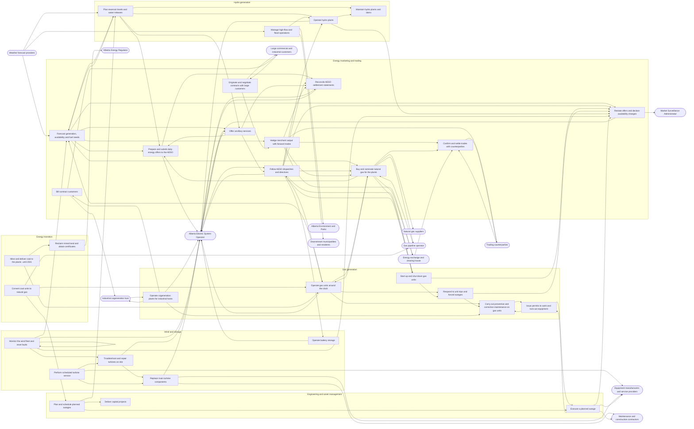

# Alberta merchant power generator (gas converted from coal, wind and hydro)

`power-generation-co` · electric power generation · modelled on public information about ['TransAlta Corporation (Alberta operations)', 'Capital Power Corporation (coal-to-gas conversion practice)']

This is a publicly listed power generation company with its head office in Alberta whose plants are almost all in Alberta. It owns natural gas steam units that were converted from coal in 2019 to 2021, gas cogeneration plants at industrial sites, a dozen wind farms in southern Alberta, a small battery, and seventeen hydro plants with dams on the Bow, North Saskatchewan and Oldman rivers. Most of its output is sold hour by hour into Alberta's energy-only wholesale market: each day it offers every plant to the Alberta Electric System Operator at prices it chooses, the operator dispatches the cheapest offers first, and every dispatched plant earns the hourly pool price. To steady its earnings it sells part of future output forward to traders and exchanges, signs fixed-price and contract-for-differences deals with large industrial customers, sells steam and power to cogeneration hosts, and earns emission credits from hydro and wind under Alberta's carbon pricing system. It is organised into generation divisions for gas, hydro and wind, a central engineering and outage group, an energy marketing and trading division that runs a round-the-clock desk, an energy transition division that converted the coal units and is reclaiming the closed coal mine, and corporate departments for safety and regulation, finance, legal, people, IT and supply chain. About a third of its staff are unionised, and the plants are run by certified power engineers on rotating shifts.

| | |
|---|---|
| Employees | 1,289 |
| Country | Canada |
| Ownership | Publicly listed corporation (TSX and NYSE) |
| Regulators | Alberta Electric System Operator (market and grid rules), Alberta Utilities Commission, Market Surveillance Administrator, Alberta Energy Regulator (coal mine), Alberta Environment and Parks, Environment and Climate Change Canada, ABSA (pressure equipment), Alberta Occupational Health and Safety, Securities regulators |
| Annual revenue 2021 (whole company, including non-Alberta assets) | 2,721,000,000 CAD (A) |
| Total assets 2021 (whole company) | 9,226,000,000 CAD (A) |
| Alberta portfolio gross margin 2021 | 864,000,000 CAD (A) |
| Alberta electricity portfolio production 2021 | 12,777 GWh (A) |
| Alberta hydro facilities | 17 plants (834 MW) (A) |
| Converted gas units (formerly coal), wholly owned | 1,259 MW in 3 units (A) |
| Alberta wind facilities | 12 wind farms (about 630 MW net) (A) |
| Battery storage | 10 MW (20 MWh) (A) |
| Average Alberta pool price 2021 | 102 CAD/MWh (A) |
| Employees at end of 2021 (whole company) | 1,282 employees (A) |
| Adjusted fleet availability 2021 | 86.6 percent (A) |
| Greenhouse gas emissions 2021 | 12.5 Mt CO2e (A) |

## Units

- **Executive office** (15 people, department): The chief executive, executive officers and their support staff; sets strategy, allocates capital and supports the board.
- **Gas generation** (357 people, division): Runs the natural gas units converted from coal near Wabamun and the cogeneration plants that supply industrial hosts.
  - **Wabamun-area converted units** (219 people, site network): Operating and maintenance staff of the two converted coal plant sites (three units of about 400 MW each).
  - **Cogeneration plants** (60 people, site network): Operates the gas-fired cogeneration plants that sell steam and power to industrial hosts under long-term contracts.
  - **Thermal technical services** (68 people, team): Plant engineers, chemistry technicians and maintenance planners who support the thermal sites.
- **Hydro generation** (112 people, division): Operates and maintains the hydro plants and dams on the Bow, North Saskatchewan and Oldman river systems.
  - **Bow River plants** (45 people, site network): Eleven small and mid-size plants and their dams and reservoirs on the Bow River system west of Calgary.
  - **North Saskatchewan plants** (30 people, site network): The two large storage plants on the North Saskatchewan system (about 475 MW).
  - **Oldman River plants** (10 people, site network): Four small irrigation-linked plants in southern Alberta.
  - **Hydro control centre** (16 people, team): Operates the hydro fleet remotely around the clock and coordinates water releases.
- **Wind and storage** (71 people, division): Operates and maintains the southern Alberta wind farms and the battery storage facility.
  - **Southern Alberta wind sites** (55 people, site network): Technicians and site managers at the wind farms near Pincher Creek, Fort Macleod and Lethbridge.
  - **Renewables operations centre** (11 people, team): Monitors wind turbines and the battery remotely, resets faults and dispatches technicians.
- **Engineering and asset management** (132 people, division): Central engineering, reliability, outage planning, capital projects and specialist maintenance crews for all plants.
  - **Asset management and reliability** (40 people, team): Sets maintenance strategies, analyses failures and plans sustaining capital.
  - **Outage planning** (25 people, team): Plans, schedules and reports planned outages for the fleet.
  - **Capital projects** (25 people, team): Delivers sustaining and growth capital projects.
  - **Specialist maintenance crews** (37 people, team): Mobile crews for turbine-generator, valve, rigging and crane work across sites.
- **Energy marketing and trading** (90 people, division): Offers the fleet into the AESO market, hedges and trades power and gas, buys fuel, signs customer contracts and settles trades.
  - **Real-time desk** (25 people, team): Submits and restates offers, follows AESO dispatches and manages the portfolio hour by hour around the clock.
  - **Commercial and trading** (30 people, team): Term trading, origination of customer contracts, structuring, fuel buying and market analysis.
  - **Settlement and contract administration** (20 people, team): Reconciles AESO and counterparty settlements, bills customers and administers contracts.
- **Energy transition** (150 people, division): Converts coal units to gas, retires units, ran the Highvale coal mine until its closure at the end of 2021 and now reclaims it.
  - **Highvale mine and reclamation** (115 people, site network): Mined and delivered coal to the Wabamun-area plants until 2021, then reclaimed the mined land.
  - **Conversion and decommissioning projects** (25 people, team): Engineers and project managers for coal-to-gas conversions, unit retirements and decommissioning.
- **Health, safety, environment and regulatory** (50 people, department): Safety programs, environmental approvals and emissions reporting, regulatory filings and market compliance.
  - **Health and safety** (18 people, team): Safety advisors at sites and head office; incident management and safety programs.
  - **Environment and emissions** (18 people, team): Environmental approvals, monitoring and TIER and federal emissions compliance.
  - **Regulatory and market compliance** (12 people, team): AUC filings, AESO rule and reliability standard compliance and dealings with the MSA.
- **Finance** (100 people, department): Accounting, reporting, risk management, credit, treasury, tax, planning and internal audit.
  - **Controllership and accounts payable** (41 people, team): General ledger, month-end close, accounts payable and financial reporting.
  - **Commodity risk and credit** (15 people, team): Independent middle office: positions, value at risk, limits and counterparty credit.
  - **Treasury and tax** (12 people, team): Cash, debt, collateral, banking and tax.
  - **Planning and investor relations** (12 people, team): Budgets, forecasts and investor relations.
  - **Internal audit** (6 people, team): Internal audit and testing of internal controls over financial reporting.
- **Legal and land** (25 people, department): Contracts, disputes, corporate secretary work and land leases for wind and hydro sites.
- **Human resources** (40 people, department): Recruiting, payroll, labour relations with unions, training records and workforce transition.
- **Information technology** (65 people, department): Business systems, infrastructure and the operational technology that controls the plants.
  - **Enterprise IT** (35 people, team): Service desk, ERP and trading systems, infrastructure.
  - **Operational technology and cyber security** (20 people, team): Plant control systems, SCADA and cyber security compliance.
- **Supply chain** (82 people, department): Purchasing, contracts with suppliers and contractors, warehouses and spare parts.
  - **Procurement** (24 people, team): Buyers and contract specialists.
  - **Warehouses** (50 people, site network): Site warehouses holding spare parts and consumables.

## Demand drivers

| Driver | Per month | Unit | Evidence |
|---|---:|---|---|
| Asset-days offered into the AESO market | 880 | asset-days | C |
| AESO dispatch instructions received | 3,000 | dispatches | C |
| Power and gas trades executed | 800 | trades | C |
| Maintenance work orders across the fleet | 4,200 | work orders | C |
| Wind turbine fault stops | 450 | faults | C |
| Supplier invoices received | 3,500 | invoices | C |
| Planned unit outages starting | 4 | outages | C |
| Employees | 1,289 | employees | B [src1] |
| Active customer and offtake contracts | 45 | contracts | C |

## How the core processes connect

## Process map

### Executive office

| Process | Owner | Type | Unit of work | Per month | Priority | Receives from | Sends to |
|---|---|---|---|---:|---:|---|---|
| **Manage enterprise risk and insurance.** Executives maintain the enterprise risk register, review mitigations and arrange insurance renewals. Market, regulatory and climate policy risks were dominant in this period, and insurers asked for more detail on coal and dam exposure at each renewal. | Executive office | management | one risk review | 0.33 | 3 | Measure and report trading risk | Insurers and brokers, Run internal audits and control testing, Support the board and its committees |
| **Set strategy and allocate capital.** The executive team sets direction on conversions, retirements, renewables growth and capital allocation, using market analysis, and takes proposals to the board. Decisions in 2019 to 2022 centred on how fast to exit coal and where to grow. | Executive office | management | one strategy cycle | 0.08 | 3 | Analyse market fundamentals and forecast prices | Budget and forecast, Convert coal units to natural gas, Retire and decommission units, Support the board and its committees |
| **Support the board and its committees.** The corporate secretary and executives prepare board and committee packages, record decisions and follow up actions. Packages must be issued a week ahead of meetings, so late analysis from finance, trading or operations compresses review time and causes revisions. | Executive office | management | one board or committee meeting | 2 | 3 | Board of directors, Budget and forecast, Manage enterprise risk and insurance, Prepare quarterly and annual financial reports, Run internal audits and control testing, Set strategy and allocate capital | Board of directors, Budget and forecast, Hedge merchant output with forward trades, Measure and report trading risk |

### Gas generation

| Process | Owner | Type | Unit of work | Per month | Priority | Receives from | Sends to |
|---|---|---|---|---:|---:|---|---|
| **Carry out preventive and corrective maintenance on gas units.** Planners turn work requests and preventive maintenance plans into scheduled work orders; millwrights and instrument technicians get permits, parts and specialist help, do the work, and close the order with notes. Parts waits and permit coordination slow the work, and the backlog grows before outage seasons. | Gas generation | core | one work order | 1,400 | 1 | Analyse equipment condition and failures, Book specialist crews and cranes across sites, Inspect boilers and pressure equipment, Issue permits to work and lock out equipment, Manage warehouses and spare parts, Operate cogeneration plants for industrial hosts, Operate gas units around the clock, Respond to unit trips and forced outages | Analyse equipment condition and failures, Book specialist crews and cranes across sites, Issue permits to work and lock out equipment, Manage warehouses and spare parts, Purchase materials and services, Report and investigate safety incidents, Run payroll, Submit and update outage schedules with the AESO |
| **Issue permits to work and lock out equipment.** Before any maintenance, a shift operator reviews the job, identifies isolation points, applies locks and tags, tests for zero energy and issues a signed permit; the permit is returned and isolations removed when work ends. Permits are a safety control and a common queue in outages. | Gas generation | core | one work permit | 1,250 | 1 | Carry out preventive and corrective maintenance on gas units, Execute a planned outage, Run safety programs, Track training and certifications | Carry out preventive and corrective maintenance on gas units, Execute a planned outage |
| **Operate gas units around the clock.** Shift crews of power engineers run each converted unit from the control room and in the field: they follow dispatch targets, do rounds and readings, respond to alarms, raise work requests and hand over between shifts. Pressure equipment rules require certified engineers on shift. Frequent load changes after the switch to merchant operation add work and wear. | Gas generation | core | one plant-shift | 122 | 1 | Buy and nominate natural gas for the plants, Convert coal units to natural gas, Follow AESO dispatches and directives, Maintain plant control systems and cyber security, Manage engineering changes, Mine and deliver coal to the plants (until 2021), Sample and control boiler water chemistry | Alberta Electric System Operator, Buy and nominate natural gas for the plants, Carry out preventive and corrective maintenance on gas units, Forecast generation, availability and fuel needs, Report spills and emission exceedances, Respond to unit trips and forced outages, Run continuous emissions monitoring, Run payroll, Sample and control boiler water chemistry |
| **Respond to unit trips and forced outages.** When a unit trips or must be derated, the shift supervisor makes it safe, informs the real-time desk to restate offers, diagnoses the cause with maintenance and engineering, raises urgent work and records the forced outage. Returning quickly matters because lost hours in high-price periods are costly. | Gas generation | core | one forced outage or derate | 12 | 1 | Operate gas units around the clock, Start up and shut down gas units | Analyse equipment condition and failures, Book specialist crews and cranes across sites, Carry out preventive and corrective maintenance on gas units, Purchase materials and services, Report and investigate safety incidents, Restate offers and declare availability changes |
| **Start up and shut down gas units.** When dispatch or economics call for it, the shift crew follows start-up or shutdown procedures, purges and lights the boiler, warms the turbine and synchronises to the grid, which takes hours. Starts are more frequent since the units became merchant gas units, and failed starts must be reported as restatements. | Gas generation | core | one unit start or stop | 20 | 2 | Buy and nominate natural gas for the plants, Follow AESO dispatches and directives, Sample and control boiler water chemistry | Follow AESO dispatches and directives, Respond to unit trips and forced outages, Restate offers and declare availability changes |
| **Inspect boilers and pressure equipment.** Plant engineers plan and witness inspections of boilers, pressure vessels and safety valves under the pressure equipment rules, record results, and raise repairs. Major inspections are timed with planned outages. | Gas generation | management | one inspection | 20 | 3 | Alberta pressure equipment safety authority (ABSA), Plan and schedule planned outages | Alberta pressure equipment safety authority (ABSA), Carry out preventive and corrective maintenance on gas units |
| **Operate cogeneration plants for industrial hosts.** Cogeneration operators run gas turbines and heat recovery boilers to deliver steam and power to the host plant and export surplus power, coordinating with the host's operators on steam demand and outages. Host process upsets can force rapid changes. | Gas generation | core | one plant-shift | 122 | 3 | Industrial cogeneration host | Alberta Electric System Operator, Bill contract customers, Carry out preventive and corrective maintenance on gas units, Industrial cogeneration host |
| **Run continuous emissions monitoring.** Operators and technicians keep the stack emissions monitors calibrated, review daily data, fix gaps and pass validated emissions and fuel data to the environment team for approvals reporting and TIER compliance. | Gas generation | support | one unit-month of emissions data | 5 | 3 | Operate gas units around the clock | Maintain environmental approvals and monitoring reports, Prepare TIER and federal emissions reports |
| **Sample and control boiler water chemistry.** Chemistry technicians sample boiler water, steam and condensate, run analyses, adjust chemical dosing and advise operators. Poor chemistry causes tube failures, so results feed operating decisions and reliability analysis. | Gas generation | support | one day of chemistry control at one plant | 60 | 3 | Operate gas units around the clock | Operate gas units around the clock, Start up and shut down gas units |

### Hydro generation

| Process | Owner | Type | Unit of work | Per month | Priority | Receives from | Sends to |
|---|---|---|---|---:|---:|---|---|
| **Maintain hydro plants and dams.** Operator-maintainers and electricians plan and do preventive and corrective work on turbines, generators, gates and protection systems, often travelling between unstaffed sites. Larger jobs need specialist crews and unit outages timed around water availability. | Hydro generation | core | one work order | 550 | 2 | Analyse equipment condition and failures, Book specialist crews and cranes across sites, Manage warehouses and spare parts, Operate hydro plants, Plan reservoir levels and water releases, Run the dam safety program | Analyse equipment condition and failures, Book specialist crews and cranes across sites, Manage warehouses and spare parts, Purchase materials and services, Recruit and hire, Report and investigate safety incidents, Run payroll, Run the dam safety program, Submit and update outage schedules with the AESO |
| **Operate hydro plants.** The control centre runs the 17 plants remotely: it follows dispatches and water schedules, starts and stops units, watches levels and alarms, and sends operator-maintainers to sites when needed. It reports availability changes to the desk. | Hydro generation | core | one control centre shift | 61 | 2 | Follow AESO dispatches and directives, Manage high-flow and flood operations, Plan reservoir levels and water releases | Alberta Electric System Operator, Maintain hydro plants and dams, Report water licence compliance, Restate offers and declare availability changes, Run the dam safety program |
| **Plan reservoir levels and water releases.** Hydro planners and portfolio analysts forecast inflows from snowpack and weather, and plan hourly releases for each reservoir within licence limits so that water is used in the highest-price hours and kept for reserves. Licence minimum flows and downstream needs constrain the plan. | Hydro generation | core | one weekly water plan | 4 | 2 | Alberta Environment and Parks, Forecast generation, availability and fuel needs, Plan and schedule planned outages, Weather forecast providers | Forecast generation, availability and fuel needs, Maintain hydro plants and dams, Offer ancillary services, Operate hydro plants, Prepare and submit daily energy offers to the AESO |
| **Run the dam safety program.** Dam safety engineers keep consequence classifications, surveillance and operation manuals and emergency plans current, arrange periodic safety assessments by qualified professionals, review instrumentation and report hazardous conditions to the provincial regulator. | Hydro generation | management | one dam safety task | 8 | 2 | Alberta Environment and Parks, Maintain hydro plants and dams, Operate hydro plants | Alberta Environment and Parks, Maintain hydro plants and dams, Maintenance and construction contractors |
| **Manage high-flow and flood operations.** During spring runoff and heavy rain, the control centre and area managers raise releases, coordinate with the province and warn downstream communities, while protecting dams. Events are rare but intense and override market dispatch. | Hydro generation | core | one high-flow event | 1 | 3 | Weather forecast providers | Alberta Environment and Parks, Downstream municipalities and residents, Operate hydro plants |
| **Report water licence compliance.** Hydro staff collect reservoir level and flow records, check them against licence conditions and send compliance reports to the province. Exceedances must be explained. Gaps in gauge data must be filled before filing. | Hydro generation | management | one monthly report | 1 | 3 | Operate hydro plants | Alberta Environment and Parks |

### Wind and storage

| Process | Owner | Type | Unit of work | Per month | Priority | Receives from | Sends to |
|---|---|---|---|---:|---:|---|---|
| **Monitor the wind fleet and reset faults.** Operations centre operators watch turbine alarms in SCADA, reset faults remotely where rules allow, restate availability to the real-time desk, and dispatch technicians to turbines that stay down. Cold, icing and high winds cause bursts of faults. | Wind and storage | core | one turbine fault stop | 450 | 1 | Monitor the wind fleet and reset faults, Weather forecast providers | Alberta Electric System Operator, Forecast generation, availability and fuel needs, Monitor the wind fleet and reset faults, Restate offers and declare availability changes, Troubleshoot and repair turbines on site |
| **Troubleshoot and repair turbines on site.** A two-person technician team drives to the turbine, climbs, diagnoses the fault, replaces parts and returns the turbine to service. Wind speed limits climbing, parts may need to come from stores or the manufacturer, and travel is a large share of time. | Wind and storage | core | one turbine repair visit | 200 | 1 | Manage warehouses and spare parts, Monitor the wind fleet and reset faults, Perform scheduled turbine service | Alberta Electric System Operator, Analyse equipment condition and failures, Manage warehouses and spare parts, Purchase materials and services, Replace main turbine components, Report and investigate safety incidents, Run payroll |
| **Perform scheduled turbine service.** Technicians or the manufacturer's service crews do semi-annual and annual service on each turbine: torque checks, oil changes, filters, inspections. Most is done in lower-wind summer months to lose less energy. | Wind and storage | core | one turbine service | 75 | 2 | Analyse equipment condition and failures, Manage warehouses and spare parts | Analyse equipment condition and failures, Equipment manufacturers and service providers, Replace main turbine components, Run payroll, Submit and update outage schedules with the AESO, Troubleshoot and repair turbines on site |
| **Replace main turbine components.** When a gearbox, generator, main bearing or blade fails, the site manager orders the part, books a large crane and contractors, waits for low wind, and swaps the component. Crane availability and lead times can keep a turbine down for weeks. | Wind and storage | core | one main component exchange | 2 | 2 | Analyse equipment condition and failures, Contract and onboard contractors, Perform scheduled turbine service, Troubleshoot and repair turbines on site | Alberta Electric System Operator, Analyse equipment condition and failures, Equipment manufacturers and service providers, Maintenance and construction contractors, Purchase materials and services |
| **Operate battery storage.** The operations centre charges and discharges the battery following AESO dispatches and reserve awards and monitors its state of charge and health. Its small energy capacity means state of charge must be watched closely before each award. | Wind and storage | core | one battery operating day | 30 | 3 | Follow AESO dispatches and directives | Alberta Electric System Operator |

### Engineering and asset management

| Process | Owner | Type | Unit of work | Per month | Priority | Receives from | Sends to |
|---|---|---|---|---:|---:|---|---|
| **Execute a planned outage.** During a thermal outage of several weeks, hundreds of contractor and company workers open the turbine, boiler and auxiliaries, inspect, repair and reassemble under permits, working two shifts. Discovered work and late parts extend outages and delay return to market. | Engineering and asset management | core | one planned thermal or cogeneration unit outage (major or minor) | 0.8 | 1 | Contract and onboard contractors, Issue permits to work and lock out equipment, Plan and schedule planned outages | Analyse equipment condition and failures, Equipment manufacturers and service providers, Issue permits to work and lock out equipment, Maintenance and construction contractors, Report and investigate safety incidents, Restate offers and declare availability changes, Run payroll, Test unit capability and heat rate |
| **Plan and schedule planned outages.** Outage managers build a multi-year outage plan for every unit and, for each outage, a scope, critical-path schedule, budget, contractor and material plan, starting 12 to 24 months ahead. Long-lead parts and contractor availability drive the dates, and the AESO may ask for changes. | Engineering and asset management | core | one planned thermal or cogeneration unit outage (major or minor) | 0.8 | 1 | Convert coal units to natural gas, Plan sustaining capital and asset life | Book specialist crews and cranes across sites, Contract and onboard contractors, Deliver capital projects, Execute a planned outage, Inspect boilers and pressure equipment, Plan reservoir levels and water releases, Purchase materials and services, Submit and update outage schedules with the AESO |
| **Analyse equipment condition and failures.** Reliability engineers review work order history, trips and condition data, run root cause analyses on significant failures, and update maintenance strategies and spare-part policies. Cycling of converted units changed failure patterns. | Engineering and asset management | management | one analysis or strategy update | 30 | 2 | Carry out preventive and corrective maintenance on gas units, Execute a planned outage, Maintain hydro plants and dams, Perform scheduled turbine service, Replace main turbine components, Respond to unit trips and forced outages, Troubleshoot and repair turbines on site | Carry out preventive and corrective maintenance on gas units, Maintain hydro plants and dams, Manage warehouses and spare parts, Perform scheduled turbine service, Plan sustaining capital and asset life, Replace main turbine components |
| **Deliver capital projects.** Project managers deliver approved projects from design to commissioning: they define scope, obtain regulatory approvals, buy equipment, manage contractors and hand over to operations. Many projects must be finished inside a planned outage. | Engineering and asset management | core | one sustaining capital project | 4 | 2 | Budget and forecast, Plan and schedule planned outages, Prepare AUC applications and filings | Close the books each month, Contract and onboard contractors, Manage engineering changes, Prepare AUC applications and filings, Purchase materials and services |
| **Submit and update outage schedules with the AESO.** Outage planners submit planned outages and changes to the AESO, respond to AESO requests to move outages for reliability, and keep the accepted schedule current for forecasting. Late changes must be justified. | Engineering and asset management | management | one outage submission or change | 30 | 2 | Alberta Electric System Operator, Analyse market fundamentals and forecast prices, Carry out preventive and corrective maintenance on gas units, Maintain hydro plants and dams, Perform scheduled turbine service, Plan and schedule planned outages | Alberta Electric System Operator, Forecast generation, availability and fuel needs |
| **Book specialist crews and cranes across sites.** Crew leads take requests from plants for turbine, valve, rigging or crane work, balance them against outage commitments, and assign crews and equipment. Conflicts peak in outage seasons. | Engineering and asset management | support | one crew request | 40 | 3 | Carry out preventive and corrective maintenance on gas units, Maintain hydro plants and dams, Plan and schedule planned outages, Respond to unit trips and forced outages | Carry out preventive and corrective maintenance on gas units, Maintain hydro plants and dams |
| **Manage engineering changes.** Engineers propose changes to equipment, settings or procedures, review risks, get approvals, update drawings and procedures and train operators. Skipped steps are a known cause of incidents. | Engineering and asset management | management | one engineering change | 20 | 3 | Deliver capital projects | Operate gas units around the clock |
| **Plan sustaining capital and asset life.** Asset managers rank sustaining capital needs from condition reports and strategy, estimate costs, and propose the annual capital plan and outage scopes. Uncertain unit lives during the coal transition complicate decisions. | Engineering and asset management | management | one annual capital plan | 0.08 | 3 | Analyse equipment condition and failures | Budget and forecast, Plan and schedule planned outages |
| **Test unit capability and heat rate.** After outages and conversions, engineers run capability and heat rate tests, analyse results and update declared maximum capability with the AESO and fuel cost estimates used in offers. | Engineering and asset management | management | one unit test | 2 | 3 | Convert coal units to natural gas, Execute a planned outage | Alberta Electric System Operator, Prepare and submit daily energy offers to the AESO |

### Energy marketing and trading

| Process | Owner | Type | Unit of work | Per month | Priority | Receives from | Sends to |
|---|---|---|---|---:|---:|---|---|
| **Buy and nominate natural gas for the plants.** The gas buyer forecasts daily burn from the generation forecast, buys gas, nominates it on the pipeline to each plant before nomination deadlines, and adjusts intraday when units are dispatched up or down or trip. Pipeline curtailments and imbalances must be managed daily, including weekends. | Energy marketing and trading | core | one gas day of nominations | 30 | 1 | Follow AESO dispatches and directives, Forecast generation, availability and fuel needs, Gas pipeline operator, Hedge merchant output with forward trades, Operate gas units around the clock | Close the books each month, Confirm and settle trades with counterparties, Energy exchange and clearing house, Gas pipeline operator, Measure and report trading risk, Natural gas suppliers, Operate gas units around the clock, Prepare and submit daily energy offers to the AESO, Process supplier invoices and payments, Start up and shut down gas units |
| **Confirm and settle trades with counterparties.** Settlement analysts match each trade with the counterparty or exchange confirmation, chase mismatches, then at month end prepare netting statements and invoices, pay or collect, and post entries. Mismatched terms and late confirmations create credit and accounting risk. | Energy marketing and trading | core | one trade | 800 | 1 | Buy and nominate natural gas for the plants, Change and release business systems, Energy exchange and clearing house, Hedge merchant output with forward trades, Manage counterparty credit and collateral, Trading counterparties | Close the books each month, Manage cash, debt and liquidity, Manage counterparty credit and collateral, Trading counterparties |
| **Follow AESO dispatches and directives.** The AESO dispatches assets up the merit order every few minutes. The real-time trader acknowledges each dispatch and passes it to the gas control room, hydro control centre or battery operator, who ramp the unit to the target; deviations must be explained. In tight hours the desk also handles reserve directives and supply shortfall alerts. | Energy marketing and trading | core | one dispatch instruction | 3,000 | 1 | Alberta Electric System Operator, Offer ancillary services, Start up and shut down gas units | Alberta Electric System Operator, Buy and nominate natural gas for the plants, Monitor market rule compliance and respond to the MSA, Operate battery storage, Operate gas units around the clock, Operate hydro plants, Reconcile AESO settlement statements, Restate offers and declare availability changes, Start up and shut down gas units |
| **Hedge merchant output with forward trades.** Term traders sell forward Alberta power and buy gas to fix the margin on part of expected merchant output, within risk and credit limits, on the exchange or with counterparties. Each trade is captured in the trading system for confirmation, settlement and risk reporting. Judging how much to hedge against forecast output and price views is the hard part. | Energy marketing and trading | core | one hedge trade (a forward power sale or a forward gas purchase or sale) | 120 | 1 | Analyse market fundamentals and forecast prices, Forecast generation, availability and fuel needs, Manage counterparty credit and collateral, Measure and report trading risk, Originate and negotiate contracts with large customers, Support the board and its committees | Buy and nominate natural gas for the plants, Confirm and settle trades with counterparties, Energy exchange and clearing house, Measure and report trading risk, Reconcile AESO settlement statements, Trading counterparties |
| **Prepare and submit daily energy offers to the AESO.** For each asset and each hour of the next day, the real-time desk and portfolio analysts set price and quantity blocks within the 0 to 999.99 CAD/MWh range, using the generation forecast, fuel and carbon cost, water schedule and price view, and submit them through the AESO trading system before the deadline. Offers must follow ISO rules and the fair competition regulation, so reasons and records are kept. Errors can strand a unit or sell output far below cost. | Energy marketing and trading | core | one asset-day of offers | 880 | 1 | Alberta Electric System Operator, Analyse market fundamentals and forecast prices, Buy and nominate natural gas for the plants, Forecast generation, availability and fuel needs, Monitor market rule compliance and respond to the MSA, Offer ancillary services, Plan reservoir levels and water releases, Test unit capability and heat rate | Alberta Electric System Operator, Monitor market rule compliance and respond to the MSA, Reconcile AESO settlement statements |
| **Reconcile AESO settlement statements.** Settlement analysts compare preliminary and final AESO statements of energy, ancillary service and other charges against internal meter, offer and dispatch records, raise queries on differences, and post the results. Final statements arrive weeks later, so items are reconciled twice. | Energy marketing and trading | core | one settlement statement | 10 | 1 | Alberta Electric System Operator, Follow AESO dispatches and directives, Hedge merchant output with forward trades, Offer ancillary services, Prepare and submit daily energy offers to the AESO | Alberta Electric System Operator, Close the books each month, Manage cash, debt and liquidity |
| **Restate offers and declare availability changes.** When a unit trips, a wind or water forecast changes or a unit returns from outage, the real-time trader restates the offered megawatts for the affected hours in the AESO system with an acceptable operational reason, often within minutes. Restatement timing and reasons are monitored for compliance. Volume rises sharply in cold snaps and windy, volatile days. | Energy marketing and trading | core | one offer restatement | 600 | 1 | Alberta Electric System Operator, Execute a planned outage, Follow AESO dispatches and directives, Forecast generation, availability and fuel needs, Monitor market rule compliance and respond to the MSA, Monitor the wind fleet and reset faults, Operate hydro plants, Respond to unit trips and forced outages, Start up and shut down gas units | Alberta Electric System Operator, Market Surveillance Administrator, Monitor market rule compliance and respond to the MSA |
| **Forecast generation, availability and fuel needs.** Portfolio analysts combine weather forecasts, the accepted outage schedule, unit status, water schedules and wind forecasts into an hourly forecast of what each asset can generate over the next days and months. The forecast feeds offers, gas buying and hedging. Wind and inflow uncertainty and late outage changes make it error-prone. | Energy marketing and trading | core | one daily portfolio forecast | 30 | 2 | Analyse market fundamentals and forecast prices, Monitor the wind fleet and reset faults, Operate gas units around the clock, Plan reservoir levels and water releases, Submit and update outage schedules with the AESO, Weather forecast providers | Buy and nominate natural gas for the plants, Hedge merchant output with forward trades, Offer ancillary services, Plan reservoir levels and water releases, Prepare and submit daily energy offers to the AESO, Restate offers and declare availability changes |
| **Offer ancillary services.** Each day the desk decides how much hydro, gas and battery capacity to offer as regulating, spinning and supplemental reserves instead of energy, and submits ancillary service offers. Awards change what can be offered as energy and must be followed in real time. The trade-off between energy and reserves is judged from price forecasts. | Energy marketing and trading | core | one Watt-Ex trading session of reserve offers (one or more delivery days) | 21 | 2 | Alberta Electric System Operator, Analyse market fundamentals and forecast prices, Forecast generation, availability and fuel needs, Plan reservoir levels and water releases | Alberta Electric System Operator, Follow AESO dispatches and directives, Prepare and submit daily energy offers to the AESO, Reconcile AESO settlement statements |
| **Originate and negotiate contracts with large customers.** Originators respond to large customers' requests for supply, price fixed, index or contract-for-differences deals with structuring analysts, check credit, negotiate terms and send drafts through legal review before signing. Deals take weeks to months and change the hedge position when signed. | Energy marketing and trading | core | one customer deal | 5 | 2 | Analyse market fundamentals and forecast prices, Large commercial and industrial customers, Manage counterparty credit and collateral, Review and negotiate contracts | Administer customer and offtake contracts, Hedge merchant output with forward trades, Large commercial and industrial customers, Measure and report trading risk, Review and negotiate contracts |
| **Administer customer and offtake contracts.** Contract administrators keep signed contracts in the repository, track notices, renewals, volume changes and price resets, and maintain the billing terms. They answer customer notices and keep the AESO renewable offtake contract for the newest wind farm in order. | Energy marketing and trading | support | one contract event | 30 | 3 | Large commercial and industrial customers, Originate and negotiate contracts with large customers | Bill contract customers |
| **Analyse market fundamentals and forecast prices.** Market analysts track Alberta supply additions, retirements, demand, gas prices and interties, and maintain price forecasts used for offers, hedging and strategy. The work is spreadsheet and model based and is updated weekly and when large events change the outlook. | Energy marketing and trading | management | one weekly price forecast update | 4 | 3 | Alberta Electric System Operator | Budget and forecast, Forecast generation, availability and fuel needs, Hedge merchant output with forward trades, Offer ancillary services, Originate and negotiate contracts with large customers, Prepare and submit daily energy offers to the AESO, Set strategy and allocate capital, Submit and update outage schedules with the AESO |
| **Bill contract customers.** Each month settlement analysts take metered volumes and pool prices, apply each contract's pricing, prepare invoices or contract-for-differences statements for customers and cogeneration hosts, and post receivables. Disputed volumes and index calculations cause rework. | Energy marketing and trading | core | one customer invoice | 45 | 3 | Administer customer and offtake contracts, Alberta Electric System Operator, Operate cogeneration plants for industrial hosts | Close the books each month, Industrial cogeneration host, Large commercial and industrial customers |
| **Manage emission credits for TIER compliance.** Traders and emissions analysts track the compliance obligation from gas units against emission performance credits created by hydro and wind, buy or sell credits and offsets, and choose between credits and fund payments. Prices and rules changed often in 2019 to 2022. | Energy marketing and trading | support | one credit trade or compliance decision | 4 | 3 | Prepare TIER and federal emissions reports | Prepare TIER and federal emissions reports, Trading counterparties |

### Energy transition

| Process | Owner | Type | Unit of work | Per month | Priority | Receives from | Sends to |
|---|---|---|---|---:|---:|---|---|
| **Convert coal units to natural gas.** Project teams design boiler and burner changes, secure gas pipeline service and regulatory approvals, buy equipment and carry out the conversion during a planned outage, then commission the unit on gas. Each conversion took one to two years; the last Alberta units were converted in 2021. | Energy transition | core | one unit conversion project | 0.07 | 2 | Prepare AUC applications and filings, Set strategy and allocate capital | Gas pipeline operator, Operate gas units around the clock, Plan and schedule planned outages, Prepare AUC applications and filings, Purchase materials and services, Test unit capability and heat rate |
| **Mine and deliver coal to the plants (until 2021).** Until the end of 2021 mine crews stripped overburden with draglines, dug coal and hauled it to plant stockpiles around the clock, matching deliveries to plant burn. Output fell as units converted to gas. | Energy transition | core | one day of mining | 30 | 3 | Manage warehouses and spare parts | Manage warehouses and spare parts, Operate gas units around the clock, Reclaim mined land and obtain certificates, Report and investigate safety incidents, Run payroll |
| **Reclaim mined land and obtain certificates.** Reclamation crews recontour pits, replace soil and revegetate; specialists monitor results, file annual reports and apply to the AER for reclamation certificates when outcomes are met. Work is seasonal and runs for decades. | Energy transition | core | one reclamation work package | 5 | 3 | Alberta Energy Regulator, Mine and deliver coal to the plants (until 2021) | Alberta Energy Regulator |
| **Retire and decommission units.** When a unit is to retire or be mothballed, the team gives notice to the AESO, plans workforce changes and regulatory filings, and later decommissions and demolishes plant safely. | Energy transition | management | one unit retirement | 0.1 | 3 | Prepare AUC applications and filings, Set strategy and allocate capital | Alberta Electric System Operator, Manage workforce changes from the coal transition, Prepare AUC applications and filings |

### Health, safety, environment and regulatory

| Process | Owner | Type | Unit of work | Per month | Priority | Receives from | Sends to |
|---|---|---|---|---:|---:|---|---|
| **Monitor market rule compliance and respond to the MSA.** Compliance officers review offers, restatements, outage reports and reliability standard evidence for breaches, train traders, self-report issues and answer MSA requests and investigations. Judging whether an offer reason is acceptable needs experience. | Health, safety, environment and regulatory | management | one compliance review or inquiry | 20 | 2 | Alberta Electric System Operator, Follow AESO dispatches and directives, Maintain plant control systems and cyber security, Market Surveillance Administrator, Prepare and submit daily energy offers to the AESO, Restate offers and declare availability changes | Market Surveillance Administrator, Prepare and submit daily energy offers to the AESO, Process supplier invoices and payments, Restate offers and declare availability changes |
| **Prepare TIER and federal emissions reports.** Emissions analysts compile validated emissions and generation data, calculate the TIER obligation against the benchmark, retire credits or pay into the fund, have the report verified by a third party and file it, and file federal greenhouse gas and pollutant reports. | Health, safety, environment and regulatory | management | one compliance report (one facility, one program, one year) | 1.8 | 2 | Manage emission credits for TIER compliance, Run continuous emissions monitoring | Alberta Environment and Parks, Close the books each month, Environment and Climate Change Canada, Manage emission credits for TIER compliance |
| **Report and investigate safety incidents.** Workers report injuries, near misses and process safety events; safety advisors classify them, notify regulators for serious events, lead investigations and track corrective actions. Outage seasons bring more contractor incidents. | Health, safety, environment and regulatory | management | one incident report | 45 | 2 | Carry out preventive and corrective maintenance on gas units, Execute a planned outage, Maintain hydro plants and dams, Mine and deliver coal to the plants (until 2021), Respond to unit trips and forced outages, Troubleshoot and repair turbines on site | Alberta Occupational Health and Safety, Run safety programs, Workers' Compensation Board of Alberta |
| **Maintain environmental approvals and monitoring reports.** Environmental specialists track conditions in plant approvals, compile air, water and waste monitoring reports and submit them, renew approvals and keep the environmental management system audited. | Health, safety, environment and regulatory | management | one approval report | 10 | 3 | Alberta Environment and Parks, Run continuous emissions monitoring | Alberta Environment and Parks |
| **Prepare AUC applications and filings.** Regulatory advisors prepare applications to the AUC for plant alterations, conversions and decommissioning, run participant involvement, answer information requests and receive decisions. Information requests and objections from nearby residents can extend timelines by months. | Health, safety, environment and regulatory | management | one application | 1 | 3 | Alberta Utilities Commission, Convert coal units to natural gas, Deliver capital projects, Retire and decommission units | Alberta Utilities Commission, Convert coal units to natural gas, Deliver capital projects, Retire and decommission units |
| **Report spills and emission exceedances.** When a spill or exceedance occurs, plant staff report it, the environment team assesses whether it is reportable, notifies the regulator within required times and manages clean-up and follow-up reports. | Health, safety, environment and regulatory | management | one release | 3 | 3 | Operate gas units around the clock | Alberta Environment and Parks |
| **Run safety programs.** The safety team maintains safety standards for permits, lockout, heights and confined spaces, audits sites and contractors, and defines training requirements. Keeping contractors who arrive for short outages trained in site rules is the hardest part. | Health, safety, environment and regulatory | management | one program activity | 40 | 3 | Report and investigate safety incidents | Contract and onboard contractors, Issue permits to work and lock out equipment, Track training and certifications |

### Finance

| Process | Owner | Type | Unit of work | Per month | Priority | Receives from | Sends to |
|---|---|---|---|---:|---:|---|---|
| **Measure and report trading risk.** The independent risk group values positions daily, calculates value at risk and margin at risk, checks limits, reports breaches and maintains limits approved by the board. | Finance | management | one daily risk report | 21 | 1 | Buy and nominate natural gas for the plants, Energy exchange and clearing house, Hedge merchant output with forward trades, Originate and negotiate contracts with large customers, Support the board and its committees | Close the books each month, Hedge merchant output with forward trades, Manage enterprise risk and insurance |
| **Process supplier invoices and payments.** Accounts payable clerks receive invoices from gas suppliers, contractors and material suppliers, match them to purchase orders and receipts, route exceptions for approval and include approved invoices in weekly payment runs. Outage contractor invoices and gas invoices are large and time-critical. | Finance | support | one supplier invoice | 3,500 | 1 | Buy and nominate natural gas for the plants, Contract and onboard contractors, Equipment manufacturers and service providers, Maintenance and construction contractors, Manage land leases for wind and hydro sites, Manage warehouses and spare parts, Material and parts suppliers, Monitor market rule compliance and respond to the MSA, Natural gas suppliers, Purchase materials and services | Close the books each month, Equipment manufacturers and service providers, Landowners, Maintenance and construction contractors, Manage cash, debt and liquidity, Material and parts suppliers, Natural gas suppliers |
| **Close the books each month.** Accountants post settlement, trading, payroll and payables entries, accrue unbilled and unsettled amounts, reconcile accounts including mark-to-market on hedges, and produce the monthly results. Final AESO statements arrive later, so estimates are trued up. | Finance | support | one monthly close | 1 | 2 | Bill contract customers, Budget and forecast, Buy and nominate natural gas for the plants, Confirm and settle trades with counterparties, Deliver capital projects, Manage cash, debt and liquidity, Measure and report trading risk, Prepare TIER and federal emissions reports, Process supplier invoices and payments, Reconcile AESO settlement statements, Run payroll | Budget and forecast, File taxes, Prepare quarterly and annual financial reports |
| **Budget and forecast.** Planning analysts build the annual budget and quarterly forecasts from price forecasts, hedges, outage plans and capital plans, and prepare board material. Pool price swings make merchant revenue forecasts uncertain, so several scenarios are prepared. | Finance | management | one budget or forecast cycle | 0.33 | 3 | Analyse market fundamentals and forecast prices, Close the books each month, Plan sustaining capital and asset life, Set strategy and allocate capital, Support the board and its committees | Close the books each month, Deliver capital projects, Support the board and its committees |
| **Communicate with investors.** Investor relations prepares earnings releases and presentations, runs calls and answers analysts and shareholders. Investors focused in 2019 to 2022 on the coal exit, Alberta pool prices and hedging, so messages must match the filings and avoid selective disclosure. | Finance | management | one investor interaction batch | 2 | 3 | Prepare quarterly and annual financial reports | Shareholders and analysts |
| **File taxes.** Tax specialists prepare income tax provisions and returns, property and other tax filings, and answer audits. Accelerated capital cost allowance on renewables and the closure of coal assets add complexity, and filings follow fixed annual and monthly deadlines. | Finance | support | one tax filing | 4 | 3 | Close the books each month | Canada Revenue Agency |
| **Manage cash, debt and liquidity.** Treasury forecasts cash, funds payment runs and collateral, manages credit facilities and covenant certificates, and arranges financing. Collateral calls driven by price spikes can require large amounts of cash at short notice, which strains liquidity planning. | Finance | support | one cash management day | 21 | 3 | Banks and bondholders, Confirm and settle trades with counterparties, Manage counterparty credit and collateral, Process supplier invoices and payments, Reconcile AESO settlement statements | Banks and bondholders, Close the books each month |
| **Manage counterparty credit and collateral.** Credit analysts review counterparties and customers, set limits, monitor exposure and issue or answer collateral calls with treasury. Exposure can rise quickly when forward prices move, so collateral needs change daily and must be funded the same day. | Finance | management | one credit review or collateral call | 40 | 3 | Confirm and settle trades with counterparties, Large commercial and industrial customers, Trading counterparties | Confirm and settle trades with counterparties, Hedge merchant output with forward trades, Manage cash, debt and liquidity, Originate and negotiate contracts with large customers, Trading counterparties |
| **Prepare quarterly and annual financial reports.** The controller's team drafts financial statements, MD&A and the annual information form, works with the auditor, and files with securities regulators after board approval. Hedge accounting and impairments of coal assets made 2019 to 2022 complex. | Finance | management | one quarterly report | 0.33 | 3 | Close the books each month, External auditor, Manage disputes and arbitrations | Communicate with investors, External auditor, Securities regulators, Support the board and its committees |
| **Run internal audits and control testing.** Internal auditors test controls over financial reporting and run risk-based audits, reporting findings to the audit committee and following up actions. Trading and settlement controls get particular attention because errors there move money quickly. | Finance | management | one audit | 2 | 3 | Manage enterprise risk and insurance | Support the board and its committees |

### Legal and land

| Process | Owner | Type | Unit of work | Per month | Priority | Receives from | Sends to |
|---|---|---|---|---:|---:|---|---|
| **Manage disputes and arbitrations.** Counsel manage commercial disputes and arbitrations with counterparties, with external lawyers, and estimate provisions for the financial statements. Arbitrations over power purchase arrangement terminations and force majeure claims can run for years and need large volumes of evidence. | Legal and land | support | one active dispute-month | 4 | 3 | Trading counterparties | Arbitrators, courts and tribunals, Prepare quarterly and annual financial reports |
| **Manage land leases for wind and hydro sites.** Land administrators maintain surface leases with landowners, calculate and arrange annual payments and answer landowner requests on access, crop damage and roads. Records for older leases are often on paper. | Legal and land | support | one lease event | 40 | 3 | Landowners | Process supplier invoices and payments |
| **Review and negotiate contracts.** Counsel review customer, supply, service and contractor contracts, negotiate terms with the business and counterparties, and approve signature. Customer deals often go through several rounds of comments on credit support, force majeure and change-in-law clauses before signing. | Legal and land | support | one contract review | 40 | 3 | Contract and onboard contractors, Originate and negotiate contracts with large customers | Contract and onboard contractors, Originate and negotiate contracts with large customers |

### Human resources

| Process | Owner | Type | Unit of work | Per month | Priority | Receives from | Sends to |
|---|---|---|---|---:|---:|---|---|
| **Run payroll.** Payroll specialists import timesheets with shift premiums, overtime and call-outs, apply collective agreement rules, run biweekly payroll, remit deductions and post costs. Retroactive pay after bargaining causes rework. | Human resources | support | one payroll run | 2 | 2 | Bargain and administer collective agreements, Carry out preventive and corrective maintenance on gas units, Execute a planned outage, Maintain hydro plants and dams, Manage workforce changes from the coal transition, Mine and deliver coal to the plants (until 2021), Operate gas units around the clock, Perform scheduled turbine service, Recruit and hire, Troubleshoot and repair turbines on site | Canada Revenue Agency, Close the books each month, Employees, Labour unions |
| **Bargain and administer collective agreements.** Labour relations specialists bargain renewals with unions, handle grievances and interpret agreements for supervisors. With eleven agreements on different cycles, bargaining is almost continuous, and work rules in each agreement affect shift scheduling and overtime. | Human resources | management | one bargaining or grievance case | 5 | 3 | Labour unions | Labour unions, Run payroll |
| **Manage workforce changes from the coal transition.** HR plans redeployment, retraining, layoffs and severance when units retire, conversions reduce staffing or mining ends, and gives required notices to unions and employees. Seniority rules decide who moves. | Human resources | management | one workforce change | 0.3 | 3 | Retire and decommission units | Employees, Labour unions, Run payroll |
| **Recruit and hire.** Recruiters post vacancies, screen candidates, coordinate interviews and checks including power engineer certification, and make offers. Experienced power engineers and wind technicians are in short supply, and shift work and remote sites make some roles hard to fill. | Human resources | support | one requisition | 12 | 3 | Maintain hydro plants and dams | Job candidates, Run payroll, Track training and certifications |
| **Track training and certifications.** Training coordinators schedule safety and technical training, track power engineer and trade certifications and keep records used to authorise permit holders. Expired certifications can stop a worker from holding a permit. | Human resources | support | one training record batch | 4 | 3 | Recruit and hire, Run safety programs | Issue permits to work and lock out equipment |

### Information technology

| Process | Owner | Type | Unit of work | Per month | Priority | Receives from | Sends to |
|---|---|---|---|---:|---:|---|---|
| **Change and release business systems.** Business systems analysts design, test and release changes to ERP, trading and settlement systems. Changes to trading and settlement systems must be tested against AESO file formats and timed so that they do not disturb the daily offer cycle. | Information technology | support | one change | 40 | 3 | Maintain plant control systems and cyber security, Run the IT service desk | Confirm and settle trades with counterparties, Maintain plant control systems and cyber security |
| **Maintain plant control systems and cyber security.** OT specialists patch and back up control systems, manage access, monitor for cyber threats and keep evidence for the reliability standards on cyber security. Patches can only be applied during unit outages. | Information technology | management | one OT change or compliance task | 35 | 3 | Alberta Electric System Operator, Change and release business systems | Change and release business systems, Monitor market rule compliance and respond to the MSA, Operate gas units around the clock |
| **Run the IT service desk.** Service desk analysts log and resolve user incidents and requests and pass changes to system teams. Field staff at remote plants and wind sites often have poor connectivity, so some issues need a site visit or a remote session to fix. | Information technology | support | one IT ticket | 1,000 | 3 | Employees | Change and release business systems |

### Supply chain

| Process | Owner | Type | Unit of work | Per month | Priority | Receives from | Sends to |
|---|---|---|---|---:|---:|---|---|
| **Purchase materials and services.** Buyers turn material requests into purchase orders, get quotes, check contracts and expedite long-lead items, especially for outages and projects. Single-source parts for older units can take months to arrive. | Supply chain | support | one purchase order | 750 | 1 | Carry out preventive and corrective maintenance on gas units, Convert coal units to natural gas, Deliver capital projects, Maintain hydro plants and dams, Manage warehouses and spare parts, Plan and schedule planned outages, Replace main turbine components, Respond to unit trips and forced outages, Troubleshoot and repair turbines on site | Manage warehouses and spare parts, Material and parts suppliers, Process supplier invoices and payments |
| **Manage warehouses and spare parts.** Storekeepers receive deliveries, issue parts to work orders, count stock and trigger replenishment. Critical spares are held for long-lead items. Inaccurate stock records cause emergency purchases and delayed work orders. | Supply chain | support | one stock issue or receipt | 3,500 | 2 | Analyse equipment condition and failures, Carry out preventive and corrective maintenance on gas units, Maintain hydro plants and dams, Material and parts suppliers, Mine and deliver coal to the plants (until 2021), Purchase materials and services, Troubleshoot and repair turbines on site | Carry out preventive and corrective maintenance on gas units, Maintain hydro plants and dams, Mine and deliver coal to the plants (until 2021), Perform scheduled turbine service, Process supplier invoices and payments, Purchase materials and services, Troubleshoot and repair turbines on site |
| **Contract and onboard contractors.** Contract specialists tender and award service agreements, check contractor safety records and insurance, and onboard crews for outages and projects. Many outages compete for the same contractors each spring and fall. | Supply chain | support | one contractor agreement | 15 | 3 | Deliver capital projects, Plan and schedule planned outages, Review and negotiate contracts, Run safety programs | Execute a planned outage, Maintenance and construction contractors, Process supplier invoices and payments, Replace main turbine components, Review and negotiate contracts |

## Roles

| Role | Unit | Layer | Reports to | Headcount | Loaded cost per hour |
|---|---|---|---|---:|---:|
| President and chief executive officer | Executive office | executive |  | 1 | 450 CAD |
| Executive vice-president (finance, operations, trading, legal, people, transition) | Executive office | executive | President and chief executive officer | 6 | 260 CAD |
| Executive assistant | Executive office | individual contributor | Executive vice-president (finance, operations, trading, legal, people, transition) | 5 | 55 CAD |
| Corporate secretary | Legal and land | manager | Associate general counsel | 1 | 140 CAD |
| Vice-president, gas generation | Gas generation | director | Executive vice-president (finance, operations, trading, legal, people, transition) | 1 | 190 CAD |
| Plant manager | Wabamun-area converted units | manager | Vice-president, gas generation | 4 | 135 CAD |
| Shift supervisor (first-class power engineer) | Wabamun-area converted units | supervisor | Plant manager | 10 | 92 CAD |
| Control room operator (second-class power engineer) | Wabamun-area converted units | individual contributor | Shift supervisor (first-class power engineer) | 25 | 70 CAD |
| Field operator (third- or fourth-class power engineer) | Wabamun-area converted units | individual contributor | Shift supervisor (first-class power engineer) | 40 | 60 CAD |
| Cogeneration plant operator (power engineer) | Cogeneration plants | individual contributor | Plant manager | 30 | 66 CAD |
| Millwright | Wabamun-area converted units | individual contributor | Maintenance supervisor | 34 | 66 CAD |
| Instrument and electrical technician | Wabamun-area converted units | individual contributor | Maintenance supervisor | 26 | 68 CAD |
| Maintenance supervisor | Wabamun-area converted units | supervisor | Plant manager | 9 | 95 CAD |
| Maintenance planner and scheduler | Thermal technical services | individual contributor | Maintenance supervisor | 20 | 66 CAD |
| Water chemistry technician | Thermal technical services | individual contributor | Plant engineer | 6 | 60 CAD |
| Plant engineer | Thermal technical services | senior specialist | Plant manager | 12 | 92 CAD |
| Director, hydro operations | Hydro generation | director | Executive vice-president (finance, operations, trading, legal, people, transition) | 1 | 165 CAD |
| Hydro area manager | Hydro generation | manager | Director, hydro operations | 3 | 128 CAD |
| Hydro control centre operator | Hydro control centre | individual contributor | Hydro operations supervisor | 12 | 68 CAD |
| Hydro operations supervisor | Hydro generation | supervisor | Hydro area manager | 7 | 92 CAD |
| Hydro operator-maintainer | Bow River plants | individual contributor | Hydro operations supervisor | 42 | 64 CAD |
| Hydro electrician and protection technician | North Saskatchewan plants | individual contributor | Hydro operations supervisor | 14 | 68 CAD |
| Dam safety engineer | Hydro generation | senior specialist | Director, hydro operations | 4 | 105 CAD |
| Director, wind and storage | Wind and storage | director | Executive vice-president (finance, operations, trading, legal, people, transition) | 1 | 160 CAD |
| Wind site manager | Southern Alberta wind sites | manager | Director, wind and storage | 4 | 115 CAD |
| Wind site supervisor | Southern Alberta wind sites | supervisor | Wind site manager | 4 | 88 CAD |
| Wind turbine technician | Southern Alberta wind sites | individual contributor | Wind site supervisor | 38 | 56 CAD |
| Renewables operations centre operator | Renewables operations centre | individual contributor | Director, wind and storage | 8 | 62 CAD |
| Renewables performance analyst | Renewables operations centre | senior specialist | Director, wind and storage | 3 | 80 CAD |
| Vice-president, engineering and asset management | Engineering and asset management | director | Executive vice-president (finance, operations, trading, legal, people, transition) | 1 | 185 CAD |
| Asset manager | Asset management and reliability | manager | Vice-president, engineering and asset management | 4 | 125 CAD |
| Reliability engineer | Asset management and reliability | senior specialist | Asset manager | 14 | 98 CAD |
| Electrical and protection engineer | Asset management and reliability | senior specialist | Asset manager | 9 | 100 CAD |
| Outage manager | Outage planning | manager | Vice-president, engineering and asset management | 4 | 122 CAD |
| Outage planner and scheduler | Outage planning | individual contributor | Outage manager | 12 | 75 CAD |
| Project manager | Capital projects | senior specialist | Vice-president, engineering and asset management | 14 | 105 CAD |
| Specialist crew lead | Specialist maintenance crews | supervisor | Outage manager | 7 | 85 CAD |
| Specialist maintenance technician (turbine, valve, rigging) | Specialist maintenance crews | individual contributor | Specialist crew lead | 26 | 68 CAD |
| Crane operator | Specialist maintenance crews | individual contributor | Specialist crew lead | 4 | 64 CAD |
| Engineering document controller | Engineering and asset management | individual contributor | Vice-president, engineering and asset management | 5 | 48 CAD |
| Director, Alberta portfolio and trading | Energy marketing and trading | director | Executive vice-president (finance, operations, trading, legal, people, transition) | 1 | 210 CAD |
| Real-time trader | Real-time desk | individual contributor | Real-time desk lead | 12 | 90 CAD |
| Real-time desk lead | Real-time desk | supervisor | Director, Alberta portfolio and trading | 2 | 120 CAD |
| Portfolio optimisation analyst | Real-time desk | senior specialist | Director, Alberta portfolio and trading | 7 | 100 CAD |
| Term trader | Commercial and trading | senior specialist | Director, Alberta portfolio and trading | 7 | 125 CAD |
| Originator (customer contracts) | Commercial and trading | senior specialist | Director, Alberta portfolio and trading | 5 | 120 CAD |
| Structuring and pricing analyst | Commercial and trading | senior specialist | Director, Alberta portfolio and trading | 4 | 98 CAD |
| Natural gas scheduler and buyer | Commercial and trading | individual contributor | Director, Alberta portfolio and trading | 4 | 80 CAD |
| Market fundamentals analyst | Commercial and trading | senior specialist | Director, Alberta portfolio and trading | 6 | 88 CAD |
| Settlement analyst | Settlement and contract administration | individual contributor | Manager, settlement and contracts | 9 | 64 CAD |
| Manager, settlement and contracts | Settlement and contract administration | manager | Director, Alberta portfolio and trading | 1 | 120 CAD |
| Contract administrator | Settlement and contract administration | individual contributor | Manager, settlement and contracts | 4 | 58 CAD |
| Director, energy transition | Energy transition | director | Executive vice-president (finance, operations, trading, legal, people, transition) | 1 | 175 CAD |
| Mine manager | Highvale mine and reclamation | manager | Director, energy transition | 1 | 155 CAD |
| Mine shift supervisor | Highvale mine and reclamation | supervisor | Mine manager | 8 | 92 CAD |
| Heavy equipment operator (dragline, dozer, haul truck) | Highvale mine and reclamation | individual contributor | Mine shift supervisor | 70 | 58 CAD |
| Heavy-duty equipment mechanic | Highvale mine and reclamation | individual contributor | Mine shift supervisor | 18 | 66 CAD |
| Reclamation specialist | Highvale mine and reclamation | senior specialist | Mine manager | 4 | 85 CAD |
| Conversion and decommissioning project manager | Conversion and decommissioning projects | senior specialist | Director, energy transition | 8 | 110 CAD |
| Director, health, safety, environment and regulatory | Health, safety, environment and regulatory | director | Executive vice-president (finance, operations, trading, legal, people, transition) | 1 | 165 CAD |
| Safety advisor | Health and safety | senior specialist | Director, health, safety, environment and regulatory | 14 | 80 CAD |
| Environmental specialist | Environment and emissions | senior specialist | Director, health, safety, environment and regulatory | 11 | 82 CAD |
| Emissions compliance analyst | Environment and emissions | senior specialist | Director, health, safety, environment and regulatory | 4 | 82 CAD |
| Regulatory affairs advisor | Regulatory and market compliance | senior specialist | Director, health, safety, environment and regulatory | 5 | 98 CAD |
| Market compliance officer | Regulatory and market compliance | senior specialist | Director, health, safety, environment and regulatory | 4 | 98 CAD |
| Corporate controller | Finance | director | Executive vice-president (finance, operations, trading, legal, people, transition) | 1 | 170 CAD |
| Accountant | Controllership and accounts payable | individual contributor | Manager, accounting and reporting | 18 | 68 CAD |
| Accounts payable clerk | Controllership and accounts payable | individual contributor | Manager, accounting and reporting | 10 | 43 CAD |
| Financial planning analyst | Planning and investor relations | individual contributor | Corporate controller | 7 | 74 CAD |
| Treasury analyst | Treasury and tax | individual contributor | Corporate controller | 5 | 74 CAD |
| Tax specialist | Treasury and tax | senior specialist | Corporate controller | 4 | 88 CAD |
| Manager, commodity risk | Commodity risk and credit | manager | Executive vice-president (finance, operations, trading, legal, people, transition) | 1 | 145 CAD |
| Risk analyst (middle office) | Commodity risk and credit | individual contributor | Manager, commodity risk | 7 | 78 CAD |
| Credit analyst | Commodity risk and credit | individual contributor | Manager, commodity risk | 4 | 75 CAD |
| Investor relations manager | Planning and investor relations | manager | Executive vice-president (finance, operations, trading, legal, people, transition) | 2 | 125 CAD |
| Internal auditor | Internal audit | senior specialist | Executive vice-president (finance, operations, trading, legal, people, transition) | 5 | 82 CAD |
| Associate general counsel | Legal and land | director | Executive vice-president (finance, operations, trading, legal, people, transition) | 1 | 200 CAD |
| Legal counsel | Legal and land | senior specialist | Associate general counsel | 7 | 140 CAD |
| Paralegal | Legal and land | individual contributor | Associate general counsel | 5 | 52 CAD |
| Land and lease administrator | Legal and land | individual contributor | Associate general counsel | 4 | 62 CAD |
| Director, human resources | Human resources | director | Executive vice-president (finance, operations, trading, legal, people, transition) | 1 | 160 CAD |
| HR business partner | Human resources | senior specialist | Director, human resources | 7 | 80 CAD |
| Labour relations specialist | Human resources | senior specialist | Director, human resources | 3 | 92 CAD |
| Payroll specialist | Human resources | individual contributor | Director, human resources | 6 | 48 CAD |
| Recruiter | Human resources | individual contributor | Director, human resources | 4 | 60 CAD |
| Training and certification coordinator | Human resources | individual contributor | Director, human resources | 5 | 55 CAD |
| Director, information technology | Information technology | director | Executive vice-president (finance, operations, trading, legal, people, transition) | 1 | 165 CAD |
| Service desk analyst | Enterprise IT | individual contributor | Director, information technology | 8 | 48 CAD |
| Business systems analyst (ERP and trading systems) | Enterprise IT | senior specialist | Director, information technology | 12 | 85 CAD |
| Infrastructure administrator | Enterprise IT | individual contributor | Director, information technology | 9 | 72 CAD |
| OT and SCADA specialist | Operational technology and cyber security | senior specialist | Director, information technology | 8 | 92 CAD |
| Cyber security analyst | Operational technology and cyber security | senior specialist | Director, information technology | 5 | 92 CAD |
| Manager, supply chain | Supply chain | manager | Executive vice-president (finance, operations, trading, legal, people, transition) | 1 | 135 CAD |
| Buyer | Procurement | individual contributor | Manager, supply chain | 14 | 62 CAD |
| Supply contract specialist | Procurement | senior specialist | Manager, supply chain | 6 | 76 CAD |
| Storekeeper | Warehouses | individual contributor | Warehouse supervisor | 24 | 46 CAD |
| Warehouse supervisor | Warehouses | supervisor | Manager, supply chain | 4 | 66 CAD |
| Manager, accounting and reporting | Finance | manager | Corporate controller | 2 | 125 CAD |
| Budget holder (manager with delegated signing authority) | Finance | manager | Corporate controller | 2 | 130 CAD |
| Permit coordinator (power engineer, day shift) | Wabamun-area converted units | individual contributor | Plant manager | 5 | 64 CAD |
| Hydro scheduler (water resources engineer) | Hydro control centre | senior specialist | Hydro area manager | 1 | 92 CAD |

## Systems

- **ERP (finance, purchasing and plant maintenance modules)** (system of record)
- **Plant distributed control system** (instrument)
- **Hydro, wind and battery SCADA and remote control** (instrument)
- **Plant data historian** (analytics)
- **AESO Energy Trading System (offers, declarations and dispatch)** (external portal)
- **Energy trading and risk management system** (system of record)
- **Exchange and broker trading screens (NGX, ICE)** (external portal)
- **Gas pipeline customer portal (nominations)** (external portal)
- **Continuous emissions monitoring system** (instrument)
- **Permit-to-work and lockout system** (workflow)
- **Outage and project scheduling software (critical path)** (other)
- **Load, price, wind and inflow forecasting models** (analytics)
- **Incident and environmental management system** (workflow)
- **HR information system and payroll** (system of record)
- **Time and attendance system** (system of record)
- **Document management and engineering drawings repository** (document store)
- **IT service management ticketing** (workflow)
- **Email, chat and video calls** (communication)
- **Spreadsheets** (spreadsheet)
- **Reporting and business intelligence** (analytics)
- **AUC eFiling System** (external portal)
- **AER and Alberta Environment submission portals** (external portal)
- **Contract repository** (document store)
- **Bank cash management portal (statements)** (external portal)
- **Invoice scanning, OCR capture and AP approval workflow (add-on to the ERP)** (workflow)
- **myWCB employer portal** (external portal)
- **ECCC Single Window reporting system (GHGRP and NPRI)** (external portal)
- **Alberta emissions offset and EPC registry** (external portal)
- **Watt-Ex operating reserve trading platform (NGX)** (external portal)
- **Recorded desk and control room phone lines** (communication)
- **AESO Automated Dispatch and Messaging System (ADaMS)** (external portal)
- **ICE eConfirm electronic confirmation matching** (external portal)

## Outside parties

- **Alberta Electric System Operator**: Runs the wholesale power pool and the grid: receives offers, dispatches units, buys ancillary services, coordinates outages and settles the market.
- **Alberta Utilities Commission**: Approves the construction, alteration and decommissioning of power plants and hears market enforcement cases.
- **Alberta Energy Regulator**: Regulates coal mines, including mine permits, EPEA approvals for mines and reclamation certificates.
- **Market Surveillance Administrator**: Watches offer behaviour and compliance with ISO rules and reliability standards; issues penalties and brings cases to the AUC.
- **Alberta Environment and Parks**: Issues and enforces EPEA approvals for power plants, Water Act licences and dam safety rules, and administers TIER.
- **Environment and Climate Change Canada**: Receives federal greenhouse gas and pollutant reports and administers federal coal and carbon pricing rules.
- **Alberta pressure equipment safety authority (ABSA)**: Certifies power engineers and pressure equipment and audits boiler inspection programs.
- **Alberta Occupational Health and Safety**: Receives serious incident reports and inspects workplaces.
- **Workers' Compensation Board of Alberta**: Handles work injury claims.
- **Large commercial and industrial customers**: Buy power under fixed-price, index or contract-for-differences agreements.
- **Industrial cogeneration host**: Petrochemical or oil sands plant that buys steam and power from an on-site cogeneration plant.
- **Trading counterparties**: Retailers, generators, banks and marketers on the other side of power, gas and credit trades.
- **Energy exchange and clearing house**: Exchange where Alberta power and gas forwards are traded and cleared.
- **Natural gas suppliers**: Producers and marketers that sell gas delivered to the plants.
- **Gas pipeline operator**: Transports gas to the plants and takes daily nominations.
- **Weather forecast providers**: Supply weather, wind and snowpack forecasts.
- **Equipment manufacturers and service providers**: Turbine, generator and wind turbine manufacturers under service agreements.
- **Maintenance and construction contractors**: Supply trades, scaffolding, cranes and project crews, mainly during outages.
- **Material and parts suppliers**: Sell spare parts, chemicals and consumables.
- **Landowners**: Lease land for wind turbines and access roads.
- **Downstream municipalities and residents**: Are warned of high river releases.
- **Labour unions**: Represent about a third of employees under collective agreements.
- **Employees**: Receive pay and notices.
- **Job candidates**: Apply for vacancies.
- **Canada Revenue Agency**: Receives tax returns and payroll remittances.
- **Banks and bondholders**: Provide credit facilities and debt.
- **Shareholders and analysts**: Own and follow the listed shares.
- **Securities regulators**: Receive continuous disclosure filings.
- **External auditor**: Reviews quarterly and audits annual financial statements.
- **Board of directors**: Approves strategy, budgets and major decisions.
- **Arbitrators, courts and tribunals**: Hear commercial disputes.
- **Insurers and brokers**: Provide property, business interruption and liability insurance.

## Things that pass between processes

- **ISO rules and market notices**: AESO rules, Alberta Reliability Standards and market notices that set how offers, dispatch, outages and settlement work.
- **Generation and availability forecast**: Expected output and availability per asset per hour for the next days and months, including wind and hydro forecasts.
- **Price forecast**: Forward view of Alberta pool prices and gas prices with supply and demand scenarios.
- **Water release schedule**: Planned reservoir levels and plant flows per hour for the hydro fleet within licence limits.
- **Fuel and carbon cost estimate**: Expected gas cost per MWh for each gas unit including transport and carbon cost, used to price offers.
- **Energy offer**: Price and quantity blocks offered for one asset for each hour of a day into the AESO energy market, and any restatement.
- **Offer and restatement record**: The submitted offers, restatements and stated reasons kept as evidence for compliance and settlement checks.
- **Availability change**: A change in what an asset can deliver: a trip, derate, wind or water change, or return to service.
- **Dispatch instruction**: An AESO instruction to move an asset to a megawatt level or provide reserves, passed on to the plant.
- **Dispatch acknowledgement**: Confirmation to the AESO that a dispatch was received and is being followed.
- **Dispatch log**: Record of dispatches, ramp times and deviations for each asset.
- **Delivered electricity**: Metered megawatt-hours delivered to the grid in each settlement hour.
- **Unit status**: Current state of a unit: online, offline, starting, derated, with megawatts and constraints.
- **Unit trip alarm**: An unplanned shutdown or forced derate of a unit.
- **Pool price data**: Hourly Alberta pool prices and market data published by the AESO.
- **AESO settlement statement**: Preliminary and final statements of energy, ancillary service and other charges and payments per settlement period.
- **Settlement query**: A dispute or question about a settlement item raised with the AESO or a counterparty.
- **Ancillary services procurement**: The AESO's request for operating reserves for the next trading day.
- **Ancillary service offer**: An offer to provide regulating, spinning or supplemental reserve from an asset.
- **Ancillary service award**: Reserves awarded to an asset for given hours.
- **Hedge trade**: A forward or financial trade in Alberta power or gas to fix the price of part of future output or fuel.
- **Trade confirmation**: The counterparty's or exchange's confirmation of a trade's terms.
- **Exchange clearing statement**: Daily statement of cleared trades, margin and settlement from the exchange.
- **Counterparty invoice or statement**: Monthly invoice or netting statement exchanged with a trading counterparty.
- **Credit exposure report**: Amounts owed by and to each counterparty after settlement and mark-to-market.
- **Risk limits**: Approved value-at-risk, position, tenor and product limits for trading.
- **Credit limits**: Approved credit limits and collateral terms per counterparty.
- **Risk report**: Daily positions, mark-to-market, value at risk and limit breaches.
- **Counterparty financial information**: Financial statements and credit ratings of a counterparty or customer for credit review.
- **Collateral call**: A demand for letters of credit or cash margin from or to a counterparty.
- **Collateral requirement**: Cash or letters of credit treasury must post or can release.
- **Customer enquiry or request for proposal**: A large customer's request for a power supply offer or a long-term contract.
- **Draft contract**: A contract draft sent for legal review.
- **Reviewed contract**: A contract returned with legal comments or approval to sign.
- **Customer contract**: A signed power supply, power purchase or steam supply agreement with a customer.
- **Contract notice**: A customer's notice of a volume change, renewal, dispute or other contractual event.
- **Customer invoice**: The monthly bill to a contract customer for energy, steam or contract-for-differences settlement.
- **Metered customer volumes**: Monthly metered power and steam delivered to a customer site.
- **Steam and power demand**: The host's steam and power requirements for its industrial process.
- **Steam supply**: Process steam delivered to the industrial host.
- **Gas nomination**: The daily quantity of gas scheduled on the pipeline to each plant and the matching purchases.
- **Pipeline notice**: Pipeline operator notices of curtailments, maintenance or imbalance.
- **Supplier invoice**: An invoice from a gas supplier, contractor or material supplier.
- **Payment request**: An internal request to pay a non-PO amount such as a land lease or a fee.
- **Vendor payment**: Electronic payment to a supplier, contractor or landowner.
- **Payment proposal**: The list of invoices due in the next payment run.
- **Weather forecast**: Temperature, wind, precipitation and snowpack forecasts.
- **Work request**: A reported defect or needed job on equipment, to be planned as a work order.
- **Work order history**: Completed work orders with failure codes, hours and parts used.
- **Maintenance strategy**: Preventive maintenance plans, inspection intervals and spare-part strategies per equipment class.
- **Permit request**: A request to isolate equipment and authorise work on it.
- **Work permit**: A signed permit to work with lockout and isolation points, valid for a job and shift.
- **Material request**: A request for spare parts, materials or services for a job.
- **Issued parts**: Parts picked from stores and issued against a work order.
- **Purchase order**: An approved order to a supplier.
- **Delivered goods**: Materials received from a supplier with packing slip.
- **Goods receipt**: System record that goods or services were received, used to match invoices.
- **Specialist crew request**: A site's request for a specialist crew or crane.
- **Crew assignment**: A specialist crew booked to a site and job for given dates.
- **Outage plan**: The scope, schedule, budget and resources of a planned outage.
- **Outage submission**: Planned outage records and updates submitted to the AESO.
- **Outage coordination notice**: An AESO request to move, cancel or confirm a planned outage for reliability reasons.
- **Accepted outage schedule**: The outage schedule after AESO coordination, used in forecasts.
- **Service order**: A request for contractor or OEM services.
- **Contractor agreement**: A signed agreement with a contractor including scope, rates and safety terms.
- **Asset condition report**: Inspection findings, failure analyses and remaining-life estimates for equipment.
- **Capital plan**: Ranked sustaining and growth capital projects with costs and timing.
- **Approved budget**: Budget approved for operations and capital.
- **Engineering change**: An approved change to equipment, settings or procedures with updated drawings.
- **Test request**: A request to test a unit's capability or heat rate after work.
- **Capability declaration**: A unit's tested maximum capability and operating limits declared to the AESO.
- **Regulatory filing request**: An internal request to prepare a regulatory application or notice.
- **Regulatory approval**: An approval, permit or decision received from a regulator.
- **AUC application**: An application to the Alberta Utilities Commission to build, alter or decommission a power plant.
- **Strategic plan**: Board-approved direction on conversions, retirements, growth and capital allocation.
- **Coal delivery**: Coal delivered from the mine to the plant stockpile (until 2021).
- **Reclamation obligation**: Disturbed land and its required reclamation under the mine approvals.
- **Approval conditions**: Conditions in EPEA, Water Act or Coal Conservation Act approvals.
- **AER submission**: Annual conservation and reclamation report or reclamation certificate application to the AER.
- **Retirement or mothball notice**: Notice to the AESO that a unit will retire or be mothballed.
- **Workforce plan**: Positions affected by a retirement or conversion and the transition plan.
- **Workforce notice**: Notice to unions and employees of layoffs, redeployment or severance.
- **Incident report**: Report of an injury, near miss, equipment damage or process safety event.
- **Serious incident notification**: Notification of a serious incident to Alberta Occupational Health and Safety.
- **Injury claim**: A workers' compensation claim for a work injury.
- **Corrective action**: An action from an investigation or audit with an owner and due date.
- **Safety standard**: Company rules for permits, lockout, working at heights, confined spaces and contractors.
- **Training requirement**: Training each role must hold.
- **Training record**: Completed training and certifications per person.
- **Emissions data**: Measured stack emissions and fuel use per unit.
- **TIER compliance report**: Annual report of emissions against the TIER benchmark with credits retired or fund payments made.
- **Federal emissions report**: Greenhouse gas and pollutant reports to Environment and Climate Change Canada.
- **Compliance obligation**: Tonnes of CO2e above benchmark that must be covered by credits or fund payments.
- **Emission credits**: Emission performance credits and offsets held, bought or sold.
- **Credit trade**: A purchase or sale of emission credits.
- **Environmental monitoring report**: Periodic air, water and waste monitoring reports required by approvals.
- **Release report**: Report of a spill or emission exceedance from a plant.
- **Release notification**: Notification of a reportable release to Alberta Environment.
- **MSA inquiry**: A request for information or notice of investigation from the Market Surveillance Administrator.
- **Inquiry response**: The company's response and evidence to an MSA inquiry.
- **Compliance guidance**: Internal guidance on ISO rules and fair competition rules for traders and operators.
- **Reliability standard compliance evidence**: Evidence of compliance with Alberta Reliability Standards, including cyber security standards.
- **AUC decision**: The commission's decision on an application.
- **Journal entries**: Accounting entries posted to the general ledger.
- **Trial balance**: Closed monthly ledger balances.
- **Financial statements and MD&A**: Quarterly and annual financial statements, management discussion and the annual information form.
- **Audit opinion**: The external auditor's review or audit report.
- **Investor disclosure**: Earnings releases, presentations and investor responses.
- **Board package**: Material prepared for a board or committee meeting.
- **Board resolution**: A decision of the board or a committee.
- **Enterprise risk register**: Top enterprise risks with owners and mitigations.
- **Internal audit report**: Findings and management actions from an internal audit.
- **Credit facility terms**: Bank facilities and covenants.
- **Covenant compliance certificate**: Quarterly certificate to lenders that covenants are met.
- **Tax return**: Corporate income and other tax filings.
- **Legal submission**: Pleadings, evidence or arguments filed with an arbitrator, court or tribunal.
- **Dispute notice**: A notice of dispute or claim from or to a counterparty.
- **Legal provision estimate**: Estimate of the financial outcome of a dispute for the financial statements.
- **Lease query**: A landowner's question or request under a surface lease.
- **Lease payment**: Annual or production-based payment to a landowner.
- **Job requisition**: An approved vacancy to fill.
- **Job offer**: An employment offer to a candidate.
- **Employee record**: Hire, transfer, pay rate and termination data for an employee.
- **Timesheet**: Hours worked including shift premiums, overtime and call-outs.
- **Pay deposit**: Net pay deposited to employees.
- **Payroll remittance**: Source deductions remitted to the Canada Revenue Agency.
- **Collective agreement**: Agreement with a union on wages, hours and work rules.
- **Notice to bargain**: A union's or the company's notice to start collective bargaining.
- **Change request**: A request to change an IT or OT system.
- **System release**: A tested change deployed to a business or control system.
- **IT ticket**: A user's incident or service request.
- **Dam safety report**: Consequence classifications, safety reviews, emergency plans and hazardous condition reports for dams.
- **Dam safety requirements**: Water (Ministerial) Regulation Part 6 and the Alberta Dam and Canal Safety Directive.
- **Water licence**: Water Act licences setting allowed diversions, flows and reservoir levels.
- **Flow and level data**: Measured reservoir levels and river flows.
- **Water use report**: Licence compliance reporting of flows and levels.
- **Flood notification**: Notice to downstream communities and the province of high releases.
- **Turbine fault**: A wind turbine stop with a fault code that remote reset could not clear.
- **Pressure equipment rules**: Alberta pressure equipment and power engineer certification requirements.
- **Pressure equipment inspection report**: Inspection results for boilers and pressure vessels.
- **Insurance submission**: Property and liability insurance renewal information and claims.
- **Water chemistry results**: Boiler water and steam chemistry results with corrective dosing.

## Assumptions

- The organisation is an archetype of an Alberta-centred listed generator, built mainly from TransAlta's public filings for its Alberta fleet. TransAlta also owns assets in the United States, Ontario and Australia; those are left out of the units and processes, but company-wide figures (revenue, assets, employees, availability, emissions) are shown in scale with a note.
- Employees were set at 1,300 for 2020-2021 and revised on 2026-11-24 to 1,289: TransAlta reported 1,282 at the end of 2021 for the whole company; this archetype drops non-Alberta staff but keeps the Highvale mine workforce of the wind-down years, which roughly offset each other. The revision sets converted-unit operators from shift coverage and raises roles to the work the workflows record. Unit and role headcounts are tier C estimates.
- Facility counts and capacities are as at the end of 2021. In 2019-2020 the thermal units still burned coal from the company's own mine; the process map keeps coal mining and conversions as processes because they ran during the reference period.
- Loaded cost per hour = wage x 1.40 (benefits about 25 percent, overhead about 15 percent). Power engineer wages come from the 2023 Alberta Wage and Salary Survey (src7), deflated by about 8 percent to 2021 and raised for shift premiums and overtime at large generators. Other wages are tier C estimates from Alberta pay levels in 2019-2022.
- Occupation codes are NOC 2021 codes where the author was confident; others are null.
- AESO rule details (offer deadlines, restatement rules, outage reporting under ISO rule 306.5) are described from general knowledge because the AESO rule documents opened as unreadable PDFs; the processes that depend on them are tier B or C accordingly.
- Partner-operated units (the 50 percent Sheerness share) are offered and hedged by the marketing division but operated by the partner, so no plant staff are listed for them.
- Volumes (work orders, trades, dispatches, invoices, faults) are tier C estimates scaled from fleet size; they are the numbers most worth checking against an operator's own data.

## Sources

- [src1] [TransAlta Corporation Annual Information Form for the year ended December 31, 2021 (Exhibit 13.1 to Form 40-F)](https://www.sec.gov/Archives/edgar/data/1144800/000114480022000004/a20211231tacex131aif.htm) (TransAlta Corporation via U.S. SEC EDGAR, 2022). Head office in Calgary; segments (Hydro, Wind and Solar, Gas, Energy Transition, Energy Marketing, Corporate); Alberta facility list and capacities (17 hydro facilities 834 MW; Keephills 2 395 MW, Keephills 3 463 MW, Sundance 6 401 MW converted to gas in 2021; Sheerness 50% partner-operated; Alberta wind farms; WindCharger 10 MW/20 MWh battery; Windrise 20-year AESO offtake); Alberta PPAs expired end 2020 and assets sold merchant into the energy-only market; TIER and federal carbon prices; Highvale mine closed end 2021; hedging of merchant output and about 50% contracted; industrial contracts with Dow and Suncor; independent risk management group using VaR and limits; ISO 14001-aligned environmental management system; 1,282 employees at end 2021, about 33% unionised, 11 collective agreements; maintenance service agreements with equipment manufacturers.
- [src2] [TransAlta Corporation 2021 Integrated Report (Form 6-K)](https://www.sec.gov/Archives/edgar/data/1144800/000114480022000006/tac2021integratedreportf.htm) (TransAlta Corporation via U.S. SEC EDGAR, 2022). Revenues 2019-2021 (2,347, 2,101, 2,721 million CAD); total assets; production by segment; Alberta portfolio production 2019-2021; adjusted availability; average Alberta pool price 55, 47, 102 CAD/MWh; Alberta portfolio gross margin 864 million CAD in 2021 and an optimisation team formed in 2021; Energy Marketing EBITDA; Alberta gas hedge percentages and prices; 12.5 Mt CO2e emissions in 2021; 76 facilities.
- [src3] [TransAlta Corporation Annual Information Form for the year ended December 31, 2020 (Exhibit 13.1)](https://sec.gov/Archives/edgar/data/1144800/000114480021000005/a20201231tacex131aif.htm) (TransAlta Corporation via U.S. SEC EDGAR, 2021). Alberta hydro and Keephills PPAs expired December 31, 2020; former PPA hydro dispatched to capture price volatility and provide ancillary services; announcement that Highvale mining would end by December 31, 2021; Energy Marketing secures fuel, markets output and trades power, gas and environmental products.
- [src4] [How Alberta's electricity generation market works](https://ucahelps.alberta.ca/residential/electricity/how-wholesale-electricity-pricing-works/) (Utilities Consumer Advocate, Government of Alberta, 2024). Suppliers offer into the power pool every hour; the AESO dispatches from the cheapest offer upward; all dispatched suppliers are paid the highest dispatched offer; the MSA can investigate uncompetitive behaviour.
- [src5] [Simplified versus integrated market designs: a review of Alberta's evolving electricity market (D. P. Brown)](https://energyregulationquarterly.ca/articles/simplified-versus-integrated-market-designs-a-review-of-albertas-evolving-electricity-market) (Energy Regulation Quarterly, 2026). Before 2024 offers were limited to between 0 and 999.99 CAD/MWh; the AESO stacks offers and the highest accepted offer sets a uniform hourly price; MSA reports on economic withholding.
- [src6] [About us](https://www.albertamsa.ca/about-us) (Market Surveillance Administrator (Alberta), 2024). The MSA monitors compliance with ISO rules and Alberta Reliability Standards, enforces the Fair, Efficient and Open Competition Regulation, issues specified penalties and can bring matters to the AUC.
- [src7] [Wages and salaries in Alberta: power engineers and power systems operators (NOC 92100), 2023 Alberta Wage and Salary Survey](https://alis.alberta.ca/occinfo/wages-and-salaries-in-alberta/power-engineers-and-power-systems-operators/92100/) (Government of Alberta, alis, 2024). Overall median wage 39.00 CAD/h, average 46.73 CAD/h, 95th percentile 69.47 CAD/h, average 42 hours per week for NOC 92100 in Alberta (2023).
- [src8] [Capital Power accelerates plans for natural gas capability at the Genesee facility](https://www.capitalpower.com/media/media_releases/capital-power-accelerates-plans-for-natural-gas-capability-at-the-genesee-facility/) (Capital Power Corporation, 2019). Coal-to-gas dual-fuel conversions of Genesee units done during scheduled maintenance outages, about 50 million CAD over 2019-2021, subject to regulatory approval; head office in Edmonton.
- [src9] [Dam and canal safety regulatory framework](https://www.alberta.ca/dam-and-canal-safety-regulatory-framework) (Government of Alberta, 2024). Water (Ministerial) Regulation Part 6 and the Alberta Dam and Canal Safety Directive; owners must classify consequence, keep emergency management plans and operation, maintenance and surveillance manuals, have qualified professionals perform periodic safety assessments and report hazardous conditions to the Director.
- [src10] [Reclamation requirements for mines (AER)](https://www.aer.ca/node/175) (Alberta Energy Regulator, 2024). EPEA approvals for coal mines carry conservation and reclamation conditions; reports typically submitted annually or semi-annually; Mine Financial Security Program; reclamation certificates applied for once reclamation outcomes are met.
- [src11] [Notice of application for a reclamation certificate, Highvale Coal Mine (Mine No. 1769), application 001-00510564](https://www.aer.ca/node/5021) (Alberta Energy Regulator, 2025). TransAlta applies to the AER under EPEA for reclamation certificates for parcels of the Highvale mine near Wabamun, with a public statement-of-concern window.
- [ta_permit_post] [Permit Coordinator job details (Wabamun, AB)](https://jobs.transalta.com/job/Wabuman-Permit-Coordinator-AB/1406543200/) (TransAlta careers site, 2026). TransAlta has advertised a role titled Permit Coordinator at its Wabamun-area plant. The page opened shows only the title and that the position is filled; it does not show the duties, and it dates from after the reference period.
- [tac2019mda] [TransAlta Corporation Management's Discussion and Analysis for 2019 (Exhibit 13.2 to Form 40-F)](https://www.sec.gov/Archives/edgar/data/1144800/000162828020002853/a20191231tacex132mda.htm) (TransAlta Corporation via U.S. SEC EDGAR, 2020). Canadian Coal planned major maintenance 34 million CAD in 2019, 15 million in 2018, 54 million in 2017; two planned major outages (Keephills 1 and Sundance 4) in 2019, one planned major outage at a non-operated unit in 2018 and four planned outages in 2017; Canadian Gas planned major maintenance 8, 16 and 22 million; consolidated sustaining capital 141 million CAD (2019), 150 million (2018), 218 million (2017) and 170 to 200 million forecast for 2020.
- [tac2021ir] [TransAlta Corporation 2021 Integrated Report (Form 6-K)](https://www.sec.gov/Archives/edgar/data/1144800/000114480022000006/tac2021integratedreportf.htm) (TransAlta Corporation via U.S. SEC EDGAR, 2022). Coal-to-gas conversions completed 2020-2021 at 7 to 39 million CAD per unit (Keephills 3 31 million, Keephills 2 34 million, Sundance 6 39 million); planned outages for the Keephills 2 and 3 boiler conversions reduced 2021 adjusted availability to 86.6 percent; planned major maintenance is part of sustaining capital; 2022 sustaining capital assumption 150 to 170 million CAD; significant planned major outages expected in 2022.
- [cra2023] [Assessment of AESO Recommendations to Adopt a Sealed-Bid Auction for Operating Reserves (A. Baziliauskas and A. Yatchew, Charles River Associates)](https://www.aeso.ca/assets/LARA-Rules-and-ARS/OR-Sealed-Bid-Additional-Feedback/CRA-AESO-OR-Assessment-FINAL-01.11.2023.pdf) (Alberta Electric System Operator, 2023). Operating reserves bought day-ahead by the AESO as sole buyer on the Watt-Ex exchange; auctions close in sequence ten minutes apart (active regulating, spinning, supplemental, then standby products); time blocks on-peak 07:00-23:00, off-peak, AM and PM super-peak; offers during an hour-long window starting at 9:00 each weekday; open book where offers are visible as entered; equilibrium price is the average of the AESO bid price and the clearing offer, added to pool price; participants estimate pool price and foregone energy margin before offering; TransAlta and other large participants commented in the 2022 review.
- [iso2051] [ISO Rules Section 205.1, Offers for Operating Reserve (2023-03-31 drafting update of the 2014-12-23 rule)](https://www.aeso.ca/assets/documents/205.1-Offers-for-OR-2023-03-31.pdf) (Alberta Electric System Operator, 2023). Operating reserve offers through the electronic trading platform the AESO specifies; offers per on-peak, off-peak and super-peak period with the same MW in each hour and at least 5 MW; active offers as a premium or discount to pool price not above the AESO bid price; standby offers with a premium (max 99 CAD/MWh) and activation price; designation of pool assets for virtual-asset awards by 11:30 (one day) or 13:00 (multiple days); over-the-counter fallback; AESO accepts offers in merit order at the close of trading.
- [msa_cr2021] [MSA Compliance Review 2021](https://www.albertamsa.ca/assets/Documents/Compliance-Review-2021.pdf) (Market Surveillance Administrator (Alberta), 2022). 462 ISO rules matters addressed in 2021 (437 in 2020), 91 percent self-reported; outcomes 341 forbearance, 75 notices of specified penalty, 44 no contravention; 56 matters unresolved at end of 2021; 10 percent of self-reported and 77 percent of AESO-referred matters received a specified penalty; most matters under sections 203.3 (restatements), 203.4, 201.7, 205.5 and 205.6; TransAlta Generation Partnership 8 penalty matters (19,500 CAD), TA Alberta Hydro LP 5 (8,000 CAD), TransAlta Corporation 1 (500 CAD) and TransAlta Generation Partnership 1 O&P ARS matter (2,250 CAD); 80 O&P ARS and 294 CIP ARS matters addressed; O&P ARS counts vary with the three-year audit cycle; no penalty disputed.
- [s3] [Bow River Basin: TransAlta operations](https://www.alberta.ca/bow-river-basin-transalta-operations) (Government of Alberta, 2026). Agreement since May 2016 (extended to April 1, 2031): from May 16 to July 7 the province may set target elevations for Ghost Reservoir (up to 65 million m3 for flood mitigation) and year-round volume targets for the Kananaskis-area reservoirs (up to 40 million m3 for drought mitigation); TransAlta decides how to meet the targets; the province and TransAlta assess elevations together each year; compensation 5.5 million CAD per year.

Written by claude-opus on 2026-11-24.
