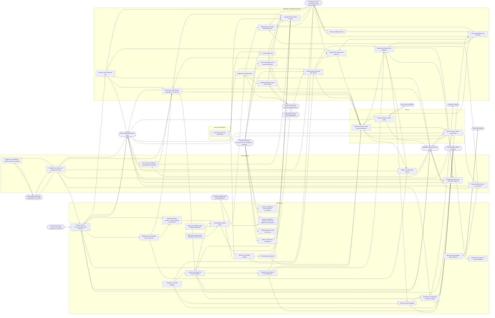

# Provincial public-sector asset manager for multiple client institutions (pooled funds, cost recovery)

`public-asset-manager` · Public sector institutional asset management · modelled on public information about An Ontario public-sector investment manager that serves several public pension and insurance clients (name withheld), public information for 2019 to 2022

This organisation is a provincial public-sector asset manager that invested about $79 billion at the end of 2021 for a handful of public bodies: a public service pension plan, a judges' pension plan, a jointly sponsored workplace pension trust and a workers' compensation insurance board with two funds. Each client keeps its own statement of investment policies and asset mix; the manager advises on that mix, then carries it out through pooled funds in which clients hold units and through segregated holdings, mainly private assets that were not yet pooled. It earns no profit: as a not-for-profit, non-share capital corporation it budgets its costs each year and recovers them from clients through cost allocation statements. Internal teams run public equities, fixed income, credit, total portfolio overlays and private market deals, but much of the money sits with about 120 external managers and private fund general partners, so manager selection and monitoring, capital calls and quarterly valuations are large workloads. About 240 staff in one Toronto office work in divisions for investments, client relations, investment risk, operations and technology, finance, and legal and compliance, plus human resources, communications, internal audit and an executive office with the board secretariat. It reports to each client separately every month and quarter, publishes an annual report to the Minister of Finance and the public, and is governed by a board partly appointed by the Minister and partly elected by its client members.

| | |
|---|---|
| Employees | 242 |
| Country | Canada (Ontario) |
| Ownership | Member-based, not-for-profit, non-share capital corporation created by the manager's governing act, 2015; members are its client institutions; operates on a cost recovery basis at arm's length from government |
| Regulators | Ontario Ministry of Finance (The model manager Act, 2015 and its regulation; appoints one to three directors; receives the annual report), Ontario Securities Commission (securities law as it applies to the pools and trading), Canada Revenue Agency (tax filings of the model manager and the pools), Clients' own regulators apply indirectly through client investment policies (pension regulator for pension plan clients) |
| Assets under management, end 2021 | 79,000,000,000 CAD (A) |
| Assets under management, end 2020 | 73,300,000,000 CAD (A) |
| Assets under management, end 2022 | 73,300,000,000 CAD (A) |
| Net investments, end 2021 | 76,700,000,000 CAD (A) |
| Public equity pools, end 2021 | 25,200,000,000 CAD (A) |
| Infrastructure pool, end 2022 | 8,400,000,000 CAD (A) |
| Client institutions, 2021 | 4 clients (B) |
| Client portfolios, 2021 | 5 portfolios (B) |
| Investment pools in operation, end 2021 | 4 pools (A) |
| External managers, end 2020 | 124 managers (A) |
| Direct and co-investment transactions, 2021 | 35 transactions per year (A) |
| Shareholder meetings voted, 2020 | 4,177 meetings per year (A) |
| Investment management cost savings delivered to clients, 2021 | 20,000,000 CAD per year (A) |
| Offices | 1 sites (A) |
| Employees, 2021 | 242 people (C) |
| Operating costs recovered from clients, excluding external manager fees, 2021 | 100,000,000 CAD per year (C) |
| Total cost, 2025 (outside reference period) | 62 basis points of assets (A) |
| Costs recovered from clients, 2021 | 216,615,000 CAD (A) |

## Units

- **Executive office and board secretariat** (11 people, division): Supports the chief executive, leads strategy and business planning, handles relations with the Ministry of Finance and runs board, committee and members' meetings.
  - **Office of the CEO and strategy** (8 people, team): Chief of staff, strategy and enterprise project office, and executive assistants for the executive team.
  - **Board secretariat** (2 people, team): Prepares board and committee meetings, keeps minutes and governance records and runs the annual members' meeting and director elections.
- **Investments** (90 people, division): Led by the chief investment officer. Designs client asset mixes, runs the pools and strategies and selects external managers and private market partners.
  - **Total portfolio management** (14 people, department): Portfolio design and construction for each client, capital market assumptions, rebalancing, liquidity, currency and derivative overlays.
    - **Portfolio construction and asset mix advice** (6 people, team): Works with each client's board, staff and actuary on asset-liability studies and recommends strategic asset allocations; sets capital market assumptions.
    - **Total portfolio management and rebalancing** (7 people, team): Keeps each client portfolio within its asset mix ranges, forecasts liquidity, and runs active asset allocation, dynamic currency and leverage overlays.
  - **Equities and credit** (36 people, department): Public equities, fixed income, public market alternatives, global credit and the trading desk under a senior managing director.
    - **Public equities** (10 people, team): Runs the Canadian, global and emerging markets public equity pools through internal factor, index and fundamental strategies and external mandates.
    - **Fixed income and money markets** (6 people, team): Manages government bond and money market portfolios used for liability matching, liquidity and rebalancing.
    - **Public market alternatives** (6 people, team): Runs the public market alternatives pool of hedge fund and alternative strategies, mostly through external managers.
    - **Global credit (public and private credit)** (9 people, team): Manages one global credit portfolio across private direct lending, structured and real asset credit and public bonds and loans, with internal decisions and external partners.
    - **Public markets trading desk** (4 people, team): Executes orders from internal portfolio managers, pool rebalancing and overlays with brokers and dealers.
  - **Private markets** (28 people, department): Private equity, real estate and infrastructure teams that make fund commitments, co-investments and direct investments and manage the holdings.
    - **Private equity** (9 people, team): Commits to buyout funds and co-invests alongside general partners.
    - **Real estate** (10 people, team): Holds direct properties with operating partners, co-investments and funds, and manages development and disposals.
    - **Infrastructure** (9 people, team): Makes direct and partnered infrastructure investments and fund commitments; manages the infrastructure pool from 2022.
  - **External manager research** (5 people, team): Screens, diligences and monitors external public market managers and supports operational due diligence on private fund managers.
  - **Responsible investing** (4 people, team): Proxy voting, company engagement, ESG due diligence support and climate reporting.
- **Client relations** (9 people, division): Led by the chief client officer. Manages each client relationship, new client development and onboarding, client reporting and client service.
  - **Client relationship management** (4 people, team): One relationship lead per client, presents quarterly results to client boards, leads proposals to prospective clients and onboarding.
  - **Client reporting and service** (4 people, team): Takes in client cash instructions, produces monthly reports and answers client service requests.
- **Investment risk** (18 people, division): Led by the chief risk officer. Measures and reports risk for every pool and client portfolio, reviews new investments independently and runs enterprise risk.
  - **Portfolio risk and analytics** (9 people, team): Daily risk measurement, limit monitoring against board limits and client policy ranges, stress testing and risk reporting.
  - **Investment risk oversight** (5 people, team): Independent risk review of private investments, fund commitments and mandates; counterparty and credit exposure limits.
  - **Enterprise and operational risk** (3 people, team): Risk register, risk and control self-assessments, incident logging and business continuity.
- **Operations, technology and data** (68 people, division): Led by a chief operating officer. Runs investment operations for pools, client portfolios and mandates, and the firm's technology and data.
  - **Investment operations** (39 people, department): Trade support and settlement, cash and collateral, reconciliations and corporate actions, pool unit pricing and transfer agency, private markets operations, valuations, performance and investment data.
    - **Trade support and settlements** (6 people, team): Confirms trades with brokers, releases settlement instructions to the custodian and resolves failed settlements; onboards counterparties operationally.
    - **Cash, collateral and treasury operations** (4 people, team): Daily cash positioning and funding across pool, client and mandate accounts, wires, and derivative margin and collateral.
    - **Reconciliations and corporate actions** (5 people, team): Daily reconciliation of positions and cash with the custodian, managers and counterparties, and processing of corporate actions.
    - **Pool unit pricing and transfer agency** (4 people, team): Approves pool net asset values and unit prices and keeps the unitholder register for subscriptions, redemptions and switches.
    - **Private markets operations** (6 people, team): Processes capital calls and distributions, sets up commitments and holdings and keeps the private markets system current.
    - **Valuations** (4 people, team): Quarterly valuation of private holdings from general partner statements, appraisals and models; supports the valuation committee.
    - **Performance measurement and attribution** (5 people, team): Calculates returns and attribution for client portfolios, pools, strategies and mandates.
    - **Investment data management** (4 people, team): Security master, prices, benchmark and reference data, and data quality controls.
  - **Technology and data** (28 people, department): Business applications, infrastructure and security, and data engineering for a firm that bought software as a service rather than inheriting legacy systems.
    - **Investment and business applications** (12 people, team): Business systems analysis, configuration and integration of investment, accounting and corporate applications; change and project delivery.
    - **Infrastructure, end-user services and security** (8 people, team): Service desk, devices, network, cloud services, access management and cyber security.
    - **Data engineering and reporting** (7 people, team): Data warehouse, data feeds and business intelligence reports used by client reporting, risk and performance.
- **Finance** (20 people, division): Led by the chief financial officer. Investment and corporate accounting, financial reporting, budgeting, cost allocation and client billing, tax and procurement.
  - **Investment accounting (pools and client portfolios)** (6 people, team): Monthly close of pools and client portfolios, external manager fee validation and client year-end audit support.
  - **Financial reporting and corporate accounting** (4 people, team): The model manager's corporate books, accounts payable and audited financial statements for the model manager and its pools.
  - **Financial planning, cost allocation and client billing** (4 people, team): Annual cost budget, monthly allocation of costs to clients and pools, quarterly cost statements and invoices.
  - **Tax** (2 people, team): Tax filings and allocations for the pools, foreign withholding tax recovery and deal tax structuring.
  - **Procurement and vendor management** (3 people, team): Competitive sourcing, vendor due diligence and contract set-up.
- **Legal and compliance** (11 people, division): Led by the general counsel and corporate secretary. Investment and corporate legal work, regulatory and investment compliance.
  - **Legal services** (6 people, team): Negotiates fund, co-investment, manager, counterparty and client agreements and supports closings.
  - **Compliance** (4 people, team): Investment guideline compliance monitoring, code of conduct and personal trading, and regulatory filings.
- **Human resources** (8 people, department): Recruitment, onboarding, performance and pay, payroll and benefits.
  - **Talent acquisition and HR business partnering** (3 people, team): Runs hiring and onboarding for a fast-growing firm.
  - **Total rewards and HR operations** (4 people, team): Compensation cycle, payroll, benefits and HR records.
- **Corporate communications** (4 people, department): Annual report, results releases, media relations, website and stakeholder communications.
- **Internal audit** (3 people, department): Independent assurance over controls, reporting to the board's audit committee.

## Demand drivers

| Driver | Per month | Unit | Evidence |
|---|---:|---|---|
| Client portfolios under management | 5 | client portfolios | B [src2], [src19], [src31], [src32] |
| Client contribution and withdrawal instructions | 16 | instructions | C [src32] |
| Investment pools in operation | 4 | pools | A [src1], [src3], [src6] |
| Pool unit subscriptions, redemptions and switches | 45 | unit transactions | C |
| Internally generated public market orders | 900 | orders | C |
| Trades processed by investment operations | 1,600 | trade allocations | C |
| External manager mandates | 124 | mandates | A [src2] |
| External manager hires and terminations | 3 | roster changes | B [src2], [src3] |
| New private fund commitments | 1.3 | commitments | B [src1], [src2], [src3] |
| Direct and co-investment transactions closed | 3 | transactions | A [src1] |
| Capital call and distribution notices | 100 | notices | C |
| Private holdings valued each quarter (average per month) | 100 | holdings per month | C |
| Business days | 21 | days | C |
| Shareholder meetings voted | 348 | meetings | A [src2] |
| Employees | 242 | employees | C [src7], [src24] |
| New hires | 5 | hires | C [src7], [src24] |
| Corporate vendor invoices | 250 | invoices | C |
| Client service requests | 25 | requests | C |
| Board and committee meetings | 2 | meetings | C [src21] |
| IT service tickets | 400 | tickets | C |
| IT change requests | 35 | changes | C |
| Personal trading pre-clearances and attestations | 150 | requests | C |

## How the core processes connect

## Process map

### Executive office and board secretariat

| Process | Owner | Type | Unit of work | Per month | Priority | Receives from | Sends to |
|---|---|---|---|---:|---:|---|---|
| **Prepare and run board and committee meetings.** The board of seven to eleven directors and its committees, typically audit, investment, risk, human resources and governance, meet on a quarterly cycle plus special meetings for large investments. The secretariat sets agendas with the chair and CEO, collects and checks management papers, publishes them on the board portal, records minutes and decisions and tracks actions. Paper deadlines create a monthly crunch for management. | Board secretariat | management | one board or committee meeting | 2 | 2 | Approve investments at the investment committee, Hold the members' meeting and director elections, Manage enterprise and operational risk, Measure performance and attribution, Prepare and audit annual financial statements, Prepare the annual cost budget, Report risk and run stress tests, Run code of conduct, personal trading and attestations, Run internal audit engagements, Run performance reviews and incentive pay, Set the annual investment plan and strategy benchmarks, Set the strategic and business plan, The model manager Board of Directors and committees | Launch a new investment pool, Run internal audit engagements, Run performance reviews and incentive pay, Set the annual investment plan and strategy benchmarks, Set the strategic and business plan, The model manager Board of Directors and committees |
| **Hold the members' meeting and director elections.** The model manager is a member-based corporation whose members are its clients. Each year the secretariat runs the members' meeting, collects nominations from members, such as the two individuals the pension client may designate, and records the election of the six to eight member-elected directors who sit beside up to three directors appointed by the Minister of Finance. | Board secretariat | management | one annual members' meeting | 0.083 | 3 | Public sector pension plan client, Workplace insurance board client | Prepare and run board and committee meetings, The model manager Board of Directors and committees |
| **Report to and work with the Ministry of Finance.** The model manager operates at arm's length from government but sends its annual report to the Minister of Finance and works with the Ministry on regulations, for example when a regulation change is needed before a new type of public body can become a client, and on ministerial board appointments. The CEO's office coordinates these exchanges with legal. | Office of the CEO and strategy | management | one submission to the Ministry | 0.4 | 3 | Ontario Ministry of Finance, Publish the annual report and results, Respond to a prospective client's request for proposal | Onboard a new client and transition its assets, Ontario Ministry of Finance |
| **Set the strategic and business plan.** The CEO's office leads the multi-year strategic plan and the annual business plan: client growth, investment capability build, internal versus external management, technology and people priorities and cost targets. Executives draft initiatives, the board approves and the strategy team tracks progress quarterly. A five-year plan for 2023 to 2027 was approved in 2022. | Office of the CEO and strategy | management | one annual plan update | 0.083 | 3 | Prepare and run board and committee meetings, Set capital market assumptions | Deliver technology projects, Prepare and run board and committee meetings, Prepare the annual cost budget |

### Investments

| Process | Owner | Type | Unit of work | Per month | Priority | Receives from | Sends to |
|---|---|---|---|---:|---:|---|---|
| **Make a private fund commitment.** Teams commit to private equity, infrastructure, real estate and private credit funds run by general partners; in 2021 private equity alone made four new commitments totalling $1.5 billion. The work covers reviewing the offering memorandum and data room, reference calls, operational due diligence, fee and term analysis, an investment memo, negotiating the partnership agreement and side letter, and deciding which pool or client accounts take the commitment. Most private assets sat in segregated client accounts in the period, so each commitment is split among the clients whose asset mix needs it. | Private markets | core | one fund commitment | 1.3 | 1 | Private fund general partners and co-investment sponsors, Set the annual investment plan and strategy benchmarks | Approve investments at the investment committee, Negotiate investment legal agreements, Review new investments and mandates for risk |
| **Monitor external managers.** Each month the manager research team and asset class portfolio managers review every external mandate's returns against benchmark, risk, positioning, guideline compliance and organisational changes, with deeper quarterly meetings and an annual operational due diligence refresh. Managers that underperform or lose key staff go on a watch list and the team recommends keeping, resizing or terminating. With over one hundred mandates, keeping reviews current is a constant load. | External manager research | core | one monthly review of one external mandate | 124 | 1 | External public market managers, Measure performance and attribution, Monitor investment compliance, Onboard an external manager | Set the annual investment plan and strategy benchmarks, Terminate a manager and transition its assets |
| **Rebalance client portfolios to their asset mix.** Market moves, cash flows and private market calls and distributions pull each client portfolio away from its approved asset mix. The total portfolio team checks every client's weights against targets and ranges, nets client flows where it can, and decides how to rebalance: switching units between pools, adjusting segregated holdings, or using futures and currency overlays when private assets cannot be traded. Each client's mix is different, so one market move creates several separate rebalancing decisions. | Total portfolio management and rebalancing | core | one client portfolio rebalancing review | 5 | 1 | Forecast liquidity for each client portfolio, Measure risk and monitor limits daily, Review a client's investment policy and asset mix | Manage derivative overlays, currency hedges and leverage, Process pool subscriptions, redemptions and switches, Produce monthly client reports |
| **Review a client's investment policy and asset mix.** Each client keeps its own asset mix and approves its own statement of investment policies. At least once a year, and in a fuller asset-liability study about every four years, the portfolio construction team works with the client's staff, actuary and board to test the current mix against liabilities, capital market assumptions and stress scenarios, and recommends a strategic asset allocation with ranges. Once the client's board approves, the new targets, ranges, benchmarks and restrictions are loaded into rebalancing, risk, compliance and performance. | Portfolio construction and asset mix advice | core | one client portfolio's policy and asset mix review | 0.45 | 1 | Client actuaries and investment consultants, Onboard a new client and transition its assets, Public sector pension plan client, Report risk and run stress tests, Set capital market assumptions, Workplace insurance board client | Launch a new investment pool, Manage derivative overlays, currency hedges and leverage, Measure performance and attribution, Measure risk and monitor limits daily, Monitor investment compliance, Public sector pension plan client, Rebalance client portfolios to their asset mix, Report risk and run stress tests, Review new investments and mandates for risk, Workplace insurance board client |
| **Search for and select an external manager.** When the investment plan calls for a new or replacement mandate, the manager research team screens candidates, sends due diligence questionnaires, meets shortlisted firms and runs investment and operational due diligence on process, people, track record, fees and controls. The asset class team writes a recommendation, risk gives an independent view and the investment committee approves. A search typically takes three to six months and fees and terms are negotiated before onboarding. | External manager research | core | one manager search | 1.5 | 1 | External public market managers, Set the annual investment plan and strategy benchmarks | Approve investments at the investment committee, Negotiate investment legal agreements, Review new investments and mandates for risk |
| **Approve investments at the investment committee.** The internal investment committee, chaired by the CIO with the CEO and chief risk officer, reviews memos for direct investments, fund commitments, new external mandates, follow-ons and exits above team authority. The investment office circulates papers, records decisions and conditions and tracks delegated limits; deals above the CEO's authority go to the board. Committee dates set the pace for deal teams facing seller deadlines. | Investments | management | one investment committee submission | 8 | 2 | Make a private fund commitment, Review new investments and mandates for risk, Screen and diligence infrastructure and real estate direct investments, Screen and diligence private equity co-investments, Search for and select an external manager, Sell a private investment, Underwrite private credit investments | Close and fund private investments, Onboard an external manager, Prepare and run board and committee meetings, Sell a private investment |
| **Execute public market trades.** Traders work orders from internal portfolio managers, pool rebalancing and the total portfolio overlay through approved brokers and dealer platforms, choosing between program, block, request-for-quote and algorithmic execution. They record fills and allocate executions across pools and client accounts in the order management system. Best execution reviews and counterparty limits constrain which brokers can be used. | Public markets trading desk | core | one order executed | 900 | 2 | Invest or raise pool cash across mandates, Make internal fixed income and public credit decisions, Make internal public equity investment decisions, Manage derivative overlays, currency hedges and leverage, Onboard a broker or derivative counterparty | Brokers, dealers and derivative counterparties, Capture and confirm trades |
| **Forecast liquidity for each client portfolio.** Each week the total portfolio team rolls forward a cash and liquidity forecast for every client portfolio and pool: expected client flows, capital calls on unfunded commitments, distributions, margin and settlement needs. It tests whether liquid assets cover stressed outflows and flags any client at risk of becoming a forced seller. The forecast depends on uncertain call timing from general partners and on clients warning the model manager early about large payments. | Total portfolio management and rebalancing | management | one weekly liquidity forecast across all portfolios | 4.3 | 2 | Manage daily cash and funding, Process capital calls, Process distributions from private investments, Subscribe to and redeem from hedge funds, Take in client contribution and withdrawal instructions | Manage derivative overlays, currency hedges and leverage, Rebalance client portfolios to their asset mix, Report risk and run stress tests, Review new investments and mandates for risk |
| **Invest or raise pool cash across mandates.** When net subscriptions or redemptions hit a pool, its portfolio managers invest or raise the cash across the pool's internal strategies and external manager mandates so the pool stays at its target allocations and within its guidelines. They decide which mandates to fund or draw from, send orders for internal sleeves and cash notices to external managers. Large same-day redemptions from several clients make this harder. | Public equities | core | one pool cash deployment or raise | 16 | 2 | Onboard an external manager, Process pool subscriptions, redemptions and switches, Terminate a manager and transition its assets | Execute public market trades, External public market managers, Manage daily cash and funding, Subscribe to and redeem from hedge funds |
| **Make internal fixed income and public credit decisions.** Fixed income and global credit portfolio managers run government bond, money market and public credit portfolios used for liability matching, liquidity and return. They set duration and curve positions against each portfolio's benchmark, pick bonds and loans, and send orders to the desk, often as request-for-quote trades with dealers. Liquidity needs from client withdrawals and capital calls are met first from these portfolios. | Fixed income and money markets | core | one fixed income or credit order | 300 | 2 | Maintain security, price and reference data, Monitor investment compliance, Set the annual investment plan and strategy benchmarks | Execute public market trades |
| **Make internal public equity investment decisions.** Internal portfolio managers run factor, index, fundamental and portfolio completion strategies inside the public equity pools. They review models, research and limits, decide trades and enter orders in the order management system, where pre-trade compliance checks guidelines. Order volume rises at month end, at index changes and when pools receive flows. | Public equities | core | one equity order | 600 | 2 | Maintain security, price and reference data, Monitor investment compliance, Set the annual investment plan and strategy benchmarks | Execute public market trades |
| **Manage derivative overlays, currency hedges and leverage.** The total portfolio team uses futures, currency forwards and swaps to rebalance quickly, hedge foreign currency to each client's policy and, from 2022, apply leverage at the total portfolio level. It sizes each client's overlay, checks counterparty and margin capacity and sends orders to the trading desk. Rolling contracts and keeping overlays in line with changing client weights is steady daily work. | Total portfolio management and rebalancing | core | one overlay adjustment | 30 | 2 | Forecast liquidity for each client portfolio, Market data and index providers, Rebalance client portfolios to their asset mix, Review a client's investment policy and asset mix | Execute public market trades |
| **Onboard an external manager.** Once a manager is approved, legal finalises the management agreement and guidelines, operations opens the custody account, sets up data feeds, settlement instructions and reconciliation, compliance codes the guidelines into monitoring rules and finance loads the fee schedule. The account is then funded from the pool or client account. Gaps between the legal guidelines and the coded rules are a common source of later breaches. | External manager research | core | one new external mandate | 1.5 | 2 | Approve investments at the investment committee, Negotiate investment legal agreements | Custodian and fund accounting provider, External public market managers, Invest or raise pool cash across mandates, Monitor external managers, Monitor investment compliance, Validate and pay external manager fees |
| **Screen and diligence infrastructure and real estate direct investments.** Infrastructure and real estate teams source direct, joint venture and partnered deals such as take-privates, full acquisitions and development projects with operating partners. They screen fit, then run technical, market, regulatory, legal, tax and environmental due diligence with outside advisers, build long-term cash flow models and write an investment memo. Large deals are bid in auctions with partners, so work is lost when bids fail. | Infrastructure | core | one direct real asset opportunity taken into due diligence | 4 | 2 | Portfolio companies and operating partners, Private fund general partners and co-investment sponsors, Set the annual investment plan and strategy benchmarks | Approve investments at the investment committee, Negotiate investment legal agreements, Review new investments and mandates for risk |
| **Screen and diligence private equity co-investments.** The private equity team receives co-investment offers from its fund partners, usually with short deadlines and no fee or carry. It screens each against the investment plan, then for promising deals reviews the sponsor's diligence, adds its own work with outside advisers on the business, valuation, financing and ESG risks, models returns and writes an investment memo. In 2021 the team closed seven direct and co-investments totalling $800 million. | Private equity | core | one co-investment taken into due diligence | 3 | 2 | Private fund general partners and co-investment sponsors, Set the annual investment plan and strategy benchmarks | Approve investments at the investment committee, Negotiate investment legal agreements, Review new investments and mandates for risk |
| **Set the annual investment plan and strategy benchmarks.** Each year every asset class team writes a plan: target size, pacing of private commitments, internal versus external split, manager changes, new pools and the benchmark and risk budget for each strategy. The CIO, risk and finance check the plans against capital market assumptions, clients' asset mixes and the cost budget, and the board approves the consolidated plan. Benchmarks set here drive performance measurement and incentive pay, so changes are contested. | Investments | management | one asset class strategy plan | 0.75 | 2 | Monitor external managers, Prepare and run board and committee meetings, Set capital market assumptions | Launch a new investment pool, Make a private fund commitment, Make internal fixed income and public credit decisions, Make internal public equity investment decisions, Measure risk and monitor limits daily, Prepare and run board and committee meetings, Review new investments and mandates for risk, Screen and diligence infrastructure and real estate direct investments, Screen and diligence private equity co-investments, Search for and select an external manager, Underwrite private credit investments |
| **Terminate a manager and transition its assets.** When a mandate is terminated or a new client's legacy managers are replaced, the team plans the transition: notice to the manager, choice between in-kind transfer, liquidation or a transition manager, a cost estimate and reallocation to target mandates or internal strategies. Operations closes the account after final fees and residual cash are settled. The model manager cut its roster from 200 to 124 managers in 2020, so transitions were frequent in the period. | External manager research | core | one mandate termination or transition | 1.5 | 2 | Monitor external managers, Onboard a new client and transition its assets | External public market managers, Invest or raise pool cash across mandates, Transition manager |
| **Underwrite private credit investments.** The global credit team underwrites direct lending co-investments, loan participations and separately managed private credit accounts with strategic partners. It reviews the borrower, structure, covenants and collateral, compares terms with public credit, sizes the position for the single global credit portfolio and writes a credit memo. After funding it monitors covenants and amendments through the partner. | Global credit (public and private credit) | core | one private credit opportunity taken into due diligence | 3 | 2 | Private fund general partners and co-investment sponsors, Set the annual investment plan and strategy benchmarks | Approve investments at the investment committee, Negotiate investment legal agreements, Review new investments and mandates for risk |
| **Monitor direct private holdings.** Deal teams monitor direct and co-investments and real estate held with operating partners: they review quarterly results and budgets, attend boards where the model manager has a seat, approve major decisions such as refinancing or capital spending and flag problems. Monitoring reports inform valuations and exit decisions. | Real estate | core | one quarterly review of one direct holding | 20 | 3 | Close and fund private investments, Portfolio companies and operating partners | Sell a private investment, Value private investments each quarter |
| **Sell a private investment.** When a holding meets its plan or no longer fits, the team prepares a sale: picks advisers, runs a sale process or negotiates with partners, gets committee approval and closes, with operations booking proceeds across owning accounts. In 2020 the model manager sold 12 properties worth about $648 million. | Private markets | core | one exit or partial sale | 1 | 3 | Approve investments at the investment committee, Monitor direct private holdings | Approve investments at the investment committee, Close the books for pools and client portfolios, Manage daily cash and funding |
| **Set capital market assumptions.** Once a year the portfolio construction and research team updates long-term expected returns, volatilities and correlations for each asset class and risk factor from economic research and market data, and publishes a house view. The CIO challenges and approves them, and they drive asset mix advice for every client, the investment plan and the strategic plan. Changes must be explained to clients whose recommended mix shifts. | Portfolio construction and asset mix advice | management | one annual set of assumptions | 0.083 | 3 | Market data and index providers | Review a client's investment policy and asset mix, Set the annual investment plan and strategy benchmarks, Set the strategic and business plan |
| **Subscribe to and redeem from hedge funds.** The public market alternatives pool holds hedge funds and alternative funds that deal monthly or quarterly with notice periods and possible gates. When the pool needs to add or raise cash, the team decides which funds to use, sends subscription or redemption forms before the notice deadline, and tracks acknowledgements and settlement, which for redemptions can come weeks after the dealing date with a holdback until the fund's audit. Notice periods make this the slowest source of liquidity in the pools. | Public market alternatives | core | one fund subscription or redemption | 6 | 3 | Invest or raise pool cash across mandates | Close the books for pools and client portfolios, External public market managers, Forecast liquidity for each client portfolio, Manage daily cash and funding |
| **Vote proxies and engage with companies.** The model manager votes the shares it holds for clients at company meetings under its voting guidelines. The responsible investing team receives ballots and research through a proxy advisor platform, reviews contentious items such as director elections, pay and climate proposals, records votes and engages selected companies. Voting peaks from April to June and results feed client and public stewardship reporting. | Responsible investing | core | one shareholder meeting voted | 348 | 3 | Proxy voting advisor | Proxy voting advisor, Publish the annual report and results, Report quarterly to each client's board |

### Client relations

| Process | Owner | Type | Unit of work | Per month | Priority | Receives from | Sends to |
|---|---|---|---|---:|---:|---|---|
| **Onboard a new client and transition its assets.** After a client signs an investment management agreement, a cross-functional team maps its investment policy to the model manager's pools and strategies, opens custody and client accounts, sets up reporting, cost allocation and compliance rules, and moves the legacy portfolio. Legacy managers are kept, terminated or transitioned and assets move into pools in kind where possible. The hard parts are timing the transfer around market risk, legacy private holdings that cannot move, and agreeing day-one positions and values with the old custodian. | Client relationship management | core | one new client portfolio | 0.08 | 1 | Other eligible public body (prospective or new client), Report to and work with the Ministry of Finance, Respond to a prospective client's request for proposal | Allocate costs to clients and bill them, Custodian and fund accounting provider, Monitor investment compliance, Other eligible public body (prospective or new client), Process pool subscriptions, redemptions and switches, Public sector pension plan client, Review a client's investment policy and asset mix, Terminate a manager and transition its assets |
| **Produce monthly client reports.** Each month, after pools and portfolios are closed and performance is approved, client reporting builds a package for each client portfolio: market values by pool and asset class, units held, returns against benchmarks, asset mix against policy ranges, cash flows, rebalancing done and compliance with the client's investment policy. Analysts reconcile figures across accounting, performance and risk sources, the manager reviews and the relationship manager releases it. Late private market values and performance restatements are the usual causes of delay. | Client reporting and service | core | one client portfolio's monthly report | 5 | 1 | Close the books for pools and client portfolios, Measure performance and attribution, Monitor investment compliance, Rebalance client portfolios to their asset mix, Report risk and run stress tests, Run data warehouse loads and reporting data sets | Public sector pension plan client, Workplace insurance board client |
| **Report quarterly to each client's board.** Each quarter the model manager prepares a fuller report and presentation for each client's investment committee or board: total fund and asset class performance including private markets on quarter-end values, risk and stress tests, liquidity, compliance, costs charged, stewardship and outlook. Relationship managers, portfolio construction and risk staff present it at the client's meeting and log follow-up questions. The lag on private valuations means the report goes out six to ten weeks after quarter end. | Client relationship management | core | one client portfolio's quarterly report and presentation | 1.67 | 1 | Allocate costs to clients and bill them, Measure performance and attribution, Report risk and run stress tests, Run data warehouse loads and reporting data sets, Vote proxies and engage with companies | Public sector pension plan client, Workplace insurance board client |
| **Take in client contribution and withdrawal instructions.** Clients send instructions when they have cash to invest, such as pension contributions or insurance premiums, or need cash to pay pensions and benefits. Client service checks the instruction against authorised signers and a call-back list, confirms amount and value date, and turns it into pool subscriptions or redemptions and segregated account cash moves that follow the client's current asset mix and liquidity plan. Late or changed instructions and large same-day withdrawals cause most of the rework. | Client reporting and service | core | one client cash instruction | 16 | 1 | Public sector pension plan client, Workplace insurance board client | Forecast liquidity for each client portfolio, Manage daily cash and funding, Process pool subscriptions, redemptions and switches |
| **Handle client service and information requests.** Clients ask for holdings for their financial statements, data for actuarial valuations, analysis for a board meeting, explanations of returns or costs, and answers for their regulators. Client service logs each request, routes analysis to performance, risk or finance, reviews the answer and sends it within the agreed service level. Requests cluster around client board cycles and year end. | Client reporting and service | core | one client request | 25 | 2 | Measure performance and attribution, Public sector pension plan client, Report risk and run stress tests, Run data warehouse loads and reporting data sets, Workplace insurance board client | Measure performance and attribution, Public sector pension plan client, Report risk and run stress tests, Workplace insurance board client |
| **Respond to a prospective client's request for proposal.** An eligible public body reviewing how its fund is managed sends a request for proposal or asks for a presentation. The client relationship team leads a response with portfolio construction, finance, legal and the CEO covering an illustrative asset mix, the pools available, the cost recovery approach and reporting. Sales cycles are long because prospects' boards decide slowly and some types of body need a regulation change before they can join. | Client relationship management | core | one proposal to a prospective client | 0.2 | 3 | Other eligible public body (prospective or new client) | Onboard a new client and transition its assets, Other eligible public body (prospective or new client), Report to and work with the Ministry of Finance |

### Investment risk

| Process | Owner | Type | Unit of work | Per month | Priority | Receives from | Sends to |
|---|---|---|---|---:|---:|---|---|
| **Measure risk and monitor limits daily.** Each day the risk team loads reconciled positions, prices and benchmarks into the risk system, calculates active risk, value at risk, factor and currency exposures, leverage and liquidity for every pool and client portfolio, and checks them against board limits and each client's policy ranges. Breaches and near breaches go to the CIO and portfolio managers with a required action and date. Private assets are represented by public proxies, a known weakness. | Portfolio risk and analytics | management | one business day's risk run | 21 | 1 | Maintain security, price and reference data, Reconcile positions and cash daily, Review a client's investment policy and asset mix, Set the annual investment plan and strategy benchmarks | Public sector pension plan client, Rebalance client portfolios to their asset mix, Report risk and run stress tests, The model manager Board of Directors and committees |
| **Report risk and run stress tests.** Monthly the risk team produces risk reports for each client portfolio and the CIO, and quarterly for the board and client boards: exposures, active risk use, limit status, liquidity coverage, counterparty exposure and stress tests such as an inflation shock or equity crash. Analysts check the numbers, write commentary and answer client questions. Each client wants its own format, which multiplies the work. | Portfolio risk and analytics | management | one monthly risk report pack | 6 | 2 | Forecast liquidity for each client portfolio, Handle client service and information requests, Maintain security, price and reference data, Measure risk and monitor limits daily, Monitor counterparty exposure, Review a client's investment policy and asset mix, Run data warehouse loads and reporting data sets | Handle client service and information requests, Prepare and run board and committee meetings, Produce monthly client reports, Report quarterly to each client's board, Review a client's investment policy and asset mix |
| **Review new investments and mandates for risk.** Before the investment committee decides on a direct investment, fund commitment or new mandate, the investment risk team reviews the memo independently: concentration, leverage, liquidity, currency, fit with risk budgets, key person and counterparty risk and stress scenarios. Its written opinion goes into the committee paper. Tight deal timelines often leave little time for the review. | Investment risk oversight | management | one risk review | 8 | 2 | Forecast liquidity for each client portfolio, Make a private fund commitment, Review a client's investment policy and asset mix, Screen and diligence infrastructure and real estate direct investments, Screen and diligence private equity co-investments, Search for and select an external manager, Set the annual investment plan and strategy benchmarks, Underwrite private credit investments | Approve investments at the investment committee |
| **Manage enterprise and operational risk.** The enterprise risk team keeps the risk register, runs quarterly risk and control self-assessments with each department, logs operational incidents such as unit pricing or payment errors, tracks fixes, tests business continuity plans and reports to the board. In 2020 the business continuity program moved all staff to remote work. | Enterprise and operational risk | management | one incident or risk assessment | 6 | 3 | Calculate and approve pool unit prices, Manage IT changes and releases, Reconcile positions and cash daily, Run internal audit engagements, Run the IT service desk and access management | Prepare and run board and committee meetings, Run internal audit engagements |
| **Monitor counterparty exposure.** Weekly, and daily in stressed markets, the investment risk team measures exposure to each derivative counterparty, broker and the custodian net of collateral, compares it with credit limits and recommends limit cuts or extra collateral. Results feed the monthly risk report. | Investment risk oversight | management | one weekly counterparty review | 4.3 | 3 | Manage derivative margin and collateral, Onboard a broker or derivative counterparty | Report risk and run stress tests |

### Operations, technology and data

| Process | Owner | Type | Unit of work | Per month | Priority | Receives from | Sends to |
|---|---|---|---|---:|---:|---|---|
| **Calculate and approve pool unit prices.** For each pool and valuation date the custodian produces a net asset value from priced holdings, accruals and expenses, and the model manager's unit pricing team checks it: price moves against tolerances, stale or missing prices, accruals, cost recovery charges, private holding values and units outstanding from the register. The approved net asset value divided by units in issue gives the unit price used for subscriptions, redemptions and client values. A wrong price affects every client in the pool and must be corrected and compensated, so checks are strict. | Pool unit pricing and transfer agency | core | one pool unit price for one valuation date | 84 | 1 | Custodian and fund accounting provider, Launch a new investment pool, Maintain security, price and reference data, Reconcile positions and cash daily, Value private investments each quarter | Close the books for pools and client portfolios, Manage enterprise and operational risk, Process pool subscriptions, redemptions and switches |
| **Measure performance and attribution.** After month end the performance team calculates time-weighted returns net of costs for every client portfolio, pool, asset class, strategy and external mandate, compares them with benchmarks and explains the difference through allocation and selection attribution. Private assets are updated when quarterly values arrive, which restates earlier months. Results are reconciled to accounting, approved and released to client reporting, investment teams and the board. | Performance measurement and attribution | core | one monthly performance cycle for one client portfolio or pool | 9 | 1 | Close the books for pools and client portfolios, Handle client service and information requests, Maintain security, price and reference data, Reconcile positions and cash daily, Review a client's investment policy and asset mix, Value private investments each quarter | Handle client service and information requests, Monitor external managers, Prepare and run board and committee meetings, Produce monthly client reports, Publish the annual report and results, Report quarterly to each client's board, Run performance reviews and incentive pay |
| **Process capital calls.** General partners send capital call notices, usually with about ten business days' notice, stating amount, purpose and due date. Private markets operations checks each notice against the commitment, unfunded balance and partnership terms, splits it across the pools or client accounts that own the interest, records it, arranges funding and confirms payment. Notices arrive by email and portals in many formats, so validation and keying are manual. | Private markets operations | core | one capital call notice | 60 | 1 | Close and fund private investments, Private fund general partners and co-investment sponsors | Close the books for pools and client portfolios, Forecast liquidity for each client portfolio, Manage daily cash and funding |
| **Process pool subscriptions, redemptions and switches.** The transfer agency team processes each subscription, redemption and switch between pools: it checks the instruction is authorised and before the dealing cut-off, applies the unit price for the dealing date, issues or cancels units in the unitholder register, instructs the cash or in-kind transfer between client and pool accounts, and confirms units and values to the client. Pools have few but very large unitholders, so one error can move hundreds of millions of dollars between clients. | Pool unit pricing and transfer agency | core | one unit transaction | 45 | 1 | Calculate and approve pool unit prices, Launch a new investment pool, Onboard a new client and transition its assets, Rebalance client portfolios to their asset mix, Take in client contribution and withdrawal instructions | Close the books for pools and client portfolios, Invest or raise pool cash across mandates, Manage daily cash and funding, Public sector pension plan client, Workplace insurance board client |
| **Reconcile positions and cash daily.** Every business day the reconciliations team compares the model manager's book of record with the custodian, external managers and brokers and counterparties for positions, cash and derivatives across all pool, client and mandate accounts. A reconciliation tool matches most items automatically and analysts investigate breaks, assign them to trade support, cash or data teams and age them until resolved. Clean positions are released to pricing, risk, performance and accounting, so breaks delay everything downstream. | Reconciliations and corporate actions | core | one business day's reconciliation across all accounts | 21 | 1 | Custodian and fund accounting provider, External public market managers, Maintain security, price and reference data, Process corporate actions, Settle trades and resolve failed settlements | Calculate and approve pool unit prices, Close the books for pools and client portfolios, Manage enterprise and operational risk, Measure performance and attribution, Measure risk and monitor limits daily, Run data warehouse loads and reporting data sets, Settle trades and resolve failed settlements |
| **Settle trades and resolve failed settlements.** The custodian settles each instructed trade in the market. Trade support monitors pending and failed settlements across internal accounts and external manager accounts, chases brokers and the custodian to fix mismatches, claims compensation for late settlement and tells cash management about expected cash. Fails cluster in emerging markets and around wrong settlement instructions. | Trade support and settlements | core | one trade settlement | 1,600 | 1 | Capture and confirm trades, Custodian and fund accounting provider, Reconcile positions and cash daily | Custodian and fund accounting provider, Manage daily cash and funding, Reconcile positions and cash daily |
| **Value private investments each quarter.** Each quarter the valuations team values every private holding: fund interests from general partners' capital account statements, rolled forward for calls, distributions and market moves when statements arrive late, and direct investments and properties from independent appraisals or internal models checked against valuation policy. A valuation committee approves the set, which updates pool unit prices, client portfolio values and performance. Statements arrive 45 to 90 days after quarter end, so values are revised after first reporting. | Valuations | core | one private holding valued for a quarter | 100 | 1 | Close and fund private investments, Independent valuation firms and appraisers, Monitor direct private holdings, Private fund general partners and co-investment sponsors | Calculate and approve pool unit prices, Close the books for pools and client portfolios, Measure performance and attribution |
| **Capture and confirm trades.** Trade support checks every executed trade against the broker's confirmation in the matching service: security, quantity, price, commission, settlement date and settlement instructions. Unmatched or wrong trades are queried with the trader and broker, and matched trades are released to the custodian. Derivative trades are also confirmed and passed to collateral management and every trade feeds post-trade compliance. | Trade support and settlements | core | one trade allocation | 1,600 | 2 | Brokers, dealers and derivative counterparties, Execute public market trades | Manage derivative margin and collateral, Monitor investment compliance, Settle trades and resolve failed settlements |
| **Launch a new investment pool.** When the model manager decides to pool an asset class, a project team designs the pool's legal form, guidelines, unit classes and valuation policy, drafts trust and subscription documents with outside counsel, opens custody accounts, registers for tax and configures systems. On launch day clients' existing holdings move into the pool in kind at agreed values in exchange for units, and every client's records must agree. Public equity pools launched in 2020 and 2021, a public market alternatives pool in 2021 and the first private market pool, infrastructure, in 2022. | Investment operations | core | one new pool | 0.12 | 2 | Prepare and run board and committee meetings, Review a client's investment policy and asset mix, Set the annual investment plan and strategy benchmarks | Allocate pool income and file pool tax returns, Calculate and approve pool unit prices, Custodian and fund accounting provider, Manage IT changes and releases, Process pool subscriptions, redemptions and switches, Public sector pension plan client, Workplace insurance board client |
| **Maintain security, price and reference data.** The investment data team maintains the security master, prices, benchmark constituents and returns, exchange rates and account structures that every downstream process uses. It validates daily vendor prices against tolerances, chases missing or stale prices, sets up new securities and accounts and manages feed changes with technology. | Investment data management | support | one business day's data validation cycle | 21 | 2 | Manage IT changes and releases, Market data and index providers | Calculate and approve pool unit prices, Make internal fixed income and public credit decisions, Make internal public equity investment decisions, Manage IT changes and releases, Measure performance and attribution, Measure risk and monitor limits daily, Reconcile positions and cash daily, Report risk and run stress tests, Run data warehouse loads and reporting data sets |
| **Manage daily cash and funding.** Each morning the cash team projects cash in every pool, client and mandate account from settlements, unit transactions, capital calls, distributions, fees and client flows, then funds shortfalls, sweeps surpluses into money market holdings and books foreign exchange for settlements. Wires above set thresholds need two approvers and a call-back on new payment details. Late capital call notices and same-day client requests cause most exceptions. | Cash, collateral and treasury operations | core | one business day's cash cycle | 21 | 2 | Close and fund private investments, Invest or raise pool cash across mandates, Manage derivative margin and collateral, Process capital calls, Process distributions from private investments, Process pool subscriptions, redemptions and switches, Sell a private investment, Settle trades and resolve failed settlements, Subscribe to and redeem from hedge funds, Take in client contribution and withdrawal instructions, Validate and pay external manager fees | Custodian and fund accounting provider, Forecast liquidity for each client portfolio |
| **Process distributions from private investments.** Funds and direct holdings return cash as income, realised gains and return of capital, some of which can be recalled. The team matches each notice to cash received at the custodian, splits it across owning accounts, classifies it for accounting and tax and updates remaining commitments. Unannounced or poorly described distributions are the main exceptions. | Private markets operations | core | one distribution notice | 40 | 2 | Private fund general partners and co-investment sponsors | Close the books for pools and client portfolios, Forecast liquidity for each client portfolio, Manage daily cash and funding |
| **Deliver technology projects.** Multi-year programs replaced and upgraded front, middle and back office systems as the model manager built its own operations. Each project, such as pool accounting set-up, a private markets system or the data warehouse, passes stage gates for business case, vendor selection, design, build, testing and go-live, with business analysts working beside operations and investment users. | Investment and business applications | support | one project stage gate or release | 2 | 3 | Prepare the annual cost budget, Set the strategic and business plan | Manage IT changes and releases, Procure and onboard a vendor |
| **Manage IT changes and releases.** Changes to investment and corporate systems, such as set-up for a new pool, a new data feed, a vendor upgrade or a report change, are raised as change requests, assessed for risk, tested by business users, approved at a weekly change board and released in set windows. Emergency fixes follow a shorter path and are reviewed afterwards. | Investment and business applications | support | one change request | 35 | 3 | Deliver technology projects, Launch a new investment pool, Maintain security, price and reference data | Maintain security, price and reference data, Manage enterprise and operational risk |
| **Manage derivative margin and collateral.** For futures, forwards and swaps the collateral team agrees daily margin calls with clearing brokers and counterparties, checks exposure calculations, chooses eligible collateral, instructs movements and resolves disputes. Margin needs rise sharply in volatile markets and feed the liquidity forecast and counterparty exposure monitoring. | Cash, collateral and treasury operations | core | one margin call | 60 | 3 | Brokers, dealers and derivative counterparties, Capture and confirm trades | Brokers, dealers and derivative counterparties, Manage daily cash and funding, Monitor counterparty exposure |
| **Onboard a broker or derivative counterparty.** Before trading with a new broker or derivative counterparty, the model manager completes due diligence, credit approval by risk, legal agreements such as ISDA master agreements with collateral terms, and set-up of settlement instructions and connectivity. The approved counterparty is added to the order management system with limits. Negotiating collateral terms can take months. | Trade support and settlements | support | one new counterparty | 1 | 3 | Brokers, dealers and derivative counterparties, Negotiate investment legal agreements | Execute public market trades, Monitor counterparty exposure, Negotiate investment legal agreements |
| **Process corporate actions.** The custodian sends notices of dividends, splits, mergers, rights issues and tender offers on internally held securities. The analyst checks terms against a second source, asks the portfolio manager for elections on voluntary events, instructs the custodian before the deadline and checks entitlements are booked. Missed voluntary deadlines are costly and must be compensated. | Reconciliations and corporate actions | core | one corporate action event | 300 | 3 | Custodian and fund accounting provider | Custodian and fund accounting provider, Reconcile positions and cash daily |
| **Run data warehouse loads and reporting data sets.** Each night the data engineering team runs loads from the book of record, custodian files, the private markets system and performance results into the investment data warehouse, checks completeness and data quality rules, fixes failed jobs and publishes the data sets used for client reports, risk reports and ad hoc client requests. A failed load holds up the morning's reporting. | Data engineering and reporting | support | one nightly load cycle | 21 | 3 | Maintain security, price and reference data, Reconcile positions and cash daily | Handle client service and information requests, Produce monthly client reports, Report quarterly to each client's board, Report risk and run stress tests |
| **Run the IT service desk and access management.** The service desk handles incidents and requests from staff, including device set-up, software access and password resets, and provisions access to investment systems on approved requests. Each quarter system owners recertify who has access and security reviews privileged accounts. Joiners, movers and leavers drive much of the volume in a growing firm. | Infrastructure, end-user services and security | support | one IT ticket | 400 | 3 | Recruit and onboard staff | Manage enterprise and operational risk |

### Finance

| Process | Owner | Type | Unit of work | Per month | Priority | Receives from | Sends to |
|---|---|---|---|---:|---:|---|---|
| **Allocate costs to clients and bill them.** The model manager charges clients only what it costs to run. Finance allocates actual operating costs each month to client portfolios and pools with agreed keys such as assets by strategy and activity measures, adds directly attributable external manager and transaction costs, accrues the charges and each quarter issues every client a cost allocation statement and invoice, with a year-end true-up to audited costs. Clients' finance staff review the allocations closely, so the keys and any changes must be documented and explained. | Financial planning, cost allocation and client billing | core | one client portfolio's quarterly cost allocation statement | 1.67 | 1 | Close the books for pools and client portfolios, Onboard a new client and transition its assets, Pay corporate vendor invoices, Prepare the annual cost budget, Public sector pension plan client, Run payroll and benefits, Validate and pay external manager fees, Workplace insurance board client | Close the books for pools and client portfolios, Public sector pension plan client, Report quarterly to each client's board, Workplace insurance board client |
| **Close the books for pools and client portfolios.** Each month fund accounting closes the books for every pool and client portfolio: it reviews the custodian's accounting against the model manager's book of record, books private market capital activity, accruals, manager fees and cost recovery charges, checks the unitholder register against pool net assets and signs off net asset values. The approved package feeds performance, client reporting, cost allocation and the annual audit. Late private market information and manual journals slow the close. | Investment accounting (pools and client portfolios) | core | one monthly close for one pool or client portfolio | 9 | 1 | Allocate costs to clients and bill them, Calculate and approve pool unit prices, File tax returns and recover withholding tax, Process capital calls, Process distributions from private investments, Process pool subscriptions, redemptions and switches, Reconcile positions and cash daily, Sell a private investment, Subscribe to and redeem from hedge funds, Validate and pay external manager fees, Value private investments each quarter | Allocate costs to clients and bill them, Measure performance and attribution, Prepare and audit annual financial statements, Produce monthly client reports, Support clients' year-end audits |
| **Prepare and audit annual financial statements.** After 31 December, financial reporting prepares audited statements for the model manager itself and for each pool, with notes on fair value, related parties and cost recovery. The external auditor tests controls, confirms holdings and challenges private market valuations, and the audit committee approves the statements before they go to clients and into the annual report. | Financial reporting and corporate accounting | support | one set of audited annual statements | 0.42 | 2 | Close the books for pools and client portfolios, The model manager external auditor | Allocate pool income and file pool tax returns, Prepare and run board and committee meetings, Publish the annual report and results, Support clients' year-end audits, The model manager external auditor |
| **Prepare the annual cost budget.** Each autumn finance builds the model manager's operating budget for the next year: salaries and incentives for planned headcount, technology and data, premises, professional fees and expected external manager fees, with a forecast of each client's share. Department heads submit requests, the executives cut them to the cost target, clients are consulted because they pay, and the board approves. Because all costs are recovered from clients, budget growth is watched against the savings the model manager promised. | Financial planning, cost allocation and client billing | management | one annual operating budget | 0.083 | 2 | Set the strategic and business plan | Allocate costs to clients and bill them, Deliver technology projects, Prepare and run board and committee meetings, Procure and onboard a vendor, Public sector pension plan client, Recruit and onboard staff, Workplace insurance board client |
| **Validate and pay external manager fees.** External managers invoice management and performance fees, usually quarterly. Fund accounting recalculates each fee from the agreed schedule, average assets from the custodian and any performance hurdle, resolves differences with the manager, gets approval and instructs payment from the right pool or client account. Validated fees feed cost reporting because external fees are a large part of what clients pay. | Investment accounting (pools and client portfolios) | support | one manager fee invoice | 45 | 2 | External public market managers, Onboard an external manager | Allocate costs to clients and bill them, Close the books for pools and client portfolios, Manage daily cash and funding |
| **Allocate pool income and file pool tax returns.** Each pool is assumed to be a trust for tax purposes, so its net income and realised gains are allocated to unitholders each year and reported to them and the Canada Revenue Agency. The tax team computes taxable income by pool, allocates it to each client by units held through the year, prepares the trust return and slips and documents treaty positions. Clients are tax-exempt public bodies, but the filings are still required and must agree with audited statements. | Tax | support | one pool's annual tax allocation | 0.33 | 3 | Launch a new investment pool, Prepare and audit annual financial statements | Canada Revenue Agency, Public sector pension plan client, Workplace insurance board client |
| **File tax returns and recover withholding tax.** The tax team files returns and keeps tax status documents for the model manager and the pools in Canada and abroad, recovers foreign withholding tax on dividends and interest through relief at source or reclaims, and reviews the tax structure of private investments. Reclaims take months to years and must be tracked market by market. | Tax | support | one filing or reclaim | 20 | 3 | Custodian and fund accounting provider | Canada Revenue Agency, Close the books for pools and client portfolios, Foreign tax authorities |
| **Pay corporate vendor invoices.** The accounts payable clerk receives invoices for data, technology, legal, audit, premises and other corporate costs, matches them to contracts or purchase orders, routes them for approval under the delegation of authority and pays them in weekly runs. Paid costs post to the general ledger and feed monthly cost allocation to clients. | Financial reporting and corporate accounting | support | one vendor invoice | 250 | 3 | External law firms, Market data and index providers, Procure and onboard a vendor, Technology and service vendors | Allocate costs to clients and bill them, External law firms, Technology and service vendors |
| **Procure and onboard a vendor.** When a department needs a new service, such as a data feed, platform, adviser or consultant, procurement runs a competitive or justified single-source process, checks the vendor's financial, security and privacy controls with technology, negotiates the contract with legal and sets the vendor up for payment. Public sector expectations mean competitive bid thresholds are applied strictly. | Procurement and vendor management | support | one vendor procurement | 4 | 3 | Deliver technology projects, Prepare the annual cost budget, Technology and service vendors | Pay corporate vendor invoices, Technology and service vendors |
| **Support clients' year-end audits.** At year end each client's auditor needs confirmed holdings, unit balances, values and income for the client's financial statements. Fund accounting prepares confirmation letters and schedules, answers questions on private market valuations and provides the pools' audited statements once signed. Timing is tight because most clients close on 31 December and need figures in the same weeks. | Investment accounting (pools and client portfolios) | core | one client portfolio's year-end audit package | 0.42 | 3 | Client external auditors, Close the books for pools and client portfolios, Prepare and audit annual financial statements | Client external auditors, Public sector pension plan client, Workplace insurance board client |

### Legal and compliance

| Process | Owner | Type | Unit of work | Per month | Priority | Receives from | Sends to |
|---|---|---|---|---:|---:|---|---|
| **Close and fund private investments.** After approval, legal and the deal team finalise and sign the purchase, co-investment or subscription documents, and private markets operations sets up the commitment or holding, allocates it across pools or client accounts and funds the closing. Announcements go to communications. Closings often move at short notice, which strains same-day funding and approvals. | Legal services | core | one closing (direct deal or fund commitment) | 4.5 | 2 | Approve investments at the investment committee, Negotiate investment legal agreements | Handle media and stakeholder relations, Manage daily cash and funding, Monitor direct private holdings, Private fund general partners and co-investment sponsors, Process capital calls, Value private investments each quarter |
| **Monitor investment compliance.** Compliance codes each pool's, mandate's and client's investment restrictions into the compliance engine, reviews pre-trade warnings and runs post-trade checks daily on all holdings, including external managers' accounts. Analysts investigate each alert, confirm whether it is a real breach, agree a fix with the portfolio manager or external manager and report breaches to clients and the board. False alerts from bad reference data take much of the time. | Compliance | management | one business day's compliance run with its alerts | 21 | 2 | Capture and confirm trades, Onboard a new client and transition its assets, Onboard an external manager, Review a client's investment policy and asset mix | Make internal fixed income and public credit decisions, Make internal public equity investment decisions, Make regulatory and statistical filings, Monitor external managers, Produce monthly client reports |
| **Negotiate investment legal agreements.** Legal counsel negotiate the agreements behind every investment and mandate: limited partnership agreements and side letters, co-investment and shareholder agreements, external manager agreements, ISDA and collateral agreements and client agreements, using outside law firms on large deals. They track key terms such as fees, most favoured nation rights and consents in the document system. | Legal services | support | one negotiated agreement | 14 | 2 | External law firms, Make a private fund commitment, Onboard a broker or derivative counterparty, Screen and diligence infrastructure and real estate direct investments, Screen and diligence private equity co-investments, Search for and select an external manager, Underwrite private credit investments | Close and fund private investments, External law firms, Onboard a broker or derivative counterparty, Onboard an external manager |
| **Make regulatory and statistical filings.** Compliance and legal prepare filings that arise from the model manager's holdings and status: ownership reports when holdings cross thresholds, foreign investment and competition filings for direct deals and statistical surveys. Each filing has a fixed deadline and needs data from operations. | Compliance | management | one regulatory or statistical filing | 4 | 3 | Monitor investment compliance | Securities and competition regulators |
| **Run code of conduct, personal trading and attestations.** Employees pre-clear personal trades, report holdings, gifts and outside activities, and once a year attest that they followed the code of conduct and conflict of interest policy. Compliance checks each request against restricted lists of companies the model manager is dealing in, follows up late attestations and reports results to the audit committee. | Compliance | management | one pre-clearance request or attestation | 150 | 3 | Recruit and onboard staff | Prepare and run board and committee meetings |

### Human resources

| Process | Owner | Type | Unit of work | Per month | Priority | Receives from | Sends to |
|---|---|---|---|---:|---:|---|---|
| **Recruit and onboard staff.** Hiring managers open a requisition against the approved budget, HR posts the role and works with search firms, coordinates interviews and assessments, makes an offer within the pay band and runs background checks. Onboarding then sets up payroll, system access and code of conduct training. The model manager grew from about 100 staff in 2018 toward a planned 250 to 300, so hiring was a steady load. | Talent acquisition and HR business partnering | support | one hire | 5 | 2 | Job candidates and search firms, Prepare the annual cost budget | Job candidates and search firms, Run code of conduct, personal trading and attestations, Run payroll and benefits, Run the IT service desk and access management |
| **Run payroll and benefits.** HR operations runs payroll through an outsourced provider, enters joiners, leavers and pay changes, administers group benefits and enrolment in the defined benefit pension plan, and reconciles payroll to the general ledger. Payroll is the largest part of the operating budget and flows into cost allocation. | Total rewards and HR operations | support | one payroll run | 2 | 3 | Recruit and onboard staff, Run performance reviews and incentive pay | Allocate costs to clients and bill them, Payroll and benefits providers |
| **Run performance reviews and incentive pay.** Employees have reviews every six months, and once a year managers rate performance and propose incentive awards that depend partly on investment results against benchmarks. HR calibrates ratings and models incentive pools against the budget, the board's human resources committee approves executive pay, and approved awards go to payroll. | Total rewards and HR operations | support | one employee review | 40 | 3 | Measure performance and attribution, Prepare and run board and committee meetings | Prepare and run board and committee meetings, Run payroll and benefits |

### Corporate communications

| Process | Owner | Type | Unit of work | Per month | Priority | Receives from | Sends to |
|---|---|---|---|---:|---:|---|---|
| **Publish the annual report and results.** Each spring the model manager publishes its annual report and a results release with the weighted average client return, asset class results, assets under management, transactions, cost savings and audited statements, and from 2022 a separate responsible investing report. Communications coordinates writers across investments, finance and risk, the board approves, and the report goes to the Minister of Finance, clients and the public. | Corporate communications | management | one annual report | 0.083 | 2 | Measure performance and attribution, Prepare and audit annual financial statements, Vote proxies and engage with companies | Handle media and stakeholder relations, Media and the public, Public sector pension plan client, Report to and work with the Ministry of Finance, Workplace insurance board client |
| **Handle media and stakeholder relations.** Communications answers media questions, announces transactions and appointments, maintains the website and prepares executives for interviews and conferences. Every deal announcement is cleared with partners and legal before release. | Corporate communications | support | one media enquiry or announcement | 10 | 3 | Close and fund private investments, Media and the public, Publish the annual report and results | Media and the public |

### Internal audit

| Process | Owner | Type | Unit of work | Per month | Priority | Receives from | Sends to |
|---|---|---|---|---:|---:|---|---|
| **Run internal audit engagements.** Internal audit builds a risk-based annual plan approved by the audit committee and runs about eight to ten engagements a year, for example on unit pricing, capital call payments, cost allocation or access controls. Each engagement covers planning, walkthroughs, control testing, a draft report agreed with management and tracking of actions until closed. | Internal audit | management | one audit engagement | 0.8 | 3 | Manage enterprise and operational risk, Prepare and run board and committee meetings | Manage enterprise and operational risk, Prepare and run board and committee meetings |

## Roles

| Role | Unit | Layer | Reports to | Headcount | Loaded cost per hour |
|---|---|---|---|---:|---:|
| President and chief executive officer | Executive office and board secretariat | executive |  | 1 | 1800 CAD |
| Chief of staff and head of strategy | Office of the CEO and strategy | director | President and chief executive officer | 1 | 190 CAD |
| Senior manager, strategy and enterprise projects | Office of the CEO and strategy | manager | Chief of staff and head of strategy | 2 | 120 CAD |
| Executive assistant | Office of the CEO and strategy | individual contributor | Chief of staff and head of strategy | 5 | 42 CAD |
| Manager, board secretariat and governance | Board secretariat | manager | General counsel and corporate secretary | 1 | 115 CAD |
| Governance coordinator | Board secretariat | individual contributor | Manager, board secretariat and governance | 1 | 45 CAD |
| Chief investment officer | Investments | executive | President and chief executive officer | 1 | 1800 CAD |
| Manager, investment office and committee secretariat | Investments | manager | Chief investment officer | 2 | 130 CAD |
| Managing director, head of portfolio design and construction | Total portfolio management | director | Chief investment officer | 1 | 420 CAD |
| Principal, portfolio construction and asset mix advice | Portfolio construction and asset mix advice | senior specialist | Managing director, head of portfolio design and construction | 3 | 195 CAD |
| Associate, portfolio construction and research | Portfolio construction and asset mix advice | individual contributor | Principal, portfolio construction and asset mix advice | 3 | 85 CAD |
| Managing director, total portfolio management | Total portfolio management and rebalancing | director | Chief investment officer | 1 | 420 CAD |
| Portfolio manager, total portfolio (rebalancing, liquidity, overlays) | Total portfolio management and rebalancing | senior specialist | Managing director, total portfolio management | 4 | 195 CAD |
| Analyst, total portfolio management | Total portfolio management and rebalancing | individual contributor | Portfolio manager, total portfolio (rebalancing, liquidity, overlays) | 2 | 85 CAD |
| Senior managing director, equities and credit | Equities and credit | director | Chief investment officer | 1 | 700 CAD |
| Managing director, public equities | Public equities | director | Senior managing director, equities and credit | 1 | 420 CAD |
| Portfolio manager, public equities | Public equities | senior specialist | Managing director, public equities | 5 | 195 CAD |
| Analyst, public equities | Public equities | individual contributor | Portfolio manager, public equities | 4 | 85 CAD |
| Managing director, fixed income | Fixed income and money markets | director | Senior managing director, equities and credit | 1 | 420 CAD |
| Portfolio manager, fixed income and money markets | Fixed income and money markets | senior specialist | Managing director, fixed income | 3 | 195 CAD |
| Analyst, fixed income | Fixed income and money markets | individual contributor | Portfolio manager, fixed income and money markets | 2 | 85 CAD |
| Managing director, public market alternatives | Public market alternatives | director | Senior managing director, equities and credit | 1 | 420 CAD |
| Portfolio manager, public market alternatives | Public market alternatives | senior specialist | Managing director, public market alternatives | 3 | 195 CAD |
| Analyst, public market alternatives | Public market alternatives | individual contributor | Portfolio manager, public market alternatives | 2 | 85 CAD |
| Managing director, global credit | Global credit (public and private credit) | director | Senior managing director, equities and credit | 1 | 420 CAD |
| Principal, global credit (private and public credit) | Global credit (public and private credit) | senior specialist | Managing director, global credit | 4 | 195 CAD |
| Associate, global credit | Global credit (public and private credit) | individual contributor | Principal, global credit (private and public credit) | 4 | 85 CAD |
| Head of trading | Public markets trading desk | manager | Senior managing director, equities and credit | 1 | 280 CAD |
| Trader (equities, fixed income, FX and derivatives) | Public markets trading desk | senior specialist | Head of trading | 3 | 170 CAD |
| Managing director, private equity | Private equity | director | Chief investment officer | 1 | 420 CAD |
| Principal, private equity | Private equity | senior specialist | Managing director, private equity | 4 | 195 CAD |
| Associate, private equity | Private equity | individual contributor | Principal, private equity | 4 | 85 CAD |
| Managing director, real estate | Real estate | director | Chief investment officer | 1 | 420 CAD |
| Senior principal, real estate (transactions and asset management) | Real estate | senior specialist | Managing director, real estate | 5 | 195 CAD |
| Associate, real estate | Real estate | individual contributor | Senior principal, real estate (transactions and asset management) | 4 | 85 CAD |
| Managing director, infrastructure | Infrastructure | director | Chief investment officer | 1 | 420 CAD |
| Principal, infrastructure | Infrastructure | senior specialist | Managing director, infrastructure | 4 | 195 CAD |
| Associate, infrastructure | Infrastructure | individual contributor | Principal, infrastructure | 4 | 85 CAD |
| Director, external manager research and operational due diligence | External manager research | director | Chief investment officer | 1 | 300 CAD |
| Senior analyst, manager research and operational due diligence | External manager research | senior specialist | Director, external manager research and operational due diligence | 4 | 140 CAD |
| Vice president, head of responsible investing | Responsible investing | director | Chief investment officer | 1 | 240 CAD |
| Analyst, responsible investing and stewardship | Responsible investing | individual contributor | Vice president, head of responsible investing | 3 | 75 CAD |
| Chief client officer | Client relations | executive | President and chief executive officer | 1 | 750 CAD |
| Director, client relationships | Client relationship management | director | Chief client officer | 1 | 240 CAD |
| Client relationship manager (lead for one or two clients) | Client relationship management | senior specialist | Director, client relationships | 3 | 160 CAD |
| Manager, client reporting and service | Client reporting and service | manager | Chief client officer | 1 | 90 CAD |
| Analyst, client reporting and service | Client reporting and service | individual contributor | Manager, client reporting and service | 3 | 56 CAD |
| Chief risk officer | Investment risk | executive | President and chief executive officer | 1 | 850 CAD |
| Director, portfolio risk and analytics | Portfolio risk and analytics | director | Chief risk officer | 1 | 240 CAD |
| Senior manager, investment risk | Portfolio risk and analytics | senior specialist | Director, portfolio risk and analytics | 3 | 120 CAD |
| Analyst, investment risk analytics | Portfolio risk and analytics | individual contributor | Senior manager, investment risk | 5 | 65 CAD |
| Director, investment risk oversight | Investment risk oversight | director | Chief risk officer | 1 | 240 CAD |
| Manager, investment risk oversight (private markets and counterparty) | Investment risk oversight | senior specialist | Director, investment risk oversight | 4 | 120 CAD |
| Senior manager, enterprise and operational risk | Enterprise and operational risk | manager | Chief risk officer | 1 | 130 CAD |
| Analyst, enterprise risk and business continuity | Enterprise and operational risk | individual contributor | Senior manager, enterprise and operational risk | 2 | 56 CAD |
| Chief operating officer | Operations, technology and data | executive | President and chief executive officer | 1 | 750 CAD |
| Vice president, investment operations | Investment operations | director | Chief operating officer | 1 | 240 CAD |
| Manager, trade support and settlements | Trade support and settlements | manager | Vice president, investment operations | 1 | 90 CAD |
| Analyst, trade support and settlements | Trade support and settlements | individual contributor | Manager, trade support and settlements | 5 | 56 CAD |
| Manager, cash, collateral and treasury operations | Cash, collateral and treasury operations | manager | Vice president, investment operations | 1 | 90 CAD |
| Analyst, cash and collateral | Cash, collateral and treasury operations | individual contributor | Manager, cash, collateral and treasury operations | 3 | 56 CAD |
| Manager, reconciliations and corporate actions | Reconciliations and corporate actions | manager | Vice president, investment operations | 1 | 90 CAD |
| Analyst, reconciliations and corporate actions | Reconciliations and corporate actions | individual contributor | Manager, reconciliations and corporate actions | 4 | 56 CAD |
| Manager, pool unit pricing and transfer agency | Pool unit pricing and transfer agency | manager | Vice president, investment operations | 1 | 90 CAD |
| Analyst, pool unit pricing and transfer agency | Pool unit pricing and transfer agency | individual contributor | Manager, pool unit pricing and transfer agency | 3 | 56 CAD |
| Manager, private markets operations | Private markets operations | manager | Vice president, investment operations | 1 | 90 CAD |
| Analyst, private markets operations | Private markets operations | individual contributor | Manager, private markets operations | 5 | 56 CAD |
| Manager, valuations | Valuations | manager | Vice president, investment operations | 1 | 120 CAD |
| Senior analyst, valuations | Valuations | senior specialist | Manager, valuations | 3 | 80 CAD |
| Manager, performance measurement and attribution | Performance measurement and attribution | manager | Vice president, investment operations | 1 | 90 CAD |
| Analyst, performance measurement and attribution | Performance measurement and attribution | individual contributor | Manager, performance measurement and attribution | 4 | 56 CAD |
| Manager, investment data management | Investment data management | manager | Vice president, investment operations | 1 | 90 CAD |
| Analyst, investment data | Investment data management | individual contributor | Manager, investment data management | 3 | 56 CAD |
| Vice president, technology and data | Technology and data | director | Chief operating officer | 1 | 240 CAD |
| Director, investment and business applications | Investment and business applications | manager | Vice president, technology and data | 1 | 130 CAD |
| Business systems analyst | Investment and business applications | individual contributor | Director, investment and business applications | 5 | 75 CAD |
| Application developer and integration engineer | Investment and business applications | individual contributor | Director, investment and business applications | 6 | 75 CAD |
| Manager, infrastructure, end-user services and security | Infrastructure, end-user services and security | manager | Vice president, technology and data | 1 | 110 CAD |
| IT support and infrastructure analyst | Infrastructure, end-user services and security | individual contributor | Manager, infrastructure, end-user services and security | 4 | 45 CAD |
| Information security analyst | Infrastructure, end-user services and security | individual contributor | Manager, infrastructure, end-user services and security | 3 | 80 CAD |
| Manager, data engineering and reporting | Data engineering and reporting | manager | Vice president, technology and data | 1 | 115 CAD |
| Data engineer and BI developer | Data engineering and reporting | individual contributor | Manager, data engineering and reporting | 6 | 75 CAD |
| Chief financial officer | Finance | executive | President and chief executive officer | 1 | 750 CAD |
| Director, investment accounting | Investment accounting (pools and client portfolios) | director | Chief financial officer | 1 | 240 CAD |
| Senior accountant, investment accounting | Investment accounting (pools and client portfolios) | individual contributor | Director, investment accounting | 5 | 56 CAD |
| Manager, financial reporting and corporate accounting | Financial reporting and corporate accounting | manager | Chief financial officer | 1 | 90 CAD |
| Accountant, corporate accounting and reporting | Financial reporting and corporate accounting | individual contributor | Manager, financial reporting and corporate accounting | 2 | 56 CAD |
| Accounts payable clerk | Financial reporting and corporate accounting | individual contributor | Manager, financial reporting and corporate accounting | 1 | 32 CAD |
| Director, financial planning, cost allocation and client billing | Financial planning, cost allocation and client billing | director | Chief financial officer | 1 | 240 CAD |
| Analyst, budgeting, cost allocation and billing | Financial planning, cost allocation and client billing | individual contributor | Director, financial planning, cost allocation and client billing | 3 | 56 CAD |
| Manager, tax | Tax | manager | Chief financial officer | 1 | 130 CAD |
| Analyst, tax | Tax | individual contributor | Manager, tax | 1 | 56 CAD |
| Manager, procurement and vendor management | Procurement and vendor management | manager | Chief financial officer | 1 | 100 CAD |
| Procurement analyst | Procurement and vendor management | individual contributor | Manager, procurement and vendor management | 2 | 56 CAD |
| General counsel and corporate secretary | Legal and compliance | executive | President and chief executive officer | 1 | 750 CAD |
| Senior legal counsel, investments | Legal services | senior specialist | General counsel and corporate secretary | 4 | 170 CAD |
| Law clerk and paralegal | Legal services | individual contributor | Senior legal counsel, investments | 2 | 50 CAD |
| Chief compliance officer | Compliance | director | General counsel and corporate secretary | 1 | 190 CAD |
| Compliance analyst | Compliance | individual contributor | Chief compliance officer | 3 | 65 CAD |
| Senior vice president, human resources | Human resources | director | President and chief executive officer | 1 | 290 CAD |
| Manager, talent acquisition and HR business partnering | Talent acquisition and HR business partnering | manager | Senior vice president, human resources | 1 | 95 CAD |
| Talent acquisition partner | Talent acquisition and HR business partnering | individual contributor | Manager, talent acquisition and HR business partnering | 2 | 55 CAD |
| Manager, total rewards and HR operations | Total rewards and HR operations | manager | Senior vice president, human resources | 1 | 100 CAD |
| HR operations and payroll specialist | Total rewards and HR operations | individual contributor | Manager, total rewards and HR operations | 3 | 50 CAD |
| Vice president, corporate communications | Corporate communications | director | President and chief executive officer | 1 | 240 CAD |
| Communications advisor | Corporate communications | individual contributor | Vice president, corporate communications | 3 | 58 CAD |
| Director, internal audit | Internal audit | director | President and chief executive officer | 1 | 240 CAD |
| Senior internal auditor | Internal audit | senior specialist | Director, internal audit | 2 | 80 CAD |

## Systems

- **Order management, pre-trade compliance and investment book of record platform (vendor software as a service)** (system of record)
- **Electronic trading and broker platforms (equity, bond and FX multi-dealer)** (external portal)
- **Trade confirmation matching and SWIFT messaging service** (external portal)
- **Custodian portal (custody, accounting records, net asset value reports, cash and corporate action notices)** (external portal)
- **Reconciliation tool** (workflow)
- **Pool unitholder register and transfer agency records (custodian module with controlled spreadsheets)** (system of record)
- **Private markets investment accounting and monitoring system (commitments, calls, distributions, valuations)** (system of record)
- **General partner investor portals** (external portal)
- **Risk analytics system (third-party factor and stress models)** (analytics)
- **Performance measurement and attribution system** (analytics)
- **Investment data warehouse and business intelligence reports** (analytics)
- **Market data terminals and vendor feeds (prices, indices, reference data)** (external portal)
- **Manager research database and due diligence questionnaire library** (document store)
- **Client relationship management system** (workflow)
- **Document management system and virtual data rooms** (document store)
- **Corporate ERP (general ledger, accounts payable, budgeting)** (system of record)
- **HR information system with outsourced payroll** (system of record)
- **Board portal** (document store)
- **IT service management and change ticketing tool** (workflow)
- **Code of conduct, personal trading pre-clearance and attestation system** (workflow)
- **Proxy voting platform of a proxy advisor** (external portal)
- **Excel workbooks and models** (spreadsheet)
- **Email, video calls and collaboration suite** (communication)

## Outside parties

- **Public sector pension plan client**: Administrators of public service and judges' pension plans and a jointly sponsored workplace pension trust (in the period: The pension client for the Public Service Pension Plan, Provincial Judges' Pension Board, WISE Trust). Each keeps its own investment policy and asset mix and is a member of the model manager.
- **Workplace insurance board client**: The provincial workers' compensation board, whose insurance fund and loss of retirement income fund the model manager manages as two client portfolios with separate asset mixes.
- **Other eligible public body (prospective or new client)**: Crown agencies, guarantee and reserve funds, universities and municipal plans eligible to join. None joined in 2019 to 2022; four selected the model manager in 2023.
- **Client actuaries and investment consultants**: Advisers who project client liabilities and advise client boards on asset mix.
- **Client external auditors**: Auditors of each client's financial statements who need confirmations from the model manager.
- **Custodian and fund accounting provider**: Global custodian that holds pool, client and mandate assets, settles trades, keeps accounting records and calculates pool net asset values.
- **External public market managers**: About 120 firms running equity, fixed income, credit and alternative mandates for pools and client accounts.
- **Private fund general partners and co-investment sponsors**: Managers of private equity, credit, real estate and infrastructure funds who call and distribute capital and offer co-investments.
- **Brokers, dealers and derivative counterparties**: Execute trades, confirm them, clear futures and face the model manager on swaps and forwards.
- **Transition manager**: Specialist broker used to move large portfolios between managers at low cost.
- **The model manager external auditor**: Audits the model manager's and the pools' annual financial statements.
- **Independent valuation firms and appraisers**: Value direct private investments and properties.
- **Market data and index providers**: Supply prices, reference data, benchmarks and research.
- **Proxy voting advisor**: Provides ballots, research and the voting platform.
- **Portfolio companies and operating partners**: Businesses and property partners in which the model manager holds direct or co-investments.
- **The model manager Board of Directors and committees**: Seven to 11 directors, up to three appointed by the Minister of Finance and the rest elected by members; approves budget, policies, pools, plans and large investments.
- **Ontario Ministry of Finance**: Responsible for the manager's governing act and regulation, appoints up to three directors and receives the annual report.
- **Securities and competition regulators**: Receive ownership, competition and other filings.
- **Canada Revenue Agency**: Receives pool trust returns and other Canadian tax filings.
- **Foreign tax authorities**: Process withholding tax reclaims and relief at source.
- **External law firms**: Advise on large transactions, pools and fund documents.
- **Technology and service vendors**: Supply software as a service platforms, data, consulting and other services.
- **Payroll and benefits providers**: Run payroll and administer group benefits.
- **Job candidates and search firms**: Applicants and recruiters for open roles.
- **Media and the public**: Journalists and the public who read results and announcements.

## Things that pass between processes

- **Request for proposal**: A prospective client's request for proposal or presentation on investment management services.
- **Investment management proposal**: The model manager's response: illustrative asset mix, pools and strategies, cost recovery estimate, reporting and transition approach.
- **Request for regulation change**: Request to the Ministry of Finance to amend the regulation so a new type of public body can become a client.
- **Amended regulation or designation**: Regulation change or designation that lets a public body become a member and client.
- **Client investment management agreement**: Signed agreement setting the model manager's mandate, services, reporting, cost recovery and termination terms for one client.
- **Account set-up record**: Custody, client and pool accounts, authorised signers, call-back lists and standing instructions for a client or pool.
- **Asset transition report**: Report to a new client on legacy assets moved, costs incurred and day-one positions and values.
- **Client investment policy**: The client's statement of investment policies and procedures: strategic asset allocation, ranges, benchmarks, restrictions and risk limits.
- **Asset mix recommendation**: The model manager's recommended strategic asset allocation and ranges with supporting asset-liability and stress analysis.
- **Liability projection**: Actuarial projection of a client's liabilities and cash flows used in asset mix work.
- **Capital market assumptions**: Long-term expected returns, volatilities and correlations by asset class and risk factor.
- **Client contribution or withdrawal instruction**: A client's notice of cash to invest or cash it needs, with amount, value date and authorisation.
- **Hedge fund dealing order**: Subscription or redemption form sent to an external fund before its notice deadline.
- **Reporting data set**: Validated warehouse data set used to build client, risk and ad hoc reports.
- **Subscription or redemption instruction**: Order to issue, cancel or switch units of a pool for a client account on a dealing date.
- **Pool unit price**: Approved net asset value per unit of a pool for one valuation date.
- **Unitholder register update**: Units issued, cancelled and held by each client in each pool.
- **Unit transaction confirmation**: Confirmation to the client of units issued or redeemed, price and value.
- **Pool cash flow notice**: Net subscriptions or redemptions for a pool that its managers must invest or raise.
- **Pool constating documents**: Trust declaration, investment guidelines, valuation policy and subscription terms for a pool.
- **Manager cash notice**: Notice to an external manager of cash added to or withdrawn from its mandate.
- **Rebalancing proposal**: Proposed unit switches, trades or overlay changes to bring a client portfolio back to its target mix.
- **Liquidity report**: Forecast liquidity sources and needs and stressed coverage for each client portfolio and pool.
- **Cash forecast**: Expected cash inflows and outflows by account and date.
- **Payment instruction**: Instruction to move cash between accounts or to a counterparty, general partner, manager or client.
- **Sale proceeds notice**: Cash expected or received from the sale of a private holding, by owning account.
- **Annual investment plan**: Asset class plans with target sizes, commitment pacing, internal and external split, benchmarks and risk budgets.
- **Trade order**: An instruction to buy or sell a security or derivative for a pool or client account.
- **Trade ticket**: Executed trade with price, quantity, broker, allocation and settlement details.
- **Broker trade confirmation**: Broker's or counterparty's confirmation of an executed trade.
- **Settlement instruction**: Instruction to the custodian to deliver or receive securities and cash.
- **Settlement status report**: Settled, pending and failed trades with reasons and expected cash.
- **Custodian statement**: Custodian's holdings, cash, accounting, net asset value and withholding tax records.
- **Reconciled positions and cash**: Positions and cash agreed between the book of record and outside records, released for downstream use.
- **Reconciliation break report**: Unresolved differences between internal and outside records with age and owner.
- **Corporate action notice**: Notice of a dividend, split, merger, rights issue or tender offer and its terms.
- **Corporate action election**: Instruction to the custodian choosing an option on a voluntary corporate action.
- **Proxy ballot**: Meeting agenda and ballot with research for a shareholder meeting.
- **Vote instruction**: Recorded vote on each ballot item.
- **Stewardship report**: Summary of votes and company engagement for clients and the public.
- **Margin call**: Demand for collateral from or to a clearing broker or derivative counterparty.
- **Collateral report**: Collateral posted and received and exposure by counterparty.
- **Counterparty due diligence documents**: Know-your-counterparty documents, financials and settlement details from a broker or counterparty.
- **Approved counterparty set-up**: Counterparty approval, credit limit and settlement instructions loaded in systems.
- **Request for legal documentation**: Term sheet or mark-up request sent to legal for an investment, mandate or counterparty agreement.
- **Executed legal agreement**: Signed limited partnership agreement, side letter, co-investment, manager or ISDA agreement.
- **Manager due diligence response**: External manager's RFP response, questionnaire and supporting documents.
- **Investment memo**: Recommendation to the investment committee for an investment, commitment, mandate or exit.
- **Independent risk opinion**: Risk team's assessment attached to an investment committee paper.
- **Investment committee decision**: Approval, conditions or rejection recorded by the investment committee.
- **External manager mandate**: Executed management agreement, investment guidelines, fee schedule and account details.
- **External manager report**: Manager's monthly holdings, transactions, performance and commentary.
- **Manager review**: Monitoring conclusions and watch list status for an external mandate.
- **Manager termination decision**: Decision to terminate or resize a mandate with the target reallocation.
- **Manager termination notice**: Formal notice to an external manager ending or changing its mandate.
- **Transition plan**: Plan to move assets between managers or from a legacy portfolio, with method, timing and cost estimate.
- **Manager fee invoice**: External manager's invoice for management and performance fees.
- **Investment cost data**: Validated external manager fees and transaction costs by pool and client portfolio.
- **Deal or fund opportunity**: Co-investment offer, direct deal or fund offering from a general partner, adviser or seller.
- **Commitment or holding record**: New fund commitment or direct holding set up in the private markets system with its split across owning accounts.
- **Capital call notice**: General partner's request for capital with amount, purpose and due date.
- **Distribution notice**: General partner's notice of cash distributed and its composition.
- **General partner quarterly report**: Fund financial statements and capital account statement for a quarter.
- **Independent valuation report**: Appraisal or valuation of a direct holding by an independent firm.
- **Asset monitoring report**: Quarterly operating results, budget and issues for a direct holding.
- **Approved quarterly valuations**: Valuation committee-approved fair values of private holdings for a quarter end.
- **Risk report**: Exposures, limit usage, breaches, stress tests and liquidity for a portfolio or the total fund.
- **Risk incident or assessment report**: Logged operational incident or control assessment with impact and remediation.
- **Compliance exception**: Confirmed guideline or policy breach, or ownership threshold crossing, with remediation.
- **Compliance report**: Code of conduct, attestation and breach summary for the audit committee.
- **Regulatory filing**: Ownership, competition, investment or statistical filing to an authority.
- **Security and market reference data**: Security master, prices, benchmarks and exchange rates.
- **Performance and attribution results**: Approved returns and attribution by client portfolio, pool, asset class, strategy and mandate.
- **Month-end accounting package**: Closed books and net assets for each pool and client portfolio.
- **Ledger postings**: Journal entries for investment or corporate transactions.
- **Audited financial statements**: Annual audited statements for the model manager or a pool.
- **External audit opinion**: Auditor's opinion and findings on annual financial statements.
- **Client auditor confirmation request**: A client auditor's request to confirm holdings, values and income.
- **Audit confirmation**: The model manager's confirmation letter and schedules for a client's auditor.
- **Approved annual cost budget**: The model manager's operating budget and headcount plan with each client's expected share.
- **Cost allocation statement**: A client's share of the model manager's operating and investment costs for a period, with allocation keys and true-ups.
- **Client cost recovery payment**: Client payment or authorised deduction settling a cost allocation invoice.
- **Client monthly report**: Monthly values, units, returns, asset mix and policy compliance for one client portfolio.
- **Client quarterly report**: Quarterly performance, risk, liquidity, costs, stewardship and outlook report and presentation for one client's board.
- **Client service request**: Ad hoc client request for data, analysis or explanation.
- **Client service response**: Reviewed answer to a client request.
- **Tax filing or slip**: Trust return, information slips or other tax filing.
- **Withholding tax reclaim**: Claim to a foreign tax authority for over-withheld tax.
- **Vendor invoice**: Invoice from a corporate supplier.
- **Vendor payment**: Payment to a corporate supplier.
- **Vendor proposal**: A supplier's bid in response to a procurement.
- **Vendor contract**: Signed supplier contract and vendor master record.
- **Purchase request**: Internal request to buy a product or service.
- **IT change request**: Requested change to a system, configuration, data feed or report.
- **System release record**: Deployed change with test evidence and approval.
- **Access review report**: Results of user access provisioning and recertification.
- **Job application**: Candidate application and résumé.
- **Job offer**: Offer letter to a selected candidate.
- **New hire record**: Hired employee's start date, role, pay and access needs.
- **Compensation decisions**: Approved pay changes and incentive awards.
- **Payroll instruction**: Pay run data sent to the payroll provider.
- **Annual report**: The model manager's public annual report with results, governance, compensation and audited statements.
- **News release**: Public announcement of results, transactions or appointments.
- **Media enquiry**: Question from a journalist.
- **Board paper**: Management paper for a board or committee decision or information.
- **Board resolution**: Board or committee decision with any conditions.
- **Strategic and business plan**: Multi-year strategy and annual business plan with targets.
- **Director nomination**: A member's nomination of a candidate director.
- **Director election results**: Directors elected or re-elected by members.
- **Internal audit report**: Findings, ratings and agreed management actions from an audit.
- **Limit breach notice**: Notice that an investment risk limit was breached, with the cause and the plan to cure it.

## Assumptions

- The snapshot is the end of 2021, inside the 2019 to 2022 reference period: about $79 billion, four client institutions with five portfolios, four pools and about 124 external managers. In 2019 there were only three portfolios and no pools; the file shows the 2021 state with ranges covering 2020 to 2022.
- The model manager's annual report PDFs for 2019 to 2022 could not be read with the tools available, so numbers come from the model manager news releases, the model manager web pages, client web pages and secondary coverage. Headcount by unit, role costs and most volumes are tier C estimates. Later correction: the workflow authors did read the 2020 to 2022 annual reports (sources mgr_ar20, mgr_ar21, mgr_ar22). Numbers in this file have not yet been re-checked against them, apart from the cost recovery figure.
- Total headcount of 242 is interpolated between about 100 staff in late 2018 and 406 full-time employees in 2026; the split between units follows common practice at Canadian public pension investment managers (investments about 37%, operations and technology about 28%).
- Executive structure for 2021 is assumed: CEO, CIO, CFO, chief risk officer, chief client officer, general counsel and corporate secretary, and a chief operating officer over investment operations and technology. The model manager's current site lists a chief corporate officer and a chief technology and data officer instead of a COO; individual names are not used.
- Loaded cost per hour: Job Bank Toronto wages (reference period 2023-2024) deflated 9% to 2021, plus variable pay (10% for analysts, 15% for managers), times a loading factor of 1.35 for benefits including the defined benefit pension, payroll taxes and overhead, over 1,950 paid hours a year. Investment professionals and executives are priced from estimated total pay because Job Bank medians omit their incentives; the CEO, CIO and chief risk officer use 2022 pay reported from the annual report with a 1.1 loading.
- In 2021 only public equity and public market alternative assets were pooled; fixed income, real estate, private equity, infrastructure (pooled in 2022) and credit were held in segregated client accounts managed by the model manager. Private commitments are therefore split across client accounts, and client rebalancing mixes unit switches with segregated trades and overlays.
- Pool unit prices are assumed to be calculated daily by the custodian and approved by the model manager, with unit transactions dealt on business days; the transfer agency register is assumed to be kept in-house on custodian records with controlled spreadsheets. The model manager has not published its pricing arrangements.
- A single global custodian and fund accounting provider is assumed; its name is not sourced.
- The Ontario Securities Commission is listed as a regulator because the pools and trading fall under Ontario securities law; its order concerning the model manager could not be opened, so no detail from it is used. Later correction: the workflow authors opened the order of 17 May 2017 (source osc_mgr_2017); it limits pool units to members who are accredited investors.
- Costs are assumed to be allocated monthly with agreed keys and invoiced quarterly with a year-end true-up; the model manager states cost recovery but not its allocation method.
- Clients are grouped into two external party types (pension plans and the insurance board) because they send the same objects; the other public body type covers prospects and the clients that joined after 2023.
- The board of directors is treated as an external party so that board decisions can link to the processes they trigger.
- cases_per_month for annual and quarterly processes is the average per month (for example 5 quarterly reports a quarter gives 1.67 a month).
- Some web page titles in the source list are descriptive because the page heading was not captured; news release titles follow the release URL wording.

## Sources

- [src1] The model manager posts 2021 net return of 9.6%, outperforms benchmark (news release) (link withheld) (The model manager via Cision Newswire, 2022). 2021 assets under management of $79 billion, net investments of $76.7 billion by asset class, client return range, four pools (Canadian, global and emerging markets public equity, public market alternatives), 35 direct and co-investments, four private equity fund commitments, $20 million cost savings
- [src2] The model manager posts solid 2020 return, meets benchmark index (news release) (link withheld) (The model manager via Cision Newswire, 2021). 2020 assets of $73.3 billion by asset class, new clients Provincial Judges' Pension Board and WISE Trust, external manager roster cut from 200 to 124, fund-of-funds eliminated, 4,177 shareholder meetings voted, 12 property disposals, cost recovery basis, $10 million fee savings
- [src3] The model manager posts a -8.1% return in 2022, outperforms benchmark (news release) (link withheld) (The model manager via Cision Newswire, 2023). 2022 assets of $73.3 billion, net investments by asset class including leverage applied at total portfolio level, Infrastructure Pool of about $8.4 billion as first private market pool, systematic rebalancing, five-year strategic plan 2023 to 2027, World View publication
- [src4] New Ontario-based asset manager the model manager begins to manage $60B of assets (news release) (link withheld) (The model manager via Cision Newswire, 2017). The model manager began managing the insurance client and the pension client assets in July 2017; member-based non-share capital corporation; eligible members include public sector funds of Crown corporations, agencies, universities and municipalities; services include portfolio construction advice, asset class access and risk and return reporting
- [src5] The model manager's CIO Discusses 9.6% Gain in 2021 (link withheld) (Pension Pulse (blog), 2022). Investment leadership titles in 2021 and 2022 (CIO, managing directors of infrastructure and global credit, senior managing director equities and credit, head of responsible investing, senior principal real estate); reliance on general partner and strategic partners; move toward internal management
- [src6] The model manager Gains 5.4% in 2020 (link withheld) (Pension Pulse (blog), 2021). Pool launches (Canadian equity pool November 2020, global and emerging markets pools by early 2021, other asset classes planned), multi-year programs to upgrade processes and systems, business continuity and remote work, VP corporate communications, Provincial Judges' plan joining with $420 million
- [src7] The model manager Flying Under the Radar? (link withheld) (Pension Pulse (blog), 2018). About 100 staff with about 40 in investments in late 2018 and a plan for 250 to 300; one office in Toronto; chief risk officer role; inherited portfolios 75% externally managed; clients keep asset allocation control; plan to buy software as a service; risk system and client reporting framework in place
- [src8] The model manager Loses 8.1% in 2022 But Doles Out Millions in Executive Compensation (link withheld) (Pension Pulse (blog), 2023). 2022 total compensation of the CEO and CIO (about $3.3 million each) and chief risk officer (about $1.5 million) as read from the 2022 annual report; VP corporate communications; external manager roster being honed
- [src9] Annual Report (The model manager web page) (link withheld) (The model manager, 2026). The model manager publishes an annual report every year since 2017; 2025 cost of 62 basis points of assets
- [src10] Our Commitment to Client Success (The model manager web page) (link withheld) (The model manager, 2026). Asset mix advice from each client's obligations, customised portfolio construction with internal and select external managers, dedicated risk team monitoring daily against targets and risk tolerances, timely reporting, tailored client service models, cost recovery
- [src11] Our Approach (The model manager web page) (link withheld) (The model manager, 2026). Planning and forecasting, asset allocation with stress tests, transition to the model manager strategies; work with client boards, actuaries and advisers; dedicated portfolio construction and research teams; liquidity managed to avoid forced selling; cost recovery
- [src12] Executive Team (The model manager web page) (link withheld) (The model manager, 2026). Current executive titles: President and CEO, CFO, Chief Client Officer, Chief Risk Officer, Chief Corporate Officer, General Counsel and Corporate Secretary, CIO
- [src13] Our Investment Strategies (The model manager web page) (link withheld) (The model manager, 2026). Asset classes offered: private equity, infrastructure, real estate, global credit, public equities, fixed income and government bonds
- [src14] Private Equity (The model manager web page) (link withheld) (The model manager, 2026). Hybrid model of general partner fund commitments and co-investments, 14 strategic partners, managing director titles, use of secondaries
- [src15] Public Equities (The model manager web page) (link withheld) (The model manager, 2026). Passive exposure plus factor, fundamental, external partnership and portfolio completion strategies; head of public equities and managing directors
- [src16] Infrastructure (The model manager web page) (link withheld) (The model manager, 2026). Infrastructure strategy, sectors and managing director titles
- [src17] Global Credit (The model manager web page) (link withheld) (The model manager, 2026). Single global credit portfolio across public and private credit, internal direct decisions and external strategic partners
- [src18] Real Estate (The model manager web page) (link withheld) (The model manager, 2026). Direct holdings with active asset management, co-investments with operating partners, funds and public REITs
- [src19] The model manager (The pension client investments page) (link withheld) (The pension client, 2026). The pension client transferred PSPP investment management to the model manager in 2017; the model manager is sole manager under an investment management agreement and must comply with the pension client's SIP&P and strategic asset allocation; the model manager reports regularly on performance and risk; the pension client may designate two board nominees; cost recovery only
- [src20] Province establishes the model manager (link withheld) (Legal 500 (originally on Mondaq), 2016). The model manager established 1 July 2016 under the manager's governing act, 2015; voluntary membership for broader public sector entities; members keep ownership of assets and decide how the model manager invests them; initial board of ministerial and member appointees; arm's length from government
- [src21] The model manager (agency page) (link withheld) (Public Appointments Secretariat, Government of Ontario, undated). Board of seven to 11 directors, one to three appointed by the Minister of Finance (one as chair) and six to eight elected by members; terms up to three years
- [src22] FSRA selects the model manager to manage Ontario Pension Benefits Guarantee Fund (link withheld) (Benefits and Pensions Monitor, 2023). Four new public body clients selected the model manager in December 2023 (guarantee fund, warranty fund, municipal transit pension plan, water agency reserve fund), with onboarding from 2024
- [src23] The model manager to add $2.6 billion in portfolio assets following selection by four new clients to provide investment management services (news release) (link withheld) (The model manager via Cision Newswire, 2023). Selection after competitive evaluation and RFP; onboarding to begin following required regulatory changes and contracts completion; end-to-end investment solutions and fiduciary oversight
- [src24] The model manager's public purpose inspires its employees (employer review) (link withheld) (Canada's Top 100 Employers (Mediacorp Canada), 2026). 406 full-time employees in Canada in 2026, founded 2016, single Toronto location, performance reviews every six months, defined benefit pension
- [src25] Kathy Jenkins appointed CFO of the model manager (link withheld) (Investment Executive, 2019). CFO appointed May 2019 reporting to the President and CEO
- [src26] Analyst, Fundamental Equities (The model manager job posting) (link withheld) (Simplify Jobs, undated). Analyst base salary CA$85,000 to $110,000 plus incentive; works with Finance and Investment Operations & Accounting on accounting and reporting for public equities
- [src27] [Wages Finance Director near Toronto (ON), NOC 10010](https://www.jobbank.gc.ca/marketreport/wages-occupation/1225/22437) (Job Bank, Government of Canada, 2025). Toronto hourly wages low 41.21, median 62.37, high 96.15 (reference period 2023-2024)
- [src28] [Job Bank wages, Financial Analyst (NOC 11101), Toronto region](https://www.jobbank.gc.ca/marketreport/wages-occupation/12417/22437) (Job Bank, Government of Canada, 2025). Toronto hourly wages low 27.97, median 41.60, high 73.57 (reference period 2023-2024)
- [src29] [Wages Accountant in the Toronto Region, NOC 11100](https://www.jobbank.gc.ca/marketreport/wages-occupation/113/geo9219) (Job Bank, Government of Canada, 2025). Toronto hourly wages low 25.00, median 41.34, high 74.36 (reference period 2023-2024)
- [src30] [Wages Financial Clerk - Financial Sector in the Toronto Region, NOC 14201](https://www.jobbank.gc.ca/marketreport/wages-occupation/1674/geo9219) (Job Bank, Government of Canada, 2025). Toronto hourly wages low 17.95, median 25.00, high 38.29 (reference period 2023-2024)
- [src31] Insurance fund (The insurance client web page) (link withheld) (The insurance client, 2025). The insurance client board approves the SIPP and policy asset mix; the model manager is sole investment manager including external manager selection, sets strategy benchmarks and risk targets; performance, risk and compliance reviewed at least quarterly; liquidity monitored monthly; non-traded assets valued at least annually and reviewed quarterly; derivatives may be used for rebalancing
- [src32] Loss of retirement income fund (The insurance client web page) (link withheld) (The insurance client, 2025). The model manager is sole investment manager of the insurance client loss of retirement income fund, a separate fund with its own asset mix, contributions set aside from benefit payments and negative net cash flow
- [src33] [CEM Benchmarking (home page)](https://explorecem.com/) (CEM Benchmarking, 2026). Annual investment cost and performance benchmarking of pension funds against peers, including over 80 Canadian funds
- [src34] [ILPA Capital Call & Distribution Template](https://ilpa.org/capital-call-distribution-quarterly-reporting/) (Institutional Limited Partners Association, 2025). Standard template for the accounting details of capital call and distribution notices, used by limited partners to monitor fund activity
- [src35] [GIPS Standards Handbook for Asset Owners](https://www.gipsstandards.org/standards/gips-standards-for-asset-owners/gips-standards-handbook-for-asset-owners/) (CFA Institute, 2021). Asset owner performance reports with annual time-weighted total fund returns net of fees, updated at least every 12 months for the oversight body; money-weighted returns for additional composites
- [src36] The model manager (The model manager) org chart (link withheld) (The Org (third-party org chart), 2026). Current (not reference period) team names: Investment Risk Management, Private Equity Operations, Business Systems Analysis, Finance and Reporting, Data Engineering; SVP Human Resources
- [src37] [RG 94 Unit pricing: Guide to good practice](https://www.asic.gov.au/regulatory-resources/find-a-document/regulatory-guides/rg-94-unit-pricing-guide-to-good-practice) (Australian Securities and Investments Commission, 2008). Joint regulator guide issued after a review of unit pricing practice at fund managers; shows unit pricing errors are a recognised control risk
- [src38] [Valuation Guidelines (IPEV)](https://www.privateequityvaluation.com/Valuation-Guidelines) (International Private Equity and Venture Capital Valuation Board, 2025). Guidelines setting current practice for reporting private capital investments at fair value, endorsed by industry associations
- [osc_mgr_2017] The model manager, Commission and Director decisions (exemptions for the model manager and its investment pools) (link withheld) (Ontario Securities Commission, 2017). IMA with each member under the manager's governing act s. 9(1)2; pool units only to accredited investor members; board-approved policies for KYC, restrictions set out in each IMA built into controls that prevent contraventions, fair allocation of opportunities among members and pools, books and records; PBA fiduciary standard applies to pension clients
- [mgr_ar20] The model manager 2020 Annual Report (link withheld) (The model manager, 2021). New client reporting suite in 2020 with a core set of concise reports for all clients; quarterly performance recaps, positioning and commentary; KPI framework; a consistent core team for client management teams and investment committees; cost allocation policy and guidelines for fair, consistent allocation to the model manager products, segregated assets and clients, overseen by a Cost Allocation Committee; tiered approval authorities; costs reported regularly to senior management, the Finance and Audit Committee and clients; returns net of all costs, time-weighted, based on daily calculations; total benchmark daily weighted by clients' investment in each strategy; 2020 total costs $384.3 million (55.3 cents per $100).
- [mgr_ar21] The model manager 2021 Annual Report (link withheld) (The model manager, 2022). Clean SOC 1 Type I report on the design of controls as at 30 September 2021, with Type II planned for 2022; Board and client reporting redesigned in 2021 including a Quarterly Risk Insights report; full cost recovery without profit; the model manager allocates to and recovers all operational costs from clients based on agreed cost allocation principles; 2021 total costs $473.7 million (63.1 cents per $100 of AUM), investment management costs $317.2 million, operating expenses $156.5 million; recovery of costs revenue $216.6 million; year-end receivable from clients for cost recoveries $36.6 million plus HST (2020: $17.7 million); external fees paid as agent and collected from clients; amounts collected in advance held as deferred recovery of costs; financial statements authorised by the Board on 24 February 2022; CEM benchmarking of costs.
- [mgr_ar22] The model manager 2022 Annual Report (link withheld) (The model manager, 2023). Inaugural SOC 1 Type 2 report with a clean opinion that controls were designed and operated effectively from 1 October 2021 to 30 September 2022; returns net of all costs using the time-weighted rate of return; benchmark policy under which Risk researches and reviews benchmarks, the Management Investment Committee recommends them and the Board approves them; net value added defined against the IPS benchmark; interim private markets administration software and a new risk and total portfolio system implemented in 2022.

Written by claude-opus on 2026-11-17.
