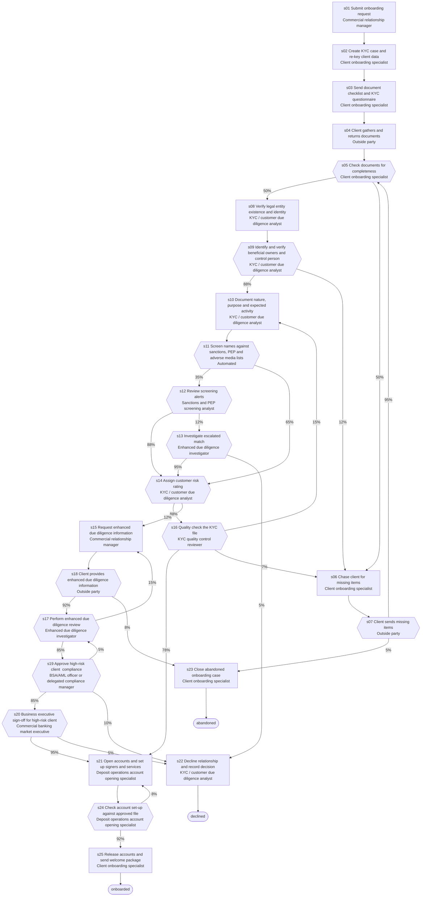

# Know-your-customer onboarding of a new corporate client at a commercial bank

`bank-business-kyc-onboarding` · commercial banking · client onboarding and financial crimes compliance

This process takes one new corporate client of a US commercial bank from the relationship manager's onboarding request to open accounts, or to a decline or abandonment. Onboarding staff collect formation documents, the beneficial ownership certification and a KYC questionnaire; KYC analysts verify the entity and its owners, write the customer profile, screen every related name for sanctions, politically exposed persons and negative news, and rate the client's risk. High-risk clients go through enhanced due diligence and senior compliance and business approval before deposit operations open the accounts. Most of the elapsed time is spent waiting for the client to supply missing documents, with several chase rounds, and in queues between the onboarding, compliance and operations teams, while data is re-keyed between CRM, KYC and core systems.

| | |
|---|---|
| Unit of work | one new corporate (legal entity) client relationship |
| Starts when | A relationship manager submits an onboarding request for a company that has agreed to bank with the bank. |
| Done when | The client's accounts and services are open and the KYC file is approved and stored, or the relationship is declined, or the client abandons onboarding. |
| Organisation | A US regional commercial bank with about 8,000 employees that banks small and mid-size companies through relationship managers, with a central client onboarding team, a financial crimes compliance unit and deposit operations. (8,000 employees, 2019-2022) |
| Volume | 320 cases a month (range 220 to 450) |

## Where it sits

- Starts with **onboarding request** from Commercial banking sales (relationship managers) (85% of cases)
- Starts with **onboarding request** from Commercial lending (new borrower needing deposit accounts) (15% of cases)
- Sends **open accounts and online banking credentials** to Corporate client (outcome: onboarded)
- Sends **customer risk rating and expected activity profile** to Transaction monitoring and periodic KYC review (outcome: onboarded)
- Sends **service set-up request** to Treasury management implementation (outcome: onboarded)
- Sends **blocking or rejection report, suspicious activity report** to OFAC and FinCEN (when a sanctions match or suspicious activity is found) (outcome: declined)
- Sends **KYC file** to Records retention and BSA/AML audit (outcome: any)
- Sends **withdrawn onboarding case** to Commercial banking sales (relationship managers) (outcome: abandoned)

## Flow

## Roles

| Role | Department | Layer | FTE on this process | Loaded cost per hour | Evidence |
|---|---|---|---:|---:|---|
| Commercial relationship manager | Commercial banking | senior specialist | 2 | 85 USD | B [bls_lo], [bls_ecec] |
| Client onboarding specialist | Commercial client onboarding (operations) | individual contributor | 7 | 38 USD | A [bls_nac], [bls_ecec] |
| KYC / customer due diligence analyst | Financial crimes compliance operations | individual contributor | 6.5 | 62 USD | A [bls_co], [bls_ecec] |
| Sanctions and PEP screening analyst | Financial crimes compliance operations | individual contributor | 0.5 | 52 USD | B [bls_co], [bls_ecec] |
| Enhanced due diligence investigator | Financial crimes compliance (EDD unit) | senior specialist | 1.6 | 80 USD | B [bls_co], [bls_ecec] |
| KYC quality control reviewer | Financial crimes compliance operations | senior specialist | 1.3 | 72 USD | B [bls_co], [bls_ecec] |
| BSA/AML officer or delegated compliance manager | BSA/AML compliance | manager | 0.15 | 114 USD | A [bls_fm], [bls_ecec] |
| Commercial banking market executive | Commercial banking | director | 0.08 | 140 USD | C |
| Deposit operations account opening specialist | Deposit and treasury services operations | individual contributor | 3.2 | 36 USD | A [bls_nac], [bls_ecec] |

## Steps

Hands-on time and the wait before each step show the most common value. Evidence tier A is a sourced number, B a sourced description, C the author's estimate.

| Step | Who | Kind | Hands-on | Wait before | Control | Evidence |
|---|---|---|---:|---:|---|---|
| **s01 Submit onboarding request.** After agreeing to bank a new corporate client, the relationship manager opens an onboarding request in the CRM with the legal name, entity type, products wanted (operating accounts, treasury services, credit), expected balances and activity, and client contacts. The RM often adds notes from the sales calls. | Commercial relationship manager | intake | 30 min | 0 min |  | C |
| **s02 Create KYC case and re-key client data.** An onboarding specialist picks up the request, creates a case in the KYC workflow tool and re-types the entity name, address, tax ID, products and contacts from the CRM because the two systems are not linked. The specialist checks for an existing relationship or a prior declined case. | Client onboarding specialist | data entry | 15 min | 8.0 h |  | B [gleif2018] |
| **s03 Send document checklist and KYC questionnaire.** The specialist selects the checklist for the entity type (corporation, LLC, partnership, nonprofit) and emails it with the KYC questionnaire and beneficial ownership certification form to the client contact, copying the RM. | Client onboarding specialist | communication | 15 min | 30 min |  | B [bo_reg], [cip] |
| **s04 Client gathers and returns documents.** The client's finance or legal staff collect articles of incorporation or organisation, operating or partnership agreement, IRS tax ID letter or W-9, certificate of good standing, signed beneficial ownership certification, IDs for owners and signers, board resolution and the completed questionnaire, and upload or email them. | Outside party | external wait | 0 min | 5.0 d |  | B [tr_kyc2017], [gt_kyc2017] |
| **s05 Check documents for completeness.** The specialist opens each document, ticks it off the checklist, checks signatures, dates and that names match across documents, and confirms every 25% owner and a control person appear on the certification. Gaps are listed for the client. | Client onboarding specialist | validation | 25 min | 12.0 h | Beneficial ownership rule, 31 CFR 1010.230: identify 25% owners and one control person at account opening | A [tr_kyc2017], [fenergo2019] |
| **s06 Chase client for missing items.** The specialist emails the client a list of the missing or defective items and, when replies stall, asks the RM to call the client. Each chase is logged in the case. | Client onboarding specialist | communication | 15 min | 4.0 h |  | A [tr_kyc2017], [fenergo2019] |
| **s07 Client sends missing items.** The client finds the missing pages, signs the certification, obtains a current good standing certificate or explains the ownership structure, and sends them. Some clients lose patience and stop responding. | Outside party | external wait | 0 min | 3.0 d |  | A [gt_kyc2017] |
| **s08 Verify legal entity existence and identity.** A KYC analyst checks the entity on the state business registry (status, formation date, registered agent, officers), matches the tax ID and address, compares formation documents with the registry record, and records the evidence in the case. | KYC / customer due diligence analyst | lookup | 25 min | 1.0 d | Customer Identification Program, 31 CFR 1020.220: verify a non-individual customer's existence through documents or non-documentary methods | B [cip] |
| **s09 Identify and verify beneficial owners and control person.** The analyst builds an ownership chart from the certification and agreements, traces owners through holding companies, and verifies each 25% owner and the control person against identity databases or ID copies. Layered or foreign ownership often needs more documents from the client. | KYC / customer due diligence analyst | validation | 30 min | 0 min | Beneficial ownership rule, 31 CFR 1010.230(b)(2): verify identity of each beneficial owner using risk-based procedures including CIP elements | A [cdd_rule], [bo_reg] |
| **s10 Document nature, purpose and expected activity.** The analyst writes the customer profile: business description and industry code, countries of operation, sources of revenue, products, expected monthly deposits, wires, cash and international payments, and the reason for the relationship. Vague RM notes are clarified by email. | KYC / customer due diligence analyst | analysis | 30 min | 1.0 h | AML program rule, 31 CFR 1020.210(a)(2)(v): understand the nature and purpose of customer relationships to develop a customer risk profile | A [aml_prog] |
| **s11 Screen names against sanctions, PEP and adverse media lists.** The screening tool checks the entity, its trade names, owners, control person, signers and directors against OFAC and other sanctions lists, politically exposed person lists and negative news. Possible matches open alerts for review. | Automated | system auto | 0 min | 5 min | OFAC sanctions regulations (31 CFR chapter V) and CIP comparison with government lists, 31 CFR 1020.220(a)(4) | C [cip] |
| **s12 Review screening alerts.** A screening analyst compares each alert with the client data (date of birth, nationality, address, ownership) and the list entry, discounts false positives with a written rationale, and escalates possible true matches, confirmed PEPs or relevant negative news. | Sanctions and PEP screening analyst | judgment | 20 min | 12.0 h | OFAC sanctions compliance: no dealings with blocked persons; documented alert disposition | C |
| **s13 Investigate escalated match.** An investigator researches the escalated name in depth, confirms or rules out the sanctions match, assesses the PEP's role and the news, and records the conclusion. A confirmed sanctions match stops onboarding and triggers blocking or rejection reporting. | Enhanced due diligence investigator | analysis | 1.0 h | 1.0 d | OFAC regulations: reject or block and report within 10 business days (31 CFR 501.603/501.604) | B [ofac_block] |
| **s14 Assign customer risk rating.** The analyst runs the risk rating model in the KYC tool, which scores industry, geography, products, ownership complexity, PEP status, cash intensity and screening results, checks the result against the profile and documents any override. | KYC / customer due diligence analyst | judgment | 15 min | 1.0 h | AML program rule, 31 CFR 1020.210(a)(2)(v): customer risk profile; bank's board-approved risk rating methodology | C [aml_prog] |
| **s15 Request enhanced due diligence information.** The relationship manager asks the client for source of funds and wealth, details of international payments and counterparties, cash handling, licences (for example money services or cannabis-adjacent businesses) and, for some clients, arranges a site visit. | Commercial relationship manager | communication | 30 min | 1.0 d |  | C |
| **s16 Quality check the KYC file.** A QC reviewer re-checks the file before approval: every required document present and current, entity and owner verification evidenced, screening alerts dispositioned, profile and risk rating supported. Failures go back to the analyst or, for missing evidence, to the client. | KYC quality control reviewer | review | 25 min | 1.0 d | Four-eyes review of KYC files under the bank's BSA/AML program; supports independent testing and examination findings | C |
| **s17 Perform enhanced due diligence review.** An EDD investigator reviews the client's EDD answers and documents, researches owners and counterparties in depth, compares expected activity with the business model, and writes an EDD memo with a recommendation and any account restrictions or monitoring conditions. | Enhanced due diligence investigator | analysis | 3.0 h | 3.0 d | Risk-based customer due diligence for higher-risk customers under 31 CFR 1020.210(a)(2)(v) and bank BSA/AML policy | C [aml_prog] |
| **s18 Client provides enhanced due diligence information.** The client prepares explanations and documents on ownership history, source of funds, major customers and suppliers, and international activity, and may host a site visit. | Outside party | external wait | 0 min | 5.0 d |  | C |
| **s19 Approve high-risk client (compliance).** The BSA/AML officer or a delegated compliance manager reads the EDD memo and QC notes and approves, approves with conditions such as transaction limits or more frequent reviews, sends back for more information, or declines. | BSA/AML officer or delegated compliance manager | approval | 30 min | 2.0 d | Bank BSA/AML policy: senior compliance approval to onboard high-risk customers | C |
| **s20 Business executive sign-off for high-risk client.** The commercial market executive reviews the relationship's value against the compliance conditions and signs off on accepting the risk, or decides not to proceed. | Commercial banking market executive | approval | 15 min | 2.0 d | Bank risk acceptance policy: line-of-business ownership of high-risk relationships | C |
| **s21 Open accounts and set up signers and services.** A deposit operations specialist creates the customer and accounts in the core system, re-keying data from the KYC case, adds authorised signers, sets up online banking users and entitlements and treasury services such as ACH and wires, and records the risk rating and review date. | Deposit operations account opening specialist | data entry | 40 min | 1.0 d | CIP, 31 CFR 1020.220: account opened only after required identifying information is obtained; KYC approval recorded before opening | C [cip] |
| **s22 Decline relationship and record decision.** The KYC analyst records the decline reason, notifies the RM, who tells the client the bank cannot proceed, and flags the entity and owners in the KYC tool. For a confirmed sanctions match, compliance files the rejection or blocking report and considers a suspicious activity report. | KYC / customer due diligence analyst | drafting | 25 min | 8.0 h | OFAC reporting of blocked or rejected transactions (31 CFR 501.603-604) and record retention under 31 CFR 1010.230(i) | B [ofac_block], [bo_reg] |
| **s23 Close abandoned onboarding case.** After the client stops responding past the follow-up limit, the onboarding specialist confirms with the RM, closes the case as withdrawn and keeps the collected documents and verification records. | Client onboarding specialist | coordination | 10 min | 10.0 d | Record retention for identification and verification records, 31 CFR 1010.230(i) and 1020.220(a)(3) | B [fenergo2019], [gt_kyc2017] |
| **s24 Check account set-up against approved file.** A second deposit operations specialist compares the core set-up with the approved KYC file and signed agreements, field by field for names, tax ID, signers, limits and entitlements, and returns errors for correction. | Deposit operations account opening specialist | review | 15 min | 8.0 h | Maker-checker control on account and entitlement set-up | C |
| **s25 Release accounts and send welcome package.** The onboarding specialist confirms the accounts are active, sends the client the account numbers, online banking credentials and treasury service instructions, notifies the RM and closes the case. | Client onboarding specialist | communication | 15 min | 4.0 h |  | C |

## Exceptions

| Exception | Share of cases | What happens |
|---|---:|---|
| Incomplete documents | 50% | The first package lacks a signed certification, a current good standing certificate, owner IDs or an agreement, so the specialist chases the client, often more than once. |
| Layered or unclear ownership | 11% | Owners sit behind holding companies, trusts or foreign entities and the analyst needs more documents to trace 25% owners. |
| Screening escalation | 4% | An alert looks like a true sanctions match, a PEP or relevant negative news and goes to an investigator; a confirmed sanctions match ends in a decline and report. |
| High-risk client | 12% | The risk rating is high (industry, geography, cash intensity, PEP) and the client goes through enhanced due diligence and two senior approvals. |
| QC failure | 19% | QC finds unsupported profile entries, missing verification evidence or undispositioned alerts and returns the file. |
| Account set-up error | 7% | The checker finds a wrong signer, entitlement or tax ID in the core set-up. |
| Client abandons | 7% | The client stops responding during document collection or EDD and the case is closed. |

## Benchmarks

| Metric | Value | Unit | Population | Evidence |
|---|---|---|---|---|
| cycle_time_days | p50 28, p90 75 | calendar days from onboarding request to accounts open | Corporate client onboarding at banks, 2017-2019 surveys | B [tr_kyc2017], [gleif2018] |
| client_contacts_per_onboarding | bank_reported 4, corporate_reported 8 | contacts | Thomson Reuters 2017 KYC survey | A [tr_kyc2017] |
| beneficial_ownership_minutes_per_customer | low 20, high 40 | minutes | US covered financial institutions (FinCEN 2016 burden estimate) | A [cdd_rule] |
| share_changing_banks_due_to_kyc | 0.12 | share of corporate respondents | Thomson Reuters 2017 KYC survey | A [gt_kyc2017] |
| onboarding_time_distribution | under_1_week 0.07, 1_week_to_1_month 0.36, 1_to_2_months 0.3, 2_to_3_months 0.17, over_3_months 0.09 | share of banks | GLEIF 2018 survey of 102 bank sales leaders | A [gleif2018] |

## Pain points

- Clients are asked for documents several times because checklists differ by bank and first packages are often incomplete, which is the largest source of delay and of client frustration. (steps s05, s06, s07; A [tr_kyc2017], [fenergo2019])
- Client and entity data is typed into the CRM, re-keyed into the KYC tool and keyed again into the core system, creating errors that QC and the set-up checker must catch. (steps s02, s21, s24; B [gleif2018])
- Most screening alerts are false positives, yet each needs a documented review, and escalations queue for scarce investigators. (steps s12, s13; C)
- High-risk clients wait days in the EDD queue and again for two senior approvers, adding two to four weeks. (steps s17, s19, s20; C)

## Assumptions

- External steps (client actions) carry zero touch time; the client's effort is inside the waits, so the staffing comparison reflects bank labour only.
- The 50% incomplete rate at each completeness check (about 1.9 document rounds per case) are set to match the survey finding of about four bank contacts (eight as clients count them) per onboarding.
- Screening alert, escalation and high-risk shares (35%, 12% of alerted cases, 12% of cases) are author estimates; no source with these rates was opened.
- Senior compliance and business approval for high-risk clients and pre-approval QC follow common US practice; the FFIEC BSA/AML manual was not reachable, so these controls are marked as bank policy rather than law.
- Cycle-time benchmarks come from 2017-2019 global surveys that mix commercial, corporate and investment banking clients; a US regional commercial bank's middle-market clients are likely nearer the lower end.
- Credit approval for clients that also borrow runs in a separate process and is not included; treasury services implementation after account opening is a separate downstream process.
- Stated FTEs are about 15% above the hands-on time implied at 130 productive hours a month, to cover case administration, rework not modelled and periodic reviews handled by the same teams.
- Loaded cost = BLS May 2021 hourly wage x 1.49 (benefits: wages are 67% of compensation in financial activities, BLS ECEC Dec 2021) x 1.2 for overhead (author estimate), about 1.8 x wage.

## Sources

- [cdd_rule] [Customer Due Diligence Requirements for Financial Institutions, final rule (81 FR 29398)](https://www.govinfo.gov/content/pkg/FR-2016-05-11/pdf/2016-10567.pdf) (Financial Crimes Enforcement Network, via U.S. Government Publishing Office, 2016). Beneficial ownership rule; burden estimate of 20 to 40 minutes per legal entity customer to identify, verify, review and record beneficial owners; about 8 million new legal entity accounts a year; new accounts clerk wage used in the cost estimate
- [bo_reg] [31 CFR 1010.230 Beneficial ownership requirements for legal entity customers](https://www.law.cornell.edu/cfr/text/31/1010.230) (Legal Information Institute, Cornell Law School, 2023). Identify each 25% owner and one control person at account opening, certification form, risk-based verification using CIP elements, five-year record retention
- [aml_prog] [31 CFR 1020.210 Anti-money laundering program requirements for banks](https://www.law.cornell.edu/cfr/text/31/1020.210) (Legal Information Institute, Cornell Law School, 2023). AML program must include customer due diligence: understanding the nature and purpose of customer relationships to develop a customer risk profile, ongoing monitoring, beneficial owner information
- [cip] [31 CFR 1020.220 Customer identification program requirements for banks](https://www.law.cornell.edu/cfr/text/31/1020.220) (Legal Information Institute, Cornell Law School, 2023). Identifying information and verification for non-individual customers (documents showing existence such as articles of incorporation or partnership agreements), comparison with government lists, recordkeeping
- [ofac_block] [31 CFR 501.603 Reports of blocked property](https://www.law.cornell.edu/cfr/text/31/501.603) (Legal Information Institute, Cornell Law School, 2023). Blocked property must be reported to OFAC within 10 business days
- [tr_kyc2017] [Thomson Reuters 2017 global KYC surveys attest to even greater compliance pain points](https://www.corporatecomplianceinsights.com/thomson-reuters-2017-global-kyc-surveys-attest-even-greater-compliance-pain-points/) (Corporate Compliance Insights, 2017). Survey of 1,023 financial institution and 1,122 corporate respondents (April-May 2017): onboarding averaged 26 days per banks (24 in 2016) and 32 days per corporates; banks contact clients about 4 times, corporates report 8
- [gt_kyc2017] [KYC pain: financial institutions and their clients still struggling with ongoing challenges](https://www.theglobaltreasurer.com/2017/11/02/kyc-pain-financial-institutions-and-their-clients-still-struggling-with-ongoing-challenges/?amp=1) (The Global Treasurer, 2017). Thomson Reuters 2017 survey: banks report 30 days average onboarding; 12% of corporates changed banks because of KYC issues; no common document standard across banks
- [gleif2018] [Know Your Customer (KYC): The Challenges Faced by the Banking Sector When Onboarding New Client Organizations](https://www.gleif.org/lei-solutions/lei-in-kyc-a-new-future-for-legal-entity-identification/gleif-research-findings_challenges-onboarding-client-organizations-in-banking-sector_v1.0-final.pdf) (Global Legal Entity Identifier Foundation, 2018). Survey of 102 bank sales leaders: new client organizations typically take 6 weeks to onboard; 7% under a week, 36% one week to a month, 30% one to two months, 17% two to three months, 9% over three months; about 25% of the process is manual
- [fenergo2019] [Global Business & Commercial Banking Market Sees $3.3 Trillion in Losses Due to Operational Inefficiencies](https://prnewswire.com/news-releases/global-business--commercial-banking-market-sees-3-3-trillion-in-losses-due-to-operational-inefficiencies-300944422.html) (Fenergo (PR Newswire), 2019). Survey of more than 500 commercial and business banking decision makers (Aug-Sep 2019): onboarding times rose an average of three weeks in a year; 15% contact clients ten or more times for data or documents; 14% involve 20 or more people for one complex client
- [bls_co] [Occupational Employment and Wages, May 2021: 13-1041 Compliance Officers](https://www.bls.gov/oes/2021/may/oes131041.htm) (U.S. Bureau of Labor Statistics, 2022). Compliance officer hourly wages: 25th percentile $24.05, median $34.45, 75th percentile $46.47
- [bls_nac] [Occupational Employment and Wages, May 2021: 43-4141 New Accounts Clerks](https://www.bls.gov/oes/2021/may/oes434141.htm) (U.S. Bureau of Labor Statistics, 2022). New accounts clerk hourly wages: 25th percentile $17.47, median $18.19, 75th percentile $22.58; duties include helping applicants complete account paperwork
- [bls_lo] [Occupational Employment and Wages, May 2021: 13-2072 Loan Officers](https://www.bls.gov/oes/2021/may/oes132072.htm) (U.S. Bureau of Labor Statistics, 2022). Loan officer (including commercial lenders) hourly wages: 25th percentile $22.83, median $30.47, 75th percentile $47.18
- [bls_fm] [Occupational Employment and Wages, May 2021: 11-3031 Financial Managers](https://www.bls.gov/oes/2021/may/oes113031.htm) (U.S. Bureau of Labor Statistics, 2022). Financial manager hourly wages: 25th percentile $47.89, median $63.32, 75th percentile $92.24
- [bls_ecec] [Employer Costs for Employee Compensation, December 2021](https://www.bls.gov/news.release/archives/ecec_03182022.htm) (U.S. Bureau of Labor Statistics, 2022). Financial activities industry: wages 67.0% of total compensation (benefits loading factor 1.49)

Written by claude-opus on 2026-11-17.
