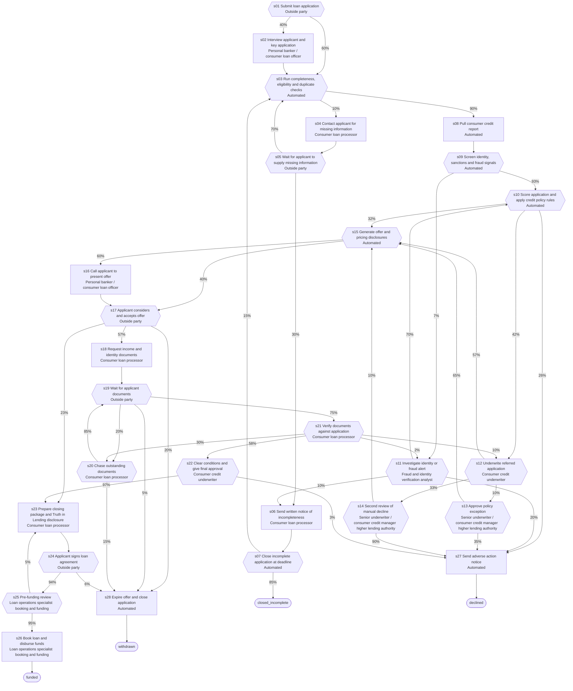

# Unsecured consumer loan origination at a retail bank

`bank-consumer-loan-origination` · retail banking · consumer lending

This process takes one unsecured personal loan application from submission to funding, decline or withdrawal at a US regional retail bank. A decision engine pulls the credit report, screens identity and fraud signals and auto-approves or auto-declines most files; the rest go to underwriters, fraud analysts and, for exceptions, a senior credit officer. Approved applicants must accept the offer, often upload pay stubs and statements, and sign before loan operations books and funds the loan. Most elapsed time is spent waiting on the applicant for missing information, documents and signatures, and on work queues between underwriting, processing and funding; incomplete documents cause repeated chase loops.

| | |
|---|---|
| Unit of work | one unsecured personal loan application |
| Starts when | A consumer submits a personal loan application online, by phone or in a branch. |
| Done when | The loan is booked and funded, the application is declined with an adverse action notice, or it is closed as incomplete or withdrawn. |
| Organisation | A US regional bank with about 6,000 employees, a branch network and contact centre, and a centralised consumer lending operation using a loan origination system with a rules-based decision engine. (6,000 employees, 2019-2022) |
| Volume | 3,000 cases a month (range 2,200 to 4,000) |

## Where it sits

- Starts with **personal loan application** from Consumer applicants (online) (60% of cases)
- Starts with **assisted personal loan application** from Branch and contact-centre sales (40% of cases)
- Sends **booked loan account** to Loan servicing and collections (outcome: funded)
- Sends **loan disbursement** to Borrower (outcome: funded)
- Sends **loan booking entries** to General ledger and finance close (outcome: funded)
- Sends **adverse action notice** to Applicant (outcome: declined)
- Sends **application decision record** to Fair lending and compliance monitoring (outcome: any)
- Sends **notice of incompleteness and closure** to Applicant (outcome: closed_incomplete)
- Sends **withdrawn application lead** to Marketing and sales follow-up (outcome: withdrawn)

## Flow

## Roles

| Role | Department | Layer | FTE on this process | Loaded cost per hour | Evidence |
|---|---|---|---:|---:|---|
| Personal banker / consumer loan officer | Retail branches and contact centre | individual contributor | 7.1 | 55 USD | A [bls_lo], [bls_ecec] |
| Consumer loan processor | Consumer lending operations | individual contributor | 9 | 40 USD | A [bls_lic], [bls_ecec] |
| Consumer credit underwriter | Consumer credit underwriting | individual contributor | 4.7 | 67 USD | A [bls_ca], [bls_ecec], [cornerstone] |
| Senior underwriter / consumer credit manager (higher lending authority) | Consumer credit underwriting | supervisor | 1.1 | 95 USD | C |
| Fraud and identity verification analyst | Fraud operations | individual contributor | 1.2 | 58 USD | C |
| Loan operations specialist (booking and funding) | Loan operations | individual contributor | 3.2 | 40 USD | B [bls_lic], [bls_ecec] |

## Steps

Hands-on time and the wait before each step show the most common value. Evidence tier A is a sourced number, B a sourced description, C the author's estimate.

| Step | Who | Kind | Hands-on | Wait before | Control | Evidence |
|---|---|---|---:|---:|---|---|
| **s01 Submit loan application.** The applicant starts an unsecured personal loan application on the bank's website or mobile app, or calls or visits a branch. Online applicants type identity, address, employment, income, housing cost, loan amount and purpose themselves and consent to a credit check; others are routed to a banker. | Outside party | intake | 0 min | 0 min |  | C |
| **s02 Interview applicant and key application.** A personal banker meets or phones the applicant, asks the application questions, explains products and keys the answers into the loan origination system. The banker checks a photo ID in person for branch applicants and records the ID number for the customer identification program. | Personal banker / consumer loan officer | data entry | 25 min | 1.0 h | Customer Identification Program, 31 CFR 1020.220: collect name, date of birth, address and ID number before opening the account | B [cip], [bls_lic] |
| **s03 Run completeness, eligibility and duplicate checks.** The origination system checks that required fields are present and formatted, that the applicant meets age, residency and product limits, and that no open application exists for the same person. Applications that fail a field or eligibility rule drop into a processor's exception queue. | Automated | system auto | 0 min | 0 min |  | C |
| **s04 Contact applicant for missing information.** A loan processor opens the exception queue, reads which item is missing or inconsistent (employer, income, previous address, SSN format), and phones or emails the applicant to ask for it. The processor notes the request and the date in the file because the 30-day Regulation B clock is running. | Consumer loan processor | communication | 10 min | 8.0 h | Regulation B, 12 CFR 1002.9(c): incomplete applications must be acted on or given a notice of incompleteness within 30 days | B [regb_9] |
| **s05 Wait for applicant to supply missing information.** The application waits while the applicant finds and sends the missing details by phone, the online application or secure message. Most applicants reply within a day or two; some never reply because they have applied elsewhere. | Outside party | external wait | 0 min | 1.0 d |  | B [bpi17_jeong] |
| **s06 Send written notice of incompleteness.** After several days without a reply the processor generates a written notice of incompleteness from the origination system, listing the information needed and the deadline after which the application will not be considered. The letter goes by email or post. | Consumer loan processor | drafting | 5 min | 3.0 d | Regulation B, 12 CFR 1002.9(c)(2): written notice of incompleteness stating the information needed and a reasonable period to provide it | A [regb_9] |
| **s07 Close incomplete application at deadline.** The origination system holds the file until the deadline in the notice, typically 10 to 30 days, then closes it as incomplete and records the action for fair lending reporting. A minority of applicants respond before the deadline and the file returns to the checks. | Automated | system auto | 0 min | 10.0 d |  | B [regb_9], [bpi17_win] |
| **s08 Pull consumer credit report.** The origination system requests the applicant's credit report and score from a credit bureau through the bureau interface, using the consent captured in the application. Thin-file or frozen reports return without a score and are flagged for review. | Automated | system auto | 0 min | 0 min | Fair Credit Reporting Act section 604: permissible purpose (consumer's application) for obtaining a consumer report | B [occ_retail] |
| **s09 Screen identity, sanctions and fraud signals.** The system matches name, date of birth, address and SSN against the credit report and an identity verification service, screens the name against the OFAC sanctions list and checks fraud alerts, address discrepancy notices and fraud scores. Any hit sends the application to the fraud queue. | Automated | system auto | 0 min | 0 min | Customer Identification Program (31 CFR 1020.220), OFAC sanctions regulations, and the Identity Theft Red Flags Rule under FCRA (FACT Act) | B [cip], [ftc_redflags], [bpi17_jang] |
| **s10 Score application and apply credit policy rules.** The decision engine combines the credit score with policy rules on minimum score, debt-to-income, recent delinquencies, bankruptcies and loan amount, and returns auto-approve with terms, auto-decline with reason codes, or refer to an underwriter. | Automated | system auto | 0 min | 0 min | Board-approved credit policy and model risk management (OCC Bulletin 2011-12 principles) govern scorecard cut-offs | B [occ_retail], [cornerstone] |
| **s11 Investigate identity or fraud alert.** A fraud analyst opens the alert, compares the application with the credit file, prior applications and device or contact data, and calls the applicant on a number from an independent source to confirm identity or ask for a photo ID. The analyst clears the alert, declines, or closes the file when the applicant does not respond. | Fraud and identity verification analyst | judgment | 30 min | 16.0 h | Identity Theft Red Flags Rule: respond to detected red flags; FCRA 605A: verify identity when a fraud alert is on the file | A [bpi17_jang], [ftc_redflags] |
| **s12 Underwrite referred application.** A credit underwriter opens the referred file, reviews the credit report, recalculates debt-to-income from stated income and bureau debts, weighs the deposit relationship and any compensating factors, and decides to approve, counteroffer a smaller amount or higher rate, decline with reasons, or escalate a policy exception. | Consumer credit underwriter | judgment | 17 min | 20.0 h | Credit policy and individual lending authority limits delegated by the board | B [occ_retail], [bpi17_jeong], [cornerstone] |
| **s13 Approve policy exception.** A senior underwriter or consumer credit manager reviews the underwriter's exception memo (for example debt-to-income above policy or a low-side score override), checks the compensating factors and approves or declines in the origination system. The exception is coded for portfolio exception reporting. | Senior underwriter / consumer credit manager (higher lending authority) | approval | 15 min | 12.0 h | Credit policy exception approval and tracking (OCC Retail Lending booklet: policy exceptions and score overrides need defined approval authority and reporting) | B [occ_retail] |
| **s14 Second review of manual decline.** Before a manually declined application is notified, a senior underwriter re-reads the file and the stated decline reasons to confirm they are accurate, specific and consistent with policy and with similar approved files. A small share of declines are overturned into an approval or counteroffer. | Senior underwriter / consumer credit manager (higher lending authority) | review | 10 min | 12.0 h | Fair lending second-review program supporting ECOA/Regulation B compliance; specific and accurate adverse action reasons (12 CFR 1002.9(b)(2)) | C [regb_9] |
| **s15 Generate offer and pricing disclosures.** The origination system builds the offer (amount, rate, term, monthly payment) from the decision, attaches the risk-based pricing notice or credit score disclosure and posts the offer to the applicant's online account with an email alert. Offers stay open for about 30 days. | Automated | system auto | 0 min | 0 min | FCRA risk-based pricing rule: notice or credit score disclosure before the consumer is contractually obligated | B [ftc_aa], [bpi17_win] |
| **s16 Call applicant to present offer.** A personal banker phones the applicant, confirms they received the offer, explains the rate, term and conditions such as documents still needed, and answers questions or notes a request for a different amount or term. | Personal banker / consumer loan officer | communication | 10 min | 8.0 h |  | A [bpi17_win], [bpi17_jang] |
| **s17 Applicant considers and accepts offer.** The applicant compares the offer with other lenders, sometimes asks for a revised amount, and accepts online or by phone, or lets the offer lapse. Acceptance tells the bank whether documents are still needed before closing. | Outside party | external wait | 0 min | 1.0 d |  | A [bpi17_win] |
| **s18 Request income and identity documents.** A processor reviews the approval conditions and sends the applicant a checklist through the upload portal and email: recent pay stubs or W-2, bank statements, and a photo ID or proof of address where identity was not verified electronically. | Consumer loan processor | communication | 8 min | 4.0 h |  | B [bankrate], [bpi17_win] |
| **s19 Wait for applicant documents.** The file waits while the applicant gathers and uploads pay stubs, statements and ID, or brings them to a branch. This is the longest wait for approved applicants. | Outside party | external wait | 0 min | 2.0 d |  | A [bpi17_jeong] |
| **s20 Chase outstanding documents.** The processor sees the file in the aged-conditions report, calls or emails the applicant to remind them what is still missing and why, and resets the follow-up date. | Consumer loan processor | communication | 8 min | 1.0 d |  | A [bpi17_win] |
| **s21 Verify documents against application.** The processor opens each upload, checks pay stub dates, employer name and year-to-date income against stated income, scans bank statements for undisclosed debts or returned items, and matches the ID. Missing or stale items go back to the applicant; material differences go back to underwriting. | Consumer loan processor | validation | 18 min | 18.0 h | Credit policy income verification standard (OCC Retail Lending booklet: verification practices) | A [bpi17_win], [occ_retail] |
| **s22 Clear conditions and give final approval.** An underwriter reviews the processor's verification notes, confirms every condition is met and the final terms are within authority, and marks the loan clear to close. A loan that no longer qualifies is declined. | Consumer credit underwriter | approval | 5 min | 8.0 h | Credit policy: conditions verified by a processor are signed off by a credit officer with lending authority | C [occ_retail] |
| **s23 Prepare closing package and Truth in Lending disclosure.** The processor generates the promissory note, Truth in Lending disclosure with APR and finance charge, payment schedule and any payoff instructions for debt consolidation, checks names, amounts and disbursement account, and sends the package for electronic signature. | Consumer loan processor | drafting | 10 min | 4.0 h | Truth in Lending Act, Regulation Z 12 CFR 1026.17-18: closed-end disclosures before consummation | B [regz_17] |
| **s24 Applicant signs loan agreement.** The applicant opens the electronic signature envelope, reviews and signs the note and disclosures, or signs at a branch. Some applicants take days or never sign. | Outside party | external wait | 0 min | 1.0 d |  | C |
| **s25 Pre-funding review.** A loan operations specialist checks the signed package against the approval: signatures and dates present, amount and rate match, identity and sanctions checks cleared, and the disbursement account belongs to the borrower. Defects go back to the processor. | Loan operations specialist (booking and funding) | review | 8 min | 8.0 h | Dual control: funding approved by operations, separate from the staff who originated and processed the loan | C |
| **s26 Book loan and disburse funds.** The specialist books the loan in the core banking system from the origination data, sets up the payment schedule and autopay, and releases funds to the borrower's deposit account or by ACH or creditor payoff checks in the next funding run. | Loan operations specialist (booking and funding) | data entry | 10 min | 10.0 h | Internal control over financial reporting: booking reconciled to the origination record | B [bankrate], [jdp_2026] |
| **s27 Send adverse action notice.** The system generates the decline or counteroffer notice from the reason codes, with the ECOA notice, the credit bureau's contact details, the credit score used and the right to a free report, and prints it in the nightly mail batch or sends it electronically with consent. | Automated | system auto | 0 min | 12.0 h | ECOA/Regulation B 12 CFR 1002.9(a)(2) and FCRA section 615(a): notice of adverse action with specific reasons and credit report details within 30 days | A [regb_9], [ftc_aa] |
| **s28 Expire offer and close application.** When the applicant declines, stops responding or does not sign, the system holds the offer until its expiry date, then closes the application as withdrawn and, for counteroffers that were never accepted, sends the required adverse action notice. | Automated | system auto | 0 min | 14.0 d | Regulation B 12 CFR 1002.9(a)(1)(iv): adverse action notice within 90 days for a counteroffer not accepted | A [bpi17_win], [regb_9] |

## Exceptions

| Exception | Share of cases | What happens |
|---|---:|---|
| Missing application information | 11% | Required details are missing or inconsistent; the processor asks for them, and if they do not arrive the bank must send a written notice of incompleteness before closing the file. |
| Identity or fraud alert | 7% | A fraud alert, address discrepancy, identity mismatch or sanctions near-match stops the file until a fraud analyst verifies the applicant. |
| Policy exception | 4% | The underwriter wants to approve outside policy (debt-to-income or score override) and needs a senior approver. |
| Incomplete or stale documents | 14% | Uploaded pay stubs or statements are missing pages, out of date or unreadable, so the processor chases the applicant again. |
| Income lower than stated | 4% | Verified income or newly found debts change the debt-to-income ratio and the file goes back to underwriting, often for a counteroffer. |
| Closing package defect | 2% | Pre-funding review finds a missing signature, wrong amount or disbursement account mismatch and the package is reissued. |

## Benchmarks

| Metric | Value | Unit | Population | Evidence |
|---|---|---|---|---|
| cycle_time_days | p50 7, p90 32 | calendar days from application to final outcome, all outcomes | US bank unsecured personal loan applications, 2019-2022 (composite) | B [bankrate], [bpi17_win], [jdp_2026] |
| reference_case_duration_days_dutch_bank | all_cases_median 19.1, all_cases_mean 21.8, funded_median 14.8, denied_median 14.1, cancelled_median 31.6 | calendar days | 31,409 consumer loan applications at a Dutch bank, filed in 2016 (BPI Challenge 2017 log) | A [bpi17_win] |
| outcome_shares_dutch_bank | funded 0.55, cancelled 0.33, denied 0.12 | share of applications | BPI Challenge 2017 log | A [bpi17_win] |
| approval_rate | 0.6 | share of consumer loan applications approved | US banks and credit unions, Cornerstone Advisors 2022 benchmarks | A [cornerstone] |
| applications_per_underwriting_fte_per_month | with_auto_decisioning 960, without 260 | applications | US banks and credit unions, Cornerstone Advisors 2022 benchmarks | A [cornerstone] |
| share_of_cases_with_incomplete_file_call | 0.476 | share of applications | BPI Challenge 2017 log | A [bpi17_win] |

## Pain points

- Approved applicants take days to return pay stubs and statements, and about a third of first uploads are incomplete, so processors run repeated chase calls while the file ages. (steps s19, s20, s21; A [bpi17_win], [bpi17_jeong])
- Referred files wait one to two days in the underwriting queue, and exception files wait again for a senior approver, while faster online lenders decide the same day. (steps s12, s13; B [bankrate], [bpi17_jeong])
- A third of approved applicants never take the loan, often after shopping elsewhere during the wait, and their files sit open until the offer expires. (steps s17, s28; A [bpi17_win])
- Data typed by bankers and applicants is re-checked by hand against documents, and loan details are re-keyed or re-verified between the origination and core systems at booking. (steps s02, s21, s26; C)

## Assumptions

- External steps (applicant actions) carry zero touch time; the applicant's own effort is inside the waits, so the staffing comparison reflects bank labour only.
- Branch, phone and online applications share one flow after keying; 40% of applications are assisted by a banker.
- The decision engine split (30% auto-approve, 28% auto-decline, 42% refer) is an estimate consistent with the OCC statement that most unsecured decisions are automatic and Cornerstone's finding that auto-decisioning approves about a third of loans.
- Applicant-wait times are taken from the BPI 2017 Dutch bank log and shortened for upload portals and e-signature common in US banks in 2019-2022; the Dutch log's 19.1-day median is longer than this model mainly because it has no instant auto-declines and used mailed paperwork.
- The cycle-time benchmark is a composite of practitioner timelines and the BPI 2017 log rather than a measured US median; no public US event log was found.
- The fraud referral rate (7%) is above the 1% formal fraud assessments in BPI 2017 because US banks route identity mismatches, fraud alerts and sanctions near-matches to a queue.
- Revised offers after re-underwriting go through acceptance and document collection again; in practice some documents are reused, so this slightly overstates rework.
- Stated FTEs exceed the hands-on time implied at 130 productive hours a month by about 20% to cover queue management, callbacks that reach voicemail and reporting; post-funding quality control sampling and servicing are outside this workflow.
- Loaded cost = BLS May 2021 hourly wage x 1.49 (benefits: wages are 67% of compensation in financial activities, BLS ECEC Dec 2021) x 1.2 for overhead (author estimate), about 1.8 x wage.

## Sources

- [bpi17_win] [Stairway to value: mining a loan application process (BPI Challenge 2017 academic winner)](https://ais.win.tue.nl/bpi/2017/bpi2017_winner_academic.pdf) (Pontifical Catholic University of Rio de Janeiro, BPI Challenge 2017, 2017). Event-log statistics of a Dutch bank's consumer loan process (applications filed in 2016): case counts by outcome, median and mean case duration by outcome, offers per case, waits between activities, share of cases with incomplete-file calls, 26-30 day automatic cancellation
- [bpi17_jang] [Analysis of Loan Process through Process Mining (BPI Challenge 2017)](https://ais.win.tue.nl/bpi/2017/bpi2017_paper_29.pdf) (POSTECH, BPI Challenge 2017, 2017). Activity frequencies and durations in the BPI 2017 log: W_Call after offers, W_Complete application, W_Validate application, W_Call incomplete files, W_Assess potential fraud (355 events, median 15 h 33 min)
- [bpi17_jeong] [BPIC 2017: Business process mining, a loan process application](https://ais.win.tue.nl/bpi/2017/bpi2017_paper_20.pdf) (POSTECH, BPI Challenge 2017, 2017). Median waits in the BPI 2017 log: documents returned about 7 days after the offer, resubmission after an incomplete-file call median 23.4 h, validation to decision median 1.95 days, cancellation after about 27-31 days
- [regb_9] [12 CFR 1002.9 Notifications (Regulation B, Equal Credit Opportunity Act)](https://www.consumerfinance.gov/rules-policy/regulations/1002/9/) (Consumer Financial Protection Bureau, 2023). Notice of action within 30 days of a completed application; notice of incompleteness; adverse action notice with specific reasons; counteroffer handling
- [cip] [31 CFR 1020.220 Customer identification program requirements for banks](https://www.law.cornell.edu/cfr/text/31/1020.220) (Legal Information Institute, Cornell Law School, 2023). Banks must collect name, date of birth, address and identification number before opening an account, verify identity by documentary or non-documentary methods, and check government lists
- [bls_lo] [Occupational Employment and Wages, May 2021: 13-2072 Loan Officers](https://www.bls.gov/oes/2021/may/oes132072.htm) (U.S. Bureau of Labor Statistics, 2022). Loan officer hourly wages: 25th percentile $22.83, median $30.47, 75th percentile $47.18
- [bls_lic] [Occupational Employment and Wages, May 2021: 43-4131 Loan Interviewers and Clerks](https://www.bls.gov/oes/2021/may/oes434131.htm) (U.S. Bureau of Labor Statistics, 2022). Loan interviewer and clerk hourly wages: 25th percentile $17.79, median $22.09, 75th percentile $23.63; duties include checking applicant background and preparing loan paperwork
- [bls_ca] [Occupational Employment and Wages, May 2021: 13-2041 Credit Analysts](https://www.bls.gov/oes/2021/may/oes132041.htm) (U.S. Bureau of Labor Statistics, 2022). Credit analyst hourly wages: 25th percentile $29.08, median $37.23, 75th percentile $48.68
- [bls_ecec] [Employer Costs for Employee Compensation, December 2021](https://www.bls.gov/news.release/archives/ecec_03182022.htm) (U.S. Bureau of Labor Statistics, 2022). Financial activities industry: wages 67.0% and benefits 33.0% of total compensation, used for the benefits loading factor
- [bankrate] [How long does it take to get a personal loan?](https://www.bankrate.com/loans/personal-loans/how-long-does-it-take-to-get-a-personal-loan) (Bankrate, 2024). Banks typically approve in 1 to 3 business days and fund in 3 or more business days; documents asked for (ID, W-2, tax return, bank statements); manual underwriting and missing documents cause delays
- [cornerstone] [Consumer lenders still struggle to get with the times](https://www.crnrstone.com/gonzobanker/consumer-lenders-still-struggle-to-get-with-the-times) (Cornerstone Advisors (GonzoBanker), 2023). 2022 benchmarks: 42% of institutions use auto-decisioning, which approves about one third of their loans; approval rates 60% vs 62%; 960 vs 260 applications per underwriting FTE per month
- [occ_retail] [Comptroller's Handbook: Retail Lending, version 2.0](https://www.occ.gov/publications-and-resources/publications/comptrollers-handbook/files/retail-lending/pub-ch-retail-lending.pdf) (Office of the Comptroller of the Currency, 2021). Automated decisions fall into auto-approve, auto-decline, recommended approve and recommended decline, the last two going to manual underwriting; most unsecured loan decisions are automatic; policy exceptions and credit score overrides need defined approval and tracking; information verification practices
- [ftc_redflags] [Fighting Identity Theft with the Red Flags Rule: A How-To Guide for Business](https://www.ftc.gov/business-guidance/resources/fighting-identity-theft-red-flags-rule-how-guide-business) (Federal Trade Commission, 2013). Creditors need a written identity theft prevention program; red flags include fraud alerts on credit reports, address discrepancy notices and altered identification; responses include contacting the customer or not opening the account
- [regz_17] [12 CFR 1026.17 General disclosure requirements (Regulation Z, Truth in Lending)](https://www.consumerfinance.gov/rules-policy/regulations/1026/17/) (Consumer Financial Protection Bureau, 2023). Closed-end credit disclosures must be made before consummation and may be electronic with E-Sign consent
- [ftc_aa] [Using Consumer Reports for Credit Decisions: What to Know About Adverse Action and Risk-Based Pricing Notices](https://www.ftc.gov/business-guidance/resources/using-consumer-reports-credit-decisions-what-know-about-adverse-action-risk-based-pricing-notices) (Federal Trade Commission, 2016). FCRA adverse action notice contents (credit bureau, score, 60-day free report right) and risk-based pricing notice before the consumer is contractually obligated
- [jdp_2026] [Survey: speedy personal loan approvals drive growing customer satisfaction in nonbanks (J.D. Power 2026 U.S. Consumer Lending Satisfaction Study)](https://bankingjournal.aba.com/2026/05/survey-speedy-personal-loan-approvals-drive-growing-customer-satisfaction-in-nonbanks/) (ABA Banking Journal, 2026). 58% of bank personal loan customers and 68% of nonbank customers were funded within one day of approval (2026, after the reference period)

Written by claude-opus on 2026-11-17.
