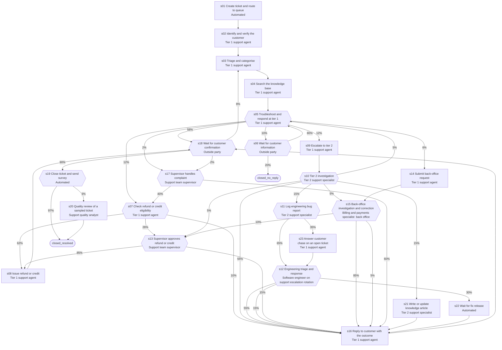

# Customer support ticket: one case through tiered support

`cs-customer-support-ticket` · cross-industry · customer service

This process handles one customer support case at a company that sells products and subscriptions online, from the customer's contact through triage, tier 1 handling with a knowledge lookup, and escalation where needed to tier 2 specialists, the billing back office or engineering. Refunds and credits above an agent's limit need a supervisor's approval, and solved tickets wait a few days for the customer to confirm before closing. Most cases are solved by tier 1 in minutes of work, but escalated ones wait in several queues, are re-keyed into other teams' tools, and draw chases and reopens when the first answer was wrong.

| | |
|---|---|
| Unit of work | one customer support ticket |
| Starts when | A customer emails, submits a web form, starts a chat or calls about a question, problem, bill or refund. |
| Done when | The ticket is closed after the customer confirms or does not reply, or is auto-solved after the customer stops responding. |
| Organisation | A US company of about 1,000 employees selling products and subscriptions online, with an in-house support team of about 70 agents in two tiers, a small billing back office and an engineering escalation rotation, all on a help desk tool linked to CRM and billing. (1,000 employees, 2019-2022) |
| Volume | 25,000 cases a month (range 20,000 to 32,000) |

## Where it sits

- Starts with **support request** from Customers (email, web form, chat, phone) (92% of cases)
- Starts with **billing query** from Billing and payments (failed payment or invoice notice) (5% of cases)
- Starts with **delivery problem report** from Order fulfilment and delivery partners (3% of cases)
- Sends **resolution, refund or explanation** to Customers (outcome: closed_resolved)
- Sends **refund transactions** to Payment processor (outcome: any)
- Sends **credit notes and refund records** to Finance (revenue and reconciliation) (outcome: any)
- Sends **bug reports** to Product engineering (outcome: any)
- Sends **new and updated articles** to Knowledge management (outcome: any)
- Sends **satisfaction survey results** to Customer experience reporting (outcome: closed_resolved)

## Flow

## Roles

| Role | Department | Layer | FTE on this process | Loaded cost per hour | Evidence |
|---|---|---|---:|---:|---|
| Tier 1 support agent | Customer support | individual contributor | 50 | 29 USD | B [bls_oews2021], [bls_ecec2021], [bls_ooh_csr] |
| Tier 2 support specialist | Customer support | senior specialist | 16 | 39 USD | B [bls_oews2021], [bls_ecec2021], [wiki_techsupport] |
| Support team supervisor | Customer support | supervisor | 3.7 | 47 USD | B [bls_oews2021], [bls_ecec2021] |
| Billing and payments specialist (back office) | Finance operations | individual contributor | 3.5 | 30 USD | B [bls_oews2021], [bls_ecec2021] |
| Software engineer on support escalation rotation | Product engineering | individual contributor | 2.9 | 95 USD | B [bls_oews2021], [bls_ecec2021], [wiki_techsupport] |
| Support quality analyst | Customer support | individual contributor | 1.8 | 33 USD | B [bls_oews2021], [bls_ecec2021] |

## Steps

Hands-on time and the wait before each step show the most common value. Evidence tier A is a sourced number, B a sourced description, C the author's estimate.

| Step | Who | Kind | Hands-on | Wait before | Control | Evidence |
|---|---|---|---:|---:|---|---|
| **s01 Create ticket and route to queue.** An email, web form, chat or call creates a ticket in the help desk system, which sends an automatic acknowledgement, tags the channel and topic from the form fields, and routes it to the right tier 1 queue by language and product. | Automated | system auto | 0 min | 0 min |  | B [zendesk_frt] |
| **s02 Identify and verify the customer.** When the ticket reaches the front of the queue, the agent opens it, finds the customer's account in the CRM and billing system by email or phone number, and asks verification questions before discussing or changing the account. | Tier 1 support agent | validation | 1 min | 2.0 h | Privacy and account security policy: verify identity before disclosing or changing account details (for regulated firms also sector privacy rules) | A [superoffice_bench], [zendesk_frt] |
| **s03 Triage and categorise.** The agent reads the request, sets the reason code and priority, merges duplicate tickets from the same customer and checks the status page for a known outage. | Tier 1 support agent | judgment | 0.5 min | 0 min |  | C |
| **s04 Search the knowledge base.** The agent searches internal articles and macros for the symptom or question, and opens the matching troubleshooting steps or policy page. | Tier 1 support agent | lookup | 1 min | 0 min |  | B [kcs_guide] |
| **s05 Troubleshoot and respond at tier 1.** The agent answers the question or walks through troubleshooting, makes simple account changes, and writes the reply from a macro, or decides the case needs a refund decision, tier 2, the back office or a supervisor. | Tier 1 support agent | communication | 5 min | 0 min |  | A [sqm_fcr], [wiki_techsupport] |
| **s06 Wait for customer information.** The ticket is set to pending while the customer sends an order number, screenshot or test result; reminders go out automatically and silent tickets are solved after a few days. | Outside party | external wait | 0 min | 1.0 d |  | C |
| **s07 Check refund or credit eligibility.** The agent opens the order or subscription in the billing system, checks dates, usage and earlier refunds against the refund policy, and works out the amount and whether it is within the agent's approval limit. | Tier 1 support agent | validation | 4 min | 0 min | Refund and credit policy: eligibility rules and agent approval limits | C |
| **s08 Issue refund or credit.** The agent enters the refund or account credit in the billing system or payment processor portal with a reason code, notes the transaction reference on the ticket, and tells the customer when the money will appear. | Tier 1 support agent | data entry | 5 min | 6 min | FTC Mail, Internet, or Telephone Order Merchandise Rule: refunds for cancelled unshipped orders within seven working days or one billing cycle | A [ftc_mailorder], [bls_ooh_csr] |
| **s09 Escalate to tier 2.** The agent writes an internal note summarising the problem, what was tried and the customer's environment, tells the customer the case is with specialists, and reassigns the ticket to the tier 2 queue. | Tier 1 support agent | coordination | 4 min | 0 min |  | B [wiki_techsupport], [bls_ooh_csr] |
| **s10 Tier 2 investigation.** A tier 2 specialist picks the ticket from the queue, reproduces the issue in the admin console or a test account, reads logs and decides whether to resolve it, involve engineering or the back office, or seek a refund approval. | Tier 2 support specialist | analysis | 20 min | 8.0 h |  | B [wiki_techsupport] |
| **s11 Log engineering bug report.** The specialist re-keys the problem into the engineering issue tracker with reproduction steps, account identifiers, logs and the number of customers affected, and links the support ticket to it. | Tier 2 support specialist | data entry | 20 min | 30 min |  | B [wiki_techsupport] |
| **s12 Engineering triage and response.** An engineer on the support rotation triages the bug in the next triage meeting, investigates, and provides a workaround, schedules a fix for a coming release, or declines it. | Software engineer on support escalation rotation | analysis | 20 min | 5.0 d |  | B [wiki_techsupport] |
| **s13 Supervisor approves refund or credit.** The supervisor reviews the request, the customer's value and history and the reason, and approves, reduces or declines the refund or goodwill credit in the help desk approval queue. | Support team supervisor | approval | 3 min | 4.0 h | Delegation of authority for refunds and credits: amounts above the agent limit need supervisor approval | C |
| **s14 Submit back-office request.** The agent fills in the billing adjustment or payment investigation form, re-typing the account, invoice and transaction details, and tells the customer the billing team will follow up. | Tier 1 support agent | data entry | 5 min | 0 min |  | C |
| **s15 Back-office investigation and correction.** A billing specialist works the request queue once or twice a day, traces the payment or invoice in the billing system and processor portal, and corrects the invoice, retries the payment or issues a credit note. | Billing and payments specialist (back office) | analysis | 12 min | 1.0 d | Internal control over financial reporting: billing adjustments and credit notes reviewed and reconciled | C |
| **s16 Reply to customer with the outcome.** The ticket owner writes to the customer with the fix, workaround, refund decision or explanation, and sets the ticket to solved. | Tier 1 support agent | communication | 6 min | 2.0 h |  | C |
| **s17 Supervisor handles complaint.** A supervisor calls or writes to an upset customer who asked for a manager or reopened an escalated case, reviews the history, apologises and decides on a remedy, sometimes a goodwill credit. | Support team supervisor | communication | 15 min | 6.0 h |  | B [bls_ooh_csr], [helpscout_stats] |
| **s18 Wait for customer confirmation.** The ticket stays in solved status; the customer can reply to reopen it, and otherwise the help desk closes it automatically after a few days. | Outside party | external wait | 0 min | 3.0 d |  | A [sqm_fcr] |
| **s19 Close ticket and send survey.** An automation closes the solved ticket and sends a one-question satisfaction survey; a small random sample is flagged for quality review. | Automated | system auto | 0 min | 0 min |  | C |
| **s20 Quality review of a sampled ticket.** A quality analyst scores the sampled ticket against the quality scorecard (verification, accuracy, tone, policy compliance) and sends feedback to the agent's supervisor. | Support quality analyst | review | 15 min | 5.0 d | Support quality monitoring programme: scored sample of tickets per agent each month | C |
| **s21 Write or update knowledge article.** The specialist writes a short article with the symptom, cause and steps, or fixes the existing one, so tier 1 can solve the next case without escalating. | Tier 2 support specialist | drafting | 15 min | 1.0 h |  | B [kcs_guide] |
| **s22 Wait for fix release.** The ticket is kept on hold, linked to the bug, until the fix ships in a scheduled release; the help desk then notifies the ticket owner. | Automated | system auto | 0 min | 10.0 d |  | C |
| **s23 Answer customer chase on an open ticket.** While the case waits on engineering, the customer writes or calls for an update; an agent reads the linked bug, replies with the status and adds a note. | Tier 1 support agent | communication | 5 min | 0 min |  | B [helpscout_stats], [zendesk_stats] |

## Exceptions

| Exception | Share of cases | What happens |
|---|---:|---|
| Escalation to tier 2 | 13% | Complex product or technical issues go to tier 2 specialists. |
| Engineering involvement | 2% | A product defect is logged for engineering; the customer waits for a workaround or a release. |
| Refund or credit above agent limit | 4% | A supervisor approves, reduces or declines the refund or goodwill credit. |
| Back-office billing correction | 7% | Billing or payment problems go to the billing team's request queue. |
| Reopened ticket | 8% | The customer replies that the problem is not fixed and the ticket goes back to triage. |
| Customer stops responding | 2% | A pending ticket is auto-solved after reminders go unanswered. |
| Complaint to a supervisor | 3% | The customer asks for a manager or reopens with a complaint. |

## Benchmarks

| Metric | Value | Unit | Population | Evidence |
|---|---|---|---|---|
| cycle_time_days | p50 3.5, p90 9 | calendar days from ticket creation to closed status (includes the solved-to-closed period) | Tiered support at mid-sized online sellers (composite estimate) | C [superoffice_bench], [zendesk_frt] |
| first_contact_resolution_rate | average 0.71, world_class 0.8 | share of contacts resolved without a repeat contact | SQM call centre benchmark (current page) | A [sqm_fcr] |
| email_first_reply_hours | average_test 12.2, good 12, best 1 | hours | SuperOffice test of 1,000 companies (2017 to 2018); Zendesk citing Toister | A [superoffice_bench], [zendesk_frt] |
| tier_1_resolution_share | low 0.7, high 0.8 | share of reported cases | General description of tiered support | B [wiki_techsupport] |

## Pain points

- Escalated cases are re-keyed into the engineering tracker or a back-office form and wait in each team's queue, while customers chase for updates. (steps s11, s12, s14, s15, s23; C)
- Customers must repeat their problem when a ticket changes hands; 72% call this poor service. (steps s09, s10, s17; A [helpscout_stats], [zendesk_stats])
- Refunds above an agent's limit wait for a supervisor's approval. (steps s13; C)
- Wrong or incomplete first answers cause repeat contacts; about 29% of customers contact again at average first contact resolution. (steps s05, s18; A [sqm_fcr])
- Email queues build up so first replies take hours. (steps s02; A [superoffice_bench])

## Assumptions

- Phone and chat contacts are answered in minutes and email or form tickets in hours; s02's wait mixes the channels.
- Tier 1 keeps ownership of most tickets and sends the final reply (s16); some companies let tier 2 own escalated tickets.
- Repeat contacts that arrive as new tickets are separate cases; only replies on the same ticket appear as reopens.
- Solved tickets close automatically after about four days without a reply; this setting varies by company.
- Refund settlement by the payment processor (several business days) happens after the ticket is solved and is not modelled as a step.
- The FTC refund deadline applies only to cancelled or unshipped orders; other refunds follow company policy.
- Loaded hourly cost = BLS May 2021 median wage x 1.42 benefits factor (ECEC December 2021) x 1.15 overhead factor.
- The SQM benchmark page is current (2026) and does not date its figures; it is used as the best available FCR anchor.

## Sources

- [sqm_fcr] [First call resolution operating philosophy](https://www.sqmgroup.com/resources/library/blog/fcr-metric-operating-philosophy) (SQM Group, 2026). Call centre industry benchmark first call resolution average 71%, world class 80% or higher; 29% of customers must contact again about the same issue; each 1% FCR gain lifts customer satisfaction 1%.
- [ftc_mailorder] [Business guide to the FTC's Mail, Internet, or Telephone Order Merchandise Rule](https://www.ftc.gov/business-guidance/resources/business-guide-ftcs-mail-internet-or-telephone-order-merchandise-rule) (US Federal Trade Commission, n.d.). Refunds for cancelled or unshipped orders within seven working days (cash, check or third-party credit) or one billing cycle (seller credit); refunds may not be replaced by store credit.
- [kcs_guide] [KCS v6 practices guide](https://library.serviceinnovation.org/KCS/KCS_v6/KCS_v6_Practices_Guide) (Consortium for Service Innovation, n.d.). Knowledge-Centered Service solve loop: capture knowledge in the moment, structure, reuse (search early and often, linking), improve (reuse is review, flag it or fix it).
- [superoffice_bench] [Customer service benchmark report](https://www.superoffice.com/blog/customer-service-benchmark-report/) (SuperOffice, 2018). Test of 1,000 companies: average response time to a customer service email 12 hours 10 minutes; 62% did not respond; only 20% answered fully on the first reply.
- [helpscout_stats] [107 customer service statistics and facts you shouldn't ignore](https://www.helpscout.com/75-customer-service-facts-quotes-statistics/) (Help Scout, 2021). Compiled statistics: 72% of customers say explaining a problem to multiple people is poor service; during the 2020 pandemic some companies saw escalations rise by more than 68% (HBR).
- [zendesk_frt] [First reply time: benchmarks and tips](https://www.zendesk.com/blog/first-reply-time/) (Zendesk, n.d.). First reply benchmarks: email good at 12 hours or less, better 4 hours, best 1 hour (Toister); social 5 hours; live chat 1 minute or less.
- [zendesk_stats] [Customer service statistics](https://www.zendesk.com/blog/customer-service-statistics/) (Zendesk, n.d.). 70% of customers expect anyone they interact with to have the full context; 3 in 10 agents cannot reliably access customer information.
- [bls_ooh_csr] [Customer service representatives (Occupational Outlook Handbook)](https://www.bls.gov/ooh/office-and-administrative-support/customer-service-representatives.htm) (US Bureau of Labor Statistics, n.d.). Representatives answer questions, handle complaints, orders, returns and billing, process refunds and exchanges, record contacts and refer customers to supervisors or more experienced staff; many work in call centres.
- [wiki_techsupport] [Technical support (multi-tiered support)](https://en.wikipedia.org/wiki/Technical_support) (Wikipedia, n.d.). Tier 1 gathers information and resolves straightforward problems, typically 70% to 80% of cases; tier 2 has deeper product knowledge; tier 3 is developers or back-end experts.
- [bls_oews2021] [May 2021 national occupational employment and wage estimates, United States](https://www.bls.gov/oes/2021/may/oes_nat.htm) (US Bureau of Labor Statistics, 2022). Median hourly wages: 43-4051 17.75, 43-1011 29.13, 43-3021 18.43, 15-1232 23.93, 15-1252 58.05 USD.
- [bls_ecec2021] [Employer costs for employee compensation, December 2021](https://www.bls.gov/news.release/archives/ecec_03182022.htm) (US Bureau of Labor Statistics, 2022). Private industry wages and salaries were 70.5% of employer compensation costs; office and administrative support 69.7% (December 2021).

Written by claude-opus on 2026-11-17.
