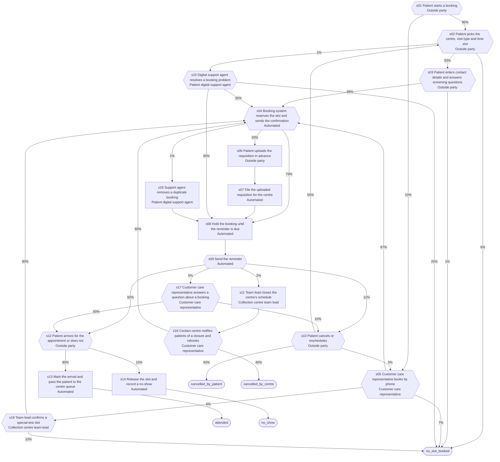

# Book collection centre appointments online

`dls-cd-appointment-booking` · health care: medical laboratory testing and health services · consumer and digital services · part of `diagnostic-lab-services-co`

Patients who need blood or urine collected can book a time at one of about 200 collection centres instead of queuing as walk-ins. Most book themselves on the website, which reserves a slot, sends a confirmation and a reminder and puts the booked patient ahead of walk-ins on arrival; about one in ten books by phone through the contact centre, including timed tests that need the centre to confirm staff and equipment. Booking is almost all automatic, but cancellations, no-shows, unexpected centre closures, duplicate bookings and patients whose confirmations never arrive create work for contact centre and digital support staff and leave slots empty while walk-ins wait.

| | |
|---|---|
| Unit of work | one booking |
| Starts when | A patient asks for a collection centre time slot online or by phone. |
| Done when | The patient has arrived and is in the centre's registration queue, or the booking ended as a cancellation, a no-show, a centre closure or an attempt that never became a booking. |
| Organisation | A large Canadian community laboratory company with about 200 collection centres in Ontario, Quebec and Manitoba, an online booking tool, a patient portal and a central contact centre. (3,300 employees, 2019-2022) |
| Volume | 320,000 cases a month (range 250,000 to 400,000) |

## Where it sits

- Starts with **appointment_request** from patient (100% of cases)
- Sends **appointment** to cl-psc-registration (outcome: attended)

## Flow

## Roles

| Role | Department | Layer | FTE on this process | Loaded cost per hour | Evidence |
|---|---|---|---:|---:|---|
| Customer care representative | Customer care contact centre | individual contributor | 34 | 29 CAD | B [jobbank_64409] |
| Patient digital support agent | Patient digital support | individual contributor | 3.5 | 29 CAD | C |
| Collection centre team lead | Laboratory and Health Services Centres network | supervisor | 2 | 40 CAD | C |

## Steps

Hands-on time and the wait before each step show the most common value. Evidence tier A is a sourced number, B a sourced description, C the author's estimate.

| Step | Who | Kind | Hands-on | Wait before | Control | Evidence |
|---|---|---|---:|---:|---|---|
| **s01 Patient starts a booking.** The patient, usually holding a requisition from their clinician, opens the location finder on the company website and chooses to book, or phones the customer care line because they prefer to talk to someone or need a special test. | Outside party | intake | 0 min | 0 min |  | B [dyn_findloc], [dyn_before] |
| **s02 Patient picks the centre, visit type and time slot.** On the booking page the patient filters centres by distance, opens one, chooses the visit type (routine blood and urine, or a timed test) and picks one of the open slots shown for the coming days. Patient time of two to five minutes is not counted as staff work. | Outside party | data entry | 0 min | 1 min |  | C |
| **s03 Patient enters contact details and answers screening questions.** The patient types name, date of birth, phone number and email and agrees to receive notices; in 2020 to 2022 the form also asked COVID-19 screening questions and told symptomatic patients not to book. | Outside party | data entry | 0 min | 1 min | Ontario Personal Health Information Protection Act: consent and limited collection for contact details; COVID-19 screening of visitors under provincial public health direction (2020 to 2022) | C |
| **s04 Booking system reserves the slot and sends the confirmation.** The booking engine holds the slot, adds the patient to the centre's appointment list and sends a confirmation email and text with the address, preparation notes and links to cancel or reschedule. | Automated | system auto | 0 min | 0 min |  | B [dyn_myturn], [dyn_plus] |
| **s05 Customer care representative books by phone.** After the telephone queue, a representative confirms the patient's identity, checks the test and any preparation rules, searches open slots at the centres the patient can reach, books the slot in the appointment system and reads back the time, address and preparation instructions. | Customer care representative | data entry | 4.5 min | 6 min |  | B [dyn_before] |
| **s06 Patient uploads the requisition in advance.** The patient photographs the requisition and submits it with the physician's and patient's names and date of birth through the upload page; requisitions older than six months are refused, and a confirmation email follows. | Outside party | data entry | 0 min | 30 min | Company upload rule: requisitions older than six months are not accepted | A [dyn_upload], [requpload] |
| **s07 File the uploaded requisition for the centre.** The upload service stores the image in the requisition imaging system, where centre staff can find it by patient name and date of birth when the patient arrives. | Automated | system auto | 0 min | 5 min |  | B [dyn_upload] |
| **s08 Hold the booking until the reminder is due.** The appointment sits on the centre's schedule until the day before; most patients book for the next few days, and some book weeks ahead for timed tests or a preferred centre. | Automated | system auto | 0 min | 1.0 d |  | B [dyn_myturn] |
| **s09 Send the reminder.** The booking system sends a reminder text or email the day before with the time, address, preparation reminder and the cancel and reschedule links. | Automated | system auto | 0 min | 0 min |  | C |
| **s10 Patient cancels or reschedules.** The patient uses the link to cancel or move the appointment, or phones in; a moved booking goes back to slot selection and the freed slot reappears in the calendar. | Outside party | data entry | 0 min | 1.0 h |  | B [dyn_myturn] |
| **s11 Team lead closes the centre's schedule.** When staff call in sick, the building loses power or a storm closes roads, the collection centre team lead blocks the affected slots in the booking system, marks the centre closed on the location finder and sends the list of booked patients to the contact centre. | Collection centre team lead | coordination | 0.5 min | 1.0 h |  | B [dyn_findloc] |
| **s12 Patient arrives for the appointment or does not.** On the day the patient comes to the centre at the booked time and tells the front desk; patients who come more than 15 minutes late are seen as walk-ins, and some do not come at all. | Outside party | intake | 0 min | 20.0 h |  | B [dyn_myturn], [kheirkhah2016] |
| **s13 Mark the arrival and pass the patient to the centre queue.** The booking system shows the patient as arrived when the lab assistant checks them in, and the booked visit moves ahead of walk-ins in the centre's queue for registration. | Automated | system auto | 0 min | 0 min |  | B [dyn_myturn], [ag2017] |
| **s14 Release the slot and record a no-show.** Fifteen minutes after the booked time the system releases the unused slot and records the absence, which feeds the centre's no-show statistics; the patient may later walk in or rebook. | Automated | system auto | 0 min | 15 min | Booking rule: a booked slot is held up to 15 minutes past the appointment time | B [dyn_myturn] |
| **s15 Digital support agent resolves a booking problem.** A support agent picks up the patient's web form or email during office hours, verifies the patient's identity, looks up the booking, then resends a missing confirmation, corrects the contact details or books the slot for the patient. | Patient digital support agent | communication | 5 min | 1.0 d | Ontario Personal Health Information Protection Act: verify identity before discussing a patient's booking | C |
| **s16 Contact centre notifies patients of a closure and rebooks.** A representative texts or phones each patient on the closure list, offers another slot at a nearby centre or another day, and books it, or tells the patient to walk in elsewhere. | Customer care representative | communication | 3 min | 2.0 h |  | C |
| **s17 Customer care representative answers a question about a booking.** A representative takes a call about an existing booking, for example how to prepare for a fasting test, how to find the centre, or a lost confirmation, looks up the appointment and answers or hands the caller on. | Customer care representative | communication | 3.5 min | 6 min |  | C |
| **s18 Support agent removes a duplicate booking.** A support agent works through the daily list of patients holding more than one future booking, confirms which one the patient wants from the most recent booking or by text, and cancels the extra slot so others can use it. | Patient digital support agent | validation | 1.5 min | 18.0 h |  | C |
| **s19 Team lead confirms a special-test slot.** For a glucose tolerance test, Holter monitor or breath test the representative messages the centre, and the team lead checks that a trained person, the device and a long enough slot are free before the booking is confirmed to the patient. | Collection centre team lead | coordination | 5 min | 8.0 h |  | B [dyn_before] |

## Exceptions

| Exception | Share of cases | What happens |
|---|---:|---|
| No-show | 8% | The patient does not come; the slot is released 15 minutes after the booked time and stays empty unless a walk-in is moved into it. |
| Patient cancels or reschedules | 10% | The patient uses the reminder link or phones to move or cancel; a moved booking goes back to slot selection. |
| Unexpected centre closure | 2% | Staff shortage, weather or an outage closes a centre; the team lead blocks the schedule and the contact centre contacts every booked patient to rebook. |
| Missing confirmation or booking error | 1% | The patient gets an error or no confirmation, often because of a mistyped email or phone number, and digital support fixes the booking the next business day. |
| Special test by phone | 1% | A timed or device-based test needs the centre team lead to confirm staff, device and a long slot before the representative confirms the booking. |

## Benchmarks

| Metric | Value | Unit | Population | Evidence |
|---|---|---|---|---|
| cycle_time_days | p50 3, p90 10 | calendar days from booking request to arrival or other end | All booking attempts | C |
| advance_booking_limit | 28 | days | Company booking tool after the reference period | A [dyn_myturn] |
| booked_slot_hold_after_appointment | 15 | minutes | Company booking tool after the reference period | A [dyn_myturn] |
| collection_wait_target | low 30, high 40 | minutes for 90% of patients after arrival | Ontario community laboratories, 2016/17 | A [ag2017] |
| outpatient_no_show_rate | 0.188 | share of appointments | Ten outpatient clinics at a US veterans hospital | A [kheirkhah2016] |

## Pain points

- No-shows and late cancellations leave booked slots empty while walk-ins wait, which makes it hard to set how many slots to offer. (steps s10, s12, s14; B [kheirkhah2016])
- Unexpected closures force the contact centre to reach every booked patient by phone or text at short notice. (steps s11, s16; B [dyn_findloc])
- Mistyped contact details stop confirmations and reminders, and digital support only answers in office hours, so fixes take about a day. (steps s03, s15; C)
- Uploaded requisitions are not linked to the booking, so centre staff must search for them by name at registration. (steps s06, s07; B [dyn_upload])

## Assumptions

- About 90% of bookings are made online and 10% by phone through the contact centre; the organisation file does not give the split.
- Patient time spent booking, uploading and travelling is not counted as hands-on time (touch time 0 for patient steps), so the staffing line covers staff only.
- The no-show rate is set at 10% of arrivals due and cancellations at 11%, below the 18.8% outpatient clinic rate in kheirkhah2016, because laboratory bookings are usually made a few days ahead.
- The MyTurn tool described on the company website is later than 2019 to 2022; its rules (4-week horizon, 15-minute hold, confirmation links) are taken as typical of the booking tool used in the period.
- Check-in at the counter is done by the lab assistant and documented in the registration workflow; this workflow ends when the booked patient joins the registration queue. The registration workflow assumes 45% of its visits come from bookings; with 320,000 bookings a month and about 77% attending, this workflow supplies about 245,000 visits, consistent with that share.
- Loaded costs come from the organisation file (hourly wage times 1.35).

## Sources

- [dyn_myturn] MyTurn: join the line, book an appointment or walk in (link withheld) (The model laboratory, undated). Current booking tool (after the reference period, powered by WaitWell): appointments up to 4 weeks in advance at participating locations; confirmation text and email with links to reschedule or cancel; notification 10 minutes before the patient's turn; arrive about 10 minutes early and tell the front desk; booked spots held up to 15 minutes past the appointment; pre-booked patients prioritised over walk-ins.
- [dyn_findloc] Find a location (link withheld) (The model laboratory, undated). Location finder with join-the-line and book-an-appointment links, real-time wait updates and a note that some locations may be closed unexpectedly.
- [dyn_before] Before my test (link withheld) (The model laboratory, undated). Most visits do not require appointments; appointments are needed for glucose, lactose and xylose tolerance tests, Holter monitoring, urea breath tests, breath alcohol, US DOT urine collections and some Quebec services, booked by contacting the nearest centre; bring a signed requisition and health card; requisition upload tool linked.
- [dyn_upload] Upload Ontario lab requisitions conveniently and securely (partner update, September 2020) (link withheld) (The model laboratory, 2020). From September 2020 physicians and patients can upload Ontario requisitions online; required fields are physician and patient names, date of birth and requisition date; requisitions older than 6 months are not accepted; the patient receives a confirmation email with information on checking in remotely and tells staff on arrival that the requisition was uploaded.
- [requpload] Requisition uploader (link withheld) (The model laboratory, undated). Upload form with required physician and patient names and date of birth, optional health card number and email, and a file upload control.
- [dyn_plus] The consumer health service (link withheld) (The model laboratory, undated). Patient portal in Ontario and Quebec that lets patients see results and keep track of their appointments.
- [ag2017] [2017 Annual Report, Section 3.07: Laboratory Services in the Health Sector](https://www.auditor.on.ca/en/content/annualreports/arreports/en17/v1_307en17.pdf) (Office of the Auditor General of Ontario, 2017). Community laboratories set their own collection wait targets (90% of patients served within 30 or 40 minutes of arrival); in 2016/17 the two sampled community laboratories averaged 14 and 17 minutes and met their targets for 87% and 89% of patients; wait times were the improvement most often named by patients.
- [kheirkhah2016] [Prevalence, predictors and economic consequences of no-shows (Kheirkhah P et al., BMC Health Services Research 16:13)](https://www.ebi.ac.uk/europepmc/webservices/rest/PMC4714455/fullTextXML) (Europe PMC (full text of PMC4714455), 2016). Mean outpatient no-show rate 18.8% in 10 clinics (12.6% to 25.7%); reminder letters did not change it and a centralised phone reminder system lowered it only modestly.
- [jobbank_64409] [Wages: Customer Service Representative - Call Centre in Ontario (NOC 64409)](https://www.jobbank.gc.ca/marketreport/wages-occupation/15201/ON) (Government of Canada Job Bank, 2025). Ontario hourly wages low $17.95, median $21.50, high $33.17 (2023-2024).

Written by claude-opus on 2026-11-17.
