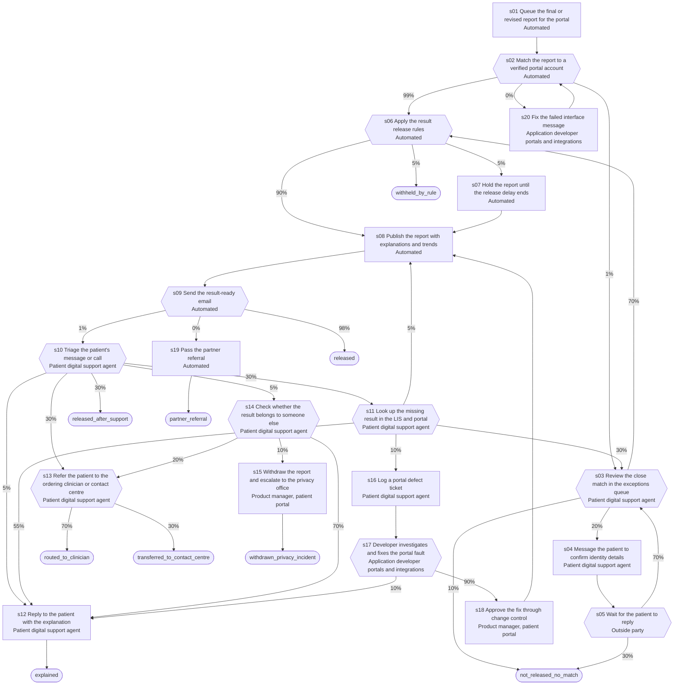

# Release laboratory results to the patient portal

`dls-cd-portal-results` · medical laboratory services · consumer and digital services · part of `diagnostic-lab-services-co`

This process publishes a patient's finished laboratory report to the company's results portal, with plain-language explanations and trends, after release rules have removed tests that must go only to the physician and held a few for a delay. Almost all of it runs automatically between the laboratory information system and the portal. People are needed when the report cannot be matched to a verified account, when a patient cannot find a result or asks what it means, when an interface fault blocks publication, and in the rare case of a report shown to the wrong person. Support works weekday office hours while results arrive around the clock, so patient questions wait.

| | |
|---|---|
| Unit of work | one result release |
| Starts when | The LIS finalises or revises a report for a patient with a portal account, or a newly verified account pulls in the patient's recent reports. |
| Done when | The report is published and the patient notified, or it is withheld by rule, not linked to any account, or withdrawn; any patient query is answered or routed. |
| Organisation | A large Canadian community laboratory company with a subscription patient portal in Ontario and Quebec, fed from its LIS, with a small digital support team. (3,300 employees, 2019-2022) |
| Volume | 250,000 cases a month (range 150,000 to 350,000) |

## Where it sits

- Starts with **test_result** from cl-result-reporting (96% of cases)
- Starts with **portal_account** from cd-portal-registration (4% of cases)
- Sends **patient_result_release** to patient (outcome: released)
- Sends **patient_result_release** to patient (outcome: released_after_support)
- Sends **client_inquiry** to cs-client-inquiries (outcome: transferred_to_contact_centre)
- Sends **partner_referral** to digital_health_partner (outcome: partner_referral)

## Flow

## Roles

| Role | Department | Layer | FTE on this process | Loaded cost per hour | Evidence |
|---|---|---|---:|---:|---|
| Patient digital support agent | Patient digital support | individual contributor | 7 | 29 CAD | B [jobbank_64409] |
| Application developer (portals and integrations) | LIS and integration | individual contributor | 0.8 | 68 CAD | C |
| Product manager, patient portal | Digital product and marketing | senior specialist | 0.4 | 65 CAD | C |

## Steps

Hands-on time and the wait before each step show the most common value. Evidence tier A is a sourced number, B a sourced description, C the author's estimate.

| Step | Who | Kind | Hands-on | Wait before | Control | Evidence |
|---|---|---|---:|---:|---|---|
| **s01 Queue the final or revised report for the portal.** When the LIS marks a requisition's results final, or issues a revised report, it writes an outbound result message for the patient portal alongside the messages to the clinician's EMR. The message carries patient identifiers, test codes, values, reference ranges and flags. | Automated | system auto | 0 min | 5 min |  | B [dplus_faq] |
| **s02 Match the report to a verified portal account.** On each interface run the portal looks for a verified account whose name, date of birth and health card or PIN match the LIS order, for an order within the last 30 days. Exact matches are linked automatically; close matches go to an exceptions queue and malformed messages to the developers' error queue. | Automated | system auto | 0 min | 1.0 h | PHIPA s. 12: reasonable steps to protect personal health information against unauthorized use or disclosure; matching only to identity-verified accounts | B [dplus_faq], [oma_privacy] |
| **s03 Review the close match in the exceptions queue.** A patient digital support agent opens the exception, compares the account profile with the LIS demographics (spelling, hyphenated surname, date of birth, health card version) and the identity verification record, and links the report only if the identity is certain. | Patient digital support agent | validation | 4 min | 12.0 h | Portal identity matching procedure: link only when identity is confirmed (PHIPA safeguards) | B [dplus_faq] |
| **s04 Message the patient to confirm identity details.** The agent sends a secure portal message or email asking the patient to confirm or correct the profile details, or to bring photo identification to a collection centre for a PIN, and logs a case in the CRM. | Patient digital support agent | communication | 4 min | 4.0 h |  | C |
| **s05 Wait for the patient to reply.** The patient may correct the profile, visit a centre for verification or ignore the message. Results stay unpublished in the meantime, though the ordering clinician already has them. | Outside party | external wait | 0 min | 2.0 d |  | C |
| **s06 Apply the result release rules.** The portal compares each test code with the release rule table approved by the laboratory medical directors: genetic, pathology and cardiology tests, tests done by a government laboratory and tests that must go only to the physician are suppressed, and some tests are held for a set delay. Reports with nothing releasable are not published. | Automated | system auto | 0 min | 1 min | Laboratory release rules: results restricted by regulation or required to go directly to the physician are not shown; medical director approved delay list | B [dplus_faq], [dyn_privacy], [dplus_terms] |
| **s07 Hold the report until the release delay ends.** Reports with a delayed test wait in the portal so that the ordering clinician can see and act on them first, then are released automatically on the release date. | Automated | system auto | 0 min | 3.0 d | Clinician-first delay for selected results set by the medical directors | B [dplus_faq], [steitz2021] |
| **s08 Publish the report with explanations and trends.** The portal stores the report against the account, adds the plain-language explanation for each test and plots it against the patient's earlier values; a revised report replaces the earlier version and is marked REVISED. | Automated | system auto | 0 min | 2 min |  | B [dyn_plus_page], [dplus_faq] |
| **s09 Send the result-ready email.** The portal emails the patient that a new or updated report is ready, without any result content. Most patients log in, read the report and do nothing more; a small share contact support or open a partner service from the report page. | Automated | system auto | 0 min | 2 min |  | B [dplus_faq], [dyn_partners2020] |
| **s10 Triage the patient's message or call.** A support agent answers the digital support line or the web contact form during weekday business hours, verifies the caller against the account and sorts the issue: log-in or notification trouble, a missing result, a question about what a result means, a result that looks wrong, or a subscription question. | Patient digital support agent | intake | 5 min | 1.0 d | Caller identity verification before discussing account information (PHIPA safeguards) | B [dplus_terms], [dplus_faq] |
| **s11 Look up the missing result in the LIS and portal.** The agent looks up the order in the LIS and in the portal administration screen to see whether the result is still pending, on the excluded or delayed list, unlinked because of a demographic mismatch, or stuck by a fault. | Patient digital support agent | lookup | 5 min | 30 min |  | B [dplus_faq] |
| **s12 Reply to the patient with the explanation.** The agent explains on the phone or in a written reply why the result is not shown or when it will appear, or answers the subscription question, and closes the CRM case. | Patient digital support agent | communication | 4 min | 30 min |  | C |
| **s13 Refer the patient to the ordering clinician or contact centre.** Agents may not interpret results, so the agent tells the patient to discuss the result with the ordering clinician, points to the plain-language explanation, offers the virtual care partner, or transfers questions about collection, requisitions or report copies to the customer care contact centre. | Patient digital support agent | communication | 2 min | 0 min | Portal terms: only a qualified healthcare provider interprets results; support staff do not give clinical advice | B [dplus_terms] |
| **s14 Check whether the result belongs to someone else.** The agent compares the identifiers on the published report with the account's verification record and the LIS order, and checks whether the patient is querying a value they think is wrong rather than a report that is not theirs. | Patient digital support agent | validation | 8 min | 1.0 h |  | C |
| **s15 Withdraw the report and escalate to the privacy office.** The product manager unpublishes the report, suspends the affected links, records who viewed it from the access log and opens a privacy incident so the privacy office can assess notification of both patients. | Product manager, patient portal | judgment | 45 min | 2.0 h | PHIPA s. 12(2): notify individuals at the first reasonable opportunity when personal health information is used or disclosed without authority | B [oma_privacy], [dyn_privacy] |
| **s16 Log a portal defect ticket.** The agent records the account, order and screenshots in an IT ticket for the portal developers and tells the patient the result will appear once the fault is fixed. | Patient digital support agent | data entry | 10 min | 10 min |  | C |
| **s17 Developer investigates and fixes the portal fault.** A developer reproduces the fault, checks the interface logs and mapping tables, and corrects the data or the mapping, or finds there is no fault and returns the ticket. | Application developer (portals and integrations) | analysis | 1.5 h | 2.0 d |  | C |
| **s18 Approve the fix through change control.** The product manager reviews the test evidence for a mapping or code change and approves deployment in the next change window; data-only corrections are approved the same day. | Product manager, patient portal | approval | 20 min | 1.0 d | IT change management and computerized system validation for patient-facing systems | C |
| **s19 Pass the partner referral.** When the patient chooses virtual care or digital therapy from the report page, the portal opens the partner's booking page with the patient's consent and records the referral; the partner handles the rest. | Automated | system auto | 0 min | 1 min |  | B [dyn_partners2020], [lifelabs2020] |
| **s20 Fix the failed interface message.** A developer reads the interface error queue, finds the cause (missing field, unmapped test code, character problem), corrects the mapping or the message and resubmits it to the portal. | Application developer (portals and integrations) | analysis | 8 min | 8.0 h |  | C |

## Exceptions

| Exception | Share of cases | What happens |
|---|---:|---|
| Close match needs review | 1% | Profile and LIS demographics differ slightly; an agent links the report or asks the patient to confirm. |
| Interface message failure | 0% | A malformed or unmapped message is fixed by a developer and resubmitted. |
| Delayed release | 5% | A test on the delay list holds the report for 1 to 14 days so the clinician sees it first. |
| Whole report excluded | 5% | All tests are genetic, pathology, cardiology, government-lab or physician-only, so nothing is published. |
| Missing result query | 0% | The patient cannot find a result; the agent finds it pending, excluded, mismatched or stuck. |
| Portal defect | 0% | A display or mapping fault goes through a ticket, a developer fix and change control before republishing. |
| Report shown to the wrong person | 0% | The report is withdrawn and a privacy incident opened. |

## Benchmarks

| Metric | Value | Unit | Population | Evidence |
|---|---|---|---|---|
| cycle_time_days | p50 0.1, p90 0.25 | calendar days from final result in the LIS to publication and notification | Canadian community laboratory patient portals, 2019-2022 | C [dplus_faq], [lifelabs2015] |
| portal_membership_price | 9.99 | CAD per year | The consumer health service | A [dplus_faq], [dyn_partners2020] |
| portal_users_comparable_provider | 2600000 | Ontario customers using the portal | LifeLabs my results, 2020 | A [lifelabs2020] |
| delayed_results_viewed_before_clinician | with_delay 0.104, immediate_release 0.403 | share of results | US academic medical centre, 2020-2021 | A [steitz2021] |
| support_hours | Monday to Friday 8:00 to 16:00 Eastern | hours | The consumer health service customer care | A [dplus_terms] |

## Pain points

- Small demographic differences between the portal profile and the LIS order leave reports unpublished until the patient notices and calls. (steps s02, s03, s11; B [dplus_faq])
- Many test types are never shown, so patients expecting genetic, pathology or cardiology results call support or their clinician. (steps s06, s10, s13; B [dplus_faq], [dyn_privacy])
- Support works weekday office hours while reports publish around the clock, so evening and weekend questions wait up to three days. (steps s10; B [dplus_terms])
- Patients see results before discussing them with a clinician and support staff may not interpret them, so questions bounce to clinicians. (steps s09, s13; B [dplus_terms], [steitz2021])
- Interface faults and mapping changes need scarce developer time and a change window before results reappear. (steps s17, s18, s20; C)

## Assumptions

- A case is one requisition's report, final or revised, for a patient with a verified account; interim reports for pending tests are counted as separate releases.
- Identity verification and payment happen in cd-portal-registration; this process starts from a verified account.
- The release rule table is maintained periodically by the product manager with the laboratory medical directors and is not modelled per case.
- The share of releases that lead to a support contact (1.25 per cent) and the category split are estimates; they are set so the stated support time fits a team of 14 agents who also handle registration and online orders.
- Some patients phone the main contact centre about portal results instead; those calls belong to cs-client-inquiries and are not counted here.
- A misdirected report leads to a privacy incident (lp-privacy-incident), but the organisation file links that process only to result reporting and security incidents, so it is not listed in this workflow's interfaces.
- The Interac identity verification and some FAQ details come from current pages and may postdate 2019-2022; the matching and exclusion rules are assumed to have applied in the reference period.

## Sources

- [dplus_faq] The consumer health service frequently asked questions (link withheld) (The consumer health service, undated). Lab reports appear in the account within 3 hours of the order being entered; results generally take 1 calendar day to analyse; genetic, cardiology and pathology tests, tests controlled by regulatory requirements, tests sent to a government lab and tests that must go directly to the physician are not shown; food intolerance reports released 14 days after results are final; revised reports marked REVISED; one-time identity verification by in-person PIN or Interac verification and the patient's details must match the lab order, with a model laboratory test in the last 30 days; five failed attempts lock the account; email notifications when reports are ready or updated; missing results: check profile details match the order, then contact customer care at 855.748.1115; membership CAD 9.99 a year; results always sent to the ordering physician separately.
- [dplus_terms] The consumer health service terms of use (link withheld) (The consumer health service, undated). Portal shows results of select tests; the model laboratory may limit distribution of certain tests by jurisdiction; only a qualified healthcare provider can interpret results and patients should discuss results with the ordering provider; one-time passcode at login; customer care 1-855-748-1115 Monday to Friday 8 a.m. to 4 p.m. Eastern; subscription renews automatically.
- [dyn_privacy] Privacy policy (link withheld) (The model laboratory, undated). Not all test results are available through the consumer health service; patients must contact their ordering physician for sensitive results, results under regulatory controls, results sent to a government lab and results required to go directly to the physician; privacy officers handle access and complaints; safeguards include need-to-know access, passwords and encryption.
- [dyn_plus_page] The consumer health service (link withheld) (The model laboratory, undated). Portal available in Quebec and Ontario; lab results with a clear explanation of what they mean; track results over time; appointment tracking.
- [dyn_partners2020] The consumer health service expands digital offerings with access to mental health therapy and virtual care (link withheld) (The model laboratory, 2020). The consumer health service at CAD 9.99 a year; virtual care with Tia Health and therapist-guided digital CBT with MindBeacon reached through the portal website and app; explanations of results.
- [lifelabs2015] [LifeLabs announces Ontario launch of my results](https://www.canhealth.com/2015/07/08/lifelabs-announces-ontario-launch-of-my-results/) (Canadian Healthcare Technology, 2015). Most LifeLabs results available online, posted within 24 to 48 hours, free of charge; over 500,000 British Columbians accessed results online after the 2010 launch.
- [lifelabs2020] [LifeLabs online portal update provides convenient virtual care options to over 2.6 million Ontarians](https://www.biospace.com/lifelabs-online-portal-update-provides-convenient-virtual-care-options-to-over-2-6-million-ontarians) (GlobeNewswire via BioSpace, 2020). Over 2.6 million Ontario customers use the my results portal to book appointments and view results; more than 4 million Canadians receive results online; virtual care partners reached after viewing results.
- [steitz2021] [Association of immediate release of test results to patients with implications for clinical workflow](https://pmc.ncbi.nlm.nih.gov/articles/PMC8524306) (JAMA Network Open (Steitz, Sulieman, Wright, Rosenbloom), 2021). Before the US Cures Act rule, results were released immediately or after a 1-, 3-, 7- or 14-day delay; patients viewed 10.4 per cent of delayed-release results before clinicians, rising to 40.3 per cent after immediate release; median daily patient messages within 6 hours of viewing a delayed-release test rose from 77.5 to 146.
- [oma_privacy] [Privacy and secure electronic communication](https://www.oma.org/practice-professional-support/running-your-practice/operations-and-practice-management/cybersecurity/privacy-and-secure-electronic-communication/) (Ontario Medical Association, undated). Custodians must take reasonable steps to protect personal health information under PHIPA, including against unauthorized access; electronic communication of PHI must be secure; failures can lead to IPC and CPSO penalties.
- [jobbank_64409] [Wages: Customer Service Representative - Call Centre in Ontario (NOC 64409)](https://www.jobbank.gc.ca/marketreport/wages-occupation/15201/ON) (Job Bank, Government of Canada, 2025). Ontario hourly wages low 17.95, median 21.50, high 33.17 (2023-2024).

Written by claude-opus on 2026-11-17.
