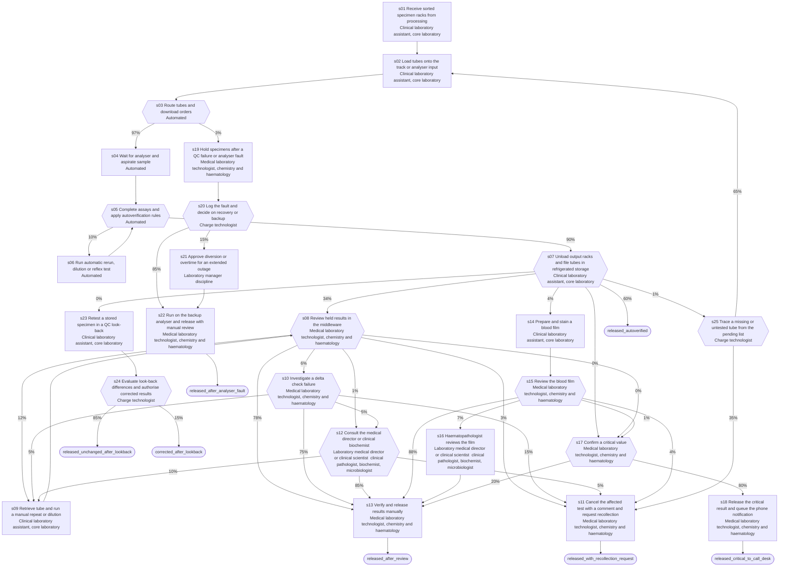

# Test specimens in chemistry, immunoassay and haematology (core laboratory)

`dls-cl-core-testing` · medical laboratory services · laboratory operations · part of `diagnostic-lab-services-co`

Community specimens that specimen processing has accessioned and sorted are loaded by laboratory assistants onto automated track lines and stand-alone haematology and urinalysis analysers. Middleware applies rules that release most results automatically; a registered technologist reviews the rest, orders repeats, dilutions and blood films, investigates delta check failures, cancels unsuitable specimens and confirms critical values. Results are released only while quality control is in control, so QC failures and analyser faults stop reporting and can force a look-back on earlier runs. Most elapsed time is queueing at the analyser input and in review queues during the evening arrival peak, plus instrument run time when nobody is working.

| | |
|---|---|
| Unit of work | one requisition with core laboratory tests (about five to six tests) |
| Starts when | Specimen processing hands over accessioned, centrifuged and sorted tubes for a requisition to the core laboratory. |
| Done when | Every core laboratory test on the requisition is released to the LIS (autoverified or by a technologist), cancelled with a comment for recollection, or handed to the call desk as a critical value, and the tubes are in refrigerated storage. |
| Organisation | A large Canadian community laboratory company with regional hub laboratories running track-connected chemistry and immunoassay lines and haematology analysers with middleware autoverification. (3,300 employees, 2019-2022) |
| Volume | 640,000 cases a month (range 560,000 to 720,000) |

## Where it sits

- Starts with **accessioned_specimen** from cl-specimen-accessioning (100% of cases)
- Relies on **qc_record** from cl-daily-qc (a standing input; it does not start a case)
- Relies on **lis_change** from it-lis-change (a standing input; it does not start a case)
- Relies on **competency_record** from qa-training-competency (a standing input; it does not start a case)
- Sends **test_result** to cl-result-reporting (outcome: any)
- Sends **critical_result** to cs-critical-result-notification (outcome: released_critical_to_call_desk)
- Sends **maintenance_request** to fac-instrument-maintenance (outcome: released_after_analyser_fault)
- Sends **stock_requisition** to sc-replenishment (outcome: released_after_analyser_fault)
- Sends **it_ticket** to it-service-desk (outcome: released_after_analyser_fault)

## Flow

## Roles

| Role | Department | Layer | FTE on this process | Loaded cost per hour | Evidence |
|---|---|---|---:|---:|---|
| Medical laboratory technologist, chemistry and haematology | Core laboratory (chemistry, immunoassay, haematology, urinalysis) | individual contributor | 100 | 52 CAD | A [s_jobbank_mlt] |
| Clinical laboratory assistant, core laboratory | Core laboratory (chemistry, immunoassay, haematology, urinalysis) | individual contributor | 40 | 30 CAD | C |
| Charge technologist | Community laboratory testing (The model laboratory Laboratories) | supervisor | 6 | 58 CAD | C |
| Laboratory manager (discipline) | Community laboratory testing (The model laboratory Laboratories) | manager | 1 | 72 CAD | C |
| Laboratory medical director or clinical scientist (clinical pathologist, biochemist, microbiologist) | Community laboratory testing (The model laboratory Laboratories) | senior specialist | 1 | 230 CAD | B [s_krasowski] |
| Director, laboratory operations (regional laboratory) | Community laboratory testing (The model laboratory Laboratories) | director | 0.2 | 105 CAD | C |

## Steps

Hands-on time and the wait before each step show the most common value. Evidence tier A is a sourced number, B a sourced description, C the author's estimate.

| Step | Who | Kind | Hands-on | Wait before | Control | Evidence |
|---|---|---|---:|---:|---|---|
| **s01 Receive sorted specimen racks from processing.** A core laboratory assistant collects racks of centrifuged, accessioned tubes that specimen processing has sorted for chemistry, immunoassay, haematology and urinalysis, checks the rack count against the processing hand-off and stages them by priority (urgent first, then routine by arrival). | Clinical laboratory assistant, core laboratory | physical | 0.05 min | 20 min |  | C |
| **s02 Load tubes onto the track or analyser input.** The laboratory assistant places tubes into the track input module or directly onto stand-alone analysers (haematology, coagulation, urinalysis), clears tubes the reader rejects for an unreadable barcode or wrong orientation, and relabels or returns them to processing. | Clinical laboratory assistant, core laboratory | physical | 0.12 min | 30 min |  | C |
| **s03 Route tubes and download orders.** The track scans each barcode, queries the LIS through the middleware for the tests ordered, decaps the tube and sends it to the analysers that carry those assays; tubes for tests not on the line are diverted to an exit lane for manual benches. | Automated | system auto | 0 min | 8 min |  | B [s_clp_c24] |
| **s04 Wait for analyser and aspirate sample.** Routed tubes queue at each analyser until it aspirates them; chemistry and immunoassay run on track-connected modules while CBC and coagulation run on haematology analysers in parallel. Nobody works on the requisition during this queue. | Automated | system auto | 0 min | 15 min |  | C |
| **s05 Complete assays and apply autoverification rules.** After the assays finish (instrument run time of roughly 10 to 30 minutes for most chemistry and immunoassay tests), the middleware checks each result against instrument flags, serum indices, measuring range, delta checks, critical limits and QC status, releases passing results to the LIS and holds the rest or orders an automatic rerun, dilution or reflex test. | Automated | system auto | 0 min | 25 min | ISO 15189:2012 clause 5.9.1 review of results before release; autoverification rules validated and approved by the medical director (CLSI AUTO10 practice); results released only while QC is accepted (Westgard multirule) | A [s_krasowski], [s_westgard], [s_deetz], [s_acd] |
| **s06 Run automatic rerun, dilution or reflex test.** The middleware sends the tube back to the analyser while it is still on the track for a repeat, an onboard dilution of an over-range result, or a reflex test set by an approved algorithm (for example free T4 after an abnormal TSH). Nobody touches the tube. | Automated | system auto | 0 min | 30 min |  | B [s_krasowski] |
| **s07 Unload output racks and file tubes in refrigerated storage.** The laboratory assistant empties the track output or analyser trays, files tubes in dated storage racks in the walk-in refrigerator so they can be found for reruns and add-on tests, and leaves the result decisions to the middleware and technologists. | Clinical laboratory assistant, core laboratory | physical | 0.08 min | 20 min | Specimen retention after examination for repeat or additional examinations (ISO 15189 post-examination handling of samples) | B [s_krasowski], [s_qp_smear] |
| **s08 Review held results in the middleware.** A technologist opens the middleware review queue, looks at each held result with its flags, serum indices, the patient's previous results and the other tests on the requisition, and decides to release it, rerun or dilute it, investigate a delta failure, cancel it as unsuitable, refer it, or treat it as a critical value. | Medical laboratory technologist, chemistry and haematology | judgment | 0.8 min | 30 min | Medical Laboratory Technology Act, 1991: evaluation of the technical sufficiency of investigations and their results is within the registered MLT scope; ISO 15189:2012 clause 5.9.1 | B [s_krasowski], [s_schifman], [s_cmlto_law] |
| **s09 Retrieve tube and run a manual repeat or dilution.** The laboratory assistant prints or reads the retrieval list, finds the tube in the dated storage rack, and loads it for the repeat or a manual dilution the technologist specified; the repeat result returns to the technologist's review queue. | Clinical laboratory assistant, core laboratory | physical | 1.5 min | 45 min |  | C |
| **s10 Investigate a delta check failure.** The technologist compares the result with the patient's earlier values and the other analytes, views the requisition image and label details, checks for a transfusion, treatment or known condition, and, if a mislabel is suspected, checks the collection site record before deciding. | Medical laboratory technologist, chemistry and haematology | analysis | 5 min | 10 min | ISO 15189:2012 clause 5.9.1 review against previous results; laboratory delta check procedure | A [s_schifman] |
| **s11 Cancel the affected test with a comment and request recollection.** The technologist cancels or suppresses the unsuitable result in the LIS with a standard comment (for example haemolysed specimen, please recollect), releases the other results on the requisition and logs the specimen problem for the processing and collection teams. | Medical laboratory technologist, chemistry and haematology | data entry | 3 min | 10 min | ISO 15189 sample acceptance and rejection criteria; OAML guideline treats haemolysed potassium as not meaningful | A [s_ag2017], [s_oaml] |
| **s12 Consult the medical director or clinical biochemist.** The technologist phones or messages the on-duty medical director or clinical biochemist about an unexpected or implausible result; the director reviews the case in the LIS and decides whether to release it with an interpretive comment, run further tests or reject the specimen. | Laboratory medical director or clinical scientist (clinical pathologist, biochemist, microbiologist) | judgment | 8 min | 4.0 h | ISO 15189 laboratory director responsibility for interpretation and advisory services | C |
| **s13 Verify and release results manually.** The technologist releases the reviewed results to the LIS under their own login, adding any comment, which makes them available for reporting; the LIS records who released each result and when. | Medical laboratory technologist, chemistry and haematology | approval | 0.3 min | 5 min | Medical Laboratory Technology Act, 1991 scope of practice and laboratory licensing staff qualifications: results not autoverified are released by a registered MLT | B [s_cmlto_law], [s_csmls] |
| **s14 Prepare and stain a blood film.** For CBCs that meet the smear review criteria the slide maker-stainer prepares a film automatically; the laboratory assistant collects the stained slides, checks labels and film quality, and takes them to the morphology bench or loads them on the digital imaging analyser. | Clinical laboratory assistant, core laboratory | physical | 0.8 min | 30 min |  | C |
| **s15 Review the blood film.** A technologist examines the film at the microscope or on the digital morphology screen, confirms or corrects the analyser differential, platelet estimate and red cell morphology, and decides to release, refer to a haematopathologist, request recollection (for example platelet clumping) or treat a finding as critical. | Medical laboratory technologist, chemistry and haematology | review | 5 min | 1.5 h | Laboratory smear review criteria validated against consensus rules (ISO 15189 examination procedures) | B [s_qp_smear] |
| **s16 Haematopathologist reviews the film.** The haematopathologist reviews the referred film and CBC history, writes an interpretive comment (for example suggesting further investigation for possible leukaemia) and returns the case to the technologist for release. | Laboratory medical director or clinical scientist (clinical pathologist, biochemist, microbiologist) | review | 6 min | 12.0 h | Laboratory haematology referral criteria for pathologist film review | C |
| **s17 Confirm a critical value.** The technologist checks specimen integrity (haemolysis, clots, delayed separation), looks for the same critical value in the past four months, repeats the test if the laboratory procedure asks for it, and decides whether the result meets the Level I criteria for an immediate call. | Medical laboratory technologist, chemistry and haematology | validation | 4 min | 5 min | OAML Guideline for Reporting Laboratory Test Results (CLP-025) Level I criteria; ISO 15189:2012 clause 5.9.1 critical intervals | A [s_oaml], [s_dyn_oaml] |
| **s18 Release the critical result and queue the phone notification.** The technologist releases the critical result, flags it in the LIS critical call list with the value and limits, and alerts the results call desk by the queue or a phone call so that a call attendant can reach the ordering clinician. | Medical laboratory technologist, chemistry and haematology | communication | 2 min | 2 min | OAML guideline: Level I results called to clinicians 24 hours a day, 7 days a week | B [s_oaml] |
| **s19 Hold specimens after a QC failure or analyser fault.** When the QC software rejects a run under the multirule or an analyser goes down, the technologist suspends reporting and autoverification for the assay, pulls or redirects the affected tubes, and starts troubleshooting (reagent, calibration, maintenance). | Medical laboratory technologist, chemistry and haematology | judgment | 0.5 min | 10 min | CLSI C24 out-of-control procedure and Westgard multirule rejection: stop patient reporting until QC is acceptable | B [s_clp_c24], [s_westgard], [s_csmls] |
| **s20 Log the fault and decide on recovery or backup.** The charge technologist logs a service call or maintenance request in the maintenance log, a reagent stock request or an IT ticket for a middleware or interface fault, and decides whether to wait for recalibration and QC, move work to a backup analyser, or escalate an extended outage. | Charge technologist | coordination | 0.3 min | 15 min |  | C |
| **s21 Approve diversion or overtime for an extended outage.** The laboratory manager approves overtime, a call-in, or sending the backlog to a sister laboratory, and informs client services if turnaround will slip. | Laboratory manager (discipline) | approval | 0.2 min | 2.0 h | Laboratory downtime and business continuity procedure | C |
| **s22 Run on the backup analyser and release with manual review.** After QC is acceptable again, or on the backup analyser, the technologist reruns the held tubes and reviews every result before release because some autoverification rules are switched off during recovery. | Medical laboratory technologist, chemistry and haematology | review | 1.5 min | 2.0 h | CLSI C24: patient testing resumes only after QC meets acceptance criteria | B [s_clp_c24] |
| **s23 Retest a stored specimen in a QC look-back.** After a QC failure is found and corrected, the laboratory assistant retrieves stored tubes run since the last acceptable QC and reruns them on the corrected analyser so the original and repeat values can be compared. | Clinical laboratory assistant, core laboratory | physical | 2 min | 4.0 h | CLSI C24 and ISO 15189 quality control: evaluate patient results since the last acceptable QC | B [s_clp_c24] |
| **s24 Evaluate look-back differences and authorise corrected results.** The charge technologist compares each repeat with the released value against the allowable difference set by the laboratory director, and for results outside it enters a corrected result and starts an amended report and a nonconformance record. | Charge technologist | judgment | 3 min | 1.0 h | CLSI C24: corrected reports and provider notification when differences exceed the laboratory director's limits | B [s_clp_c24] |
| **s25 Trace a missing or untested tube from the pending list.** The charge technologist works the end-of-shift pending list, searches the track, input rejects, storage and processing for the tube, and either reloads it or has the test cancelled for recollection. | Charge technologist | coordination | 5 min | 4.0 h |  | C |

## Exceptions

| Exception | Share of cases | What happens |
|---|---:|---|
| QC failure or analyser fault | 3% | The assay's QC run is rejected or an analyser fails; reporting stops, the fault is logged, and tubes wait for recovery or a backup analyser with manual review of every result. |
| QC look-back | 0% | A QC failure detected after a run puts already released results inside the look-back window; stored tubes are retested and about one in seven gets a corrected result and amended report. |
| Missing or untested tube | 1% | A tube is not found on the track or in storage at the end of the shift and is traced from the pending list, reloaded or cancelled for recollection. |
| Unsuitable specimen | 1% | Haemolysis, clotting, short sample, delayed separation or a suspected mislabel leads to one test being cancelled with a recollection comment while the rest are released. |
| Critical value | 0% | A result exceeds a Level I limit; the technologist confirms it, checks the four-month recurrence rule and hands it to the results call desk. |
| Blood film review | 4% | CBC flags meet the smear review criteria; a film is made and reviewed by a technologist and, for abnormal cells, a haematopathologist. |

## Benchmarks

| Metric | Value | Unit | Population | Evidence |
|---|---|---|---|---|
| cycle_time_days | p50 0.2, p90 0.6 | calendar days from receipt of sorted racks in the core laboratory to release of the last core result | Community requisitions in a large Ontario community laboratory | C [s_ag2017] |
| routine_results_within_24h_of_pickup | provider_1 94, provider_2 99 | percent of routine blood and chemistry tests, 2016/17 | Two Ontario community laboratory providers | A [s_ag2017] |
| autoverification_rate_tests | 99.5 | percent of core chemistry tests (2013) | One academic medical centre core chemistry laboratory after 13 years of rule refinement | A [s_krasowski] |
| results_flagged_for_repeat | 3 | percent of chemistry results | One large hospital chemistry laboratory, 855,000 results | A [s_deetz] |
| smear_review_rate | 26.7 | percent of automated CBCs (median) | 263 laboratories, mixed inpatient and outpatient | A [s_qp_smear] |
| delta_alert_episodes_reported_unchanged | 55.8 | percent of delta check alert episodes | 49 facilities, 4,505 episodes | A [s_schifman] |
| billable_tests_per_nonmanagement_fte_year | p10 27788, p90 105081 | billable tests per FTE per year | Highest-volume chemistry, haematology and immunology laboratories in a 151-institution Q-Probes study | A [s_qp_prod] |
| community_specimen_rejection_rate | provider_1 0.9, provider_2 0.2 | percent of specimens collected | Two Ontario community laboratory providers, 2016/17 | A [s_ag2017] |

## Pain points

- Most community specimens arrive between late afternoon and midnight, so tubes queue at the track input and held results queue for review; overnight staffing sets how much is released by morning. (steps s02, s04, s08; C)
- Delta check alerts take technologist time but most end with the result reported unchanged. (steps s10; A [s_schifman])
- Blood film review is manual microscope work that queues behind the analysers and depends on experienced technologists; pathologist referrals wait for the day shift. (steps s15, s16; B [s_qp_smear])
- A QC failure stops reporting for the assay and can force retesting of every specimen since the last acceptable QC, with corrected reports for some. (steps s19, s22, s23, s24; B [s_clp_c24])
- Manual reruns need a person to find the tube in dated storage racks, which adds a batch wait to each repeat. (steps s09; C)

## Assumptions

- Instrument run time and analyser queues are modelled as waiting with zero hands-on time (steps s04 to s06); event-level troubleshooting time is spread across the held requisitions as a fraction of a minute each.
- Requisition-level autoverification is set at about 60% (nothing held). Test-level rates of 90 to 95% are assumed for a community laboratory in 2019-2022; the published 99.5% is from one academic chemistry laboratory and excludes haematology.
- The qc_record, lis_change and competency_record inputs from the process map are enabling inputs, not case triggers, so they carry a share of 0 in interfaces.triggered_by.
- Maintenance requests, stock requisitions and IT tickets are attached to the analyser fault outcome because they arise per analyser event, not per requisition.
- Critical values are about 0.3% of core requisitions; the remainder of the organisation file's 2,500 critical calls a month come from microbiology and the reference laboratory.
- Loaded costs come from the organisation file (hourly wage times 1.35).
- Organisation file check: about 640,000 requisitions of five to six tests a month (about 42 million tests a year) with 210 core laboratory staff is roughly 200,000 tests per person a year, about twice the 90th percentile (105,081) for the highest-volume laboratories in the 2004 Q-Probes study. Either the core headcount is low or the test count includes many low-effort analytes; the stated FTE here stay within the organisation file headcount.
- The lab_ops_director role has no per-requisition step; its 0.2 FTE stands for turnaround and staffing oversight.

## Sources

- [s_krasowski] [Autoverification in a core clinical chemistry laboratory at an academic medical center (Krasowski et al.)](https://pmc.ncbi.nlm.nih.gov/articles/PMC4023033) (Journal of Pathology Informatics (PubMed Central), 2014). Autoverification rose from 40% (2000) to 99.5% of tests (2013); rules use instrument flags, haemolysis/icterus/lipaemia indices, reference, measuring range and manual review limits, critical values, delta checks and dilution protocols; all rules approved by the medical director; billable tests per hour rose from 14.9 to 19.7 (2005 to 2010).
- [s_westgard] [Westgard Rules: multirule QC](https://www.westgard.com/mltirule.htm) (Westgard QC, undated). Multirule QC: 1-2s warning rule; 1-3s, 2-2s, R-4s, 4-1s and 10x rejection rules; a run is rejected if any rejection rule is violated.
- [s_clp_c24] [The 7 best practices to recover from an out-of-control event](https://clpmag.com/lab-essentials/quality-systems/quality-control-programs/the-7-best-practices-to-recover-from-an-out-of-control-event/) (Clinical Lab Products, undated). Steps based on CLSI C24: stop patient reporting and turn off autoverification for the failed assay, route samples to an instrument with acceptable QC, find and correct the cause, reanalyse patient samples since the last acceptable QC, issue corrected reports and notify providers when differences exceed limits set by the laboratory director.
- [s_ag2017] 2017 Annual Report, Section 3.07: Laboratory Services in the Health Sector (link withheld) (Office of the Auditor General of Ontario, 2017). Community laboratories target routine blood and chemistry results within 24 hours of specimen pickup (about 75% of their testing); two providers met it for 94% and 99% of tests in 2016/17; community specimen rejection rates 0.9% and 0.2%; all licensed laboratories must follow the provincial quality management program of accreditation and proficiency testing; the model laboratory was one of the three largest community laboratories visited.
- [s_oaml] Guideline for Reporting Laboratory Test Results (CLP-025), revised September 2009 (link withheld) (Ontario Association of Medical Laboratories (copy hosted by the model laboratory), 2009). Level I critical values are phoned 24 hours a day, 7 days a week; Level II alerts are phoned or faxed 08:00 to 20:00; marked results recurrent within four months are communicated only in business hours; urgent results 6 to 12 hours after receipt; haemolysed potassium is not treated as a critical or alert value; critical and alert limits for chemistry and haematology.
- [s_dyn_oaml] OAML alert reporting (link withheld) (The model laboratory, undated). The company publishes the OAML reporting guideline to clinicians as its alert reporting protocol.
- [s_qp_smear] [New Q-Probes report: peripheral blood smear review](https://www.captodayonline.com/Archives/feature_stories/0405PeripheralBlud.html) (CAP Today (College of American Pathologists), 2005). 263 laboratories, more than 95,000 automated CBCs: median manual review rate 26.7% of CBCs, mean 28.7%; most reviews were triggered by instrument flags and only 3.5% by physician request.
- [s_deetz] [Repeat testing: is it necessary? (journal scan of Deetz, Nolan and Scott, Am J Clin Pathol 2012)](https://acutecaretesting.org/en/journal-scans/repeat-testing--is-it-necessary) (acutecaretesting.org, 2012). Of 855,000 results for 30 automated chemistry tests, 25,530 (3%) were flagged for repeat testing; most analytes had repeat 'error' rates below 0.5%.
- [s_schifman] [Delta check practices and outcomes: a Q-Probes study involving 49 health care facilities and 6541 delta check alerts (Schifman, Talbert, Souers)](https://experts.arizona.edu/en/publications/delta-check-practices-and-outcomes-a-q-probes-study-involving-49-/) (Archives of Pathology and Laboratory Medicine (University of Arizona research portal record), 2017). 4,505 episodes with 6,541 delta check alerts; median actions: clinical review 38.0%, retest 25.0%, recheck 20.2%; 55.8% of episodes reported without change and 3.0% not reported; mislabelling 0.3% of problems.
- [s_qp_prod] [Q-Probes study of laboratory staffing and productivity](https://www.captodayonline.com/Archives/feature_stories/1104QProbe.html) (CAP Today (College of American Pathologists), 2004). 151 institutions; highest-volume chemistry, haematology and immunology peer group: 27,788 (10th percentile) to 105,081 (90th percentile) billable tests per non-management FTE a year; chemistry usually runs three shifts.
- [s_cmlto_law] [Laws and legislation governing MLT practice](https://www.cmlto.com/laws-legislation-governing-mlt-practice/) (College of Medical Laboratory Technologists of Ontario, undated). Medical Laboratory Technology Act, 1991: scope of practice includes laboratory investigations and the evaluation of the technical sufficiency of the investigations and their results; protected title.
- [s_csmls] [Standards of practice](https://csmls.org/about-us/our-members/standards-of-practice/) (Canadian Society for Medical Laboratory Science, undated). MLTs validate test results, follow quality control protocols and review abnormal QC; laboratory assistants verify data and specimen handling.
- [s_jobbank_mlt] [Wages: Medical Technologist - Medical Laboratory in Ontario (NOC 32120)](https://www.jobbank.gc.ca/marketreport/wages-occupation/4203/ON) (Job Bank, Government of Canada, 2025). Ontario hourly wages low $23.00, median $42.00, high $50.00 (2023-2024 Labour Force Survey).
- [s_acd] [Accreditation Canada Diagnostics](https://diagnostics.accreditation.ca/) (Accreditation Canada Diagnostics, undated). Assesses medical laboratories against ISO 15189 Plus requirements with an external evaluation at the two-year mark.

Written by claude-opus on 2026-11-17.
