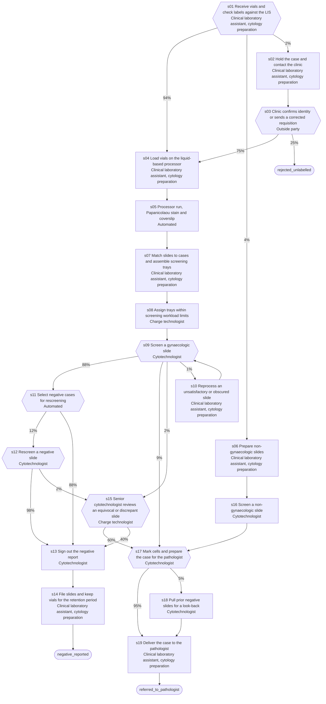

# Screen Pap tests and other cytology in the community laboratory

`dls-cl-cytology-screening` · medical laboratory services · laboratory operations · part of `diagnostic-lab-services-co`

Cervical screening Pap tests arrive as liquid-based vials, are made into thin-layer slides by laboratory assistants and screened under the microscope by cytotechnologists, one slide at a time within a daily workload limit. Negative cases, about nine in ten, are rescreened at random by a second cytotechnologist and signed out by cytotechnologists; abnormal, unsatisfactory and all non-gynaecologic cases are marked and passed to a pathologist. The work is slow because screening is manual and capped per person, and most elapsed time is cases waiting in the screening queue; errors are mostly missed abnormal cells, which rescreening and look-backs are designed to catch.

| | |
|---|---|
| Unit of work | one cytology case |
| Starts when | An accessioned cytology specimen (usually a liquid-based Pap vial) reaches the cytology laboratory. |
| Done when | A negative report is signed out by a cytotechnologist and the slide filed, or the case is marked and delivered to a pathologist, or the specimen is rejected for unresolved identification. |
| Organisation | A large Canadian community laboratory company with cytology at its main laboratories, liquid-based processors, automated staining and manual screening by cytotechnologists. (3,300 employees, 2019-2022) |
| Volume | 32,000 cases a month (range 25,000 to 40,000) |

## Where it sits

- Starts with **accessioned_specimen** from cl-specimen-accessioning (100% of cases)
- Sends **test_result** to cl-result-reporting (outcome: negative_reported)
- Sends **test_result** to cl-result-reporting (outcome: rejected_unlabelled)
- Sends **pathology_case** to cl-pathology-signout (outcome: referred_to_pathologist)

## Flow

## Roles

| Role | Department | Layer | FTE on this process | Loaded cost per hour | Evidence |
|---|---|---|---:|---:|---|
| Clinical laboratory assistant, cytology preparation | Cytology laboratory | individual contributor | 9 | 30 CAD | B [job_cyto_la], [jobbank33101] |
| Cytotechnologist | Cytology laboratory | individual contributor | 33 | 53 CAD | B [job_cytotech], [captoday_cyto10], [jobbank32120] |
| Charge technologist | Community laboratory testing (The model laboratory Laboratories) | supervisor | 1.2 | 58 CAD | B [jobs_list] |

## Steps

Hands-on time and the wait before each step show the most common value. Evidence tier A is a sourced number, B a sourced description, C the author's estimate.

| Step | Who | Kind | Hands-on | Wait before | Control | Evidence |
|---|---|---|---:|---:|---|---|
| **s01 Receive vials and check labels against the LIS.** The cytology laboratory assistant takes the accessioned liquid-based vials and other cytology specimens from processing, scans each one, checks the two patient identifiers on the vial against the requisition and the LIS order, and sorts gynaecologic vials from non-gynaecologic specimens. | Clinical laboratory assistant, cytology preparation | intake | 0.3 min | 4.0 h | Accreditation cytology requirements under ISO 15189 (IQMH in Ontario, MANQAP in Manitoba); the US rule 42 CFR 493.1274 describes the same practice: two-identifier specimen labelling and acceptance | B [job_cyto_la], [job_cytotech] |
| **s02 Hold the case and contact the clinic.** The laboratory assistant records the discrepancy, puts the case on hold in the LIS and phones or faxes the clinic to confirm the patient's identity or request a corrected requisition. | Clinical laboratory assistant, cytology preparation | communication | 8 min | 1.0 h | Accreditation cytology requirements under ISO 15189 (IQMH in Ontario, MANQAP in Manitoba); the US rule 42 CFR 493.1274 describes the same practice: specimens with unresolved identification are not tested | C |
| **s03 Clinic confirms identity or sends a corrected requisition.** The clinic replies by fax or phone with the confirmed identity or a corrected requisition; if identity cannot be confirmed the vial is rejected and the clinic is told to recollect. | Outside party | external wait | 0 min | 1.0 d |  | C |
| **s04 Load vials on the liquid-based processor.** The laboratory assistant loads gynaecologic vials into the liquid-based cytology processor in batches; the processor mixes each vial, collects cells on a filter and transfers a thin layer to a barcoded slide, which drops into fixative. | Clinical laboratory assistant, cytology preparation | physical | 0.4 min | 1.0 h |  | B [job_cyto_la], [captoday_cyto10] |
| **s05 Processor run, Papanicolaou stain and coverslip.** The processor finishes the batch and the slides go through the automated Papanicolaou stainer and coverslipper; nobody works on the case while the instruments run. | Automated | system auto | 0 min | 2.0 h |  | C |
| **s06 Prepare non-gynaecologic slides.** For urine, sputum and fluid specimens the laboratory assistant concentrates the cells by cytospin or liquid-based preparation, stains the slides, matches them to the case and places them on the non-gynaecologic screening tray. | Clinical laboratory assistant, cytology preparation | physical | 8 min | 2.0 h |  | C |
| **s07 Match slides to cases and assemble screening trays.** The laboratory assistant checks each slide label against the vial and the case in the anatomic pathology system, attaches the patient's prior cytology and histology results from the LIS, and builds screening trays. | Clinical laboratory assistant, cytology preparation | data entry | 0.4 min | 1.0 h | Accreditation cytology requirements under ISO 15189 (IQMH in Ontario, MANQAP in Manitoba); the US rule 42 CFR 493.1274 describes the same practice: slide identification at each handoff | B [job_cytotech] |
| **s08 Assign trays within screening workload limits.** The charge cytotechnologist assigns trays to each cytotechnologist's worklist so that no one exceeds their individual daily slide limit, and prioritises cases with a history of abnormal results or past their turnaround target. | Charge technologist | coordination | 0.1 min | 1.0 h | Daily screening workload limit per cytotechnologist set from past performance and reassessed every six months (Accreditation cytology requirements under ISO 15189 (IQMH in Ontario, MANQAP in Manitoba); the US rule 42 CFR 493.1274 describes the same practice) | B [cfr1274], [captoday_cyto10] |
| **s09 Screen a gynaecologic slide.** The cytotechnologist screens the whole slide under the microscope, assesses specimen adequacy, marks any abnormal cells with ink dots and records a Bethesda interpretation, counting the slide toward the daily workload limit. | Cytotechnologist | analysis | 5.5 min | 3.0 d | Daily screening workload limit (Accreditation cytology requirements under ISO 15189 (IQMH in Ontario, MANQAP in Manitoba); the US rule 42 CFR 493.1274 describes the same practice; 100 slides in 24 hours in the US rule) | A [epmc_rates], [epmc_unsat], [captoday_cyto10] |
| **s10 Reprocess an unsatisfactory or obscured slide.** For a bloody or poorly cellular slide the laboratory assistant treats the residual vial (for example with an acetic acid wash) and makes and stains a new slide, which returns to the cytotechnologist. | Clinical laboratory assistant, cytology preparation | physical | 5 min | 8.0 h |  | C |
| **s11 Select negative cases for rescreening.** The anatomic pathology system selects at least 10% of negative gynaecologic cases at random, plus cases from patients at higher risk, for rescreening by a second cytotechnologist before the result is reported. | Automated | system auto | 0 min | 0 min | Rescreen of at least 10% of negative gynaecologic cases, including high-risk patients, before reporting (Accreditation cytology requirements under ISO 15189 (IQMH in Ontario, MANQAP in Manitoba); the US rule 42 CFR 493.1274 describes the same practice) | A [cfr1274], [captoday_cyto10] |
| **s12 Rescreen a negative slide.** A second cytotechnologist rescreens the selected negative slide, records agreement or the abnormality found, and sends any discrepancy for senior review. | Cytotechnologist | review | 4 min | 12.0 h | Rescreen of negative cases before reporting (Accreditation cytology requirements under ISO 15189 (IQMH in Ontario, MANQAP in Manitoba); the US rule 42 CFR 493.1274 describes the same practice) | B [cfr1274] |
| **s13 Sign out the negative report.** The cytotechnologist checks the demographics, adequacy statement and the screening-program recommendation comment, then releases the negative report from the anatomic pathology system to the LIS for delivery. | Cytotechnologist | approval | 0.8 min | 2.0 h | Laboratory policy under accreditation: negative gynaecologic cases may be released by a registered cytotechnologist (Medical Laboratory Technology Act, 1991 scope); abnormal cases require a pathologist | B [cmlto], [cfr1274] |
| **s14 File slides and keep vials for the retention period.** The laboratory assistant files the signed-out slides in numbered boxes for long-term retention and keeps the residual vials in dated racks for the weeks set by policy so add-on tests remain possible. | Clinical laboratory assistant, cytology preparation | physical | 0.15 min | 12.0 h | Retention of cytology slides and records so they are retrievable on request (Accreditation cytology requirements under ISO 15189 (IQMH in Ontario, MANQAP in Manitoba); the US rule 42 CFR 493.1274 describes the same practice) | B [cfr1274], [job_cyto_la] |
| **s15 Senior cytotechnologist reviews an equivocal or discrepant slide.** The charge cytotechnologist reviews the dotted areas and the whole slide where needed, decides whether the case is negative or needs the pathologist, and records the outcome for the rescreen statistics. | Charge technologist | review | 5 min | 8.0 h |  | C |
| **s16 Screen a non-gynaecologic slide.** The cytotechnologist screens the urine, sputum or fluid slides, marks atypical or malignant cells and records a preliminary interpretation; all non-gynaecologic cases go to the pathologist. | Cytotechnologist | analysis | 8 min | 1.0 d |  | C |
| **s17 Mark cells and prepare the case for the pathologist.** The cytotechnologist confirms the ink dots, enters the preliminary Bethesda or descriptive interpretation, pulls the patient's prior cytology and biopsy results, and places the case in the pathologist's queue. | Cytotechnologist | drafting | 3 min | 10 min | A pathologist confirms every gynaecologic slide with reactive, atypical, premalignant or malignant changes (Accreditation cytology requirements under ISO 15189 (IQMH in Ontario, MANQAP in Manitoba); the US rule 42 CFR 493.1274 describes the same practice) | B [cfr1274] |
| **s18 Pull prior negative slides for a look-back.** For a new high-grade lesion the cytotechnologist retrieves the patient's negative slides from the past five years from the file and rescreens them so the pathologist can review any discrepancy with the current case. | Cytotechnologist | review | 20 min | 1.0 d | Five-year look-back of prior negative slides for a new high-grade lesion (Accreditation cytology requirements under ISO 15189 (IQMH in Ontario, MANQAP in Manitoba); the US rule 42 CFR 493.1274 describes the same practice) | A [cfr1274], [captoday_cyto10] |
| **s19 Deliver the case to the pathologist.** The laboratory assistant collects the referred slides with their worksheets and delivers the trays to the pathologists' offices on the scheduled runs, scanning the handoff in the anatomic pathology system. | Clinical laboratory assistant, cytology preparation | physical | 0.4 min | 4.0 h |  | C |

## Exceptions

| Exception | Share of cases | What happens |
|---|---:|---|
| Identification discrepancy | 2% | Vial and requisition do not match; the case waits for the clinic and a quarter are rejected. |
| Reprocessed slide | 1% | Bloody or poorly cellular slides are reprocessed from the residual vial and screened again. |
| Abnormal or unsatisfactory case | 9% | Marked and sent to the pathologist. |
| Rescreen discrepancy | 0% | The rescreen finds an abnormality missed in primary screening; senior review and pathologist referral follow. |
| Five-year look-back | 1% | Prior negative slides are rescreened for a new high-grade lesion. |

## Benchmarks

| Metric | Value | Unit | Population | Evidence |
|---|---|---|---|---|
| cycle_time_days | p50 6, p90 12 | calendar days from receipt in cytology to sign-out or referral | Author's estimate for a high-volume Canadian community cytology laboratory in 2019-2022 | C |
| unsatisfactory_rate_thinprep | 1.1 | percent of liquid-based (ThinPrep) Pap tests, laboratory median | CAP interlaboratory comparison program participants, 2006 | A [epmc_unsat] |
| asc_us_rate | 4.3 | percent of Pap tests, laboratory median | 679 CAP program laboratories, 2006 | A [epmc_rates] |
| manual_screening_limit | 100 | slides per cytotechnologist per 24 hours (US maximum) | US CLIA rule | A [cfr1274], [captoday_cyto10] |

## Pain points

- Manual screening is capped per person, so cytotechnologist availability sets turnaround and backlogs build quickly when staff are short. (steps s09, s08; B [captoday_cyto10], [captoday_img11])
- Screening accuracy falls when workload rises or late in the day, and missed abnormal cells are found only by rescreening or later biopsies. (steps s09, s12; A [captoday_img11])
- Identification discrepancies between vial and requisition hold cases for days while clinics respond. (steps s02, s03; C)
- Most hands-on effort goes to the nine in ten slides that are negative. (steps s09, s12, s13; A [epmc_rates], [epmc_unsat])

## Assumptions

- The organisation file's cytology unit holds only cytotechnologists (40). Slide preparation, matching, filing and delivery are given to a cytology laboratory assistant role added with not_in_org_file (about 9 FTE), because the company posts such a role; the organisation file should add it.
- Abnormal and unsatisfactory gynaecologic cases (about 9.1%) and all non-gynaecologic cases (about 4%) go to the pathologist, as the process map describes. This sends about 4,100 cases a month to pathology sign-out, slightly more than the process map's 16,000 sign-out volume implies when added to 13,000 surgical cases.
- Pathologist review of referred cytology is documented in the pathology sign-out workflow, so the pathologist role listed in the process map has no step here.
- Primary screening is manual at about 5.5 minutes a slide; imaging-assisted screening, which raises productivity 30 to 50%, is not assumed for the company in this period.
- Workload limits, rescreening and look-backs follow Canadian accreditation practice; the US CLIA rule is cited only as a public statement of the same requirements. The Canadian maximum daily slide count was not confirmed from an opened source.
- The screening queue (1 to 7 days, mode 3) is the author's estimate; pandemic backlogs in 2020 and 2021 would push it higher.
- HPV testing was not part of routine Ontario screening in 2019-2022 and is not modelled.
- Loaded costs are the organisation file's (hourly wage times 1.35) except the added cytology assistant.

## Sources

- [cfr1274] [42 CFR 493.1274 Standard: Cytology](https://www.law.cornell.edu/cfr/text/42/493.1274) (Legal Information Institute, Cornell Law School, current). US rule used as a reference for common practice: review of at least 10% of negative gynaecologic cases, randomly selected and including high-risk patients, before reporting; maximum 100 slides per person per 24 hours, not a performance target, individual limits reassessed every 6 months; a pathologist confirms every gynaecologic slide with reactive, atypical, premalignant or malignant changes; five-year look-back of prior negatives for a new HSIL or cancer; comparison of HSIL cytology with histology; annual statistical evaluation; slides retained and retrievable.
- [captoday_cyto10] [Cytology screening limits, by the numbers (Paxton)](https://www.captodayonline.com/Archives/1010/1010b_cytology_screening_limits.html) (CAP Today, 2010). CLIA limit of 100 slides in an eight-hour day; imaging-assisted systems 200 (ThinPrep) or 170 (FocalPoint) slides a day; full-day cytotechnologists screen about 6.5 to 7 hours; imaging raises productivity 30 to 50%; 95 to 99% of cytotechnologists are set at the maximum limit; liquid-based collection is over 90% of US Pap tests; negative cases require a 10% rescreen; five-year look-back for new high-grade dysplasia.
- [captoday_img11] [Imaging systems, workload limits, and screening accuracy (Lane)](https://www.captodayonline.com/Archives/0111/0111h_pap_ngc_imaging.html) (CAP Today, 2011). ThinPrep imager presents 22 fields of view per slide; in Elsheikh et al. 2010 workloads rose from 87 to 118 slides a day and above 100 slides a day screening performance fell (fewer manual reviews, lower detection, higher false-negative fraction).
- [epmc_unsat] [Europe PMC records: Moriarty et al. 2009, unsatisfactory reporting rates (CAP interlaboratory comparison program in gynecologic cytology, 2006)](https://www.ebi.ac.uk/europepmc/webservices/rest/search?query=TITLE%3A%28%22reporting%20rates%22%20OR%20%22laboratory%20practices%22%29%20AND%20TITLE%3A%28cervicovaginal%20OR%20%22gynecologic%20cytology%22%29%20AND%20AUTH%3A%28Eversole%29&resultType=core&format=json&pageSize=6) (Europe PMC (abstracts of Archives of Pathology and Laboratory Medicine), 2009). Median unsatisfactory rates 1.1% ThinPrep, 0.3% SurePath, 1.0% conventional; 95th percentile 3.4% ThinPrep; median HR-HPV positivity 36.6% in ASC-US.
- [epmc_rates] [Europe PMC records: Eversole et al. 2010 and Davey et al. 2004 and 2000, reporting rates of participants in the CAP interlaboratory comparison program in cervicovaginal cytology](https://www.ebi.ac.uk/europepmc/webservices/rest/search?query=TITLE%3A%22practices%20of%20participants%22%20AND%20TITLE%3A%22cervicovaginal%20cytology%22&resultType=core&format=json&pageSize=6) (Europe PMC (abstracts of Archives of Pathology and Laboratory Medicine), 2010). 2006 medians from 679 laboratories: ASC-US 4.3%, LSIL 2.5% (2.9% for liquid-based), HSIL 0.5%, ASC:SIL ratio 1.5; 2003: ASC-H 0.2%; 1997: atypical glandular cells 0.3%.
- [job_cyto_la] Clinical Laboratory Assistant (Cytology), Brampton (link withheld) (The model laboratory (Jobvite), 2026). Monday to Friday 6:00 a.m. to 2:00 p.m.; $22.00 to $24.50 an hour; prepare samples and reagents for routine processing, label samples, operate instruments, QC checks, prioritise abnormal and STAT samples, follow up missing samples, enter data and refer results to an MLT, equipment maintenance, specimen storage and discard.
- [job_cytotech] Cytotechnologist, Winnipeg (link withheld) (The model laboratory (Jobvite), 2025). Monday to Friday 8 a.m. to 4 p.m.; process cytology specimens, specimen preparation, verify patient demographics, screen cytology slides, maintain cytology equipment, records of test and control results; CSMLS and CMLTM registration.
- [jobs_list] The model laboratory careers (open positions) (link withheld) (The model laboratory (Jobvite), 2026). Open roles include Laboratory Assistant-Histology, Manager Histology and Pathology Assistant (Brampton), Clinical Laboratory Assistant in cytology (Brampton), Cytotechnologists (Winnipeg), Medical Laboratory Technologist - Microbiology, Medical Transcriptionist (Winnipeg histology) and Charge Technologist (Winnipeg).
- [cmlto] [Laws and legislation governing MLT practice](https://www.cmlto.com/laws-legislation-governing-mlt-practice/) (College of Medical Laboratory Technologists of Ontario, undated). Medical Laboratory Technology Act, 1991: the scope of practice is the performance of laboratory investigations and the evaluation of the technical sufficiency of the investigations and their results; communicating a diagnosis is not an MLT authorised act; protected title.
- [jobbank32120] [Wages: Medical Technologist - Medical Laboratory in Ontario (NOC 32120)](https://www.jobbank.gc.ca/marketreport/wages-occupation/4203/ON) (Job Bank, Government of Canada, 2024). Ontario hourly wages low $23.00, median $42.00, high $50.00 (2023-2024).
- [jobbank33101] [Wages: Medical Laboratory Technical Assistant in Ontario (NOC 33101)](https://www.jobbank.gc.ca/marketreport/wages-occupation/4210/ON) (Job Bank, Government of Canada, 2024). Ontario hourly wages low $17.95, median $26.25, high $36.00 (2023-2024).

Written by claude-opus on 2026-11-17.
