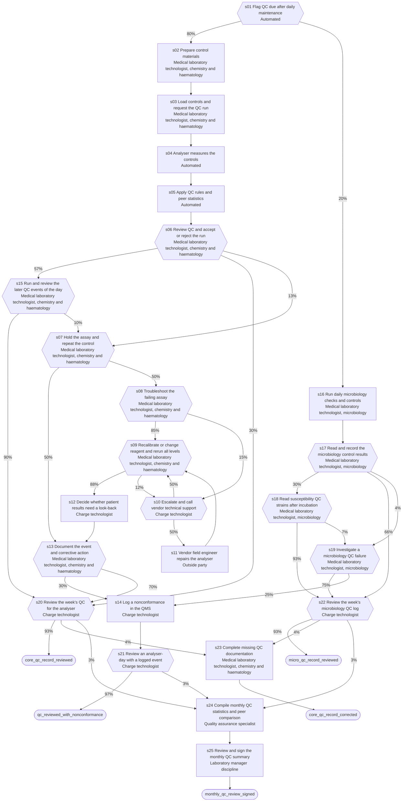

# Run and review daily quality control (community laboratory analysers and microbiology instruments)

`dls-cl-daily-qc` · medical laboratory services · laboratory quality · part of `diagnostic-lab-services-co`

Before an analyser may report patient results each day, technologists run control materials with known values, and quality control software checks them against statistical rules. If a control fails, the assay is held, the control is usually repeated, and the technologist troubleshoots, recalibrates or calls vendor service, decides whether released patient results need a look-back and documents the event. Charge technologists review each analyser's QC weekly and a quality specialist and the laboratory manager review monthly statistics against peer laboratories. Most elapsed time is waiting for instrument runs, later shifts and periodic reviews; the costly parts are failures, which happen on roughly one analyser-day in five and are often first met by repeating the control.

| | |
|---|---|
| Unit of work | one analyser-day of QC |
| Starts when | The analyser's daily start-up maintenance is logged complete and the first scheduled QC event of the day falls due. |
| Done when | Every QC event of the analyser-day is accepted or documented with corrective action, and the day's QC record is signed in the supervisor's weekly review (and, for the month-end day, in the monthly review). |
| Organisation | A large Canadian community laboratory company with nine accredited laboratories, track-connected chemistry and haematology lines, automated microbiology instruments and commercial QC software with peer comparison. (3,300 employees, 2019-2022) |
| Volume | 4,500 cases a month (range 4,000 to 5,200) |

## Where it sits

- Starts with **maintenance_record** from fac-instrument-maintenance (100% of cases)
- Sends **qc_record** to cl-core-testing (outcome: core_qc_record_reviewed)
- Sends **qc_record** to cl-core-testing (outcome: core_qc_record_corrected)
- Sends **qc_record** to cl-core-testing (outcome: qc_reviewed_with_nonconformance)
- Sends **nonconformance** to qa-nonconformance-capa (outcome: qc_reviewed_with_nonconformance)
- Sends **qc_record** to cl-microbiology-testing (outcome: micro_qc_record_reviewed)
- Sends **qc_record** to cl-core-testing (outcome: monthly_qc_review_signed)
- Sends **qc_record** to cl-microbiology-testing (outcome: monthly_qc_review_signed)

## Flow

## Roles

| Role | Department | Layer | FTE on this process | Loaded cost per hour | Evidence |
|---|---|---|---:|---:|---|
| Medical laboratory technologist, chemistry and haematology | Core laboratory (chemistry, immunoassay, haematology, urinalysis) | individual contributor | 11 | 52 CAD | B [csmls], [jobbank32120] |
| Medical laboratory technologist, microbiology | Microbiology laboratory | individual contributor | 3.6 | 52 CAD | B [csmls], [job_micro] |
| Charge technologist | Community laboratory testing (The model laboratory Laboratories) | supervisor | 3 | 58 CAD | B [jobs_list], [clp_qcproc] |
| Quality assurance specialist | Quality assurance operations | individual contributor | 0.8 | 52 CAD | B [dyn_lic] |
| Laboratory manager (discipline) | Community laboratory testing (The model laboratory Laboratories) | manager | 0.2 | 72 CAD | C |

## Steps

Hands-on time and the wait before each step show the most common value. Evidence tier A is a sourced number, B a sourced description, C the author's estimate.

| Step | Who | Kind | Hands-on | Wait before | Control | Evidence |
|---|---|---|---:|---:|---|---|
| **s01 Flag QC due after daily maintenance.** When the technologist logs the analyser's daily start-up maintenance as complete, the middleware and QC software mark the scheduled QC event as due and keep patient testing for that analyser on hold until QC is accepted. | Automated | system auto | 0 min | 10 min |  | B [clp_c24], [cfr1256] |
| **s02 Prepare control materials.** The technologist takes the control vials for each level from the refrigerator or freezer, thaws or reconstitutes them, mixes them, checks the open-vial expiry and lot number, and pours them into barcoded sample cups or tubes. | Medical laboratory technologist, chemistry and haematology | physical | 4 min | 10 min |  | B [clp_c24], [csmls] |
| **s03 Load controls and request the QC run.** The technologist places the control cups in the analyser's QC rack or track input, confirms the analyser reads each barcode and has ordered the right tests for every level, and starts the run. | Medical laboratory technologist, chemistry and haematology | physical | 2 min | 2 min |  | C |
| **s04 Analyser measures the controls.** The analyser aspirates and measures each control level for every assay on board; nobody works on the case while the instrument runs, and patient tubes queue behind the hold. | Automated | system auto | 0 min | 20 min |  | C |
| **s05 Apply QC rules and peer statistics.** The middleware passes control results to the QC software, which plots them on Levey-Jennings charts, applies the configured Westgard rules for each assay and level, and locks any assay that breaks a rejection rule. | Automated | system auto | 0 min | 1 min |  | B [westgard_mr], [dyn_lic] |
| **s06 Review QC and accept or reject the run.** The technologist opens the QC software, checks every assay and level for warnings and rejections, looks at the trend on the Levey-Jennings chart, and either accepts the run so patient testing and autoverification resume or rejects the failing assay. | Medical laboratory technologist, chemistry and haematology | review | 3 min | 5 min | Ontario licensing requires the IQMH quality management program and accreditation to ISO 15189; QC must be acceptable before patient results are released (CLSI C24 practice, Westgard multirule) | B [westgard21], [westgard_mr], [cmlto], [ag2017], [acd] |
| **s07 Hold the assay and repeat the control.** The technologist suspends reporting and autoverification for the failed assay, checks for obvious causes such as the wrong level, expired material or a bubble, and repeats the control with a fresh aliquot or a new vial. | Medical laboratory technologist, chemistry and haematology | validation | 6 min | 5 min | CLSI C24 out-of-control procedure under the ISO 15189 accredited quality management system: stop reporting, find and correct the cause, rerun QC before resuming | B [westgard21], [clp_c24] |
| **s08 Troubleshoot the failing assay.** The technologist reviews the Levey-Jennings chart for a shift or trend, checks reagent lot and onboard stability, calibration age and recent maintenance, compares with a second analyser or peer data, and decides whether to recalibrate, change reagent or call for service. | Medical laboratory technologist, chemistry and haematology | analysis | 20 min | 25 min | CLSI C24 out-of-control procedure under the ISO 15189 accredited quality management system: stop reporting, find and correct the cause, rerun QC before resuming | B [clp_c24], [csmls], [mlo_coq] |
| **s09 Recalibrate or change reagent and rerun all levels.** The technologist loads calibrators or a new reagent pack, runs and accepts the calibration, then reruns every control level for the assay and checks them against the rules before releasing the hold. | Medical laboratory technologist, chemistry and haematology | physical | 15 min | 10 min | CLSI C24 out-of-control procedure under the ISO 15189 accredited quality management system: stop reporting, find and correct the cause, rerun QC before resuming | B [clp_c24], [cfr1256] |
| **s10 Escalate and call vendor technical support.** The charge technologist reviews what was tried, takes the assay or analyser out of service, moves its work to a backup analyser, and calls the vendor's technical support line or books a field service visit. | Charge technologist | coordination | 20 min | 45 min |  | B [clp_c24], [mlo_coq] |
| **s11 Vendor field engineer repairs the analyser.** The instrument manufacturer's field service engineer arrives, diagnoses and repairs the analyser and leaves a service report; the analyser stays out of service until the technologist recalibrates and QC passes. | Outside party | external wait | 0 min | 18.0 h |  | C |
| **s12 Decide whether patient results need a look-back.** The charge technologist compares the failure time with the last acceptable QC, the size of the shift against the allowable error, and whether patient results were released in between, then either closes the event or asks the core laboratory to retest stored specimens. | Charge technologist | judgment | 8 min | 30 min | CLSI C24 and ISO 15189: evaluate patient results since the last acceptable QC and correct reports when differences exceed the laboratory director's limits | B [clp_c24] |
| **s13 Document the event and corrective action.** The technologist enters the cause, the action taken and the repeat results as comments on the QC chart, updates the reagent and calibration logs, and releases the assay hold in the middleware. | Medical laboratory technologist, chemistry and haematology | data entry | 5 min | 15 min | ISO 15189 records of QC and corrective action, reviewed at accreditation and IQMH assessment | B [clp_c24], [cfr1256] |
| **s14 Log a nonconformance in the QMS.** The charge technologist opens a nonconformance record in the quality management system, describes the QC failure, its effect on patient results and the immediate action, and routes it to quality assurance for root cause and corrective action. | Charge technologist | data entry | 15 min | 4.0 h | ISO 15189 nonconformity and corrective action management | B [job_micro], [dyn_lic] |
| **s15 Run and review the later QC events of the day.** For analysers that run evening and night shifts, the technologist on that shift prepares and loads the controls again at the scheduled interval or after a reagent change, and reviews and accepts the results in the QC software. | Medical laboratory technologist, chemistry and haematology | review | 8 min | 10.0 h | Ontario licensing requires the IQMH quality management program and accreditation to ISO 15189; QC must be acceptable before patient results are released (CLSI C24 practice, Westgard multirule) | B [westgard21], [clp_c24] |
| **s16 Run daily microbiology checks and controls.** The microbiology technologist records incubator temperatures and CO2, stains the Gram control slide, runs the MALDI-TOF calibration standard and molecular panel controls, and on scheduled days subcultures the reference strains for susceptibility QC. | Medical laboratory technologist, microbiology | physical | 15 min | 30 min | ISO 15189 and CAP or MANQAP microbiology checklists: stains checked each day of use, media and susceptibility QC with reference strains | B [cfr1256], [job_micro] |
| **s17 Read and record the microbiology control results.** The technologist reads the Gram control reactions, the MALDI-TOF calibration score and the molecular control validity, records them in the QC log, and releases the bench for patient work. | Medical laboratory technologist, microbiology | review | 6 min | 30 min | Ontario licensing requires the IQMH quality management program and accreditation to ISO 15189; QC must be acceptable before patient results are released (CLSI C24 practice, Westgard multirule) | C |
| **s18 Read susceptibility QC strains after incubation.** After overnight incubation the technologist reads the reference strain results from the susceptibility instrument or disk plates and compares each drug with the published QC ranges before accepting the panel lot for patient reporting. | Medical laboratory technologist, microbiology | review | 8 min | 20.0 h | Ontario licensing requires the IQMH quality management program and accreditation to ISO 15189; QC must be acceptable before patient results are released (CLSI C24 practice, Westgard multirule) | C |
| **s19 Investigate a microbiology QC failure.** The technologist checks the strain's subculture generation, inoculum density, media and card lots and instrument logs, repeats the QC, and holds or comments the affected patient results until the repeat passes. | Medical laboratory technologist, microbiology | analysis | 40 min | 1.0 h | CLSI C24 out-of-control procedure under the ISO 15189 accredited quality management system: stop reporting, find and correct the cause, rerun QC before resuming | C |
| **s20 Review the week's QC for the analyser.** The charge technologist opens the analyser's QC charts and event log for the past week, checks that every run was accepted or documented with a corrective action, signs the review electronically and returns incomplete entries to the bench. | Charge technologist | review | 2 min | 3.0 d | Documented periodic QC review by a supervisor (every 7 to 10 days under some accreditation checklists) | B [clp_qcproc], [csmls] |
| **s21 Review an analyser-day with a logged event.** In the weekly review the charge technologist reads the event documentation and the linked nonconformance, checks that any look-back was completed and corrected reports were issued, and signs the review. | Charge technologist | review | 6 min | 3.0 d | Documented periodic QC review by a supervisor | B [clp_qcproc], [clp_c24] |
| **s22 Review the week's microbiology QC log.** The charge technologist checks the microbiology QC and temperature logs for the week, confirms failures were investigated and repeated, and signs the log. | Charge technologist | review | 3 min | 3.0 d | Documented periodic QC review by a supervisor | B [clp_qcproc] |
| **s23 Complete missing QC documentation.** The technologist who ran the QC adds the missing cause, action or initials to the QC chart or log after the charge technologist returns it, and the record is re-signed. | Medical laboratory technologist, chemistry and haematology | data entry | 5 min | 1.0 d |  | C |
| **s24 Compile monthly QC statistics and peer comparison.** After month end the quality specialist exports each assay's monthly mean, SD and CV from the QC software, compares them with the peer group report, and flags assays with drift, bias or rising imprecision for the laboratory manager. | Quality assurance specialist | analysis | 35 min | 3.0 d |  | B [dyn_lic], [clp_qcproc] |
| **s25 Review and sign the monthly QC summary.** The laboratory manager reads the monthly summary, agrees actions such as new target ranges, recalibration schedules or a service call, and signs the review as the director's designee. | Laboratory manager (discipline) | approval | 10 min | 3.0 d | Monthly review of QC data by the laboratory director or designee (accreditation checklist requirement) | B [clp_qcproc] |

## Exceptions

| Exception | Share of cases | What happens |
|---|---:|---|
| Rejected run resolved by a repeat control | 9% | The repeat falls inside limits and the event is documented as random error; common in practice although C24 discourages repeating without investigation. |
| Recalibration or reagent change | 7% | The repeat still fails; the technologist troubleshoots, recalibrates and reruns all levels, and the charge technologist decides on a look-back. |
| Analyser down for vendor service | 1% | Troubleshooting fails; the charge technologist moves work to a backup analyser and a field engineer repairs the instrument before QC is rerun. |
| Microbiology QC failure | 1% | A stain, identification or susceptibility control fails and is investigated and repeated; affected patient results are held or commented. |
| Incomplete documentation returned | 4% | The weekly reviewer finds a missing corrective action or initials and returns the record. |

## Benchmarks

| Metric | Value | Unit | Population | Evidence |
|---|---|---|---|---|
| cycle_time_days | p50 4, p90 8 | calendar days from the first QC event of the analyser-day to the supervisor's signed review | Author's estimate for a laboratory that reviews QC weekly | C |
| labs_out_of_control_daily_or_more | 29 | percent of US laboratories reporting out-of-control events more than once a day | 2021 Global QC Survey respondents (self-reported, vendor-sponsored) | A [westgard21] |
| labs_repeating_control_first | 90 | percent of US laboratories whose first response to a QC flag is to repeat the control | 2021 Global QC Survey respondents | A [westgard21] |
| false_rejection_1_2s_two_controls | 9 | percent of good runs rejected using 2 SD limits with two controls | Statistical property of the rule | A [westgard_mr] |

## Pain points

- Repeating a failed control until it passes is the most common first response and can hide a real shift, so look-backs and corrected reports come later than they should. (steps s07, s12; A [westgard21], [clp_c24])
- Wide 2 SD limits on many assays create false rejections that consume troubleshooting time and reagent. (steps s06, s07, s08; A [westgard_mr], [westgard21])
- Corrective action notes are often incomplete and are only caught in the weekly review, days after the event. (steps s13, s20, s23; C)
- Vendor field service waits keep an analyser down for hours to days and push work to backup analysers with manual review. (steps s10, s11; B [mlo_coq], [clp_c24])

## Assumptions

- The process map names the maintenance record from fac-instrument-maintenance as the trigger; in practice the calendar starts each analyser-day, and the logged daily start-up maintenance is used as the trigger to match the map.
- About 80% of analyser-days are core laboratory test systems and 20% microbiology instruments and benches; the organisation file does not give the split.
- A rejected first QC event on 13% of core analyser-days and on 10% of later events gives about 19% of core analyser-days with at least one failure. This is the author's estimate, consistent with surveys showing many large laboratories out of control daily.
- When a failure occurs, the remaining QC events of that day are not modelled again; this slightly understates hands-on time on failure days.
- Retesting of stored patient specimens in a look-back, holding of patient tubes and backup analyser runs are counted in the core testing workflow (steps s19 to s24 there), not here, to avoid double counting. Troubleshooting minutes spread across requisitions in that workflow overlap partly with steps s07 to s09 here.
- Service calls go to fac-instrument-maintenance, but the process map lists no maintenance_request output for this process, so none is declared; the core testing workflow declares it on its analyser fault outcome.
- The weekly supervisor review (amortised per analyser-day) and the monthly review (charged to the month-end day, one day in 30) are included, so cycle time is dominated by the wait for review rather than by the QC runs themselves.
- Control frequency, rules and review cadence follow common accreditation practice under ISO 15189, IQMH and CAP; the US CLIA text is used only as a public description of the same practice.
- Loaded costs are the organisation file's (hourly wage times 1.35).

## Sources

- [westgard21] [Top ten findings of the 2021 Global QC Survey](https://westgard.com/2021-top-ten-global-qc-survey.htm) (Westgard QC, 2021). 29% of US laboratories are out of control more than once a day; nearly 90% of US laboratories repeat the control as the first response (57% in Latin and South America); 53.7% of European laboratories run controls two or three times a day; Westgard rules used on some or all tests by 76% of US laboratories; about two thirds of laboratories have not changed QC to reduce cost; 3% of US laboratories report patient results despite a QC failure.
- [clp_c24] [The 7 best practices to recover from an out-of-control event](https://clpmag.com/lab-essentials/quality-systems/quality-control-programs/the-7-best-practices-to-recover-from-an-out-of-control-event/) (Clinical Lab Products, undated). Steps based on CLSI C24: stop patient reporting and turn off autoverification for the assay, reroute samples to an instrument with acceptable QC, rule out user error (wrong level, lot, volume, material left out), review Levey-Jennings charts and recent calibration, reagent lot or maintenance changes, correct the cause and resume only when QC passes, re-test patient samples run since the last acceptable QC against limits set by the laboratory director, issue corrected reports, document root cause and corrective and preventive action.
- [cfr1256] [42 CFR 493.1256 Standard: Control procedures](https://www.law.cornell.edu/cfr/text/42/493.1256) (Legal Information Institute, Cornell Law School, current). US rule used as a reference for common practice: two control materials of different concentration once each day of testing for quantitative tests, positive and negative controls for qualitative tests, controls before resuming patient testing after a reagent change or major maintenance, control results must meet criteria before patient results are reported, stains checked each day of use, media checked for sterility and growth, all control procedures documented.
- [westgard_mr] [Westgard Rules: multirule QC](https://www.westgard.com/mltirule.htm) (Westgard QC, undated). Multirule QC: 1-2s is a warning rule that triggers inspection; 1-3s, 2-2s, R-4s, 4-1s and 10x are rejection rules; with 2s limits about 9% (two controls) to 14% (three controls) of good runs are falsely rejected, against about 1% for 1-3s.
- [mlo_coq] [Exploring cost of quality in the lab (Quintenz and Williams)](https://www.mlo-online.com/management/qa-qc/article/13017214/exploring-cost-of-quality-in-the-lab) (Medical Laboratory Observer, 2018). Failure costs include invalid instrument runs, rework and retesting, downtime, troubleshooting, documentation and supervision time; external failures include report recalls and complaints; QC run once a day is the usual frequency in the worked example.
- [clp_qcproc] [How to improve laboratory quality control processes (MacCormack)](https://clpmag.com/lab-essentials/quality-systems/quality-control-programs/how-to-improve-laboratory-quality-control-processes/) (Clinical Lab Products, 2022). Some accreditation organisations require documented review of QC every 7 to 10 days; laboratories review at least three months of daily QC data to set ranges; the laboratory director approves new control ranges; drifts and shifts are found by reviewing Levey-Jennings charts.
- [csmls] [Standards of practice](https://csmls.org/about-us/our-members/standards-of-practice/) (Canadian Society for Medical Laboratory Science, undated). MLTs adhere to quality control protocols, review abnormal QC results, troubleshoot equipment malfunctions and validate test results; laboratory assistants work on pre- and post-analytical specimen handling and prepare reagents.
- [cmlto] [Laws and legislation governing MLT practice](https://www.cmlto.com/laws-legislation-governing-mlt-practice/) (College of Medical Laboratory Technologists of Ontario, undated). Medical Laboratory Technology Act, 1991: the scope of practice is the performance of laboratory investigations and the evaluation of the technical sufficiency of the investigations and their results; communicating a diagnosis is not an MLT authorised act; protected title.
- [dyn_lic] Licences and quality commitment (link withheld) (The model laboratory, undated). The quality management system uses software to monitor quality control of analytical processes, external quality assessment (CAP, QMP-LS, Healthmetrix) for all assays, internal audits and document control; Brampton, London, Ottawa and Peterborough hold ISO 15189 accreditation and Ontario licences; Winnipeg holds CAP and MANQAP accreditation for chemistry, cytology, histology, haematology and microbiology; pathology subspecialties include dermatopathology, gastrointestinal, uropathology, breast and gynaecologic pathology.
- [ag2017] [2017 Annual Report, Section 3.07: Laboratory Services in the Health Sector](https://www.auditor.on.ca/en/content/annualreports/arreports/en17/v1_307en17.pdf) (Office of the Auditor General of Ontario, 2017). Ontario licensed laboratories must take part in a quality management program of accreditation and proficiency testing; community laboratory performance measures for 2016/17 (specimen rejection 0.9% and 0.2%, routine results within target 94% and 99%). Read from the text copy saved under scratch/ by earlier work.
- [jobbank32120] [Wages: Medical Technologist - Medical Laboratory in Ontario (NOC 32120)](https://www.jobbank.gc.ca/marketreport/wages-occupation/4203/ON) (Job Bank, Government of Canada, 2024). Ontario hourly wages low $23.00, median $42.00, high $50.00 (2023-2024).
- [jobs_list] The model laboratory careers (open positions) (link withheld) (The model laboratory (Jobvite), 2026). Open roles include Laboratory Assistant-Histology, Manager Histology and Pathology Assistant (Brampton), Clinical Laboratory Assistant in cytology (Brampton), Cytotechnologists (Winnipeg), Medical Laboratory Technologist - Microbiology, Medical Transcriptionist (Winnipeg histology) and Charge Technologist (Winnipeg).
- [job_micro] Medical Laboratory Technologist - Microbiology (link withheld) (The model laboratory (Jobvite), 2026). Rotational shifts seven days a week 7:30 a.m. to 4:30 p.m.; $36.00 to $43.50 an hour; sample identification and specimen requirements, QC and equipment maintenance, recording, interpreting and approving results, troubleshooting assays and equipment, reporting incidents and nonconformities.
- [acd] [Accreditation Canada Diagnostics](https://diagnostics.accreditation.ca/) (Accreditation Canada Diagnostics, undated). Accredits medical laboratories against ISO 15189 Plus with an external evaluation at the two-year mark.

Written by claude-opus on 2026-11-17.
