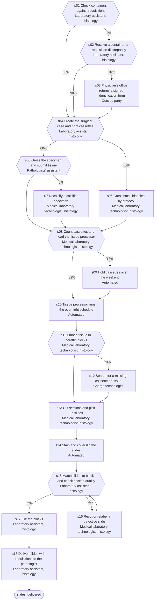

# Gross, process and cut tissue into slides (community surgical pathology)

`dls-cl-histology-processing` · medical laboratory services · laboratory operations · part of `diagnostic-lab-services-co`

Biopsies taken in physicians' offices (mostly skin, gastrointestinal, prostate and gynaecologic) arrive in formalin and are checked, entered as surgical cases, grossed into labelled cassettes, processed overnight, embedded in paraffin, cut on microtomes, stained and matched to their cases before delivery to a pathologist. Histotechnologists and pathologists' assistants do skilled hand work at every stage, much of it on evening and night shifts. Overnight processing sets a one-day minimum, weekend schedules add up to two days, and most errors are labelling slips at accessioning, block labelling and cutting that the next handoff usually catches.

| | |
|---|---|
| Unit of work | one surgical pathology case |
| Starts when | An accessioned tissue specimen with its requisition reaches the histology laboratory. |
| Done when | Stained slides matched to the case are delivered to the pathologist with the requisition and gross description, and the blocks are filed. |
| Organisation | A large Canadian community laboratory company with central histology at its main laboratories, conventional overnight tissue processors and automated stainers, cutting Monday to Friday. (3,300 employees, 2019-2022) |
| Volume | 13,000 cases a month (range 10,000 to 16,000) |

## Where it sits

- Starts with **accessioned_specimen** from cl-specimen-accessioning (100% of cases)
- Sends **pathology_case** to cl-pathology-signout (outcome: slides_delivered)

## Flow

## Roles

| Role | Department | Layer | FTE on this process | Loaded cost per hour | Evidence |
|---|---|---|---:|---:|---|
| Laboratory assistant, histology | Histology and anatomic pathology | individual contributor | 9 | 30 CAD | B [job_histo_la], [jobbank33101] |
| Pathologists' assistant | Histology and anatomic pathology | senior specialist | 6 | 62 CAD | B [job_pa] |
| Medical laboratory technologist, histology | Histology and anatomic pathology | individual contributor | 23.5 | 52 CAD | A [job_histo], [jobbank32120] |
| Charge technologist | Community laboratory testing (The model laboratory Laboratories) | supervisor | 0.6 | 58 CAD | B [jobs_list] |

## Steps

Hands-on time and the wait before each step show the most common value. Evidence tier A is a sourced number, B a sourced description, C the author's estimate.

| Step | Who | Kind | Hands-on | Wait before | Control | Evidence |
|---|---|---|---:|---:|---|---|
| **s01 Check containers against requisitions.** The histology laboratory assistant unpacks the biopsy containers that arrived from processing, checks that each container carries two patient identifiers and the site, matches the containers to the requisition and LIS order, confirms formalin is present and sorts small biopsies from larger specimens. | Laboratory assistant, histology | intake | 1 min | 2.0 h | ISO 15189 accredited anatomic pathology procedures (IQMH in Ontario, CAP and MANQAP in Manitoba): positive identification and reconciliation of containers, cassettes, blocks and slides at each handoff | A [job_histo_la], [epmc_mislabel] |
| **s02 Resolve a container or requisition discrepancy.** The laboratory assistant records the discrepancy, phones the physician's office to confirm the patient, site or number of containers, and documents the answer; irreplaceable tissue is processed on hold rather than rejected. | Laboratory assistant, histology | communication | 10 min | 1.0 h | ISO 15189 accredited anatomic pathology procedures (IQMH in Ontario, CAP and MANQAP in Manitoba): positive identification and reconciliation of containers, cassettes, blocks and slides at each handoff | C |
| **s03 Physician's office returns a signed identification form.** The office faxes back a signed form confirming the patient and specimen details; the case continues on hold until it arrives. | Outside party | external wait | 0 min | 1.0 d |  | C |
| **s04 Create the surgical case and print cassettes.** The laboratory assistant creates the surgical pathology case in the anatomic pathology system from the LIS order, enters each specimen part and site, and prints the labelled cassettes and part labels for grossing. | Laboratory assistant, histology | data entry | 2 min | 20 min | ISO 15189 accredited anatomic pathology procedures (IQMH in Ontario, CAP and MANQAP in Manitoba): positive identification and reconciliation of containers, cassettes, blocks and slides at each handoff | B [job_histo_la], [epmc_mislabel] |
| **s05 Gross the specimen and submit tissue.** The pathologists' assistant confirms the identifiers against the cassettes, describes each part (size, colour, number of fragments), inks margins on excisions, sections the tissue into cassettes and dictates or types the gross description. | Pathologists' assistant | physical | 4 min | 2.0 h | ISO 15189 accredited anatomic pathology procedures (IQMH in Ontario, CAP and MANQAP in Manitoba): gross examination by a pathologist or a qualified delegate following written protocols | B [job_pa], [job_histo] |
| **s06 Gross small biopsies by protocol.** The histotechnologist counts and measures the fragments of a small biopsy, wraps or bags them, places them in the labelled cassette and records the gross description from a template. | Medical laboratory technologist, histology | physical | 3 min | 2.0 h | ISO 15189 accredited anatomic pathology procedures (IQMH in Ontario, CAP and MANQAP in Manitoba): gross examination by a qualified delegate following written protocols | B [job_histo] |
| **s07 Decalcify a calcified specimen.** The histotechnologist places the calcified tissue in decalcifying solution, checks it daily for the end point, then rinses and cassettes it for processing. | Medical laboratory technologist, histology | physical | 10 min | 2.0 d |  | B [ucdavis_tat] |
| **s08 Count cassettes and load the tissue processor.** The histotechnologist reconciles the number of cassettes against the grossing log, loads the baskets into the tissue processor and starts the overnight protocol once tissue has fixed long enough in formalin. | Medical laboratory technologist, histology | physical | 0.5 min | 3.0 h | ISO 15189 accredited anatomic pathology procedures (IQMH in Ontario, CAP and MANQAP in Manitoba): positive identification and reconciliation of containers, cassettes, blocks and slides at each handoff | B [job_pa], [ucdavis_tat] |
| **s09 Hold cassettes over the weekend.** Cassettes from late in the week stay in formalin or on a delayed-start processor program until the Sunday night or Monday run; nobody works on them meanwhile. | Automated | system auto | 0 min | 1.5 d |  | C |
| **s10 Tissue processor runs the overnight schedule.** The processor moves the tissue through formalin, graded alcohols, a clearing agent and molten paraffin over about twelve hours; nobody works on the case while it runs. | Automated | system auto | 0 min | 12.0 h |  | B [epmc_lean] |
| **s11 Embed tissue in paraffin blocks.** The histotechnologist unloads the processor, checks the cassette count again, orients each fragment in a mould at the embedding centre (on edge for skin, flat for mucosal biopsies) and cools the blocks. | Medical laboratory technologist, histology | physical | 2.5 min | 1.0 h | ISO 15189 accredited anatomic pathology procedures (IQMH in Ontario, CAP and MANQAP in Manitoba): positive identification and reconciliation of containers, cassettes, blocks and slides at each handoff | B [job_histo], [job_pa] |
| **s12 Search for a missing cassette or tissue.** The charge technologist checks the processor baskets, grossing station and logs, traces the missing cassette or fragment, and documents the event as a nonconformance if it cannot be found. | Charge technologist | coordination | 20 min | 1.0 h | ISO 15189 accredited anatomic pathology procedures (IQMH in Ontario, CAP and MANQAP in Manitoba): positive identification and reconciliation of containers, cassettes, blocks and slides at each handoff | C |
| **s13 Cut sections and pick up slides.** The histotechnologist trims each block on the microtome, cuts ribbons at about 4 micrometres, floats them on the water bath and picks up the number of levels the protocol calls for onto slides labelled for that block, checking block and slide labels one block at a time. | Medical laboratory technologist, histology | physical | 7 min | 1.0 h | ISO 15189 accredited anatomic pathology procedures (IQMH in Ontario, CAP and MANQAP in Manitoba): positive identification and reconciliation of containers, cassettes, blocks and slides at each handoff | A [epmc_mislabel], [epmc_lean], [job_histo] |
| **s14 Stain and coverslip the slides.** The slides run through the automated haematoxylin and eosin stainer and coverslipper in racks; nobody works on the case while the instrument runs. | Automated | system auto | 0 min | 1.2 h |  | C |
| **s15 Match slides to blocks and check section quality.** The laboratory assistant checks every slide label against its block and the case, counts slides against the levels ordered, flags folds, holes or weak staining for the technologist, and sorts the slides by pathologist. | Laboratory assistant, histology | validation | 0.8 min | 30 min | ISO 15189 accredited anatomic pathology procedures (IQMH in Ontario, CAP and MANQAP in Manitoba): positive identification and reconciliation of containers, cassettes, blocks and slides at each handoff | A [epmc_mislabel] |
| **s16 Recut or relabel a defective slide.** The histotechnologist relabels a mislabelled slide after checking the block, or recuts a block with folded, torn or thick sections, and sends the new slide through staining. | Medical laboratory technologist, histology | physical | 6 min | 2.0 h | ISO 15189 accredited anatomic pathology procedures (IQMH in Ontario, CAP and MANQAP in Manitoba): positive identification and reconciliation of containers, cassettes, blocks and slides at each handoff | C |
| **s17 File the blocks.** The laboratory assistant files the cut blocks in numbered drawers by case number for retention and later retrieval for levels, special stains or immunohistochemistry. | Laboratory assistant, histology | physical | 0.3 min | 10 min | ISO 15189 accredited anatomic pathology procedures (IQMH in Ontario, CAP and MANQAP in Manitoba): retention of blocks and slides so they are retrievable | C |
| **s18 Deliver slides with requisitions to the pathologist.** The laboratory assistant assembles each case's slides with the requisition and gross description, scans the handoff in the anatomic pathology system and delivers the trays to the pathologists' offices on the scheduled runs. | Laboratory assistant, histology | physical | 0.4 min | 2.0 h |  | B [epmc_tat] |

## Exceptions

| Exception | Share of cases | What happens |
|---|---:|---|
| Container or requisition discrepancy | 2% | Labels, sites or container counts do not match; resolved by phone or by a signed form while the tissue is held. |
| Weekend hold | 18% | Specimens received late in the week wait for the Sunday night or Monday processing run. |
| Slide defect or mislabel | 4% | Caught at slide matching; the block is recut or the slide relabelled. |
| Missing cassette or tissue | 0% | Count mismatch at embedding; the charge technologist traces it. |
| Decalcification | 0% | Bone or calcified tissue needs one to three days in decalcifying solution. |

## Benchmarks

| Metric | Value | Unit | Population | Evidence |
|---|---|---|---|---|
| cycle_time_days | p50 1.3, p90 3 | calendar days from receipt in histology to slides delivered to the pathologist | Author's estimate for community biopsies processed overnight and cut Monday to Friday | C |
| mislabelled_blocks_per_1000 | 1.7 | blocks per 1,000 | 136 institutions, CAP study 2011 | A [epmc_mislabel] |
| mislabelled_slides_per_1000 | 1.1 | slides per 1,000 | 136 institutions, CAP study 2011 | A [epmc_mislabel] |
| daily_histology_turnaround_hours | before 9.7, after 9.0 | hours, mean daily histopathology turnaround | One academic histopathology laboratory before and after Lean (Raab et al. 2008) | A [epmc_lean] |

## Pain points

- Overnight batch processing and Monday-to-Friday cutting set a one-day floor and a weekend tail on every case. (steps s08, s09, s10; B [ucdavis_tat], [epmc_lean])
- Labelling errors arise at accessioning, block labelling and cutting and depend on manual label checks. (steps s04, s13, s15; A [epmc_mislabel], [captoday_def12])
- Embedding and microtomy are skilled manual tasks; histotechnologist shortages and evening and night shift work slow the line. (steps s11, s13; B [job_histo], [job_pa], [job_histo_la])
- Recuts for poor sections send cases back through cutting and staining. (steps s15, s16; C)

## Assumptions

- Case mix is mostly office biopsies of one to three blocks; about 0.5% need decalcification. Average hands-on minutes reflect about two blocks and two to four slides a case.
- About 60% of cases are grossed by pathologists' assistants and 40% (small biopsies) by histotechnologists, as the company postings say both roles gross.
- The company postings (2025 and 2026, after the reference period) show histology work on evening and night shifts; the same pattern is assumed for 2019-2022.
- Processing runs, staining and the weekend hold are waiting with no hands-on time. Cases received Friday or Saturday (about 18%) wait for the Sunday night or Monday run.
- Levels, special stains and recuts ordered by the pathologist after review are counted in the pathology sign-out workflow, not here.
- The organisation file gives pathologists' assistants a loaded cost of CAD 55 to 75 an hour; the company's 2026 Pathology Assistant posting pays $28.00 to $30.50 an hour (about CAD 38 to 41 loaded). The organisation file cost is used, which may overstate grossing cost.
- Loaded costs are the organisation file's (hourly wage times 1.35).

## Sources

- [job_histo] Medical Laboratory Technologist (Histology team), Brampton (link withheld) (The model laboratory (Jobvite), 2026). Monday to Friday 3:00 p.m. to 11:00 p.m.; $35.00 to $38.75 an hour; all aspects of histology including grossing, embedding, microtomy and routine and special staining; verify sample identification; quality control and routine equipment maintenance; CMLTO registration.
- [job_pa] Pathology Assistant (Histology team), Brampton (link withheld) (The model laboratory (Jobvite), 2026). Monday to Friday 9:00 p.m. to 5:00 a.m.; $28.00 to $30.50 an hour; gross examination of surgical specimens, selection and dissection of tissue, documentation of gross findings, embedding, positive patient identification, loading tissue processors per SOP, quality assurance.
- [job_histo_la] Laboratory Assistant-Histology, Brampton (link withheld) (The model laboratory (Jobvite), 2026). Monday to Friday 7:00 p.m. to 3:00 a.m.; $19.75 to $23.50 an hour; data entry of patient and test information from requisitions, verify documentation, receive, sort and label specimens, match specimen labels to documentation, prioritise time-sensitive specimens, follow up missing samples and documentation.
- [epmc_mislabel] [Europe PMC record: Nakhleh et al. 2011, Mislabeling of cases, specimens, blocks, and slides (CAP study of 136 institutions)](https://www.ebi.ac.uk/europepmc/webservices/rest/search?query=TITLE%3A%28mislabeling%20OR%20misidentification%20OR%20%22identification%20errors%22%29%20AND%20%28blocks%20OR%20slides%29%20AND%20%28%22surgical%20pathology%22%20OR%20histology%29&resultType=core&format=json&pageSize=6&sort=CITED%20desc) (Europe PMC (abstract of Archives of Pathology and Laboratory Medicine), 2011). Mislabelling per 1,000: 1.1 cases, 1.0 specimens, 1.7 blocks, 1.1 slides; errors arose 20.9% before accessioning, 12.4% at accessioning, 21.7% at block labelling, 10.2% at grossing and 30.4% at tissue cutting; most were caught in the next one or two steps and 96.7% were corrected before the report was issued.
- [epmc_lean] [Europe PMC records: Lean and processing studies in histology (Raab et al. 2008; Condel et al. 2004; Leong 1991)](https://www.ebi.ac.uk/europepmc/webservices/rest/search?query=TITLE%3A%28lean%20OR%20%22continuous%20flow%22%20OR%20%22rapid%20processing%22%29%20AND%20TITLE%3A%28histology%20OR%20histopathology%20OR%20%22anatomic%20pathology%22%20OR%20%22surgical%20pathology%22%29&resultType=core&format=json&pageSize=8&sort=CITED%20desc) (Europe PMC (abstracts), 2008). Raab 2008: mean daily histopathology turnaround 9.7 hours falling to 9.0 hours after Lean, productivity 3,439 to 4,074 work units per FTE a month; Condel 2004: one-by-one continuous flow reduced cutting and labelling errors compared with batch work; Leong 1991: microwave short processing cycles of about 3 hours against an overnight cycle.
- [ucdavis_tat] [Specimen turnaround time](https://health.ucdavis.edu/pathology/services/clinical/anatomic_pathology/surgical_pathology/clinical_services/turnaround_time.html) (UC Davis Health, Department of Pathology and Laboratory Medicine, undated). Biopsies 2 to 3 working days from accession; special stains and immunohistochemistry add 1 to 2 days; decalcification 1 to 2 days; intradepartmental consultation 1 to 2 days; overnight fixation 1 day; resubmission of tissue 1 to 2 days; recuts or deeper sections 1 to 2 days.
- [epmc_tat] [Europe PMC records: surgical pathology turnaround studies (Volmar et al. 2015; Alshieban and Al-Surimi 2015; Patel et al. 2012; Novis et al. 1998)](https://www.ebi.ac.uk/europepmc/webservices/rest/search?query=TITLE%3A%28%22turnaround%20time%22%29%20AND%20TITLE%3A%28%22surgical%20pathology%22%20OR%20biopsy%29%20AND%20%28Q-Probes%20OR%20%22College%20of%20American%20Pathologists%22%29&resultType=core&format=json&pageSize=6) (Europe PMC (abstracts), 2015). Novis 1998: 85.9% of 5,384 biopsy diagnoses signed out by the second working day in 157 small hospitals; Patel 2012: 77% of non-biopsy cases within 2 days, with consultation, immunohistochemistry, malignancy and number of slides lengthening turnaround; Alshieban 2015: about 24% of routine cases missed the 2-day standard, delays at slide delivery, slide review, transcription editing and pathologist verification; Volmar 2015: median 2.72 days for large or complex specimens.
- [captoday_def12] [Bringing down defects in surgical pathology reports (Paxton)](https://www.captodayonline.com/Archives/0512/0512d_bringing_down.html) (CAP Today, 2012). Q-Probes study of 73 institutions and 360,218 cases: 4.7 report defects (corrected reports) per 1,000, median 5.7; earlier studies 1.4 to 4.8 per 1,000; misinterpretation 14.6%, misidentification 13.3%, specimen defects 13.7%, other nondiagnostic defects 58.4%; 24.9% found by reviewing report text after sign-out; second identifiers on 75.7% of slides and 40% of blocks; laboratories where another pathologist reviews all malignancies before sign-out had fewer misidentifications.
- [jobs_list] The model laboratory careers (open positions) (link withheld) (The model laboratory (Jobvite), 2026). Open roles include Laboratory Assistant-Histology, Manager Histology and Pathology Assistant (Brampton), Clinical Laboratory Assistant in cytology (Brampton), Cytotechnologists (Winnipeg), Medical Laboratory Technologist - Microbiology, Medical Transcriptionist (Winnipeg histology) and Charge Technologist (Winnipeg).
- [jobbank32120] [Wages: Medical Technologist - Medical Laboratory in Ontario (NOC 32120)](https://www.jobbank.gc.ca/marketreport/wages-occupation/4203/ON) (Job Bank, Government of Canada, 2024). Ontario hourly wages low $23.00, median $42.00, high $50.00 (2023-2024).
- [jobbank33101] [Wages: Medical Laboratory Technical Assistant in Ontario (NOC 33101)](https://www.jobbank.gc.ca/marketreport/wages-occupation/4210/ON) (Job Bank, Government of Canada, 2024). Ontario hourly wages low $17.95, median $26.25, high $36.00 (2023-2024).

Written by claude-opus on 2026-11-17.
