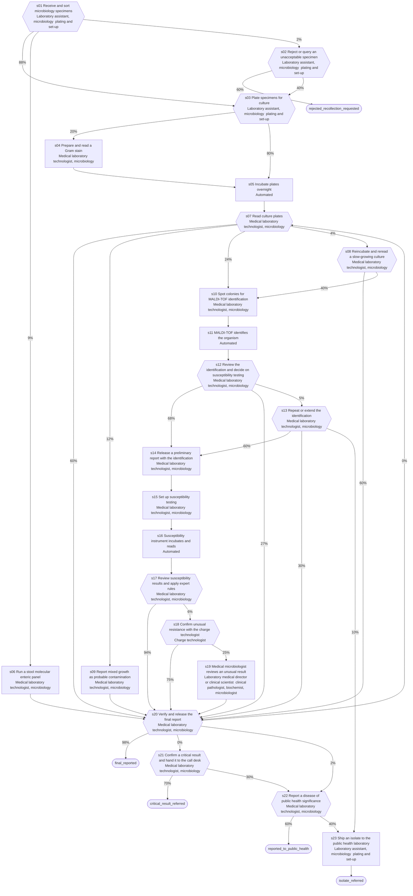

# Culture and identify organisms in community microbiology

`dls-cl-microbiology-testing` · medical laboratory services · laboratory operations · part of `diagnostic-lab-services-co`

Urine, swab and stool specimens from community patients are plated for culture, incubated overnight and read by medical laboratory technologists, who decide which growth is significant, identify pathogens by MALDI-TOF and run susceptibility tests before releasing preliminary and final reports. Stools increasingly go to a molecular enteric panel instead of culture. Most specimens are negative or contaminated and finish after one overnight incubation, but positive cultures need a second day for susceptibility, and unusual resistance, critical results and diseases of public health significance add reviews, phone calls and notifications. Elapsed time is set by incubation and batch runs, and hands-on time is spread over plating, plate reading and result review.

| | |
|---|---|
| Unit of work | one microbiology specimen |
| Starts when | An accessioned microbiology specimen arrives at the microbiology bench from specimen processing. |
| Done when | A final result (negative, contaminated, identified pathogen with susceptibilities, or rejection notice) is released to the LIS, with critical and reportable findings handed to the call desk and public health. |
| Organisation | A large Canadian community laboratory company whose regional laboratories run microbiology with automated plating, MALDI-TOF identification, automated susceptibility testing and molecular panels. (3,300 employees, 2019-2022) |
| Volume | 110,000 cases a month (range 90,000 to 130,000) |

## Where it sits

- Starts with **accessioned_specimen** from cl-specimen-accessioning (100% of cases)
- Relies on **qc_record** from cl-daily-qc (a standing input; it does not start a case)
- Sends **test_result** to cl-result-reporting (outcome: any)
- Sends **critical_result** to cs-critical-result-notification (outcome: critical_result_referred)
- Sends **reportable_disease_report** to public_health (outcome: reported_to_public_health)
- Sends **reportable_disease_report** to public_health (outcome: isolate_referred)

## Flow

## Roles

| Role | Department | Layer | FTE on this process | Loaded cost per hour | Evidence |
|---|---|---|---:|---:|---|
| Laboratory assistant, microbiology (plating and set-up) | Microbiology laboratory | individual contributor | 22.5 | 30 CAD | C |
| Medical laboratory technologist, microbiology | Microbiology laboratory | individual contributor | 64 | 52 CAD | B [job_micro], [csmls], [jobbank32120] |
| Charge technologist | Community laboratory testing (The model laboratory Laboratories) | supervisor | 1.7 | 58 CAD | B [jobs_list] |
| Laboratory medical director or clinical scientist (clinical pathologist, biochemist, microbiologist) | Community laboratory testing (The model laboratory Laboratories) | senior specialist | 0.4 | 230 CAD | C |

## Steps

Hands-on time and the wait before each step show the most common value. Evidence tier A is a sourced number, B a sourced description, C the author's estimate.

| Step | Who | Kind | Hands-on | Wait before | Control | Evidence |
|---|---|---|---:|---:|---|---|
| **s01 Receive and sort microbiology specimens.** The microbiology laboratory assistant takes the accessioned specimens from processing, scans each one to receive it on the bench, checks container type, label and transport time or preservative against the accepted criteria, and sorts urines, swabs and stools into plating batches. | Laboratory assistant, microbiology (plating and set-up) | intake | 0.4 min | 1.0 h | ISO 15189 accredited microbiology procedures (Accreditation Canada Diagnostics, IQMH, MANQAP): specimen acceptance and rejection criteria | B [idsa2018], [job_micro], [dyn_lic] |
| **s02 Reject or query an unacceptable specimen.** The laboratory assistant records the problem in the LIS with a rejection code, either cancels the culture with a comment asking for a new specimen or, after a call with the clinic, accepts it with a qualifying comment, and logs the rejection for quality monitoring. | Laboratory assistant, microbiology (plating and set-up) | validation | 4 min | 15 min | ISO 15189 accredited microbiology procedures (Accreditation Canada Diagnostics, IQMH, MANQAP): rejection criteria and documentation of nonconforming specimens | C |
| **s03 Plate specimens for culture.** The laboratory assistant loads urine and liquid swab specimens onto the automated plating instrument, which inoculates, streaks and labels the agar plates; other specimens are plated by hand with the media set in the bench protocol. | Laboratory assistant, microbiology (plating and set-up) | physical | 0.6 min | 1.0 h |  | C |
| **s04 Prepare and read a Gram stain.** The technologist makes and stains a smear from the swab, reads it under the microscope for cells and organisms (for example a Nugent score for bacterial vaginosis), and records the result for the final report. | Medical laboratory technologist, microbiology | analysis | 2.5 min | 2.0 h |  | C |
| **s05 Incubate plates overnight.** The inoculated plates sit in the incubator at the required temperature and atmosphere until the morning read; nobody works on the specimen during this time. | Automated | system auto | 0 min | 18.0 h |  | B [idsa2018] |
| **s06 Run a stool molecular enteric panel.** The technologist loads stool in transport medium into the molecular panel instrument in batches, runs it for about three hours, reviews the target results and controls, and records positive and negative results. | Medical laboratory technologist, microbiology | analysis | 4 min | 4.0 h |  | B [idsa2018] |
| **s07 Read culture plates.** The technologist examines each plate, estimates colony counts, recognises normal flora, and decides whether the culture is negative, mixed and probably contaminated, needs more incubation, or grows a potential pathogen that must be identified. | Medical laboratory technologist, microbiology | analysis | 0.7 min | 2.0 h |  | B [idsa2018] |
| **s08 Reincubate and reread a slow-growing culture.** Plates with scant or slow growth, throat cultures held for a second day and fungal cultures go back into the incubator and the technologist reads them again the next day. | Medical laboratory technologist, microbiology | analysis | 1 min | 1.0 d |  | C |
| **s09 Report mixed growth as probable contamination.** The technologist enters the mixed growth result with a standard comment that the specimen is probably contaminated and should be repeated if clinically indicated, without identifying each organism. | Medical laboratory technologist, microbiology | drafting | 0.7 min | 5 min |  | B [idsa2018] |
| **s10 Spot colonies for MALDI-TOF identification.** The technologist picks a colony of each potential pathogen, spots it onto the MALDI-TOF target plate with matrix, and records the target positions against the specimen numbers. | Medical laboratory technologist, microbiology | physical | 1.5 min | 30 min |  | C |
| **s11 MALDI-TOF identifies the organism.** The mass spectrometer reads each spot and matches the spectrum to its library, returning an organism name and a confidence score; the target plate runs in batches. | Automated | system auto | 0 min | 30 min |  | C |
| **s12 Review the identification and decide on susceptibility testing.** The technologist checks the identification score against the colony appearance and specimen type, applies the bench rules on colony count and organism to decide whether susceptibility testing is needed, and sends low-score or unusual results for repeat identification. | Medical laboratory technologist, microbiology | judgment | 1 min | 15 min |  | C |
| **s13 Repeat or extend the identification.** For a low-score or unusual result the technologist subcultures for a pure growth, repeats the MALDI-TOF the next day or uses biochemical tests, and refers organisms the laboratory cannot identify. | Medical laboratory technologist, microbiology | analysis | 10 min | 12.0 h |  | C |
| **s14 Release a preliminary report with the identification.** The technologist releases a preliminary result such as the organism and colony count with susceptibility to follow, so the clinician sees it in the EMR before the final report. | Medical laboratory technologist, microbiology | communication | 0.4 min | 10 min |  | C |
| **s15 Set up susceptibility testing.** The technologist makes a standardised suspension of the isolate, inoculates the susceptibility card or disk diffusion plate, and loads it into the instrument or incubator. | Medical laboratory technologist, microbiology | physical | 2.5 min | 10 min |  | C |
| **s16 Susceptibility instrument incubates and reads.** The automated susceptibility system incubates the card and reads growth in each antibiotic well, or the disk plate incubates overnight; nobody works on the specimen meanwhile. | Automated | system auto | 0 min | 10.0 h |  | C |
| **s17 Review susceptibility results and apply expert rules.** The technologist reviews the MIC or zone results with the interpretive breakpoints and expert rules, checks for impossible or unusual patterns, and selects which antibiotics to report under the cascade rules. | Medical laboratory technologist, microbiology | review | 1 min | 1.5 h |  | C |
| **s18 Confirm unusual resistance with the charge technologist.** The charge technologist reviews the unusual result, orders confirmatory testing or a repeat, decides on infection control comments and whether the medical microbiologist must review before release. | Charge technologist | review | 10 min | 2.0 h |  | C |
| **s19 Medical microbiologist reviews an unusual result.** The medical microbiologist reviews the isolate, the confirmatory results and the clinical context, approves the interpretive comment and treatment advice, and may phone the clinician. | Laboratory medical director or clinical scientist (clinical pathologist, biochemist, microbiologist) | review | 10 min | 4.0 h |  | C |
| **s20 Verify and release the final report.** The technologist checks the culture reading, identification, susceptibility and comments against the specimen and requisition, and releases the final result to the LIS for reporting. | Medical laboratory technologist, microbiology | approval | 0.5 min | 1.0 h | Medical Laboratory Technology Act, 1991: evaluation of the technical sufficiency of investigations and their results is within the registered MLT scope; ISO 15189 review of results before release | B [cmlto], [job_micro], [dyn_hosp] |
| **s21 Confirm a critical result and hand it to the call desk.** The technologist confirms the critical microbiology finding, flags it in the LIS so the results call desk phones the ordering clinician, and notes any technical details the caller needs. | Medical laboratory technologist, microbiology | communication | 4 min | 5 min | OAML guideline for reporting laboratory results: critical values phoned 24 hours a day | C |
| **s22 Report a disease of public health significance.** The technologist completes the public health notification for a reportable organism such as Salmonella, Shigella, Campylobacter or gonorrhoea, sends it to the local medical officer of health by fax or phone, and records the notification in the LIS. | Medical laboratory technologist, microbiology | communication | 6 min | 1.0 h | Ontario Health Protection and Promotion Act: laboratory operators report designated diseases to the medical officer of health (Manitoba and Quebec public health laws are similar) | C |
| **s23 Ship an isolate to the public health laboratory.** The laboratory assistant subcultures or packages the isolate, completes the public health laboratory requisition, packs it as infectious substance under transport of dangerous goods rules, and books the courier. | Laboratory assistant, microbiology (plating and set-up) | physical | 12 min | 4.0 h | Transportation of Dangerous Goods Regulations: packaging and documentation of infectious substances | C |

## Exceptions

| Exception | Share of cases | What happens |
|---|---:|---|
| Specimen rejected | 2% | Leaking, unlabelled or over-age specimens are cancelled with a recollection comment. |
| Mixed growth reported as contamination | 11% | Three or more organisms; reported with a repeat-if-indicated comment. |
| Unusual resistance | 1% | ESBL, CPE, MRSA or VRE patterns confirmed by the charge technologist and sometimes the medical microbiologist. |
| Reportable disease | 2% | Notification to the medical officer of health and, for enteric pathogens, isolate referral. |
| Critical microbiology result | 0% | Handed to the results call desk for phone notification. |

## Benchmarks

| Metric | Value | Unit | Population | Evidence |
|---|---|---|---|---|
| cycle_time_days | p50 1.2, p90 2.5 | calendar days from bench receipt to final result | Author's estimate for community microbiology dominated by urine cultures | C |
| urine_room_temperature_limit | 30 | minutes before refrigeration or preservative is needed | IDSA and ASM guidance | A [idsa2018] |
| molecular_stool_panel_time | low 1, high 5 | hours to result against 24 to 96 hours for culture | IDSA and ASM guidance | A [idsa2018] |

## Pain points

- Overnight incubation and batch runs set a one-day minimum for every culture and two days for positives needing susceptibility. (steps s05, s16; B [idsa2018])
- About one urine culture in eight is mixed growth from poor collection, which uses reading time and leads to repeat collections. (steps s07, s09; B [idsa2018])
- Plate reading depends on experienced technologists who judge significance and contamination by eye. (steps s07, s12; C)
- Public health notification is a manual fax or phone step that can be delayed or misdirected. (steps s22; C)

## Assumptions

- Specimen mix (about 55% urine, 15% genital swabs, 8% throat swabs, 10% stool, 12% other swabs and fungal specimens) is the author's estimate for a Canadian community laboratory; branch shares follow from it.
- The process map lists the QC record from cl-daily-qc as a trigger; it does not start a case, so it is declared under interfaces.inputs.
- Instrument run times (incubation, MALDI-TOF batches, susceptibility incubation, molecular panels) are waiting with no hands-on time.
- Chlamydia and gonorrhoea NAAT, C. difficile and ova and parasite testing are folded into the molecular and culture paths and not modelled separately.
- Critical results are about 0.35% of specimens so that microbiology supplies about 15% of the 2,500 critical calls a month assumed by the critical result workflow. Cases that are both critical and reportable end with the public health outcomes, so a small share of critical handoffs is not counted under the critical_result_referred outcome.
- Medical microbiologists are counted in the organisation file's medical director role.
- The charge technologist's stated FTE is above the per-case minutes because bench supervision and staffing are not modelled per specimen.
- Loaded costs are the organisation file's (hourly wage times 1.35).

## Sources

- [idsa2018] [A guide to utilization of the microbiology laboratory for diagnosis of infectious diseases: 2018 update by IDSA and ASM](https://academic.oup.com/cid/article/67/6/e1/5046039) (Clinical Infectious Diseases (Infectious Diseases Society of America and American Society for Microbiology), 2018). Urine should not sit at room temperature more than 30 minutes, otherwise refrigerate or use preservative tubes; three or more species usually means contamination; clean-catch urines routinely contain mixed flora; stool culture takes 24 to 72 hours to recover Salmonella and 24 to 96 hours is often required for culture, whereas multiplex molecular panels give results in 1 to 5 hours; C. difficile NAAT sensitivity 93% to 100%; stool not transported within 2 hours goes into Cary-Blair medium.
- [job_micro] Medical Laboratory Technologist - Microbiology (link withheld) (The model laboratory (Jobvite), 2026). Rotational shifts seven days a week 7:30 a.m. to 4:30 p.m.; $36.00 to $43.50 an hour; sample identification and specimen requirements, QC and equipment maintenance, recording, interpreting and approving results, troubleshooting assays and equipment, reporting incidents and nonconformities.
- [cmlto] [Laws and legislation governing MLT practice](https://www.cmlto.com/laws-legislation-governing-mlt-practice/) (College of Medical Laboratory Technologists of Ontario, undated). Medical Laboratory Technology Act, 1991: the scope of practice is the performance of laboratory investigations and the evaluation of the technical sufficiency of the investigations and their results; communicating a diagnosis is not an MLT authorised act; protected title.
- [csmls] [Standards of practice](https://csmls.org/about-us/our-members/standards-of-practice/) (Canadian Society for Medical Laboratory Science, undated). MLTs adhere to quality control protocols, review abnormal QC results, troubleshoot equipment malfunctions and validate test results; laboratory assistants work on pre- and post-analytical specimen handling and prepare reagents.
- [dyn_lic] Licences and quality commitment (link withheld) (The model laboratory, undated). The quality management system uses software to monitor quality control of analytical processes, external quality assessment (CAP, QMP-LS, Healthmetrix) for all assays, internal audits and document control; Brampton, London, Ottawa and Peterborough hold ISO 15189 accreditation and Ontario licences; Winnipeg holds CAP and MANQAP accreditation for chemistry, cytology, histology, haematology and microbiology; pathology subspecialties include dermatopathology, gastrointestinal, uropathology, breast and gynaecologic pathology.
- [jobbank32120] [Wages: Medical Technologist - Medical Laboratory in Ontario (NOC 32120)](https://www.jobbank.gc.ca/marketreport/wages-occupation/4203/ON) (Job Bank, Government of Canada, 2024). Ontario hourly wages low $23.00, median $42.00, high $50.00 (2023-2024).
- [jobs_list] The model laboratory careers (open positions) (link withheld) (The model laboratory (Jobvite), 2026). Open roles include Laboratory Assistant-Histology, Manager Histology and Pathology Assistant (Brampton), Clinical Laboratory Assistant in cytology (Brampton), Cytotechnologists (Winnipeg), Medical Laboratory Technologist - Microbiology, Medical Transcriptionist (Winnipeg histology) and Charge Technologist (Winnipeg).
- [dyn_hosp] Hospital solutions (link withheld) (The model laboratory, undated). Nine Canadian laboratories, more than 60 pathologists, more than 500 hospitals served; services include pathology and histology, cytology, immunohistochemistry and microbiology; subspecialties include dermatology, gastrointestinal, breast, prostate and gynaecology.

Written by claude-opus on 2026-11-17.
