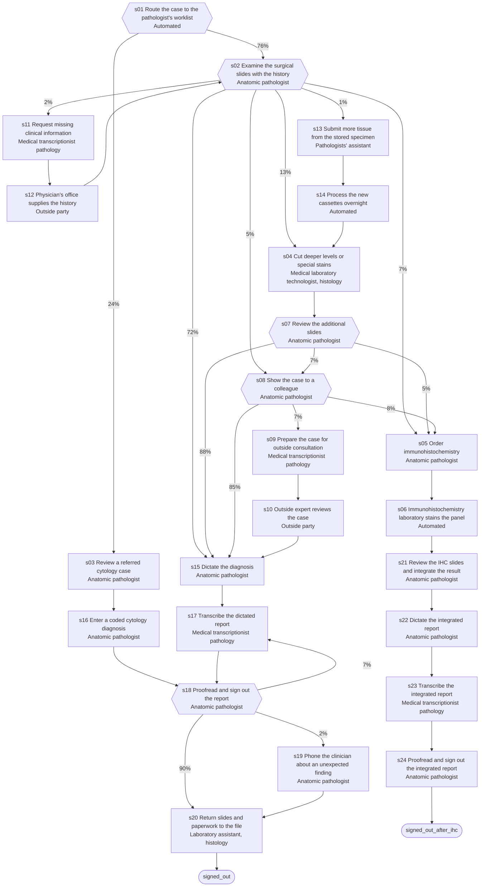

# Diagnose and sign out surgical pathology and referred cytology cases

`dls-cl-pathology-signout` · medical laboratory services · laboratory operations · part of `diagnostic-lab-services-co`

Anatomic pathologists examine the slides of each biopsy or referred cytology case with its history, decide whether they can diagnose it or need deeper levels, special stains, immunohistochemistry, a colleague's opinion or more clinical information, then dictate the diagnosis for a medical transcriptionist to type and sign the report electronically. Most community biopsies are signed out in one or two days, but immunohistochemistry, consultations and outside opinions add days and the case waits at several queues: the pathologist's tray, transcription and signature. Errors are mostly misinterpretations and report defects such as wrong sites or typing errors, and about five reports in a thousand are later amended.

| | |
|---|---|
| Unit of work | one pathology case |
| Starts when | Slides of a surgical case from histology, or a referred cytology case from the cytotechnologists, reach the pathologist's worklist. |
| Done when | The pathologist signs the report, which is released to the LIS for delivery to the clinician, and the slides are filed. |
| Organisation | A large Canadian community laboratory company with about 45 anatomic pathologists reporting community biopsies and referred cytology, using an anatomic pathology system with dictation and transcription. (3,300 employees, 2019-2022) |
| Volume | 16,000 cases a month (range 12,000 to 20,000) |

## Where it sits

- Starts with **pathology_case** from cl-histology-processing (76% of cases)
- Starts with **pathology_case** from cl-cytology-screening (24% of cases)
- Relies on **biomarker_report** from gs-ihc-molecular-pathology (a standing input; it does not start a case)
- Sends **pathology_report** to cl-result-reporting (outcome: any)
- Sends **ihc_request** to gs-ihc-molecular-pathology (outcome: signed_out_after_ihc)

## Flow

## Roles

| Role | Department | Layer | FTE on this process | Loaded cost per hour | Evidence |
|---|---|---|---:|---:|---|
| Anatomic pathologist | Histology and anatomic pathology | senior specialist | 31 | 230 CAD | B [dyn_hosp], [dyn_lic] |
| Medical transcriptionist (pathology) | Histology and anatomic pathology | individual contributor | 11 | 32 CAD | B [job_transcr] |
| Medical laboratory technologist, histology | Histology and anatomic pathology | individual contributor | 2.8 | 52 CAD | A [job_histo] |
| Pathologists' assistant | Histology and anatomic pathology | senior specialist | 0.2 | 62 CAD | B [job_pa] |
| Laboratory assistant, histology | Histology and anatomic pathology | individual contributor | 1 | 30 CAD | C |

## Steps

Hands-on time and the wait before each step show the most common value. Evidence tier A is a sourced number, B a sourced description, C the author's estimate.

| Step | Who | Kind | Hands-on | Wait before | Control | Evidence |
|---|---|---|---:|---:|---|---|
| **s01 Route the case to the pathologist's worklist.** When the slides arrive, the anatomic pathology system shows the case on the assigned pathologist's worklist with the requisition, gross description, prior pathology and, for cytology, the cytotechnologist's preliminary interpretation. | Automated | system auto | 0 min | 30 min |  | C |
| **s02 Examine the surgical slides with the history.** The pathologist reads the requisition and gross description, examines every part and level under the microscope, compares with prior pathology, and decides whether the diagnosis is clear or needs deeper levels, special stains, immunohistochemistry, a colleague's opinion or more clinical information. | Anatomic pathologist | analysis | 5 min | 4.0 h |  | B [epmc_presign], [epmc_tat], [dyn_lic] |
| **s03 Review a referred cytology case.** The pathologist reviews the dotted cells and the slide as needed with the cytotechnologist's interpretation and the patient's history, and decides the final Bethesda or descriptive category and recommendation, showing a colleague when unsure. | Anatomic pathologist | analysis | 3 min | 8.0 h | A pathologist confirms every gynaecologic slide with reactive, atypical, premalignant or malignant changes (accreditation practice; stated in the US rule 42 CFR 493.1274) | B [cfr1274], [hospitalist19] |
| **s04 Cut deeper levels or special stains.** The histotechnologist retrieves the block from the file, cuts the requested levels or sections for histochemical stains such as PAS, iron or a Helicobacter stain, stains and labels them, and returns them with the case. | Medical laboratory technologist, histology | physical | 10 min | 12.0 h |  | B [ucdavis_tat], [job_histo] |
| **s05 Order immunohistochemistry.** The pathologist selects the antibody panel and blocks in the anatomic pathology system, which sends the order to the immunohistochemistry laboratory, and keeps the case pending. | Anatomic pathologist | data entry | 2 min | 5 min |  | B [epmc_tat] |
| **s06 Immunohistochemistry laboratory stains the panel.** The case waits while the separate immunohistochemistry process cuts and stains the panel and returns the slides; that work is counted in the IHC and molecular pathology workflow. | Automated | external wait | 0 min | 1.5 d |  | B [ucdavis_tat] |
| **s07 Review the additional slides.** The pathologist examines the deeper levels or special stains with the original slides and either settles the diagnosis or asks for immunohistochemistry or a colleague's opinion. | Anatomic pathologist | analysis | 4 min | 8.0 h |  | C |
| **s08 Show the case to a colleague.** A second pathologist reviews the slides and the primary pathologist's impression, gives an opinion and the consultation is recorded in the report; difficult cases may be sent to an outside expert. | Anatomic pathologist | review | 10 min | 1.0 d | Departmental second-review policy (for example new malignancies and designated case types), recorded in the report as recommended by the University of Toronto pathology quality indicator guidelines | A [epmc_presign], [uoft_qi], [ucdavis_tat] |
| **s09 Prepare the case for outside consultation.** The medical transcriptionist prepares the consultation letter and copies of the requisition and report draft, the slides and blocks are pulled and packaged, and the courier shipment is logged on the pending list. | Medical transcriptionist (pathology) | drafting | 20 min | 8.0 h |  | B [job_transcr] |
| **s10 Outside expert reviews the case.** The expert pathologist at an academic centre reviews the slides and returns a written consultation by courier, fax or email. | Outside party | external wait | 0 min | 7.0 d |  | C |
| **s11 Request missing clinical information.** The medical transcriptionist phones or faxes the ordering physician's office for the clinical history or the biopsy site the pathologist needs and notes the request on the case. | Medical transcriptionist (pathology) | communication | 8 min | 2.0 h |  | C |
| **s12 Physician's office supplies the history.** The office calls back or faxes the missing history, site or clinical question and the case returns to the pathologist. | Outside party | external wait | 0 min | 1.0 d |  | C |
| **s13 Submit more tissue from the stored specimen.** The pathologists' assistant retrieves the stored container, submits further tissue in new cassettes as the pathologist asked and records the additional sections in the gross description. | Pathologists' assistant | physical | 10 min | 4.0 h |  | B [ucdavis_tat], [job_pa] |
| **s14 Process the new cassettes overnight.** The new cassettes go through the overnight processor with the next run before they can be embedded and cut; nobody works on them meanwhile. | Automated | system auto | 0 min | 16.0 h |  | B [ucdavis_tat] |
| **s15 Dictate the diagnosis.** The pathologist dictates the final diagnosis lines, microscopic description and comments into the dictation system, naming the specimen parts and any consultation. | Anatomic pathologist | drafting | 2.5 min | 5 min |  | C |
| **s16 Enter a coded cytology diagnosis.** The pathologist selects the Bethesda category, adequacy statement and screening recommendation from coded lists in the anatomic pathology system, adding a free-text comment when needed. | Anatomic pathologist | data entry | 1 min | 2 min |  | C |
| **s17 Transcribe the dictated report.** The medical transcriptionist listens to the dictation, types the report into the case template, checks specimen sites, laterality and patient details against the requisition, and queues it for the pathologist's signature. | Medical transcriptionist (pathology) | data entry | 5 min | 3.0 h |  | B [job_transcr], [epmc_tat] |
| **s18 Proofread and sign out the report.** The pathologist reads the transcribed or coded report against the dictation and the slides, corrects it or returns it to transcription, and signs it electronically, which releases it to the LIS for delivery. | Anatomic pathologist | approval | 1.5 min | 4.0 h | Pathology diagnoses are made and signed only by a licensed physician pathologist (Laboratory and Specimen Collection Centre Licensing Act licensing and CPSO or CPSM registration; accreditation report requirements); MLTs may not communicate a diagnosis | A [captoday_def12], [epmc_tat], [cmlto] |
| **s19 Phone the clinician about an unexpected finding.** For an unexpected malignancy, infection or other significant finding the pathologist phones the ordering clinician, confirms who received the result and documents the call in the report. | Anatomic pathologist | communication | 6 min | 1.0 h | Critical and significant unexpected findings policy: document what was communicated, when and to whom | B [uoft_qi] |
| **s20 Return slides and paperwork to the file.** The histology laboratory assistant collects the signed-out cases, files the slides by case number for retention and files or scans the paperwork. | Laboratory assistant, histology | physical | 0.4 min | 1.0 h |  | C |
| **s21 Review the IHC slides and integrate the result.** The pathologist examines the stained panel with the original slides, interprets each marker, and settles the diagnosis or asks a colleague. | Anatomic pathologist | analysis | 6 min | 8.0 h |  | C |
| **s22 Dictate the integrated report.** The pathologist dictates the diagnosis together with the immunohistochemistry results and an interpretive comment, listing each marker, its staining pattern and what it supports or excludes. | Anatomic pathologist | drafting | 4 min | 5 min |  | C |
| **s23 Transcribe the integrated report.** The medical transcriptionist types the longer report with its marker table, checks it against the requisition and queues it for signature. | Medical transcriptionist (pathology) | data entry | 8 min | 3.0 h |  | C |
| **s24 Proofread and sign out the integrated report.** The pathologist checks the transcribed report, corrects it and signs it electronically, which releases it to the LIS for delivery. | Anatomic pathologist | approval | 2 min | 4.0 h | Pathology diagnoses are made and signed only by a licensed physician pathologist (Laboratory and Specimen Collection Centre Licensing Act licensing and CPSO or CPSM registration; accreditation report requirements); MLTs may not communicate a diagnosis | B [captoday_def12] |

## Exceptions

| Exception | Share of cases | What happens |
|---|---:|---|
| Deeper levels or special stains | 10% | Blocks are recut or stained and the case waits about a day. |
| Immunohistochemistry | 7% | The case waits one to three days for the IHC laboratory and gets a longer integrated report. |
| Intradepartmental consultation | 5% | A second pathologist reviews the case before sign-out. |
| Outside expert consultation | 0% | Slides go to an academic expert and the case waits days to weeks. |
| Missing clinical information | 2% | The transcriptionist asks the office for the history before the pathologist can finish. |
| Report returned for corrections | 7% | The pathologist returns the transcribed report for corrections before signing. |
| Amended report after sign-out | 0% | A defect found after release (typo, site, misidentification or misinterpretation) leads to an amended report in the result reporting process. |

## Benchmarks

| Metric | Value | Unit | Population | Evidence |
|---|---|---|---|---|
| cycle_time_days | p50 1.2, p90 3.5 | calendar days from slides on the worklist to signed report | Author's estimate for community biopsies and referred cytology | C |
| biopsies_within_two_working_days | 85.9 | percent of biopsy diagnoses signed out by the second working day | 5,384 biopsies in 157 small hospitals (Novis et al. 1998) | A [epmc_tat] |
| report_defects_per_1000 | 4.7 | corrected reports per 1,000 cases (median 5.7) | 73 institutions, Q-Probes 2012 | A [captoday_def12] |
| cases_reviewed_before_signout | 6.6 | percent of surgical cases reviewed by a second pathologist | 45 laboratories, Q-Probes 2010 | A [epmc_presign] |

## Pain points

- Dictation and transcription add a queue and a round trip before signature, and transcription editing and pathologist verification are named delay points. (steps s15, s17, s18; B [epmc_tat], [job_transcr])
- Immunohistochemistry and consultations add one to three days and drive the slow tail of turnaround. (steps s05, s06, s08; B [epmc_tat], [ucdavis_tat])
- Missing clinical history on requisitions sends cases back to the physician's office. (steps s11, s12; C)
- Report defects, most of them nondiagnostic (wrong site, typing, demographics), lead to amended reports after release. (steps s17, s18; A [captoday_def12])

## Assumptions

- The biomarker report from gs-ihc-molecular-pathology returns to a case already open here, so it carries a share of 0 in triggered_by; the IHC wait is modelled as step p06 and the IHC work belongs to that workflow.
- Shares of 76% surgical and 24% cytology follow from the companion histology (13,000) and cytology (about 4,100 referred) workflows; together about 17,000 a month, against the process map's mode of 16,000.
- Rates of deeper levels or special stains (13%), immunohistochemistry (7%) and missing history (2%) are the author's estimates for community biopsies; second review at 5% of first reads plus later consults gives about 6% overall, close to the 6.6% Q-Probes figure.
- Pathologist minutes (about 5 minutes median microscopy for a community biopsy, 3 for referred cytology) are estimates; total stated pathologist time is about 31 FTE of the 45 anatomic pathologists, who also report hospital referral and consultation cases and do quality assurance work not modelled here.
- Cases on the IHC path end with their own dictation, transcription and sign-out steps so the ihc_request output can be tied to an outcome; unexpected-finding calls on that path are not modelled separately.
- Amended reports after sign-out are handled in the result reporting workflow; the defect probability at sign-out is set near the published 4.7 per 1,000.
- Loaded costs are the organisation file's (hourly wage times 1.35).

## Sources

- [epmc_presign] [Europe PMC record: Nakhleh et al. 2010, Surgical pathology case reviews before sign-out (Q-Probes study of 45 laboratories)](https://www.ebi.ac.uk/europepmc/webservices/rest/search?query=TITLE%3A%22case%20reviews%20before%20sign-out%22&resultType=core&format=json) (Europe PMC (abstract of Archives of Pathology and Laboratory Medicine), 2010). 1,183 of 18,032 cases (6.6%) reviewed by a second pathologist before sign-out, median laboratory 8.2%; reasons: difficult diagnosis 46.2%, departmental policy 43.0%; 78% involved one additional pathologist; laboratories with review policies reviewed 9.6% versus 6.5%.
- [epmc_tat] [Europe PMC records: surgical pathology turnaround studies (Volmar et al. 2015; Alshieban and Al-Surimi 2015; Patel et al. 2012; Novis et al. 1998)](https://www.ebi.ac.uk/europepmc/webservices/rest/search?query=TITLE%3A%28%22turnaround%20time%22%29%20AND%20TITLE%3A%28%22surgical%20pathology%22%20OR%20biopsy%29%20AND%20%28Q-Probes%20OR%20%22College%20of%20American%20Pathologists%22%29&resultType=core&format=json&pageSize=6) (Europe PMC (abstracts), 2015). Novis 1998: 85.9% of 5,384 biopsy diagnoses signed out by the second working day in 157 small hospitals; Patel 2012: 77% of non-biopsy cases within 2 days, with consultation, immunohistochemistry, malignancy and number of slides lengthening turnaround; Alshieban 2015: about 24% of routine cases missed the 2-day standard, delays at slide delivery, slide review, transcription editing and pathologist verification; Volmar 2015: median 2.72 days for large or complex specimens.
- [hospitalist19] [How long should it take to get a pathology diagnosis? (Manivel et al., AVAHO 2019 abstract)](https://blogs.the-hospitalist.org/index.php/content/how-long-should-it-take-get-pathology-diagnosis) (The Hospitalist / MDedge conference coverage, 2019). CAP: 90% of routine biopsies finalised within 2 working days; ADASP: at least 80% within 3 days; in 31,407 biopsies (2016 to 2018) average turnaround was 1.48 days for all biopsies and 2.2 days for biopsies with a new malignancy; 6.41% of biopsies were new malignancies; average 1.63 days for all cytologies; special stains had no significant effect on turnaround.
- [uoft_qi] [Pathology quality indicator guidelines (Rowsell and Ghorab)](https://lmp.utoronto.ca/db-resource/pathology-quality-indicator-guidelines) (Laboratory Medicine and Pathobiology Quality Council, University of Toronto, 2022). Prospective reviews with another pathologist should be recorded with the reviewer's name and scope; turnaround is more informative split into diagnostic biopsies and resections; laboratories keep a critical results list and document what was communicated, when and to whom.
- [captoday_def12] [Bringing down defects in surgical pathology reports (Paxton)](https://www.captodayonline.com/Archives/0512/0512d_bringing_down.html) (CAP Today, 2012). Q-Probes study of 73 institutions and 360,218 cases: 4.7 report defects (corrected reports) per 1,000, median 5.7; earlier studies 1.4 to 4.8 per 1,000; misinterpretation 14.6%, misidentification 13.3%, specimen defects 13.7%, other nondiagnostic defects 58.4%; 24.9% found by reviewing report text after sign-out; second identifiers on 75.7% of slides and 40% of blocks; laboratories where another pathologist reviews all malignancies before sign-out had fewer misidentifications.
- [ucdavis_tat] [Specimen turnaround time](https://health.ucdavis.edu/pathology/services/clinical/anatomic_pathology/surgical_pathology/clinical_services/turnaround_time.html) (UC Davis Health, Department of Pathology and Laboratory Medicine, undated). Biopsies 2 to 3 working days from accession; special stains and immunohistochemistry add 1 to 2 days; decalcification 1 to 2 days; intradepartmental consultation 1 to 2 days; overnight fixation 1 day; resubmission of tissue 1 to 2 days; recuts or deeper sections 1 to 2 days.
- [cfr1274] [42 CFR 493.1274 Standard: Cytology](https://www.law.cornell.edu/cfr/text/42/493.1274) (Legal Information Institute, Cornell Law School, current). US rule used as a reference for common practice: review of at least 10% of negative gynaecologic cases, randomly selected and including high-risk patients, before reporting; maximum 100 slides per person per 24 hours, not a performance target, individual limits reassessed every 6 months; a pathologist confirms every gynaecologic slide with reactive, atypical, premalignant or malignant changes; five-year look-back of prior negatives for a new HSIL or cancer; comparison of HSIL cytology with histology; annual statistical evaluation; slides retained and retrievable.
- [job_transcr] Medical Transcriptionist (Histology), Winnipeg (link withheld) (The model laboratory (Jobvite), 2026). Prepare consultation reports for pathologists, track incoming and outgoing reports, turnaround-time audits and monthly report totals, surgical pathology quality assurance support; medical terminology and transcription experience, 40 words a minute, advanced proofreading.
- [job_histo] Medical Laboratory Technologist (Histology team), Brampton (link withheld) (The model laboratory (Jobvite), 2026). Monday to Friday 3:00 p.m. to 11:00 p.m.; $35.00 to $38.75 an hour; all aspects of histology including grossing, embedding, microtomy and routine and special staining; verify sample identification; quality control and routine equipment maintenance; CMLTO registration.
- [job_pa] Pathology Assistant (Histology team), Brampton (link withheld) (The model laboratory (Jobvite), 2026). Monday to Friday 9:00 p.m. to 5:00 a.m.; $28.00 to $30.50 an hour; gross examination of surgical specimens, selection and dissection of tissue, documentation of gross findings, embedding, positive patient identification, loading tissue processors per SOP, quality assurance.
- [dyn_hosp] Hospital solutions (link withheld) (The model laboratory, undated). Nine Canadian laboratories, more than 60 pathologists, more than 500 hospitals served; services include pathology and histology, cytology, immunohistochemistry and microbiology; subspecialties include dermatology, gastrointestinal, breast, prostate and gynaecology.
- [dyn_lic] Licences and quality commitment (link withheld) (The model laboratory, undated). The quality management system uses software to monitor quality control of analytical processes, external quality assessment (CAP, QMP-LS, Healthmetrix) for all assays, internal audits and document control; Brampton, London, Ottawa and Peterborough hold ISO 15189 accreditation and Ontario licences; Winnipeg holds CAP and MANQAP accreditation for chemistry, cytology, histology, haematology and microbiology; pathology subspecialties include dermatopathology, gastrointestinal, uropathology, breast and gynaecologic pathology.
- [cmlto] [Laws and legislation governing MLT practice](https://www.cmlto.com/laws-legislation-governing-mlt-practice/) (College of Medical Laboratory Technologists of Ontario, undated). Medical Laboratory Technology Act, 1991: the scope of practice is the performance of laboratory investigations and the evaluation of the technical sufficiency of the investigations and their results; communicating a diagnosis is not an MLT authorised act; protected title.

Written by claude-opus on 2026-11-17.
