# Collect specimens at a collection centre

`dls-cl-psc-collection` · medical laboratory services · patient service centre operations · part of `diagnostic-lab-services-co`

After registration a lab assistant calls the patient to a collection room, confirms identity with two identifiers, draws blood into the ordered tubes in a set order, labels them at the chair and collects or receives urine and other specimens. Serum tubes are clotted and spun in the centre, then everything is stored at the right temperature, bagged to dangerous goods rules and handed to the courier at the next pickup. Hard-to-find veins, fainting, haemolysed or underfilled tubes and labelling slips are the main problems, and the wait for the next courier run makes up most of the elapsed time.

| | |
|---|---|
| Unit of work | one patient collection |
| Starts when | A registered patient with printed labels is waiting in the collection queue. |
| Done when | The specimens are labelled, processed, stored and handed to the courier, or no specimen could be collected. |
| Organisation | A large private community laboratory company with about 200 collection centres of one to six chairs, staffed by lab assistants (Ontario), auxiliary nurses (Quebec) and technicians (Manitoba), with courier pickups several times a day. (3,300 employees, 2019-2022) |
| Volume | 560,000 cases a month (range 480,000 to 640,000) |

## Where it sits

- Starts with **registered_visit** from cl-psc-registration (100% of cases)
- Relies on **competency_record** from qa-training-competency (a standing input; it does not start a case)
- Relies on **supply_shipment** from lg-supply-delivery (a standing input; it does not start a case)
- Sends **specimen_shipment** to lg-route-pickup (outcome: handed_to_courier)
- Sends **safety_incident** to hrm-health-safety (outcome: any)
- Sends **supply_order** to sc-supply-fulfilment (outcome: any)

## Flow

```mermaid
flowchart TD
    s01["s01 Call the patient to a collection room<br/>Laboratory assistant, collection centre  Ontario"]
    s02{{"s02 Confirm identity and match the labels at the chair<br/>Laboratory assistant, collection centre  Ontario"}}
    s03["s03 Fix a label or order mismatch with the front counter<br/>Laboratory assistant, collection centre  Ontario"]
    s04["s04 Check preparation and safety questions, then glove up<br/>Laboratory assistant, collection centre  Ontario"]
    s05["s05 Assemble tubes and supplies in order of draw<br/>Laboratory assistant, collection centre  Ontario"]
    s06["s06 Apply the tourniquet and prepare the site<br/>Laboratory assistant, collection centre  Ontario"]
    s07{{"s07 Draw blood into the tubes in order of draw<br/>Laboratory assistant, collection centre  Ontario"}}
    s08{{"s08 Make a second attempt<br/>Laboratory assistant, collection centre  Ontario"}}
    s09{{"s09 A team lead or second collector makes a final attempt<br/>Collection centre team lead"}}
    s10["s10 Manage a fainting or other reaction<br/>Laboratory assistant, collection centre  Ontario"]
    s11{{"s11 Remove the needle, bandage and discard the sharp<br/>Laboratory assistant, collection centre  Ontario"}}
    s12["s12 Handle and report a needlestick injury<br/>Collection centre team lead"]
    s13{{"s13 Label the tubes at the chair<br/>Laboratory assistant, collection centre  Ontario"}}
    s14["s14 Collect a urine or other specimen<br/>Laboratory assistant, collection centre  Ontario"]
    s15["s15 Receive a home-collected specimen<br/>Laboratory assistant, collection centre  Ontario"]
    s16["s16 Record the collection in the LIS<br/>Laboratory assistant, collection centre  Ontario"]
    s17{{"s17 Discharge the patient and clean the chair<br/>Laboratory assistant, collection centre  Ontario"}}
    s18["s18 Load clotted tubes into the centrifuge<br/>Laboratory assistant, collection centre  Ontario"]
    s19{{"s19 Unload the centrifuge and check the spun tubes<br/>Laboratory assistant, collection centre  Ontario"}}
    s20["s20 Aliquot or freeze specimens that need it<br/>Laboratory assistant, collection centre  Ontario"]
    s21["s21 Store specimens at the required temperature<br/>Laboratory assistant, collection centre  Ontario"]
    s22["s22 Bag the specimens for the courier<br/>Laboratory assistant, collection centre  Ontario"]
    s23["s23 Log the bags on the pickup manifest<br/>Laboratory assistant, collection centre  Ontario"]
    s24["s24 Hand the specimen boxes to the courier<br/>Laboratory assistant, collection centre  Ontario"]
    s25["s25 Count stock and place a supply order<br/>Laboratory assistant, collection centre  Ontario"]
    s26{{"s26 Team lead documents the incident and decides next steps<br/>Collection centre team lead"}}
    s27["s27 Regional manager reviews a serious incident<br/>Regional manager, collection centres"]
    s01 --> s02
    s02 --> s04
    s02 -->|"0%"| s03
    s03 --> s02
    s04 --> s05
    s05 --> s06
    s06 --> s07
    s07 -->|"96%"| s11
    s07 -->|"4%"| s08
    s07 -->|"0%"| s10
    s08 -->|"80%"| s11
    s08 -->|"20%"| s09
    s09 -->|"75%"| s11
    s09 -->|"25%"| end0
    s10 --> s26
    s11 --> s13
    s11 -->|"0%"| s12
    s12 --> s13
    s13 -->|"28%"| s14
    s13 -->|"5%"| s15
    s13 -->|"67%"| s16
    s14 --> s16
    s15 --> s16
    s16 --> s17
    s17 -->|"85%"| s18
    s17 -->|"15%"| s21
    s17 -->|"0%"| s25
    s18 --> s19
    s19 -->|"8%"| s20
    s19 -->|"92%"| s21
    s20 --> s21
    s21 --> s22
    s22 --> s23
    s23 --> s24
    s24 --> end1
    s25 --> s18
    s26 -->|"70%"| s11
    s26 -->|"5%"| s27
    s26 -->|"25%"| end0
    s27 --> end0
    end0(["not_collected"])
    end1(["handed_to_courier"])
```

## Roles

| Role | Department | Layer | FTE on this process | Loaded cost per hour | Evidence |
|---|---|---|---:|---:|---|
| Laboratory assistant, collection centre (Ontario) | Ontario collection centres | individual contributor | 185 | 31 CAD | B [jobbank33101], [uams_venip] |
| Auxiliary nurse, collection centre (Quebec) | Quebec collection centres | individual contributor | 55 | 35 CAD | C |
| Laboratory technician, collection centre (Manitoba) | Manitoba collection centres | individual contributor | 35 | 31 CAD | C |
| Collection centre team lead | Laboratory and Health Services Centres network | supervisor | 12 | 40 CAD | C |
| Regional manager, collection centres | Laboratory and Health Services Centres network | manager | 0.3 | 66 CAD | C |
| Director, Laboratory and Health Services Centres | Laboratory and Health Services Centres network | director | 0.02 | 105 CAD | C |

## Steps

Hands-on time and the wait before each step show the most common value. Evidence tier A is a sourced number, B a sourced description, C the author's estimate.

| Step | Who | Kind | Hands-on | Wait before | Control | Evidence |
|---|---|---|---:|---:|---|---|
| **s01 Call the patient to a collection room.** When a chair is free the lab assistant takes the next set of labels from the collection tray, calls the patient by first name or number and walks them to the collection room or cubicle. | Laboratory assistant, collection centre (Ontario) | intake | 0.2 min | 4 min |  | B [ag17], [yoshimoto20], [cureus23] |
| **s02 Confirm identity and match the labels at the chair.** The lab assistant asks the patient to state their full name and date of birth and compares the answer with the labels and the requisition before touching a tube. A mismatch stops the collection until it is fixed. | Laboratory assistant, collection centre (Ontario) | validation | 0.3 min | 0 min | ISO 15189 Plus (Accreditation Canada Diagnostics) and CLSI GP41: positive patient identification with two identifiers at the point of collection | B [uams_venip], [clsi_pre02] |
| **s03 Fix a label or order mismatch with the front counter.** The lab assistant takes the labels back to the registration counter, where the visit is corrected or the right labels are found and reprinted, and the identity check is repeated. Wrong labels are destroyed. | Laboratory assistant, collection centre (Ontario) | coordination | 3 min | 1 min |  | C |
| **s04 Check preparation and safety questions, then glove up.** The lab assistant confirms fasting where needed, asks about latex or antiseptic allergy, fainting history, bleeding problems and arm restrictions such as a mastectomy side, then cleans hands and puts on gloves. | Laboratory assistant, collection centre (Ontario) | validation | 0.3 min | 0 min | CLSI GP41 venipuncture procedure and infection prevention practice (hand hygiene and gloves) required under ISO 15189 Plus | B [clsi_pre02], [who_phleb], [dyn_before] |
| **s05 Assemble tubes and supplies in order of draw.** The lab assistant picks the tube types on the tube list and lines them up in the order of draw, with a safety needle or butterfly set, holder, alcohol swab, gauze and bandage within reach. | Laboratory assistant, collection centre (Ontario) | physical | 0.25 min | 0 min |  | B [uams_venip] |
| **s06 Apply the tourniquet and prepare the site.** The lab assistant applies the tourniquet a few inches above the site, feels for a suitable vein in the antecubital area, cleans the site with alcohol and lets it dry, keeping the tourniquet on for under one minute. | Laboratory assistant, collection centre (Ontario) | physical | 0.4 min | 0 min | CLSI GP41: tourniquet time under 1 minute, site cleansed and air dried | B [uams_venip], [clsi_pre02] |
| **s07 Draw blood into the tubes in order of draw.** The lab assistant anchors the vein, inserts the needle, fills each tube in order of draw, releases the tourniquet once blood flows and inverts each tube the set number of times. Most draws fill two to five tubes. | Laboratory assistant, collection centre (Ontario) | physical | 1.2 min | 0 min |  | B [cureus23], [epmc_waittime], [tian22], [yoshimoto20] |
| **s08 Make a second attempt.** After an unsuccessful first stick the lab assistant releases the tourniquet, removes the needle, chooses another site or a butterfly set on the hand, and tries once more with fresh supplies. | Laboratory assistant, collection centre (Ontario) | physical | 2 min | 0.5 min | CLSI GP41 and company procedure: no more than two attempts by one collector | B [uams_venip] |
| **s09 A team lead or second collector makes a final attempt.** The lab assistant asks the team lead or the most experienced colleague on shift to try. If that attempt also fails the patient is offered another day, advised to drink water, or referred back to the clinician. | Collection centre team lead | physical | 4 min | 4 min | Company collection procedure: escalate after two unsuccessful attempts | C |
| **s10 Manage a fainting or other reaction.** The lab assistant stops the draw, removes the needle, lowers the patient's head or reclines the chair, calls a colleague, gives water and watches the patient until recovered. Emergency services are called for a serious reaction. | Laboratory assistant, collection centre (Ontario) | physical | 15 min | 0 min |  | B [yoshimoto20], [who_phleb] |
| **s11 Remove the needle, bandage and discard the sharp.** The lab assistant places gauze, withdraws the needle, activates the safety device and drops the needle and holder straight into the sharps container, then asks the patient to press for two minutes and applies a bandage. | Laboratory assistant, collection centre (Ontario) | physical | 0.4 min | 0 min | Ontario Occupational Health and Safety Act, Needle Safety regulation (O. Reg. 474/07): safety-engineered needles in laboratories and specimen collection centres; immediate sharps disposal | B [uams_venip], [epmc_needle] |
| **s12 Handle and report a needlestick injury.** The injured lab assistant washes the wound and tells the team lead, who arranges assessment at a hospital emergency department within hours, records the source patient, files the incident report and the compensation board form, and covers the station. | Collection centre team lead | communication | 1.0 h | 5 min | Ontario Workplace Safety and Insurance Act reporting of workplace injuries; company bloodborne pathogen exposure procedure | C |
| **s13 Label the tubes at the chair.** With the patient still seated the lab assistant sticks a barcode label on each tube straight along the tube, writes initials and collection time, and asks the patient to confirm the name on the label. | Laboratory assistant, collection centre (Ontario) | physical | 0.4 min | 0 min | ISO 15189 Plus and CLSI GP41: specimens labelled at the point of collection in the presence of the patient | B [epmc_mislabel], [uams_venip] |
| **s14 Collect a urine or other specimen.** The lab assistant gives the patient a labelled container and instructions for a midstream sample, waits while the patient uses the washroom, receives the container, checks the lid and label and places it in a bag. | Laboratory assistant, collection centre (Ontario) | physical | 0.8 min | 5 min |  | C |
| **s15 Receive a home-collected specimen.** The lab assistant takes a 24-hour urine jug, stool kit or other home-collected specimen, checks the patient label, collection times and container type against the order, records the total volume if needed and bags it. | Laboratory assistant, collection centre (Ontario) | physical | 1 min | 0 min |  | B [dyn_before] |
| **s16 Record the collection in the LIS.** The lab assistant marks the order as collected, which records the collector, date and time, and enters the number of tubes, fasting status and any comment such as a difficult draw or a test not collected. | Laboratory assistant, collection centre (Ontario) | data entry | 0.3 min | 0 min | ISO 15189 Plus traceability: identity of the collector and collection date and time recorded | C |
| **s17 Discharge the patient and clean the chair.** The lab assistant checks the puncture site has stopped bleeding, tells the patient how to get results, then wipes the chair arm and work surface, discards waste and restocks tubes for the next patient. | Laboratory assistant, collection centre (Ontario) | physical | 0.3 min | 0 min |  | C |
| **s18 Load clotted tubes into the centrifuge.** Serum tubes wait in a rack until clotted, usually about 30 minutes. The lab assistant then balances them in the centrifuge with other patients' tubes and starts the run. | Laboratory assistant, collection centre (Ontario) | physical | 0.3 min | 35 min | Tube manufacturer instructions and laboratory specimen requirements under ISO 15189 Plus: clotting time before centrifugation and separation within the stated limit | C |
| **s19 Unload the centrifuge and check the spun tubes.** After the 10 to 15 minute run the lab assistant takes the tubes out, checks that the gel barrier formed and the serum looks clear, and notes any visibly haemolysed or lipaemic tube. | Laboratory assistant, collection centre (Ontario) | physical | 0.15 min | 12 min |  | C |
| **s20 Aliquot or freeze specimens that need it.** For tests that need frozen or separated serum or plasma, the lab assistant pours or pipettes the serum into a labelled transport tube and puts it in the freezer or fridge. | Laboratory assistant, collection centre (Ontario) | physical | 1.5 min | 5 min |  | C |
| **s21 Store specimens at the required temperature.** The lab assistant places each tube in the room temperature rack, refrigerator or freezer according to the test requirements and checks the temperature log for the fridge and freezer. | Laboratory assistant, collection centre (Ontario) | physical | 0.2 min | 0 min | ISO 15189 Plus specimen handling and storage requirements (stability by test, monitored storage temperatures) | C |
| **s22 Bag the specimens for the courier.** Before each pickup the lab assistant puts each patient's tubes in a sealed biohazard bag with absorbent material and the requisition copy in the outer pocket, then groups bags by temperature in the marked transport box. | Laboratory assistant, collection centre (Ontario) | physical | 0.2 min | 15 min | Transportation of Dangerous Goods Regulations section 1.39 and Part 5: UN3373 Biological Substance, Category B in CGSB-43.125 Type P650 packaging with mark and 24-hour number | A [tdg_regs] |
| **s23 Log the bags on the pickup manifest.** The lab assistant counts the bags in each temperature box, writes or prints the count on the pickup log or manifest for the courier and checks that no labelled specimen is left behind in the centrifuge or fridge. | Laboratory assistant, collection centre (Ontario) | data entry | 0.2 min | 2 min |  | C |
| **s24 Hand the specimen boxes to the courier.** At the scheduled pickup the courier arrives, scans the stop and the boxes, and the lab assistant hands over the boxes and confirms the count. Specimens collected after the last pickup wait overnight in the fridge or at room temperature as their stability allows. | Laboratory assistant, collection centre (Ontario) | physical | 0.1 min | 30 min |  | C |
| **s25 Count stock and place a supply order.** When tubes, needles, containers or requisition forms run low, the lab assistant counts what is left against the par levels and submits a supply order to the warehouse for the next delivery. | Laboratory assistant, collection centre (Ontario) | data entry | 20 min | 0 min |  | C |
| **s26 Team lead documents the incident and decides next steps.** The team lead checks on the patient, decides with them whether the draw can be completed after recovery or should be rebooked, and records the event in the incident log for the quality team. | Collection centre team lead | judgment | 10 min | 5 min | ISO 15189 Plus: adverse events and nonconformities recorded and reviewed | C |
| **s27 Regional manager reviews a serious incident.** The regional manager reads the incident record, calls the patient or family if needed, checks the collector's competency record and decides on follow-up such as retraining or a report to the director. | Regional manager, collection centres | review | 45 min | 2.0 d | Company incident management procedure: manager review of serious patient incidents | C |

## Exceptions

| Exception | Share of cases | What happens |
|---|---:|---|
| First venipuncture attempt fails | 4% | No blood or a lost vein; the collector tries once more at another site. |
| Two attempts fail | 1% | The team lead or most experienced colleague makes a final attempt; about a quarter of these patients leave without a specimen. |
| Fainting or other reaction | 0% | The draw stops, the patient is cared for until recovered and the team lead records the incident; most draws are completed afterwards. |
| Label or order mismatch at the chair | 0% | The patient's answer does not match the labels, so the labels go back to the counter for correction. |
| Urine or swab collection | 28% | The patient provides a urine sample in the washroom or a swab is taken. |
| Home-collected specimen | 5% | A 24-hour urine or stool kit is checked and accepted. |
| Needlestick injury | 0% | The collector is injured by a used needle; first aid, hospital assessment and injury reports follow. |

## Benchmarks

| Metric | Value | Unit | Population | Evidence |
|---|---|---|---|---|
| cycle_time_days | p50 0.1, p90 0.22 | calendar days from the patient entering the collection queue to the specimens handed to the courier | Community collection centres with pickups several times a day | C |
| phlebotomy_procedure_time_mean | 2.2 | minutes | Outpatient collection centre, India, 1,200 patients | A [cureus23] |
| first_attempt_success_rate | 0.97 | share of phlebotomies | Hospital phlebotomy service, Hong Kong, 2005 | A [epmc_waittime] |
| vasovagal_syncope_rate | 4e-05 | share of outpatient phlebotomies | University of Tokyo Hospital outpatient blood collection room, 677,956 draws | A [yoshimoto20] |
| haemolysis_index_flag_rate | 0.0354 | share of outpatient fasting serum specimens | Tertiary hospital, China, 195,225 outpatient specimens | A [tian22] |
| identified_mislabelling_rate | 0.00115 | share of specimens | US hospital laboratory, pilot study | A [epmc_mislabel] |

## Pain points

- Most elapsed time is the wait for the next courier run; afternoon specimens can sit for hours, and late ones wait overnight. (steps s22, s24; C)
- Difficult veins cause repeat sticks, escalation to the team lead and some patients leaving without a specimen. (steps s07, s08, s09; B [uams_venip], [epmc_waittime])
- Haemolysed, clotted or underfilled tubes and labelling slips are only found at the laboratory, so the patient has to come back. (steps s07, s13; A [tian22], [epmc_mislabel])
- Clotting and centrifuging in the centre ties up staff between patients during the morning rush. (steps s18, s19, s20; C)

## Assumptions

- Shared steps are assigned to the Ontario lab assistant role because Ontario has about 70% of centres and staff; Quebec auxiliary nurses and Manitoba technicians follow the same procedure. Their FTE is stated in proportion to visits.
- The workflow starts when the registered patient joins the collection queue and ends when the courier takes the specimens. The courier's work is in the route pickup workflow.
- Per-patient shares of batch work (centrifuge loading, bagging, manifests) are amortised as fractions of a minute per patient.
- Mean staff hands-on time is about 7.4 minutes per collection. At 560,000 collections a month this implies about 530 FTE at 130 productive hours, against 287 FTE stated here. With registration the total exceeds the org file's 580 front-line centre staff, which suggests the org file's visit volume is high or its centre headcount low. The stated FTE stays within the org file's headcount.
- The needlestick probability is set from injury rates per FTE, not per draw, and is very small per collection.
- Recollection visits for specimens rejected by the laboratory are not modelled separately; they enter as ordinary registered visits.
- Loaded costs come from the org file (hourly wage times 1.35).

## Sources

- [uams_venip] [Routine venipuncture guidelines](https://clinlab.uams.edu/test-directory/specimen-collection/routine-venipuncture-guidelines/) (University of Arkansas for Medical Sciences, Clinical Laboratory, 2026). Outpatients are asked their name and date of birth, which must match the requisition; never leave the tourniquet on for over 1 minute; do not attempt a venipuncture more than twice and notify a supervisor if unsuccessful; follow the order of draw; invert additive tubes 4 to 10 times; patient applies pressure for at least 2 minutes; label all tubes with patient labels, initials, date and time.
- [clsi_pre02] [PRE02 Collection of Diagnostic Venous Blood Specimens, 8th edition (replaces GP41-Ed7, 2017)](https://clsi.org/shop/standards/pre02/) (Clinical and Laboratory Standards Institute, 2025). Establishes criteria for venous blood specimen collection for laboratory testing as a stepwise model procedure for outpatient and inpatient collection; GP41-Ed7 (2017) was the edition in force in 2019-2022.
- [who_phleb] [WHO guidelines on drawing blood: best practices in phlebotomy](https://www.who.int/publications/i/item/9789241599221) (World Health Organization, 2010). Recommended steps for safe phlebotomy; each step carries risks for patients (bruising) and health workers (needle-stick injuries, bloodborne infection) and affects specimen quality; clerical errors can be fatal.
- [yoshimoto20] [Analysis of vasovagal syncope in the blood collection room in patients undergoing phlebotomy](https://pmc.ncbi.nlm.nih.gov/articles/PMC7578787) (Scientific Reports (PMC7578787), 2020). 27 vasovagal syncope cases in 677,956 outpatient phlebotomies (0.004%); 5 or more tubes raised the rate to 0.016%; waits were under 10 minutes for 90% or more of patients.
- [tian22] [The incidence rate and influence factors of hemolysis, lipemia, icterus in fasting serum biochemistry specimens](https://pmc.ncbi.nlm.nih.gov/articles/PMC8769349) (PLoS One (PMC8769349), 2022). Haemolysis index flagged 3.84% of 501,612 fasting serum specimens; 3.54% of outpatient specimens; longer transfer time associated with more haemolysis.
- [cureus23] [Assessment of the number of phlebotomists in a newly established sample collection center](https://pmc.ncbi.nlm.nih.gov/articles/PMC10493005) (Cureus (PMC10493005), 2023). Outpatient collection centre time study: queue wait mean 6.5 minutes, phlebotomy procedure mean 2.2 minutes (1,200 patients).
- [epmc_waittime] [Europe PMC abstracts: phlebotomy waiting and turnaround time studies, including Leung et al., Audit of phlebotomy turnaround time in a private hospital setting (2006)](https://www.ebi.ac.uk/europepmc/webservices/rest/search?query=TITLE%3A%28phlebotomy+OR+%22blood+collection%22+OR+%22blood+sampling%22%29+AND+%28TITLE%3A%22waiting+time%22+OR+TITLE%3A%22wait+time%22+OR+TITLE%3A%22turnaround%22+OR+TITLE%3A%22queue%22%29&resultType=core&format=json&pageSize=10) (Europe PMC, 2026). Leung et al.: success rate at first phlebotomy attempt 97%; job completion 10.4 minutes per ward request. Yun et al. 2016: automated reception cut mean time from reception to phlebotomy from 5:45 to 2:42 minutes.
- [epmc_mislabel] [Europe PMC abstracts: specimen labelling and identification error studies (Raymond et al. 2024; Ning et al. 2016; Sandhu et al. 2017)](https://www.ebi.ac.uk/europepmc/webservices/rest/search?query=TITLE%3A%28mislabeled+OR+mislabelled+OR+%22identification+errors%22+OR+%22labeling+errors%22%29+AND+TITLE%3A%28specimen+OR+specimens+OR+sample%29+AND+%28Q-Probes+OR+rate%29&resultType=core&format=json&pageSize=6) (Europe PMC, 2026). Raymond et al.: identified mislabelling 1.15 per 1,000 specimens, with blood-type discrepancies suggesting 3.17 per 1,000 occult mislabels. Ning et al.: outpatient identification errors 0.0067% of specimens before barcode labelling, 0.0001% after. Sandhu et al.: standardized labelling protocols cut labelling errors by a median 72%.
- [epmc_needle] [Europe PMC abstracts: sharps injury studies, including Dulon et al., Circumstances of percutaneous sharps injuries in German healthcare workers 2015-2024](https://www.ebi.ac.uk/europepmc/webservices/rest/search?query=TITLE%3A%28needlestick+OR+%22needle+stick%22+OR+%22sharps+injuries%22%29+AND+%28phlebotomist+OR+phlebotomists+OR+phlebotomy%29&resultType=core&format=json&pageSize=4) (Europe PMC, 2026). Medical practices had 21.6 percutaneous sharps injuries per 1,000 full-time equivalents a year; blood collection needles were the devices most often involved; 43% related to disposal.
- [tdg_regs] [Transportation of Dangerous Goods Regulations (SOR/2001-286), full text](https://laws-lois.justice.gc.ca/eng/regulations/SOR-2001-286/FullText.html) (Justice Laws Website, Government of Canada, 2026). Section 1.39: UN3373 Biological Substance, Category B is exempt from most documentation and labelling parts if the means of containment complies with Part 5 (CGSB-43.125 Type P650), shows the Category B mark, the shipping name and a 24-hour telephone number; Part 6 sets training certificate requirements.
- [jobbank33101] [Wages: Medical Laboratory Technical Assistant in Ontario (NOC 33101)](https://www.jobbank.gc.ca/marketreport/wages-occupation/4210/ON) (Job Bank, Government of Canada, 2025). Ontario hourly wages low $17.95, median $26.25, high $36.00 (2023-2024).
- [ag17] [2017 Annual Report, Section 3.07: Laboratory Services in the Health Sector](https://www.auditor.on.ca/en/content/annualreports/arreports/en17/v1_307en17.pdf) (Office of the Auditor General of Ontario, 2017). Collection centres differ in hours and blood-drawing chairs (for example six chairs in a North York centre, two in a small rural one); providers target serving 90% of patients within 30 or 40 minutes; specimen rejection rates of 0% to 4.4% in sampled hospital laboratories.
- [dyn_before] Patients and individuals: Before my test (link withheld) (The model laboratory, undated). Patients bring home-collected specimens their provider asked for; fasting of 4, 8 or 10 to 12 hours applies to listed tests.

Written by claude-opus on 2026-11-17.
