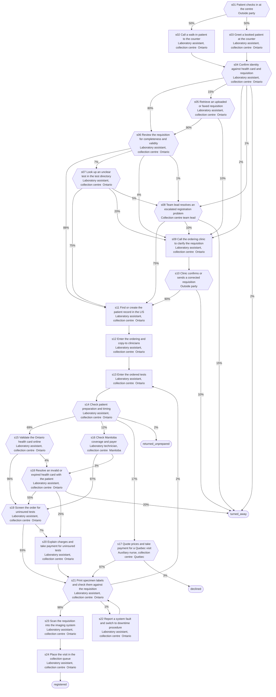

# Register the patient and requisition at a collection centre

`dls-cl-psc-registration` · medical laboratory services · patient service centre operations · part of `diagnostic-lab-services-co`

When a patient arrives at one of the company's roughly 200 collection centres with a requisition from their clinician, a lab assistant checks who they are, checks that the requisition is complete, finds or creates the patient in the laboratory information system, keys in the clinician and tests, checks the health card or takes payment, and prints the specimen labels. Most of the patient's time is spent waiting to reach the counter, especially on weekday mornings. Errors come from re-keying paper requisitions, unclear handwriting, invalid health cards and requisitions that cannot be found, which lead to calls to clinics, wrong or missed tests and patients sent away.

| | |
|---|---|
| Unit of work | one patient visit with its requisition |
| Starts when | A patient arrives at a collection centre with a paper, uploaded or faxed requisition, or a booked appointment. |
| Done when | The visit is registered in the LIS with tests, payer and labels printed and the patient is waiting for collection, or the patient leaves unregistered. |
| Organisation | A large private community laboratory company with about 200 walk-in and appointment collection centres in Ontario, Quebec and Manitoba, a central LIS and real-time Ontario health card validation. (3,300 employees, 2019-2022) |
| Volume | 560,000 cases a month (range 480,000 to 640,000) |

## Where it sits

- Starts with **lab_requisition** from patient (44% of cases)
- Starts with **appointment** from cd-appointment-booking (45% of cases)
- Starts with **lab_requisition** from ordering_physician (10% of cases)
- Starts with **consumer_order** from cd-self-pay-order (1% of cases)
- Relies on **new_collection_site** from fac-site-openings (a standing input; it does not start a case)
- Sends **registered_visit** to cl-psc-collection (outcome: registered)
- Sends **patient_invoice** to fin-patient-billing (outcome: registered)
- Sends **it_ticket** to it-service-desk (outcome: any)

## Flow

## Roles

| Role | Department | Layer | FTE on this process | Loaded cost per hour | Evidence |
|---|---|---|---:|---:|---|
| Laboratory assistant, collection centre (Ontario) | Ontario collection centres | individual contributor | 160 | 31 CAD | B [jobbank33101], [ag17] |
| Auxiliary nurse, collection centre (Quebec) | Quebec collection centres | individual contributor | 50 | 35 CAD | C |
| Laboratory technician, collection centre (Manitoba) | Manitoba collection centres | individual contributor | 30 | 31 CAD | C |
| Collection centre team lead | Laboratory and Health Services Centres network | supervisor | 8 | 40 CAD | C |

## Steps

Hands-on time and the wait before each step show the most common value. Evidence tier A is a sourced number, B a sourced description, C the author's estimate.

| Step | Who | Kind | Hands-on | Wait before | Control | Evidence |
|---|---|---|---:|---:|---|---|
| **s01 Patient checks in at the centre.** The patient walks in with a requisition, takes a numbered ticket from the queue kiosk or tells the screen or staff that they have a booked appointment, then sits in the waiting room. Patients who booked online may have checked in remotely by email link. | Outside party | intake | 0.2 min | 0 min |  | C |
| **s02 Call a walk-in patient to the counter.** When a counter frees up the lab assistant calls the next ticket number on the queue screen or by voice, greets the patient and asks what they are here for. Walk-ins wait longest on weekday mornings when fasting patients arrive before work. | Laboratory assistant, collection centre (Ontario) | intake | 0.1 min | 8 min |  | B [ag17], [nwm_lean] |
| **s03 Greet a booked patient at the counter.** The lab assistant sees the booked patient's name on the appointment list in the queue tool, calls them near their slot time, greets them and marks the appointment as arrived. Booked patients are slotted between walk-ins, so they still wait a few minutes. | Laboratory assistant, collection centre (Ontario) | intake | 0.1 min | 3 min |  | C |
| **s04 Confirm identity against health card and requisition.** The lab assistant takes the requisition and health card, asks the patient to state full name and date of birth, and compares these with the card and the requisition. A different name on the card, a missing card or someone else's requisition is caught here. | Laboratory assistant, collection centre (Ontario) | validation | 0.25 min | 0 min | ISO 15189 Plus (Accreditation Canada Diagnostics) pre-examination requirements: positive patient identification with at least two identifiers before collection | B [dyn_before], [dyn_upload] |
| **s05 Retrieve an uploaded or faxed requisition.** The lab assistant searches the requisition queue in the imaging system by patient name and date of birth, opens the uploaded or faxed image and prints it or attaches it to the visit. Faxed requisitions can take a few hours to appear, so some are not yet there. | Laboratory assistant, collection centre (Ontario) | lookup | 0.6 min | 0 min |  | B [dyn_upload] |
| **s06 Review the requisition for completeness and validity.** The lab assistant checks that the requisition names the clinician with a practitioner number and signature, that patient identifiers match the card, that tests are clearly marked, the payer box is ticked and the date is within six months, and that timed tests carry dose or collection times. | Laboratory assistant, collection centre (Ontario) | validation | 0.25 min | 0 min | Laboratory and Specimen Collection Centre Licensing Act (R.R.O. 1990, Reg. 682, replaced by O. Reg. 45/22 in 2022): tests only on a signed requisition from an authorized practitioner; Manitoba Health requisition rules | B [form4422], [dyn_mbreq], [dyn_upload] |
| **s07 Look up an unclear test in the test directory.** For a handwritten test name, abbreviation or brand name the lab assistant searches the online test directory and LIS test catalogue, checks the tube type and whether the test is done in-house, and may ask a colleague who knows the local doctors' habits. | Laboratory assistant, collection centre (Ontario) | lookup | 1.5 min | 0.5 min |  | C |
| **s08 Team lead resolves an escalated registration problem.** The team lead is called to the counter for an identity mismatch, a requisition from a prescriber not in the LIS, a test the company does not offer or an upset patient. The team lead decides whether to register with a note, create a provisional prescriber or send the patient back to the clinic. | Collection centre team lead | judgment | 5 min | 5 min | Company collection centre procedure: team lead approval for identity exceptions and non-standard requisitions | C |
| **s09 Call the ordering clinic to clarify the requisition.** The lab assistant phones the clinic on the requisition, waits through the clinic's phone menu or reception, explains what is missing or unclear and asks for a verbal clarification or a corrected requisition by fax or upload. Calls often reach voicemail. | Laboratory assistant, collection centre (Ontario) | communication | 4 min | 1 min |  | C |
| **s10 Clinic confirms or sends a corrected requisition.** Clinic staff call back or fax or upload a corrected requisition while the patient waits. If the clinic cannot be reached in a reasonable time, the clear tests are registered and the unclear ones are held with a note, or the patient is asked to come back. | Outside party | external wait | 2 min | 10 min |  | C |
| **s11 Find or create the patient record in the LIS.** The lab assistant searches the LIS by health number or name and date of birth, picks the matching record and updates address, phone and email, or creates a new record when the patient is new to the company. Similar names make picking the wrong record possible. | Laboratory assistant, collection centre (Ontario) | data entry | 0.4 min | 0 min |  | C |
| **s12 Enter the ordering and copy-to clinicians.** The lab assistant looks up the ordering clinician by practitioner number or name in the LIS provider file, confirms the clinic address so the report goes to the right place, and adds any copy-to clinicians written on the requisition. | Laboratory assistant, collection centre (Ontario) | data entry | 0.15 min | 0 min |  | B [valenstein99] |
| **s13 Enter the ordered tests.** The lab assistant keys each checked test and each written test into the LIS as test codes, adds dose and collection times for drug monitoring, and records fasting status and clinical notes the laboratory needs. Paper requisitions are re-keyed in full at the counter. | Laboratory assistant, collection centre (Ontario) | data entry | 0.6 min | 0 min |  | B [valenstein99], [nwm_lean] |
| **s14 Check patient preparation and timing.** The lab assistant asks whether the patient fasted when a fasting test is ordered, when the last dose was taken for drug levels, and whether a timed test needs an appointment. A patient who is not prepared is told how to prepare and asked to come back. | Laboratory assistant, collection centre (Ontario) | validation | 0.1 min | 0 min |  | B [dyn_before] |
| **s15 Validate the Ontario health card online.** The LIS sends the health number and version code to the ministry's Health Card Validation service and shows whether the card is valid and the patient eligible. An invalid version code usually means a renewed, expired or lost card or a keying slip. | Laboratory assistant, collection centre (Ontario) | validation | 0.1 min | 0 min | OHIP payment rules: the ministry pays only for insured tests on a valid health number and version code; Health Card Validation used at each visit | B [omd_hcv] |
| **s16 Check Manitoba coverage and payer.** The Manitoba technician records the PHIN and Manitoba Health registration number, checks the card, and confirms the physician marked the payment agency box (Manitoba Health, workers' compensation or other) on the requisition. | Laboratory technician, collection centre (Manitoba) | validation | 0.2 min | 0 min | Manitoba Health requisition rules: payment agency must be marked by the requisitioning physician | B [dyn_mbreq] |
| **s17 Quote prices and take payment for a Quebec visit.** In Quebec most community tests at a private centre are paid by the patient. The auxiliary nurse prints the price of each test, explains the total, takes debit or credit payment and gives a receipt for the patient's private insurer. A patient may drop tests or leave. | Auxiliary nurse, collection centre (Quebec) | data entry | 1.5 min | 0 min | Company cash handling and receipting controls for point-of-sale payments, reconciled daily by billing | C |
| **s18 Resolve an invalid or expired health card with the patient.** The lab assistant re-keys the number to rule out a typing slip, asks if the patient has a newer card, and otherwise explains that the tests can be paid now as uninsured or the patient can return after renewing the card at ServiceOntario. | Laboratory assistant, collection centre (Ontario) | communication | 2.5 min | 0 min |  | B [omd_hcv] |
| **s19 Screen the order for uninsured tests.** The LIS flags tests that the provincial plan does not pay for, or pays only under conditions, such as PSA for screening or vitamin D without an approved reason. The lab assistant checks the reason box the clinician ticked before treating a test as uninsured. | Laboratory assistant, collection centre (Ontario) | validation | 0.1 min | 0 min | OHIP schedule of insured community laboratory services (Health Insurance Act); requisition reason boxes for PSA and vitamin D | B [ag17], [form4422] |
| **s20 Explain charges and take payment for uninsured tests.** The lab assistant tells the patient which tests are not covered and their price, takes debit or credit payment and prints a receipt, or removes the test with a note to the clinician if the patient declines it. | Laboratory assistant, collection centre (Ontario) | data entry | 2 min | 0 min | Company cash handling and receipting controls for point-of-sale payments, reconciled daily by billing | B [ag17] |
| **s21 Print specimen labels and check them against the requisition.** The LIS assigns an accession number and prints barcode labels and a tube list. The lab assistant compares the printed order with the requisition and the patient's name and date of birth, and fixes any missing or extra test before the patient moves on. | Laboratory assistant, collection centre (Ontario) | validation | 0.2 min | 0.2 min | ISO 15189 Plus pre-examination requirements: request information verified and every specimen traceable to an identified patient and request | B [valenstein99] |
| **s22 Report a system fault and switch to downtime procedure.** When the label printer, network or LIS fails, the lab assistant restarts the printer or workstation, calls or logs a ticket with the IT service desk and, if the outage continues, switches to the downtime procedure of handwritten logs and pre-printed labels for later entry. | Laboratory assistant, collection centre (Ontario) | communication | 8 min | 0 min |  | C |
| **s23 Scan the requisition into the imaging system.** The lab assistant scans the paper requisition at the counter scanner and links the image to the accession, so the laboratory, billing and client services can see the original order, then keeps or shreds the paper as procedure says. | Laboratory assistant, collection centre (Ontario) | data entry | 0.15 min | 0 min | ISO 15189 Plus records requirements: the original request is retained and retrievable | C |
| **s24 Place the visit in the collection queue.** The lab assistant puts the labels and tube list in the collection tray in queue order, or keeps them if they will draw the patient themselves, and asks the patient to wait to be called to a collection room. | Laboratory assistant, collection centre (Ontario) | coordination | 0.15 min | 0 min |  | C |

## Exceptions

| Exception | Share of cases | What happens |
|---|---:|---|
| Unclear or incomplete requisition | 6% | Handwriting, an unknown test name, a missing signature or clinician, or identifiers that do not match the card. The assistant looks the test up or calls the clinic; some tests are held and a few patients are sent back. |
| Uploaded or faxed requisition not yet available | 2% | The patient says the clinic sent the requisition but it is not in the imaging queue yet, so the clinic has to resend it. |
| Invalid or expired Ontario health card | 3% | Health Card Validation rejects the version code; the assistant re-keys it, asks for a newer card, takes payment as uninsured or sends the patient to renew the card. |
| Uninsured test ordered | 6% | A test not paid by the provincial plan is explained and paid at the counter or removed. |
| Quebec patient-pay visit | 17% | The auxiliary nurse quotes the price of every test and takes payment before collection. |
| Patient not prepared | 2% | The patient ate before a fasting test or came without an appointment for a timed test and is asked to return. |
| System or label printer outage | 1% | The LIS, network or label printer fails; the assistant logs an IT ticket and uses downtime labels and logs for later entry. |

## Benchmarks

| Metric | Value | Unit | Population | Evidence |
|---|---|---|---|---|
| cycle_time_days | p50 0.012, p90 0.03 | calendar days from arrival at the centre to registration complete (0.012 days is about 17 minutes) | Community collection centres in Ontario, 2019-2022 | B [ag17], [nwm_lean] |
| wait_time_target_90th_percentile | low 30, high 40 | minutes to be served | Two Ontario community laboratory providers, 2017 | A [ag17] |
| requisitions_with_order_entry_error | 0.048 | share of outpatient requisitions | 660 laboratories in the CAP Q-Probes program, 1999 | A [valenstein99] |
| registration_time_mean | 1.1 | minutes per patient | Hospital outpatient collection centre in India with a simpler registration and no insurance check | A [cureus23] |

## Pain points

- Morning peaks of fasting patients make walk-in waits of 30 to 60 minutes common while the centre is quiet in the afternoon. (steps s02; B [ag17], [nwm_lean])
- Every paper requisition is re-keyed at the counter, which is the slowest and most error-prone part of registration. (steps s11, s12, s13; A [valenstein99], [nwm_lean])
- Handwritten or incomplete requisitions force calls to clinics that often go to voicemail while the patient waits. (steps s06, s07, s09, s10; C)
- Faxed or uploaded requisitions are sometimes not yet available when the patient arrives. (steps s05; B [dyn_upload])
- Explaining uninsured charges and Quebec prices at the counter slows the queue and causes complaints. (steps s17, s20; B [ag17])

## Assumptions

- All shared steps are assigned to the Ontario lab assistant role because Ontario has about 70% of the centres and staff. Quebec auxiliary nurses and Manitoba technicians do the same steps at similar speed; their own role appears only on the province-specific steps (Quebec payment, Manitoba coverage check). Their FTE is stated in proportion to visits.
- The registration ends when labels are printed and the patient waits for collection. The second wait, for a collection room, belongs to the collection workflow.
- Half of visits are modelled as booked and half as walk-in, from the org file's 320,000 appointment bookings a month against 560,000 visits. Walk-in waits are set so that about 90% reach the counter within about 40 minutes, near provider targets reported in 2017.
- Province shares (Ontario 69%, Quebec 17%, Manitoba 12%) follow the org file's staff split, not visit counts, which are not published.
- Hands-on times are for an experienced assistant. Mean staff hands-on time is about 5 minutes per visit including branches. At the org file's 560,000 visits a month this implies about 360 FTE at 130 productive hours a month, more than the 248 FTE stated here; together with collection it exceeds the org file's 580 front-line centre staff. Either visits are overstated in the org file, centre headcount is understated, or productive hours per person are higher than 130. The stated FTE is kept within the org file's headcount.
- Electronic orders sent from clinic EMRs straight into the LIS were rare at collection centres in 2019-2022, so nearly every visit is keyed from a paper or scanned requisition.
- The new_collection_site input from site openings enables visits but does not trigger them, so its share is 0.
- Loaded costs come from the org file (hourly wage times 1.35).

## Sources

- [ag17] [2017 Annual Report, Section 3.07: Laboratory Services in the Health Sector](https://www.auditor.on.ca/en/content/annualreports/arreports/en17/v1_307en17.pdf) (Office of the Auditor General of Ontario, 2017). Ontario had 356 community collection centres run by seven companies (March 2017); community laboratories did more than 121 million tests in 2015/16 and about 1.1 million uninsured tests paid by patients or private insurance; providers set their own wait targets, for example 90% of patients served within 30 minutes at one community provider and within 40 minutes at another; no provincial wait-time monitoring; collection centres differ in hours and blood-drawing chairs.
- [jobbank33101] [Wages: Medical Laboratory Technical Assistant in Ontario (NOC 33101)](https://www.jobbank.gc.ca/marketreport/wages-occupation/4210/ON) (Job Bank, Government of Canada, 2025). Ontario hourly wages low $17.95, median $26.25, high $36.00 (2023-2024 Labour Force Survey); Toronto median $25.00.
- [dyn_before] Patients and individuals: Before my test (link withheld) (The model laboratory, undated). Patients bring a completed and signed requisition and their provincial health card; most visits to Laboratory and Health Services Centres do not need an appointment, but glucose tolerance, breath and some other tests do; fasting rules of 4, 8 or 10 to 12 hours apply to listed tests.
- [dyn_upload] Upload Ontario lab requisitions conveniently and securely (partner update) (link withheld) (The model laboratory, 2020). From September 2020 physicians and patients can upload Ontario requisitions online; on arrival the patient tells staff the requisition was uploaded; requisitions older than 6 months are not accepted; an email explains how to check in remotely.
- [form4422] [Laboratory Requisition, form 4422-84 (text version)](https://forms.mgcs.gov.on.ca/dataset/83a92b8f-f0ad-4be3-80c4-13a09e6676ce/resource/5af91189-4cfd-4db7-817d-ca85b90385e5/download/txt_4422-84e.html) (Ontario Ministry of Health, Central Forms Repository, 2026). The Ontario requisition carries clinician name, address and practitioner number, payer box (OHIP/insured, third party/uninsured, WSIB), patient name as per OHIP card, health number and version, sex, date of birth, test check boxes, therapeutic drug monitoring dose times, other tests, specimen collection date and time, and clinician signature; PSA for asymptomatic screening and vitamin D without OHIP criteria are marked as patient responsible for payment.
- [omd_hcv] [Health Card Validation](https://ontariomd.ca/products-and-services/health-card-validation) (OntarioMD, undated). The ministry's Health Card Validation service lets providers validate Ontario health card numbers and version codes in real time and returns a response code showing card status and OHIP eligibility, without returning corrected numbers.
- [dyn_mbreq] The model laboratory Manitoba laboratory requisition (January 2020) (link withheld) (The model laboratory, 2020). Manitoba requisition asks for name as per MHSC card, PHIN and MHSC numbers, a payment agency box (MB, WCB, other) that the physician must mark, cash or cheque receipt number, and states that Manitoba Health does not allow tests requisitioned in non-specific blocks.
- [valenstein99] [Outpatient order accuracy: a College of American Pathologists Q-Probes study of requisition order entry accuracy in 660 institutions (abstract)](https://www.ebi.ac.uk/europepmc/webservices/rest/search?query=TITLE%3A%22outpatient%20order%20accuracy%22&resultType=core&format=json) (Archives of Pathology and Laboratory Medicine, via Europe PMC, 1999). 5,514 of 114,934 outpatient requisitions (4.8%) had at least one order entry error; median institution 6.0%; 10% of institutions at least 18%; physician name discrepancies most common; higher error rates where orders were not rechecked against requisitions and accuracy was not monitored.
- [cureus23] [Assessment of the number of phlebotomists in a newly established sample collection center](https://pmc.ncbi.nlm.nih.gov/articles/PMC10493005) (Cureus (PMC10493005), 2023). Time study of 1,200 outpatients at an Indian hospital collection centre: registration mean 1.1 minutes, queue wait 6.5 minutes, phlebotomy 2.2 minutes, 9.8 minutes from registration to completed draw.
- [nwm_lean] [Streamlining diagnostic testing at Northwestern Memorial](https://www.isixsigma.com/healthcare/streamlining-diagnostic-testing-northwestern-memorial/) (iSixSigma, 2010). Outpatient lab flow of greeter, data entry and phlebotomy; data entry (ordering tests and queuing labels) was the bottleneck at 46 patients an hour; waits of 30 to 60 minutes at peak; share of patients seen within 20 minutes rose from 44% to 84%.

Written by claude-opus on 2026-11-17.
