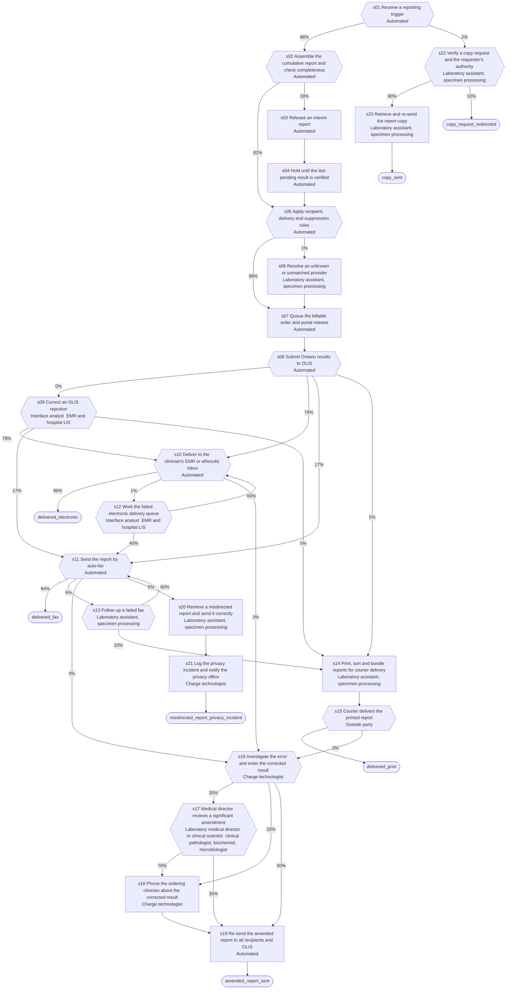

# Report results to clinicians and long-term care homes

`dls-cl-result-reporting` · medical laboratory services · laboratory operations · part of `diagnostic-lab-services-co`

Once laboratory results are verified, the LIS builds a cumulative report for each requisition and sends interim and final versions to the ordering clinician and copy-to recipients by EMR batch download, the eResults web portal, auto-fax or printed copies carried by courier, submits Ontario results to the provincial laboratory information system, and queues the order for billing and the patient portal. Almost all of this is automatic. People work the exceptions: unmatched providers, failed faxes and interface errors, report copy requests, amended reports after an error is found, and misdirected reports that become privacy incidents. Elapsed time is set mainly by the slowest test on the requisition and by EMR download and courier schedules.

| | |
|---|---|
| Unit of work | one final report |
| Starts when | A result on a community requisition is verified by autoverification or a technologist, or the contact centre logs a request for a copy of a report. |
| Done when | The final report (and any interim reports) has reached every recipient by their delivery channel and OLIS, the order is queued for billing and the portal, or an amended report or copy has been sent, or a misdirected report has been contained and passed to the privacy office. |
| Organisation | A large Canadian community laboratory company reporting about 690,000 community requisitions a month from regional laboratories to clinics, LTC homes and the provincial repository. (3,300 employees, 2019-2022) |
| Volume | 690,000 cases a month (range 600,000 to 780,000) |

## Where it sits

- Starts with **test_result** from cl-core-testing (82% of cases)
- Starts with **test_result** from cl-microbiology-testing (9% of cases)
- Starts with **test_result** from cl-cytology-screening (4% of cases)
- Starts with **pathology_report** from cl-pathology-signout (2% of cases)
- Starts with **test_result** from hs-result-delivery (2% of cases)
- Starts with **report_request** from cs-client-inquiries (2% of cases)
- Relies on **notification_record** from cs-critical-result-notification (a standing input; it does not start a case)
- Relies on **lis_change** from it-lis-change (a standing input; it does not start a case)
- Sends **lab_report** to ordering_physician (outcome: any)
- Sends **lab_report** to ltc_home (outcome: delivered_print)
- Sends **lab_report** to ltc_home (outcome: delivered_fax)
- Sends **test_result** to cd-portal-results (outcome: any)
- Sends **billable_order** to fin-provincial-billing (outcome: any)
- Sends **privacy_incident** to lp-privacy-incident (outcome: misdirected_report_privacy_incident)

## Flow

## Roles

| Role | Department | Layer | FTE on this process | Loaded cost per hour | Evidence |
|---|---|---|---:|---:|---|
| Laboratory assistant, specimen processing | Specimen receiving and processing | individual contributor | 15 | 30 CAD | B [r_jobbank_mla] |
| Interface analyst (EMR and hospital LIS) | LIS and integration | individual contributor | 2 | 62 CAD | B [r_eresults], [r_hospital] |
| Charge technologist | Community laboratory testing (The model laboratory Laboratories) | supervisor | 3 | 58 CAD | C |
| Laboratory medical director or clinical scientist (clinical pathologist, biochemist, microbiologist) | Community laboratory testing (The model laboratory Laboratories) | senior specialist | 0.3 | 230 CAD | C |

## Steps

Hands-on time and the wait before each step show the most common value. Evidence tier A is a sourced number, B a sourced description, C the author's estimate.

| Step | Who | Kind | Hands-on | Wait before | Control | Evidence |
|---|---|---|---:|---:|---|---|
| **s01 Receive a reporting trigger.** The LIS registers either a newly verified result on a requisition (from the core, microbiology, cytology, pathology or reference laboratory) or a report copy request logged by the contact centre, and starts the matching reporting path. | Automated | intake | 0 min | 0 min |  | C |
| **s02 Assemble the cumulative report and check completeness.** The LIS builds the cumulative report for the requisition with reference ranges, flags, interpretive and specimen comments and any critical call note, and checks whether every ordered test is final. | Automated | system auto | 0 min | 2 min |  | B [r_krasowski] |
| **s03 Release an interim report.** The LIS sends an interim report with the completed results marked final and the rest marked pending, through the same delivery channels as a final report. | Automated | system auto | 0 min | 10 min |  | C |
| **s04 Hold until the last pending result is verified.** The requisition waits in the LIS until the slowest test (for example a urine culture, Pap test or referred specialised test) is verified; nobody works on the report while it waits. | Automated | system auto | 0 min | 2.0 d |  | C |
| **s05 Apply recipient, delivery and suppression rules.** The LIS looks up the ordering provider and copy-to recipients on the requisition, their client account and each one's delivery preference (EMR batch, eResults web, auto-fax or printed copy), and applies rules such as withholding sensitive results from the portal. | Automated | system auto | 0 min | 1 min |  | B [r_eresults], [r_hcp] |
| **s06 Resolve an unknown or unmatched provider.** A reporting assistant opens the requisition image, searches the provider registry and client accounts for the name and billing number, phones the clinic if needed, links the correct provider in the LIS and requests a new client account when there is none. | Laboratory assistant, specimen processing | lookup | 4 min | 4.0 h |  | C |
| **s07 Queue the billable order and portal release.** The LIS sends the completed order with test codes and payer to the billing system and queues the results for the patient portal under its release rules; no one touches this step. | Automated | system auto | 0 min | 0 min |  | C |
| **s08 Submit Ontario results to OLIS.** The interface engine sends results on Ontario requisitions to the provincial laboratory information system so that other authorized clinicians can see them; Quebec and Manitoba reports skip this step. The engine then sends the report down the recipient's delivery channel. | Automated | system auto | 0 min | 5 min | Provincial requirement for community laboratories to contribute results to OLIS (Ontario) | B [r_olis], [r_olis_lab] |
| **s09 Correct an OLIS rejection.** An interface analyst reads the rejection acknowledgement (for example an unmapped test code, invalid health card format or missing provider identifier), corrects the data or the code mapping and resubmits the message. | Interface analyst (EMR and hospital LIS) | analysis | 3 min | 8.0 h |  | C |
| **s10 Deliver to the clinician's EMR or eResults inbox.** The report is posted to eResults and, for EMR users, made available to the practice's EMR batch download in the company's conformance format; the EMR collects new results on its own schedule. | Automated | system auto | 0 min | 45 min |  | B [r_eresults] |
| **s11 Send the report by auto-fax.** The fax server sends the report to the clinic's fax number on file, retrying busy lines automatically; Level II alert results are timed for 08:00 to 20:00. | Automated | system auto | 0 min | 10 min |  | B [r_oaml], [r_alpha] |
| **s12 Work the failed electronic delivery queue.** An interface analyst reviews messages with errors or missing acknowledgements, checks the EMR connection and provider mapping with the clinic's vendor, and resends or switches the clinic to fax until the connection is fixed. | Interface analyst (EMR and hospital LIS) | analysis | 1 min | 8.0 h |  | C |
| **s13 Follow up a failed fax.** A reporting assistant checks the number against the client account, phones the clinic to confirm the fax line or a new number, updates the account and re-faxes, or switches the report to printed delivery. | Laboratory assistant, specimen processing | communication | 4 min | 4.0 h |  | C |
| **s14 Print, sort and bundle reports for courier delivery.** A reporting assistant prints reports in batches by courier route, checks the page count and recipient on each, puts them in sealed envelopes and adds them to the route bags. | Laboratory assistant, specimen processing | physical | 0.5 min | 4.0 h |  | C |
| **s15 Courier delivers the printed report.** The company courier carries the bundle on the next scheduled route to the clinic or long-term care home, where staff file it in the resident or patient chart. | Outside party | external wait | 0 min | 12.0 h |  | C |
| **s16 Investigate the error and enter the corrected result.** After a clinician query, a QC look-back or an internal review finds an error in a released report (wrong result, wrong patient, wrong units or comment), the charge technologist confirms it against the instrument record and specimen, opens a nonconformance, and enters the corrected result in the LIS with an amended flag and the reason. | Charge technologist | analysis | 15 min | 3.0 d | ISO 15189 revised reports: amended reports clearly identified with the reason, original retained; CLSI C24 corrected reports | B [r_clp_c24] |
| **s17 Medical director reviews a significant amendment.** The medical director reviews the error, the corrected value and its clinical impact, approves the amended report wording and decides whether the clinician must be phoned. | Laboratory medical director or clinical scientist (clinical pathologist, biochemist, microbiologist) | approval | 10 min | 8.0 h | ISO 15189 laboratory director responsibility for reports; laboratory amended report procedure | C |
| **s18 Phone the ordering clinician about the corrected result.** The charge technologist calls the clinician's office, explains the original and corrected values, records who was told and when, and adds a call note to the amended report. | Charge technologist | communication | 8 min | 4.0 h | CLSI C24 and laboratory procedure: providers are told when a corrected report is issued | B [r_clp_c24] |
| **s19 Re-send the amended report to all recipients and OLIS.** The LIS sends the amended report, marked as corrected, to every original recipient and to OLIS through the same channels, and updates the portal copy. | Automated | system auto | 0 min | 30 min |  | C |
| **s20 Retrieve a misdirected report and send it correctly.** A reporting assistant takes the call from the clinic that received the wrong report, asks them to destroy or return it and confirm in writing, identifies the cause (wrong number, similar provider name, envelope error) and sends the report to the right recipient. | Laboratory assistant, specimen processing | communication | 20 min | 4.0 h | Personal Health Information Protection Act, 2004 (Ontario): reasonable steps to contain a privacy breach | B [r_csmls] |
| **s21 Log the privacy incident and notify the privacy office.** The charge technologist records the incident with the patient, recipient, cause and containment in the quality system and sends it to the privacy office, which decides on patient notification and reporting to the commissioner. | Charge technologist | drafting | 20 min | 8.0 h | Personal Health Information Protection Act, 2004: breach notification to the individual and, where thresholds are met, the Information and Privacy Commissioner | C |
| **s22 Verify a copy request and the requester's authority.** A reporting assistant opens the request from the contact centre, checks that the requester is the ordering clinician's office, a named copy-to clinician or another authorized custodian, and confirms patient identity and the report wanted; patients asking for their own records are directed to the portal or a records request. | Laboratory assistant, specimen processing | validation | 2 min | 2.0 h | Personal Health Information Protection Act, 2004: disclosure only to authorized recipients | C |
| **s23 Retrieve and re-send the report copy.** The assistant retrieves the final report in the LIS, adds the new recipient as a copy-to where allowed, and faxes or posts it to eResults, noting the disclosure in the request record. | Laboratory assistant, specimen processing | communication | 2 min | 10 min |  | C |

## Exceptions

| Exception | Share of cases | What happens |
|---|---:|---|
| Pending tests | 18% | A culture, cytology, referred or send-out test is still pending, so an interim report goes out first and the final report waits for the last result. |
| Unknown or unmatched provider | 1% | The ordering or copy-to provider is not on file or inactive; the report waits until an assistant identifies the provider and links the account. |
| Failed fax | 1% | A fax fails after retries; an assistant confirms the number with the clinic and re-faxes or switches to printed delivery. |
| Interface or OLIS error | 1% | An EMR delivery or OLIS message is rejected or not acknowledged and is fixed and resent by an interface analyst. |
| Amended report | 0% | An error in a released report is found later; the result is corrected with an amended flag, reviewed by the medical director when significant, phoned to the clinician and re-sent to all recipients and OLIS. |
| Misdirected report | 0% | A report reaches the wrong clinic; it is retrieved, sent correctly and logged as a privacy incident. |
| Copy request | 2% | A clinic or authorized custodian asks for a copy or redirect; an assistant checks authority and re-sends. |

## Benchmarks

| Metric | Value | Unit | Population | Evidence |
|---|---|---|---|---|
| cycle_time_days | p50 0.08, p90 2.5 | calendar days from the first verified result on a requisition to delivery of the final report | Community requisitions in a large Ontario community laboratory | C [r_eresults], [r_ag2017] |
| routine_results_within_24h_of_pickup | provider_1 94, provider_2 99 | percent of routine blood and chemistry tests, 2016/17 | Two Ontario community laboratory providers | A [r_ag2017] |
| asap_result_communication | 24 | hours (most ASAP tests communicated within) | Ontario community laboratories following the OAML guideline | A [r_oaml], [r_alpha] |

## Pain points

- Clinics without a working EMR interface depend on fax and printed reports, which fail more often, need follow-up calls and carry most of the misdirection risk. (steps s11, s13, s14, s20; C)
- Final reports for mixed requisitions wait for the slowest test, so clinicians receive several interim versions and can act on incomplete reports. (steps s03, s04; C)
- Unmatched or inactive providers stop delivery until someone identifies the clinician from the requisition image. (steps s06; C)
- Amended reports take a charge technologist's investigation, sometimes a medical director's review and a phone call, and must reach every recipient and OLIS again. (steps s16, s17, s18, s19; B [r_clp_c24])

## Assumptions

- One case is one final report per requisition; interim reports are part of the same case. Copy requests (about 2%) enter through the same first step.
- Delivery channel shares for 2019-2022 are the author's estimates: about 78% EMR or eResults, 17% auto-fax and 5% printed copies.
- OLIS submission is modelled for Ontario reports. The organisation file has no external party for OLIS, so the submission is described inside the process and not listed in interfaces.produces.
- The legal basis for OLIS contribution was not confirmed in an opened source; it is marked fixed_by_law on the author's understanding of Ontario requirements for licensed community laboratories.
- Patient portal and billing hand-offs happen for every final report in the model (outcome any); the portal process applies its own registration and release rules, so only registered patients see results.
- The amended report rate (about 0.1% of reports) and the misdirected report rate (about 5 per 100,000) are the author's estimates; no opened source gave rates.
- The notification_record and lis_change inputs from the process map are enabling inputs (call notes printed on reports, configuration changes), so they carry a share of 0.
- Loaded costs come from the organisation file (hourly wage times 1.35).

## Sources

- [r_eresults] eResults (link withheld) (The model laboratory, undated). Free online results service for providers and corporate clients: batch service loads results into EMRs that meet the company's conformance standards; online service for web viewing and printing; HL7 and ACORD interfaces; results available as soon as they are available.
- [r_hcp] Healthcare provider solutions (link withheld) (The model laboratory, undated). Results through the clinician's EMR or EHR and through the free eResults service; links to the OAML test reporting guideline.
- [r_olis] [Ontario Laboratories Information System (OLIS)](https://ontariohealth.ca/digital/innovations/olis) (Ontario Health, undated). OLIS gives authorized providers lab orders and results from hospitals, public health and community laboratories on one platform and can feed EMRs.
- [r_olis_lab] [Lab results](https://www.ontariohealth.ca/digital/programs-services/lab-results) (Ontario Health, undated). OLIS holds orders and results from hospitals, community labs and public health labs; clinicians with OntarioMD-certified EMRs view OLIS results in the EMR; capable of storing more than 68,000 test result types.
- [r_ag2017] [2017 Annual Report, Section 3.07: Laboratory Services in the Health Sector](https://www.auditor.on.ca/en/content/annualreports/arreports/en17/v1_307en17.pdf) (Office of the Auditor General of Ontario, 2017). Community laboratories target routine blood and chemistry results within 24 hours of pickup; two providers met it for 94% and 99% of tests in 2016/17; laboratories send results back to the ordering health-care professional.
- [r_oaml] Guideline for Reporting Laboratory Test Results (CLP-025), revised September 2009 (link withheld) (Ontario Association of Medical Laboratories (copy hosted by the model laboratory), 2009). Level II alert results are faxed or phoned 08:00 to 20:00 and attempts stop once results are delivered routinely (electronic, fax or hard copy); ASAP results are communicated by fax or other electronic means, most in under 24 hours; clinicians may direct Level II results to electronic delivery.
- [r_alpha] [Test reporting](https://testdirectory.alphalabs.ca/Labs/TestReporting) (Alpha Laboratories (Ontario community laboratory), undated). Peer Ontario community laboratory: urgent results about 3 hours from receipt; ASAP routine tests communicated within 24 hours by fax or telephone; Level II alerts phoned or faxed 08:00 to 24:00.
- [r_clp_c24] [The 7 best practices to recover from an out-of-control event](https://clpmag.com/lab-essentials/quality-systems/quality-control-programs/the-7-best-practices-to-recover-from-an-out-of-control-event/) (Clinical Lab Products, undated). When re-analysis shows differences beyond the laboratory director's limits, corrected reports are issued promptly and providers are told a corrected report has been issued.
- [r_krasowski] [Autoverification in a core clinical chemistry laboratory at an academic medical center (Krasowski et al.)](https://pmc.ncbi.nlm.nih.gov/articles/PMC4023033) (Journal of Pathology Informatics (PubMed Central), 2014). Results exceeding interference limits are reported as haemolysed, lipaemic or icteric instead of a number and charges are credited; clinicians must request an override.
- [r_csmls] [Standards of practice](https://csmls.org/about-us/our-members/standards-of-practice/) (Canadian Society for Medical Laboratory Science, undated). Laboratory professionals document, protect and maintain confidential information and verify relevant data.
- [r_jobbank_mla] [Wages: Medical Laboratory Technical Assistant in Ontario (NOC 33101)](https://www.jobbank.gc.ca/marketreport/wages-occupation/4210/ON) (Job Bank, Government of Canada, 2025). Ontario hourly wages low $17.95, median $26.25, high $36.00 (2023-2024).
- [r_hospital] Hospital solutions (link withheld) (The model laboratory, undated). Bi-directional order and result interfaces with hospital LIS systems (Meditech, SCC Soft, QuadraMed, Sunquest); nine laboratories; more than 500 hospitals.

Written by claude-opus on 2026-11-17.
