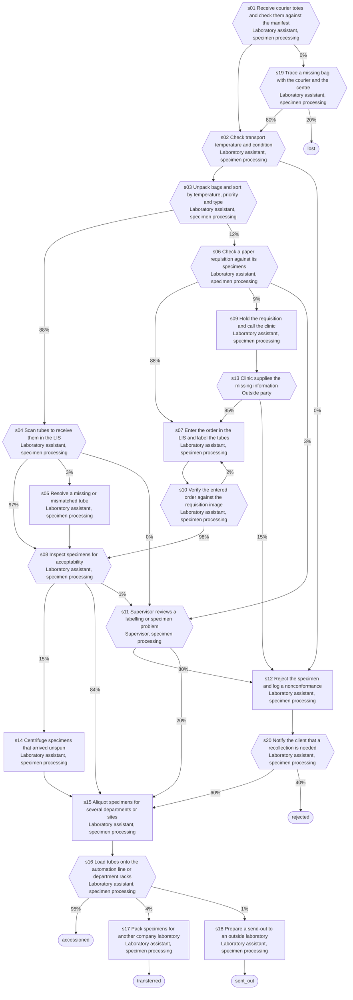

# Receive and accession specimens at the laboratory

`dls-cl-specimen-accessioning` · medical laboratory services · specimen receiving and processing · part of `diagnostic-lab-services-co`

Couriers bring totes of specimens from collection centres, clinics and homes to the regional laboratories, mostly in waves in the late afternoon and evening. Processing lab assistants check the totes against manifests and transport temperature, unpack and scan each tube into the LIS, key in orders from clinics' paper requisitions, check each specimen against acceptance criteria and route tubes to the automation line, departments, other company laboratories or outside laboratories. Clinic requisitions with missing information, mislabelled or unlabelled tubes, haemolysed or clotted specimens and missing bags cause holds, calls, rejections and patient recollections.

| | |
|---|---|
| Unit of work | one requisition with its specimens |
| Starts when | A courier tote containing the requisition's specimens arrives at the laboratory receiving bench. |
| Done when | All acceptable specimens are received in the LIS and placed on the testing line or department racks, packed for another site or sent out; unacceptable ones are rejected and logged. |
| Organisation | A large private community laboratory company with regional laboratories receiving about 40,000 specimens a day, a central LIS and pre-analytical automation feeding chemistry track lines. (3,300 employees, 2019-2022) |
| Volume | 690,000 cases a month (range 600,000 to 780,000) |

## Where it sits

- Starts with **specimen_shipment** from lg-route-pickup (97% of cases)
- Starts with **specimen_shipment** from lg-dispatch-stat (3% of cases)
- Sends **accessioned_specimen** to cl-core-testing (outcome: accessioned)
- Sends **accessioned_specimen** to cl-microbiology-testing (outcome: accessioned)
- Sends **accessioned_specimen** to cl-cytology-screening (outcome: accessioned)
- Sends **accessioned_specimen** to cl-histology-processing (outcome: accessioned)
- Sends **specimen_shipment** to lg-interlab-transfer (outcome: transferred)
- Sends **sendout_request** to hs-sendout-management (outcome: sent_out)
- Sends **nonconformance** to qa-nonconformance-capa (outcome: any)

## Flow

## Roles

| Role | Department | Layer | FTE on this process | Loaded cost per hour | Evidence |
|---|---|---|---:|---:|---|
| Laboratory assistant, specimen processing | Specimen receiving and processing | individual contributor | 125 | 30 CAD | B [dyn_job_processing], [jobbank33101] |
| Supervisor, specimen processing | Specimen receiving and processing | supervisor | 6 | 42 CAD | C |

## Steps

Hands-on time and the wait before each step show the most common value. Evidence tier A is a sourced number, B a sourced description, C the author's estimate.

| Step | Who | Kind | Hands-on | Wait before | Control | Evidence |
|---|---|---|---:|---:|---|---|
| **s01 Receive courier totes and check them against the manifest.** A processing lab assistant signs for the totes at the receiving bench, scans each tote or bag barcode into the tracking system and checks the count against the courier's manifest for that route or centre. | Laboratory assistant, specimen processing | intake | 0.06 min | 15 min | ISO 15189 Plus pre-examination requirements: chain of receipt and traceability of specimens from collection site to laboratory | C |
| **s02 Check transport temperature and condition.** The lab assistant checks that refrigerated and frozen boxes arrived cold or frozen, reads the temperature indicator where one is used, and looks for leaking or broken containers before opening bags. | Laboratory assistant, specimen processing | validation | 0.03 min | 0 min | ISO 15189 Plus: transport conditions monitored and specimen integrity checked on receipt; TDG Category B containment | B [dyn_licences], [tdg_regs] |
| **s03 Unpack bags and sort by temperature, priority and type.** The lab assistant opens the biohazard bags, separates requisitions from tubes, pulls out STAT and short-stability specimens first, and groups tubes by temperature and department so frozen and urgent work is handled before routine tubes. | Laboratory assistant, specimen processing | physical | 0.15 min | 5 min |  | C |
| **s04 Scan tubes to receive them in the LIS.** The lab assistant scans each tube's barcode; the LIS records the receipt time, shows the ordered tests and expected tubes, and the assistant checks the tube count and types against the order on screen. | Laboratory assistant, specimen processing | validation | 0.15 min | 10 min | ISO 15189 Plus: date and time of specimen receipt recorded and specimens checked against the request | C |
| **s05 Resolve a missing or mismatched tube.** The lab assistant searches the other bags from the same centre, checks the collection comment in the LIS, and calls the centre if needed. A test whose tube never arrived is cancelled with a comment asking for recollection, and the rest of the order goes on. | Laboratory assistant, specimen processing | coordination | 3 min | 10 min |  | C |
| **s06 Check a paper requisition against its specimens.** For clinic-collected work the lab assistant checks the requisition for clinician, signature, health number and tests, and compares the patient's name and date of birth on each tube label with the requisition, plus the collection date and time. | Laboratory assistant, specimen processing | validation | 0.5 min | 30 min | Laboratory and Specimen Collection Centre Licensing Act requisition requirements and the laboratory's specimen acceptance criteria | B [dyn_job_processing], [dyn_licences] |
| **s07 Enter the order in the LIS and label the tubes.** The lab assistant finds or creates the patient, keys health number, clinician and tests from the requisition, prints LIS barcode labels and applies them next to the clinic's labels, and scans the requisition into the imaging system. | Laboratory assistant, specimen processing | data entry | 3 min | 10 min |  | A [valenstein99], [dyn_job_processing] |
| **s08 Inspect specimens for acceptability.** While handling the tubes the lab assistant looks for clotted EDTA tubes, visible haemolysis, underfilled citrate tubes, leaking containers, wrong tube types and specimens past their stability time, against the laboratory's acceptance criteria. | Laboratory assistant, specimen processing | validation | 0.1 min | 0 min | ISO 15189 Plus: documented specimen acceptance and rejection criteria applied on receipt | B [epmc_rejection], [ag17], [tian22] |
| **s09 Hold the requisition and call the clinic.** The lab assistant puts the specimens in the hold rack or fridge, logs the problem, and phones or faxes the clinic for the missing health number, clinician or test, usually on the day shift after the evening receiving rush. | Laboratory assistant, specimen processing | communication | 4 min | 1.0 h |  | C |
| **s10 Verify the entered order against the requisition image.** A second lab assistant or the same one at a later pass compares the entered order with the scanned requisition, checking patient, clinician and every test, and corrects any discrepancy before results are released. | Laboratory assistant, specimen processing | review | 0.4 min | 0 min | Laboratory order entry verification procedure (recheck of manually entered orders against the requisition) | B [valenstein99] |
| **s11 Supervisor reviews a labelling or specimen problem.** The processing supervisor examines the specimen and paperwork, decides whether it must be rejected, can be accepted with a comment, or, for an irreplaceable specimen such as tissue or fluid, needs the collector to come in and identify it with documented sign-off. | Supervisor, specimen processing | judgment | 4 min | 30 min | ISO 15189 Plus specimen acceptance criteria: mislabelled or unlabelled specimens are not relabelled except documented exceptions for irreplaceable specimens | B [dyn_licences], [epmc_mislabel] |
| **s12 Reject the specimen and log a nonconformance.** The lab assistant cancels the affected tests in the LIS with the rejection code, so the report tells the clinician the specimen was unsuitable and must be recollected, and records the event in the nonconformance log with the collection site. | Laboratory assistant, specimen processing | data entry | 4 min | 10 min | ISO 15189 Plus: rejected specimens documented, requester informed and nonconformances recorded for trend review | B [dyn_licences], [ag17] |
| **s13 Clinic supplies the missing information.** The clinic calls back, faxes a corrected requisition or uploads it. If nothing arrives before the specimen's stability runs out, the tests are cancelled and a recollection is requested. | Outside party | external wait | 3 min | 10.0 h |  | C |
| **s14 Centrifuge specimens that arrived unspun.** Tubes from clinics and other sites that were not spun before transport are loaded into the laboratory centrifuge or the automation line's centrifuge module after clotting, spun and checked. | Laboratory assistant, specimen processing | physical | 0.3 min | 15 min |  | C |
| **s15 Aliquot specimens for several departments or sites.** When one tube must feed tests in different departments or another laboratory, the lab assistant or the automation line pours off labelled aliquots; manual aliquots are needed for tests off the track or going to another site. | Laboratory assistant, specimen processing | physical | 0.1 min | 3 min |  | C |
| **s16 Load tubes onto the automation line or department racks.** The lab assistant places chemistry and immunoassay tubes on the automation input, haematology tubes in analyser racks, and microbiology, cytology and pathology specimens in the department bins, checking the LIS routing for each. | Laboratory assistant, specimen processing | physical | 0.15 min | 5 min |  | C |
| **s17 Pack specimens for another company laboratory.** The lab assistant puts specimens for tests done at another company laboratory in a labelled transfer rack, lists them on the interlab manifest in the LIS and packs them in a Category B transport box at the right temperature for the next line haul. | Laboratory assistant, specimen processing | physical | 2 min | 30 min | Transportation of Dangerous Goods Regulations section 1.39: UN3373 Category B packaging, mark and 24-hour number | A [tdg_regs] |
| **s18 Prepare a send-out to an outside laboratory.** For a test no company laboratory performs, the lab assistant creates the send-out request in the LIS, prints the outside laboratory's requisition or manifest, and places the specimen in the send-out rack for the reference team. | Laboratory assistant, specimen processing | data entry | 5 min | 30 min |  | C |
| **s19 Trace a missing bag with the courier and the centre.** The lab assistant checks the tracking scans for the stop, calls the dispatcher and the collection centre, and asks the courier to check the vehicle. A specimen that cannot be found is logged as lost and the patient is called back for recollection. | Laboratory assistant, specimen processing | coordination | 15 min | 4.0 h | ISO 15189 Plus: investigation and recording of lost specimens as nonconformances | C |
| **s20 Notify the client that a recollection is needed.** The lab assistant faxes or phones the rejection notice to the clinic for clinic-collected work, or adds the patient to the collection centre's recollection call list, so someone contacts the patient to come back. | Laboratory assistant, specimen processing | communication | 1.5 min | 30 min |  | C |

## Exceptions

| Exception | Share of cases | What happens |
|---|---:|---|
| Clinic requisition with missing information | 1% | Specimens are held while the clinic is asked for the health number, clinician or test; if no reply comes within the specimen's stability, the tests are cancelled. |
| Missing or mismatched tube | 3% | The tube count or type does not match the order; the assistant searches bags and calls the centre, and cancels a test whose tube never arrived. |
| Mislabelled, unlabelled or unacceptable specimen | 2% | The supervisor reviews and usually rejects the specimen; tests are cancelled with a recollection comment and a nonconformance is logged. |
| Temperature excursion or leak in transport | 0% | A box arrives warm or thawed or a container has leaked; affected specimens go to the supervisor for a decision. |
| Missing bag on the manifest | 0% | A bag on the courier manifest is not in the tote; the assistant traces it through tracking scans, the dispatcher and the centre. |
| Order entry error found on verification | 0% | The check of a manually entered order against the requisition image finds a discrepancy, which is corrected. |

## Benchmarks

| Metric | Value | Unit | Population | Evidence |
|---|---|---|---|---|
| cycle_time_days | p50 0.05, p90 0.15 | calendar days from tote arrival at receiving to specimens at the testing line or bench (0.05 days is 72 minutes) | High-volume community laboratory receiving, evening surge included | C |
| specimen_rejection_rate | low 0.002, high 0.044 | share of specimens or tests | Hospital laboratories in Ontario (0% to 4.4%, 2016/17) and 21 million venous specimens in 10 hospitals (0.197%) | A [ag17], [epmc_rejection] |
| requisitions_with_order_entry_error | 0.048 | share of outpatient requisitions | 660 laboratories in the CAP Q-Probes program | A [valenstein99] |
| identified_mislabelling_rate | 0.00115 | share of specimens | US hospital laboratory | A [epmc_mislabel] |

## Pain points

- Most totes arrive in the late afternoon and evening, so receiving queues build and short-stability specimens compete with routine work. (steps s01, s03, s04; C)
- Clinic requisitions are keyed by hand at the laboratory, with order entry errors and holds when information is missing. (steps s06, s07, s09, s13; A [valenstein99])
- Mislabelled, haemolysed, clotted and underfilled specimens found at receipt force patient recollection days after the visit. (steps s08, s11, s12; A [epmc_rejection], [tian22])
- Bags missing from manifests take hours of calls between the laboratory, dispatch and centres to trace. (steps s19; C)

## Assumptions

- About 88% of requisitions arrive already registered in the LIS by collection centres or mobile staff, so their receipt is a barcode scan; 12% come from clinics with paper requisitions and are keyed at the laboratory. The split is derived from the org file's volumes.
- Per-requisition shares of tote handling, unpacking and rack loading are small fractions of a minute because work is done in batches of many requisitions.
- Chemistry and immunoassay tubes go through pre-analytical automation; this is inferred from the org file's track-line analysers and is not sourced.
- Mean hands-on time is about 2.3 minutes per requisition, which at 690,000 requisitions a month implies about 200 FTE at 130 productive hours, against 131 FTE stated; the org file has 150 processing assistants who also report results and pack interlab transfers.
- The process ends when specimens reach the testing line or department racks; testing waits belong to the testing workflows.
- Rejection here covers specimens rejected at receipt. Haemolysis found later by analyser indices is handled in testing.
- Loaded costs come from the org file (hourly wage times 1.35).

## Sources

- [ag17] [2017 Annual Report, Section 3.07: Laboratory Services in the Health Sector](https://www.auditor.on.ca/en/content/annualreports/arreports/en17/v1_307en17.pdf) (Office of the Auditor General of Ontario, 2017). Specimen rejection rate (share of times a test cannot be done due to a mistake in collecting or handling specimens) ranged from 0% to 4.4% in a sample of Ontario hospital laboratories in 2016/17; laboratories must take part in the IQMH quality management program to be licensed.
- [epmc_rejection] [Europe PMC abstracts: pre-analytical error and specimen rejection studies (Xie et al. 2026, 21 million venous specimens; Alenezy et al. 2025)](https://www.ebi.ac.uk/europepmc/webservices/rest/search?query=TITLE%3A%28%22preanalytical+errors%22+OR+%22pre-analytical+errors%22+OR+%22preanalytical+error%22+OR+%22specimen+rejection%22+OR+%22sample+rejection%22%29+AND+%28outpatient+OR+outpatients+OR+%22primary+care%22%29&resultType=core&format=json&pageSize=8) (Europe PMC, 2026). Xie et al.: pooled venous specimen rejection rate 0.197% of 21,319,200 specimens in 10 hospitals; leading causes clotting, insufficient or incorrect volume and container errors; outpatient events more often order, timing or identification errors. Alenezy et al.: 0.063% of 3,346,199 test orders repeated or rejected for pre-analytical errors, mostly clotted (32%) and insufficient (31%).
- [valenstein99] [Outpatient order accuracy: a College of American Pathologists Q-Probes study of requisition order entry accuracy in 660 institutions (abstract)](https://www.ebi.ac.uk/europepmc/webservices/rest/search?query=TITLE%3A%22outpatient%20order%20accuracy%22&resultType=core&format=json) (Archives of Pathology and Laboratory Medicine, via Europe PMC, 1999). 4.8% of 114,934 outpatient requisitions had at least one order entry error; rechecking entered orders against the requisition and monitoring accuracy were associated with lower error rates.
- [epmc_mislabel] [Europe PMC abstracts: specimen labelling and identification error studies (Raymond et al. 2024; Ning et al. 2016; Sandhu et al. 2017)](https://www.ebi.ac.uk/europepmc/webservices/rest/search?query=TITLE%3A%28mislabeled+OR+mislabelled+OR+%22identification+errors%22+OR+%22labeling+errors%22%29+AND+TITLE%3A%28specimen+OR+specimens+OR+sample%29+AND+%28Q-Probes+OR+rate%29&resultType=core&format=json&pageSize=6) (Europe PMC, 2026). Identified mislabelling 1.15 per 1,000 specimens with occult mislabelling estimated at 3.17 per 1,000 (Raymond); outpatient identification errors 0.0067% of specimens before barcode interventions (Ning).
- [tian22] [The incidence rate and influence factors of hemolysis, lipemia, icterus in fasting serum biochemistry specimens](https://pmc.ncbi.nlm.nih.gov/articles/PMC8769349) (PLoS One (PMC8769349), 2022). Haemolysis index flagged 3.54% of outpatient serum specimens; specimens with longer transfer time had more haemolysis, lipaemia and icterus.
- [dyn_licences] Licences and quality commitment (link withheld) (The model laboratory, undated). Brampton, London, Ottawa and Peterborough laboratories are accredited to ISO 15189 by Accreditation Canada and licensed by the Ontario ministry; Winnipeg holds MANQAP accreditation; the QMS includes specimen acceptability protocols, computerized systems validation, corrective and preventive action and monitoring of key indicators.
- [dyn_job_processing] Lab Assistant Specimen Processing, Brampton (job posting #2026-12366) (link withheld) (The model laboratory via Jobvite, 2026). Processing specimens and entering requisitions accurately and on time; ensuring samples are properly identified, data entered and labelled; following protocols for unsuitable samples; high-volume, time-sensitive environment; 10 am to 6 pm shift with rotating weekends; $19.75 to $23.50 an hour; AS400 data entry system/LIS knowledge an asset.
- [jobbank33101] [Wages: Medical Laboratory Technical Assistant in Ontario (NOC 33101)](https://www.jobbank.gc.ca/marketreport/wages-occupation/4210/ON) (Job Bank, Government of Canada, 2025). Ontario hourly wages low $17.95, median $26.25, high $36.00 (2023-2024).
- [tdg_regs] [Transportation of Dangerous Goods Regulations (SOR/2001-286), full text](https://laws-lois.justice.gc.ca/eng/regulations/SOR-2001-286/FullText.html) (Justice Laws Website, Government of Canada, 2026). UN3373 Biological Substance, Category B must travel in CGSB-43.125 Type P650 containment with the Category B mark, shipping name and a 24-hour number (section 1.39); training certificates required (Part 6).

Written by claude-opus on 2026-11-17.
