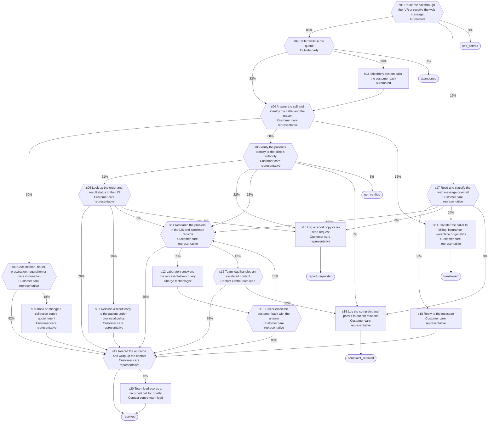

# Answer patient and clinician inquiries

`dls-cs-client-inquiries` · medical laboratory services · customer care contact centre · part of `diagnostic-lab-services-co`

The bilingual contact centre answers calls and web messages from patients and clinicians' offices about results, locations, preparation, requisitions, appointments and reports. Representatives verify who is calling before discussing any patient's tests, look up the requisition in the LIS, explain status, log report copy requests for the reporting team, research missing results with the laboratory and pass complaints to patient relations. Most contacts are settled in a single call of a few minutes; queues build at morning peaks, and contacts that need the laboratory's answer wait hours or days for a callback.

| | |
|---|---|
| Unit of work | one inquiry |
| Starts when | A patient, clinician's office or portal user calls the customer care line or sends a web form or email. |
| Done when | The inquiry is answered, a report request or complaint is passed on, the caller is transferred to the right team, or the caller hangs up. |
| Organisation | A large Canadian community laboratory company with a bilingual contact centre of about 110 representatives in Brampton, London, Laval and Winnipeg. (3,300 employees, 2019-2022) |
| Volume | 120,000 cases a month (range 90,000 to 150,000) |

## Where it sits

- Starts with **client_inquiry** from patient (70% of cases)
- Starts with **client_inquiry** from ordering_physician (30% of cases)
- Starts with **client_inquiry** from cd-portal-results (0% of cases)
- Sends **report_request** to cl-result-reporting (outcome: report_requested)
- Sends **complaint** to cs-complaint-handling (outcome: complaint_referred)

## Flow

## Roles

| Role | Department | Layer | FTE on this process | Loaded cost per hour | Evidence |
|---|---|---|---:|---:|---|
| Customer care representative | Customer care contact centre | individual contributor | 92 | 29 CAD | B [ccr_brampton], [ccr_london] |
| Contact centre team lead | Customer care contact centre | supervisor | 4 | 38 CAD | B [ccr_london] |
| Contact centre manager | Customer care contact centre | manager | 0.5 | 60 CAD | C |
| Charge technologist | Community laboratory testing (The model laboratory Laboratories) | supervisor | 2 | 58 CAD | B [ccr_london] |

## Steps

Hands-on time and the wait before each step show the most common value. Evidence tier A is a sourced number, B a sourced description, C the author's estimate.

| Step | Who | Kind | Hands-on | Wait before | Control | Evidence |
|---|---|---|---:|---:|---|---|
| **s01 Route the call through the IVR or receive the web message.** The caller dials the toll-free line, chooses English or French and patient or clinician in the IVR and hears recorded messages about hours and the online location finder; web form messages and emails land in a shared message queue instead. | Automated | system auto | 0 min | 0.7 min |  | B [ci_contact] |
| **s02 Caller waits in the queue.** The call waits for the next free representative in its language queue; at morning peaks, when centres open and clinics start calling, the wait grows and the IVR offers a callback instead of holding. | Outside party | external wait | 0 min | 1 min |  | B [babel21] |
| **s03 Telephony system calls the customer back.** When a representative becomes free the telephony system dials the customer who chose a callback and connects the call, keeping the customer's place in the queue. | Automated | system auto | 0 min | 1.0 h |  | C |
| **s04 Answer the call and identify the caller and the reason.** The representative greets the caller in English or French, asks whether they are a patient, a clinician's office or another client, opens a contact record in the CRM and works out what the caller needs. | Customer care representative | intake | 0.6 min | 0 min |  | B [ccr_brampton] |
| **s05 Verify the patient's identity or the clinic's authority.** Before discussing a patient's tests the representative confirms the patient's name, date of birth, health card number and address against the LIS, or for a clinic confirms the clinician and office are the ordering or copy-to provider on the requisition. | Customer care representative | validation | 0.7 min | 0 min | Ontario Personal Health Information Protection Act, 2004, Quebec Act respecting the protection of personal information in the private sector and Manitoba Personal Health Information Act: verify identity and authority before disclosing personal health information | B [dyn_privacy] |
| **s06 Look up the order and result status in the LIS.** The representative finds the requisition in the LIS, checks which tests are complete or pending and where the report went, and explains that results go to the ordering clinician, when pending tests are expected and that many results also appear in the patient portal. | Customer care representative | lookup | 3 min | 0 min |  | B [dplus_faq], [ci_contact] |
| **s07 Release a result copy to the patient under provincial policy.** The representative checks the release rules for each test (pathology, genetic and regulated tests go only through the clinician), then emails an encrypted copy or mails it, or guides the patient to register for the portal. | Customer care representative | communication | 4 min | 0 min | Ontario Personal Health Information Protection Act, 2004, Quebec Act respecting the protection of personal information in the private sector and Manitoba Personal Health Information Act: verify identity and authority before disclosing personal health information; company result release rules by province | B [ccr_brampton], [dplus_faq], [dyn_privacy] |
| **s08 Give location, hours, preparation, requisition or price information.** The representative answers from the website location finder, the test directory and preparation sheets: nearest centre and hours, fasting or urine collection instructions, how to fill in a requisition and the price of uninsured tests. | Customer care representative | communication | 2.5 min | 0 min |  | B [ccr_brampton] |
| **s09 Book or change a collection centre appointment.** The representative opens the online booking system, finds a time at the patient's chosen centre, books or moves the appointment in the patient's name and confirms the email or text reminder. | Customer care representative | data entry | 3 min | 0 min |  | C |
| **s10 Log a report copy or re-send request.** For a clinic that did not receive a report, or a new copy-to provider, the representative confirms the clinic's fax number or EMR delivery, enters the re-send request in the LIS for the reporting team and records the contact. | Customer care representative | data entry | 2 min | 0 min |  | B [ccr_brampton] |
| **s11 Research the problem in the LIS and specimen records.** For a missing result, an untested specimen, a rejected sample, an add-on test or a lost requisition, the representative checks specimen tracking, comments and the requisition image, and either answers on the call or sends a query to the laboratory or collection centre. | Customer care representative | analysis | 6 min | 5 min |  | B [ccr_london], [ccr_brampton] |
| **s12 Laboratory answers the representative's query.** A charge technologist or the bench supervisor reads the query, checks the specimen's status, rejection reason or add-on feasibility in the LIS and on the bench, and replies to customer care. | Charge technologist | lookup | 4 min | 4.0 h |  | B [ccr_london] |
| **s13 Call or email the customer back with the answer.** The representative phones the patient or clinic (or emails when they asked for it), explains what happened and what to do next, such as a recollection, a new requisition or the expected report date. | Customer care representative | communication | 4 min | 4.0 h |  | B [ccr_brampton] |
| **s14 Transfer the caller to billing, insurance, workplace or genetics.** For questions handled by another team the representative explains the transfer, warm-transfers or gives the right number (billing line, insurance, corporate clients or genetics) and notes the reason in the CRM. | Customer care representative | coordination | 1 min | 0 min |  | B [ci_contact], [ccr_brampton] |
| **s15 Team lead handles an escalated contact.** The team lead takes over a contentious or upset caller, reviews the record and the laboratory's answer, offers a resolution within policy such as a recollection or a manager callback, and decides whether it is a formal complaint. | Contact centre team lead | judgment | 10 min | 1.0 h |  | B [ccr_london] |
| **s16 Log the complaint and pass it to patient relations.** The representative or team lead records the complaint in the CRM with the patient's details, the centre or test involved and what the patient wants, and assigns it to patient relations for investigation and a written response. | Customer care representative | data entry | 6 min | 0 min | ISO 15189 and Accreditation Canada Diagnostics requirements to record and resolve complaints | B [ccr_brampton], [dyn_privacy] |
| **s17 Read and classify the web message or email.** During staffed hours a representative opens the next message in the shared queue, reads the subject chosen on the form, checks the sender against the LIS where a patient is named and decides how to answer. | Customer care representative | intake | 2 min | 10.0 h |  | B [ci_contact], [ccr_brampton] |
| **s18 Reply to the message.** The representative writes a reply from approved templates, adding the location, preparation or status details, and asks the patient to call or use the portal when the answer would disclose health information by unsecured email. | Customer care representative | drafting | 4 min | 5 min |  | B [dyn_privacy] |
| **s19 Record the outcome and wrap up the contact.** After the call or reply the representative selects the reason and outcome codes in the CRM, adds a short note so a repeat caller can be helped quickly and becomes available for the next call. | Customer care representative | data entry | 0.6 min | 0 min |  | B [ccr_brampton], [babel21] |
| **s20 Team lead scores a recorded call for quality.** The team lead listens to the recorded call, scores greeting, identity verification, accuracy and courtesy on the quality form, and gives the representative feedback in the next coaching session. | Contact centre team lead | review | 12 min | 3.0 d | Contact centre quality monitoring program: a sample of calls per representative scored each month | C |

## Exceptions

| Exception | Share of cases | What happens |
|---|---:|---|
| Abandoned call | 6% | The caller hangs up while waiting, mostly at the morning peak, and often calls again later. |
| Missing or delayed result | 10% | The representative cannot answer from the LIS and must query the laboratory or centre and call back. |
| Identity not verified | 2% | The caller cannot confirm the patient's details or is not an authorised provider, so nothing is disclosed. |
| Escalation and complaint | 1% | An upset caller goes to the team lead, and some contacts become formal complaints for patient relations. |

## Benchmarks

| Metric | Value | Unit | Population | Evidence |
|---|---|---|---|---|
| cycle_time_days | p50 0.006, p90 0.9 | calendar days from the call or message to the end of the contact | Derived from US contact centre benchmarks | B [babel21] |
| first_call_resolution | 0.71 | share of contacts resolved without a repeat contact | Call centre industry benchmark (SQM Group) | A [sqm_fcr], [wiki_fcr] |
| average_speed_to_answer | 75 | seconds (mean) | 214 US contact centres, Q4 2020 | A [babel21] |
| service_call_duration | 6.5 | minutes, mean (stated as over six minutes) | 214 US contact centres, Q4 2020 | A [babel21] |

## Pain points

- Morning peaks, when centres open and clinics start calling, lengthen queues and abandonment, and abandoned callers ring again. (steps s02, s03; C)
- Representatives cannot see the bench, so missing results, rejected specimens and add-on requests need a query to the laboratory and a callback hours or days later. (steps s11, s12, s13; B [ccr_london])
- Every patient-specific question needs identity checks, and many patients asking for results are told to contact their clinician because results go to the ordering provider. (steps s05, s06, s07; B [dplus_faq], [dyn_privacy])
- About three in ten contacts are repeats because the first contact did not settle the issue, adding volume the queue must absorb. (steps s19; B [sqm_fcr])

## Assumptions

- Repeat contacts about the same issue are counted as separate inquiries in the organisation file's volume, so the step graph does not loop them back; the industry first call resolution of about 71 per cent implies roughly 29 per cent of inquiries are repeats.
- Channel mix (85 per cent phone, 12 per cent web forms and email, 3 per cent ended in the IVR) and topic shares are the author's estimates.
- Report copy requests are set at about 12 per cent of inquiries so that they match the result reporting workflow, which takes 2 per cent of its 690,000 monthly cases from this process.
- Complaints passed on are about 0.35 per cent of inquiries (about 400 a month), within the organisation file's 600 complaints a month from all channels.
- Result copies released to patients and booked appointments go to the patient directly; the organisation file lists no business object for them, so they are not in interfaces.produces.
- Hands-on times are for an experienced representative; the mean is a little over six minutes per inquiry including those that end before reaching a representative. At 120,000 inquiries a month this implies about 88 FTE of representative time against the 92 FTE stated; the rest of the 110 representatives do order entry, outbound campaigns, social media and special accounts.
- The charge technologist role answering laboratory queries and the US contact centre benchmarks are assumptions or proxies; no Canadian laboratory contact centre benchmark was opened.
- Web search capacity ran out before this workflow, so sources were limited to pages fetched by address and text copies saved earlier.
- Loaded costs are from the organisation file (hourly wage times 1.35).

## Sources

- [ci_contact] Contact us (link withheld) (The model laboratory, n.d.). One toll-free line (800.565.5721) for patients and for healthcare providers and hospitals, separate lines for corporate clients, insurance, genetics (the model laboratory's genetics service) and billing (800.668.2714); online forms with subjects such as general question, payment question, scientific or clinical question, technical support and set-up; the FAQ tells patients to contact the ordering provider for results.
- [ccr_brampton] Customer Care Representative, Brampton (job posting #2026-12231) (link withheld) (The model laboratory via Jobvite, 2026). Shifts Monday to Sunday between 7:00 am and midnight; CAD 19.50 to 22.00 an hour; answers inquiries about services and redirects customers; helps clinicians and patients complete requisitions; supports sample collection, patient instructions and cost questions; owns complaints to resolution; responds by email, phone, live chat, fax, mail and social media; releases patient results in line with provincial policies; records customer information for every contact; acts on phone and fax requests from physician offices; maintains the call log and reports metrics; coordinates with other departments on test turnaround.
- [ccr_london] Bilingual Customer Care Representative (ENG/FRE), London (job posting #2026-12359) (link withheld) (The model laboratory via Jobvite, 2026). French and English required; CAD 21.00 to 26.50 an hour; handles customer calls and correspondence using several databases; liaises with other departments; identifies, documents and resolves problems and complaints; escalates contentious items to the Customer Service Manager and laboratory; works with the laboratory on testing processes and results; tracks and reports KPIs; Cisco call centre platform listed.
- [dplus_faq] The consumer health service frequently asked questions (link withheld) (The model laboratory, n.d.). Reports appear in the portal within 3 hours of the order being entered; results generally take 1 calendar day; genetic, cardiology, pathology and regulated results are available only through the healthcare provider; patients with an overdue report submit a request through Contact Us; customer care line 855.748.1115.
- [dyn_privacy] Privacy policy (link withheld) (The model laboratory, n.d.). Personal information is disclosed only with consent or as permitted by law; some results are available only from the ordering physician; staff try to confirm preferences for phone messages and do not identify the company in a message unless reporting a critical result; confidential email is encrypted; access and complaint requests go to the privacy officer.
- [sqm_fcr] [First call resolution operating philosophy](https://www.sqmgroup.com/resources/library/blog/fcr-metric-operating-philosophy) (SQM Group, n.d.). Call centre industry benchmark first call resolution 71 per cent, so 29 per cent of customers call back about the same inquiry; each 1 per cent FCR improvement raises satisfaction 1 per cent and cuts operating cost 1 per cent.
- [wiki_fcr] [First call resolution](https://en.wikipedia.org/wiki/First_call_resolution) (Wikipedia, n.d.). FCR is measured by agent logging, repeat-call counts within 1 to 30 days or post-call surveys; about 70 per cent industry average by survey; internal no-repeat methods overstate FCR by 10 to 20 per cent.
- [babel21] [The US Contact Center HR and Operational Benchmarking Report 2021 (summary)](https://www.contactbabel.com/wp-content/uploads/2021/01/US-HROB-2021-Marketing-v3-WEBSITE.pdf) (ContactBabel, 2021). 214 US contact centres interviewed in Q4 2020: mean average speed to answer 75 seconds; mean service call over six minutes; agent time 58.6 per cent talk, 9.4 per cent post-call wrap-up, 11.7 per cent email and web chat, 8.8 per cent idle; mean cost per inbound call USD 7.46. Read from a text copy saved under scratch by earlier work.

Written by claude-opus on 2026-11-17.
