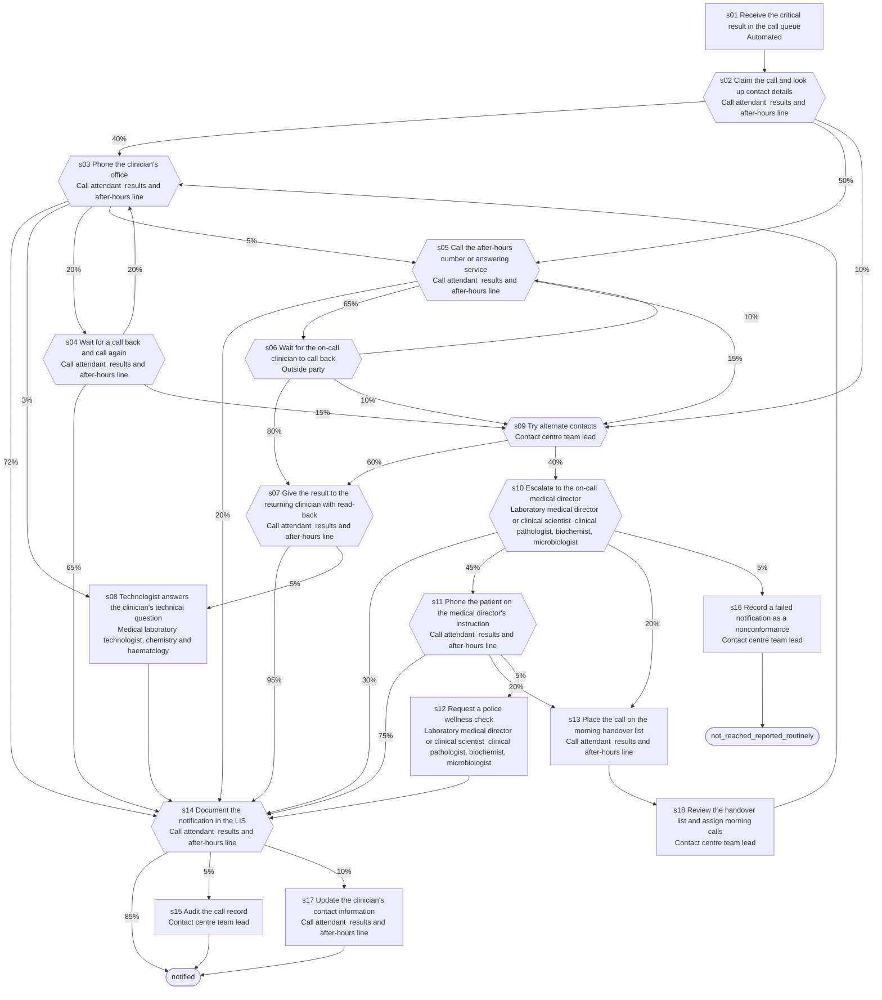

# Phone critical results to clinicians

`dls-cs-critical-result-notification` · medical laboratory services · client services · part of `diagnostic-lab-services-co`

When a technologist confirms that a community patient's result is beyond a Level I critical limit, a call attendant on the results call desk must phone the ordering clinician or a delegate, have the result read back and document who took it and when. Because most community specimens are tested in the evening and overnight, many calls go to after-hours lines and answering services, and some clinicians cannot be reached. Failed attempts are escalated to a team lead, then to the on-call medical director, who may have the patient called directly. Waiting for call backs and the overnight gap make up most of the elapsed time.

| | |
|---|---|
| Unit of work | one critical result |
| Starts when | A technologist releases a confirmed Level I critical result and it appears on the call desk's critical call list. |
| Done when | A responsible clinician, a delegate or (on the medical director's instruction) the patient has received the result with read-back and the notification is documented in the LIS, or a failed notification is recorded as a nonconformance and the result goes out in the routine report. |
| Organisation | A large Canadian community laboratory company with a central results call desk that phones critical results from regional laboratories to community clinicians around the clock. (3,300 employees, 2019-2022) |
| Volume | 2,500 cases a month (range 1,800 to 3,200) |

## Where it sits

- Starts with **critical_result** from cl-core-testing (80% of cases)
- Starts with **critical_result** from cl-microbiology-testing (15% of cases)
- Starts with **critical_result** from hs-reference-testing (5% of cases)
- Sends **notification_record** to cl-result-reporting (outcome: any)
- Sends **critical_result** to ordering_physician (outcome: notified)

## Flow

## Roles

| Role | Department | Layer | FTE on this process | Loaded cost per hour | Evidence |
|---|---|---|---:|---:|---|
| Call attendant (results and after-hours line) | Results and after-hours call desk | individual contributor | 5 | 29 CAD | B [c_jobbank_csr] |
| Contact centre team lead | Customer care contact centre | supervisor | 0.5 | 38 CAD | C |
| Medical laboratory technologist, chemistry and haematology | Core laboratory (chemistry, immunoassay, haematology, urinalysis) | individual contributor | 0.2 | 52 CAD | C |
| Laboratory medical director or clinical scientist (clinical pathologist, biochemist, microbiologist) | Community laboratory testing (The model laboratory Laboratories) | senior specialist | 0.3 | 230 CAD | C |

## Steps

Hands-on time and the wait before each step show the most common value. Evidence tier A is a sourced number, B a sourced description, C the author's estimate.

| Step | Who | Kind | Hands-on | Wait before | Control | Evidence |
|---|---|---|---:|---:|---|---|
| **s01 Receive the critical result in the call queue.** The LIS places the released critical result on the call desk's critical call list with patient identifiers, test, value, critical limit, ordering clinician, contact numbers on file and the time released, and the call desk screen alerts the attendants. | Automated | intake | 0 min | 2 min |  | C |
| **s02 Claim the call and look up contact details.** A call attendant takes the next critical on the list, opens the ordering clinician's client account for office hours, the after-hours or answering service number and any written exemptions, checks earlier call notes for the patient, and decides whom to call first. | Call attendant (results and after-hours line) | lookup | 2 min | 3 min | OAML Guideline for Reporting Laboratory Test Results: Level I results phoned 24 hours a day; clinicians must provide 24-hour contact information | A [c_oaml], [c_alpha] |
| **s03 Phone the clinician's office.** The attendant calls the clinic, asks for the ordering clinician or a nurse or physician the clinician has delegated, gives the patient's name with two identifiers, the test, value and units, and asks the receiver to read the result back. | Call attendant (results and after-hours line) | communication | 4 min | 2 min | Laboratory critical result procedure: communication to a responsible clinician with read-back (CLSI GP47 practice) | A [c_qp_sidebar], [c_qp_article] |
| **s04 Wait for a call back and call again.** If the office has not called back within the laboratory's interval, the attendant calls again and asks for any clinician in the practice who can take the result. | Call attendant (results and after-hours line) | communication | 2 min | 30 min |  | C |
| **s05 Call the after-hours number or answering service.** The attendant dials the clinician's after-hours line, cell or answering service, leaves the patient name, a call-back number and the fact that a critical laboratory result is waiting, and asks the service to page the clinician on call. | Call attendant (results and after-hours line) | communication | 4 min | 2 min | OAML guideline: critical results communicated at all times; laboratory escalation procedure | B [c_oaml], [c_cv2006] |
| **s06 Wait for the on-call clinician to call back.** The on-call clinician receives the page or message and phones the call desk; nobody at the laboratory works on the call while waiting, but the attendant watches the time against the escalation limit. | Outside party | external wait | 0 min | 20 min |  | C |
| **s07 Give the result to the returning clinician with read-back.** The attendant confirms who is calling and their role, reads the patient identifiers and result, has the clinician read it back and answers questions about the specimen or offers a transfer to the technologist. | Call attendant (results and after-hours line) | communication | 3 min | 0 min | Laboratory critical result procedure: read-back by the recipient | B [c_qp_sidebar] |
| **s08 Technologist answers the clinician's technical question.** The call is transferred to a technologist on the bench, who explains specimen quality, whether the test was repeated, previous values and the reference interval, without giving medical advice. | Medical laboratory technologist, chemistry and haematology | communication | 5 min | 5 min |  | C |
| **s09 Try alternate contacts.** The team lead reviews the failed attempts and tries other routes: a covering or partner physician in the same practice, the clinic group's main line, a hospital switchboard where the clinician has privileges, or the clinician's mobile number from earlier calls. | Contact centre team lead | coordination | 10 min | 30 min | Laboratory critical result escalation procedure (no give-up point for Level I results) | B [c_cv2006] |
| **s10 Escalate to the on-call medical director.** The team lead phones the on-call medical director, who reviews the value, the patient's history and the risk and decides whether to keep trying physicians (for example the hospital emergency physician), have the patient called directly, or, for a lower-risk or known recurrent value, wait for the clinic to open. | Laboratory medical director or clinical scientist (clinical pathologist, biochemist, microbiologist) | judgment | 10 min | 30 min | Laboratory critical result escalation procedure approved by the laboratory director | C |
| **s11 Phone the patient on the medical director's instruction.** The attendant calls the patient using the numbers on the requisition, confirms identity, and reads the medical director's script advising the patient to go to an emergency department or contact their physician now, without discussing the diagnosis. | Call attendant (results and after-hours line) | communication | 10 min | 15 min | Laboratory escalation procedure; Personal Health Information Protection Act, 2004 disclosure for the patient's own care | B [c_cv2006] |
| **s12 Request a police wellness check.** For an unreachable patient with a life-threatening value the medical director asks the local police service to check on the patient at the address on the requisition and documents the request. | Laboratory medical director or clinical scientist (clinical pathologist, biochemist, microbiologist) | communication | 10 min | 30 min |  | B [c_cv2006] |
| **s13 Place the call on the morning handover list.** The attendant records the attempts made and the medical director's instruction on the open call and adds it to the morning handover list so the day shift calls the clinic as soon as it opens. | Call attendant (results and after-hours line) | data entry | 2 min | 5 min |  | C |
| **s14 Document the notification in the LIS.** The attendant records the name and role of the person who received the result, the date and time, that the result was read back, and every failed attempt; the LIS adds a notification note to the patient report. | Call attendant (results and after-hours line) | data entry | 2 min | 1 min | ISO 15189:2012 clause 5.9.1: records of critical result notification (date, time, staff member, person notified, result, difficulties) | B [c_cv2006], [c_krasowski], [c_csmls] |
| **s15 Audit the call record.** The team lead reviews a sample of the day's critical calls against the call recording and LIS record for read-back, recipient role, timing and complete documentation, and coaches the attendant when something is missing. | Contact centre team lead | review | 5 min | 12.0 h | Monitoring of critical result notification (quality indicator under ISO 15189) | C |
| **s16 Record a failed notification as a nonconformance.** The team lead opens a nonconformance for a critical result that could not be phoned before routine delivery, with the attempts made and the medical director's decision, so quality can follow up with the clinic. | Contact centre team lead | drafting | 15 min | 4.0 h | ISO 15189 control of nonconformities | B [c_cv2006] |
| **s17 Update the clinician's contact information.** The attendant sends the corrected or newly found after-hours number to client services so the client account is updated, and flags clinicians with no 24-hour contact for a follow-up letter. | Call attendant (results and after-hours line) | data entry | 3 min | 1.0 h |  | B [c_oaml], [c_alpha] |
| **s18 Review the handover list and assign morning calls.** At the start of the day shift the team lead reviews the open critical calls handed over from the night, checks each against the LIS for any call back received overnight, and assigns them so the clinics are called when they open at about 08:00. | Contact centre team lead | coordination | 2 min | 8.0 h | Call desk shift handover procedure for open critical calls | C |

## Exceptions

| Exception | Share of cases | What happens |
|---|---:|---|
| Message left during office hours | 8% | The clinician is with patients or away; the attendant waits for a call back and calls again before escalating. |
| After-hours answering service | 33% | The attendant pages the on-call clinician through an answering service and waits for the call back. |
| No usable contact | 20% | No number on file, wrong numbers or no on-call coverage send the call to the team lead for alternate contacts. |
| Medical director escalation | 8% | No clinician can be found; the on-call medical director decides to call the patient, request a wellness check, wait for the clinic to open, or accept routine delivery. |

## Benchmarks

| Metric | Value | Unit | Population | Evidence |
|---|---|---|---|---|
| cycle_time_days | p50 0.035, p90 0.2 | calendar days from the critical result reaching the call queue to documented notification | Community outpatient critical results phoned by a laboratory call desk | C [c_liebow], [c_qp_sidebar] |
| critical_calls_within_60_min_call_centre | before 76.7, after 95.7 | percent of critical values | University of Maryland, before and after a call centre | A [c_liebow] |
| median_minutes_result_to_notification | 4 | minutes | 121 hospital laboratories, inpatient and emergency results | A [c_qp_sidebar] |
| calls_with_read_back | 96 | percent of notification calls | 121 hospital laboratories | A [c_qp_sidebar] |
| notification_abandoned | 5 | percent of critical values (2002 Q-Probes) | Q-Probes participants | A [c_cv2006] |

## Pain points

- Community specimens are tested after clinics close, so many critical calls go through answering services and wait for call backs. (steps s05, s06; B [c_dyn_oaml], [c_cv2006])
- Missing or outdated after-hours numbers force team lead searches and medical director escalations. (steps s02, s09, s10, s17; B [c_qp_article], [c_oaml])
- When no clinician can be reached the laboratory has to contact the patient or wait for the clinic to open, which takes medical director time and can leave a critical value unacted on overnight. (steps s10, s11, s13; B [c_cv2006])
- Calls taken by clinic clerks rather than clinicians are less reliable and may lack read-back. (steps s03; A [c_qp_article])

## Assumptions

- About half of critical results are assumed to be found after clinic hours because community testing peaks in the evening; this is the main driver of elapsed time and is the author's estimate.
- Critical calls are made by call attendants on the results call desk, following the organisation file; in some laboratories technologists make these calls themselves.
- The share of critical results that end with no notification before routine delivery is set near 1%, below the 5% reported in the 2002 Q-Probes study, because of around-the-clock escalation to a medical director.
- Recurrent critical values that the OAML guideline allows to wait for business hours are filtered out in the testing process before they reach the call desk.
- Loaded costs come from the organisation file (hourly wage times 1.35).

## Sources

- [c_oaml] Guideline for Reporting Laboratory Test Results (CLP-025), revised September 2009 (link withheld) (Ontario Association of Medical Laboratories (copy hosted by the model laboratory), 2009). Level I critical results are phoned to clinicians 24 hours a day, 7 days a week; the ordering clinician must give the laboratory contact information that allows direct communication at all times; recurrent marked results within four months are called only in business hours; specialists may request written exemptions; Level II alerts are phoned or faxed 08:00 to 20:00.
- [c_dyn_oaml] OAML alert reporting (link withheld) (The model laboratory, undated). The company publishes the OAML guideline as its reporting protocol, aimed at patient safety while preventing unnecessary calls outside office hours.
- [c_alpha] [Test reporting](https://testdirectory.alphalabs.ca/Labs/TestReporting) (Alpha Laboratories (Ontario community laboratory), undated). Peer Ontario community laboratory: Level I critical results called as soon as available, 24 hours a day, to the ordering clinician or delegate; physicians must provide contact information for critical results on a form; blanket exemptions are not honoured.
- [c_liebow] [Effectiveness of automated notification and customer service call centers for timely and accurate reporting of critical values: a Laboratory Medicine Best Practices systematic review and meta-analysis (Liebow et al.)](https://pmc.ncbi.nlm.nih.gov/articles/PMC4518392/) (Clinical Biochemistry (PubMed Central), 2012). Call centres raised the share of critical values reported within the target: within 1 hour from 76.7% to 95.7% (University of Maryland), 76.7% to 92.1%, 49.2% to 100% (routine outpatient work); within 30 minutes from 50% to 95.5% (Geisinger); average notification time 38 to 10 minutes (Saxena); outpatients about 14% of notifications in one study; 10.9% unsuccessful within 1 hour after automated notification (Piva).
- [c_qp_sidebar] [Study findings in brief: Q-Probes notification of critical results](https://www.captodayonline.com/Archives/feature_stories/0208_Qprobe_sidebar.html) (CAP Today (College of American Pathologists), 2008). 121 institutions, 3,545 critical reports: median 4 minutes from result to notification and 56 minutes from collection; 96% of calls included read-back; 89% first called to a licensed caregiver; 51.3% used a defined script.
- [c_qp_article] [Good news on critical values, says Q-Probes audit](https://www.captodayonline.com/Archives/feature_stories/0208_Qprobe.html) (CAP Today (College of American Pathologists), 2008). Suggests making the call within 15 minutes of the result being reported; calls to secretaries and clerks saved little time and were less reliable; a small percentage of calls were abandoned; wrong numbers and paging failures prevent results reaching caregivers.
- [c_cv2006] [Critical thinking on critical values](https://www.captodayonline.com/Archives/cover_stories/0906Critical_Values.html) (CAP Today (College of American Pathologists), 2006). In the 2002 Q-Probes study laboratories gave up contacting the physician in 5% of cases; notification standards of 30 to 40 minutes; escalation from practice to pager to other contacts, outpatients hardest; a reference laboratory hand-off to customer service can delay notification 12 to 24 hours; call logs record recipient, read-back and time; staff should keep trying to reach the patient, even via police.
- [c_krasowski] [Autoverification in a core clinical chemistry laboratory at an academic medical center (Krasowski et al.)](https://pmc.ncbi.nlm.nih.gov/articles/PMC4023033) (Journal of Pathology Informatics (PubMed Central), 2014). Critical values can autoverify, but staff must still notify the provider by phone and document the call.
- [c_jobbank_csr] [Wages: Customer Service Representative - Call Centre in Ontario (NOC 64409)](https://www.jobbank.gc.ca/marketreport/wages-occupation/15201/ON) (Job Bank, Government of Canada, 2025). Ontario hourly wages low $17.95, median $21.50, high $33.17 (2023-2024).
- [c_csmls] [Standards of practice](https://csmls.org/about-us/our-members/standards-of-practice/) (Canadian Society for Medical Laboratory Science, undated). Laboratory professionals document, protect and maintain confidential information.

Written by claude-opus on 2026-11-17.
