# Receive, test and report clinical trial visit samples in the central laboratory

`dls-ct-sample-testing` · medical laboratory services (clinical trial central laboratory) · clinical trials laboratory operations · part of `diagnostic-lab-services-co`

Investigator sites collect blood and urine from trial participants at each study visit using the company's pre-labelled kits and ship them overnight to the central laboratory. Sample management technicians check the samples against the requisition and the protocol, process and aliquot them, and core laboratory technologists run the safety tests, with specialty tests run in later batches. Results that hit protocol alert values are phoned to the investigator, a data coordinator reviews each visit against the study's enrolment and visit schedule before the report goes to the site, and discrepancies become queries that can take days to resolve. Unusable samples, batched specialty tests and slow site replies to queries are the main sources of delay.

| | |
|---|---|
| Unit of work | one trial visit sample set |
| Starts when | A courier shipment with one participant's visit samples and requisition arrives from an investigator site. |
| Done when | The visit's results are reported to the site and posted to the study database, with any query closed and a corrected report issued, and retention aliquots passed to storage; or the set is rejected and recollection requested. |
| Organisation | The clinical trials central laboratory line of a large Canadian laboratory company, serving 30 to 60 active Phase I to IV studies with testing in the shared core laboratory. (3,300 employees, 2019-2022) |
| Volume | 5,000 cases a month (range 3,000 to 8,000) |

## Where it sits

- Starts with **trial_sample** from investigator_site (100% of cases)
- Relies on **lis_change** from it-lis-change (a standing input; it does not start a case)
- Sends **lab_report** to investigator_site (outcome: reported)
- Sends **lab_report** to investigator_site (outcome: reported_after_query)
- Sends **test_result** to ct-data-transfer (outcome: reported)
- Sends **test_result** to ct-data-transfer (outcome: reported_after_query)
- Sends **trial_sample** to ct-sample-storage (outcome: reported)
- Sends **trial_sample** to ct-sample-storage (outcome: reported_after_query)

## Flow

```mermaid
flowchart TD
    s01["s01 Receive the courier shipment and check its condition<br/>Kit production and sample management technician"]
    s02{{"s02 Accession the visit samples against the requisition<br/>Kit production and sample management technician"}}
    s03{{"s03 Notify the site of an unacceptable or unidentifiable sample<br/>Clinical data coordinator"}}
    s04["s04 Process and aliquot the samples per the laboratory manual<br/>Kit production and sample management technician"]
    s05["s05 Transfer the testing aliquots to the core laboratory<br/>Kit production and sample management technician"]
    s06["s06 Load the trial samples on the analysers<br/>Medical laboratory technologist, chemistry and haematology"]
    s07["s07 Run the safety tests on the analysers<br/>Automated"]
    s08{{"s08 Review and verify the results<br/>Medical laboratory technologist, chemistry and haematology"}}
    s09["s09 Review a blood film for the flagged haematology result<br/>Medical laboratory technologist, chemistry and haematology"]
    s10["s10 Run the specialty or batched esoteric tests<br/>Medical laboratory technologist, chemistry and haematology"]
    s11{{"s11 Check results against the protocol alert ranges<br/>Automated"}}
    s12["s12 Phone the alert result to the investigator site<br/>Clinical trial project manager"]
    s13["s13 Notify the sponsor's medical monitor of the alert<br/>Clinical trial project manager"]
    s14{{"s14 Review the visit data before release<br/>Clinical data coordinator"}}
    s15["s15 Release the report to the site and the study database<br/>Automated"]
    s16["s16 Raise a query with the site<br/>Clinical data coordinator"]
    s17["s17 Release the report with the query flagged<br/>Automated"]
    s18{{"s18 Wait for the site's answer to the query<br/>Outside party"}}
    s19["s19 Correct the record and reissue the report<br/>Clinical data coordinator"]
    s20["s20 Chase the unanswered query<br/>Clinical data coordinator"]
    s01 --> s02
    s02 -->|"96%"| s04
    s02 -->|"4%"| s03
    s03 -->|"65%"| s04
    s03 -->|"35%"| end0
    s04 --> s05
    s05 --> s06
    s06 --> s07
    s07 --> s08
    s08 -->|"66%"| s11
    s08 -->|"24%"| s10
    s08 -->|"5%"| s07
    s08 -->|"5%"| s09
    s09 --> s11
    s10 --> s11
    s11 -->|"95%"| s14
    s11 -->|"5%"| s12
    s12 --> s13
    s13 --> s14
    s14 -->|"88%"| s15
    s14 -->|"12%"| s16
    s15 --> end1
    s16 --> s17
    s17 --> s18
    s18 -->|"80%"| s19
    s18 -->|"20%"| s20
    s19 --> end2
    s20 --> s18
    end0(["not_tested"])
    end1(["reported"])
    end2(["reported_after_query"])
```

## Roles

| Role | Department | Layer | FTE on this process | Loaded cost per hour | Evidence |
|---|---|---|---:|---:|---|
| Kit production and sample management technician | Trial kit, sample and data operations | individual contributor | 9.8 | 31 CAD | B [dyn_cts], [jobbank_33101] |
| Medical laboratory technologist, chemistry and haematology | Core laboratory (chemistry, immunoassay, haematology, urinalysis) | individual contributor | 7.5 | 52 CAD | B [jobbank_32120], [ezzelle2008] |
| Clinical data coordinator | Trial kit, sample and data operations | individual contributor | 5 | 42 CAD | B [dyn_cts], [labconnect] |
| Clinical trial project manager | Trial project management | senior specialist | 0.8 | 65 CAD | B [dyn_cts], [ezzelle2008] |

## Steps

Hands-on time and the wait before each step show the most common value. Evidence tier A is a sourced number, B a sourced description, C the author's estimate.

| Step | Who | Kind | Hands-on | Wait before | Control | Evidence |
|---|---|---|---:|---:|---|---|
| **s01 Receive the courier shipment and check its condition.** A sample management technician signs for the overnight courier boxes from investigator sites, checks that ambient, refrigerated and dry-ice shippers are intact and at the right temperature, scans the waybill and logs the arrival time in the trial system. Most shipments arrive in the morning courier wave. | Kit production and sample management technician | intake | 1 min | 30 min | Sample receipt and dangerous goods shipping checks under GCLP (audit trail from collection to disposal) | B [dyn_cts], [ezzelle2008] |
| **s02 Accession the visit samples against the requisition.** The technician opens the kit, scans the pre-printed kit barcode, checks each tube label against the requisition (subject number, visit, collection date and time) and against the tubes the protocol expects for that visit, checks stability time, volume and haemolysis, and confirms the accession so orders are created in the trial system and the LIS. | Kit production and sample management technician | validation | 5 min | 45 min | GCLP specimen acceptance and rejection criteria and the study laboratory manual | B [ezzelle2008], [iqvia_cl] |
| **s03 Notify the site of an unacceptable or unidentifiable sample.** The data coordinator records the problem in the trial system, cancels the affected tests, and emails or faxes the site coordinator with the reason so the site can recollect at an unscheduled visit or confirm the subject's identity. Remaining acceptable tubes go on to testing. | Clinical data coordinator | communication | 12 min | 1.0 h | Study laboratory manual and sponsor contract: sample rejection notified to the site and sponsor | C [ezzelle2008] |
| **s04 Process and aliquot the samples per the laboratory manual.** The technician centrifuges the tubes as the protocol requires, pours testing aliquots and retention aliquots into pre-labelled tubes and cryovials, scans each aliquot to the sample record, and freezes aliquots that will be stored or batch-tested later. | Kit production and sample management technician | physical | 6 min | 15 min | Sponsor protocol and study laboratory manual processing instructions | B [dyn_cts], [iqvia_cl], [acm_global] |
| **s05 Transfer the testing aliquots to the core laboratory.** The technician scans the aliquots onto a transfer list and carries the rack to the core laboratory's chemistry and haematology area, where a technologist scans receipt. | Kit production and sample management technician | physical | 1 min | 30 min |  | C |
| **s06 Load the trial samples on the analysers.** A core laboratory technologist loads the trial aliquots on the chemistry, immunoassay and haematology analysers between community lab runs, using the study's test codes and units. | Medical laboratory technologist, chemistry and haematology | physical | 2 min | 45 min |  | C |
| **s07 Run the safety tests on the analysers.** The analysers run the panel (chemistry, haematology, urinalysis) with the run's quality control and send results to the LIS through the middleware. | Automated | system auto | 0 min | 1.0 h |  | C |
| **s08 Review and verify the results.** The technologist checks the run's QC is acceptable, reviews instrument flags, delta and linearity limits, repeats or dilutes results where needed and verifies them in the LIS. Results for the study are not autoverified. | Medical laboratory technologist, chemistry and haematology | review | 3 min | 20 min | QC acceptable before reporting (GCLP; ISO 15189 and CAP accreditation) | B [ezzelle2008], [wiki_gclp] |
| **s09 Review a blood film for the flagged haematology result.** For a count flagged by the analyser (abnormal cells, platelet clumps), the technologist makes and stains a slide, reviews it under the microscope or on the digital imaging system, records the differential or morphology comment and verifies the result. | Medical laboratory technologist, chemistry and haematology | analysis | 12 min | 1.5 h | Laboratory review criteria for flagged haematology results (ISO 15189 and CAP accreditation; GCLP) | C |
| **s10 Run the specialty or batched esoteric tests.** Tests outside the safety panel (coagulation, special chemistry, biomarkers run in weekly batches, or tests sent to the specialty laboratory) are run when their batch is scheduled, and the results are verified and added to the visit record. | Medical laboratory technologist, chemistry and haematology | physical | 15 min | 2.0 d | Method validation and QC for specialty assays (GCLP) | B [dyn_cts], [ezzelle2008] |
| **s11 Check results against the protocol alert ranges.** The trial system compares each verified result with the study's reference ranges and the protocol's alert and exclusion values and flags any result that must be phoned to the investigator. | Automated | system auto | 0 min | 5 min |  | B [ezzelle2008] |
| **s12 Phone the alert result to the investigator site.** A project team member calls the site coordinator or investigator, reads back the result, records who was reached and when in the trial system, and retries or escalates to the sponsor's medical monitor when nobody answers. After hours the on-call team makes the call. | Clinical trial project manager | communication | 15 min | 20 min | Protocol alert values and GCLP immediate notification of alert results | B [ezzelle2008], [dyn_cts] |
| **s13 Notify the sponsor's medical monitor of the alert.** Where the protocol asks for it, the project team member emails the alert result and the time the site was told to the sponsor's or CRO's medical monitor, and files the notification in the study records. | Clinical trial project manager | communication | 5 min | 10 min | Protocol and sponsor contract alert notification requirements | C [dyn_cts] |
| **s14 Review the visit data before release.** The data coordinator reviews the visit record in the trial system: subject number, initials and birth date against the study's enrolment list, visit name against the visit schedule, collection time, expected tests done or cancelled, and units and ranges, using the system's edit checks. | Clinical data coordinator | review | 3 min | 8.0 h | Complete and accurate trial records: Good clinical practice for laboratories analysing trial samples (ICH E6; Health Canada Food and Drug Regulations C.05.010 and C.05.012 for Canadian trials) | B [hc_c05012], [hc_c05010], [ema_e6], [mhra_gcp], [ezzelle2008], [labconnect] |
| **s15 Release the report to the site and the study database.** The trial system publishes the report to the site portal or fax with study ranges and flags, masking any results the protocol keeps blinded from sites, and posts the results to the study database for the next sponsor data transfer. | Automated | system auto | 0 min | 10 min | Reporting to authorised persons only: Good clinical practice for laboratories analysing trial samples (ICH E6; Health Canada Food and Drug Regulations C.05.010 and C.05.012 for Canadian trials) | B [ezzelle2008], [labconnect], [cdisc_lab] |
| **s16 Raise a query with the site.** The coordinator logs the discrepancy (wrong subject number, visit outside window, missing collection time, test missing from the kit) in the query log and sends it to the site coordinator by portal, email or fax with a reply deadline. | Clinical data coordinator | communication | 10 min | 15 min | GCLP discrepancy resolution with an audit trail | B [ezzelle2008], [dyn_cts] |
| **s17 Release the report with the query flagged.** So the investigator has the safety results without waiting, the trial system releases the report to the site marked as pending a query, and holds the affected fields out of the sponsor transfer. | Automated | system auto | 0 min | 10 min |  | C |
| **s18 Wait for the site's answer to the query.** The site coordinator checks the source documents and replies, often only after the next monitoring visit or once the coordinator has time between patient visits. | Outside party | external wait | 0 min | 3.0 d |  | C |
| **s19 Correct the record and reissue the report.** The coordinator applies the site's answer in the trial system with an audit trail, reissues a corrected report marked as such while keeping the original, and closes the query so the data enter the next transfer. | Clinical data coordinator | data entry | 12 min | 4.0 h | Corrections keep the original and corrected report with an audit trail (GCLP; C.05.012 complete and accurate records) | B [ezzelle2008], [hc_c05012] |
| **s20 Chase the unanswered query.** The coordinator re-sends the query, phones the site, and after a second miss lists it on the open-query report the project manager sends to the sponsor's monitor. | Clinical data coordinator | communication | 8 min | 1.0 h |  | C |

## Exceptions

| Exception | Share of cases | What happens |
|---|---:|---|
| Unacceptable or unidentifiable sample | 4% | Outside stability, wrong temperature, broken, insufficient or unlabelled; the site is told and asked to recollect, and the whole set is lost in about a third of these. |
| Protocol alert value | 5% | A result at a protocol alert value is phoned to the investigator and documented. |
| Data discrepancy query | 12% | Wrong subject number, visit or collection time; the report goes out flagged and the record is corrected after the site replies, sometimes after reminders. |
| Specialty or batched tests | 25% | Tests run in weekly or scheduled batches delay the complete visit report by days. |
| Blood film review | 5% | An analyser flag on the blood count needs a slide review before verification. |
| Repeat or dilution | 5% | Flags or out-of-range results need a rerun before verification. |

## Benchmarks

| Metric | Value | Unit | Population | Evidence |
|---|---|---|---|---|
| cycle_time_days | p50 1.0, p90 5.0 | calendar days from receipt at the laboratory to the visit report released (or corrected) | Central laboratory visit sample sets | C [iqvia_cl], [dyn_cts] |
| trial_record_retention | 15 | years | Canadian clinical trials | A [hc_c05012] |
| record_retrieval_time | 24 | hours, suggested retrieval time for archived records | GCLP laboratories | A [ezzelle2008] |
| reference_range_verification_sample | 20 | normal specimens typically used to verify a manufacturer's reference range | GCLP laboratories | A [ezzelle2008] |
| staff_competency_assessment | every six months in the first year, then annually | frequency | GCLP laboratories | A [ezzelle2008] |

## Pain points

- Paper requisitions filled in at busy sites carry wrong subject numbers, visits or collection times, and each becomes a query that depends on the site answering. (steps s14, s16, s18, s20; C [ezzelle2008])
- Samples arriving outside stability or at the wrong temperature after courier delays are lost and the participant has to come back. (steps s01, s02, s03; C [iqvia_cl])
- Specialty tests run in scheduled batches hold the complete visit report for days. (steps s10; C)
- Trial samples share core laboratory analysers and technologists with community testing, so trial runs wait between community runs. (steps s06, s08; C)
- Open queries are tracked partly in spreadsheets and chased by phone and email. (steps s16, s20; C)

## Assumptions

- Testing is done in the shared core laboratory by its technologists, as the organisation file assumes; sample receipt, processing and data review are done by the trials operations team.
- The LIS change from the LIS change process is the study build that must be in place before any sample can be tested; it is listed with share 0 because it does not start individual cases.
- Discrepancy queries are found when the coordinator reviews the visit record; in practice many are spotted at accessioning and sent the same day, which changes timing only slightly.
- Shares of unacceptable samples (4.5 per cent), alert values (5 per cent), queries (12 per cent) and specialty tests (25 per cent) are estimates; no opened source gave rates.
- The organisation file's 14 kit production and sample management technicians must also build about 5,000 kits a month and run storage; the 9.8 FTE stated here leaves little for that work, so either headcount or volume in the organisation file may be off.
- Health Canada's Food and Drug Regulations Division 5 apply to Canadian trials; trials for foreign sponsors follow ICH E6 and the sponsor's regulator. Controls are marked needs_policy_change because the specific checks are set by protocols and laboratory procedures, though GCP itself is required by law.
- Loaded costs come from the organisation file (wage times 1.35).

## Sources

- [dyn_cts] Clinical trial services (link withheld) (The model laboratory, undated). Central laboratory testing for Phase I to IV trials with routine safety and esoteric tests; a dedicated project team per study; urgent questions answered within hours including after hours; protocol review; data in multiple electronic formats; TDG and IATA trained staff with tracked shipments; sample storage and transfer per protocol.
- [ezzelle2008] [Guidelines on good clinical laboratory practice: bridging operations between research and clinical research laboratories (Ezzelle et al.)](https://pmc.ncbi.nlm.nih.gov/articles/PMC2213906/) (Journal of Pharmaceutical and Biomedical Analysis, via PubMed Central, 2008). GCLP: each specimen needs a request form with participant ID, collection date and time and collector; labels checked against the form and discrepancies resolved; documented acceptance and rejection criteria; audit trail from collection to disposal; QC acceptable before reporting; alert values defined with study clinicians and notified immediately; reports with receipt time, units and reference ranges; corrections keep original and corrected reports; records retrievable within about 24 hours.
- [hc_c05010] [Food and Drug Regulations C.05.010 Sponsor's obligations (good clinical practices)](https://laws-lois.justice.gc.ca/eng/regulations/C.R.C.,_c._870/section-C.05.010.html) (Justice Laws Website, Government of Canada, 2024). Sponsors must conduct trials under good clinical practices, including systems and procedures that assure the quality of every aspect of the trial, and meet the record requirements of C.05.012.
- [hc_c05012] [Food and Drug Regulations C.05.012 Records](https://laws-lois.justice.gc.ca/eng/regulations/C.R.C.,_c._870/section-C.05.012.html) (Justice Laws Website, Government of Canada, 2024). Trial information must be recorded, handled and stored to allow complete and accurate reporting; records kept for 15 years.
- [ema_e6] [ICH E6 Good clinical practice: scientific guideline](https://www.ema.europa.eu/en/ich-e6-good-clinical-practice-scientific-guideline) (European Medicines Agency, 2026). ICH E6 sets an international standard for the design, conduct, recording and reporting of clinical trials and defines sponsor and investigator responsibilities; R3 adds a risk-based, proportionate approach (effective July 2025).
- [mhra_gcp] [Good clinical practice for clinical trials](https://www.gov.uk/guidance/good-clinical-practice-for-clinical-trials) (Medicines and Healthcare products Regulatory Agency, GOV.UK, 2024). Laboratories analysing samples from a clinical trial must comply with GCP; inspections are risk based and findings are graded critical, major or other; subcontracted organisations must give access to records.
- [cdisc_lab] [LAB (laboratory data exchange model)](https://www.cdisc.org/standards/data-exchange/lab) (CDISC, 2026). A standard model for the acquisition and exchange of laboratory data between labs and sponsors or CROs (LAB v1.0.1, 2004).
- [iqvia_cl] [Central laboratories](https://labs.iqvia.com/central-laboratories) (IQVIA Laboratories, 2026). Central lab services include specimen collection kits, a courier network, a biorepository, project management and data management; labs meet each protocol's turnaround and stability requirements; integrated LIMS and sample lifecycle tracking.
- [labconnect] [LabConnect central laboratory services](https://www.labconnect.com/) (LabConnect, 2026). Lists custom collection kits, kit tracking, data alignment and cleaning, customised data delivery, blinded data management and biospecimen operations as central lab services.
- [acm_global] [ACM Global Laboratories](https://www.acmgloballab.com/) (ACM Global Laboratories, 2026). Lists clinical trial testing, routine safety testing, customised sample collection kits and advanced sample tracking services for trials in more than 65 countries.
- [wiki_gclp] [Good Clinical Laboratory Practice](https://en.wikipedia.org/wiki/Good_Clinical_Laboratory_Practice) (Wikipedia, 2026). GCP does not define laboratory requirements and GLP covers preclinical work, so the Research Quality Association proposed GCLP in 2003; WHO and MHRA later issued GCLP guidance.
- [jobbank_32120] [Wages: Medical technologist, medical laboratory in Ontario (NOC 32120)](https://www.jobbank.gc.ca/marketreport/wages-occupation/4203/ON) (Job Bank, Government of Canada, 2025). Ontario hourly wages low 23.00, median 42.00, high 50.00 CAD (2023-2024).
- [jobbank_33101] [Wages: Medical laboratory technical assistant in Ontario (NOC 33101)](https://www.jobbank.gc.ca/marketreport/wages-occupation/4210/ON) (Job Bank, Government of Canada, 2025). Ontario hourly wages low 17.95, median 26.25, high 36.00 CAD (2023-2024).

Written by claude-opus on 2026-11-17.
