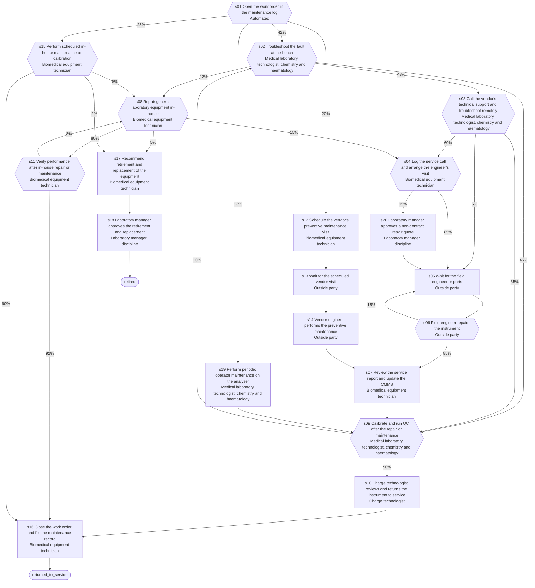

# Maintain and repair laboratory instruments

`dls-fac-instrument-maintenance` · medical laboratory services · facilities (biomedical engineering) · part of `diagnostic-lab-services-co`

Laboratory analysers and general equipment need repairs when they fail and scheduled maintenance and calibration to stay accurate. Technologists troubleshoot faults first and call the manufacturer's support line, biomedical technicians coordinate vendor field engineers, keep the maintenance log and service general equipment themselves, and an instrument returns to patient testing only after calibration and QC pass and a charge technologist signs it off. Most elapsed time is waiting for the vendor's engineer or parts and for scheduled visit dates, while the instrument's work moves to backup analysers.

| | |
|---|---|
| Unit of work | one maintenance or repair event |
| Starts when | The laboratory logs a fault, a scheduled maintenance or calibration task comes due, or the vendor schedules a preventive maintenance visit or field action. |
| Done when | The equipment is back in service with calibration, QC and the maintenance record complete, or it is retired. |
| Organisation | A large Canadian community and reference laboratory company with nine laboratories, automated analyser lines under vendor service contracts and a small biomedical engineering team. (3,300 employees, 2019-2022) |
| Volume | 550 cases a month (range 400 to 750) |

## Where it sits

- Starts with **maintenance_request** from cl-core-testing (50% of cases)
- Starts with **maintenance_request** from hs-reference-testing (18% of cases)
- Starts with **maintenance_request** from wp-tox-testing (12% of cases)
- Starts with **service_report** from instrument_vendor (20% of cases)
- Sends **maintenance_request** to instrument_vendor (outcome: any)
- Sends **maintenance_record** to cl-daily-qc (outcome: returned_to_service)

## Flow

## Roles

| Role | Department | Layer | FTE on this process | Loaded cost per hour | Evidence |
|---|---|---|---:|---:|---|
| Biomedical equipment technician | Biomedical engineering | individual contributor | 3.5 | 47 CAD | B [dyn_lic], [wiki_bmet] |
| Medical laboratory technologist, chemistry and haematology | Core laboratory (chemistry, immunoassay, haematology, urinalysis) | individual contributor | 4 | 52 CAD | B [job_mlt], [job_charge] |
| Charge technologist | Community laboratory testing (The model laboratory Laboratories) | supervisor | 0.6 | 58 CAD | B [job_charge] |
| Laboratory manager (discipline) | Community laboratory testing (The model laboratory Laboratories) | manager | 0.1 | 72 CAD | C |

## Steps

Hands-on time and the wait before each step show the most common value. Evidence tier A is a sourced number, B a sourced description, C the author's estimate.

| Step | Who | Kind | Hands-on | Wait before | Control | Evidence |
|---|---|---|---:|---:|---|---|
| **s01 Open the work order in the maintenance log.** A maintenance request logged by the laboratory after a fault, a preventive maintenance task coming due in the CMMS or a vendor's scheduled visit or field notice creates a work order with the instrument's asset number, location and type of event. | Automated | system auto | 0 min | 5 min |  | C [dyn_lic], [wiki_cmms] |
| **s02 Troubleshoot the fault at the bench.** The technologist reads the instrument's error codes and logs, follows the operator manual's troubleshooting steps (clean or replace the probe, tubing or lamp, reseat a module, restart), runs the function checks and decides whether the operator fix worked. | Medical laboratory technologist, chemistry and haematology | analysis | 25 min | 15 min |  | B [job_charge], [job_mlt], [clp_c24] |
| **s03 Call the vendor's technical support and troubleshoot remotely.** The technologist calls the manufacturer's support line with the serial number and error codes, waits for a callback, follows the specialist's instructions or lets the specialist connect remotely, and learns whether an engineer must come on site. | Medical laboratory technologist, chemistry and haematology | communication | 30 min | 45 min |  | C |
| **s04 Log the service call and arrange the engineer's visit.** The biomedical technician records the vendor's case number in the CMMS, checks whether the instrument is under a service contract, arranges building access and confirms the visit time with the charge technologist. | Biomedical equipment technician | coordination | 10 min | 1.0 h |  | B [wiki_bmet], [job_charge] |
| **s05 Wait for the field engineer or parts.** The instrument stays out of service while the vendor's field engineer travels to the laboratory, usually within the contract's response time, or while a part ships; work moves to a backup analyser or a sister laboratory. | Outside party | external wait | 0 min | 20.0 h |  | C |
| **s06 Field engineer repairs the instrument.** The vendor's field service engineer diagnoses the fault, replaces parts, adjusts and tests the instrument and leaves a service report; the time shown is the repair's duration, during which laboratory staff are not needed. | Outside party | physical | 0 min | 4.0 h |  | B [wiki_bmet] |
| **s07 Review the service report and update the CMMS.** The biomedical technician reads the engineer's service report, records parts replaced, labour and downtime in the CMMS, flags major maintenance that requires calibration verification, files the report and passes any non-contract invoice to accounts payable. | Biomedical equipment technician | review | 10 min | 8.0 h |  | B [wiki_cmms], [cfr1255] |
| **s08 Repair general laboratory equipment in-house.** The biomedical technician repairs centrifuges, refrigerators and freezers, incubators, water baths, pipettes and similar equipment, replacing parts from stock or ordering them, and decides whether the item can be repaired at all. | Biomedical equipment technician | physical | 1.0 h | 8.0 h |  | B [wiki_bmet] |
| **s09 Calibrate and run QC after the repair or maintenance.** The technologist recalibrates the affected assays, runs calibration verification after major maintenance, runs all QC levels and evaluates them against the multirule limits in the QC software before asking for release. | Medical laboratory technologist, chemistry and haematology | validation | 30 min | 30 min | ISO 15189 and CAP accreditation: equipment returned to service only after calibration and QC are acceptable, calibration verification after major maintenance (equivalent to 42 CFR 493.1255), Westgard multirule acceptance | B [cfr1255], [clp_c24], [westgard] |
| **s10 Charge technologist reviews and returns the instrument to service.** The charge technologist reviews the maintenance record, calibration and QC, signs the maintenance sheet, removes the out-of-service tag, turns autoverification back on in the middleware and tells the bench and, if needed, client services that normal testing has resumed. | Charge technologist | approval | 6 min | 1.0 h | ISO 15189 and CAP accreditation: equipment returned to service only after calibration and QC are acceptable, calibration verification after major maintenance (equivalent to 42 CFR 493.1255), Westgard multirule acceptance | B [job_charge], [clp_c24] |
| **s11 Verify performance after in-house repair or maintenance.** The biomedical technician checks that the equipment meets its specification before use: centrifuge speed and timer with a tachometer, refrigerator and freezer temperatures against a reference thermometer, pipette volumes by weighing, and records the readings. | Biomedical equipment technician | validation | 20 min | 1.0 h | ISO 15189 and CAP accreditation equipment requirements: maintenance and function checks per the manufacturer, documented, before patient testing (equivalent to 42 CFR 493.1254) | B [cfr1254], [wiki_bmet] |
| **s12 Schedule the vendor's preventive maintenance visit.** The biomedical technician agrees the date of the vendor's preventive maintenance or software update with the charge technologist, choosing low-volume hours, arranging a backup analyser and confirming the engineer's visit. | Biomedical equipment technician | coordination | 15 min | 3.0 d |  | B [cfr1254], [job_charge] |
| **s13 Wait for the scheduled vendor visit.** The visit date is set by the vendor's engineer roster and the laboratory's quiet periods, so the work order waits for the agreed day. | Outside party | external wait | 0 min | 5.0 d |  | C |
| **s14 Vendor engineer performs the preventive maintenance.** The field engineer replaces wear parts, cleans and adjusts modules, installs software updates and runs the manufacturer's checks, leaving a service report; the time shown is the visit's duration. | Outside party | physical | 0 min | 5.0 h |  | B [wiki_bmet], [cfr1254] |
| **s15 Perform scheduled in-house maintenance or calibration.** When the CMMS lists a task as due, the biomedical technician services general equipment (centrifuges, refrigerators, incubators, biosafety cabinet coordination, balances, pipettes, temperature recorders), checks its performance and decides whether it passes. | Biomedical equipment technician | physical | 40 min | 1.0 d | ISO 15189 and CAP accreditation equipment requirements: maintenance and function checks per the manufacturer, documented, before patient testing (equivalent to 42 CFR 493.1254) | B [dyn_lic], [cfr1254], [wiki_bmet] |
| **s16 Close the work order and file the maintenance record.** The biomedical technician completes the CMMS record with labour, parts, downtime and results, attaches the signed sheets, sets the next due date and makes the record available to the laboratory's QC and accreditation files. | Biomedical equipment technician | data entry | 6 min | 4.0 h | ISO 15189 and CAP accreditation equipment requirements: maintenance and function checks per the manufacturer, documented, before patient testing (equivalent to 42 CFR 493.1254); records kept for accreditation inspection | B [cfr1254], [wiki_cmms], [dyn_lic] |
| **s17 Recommend retirement and replacement of the equipment.** For equipment beyond economic repair or no longer supported by the vendor, the biomedical technician documents the repair history and cost, tags the item out of use and drafts a replacement request with a quote. | Biomedical equipment technician | drafting | 1.0 h | 2.0 d |  | B [dyn_lic], [wiki_cmms] |
| **s18 Laboratory manager approves the retirement and replacement.** The laboratory manager reviews the request against the capital budget, approves the purchase or a loaner, and the item is decommissioned in the CMMS; validation of the replacement is a separate project. | Laboratory manager (discipline) | approval | 20 min | 5.0 d | Capital spending authority and equipment decommissioning procedure in the QMS | C |
| **s19 Perform periodic operator maintenance on the analyser.** The technologist does the monthly or quarterly maintenance the manufacturer assigns to operators (replacing lamps, filters, seals or probes, deep-cleaning modules, running maintenance programs), records it on the maintenance sheet and runs the checks the manual requires. | Medical laboratory technologist, chemistry and haematology | physical | 1.0 h | 1.0 d | ISO 15189 and CAP accreditation equipment requirements: maintenance and function checks per the manufacturer, documented, before patient testing (equivalent to 42 CFR 493.1254) | B [job_mlt], [cfr1254] |
| **s20 Laboratory manager approves a non-contract repair quote.** For instruments without a service contract the vendor sends a quote for the visit and parts; the laboratory manager approves it and a purchase order is raised before the engineer is dispatched. | Laboratory manager (discipline) | approval | 10 min | 1.0 d | Purchasing authority: manager approval and purchase order before non-contract service | C |

## Exceptions

| Exception | Share of cases | What happens |
|---|---:|---|
| Vendor engineer needed | 14% | The operator and the vendor's phone support cannot fix the fault, so an engineer is dispatched and the instrument waits out of service. |
| Repeat visit for parts | 3% | The engineer needs a part that is not in the van or a second visit. |
| QC fails after repair | 8% | Calibration or QC is still unacceptable after the repair, so troubleshooting starts again. |
| Non-contract repair | 3% | The instrument is not under a service contract, so a quote and manager approval come before the visit. |
| Retirement | 1% | General equipment beyond economic repair is decommissioned and a replacement requested. |

## Benchmarks

| Metric | Value | Unit | Population | Evidence |
|---|---|---|---|---|
| cycle_time_days | p50 2.5, p90 12 | calendar days from work order to return to service or retirement | Author's estimate for this company's event mix | C |
| calibration_verification_interval | 6 | months (maximum), and after major maintenance | US CLIA rule followed by CAP-accredited laboratories | A [cfr1255] |

## Pain points

- An instrument waits out of service for the vendor's engineer or parts, and its work moves to backup analysers or sister laboratories, delaying results. (steps s05, s06; C)
- Technologists spend bench time on phone troubleshooting with vendor support before an engineer is sent. (steps s02, s03; B [job_charge])
- After every significant repair the analyser needs recalibration, calibration verification and QC before it can be released, and a failed QC sends the work back to troubleshooting. (steps s09, s10; B [cfr1255], [clp_c24])
- Service reports and maintenance sheets are re-keyed into the CMMS and filed for accreditation, and missing records surface only at inspections. (steps s07, s16; C)

## Assumptions

- One case is one work order. Daily and weekly operator maintenance is part of the testing and daily QC workflows and is excluded; monthly and quarterly operator maintenance, vendor preventive maintenance, in-house maintenance and calibration of general equipment, and repairs are included.
- The organisation file lists only testing processes and the vendor as triggers. Scheduled in-house maintenance of a laboratory's equipment is counted under the testing process that owns it, and vendor-scheduled maintenance and field actions under the vendor.
- Shared technologist steps use the core laboratory technologist role (mlt_core); reference and toxicology technologists do the same work in their laboratories. The core and reference testing workflows already include the hands-on time to hold specimens, log the fault and rerun samples after repair, so that time is not repeated here.
- US CLIA rules (42 CFR 493.1254 and 493.1255) are used as the documented description of maintenance and calibration requirements that CAP accreditation applies; the ISO 15189 and Accreditation Canada texts were not opened.
- Vendor response and repair times, the event mix and the branch shares are the author's estimates; no service contract or downtime study was opened because web search capacity ran out.
- Vendor engineers' work is shown as wait time on external steps because it costs the company contract or invoice money, not staff time.
- The lab manager role approves non-contract repairs and replacements; it is in the organisation file but not in this process's role list there.
- Loaded costs are from the organisation file (hourly wage times 1.35).

## Sources

- [dyn_lic] Licences and quality commitment (link withheld) (The model laboratory, n.d.). The quality management system includes equipment control programs that cover inventory, validation, maintenance, calibration and decommissioning; laboratories hold ISO 15189, CAP, ISO/IEC 17025, SAMHSA and MANQAP accreditations and provincial licences.
- [job_charge] Charge Technologist Chemistry, Winnipeg (job posting #2025-10930) (link withheld) (The model laboratory via Jobvite, 2025). Ensures routine equipment maintenance is performed; coordinates troubleshooting, maintenance, service and/or repair of section equipment when staff request it; ensures QC checks are run and reviewed and acts when QC fails; signs maintenance sheets; knowledge of CAP program requirements; first point of contact for operational issues.
- [job_mlt] Medical Laboratory Technologist, Haematology, Winnipeg (job posting #2026-12153) (link withheld) (The model laboratory via Jobvite, 2026). Sets up and adjusts laboratory equipment; ensures QC checks are run and reviewed; performs routine maintenance of laboratory equipment; evening and Saturday shifts.
- [cfr1254] [42 CFR 493.1254 Standard: Maintenance and function checks](https://www.law.cornell.edu/cfr/text/42/493.1254) (Legal Information Institute, Cornell Law School, n.d.). Maintenance as defined by the manufacturer and at least as often as specified; function checks within the manufacturer's limits before patient testing; laboratories document maintenance and function checks and set their own protocols where no manufacturer protocol exists. US rule used as a documented analogue; CAP accreditation applies equivalent requirements.
- [cfr1255] [42 CFR 493.1255 Standard: Calibration and calibration verification procedures](https://www.law.cornell.edu/cfr/text/42/493.1255) (Legal Information Institute, Cornell Law School, n.d.). Calibration verification at least every 6 months and after major preventive maintenance or replacement of critical parts that may influence test performance, after complete reagent changes and when controls show unresolved shifts; calibration and verification must be documented.
- [clp_c24] [The 7 best practices to recover from an out-of-control event](https://clpmag.com/lab-essentials/quality-systems/quality-control-programs/the-7-best-practices-to-recover-from-an-out-of-control-event/) (Clinical Lab Products, n.d.). Based on CLSI C24: stop reporting and turn off autoverification for the affected assay, reroute samples to an instrument with acceptable QC, investigate calibration, reagent and maintenance causes, resume patient testing only when QC meets acceptance criteria, re-analyse earlier samples and document every step.
- [westgard] [Westgard Rules: multirule QC](https://www.westgard.com/mltirule.htm) (Westgard QC, n.d.). Multirule QC: 1-2s warning; 1-3s, 2-2s, R-4s, 4-1s and 10x rejection rules; a run is rejected if any rejection rule is violated.
- [wiki_bmet] [Biomedical equipment technician](https://en.wikipedia.org/wiki/Biomedical_equipment_technician) (Wikipedia, n.d.). Biomedical equipment technicians install, inspect, maintain, repair and calibrate equipment, some specialising in laboratory equipment; manufacturers' field service engineers support service; equipment management needs recorded documentation of how equipment was maintained and tested.
- [wiki_cmms] [Computerized maintenance management system](https://en.wikipedia.org/wiki/Computerized_maintenance_management_system) (Wikipedia, n.d.). A CMMS keeps a database of maintenance operations, tracks assigned and completed tasks, identifies which machines need maintenance and which spare parts are stocked, and its data can verify regulatory compliance.

Written by claude-opus on 2026-11-17.
