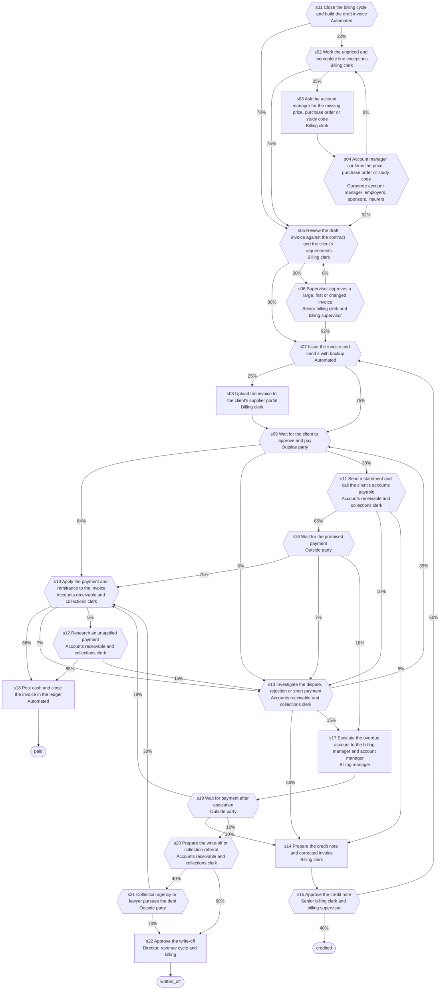

# Invoice clients and collect receivables

`dls-fin-client-invoicing` · medical laboratory services · finance (billing and revenue cycle) · part of `diagnostic-lab-services-co`

The company bills its business clients (life insurers, employers, hospitals, clinical trial and companion diagnostics sponsors and courier customers) for work priced by contract, mostly on monthly invoices and for some insurers and small employers per case or per week. Billing clerks price and check each invoice against the contract and the client's format, supervisors approve large and changed ones, and accounts receivable clerks apply payments, chase overdue invoices and resolve disputes. Most of the elapsed time is the client's own approval and payment cycle, and the work that causes delay is missing purchase orders, unpriced services, supplier portal rejections and short payments.

| | |
|---|---|
| Unit of work | one client invoice |
| Starts when | A client's billing cycle closes, or a per-case billable order arrives, with billable orders ready in the billing system. |
| Done when | The invoice is paid and closed in the ledger, fully credited, or written off. |
| Organisation | A large Canadian medical laboratory and health services company with a central billing and receivables team serving insurance, workplace, hospital, trial and sponsor clients. (3,300 employees, 2019-2022) |
| Volume | 10,000 cases a month (range 8,000 to 12,000) |

## Where it sits

- Starts with **billable_order** from in-case-review-release (35% of cases)
- Starts with **billable_order** from wp-result-reporting (33% of cases)
- Starts with **billable_order** from wp-occupational-health (8% of cases)
- Starts with **billable_order** from hs-result-delivery (12% of cases)
- Starts with **billable_order** from lg-commercial-logistics (7% of cases)
- Starts with **billable_order** from ct-study-setup (1% of cases)
- Starts with **billable_order** from ct-data-transfer (2% of cases)
- Starts with **billable_order** from gs-cdx-program (2% of cases)
- Relies on **payment_remittance** from hospital_client (a standing input; it does not start a case)
- Relies on **payment_remittance** from life_insurer (a standing input; it does not start a case)
- Relies on **payment_remittance** from employer_client (a standing input; it does not start a case)
- Relies on **payment_remittance** from trial_sponsor (a standing input; it does not start a case)
- Sends **client_invoice** to life_insurer (outcome: any)
- Sends **client_invoice** to employer_client (outcome: any)
- Sends **client_invoice** to hospital_client (outcome: any)
- Sends **client_invoice** to trial_sponsor (outcome: any)
- Sends **client_invoice** to cdx_sponsor (outcome: any)
- Sends **ledger_postings** to fin-month-end-close (outcome: paid)
- Sends **ledger_postings** to fin-month-end-close (outcome: credited)
- Sends **ledger_postings** to fin-month-end-close (outcome: written_off)

## Flow

## Roles

| Role | Department | Layer | FTE on this process | Loaded cost per hour | Evidence |
|---|---|---|---:|---:|---|
| Billing clerk | Billing and revenue cycle | individual contributor | 12 | 33 CAD | B [ci_job] |
| Accounts receivable and collections clerk | Billing and revenue cycle | individual contributor | 13 | 33 CAD | B [ci_job] |
| Senior billing clerk and billing supervisor | Billing and revenue cycle | supervisor | 2 | 38 CAD | C |
| Billing manager | Billing and revenue cycle | manager | 1 | 66 CAD | B [ci_job] |
| Director, revenue cycle and billing | Billing and revenue cycle | director | 0.1 | 105 CAD | C |
| Corporate account manager (employers, sponsors, insurers) | Hospital, corporate and specialty sales | individual contributor | 0.6 | 60 CAD | C |

## Steps

Hands-on time and the wait before each step show the most common value. Evidence tier A is a sourced number, B a sourced description, C the author's estimate.

| Step | Who | Kind | Hands-on | Wait before | Control | Evidence |
|---|---|---|---:|---:|---|---|
| **s01 Close the billing cycle and build the draft invoice.** At the client's billing point (month end for most contracts, weekly or per case for some insurers and small employers) the billing system pulls the client's billable orders from the LIS, the insurance order system, the drug testing system, the trial system or courier tracking, prices them from the contract rate table and builds a draft invoice with line detail. | Automated | system auto | 0 min | 12.0 h |  | C [ci_job] |
| **s02 Work the unpriced and incomplete line exceptions.** A billing clerk opens the exception list: tests or services with no contract price, missing purchase order or cost centre, trial visits not in the study budget, orders on the wrong account and possible duplicates. She checks the contract file and the source order and fixes what she can. | Billing clerk | validation | 8 min | 1.0 d |  | B [ci_job], [dyn_ct] |
| **s03 Ask the account manager for the missing price, purchase order or study code.** The clerk emails the corporate account manager or the trial project team with the order list and the question, and puts the invoice on hold in the billing system until the answer arrives. | Billing clerk | communication | 5 min | 4.0 h |  | C |
| **s04 Account manager confirms the price, purchase order or study code.** The account manager checks the signed contract, quote or study budget, or asks the client contact for a purchase order number, and replies with the price or code to use or confirms the service is not billable. | Corporate account manager (employers, sponsors, insurers) | coordination | 8 min | 3.0 d |  | C |
| **s05 Review the draft invoice against the contract and the client's requirements.** The clerk compares the total with the prior period, checks contract rates, volume tiers, minimum fees and pass-through charges (attending physician fees, shipping, kits), applies GST/HST to taxable services such as insurance exams and employer drug tests, and prepares the backup file in the format the client requires. | Billing clerk | review | 3 min | 12.0 h | Excise Tax Act (GST/HST): tax charged on taxable supplies and required invoice information; client contract pricing terms | B [ci_job], [hh2012] |
| **s06 Supervisor approves a large, first or changed invoice.** The billing supervisor reviews invoices above the approval threshold, the first invoice under a new contract and invoices after a price change, comparing them with the contract and prior invoices before release. | Senior billing clerk and billing supervisor | approval | 4 min | 1.0 d | Billing review policy: supervisor review of invoices above a value threshold and of new or changed contracts | C |
| **s07 Issue the invoice and send it with backup.** The billing system posts the invoice to receivables and, in the nightly run, emails the PDF with the line-detail file to the client's accounts payable address or sends it electronically to the large insurers that accept electronic invoices. | Automated | system auto | 0 min | 1.0 h |  | B [hh2012], [apqc_dso] |
| **s08 Upload the invoice to the client's supplier portal.** For hospitals and other clients that accept invoices only through their supplier or accounts payable portal, the clerk logs in, re-keys the invoice header, purchase order and amounts, attaches the PDF and backup and records the portal reference. | Billing clerk | data entry | 6 min | 1.0 d |  | C |
| **s09 Wait for the client to approve and pay.** The client's accounts payable team matches the invoice to its purchase order or contract, routes it to the laboratory, program or study budget owner for approval and pays in its next payment run, usually by EFT with a separate remittance advice. | Outside party | external wait | 0 min | 26.0 d |  | A [hh2012], [apqc_dso] |
| **s10 Apply the payment and remittance to the invoice.** An accounts receivable clerk matches each EFT or cheque to the remittance advice the client emailed or mailed, applies it across the listed invoices in the billing system and flags short payments, deductions and payments without a remittance. | Accounts receivable and collections clerk | data entry | 2 min | 1.0 d |  | B [ci_job], [nacha_cash] |
| **s11 Send a statement and call the client's accounts payable.** When the invoice is past due the clerk runs the aging report, emails a statement, checks the invoice status in the client's portal where there is one and phones accounts payable to learn whether the invoice is approved, lost or waiting for a purchase order, recording any promise to pay. | Accounts receivable and collections clerk | communication | 5 min | 7.0 d | Company credit and collection policy: dunning schedule for past-due client accounts | B [ci_job] |
| **s12 Research an unapplied payment.** The clerk asks the client's accounts payable for the remittance, searches open invoices by amount and date, and applies the payment or records it as unapplied cash pending the client's answer. | Accounts receivable and collections clerk | analysis | 20 min | 3.0 d |  | B [nacha_cash] |
| **s13 Investigate the dispute, rejection or short payment.** The clerk reads the client's reason (missing purchase order, price disagreement, exam cancelled but billed, duplicate, missing backup), pulls the order evidence from the insurance order system, LIS or drug testing system and the contract, and decides whether the client or the invoice is right. | Accounts receivable and collections clerk | analysis | 20 min | 3.0 d |  | B [hh2012], [ci_job] |
| **s14 Prepare the credit note and corrected invoice.** A billing clerk prepares a credit note for the disputed lines or the whole invoice and, where the service is still billable, a corrected invoice with the right purchase order, price or backup, and attaches the evidence. | Billing clerk | drafting | 10 min | 1.0 d |  | B [ci_job] |
| **s15 Approve the credit note.** The billing supervisor checks the credit note against the dispute evidence and the original invoice and approves it within her authority, sending larger credits to the billing manager, then releases the credit and any corrected invoice. | Senior billing clerk and billing supervisor | approval | 4 min | 1.0 d | Billing adjustment authority matrix: the clerk who prepares a credit note does not approve it; larger credits need the billing manager | C |
| **s16 Wait for the promised payment.** After the call the clerk waits for the client to clear its approval or purchase order problem and pay on its next payment run. | Outside party | external wait | 0 min | 10.0 d |  | C |
| **s17 Escalate the overdue account to the billing manager and account manager.** At the monthly aged receivables review the billing manager goes through accounts over 60 to 90 days with the account manager, who calls the client's controller or executive sponsor; small clients may be put on prepayment or credit hold. | Billing manager | coordination | 10 min | 7.0 d | Company credit and collection policy: escalation and credit hold for accounts over 60 to 90 days | C |
| **s18 Post cash and close the invoice in the ledger.** Each night the billing system posts applied cash, credits and write-offs to the ERP general ledger by business line and client type, closing the invoice for the monthly close. | Automated | system auto | 0 min | 10.0 h |  | C |
| **s19 Wait for payment after escalation.** The client pays after the executive call, agrees a settlement or stays unpaid while its own approval or budget problem continues. | Outside party | external wait | 0 min | 14.0 d |  | C |
| **s20 Prepare the write-off or collection referral.** An accounts receivable clerk assembles the account history, invoices, call notes and dispute file and recommends either referral to a commercial collection agency or lawyer, or write-off, including the GST/HST portion that can be recovered on taxable supplies. | Accounts receivable and collections clerk | drafting | 20 min | 5.0 d |  | B [ci_job], [eta231] |
| **s21 Collection agency or lawyer pursues the debt.** A commercial collection agency or the company's lawyer sends demand letters and negotiates with the client, remitting what is recovered net of fees or returning the account as uncollectible. | Outside party | external wait | 0 min | 42.0 d |  | C |
| **s22 Approve the write-off.** The director of revenue cycle reviews the recommendation and the collection history, approves the write-off within delegated authority (larger amounts go to the CFO), and finance posts it against the allowance and claims the tax adjustment for taxable supplies. | Director, revenue cycle and billing | approval | 5 min | 7.0 d | Delegated write-off authority and allowance review under internal control over financial reporting; Excise Tax Act section 231 for the tax on bad debts | B [eta231], [hh2012] |

## Exceptions

| Exception | Share of cases | What happens |
|---|---:|---|
| Unpriced or incomplete lines | 22% | Services without a contract price, missing purchase orders or trial visits outside the budget hold the invoice until a clerk or account manager fixes them. |
| Supplier portal submission | 25% | Hospitals and some large payers accept invoices only through their portals, so the invoice is re-keyed and can be rejected for a purchase order mismatch. |
| Past-due invoice | 30% | The invoice passes its due date and needs a statement, a call to accounts payable and a promise to pay. |
| Dispute or short payment | 15% | The client rejects the invoice or deducts lines it says do not meet its specifications, and the clerk investigates, credits and rebills or resends with evidence. |
| Escalation and write-off | 8% | An account over 60 to 90 days goes to the billing manager and account manager; a few end with an agency or write-off. |

## Benchmarks

| Metric | Value | Unit | Population | Evidence |
|---|---|---|---|---|
| cycle_time_days | p50 45, p90 90 | calendar days from billing point to invoice paid or otherwise closed | Derived from DSO of a paramedical exam company billing insurers and cross-industry DSO | B [hh2012], [apqc_dso], [hackett21] |
| dso_paramedical_insurer_billing | 45.5 | days, 2012 average | Hooper Holmes, US paramedical exam provider to life insurers | A [hh2012] |
| dso_cross_industry | p25 30, p50 38, p75 46 | days | APQC cross-industry benchmark | A [apqc_dso] |
| auto_cash_application_rate | low_performers 0 to 20 per cent, high_performers 80 per cent and above | share of payments applied automatically | Nacha and Credit Research Foundation survey | A [nacha_cash] |

## Pain points

- Invoices wait for missing purchase orders, contract prices and trial budget codes that only the account manager or client can supply. (steps s02, s03, s04; C)
- Client supplier portals require re-keying and reject invoices for purchase order mismatches, restarting the client's approval clock. (steps s08, s13; C)
- Remittances arrive by email and mail separately from EFTs and cover many invoices, so cash application is manual and leaves unapplied cash. (steps s10, s12; B [nacha_cash])
- Insurers and other clients deduct lines they say do not meet their specifications, and each deduction needs evidence from the operating system and a credit or rebill. (steps s13, s14, s15; B [hh2012])

## Assumptions

- One case is one client invoice from its billing point to closure. Monthly statement invoices for large clients and per-case invoices for some insurers and small employers are modelled with one set of steps; hands-on times are ranges that cover both.
- The client mix and the shares of trigger sources are the author's estimates; the organisation file gives only the total of about 10,000 invoices a month.
- Payment remittances from hospitals, insurers, employers and sponsors are listed in triggered_by with a share of 0 to match the organisation file; they arrive during a case (step s08) and do not start one.
- Companion diagnostics sponsors and courier clients pay like the others; courier clients are mostly hospitals and health organisations, so their invoices go to hospital_client.
- The GST/HST treatment (insurance exams and employer drug tests taxable, hospital laboratory testing exempt) is the author's understanding and was not confirmed by an opened source.
- The DSO benchmarks are US figures (a paramedical exam company billing insurers and cross-industry surveys); Ontario hospitals and some sponsors are believed to pay more slowly, which the p90 allows for.
- The corporate account manager, billing manager and director roles are added for pricing questions, escalations and write-off approval; they are in the organisation file but not in this process's role list there.
- Web search capacity ran out during this workflow, so sources were limited to pages fetched by address and text copies saved earlier; many step details are tier C.
- Loaded costs are from the organisation file (hourly wage times 1.35).
- Hands-on times are averages per invoice; a remittance, statement or collection call often covers several invoices of one client, and its time is divided among them. Stated FTE are about 80 per cent of the hands-on time implied by volume, which assumes clerks handle related invoices of the same client together.

## Sources

- [ci_job] Senior Billing Clerk, Winnipeg (job posting) (link withheld) (The model laboratory via Jobvite, 2026). Reports to the Manager of Billing; analyses client and patient invoices to confirm price variations and billing requirements match contracts; edits invoices, adjusts accounts, prepares corrected invoices and sends them in the format each client requires; posts payments, adjustments and transfers; generates aging reports; follows up delinquent accounts with physicians and clients; recommends write-offs; reconciles non-payments; maintains files of client contracts and original invoices; allocates cheques and posts payments; CAD 40,000 to 46,000 a year.
- [hh2012] [Hooper Holmes, Inc. annual report on Form 10-K for 2012](https://www.sec.gov/Archives/edgar/data/741815/000074181513000006/hh12311210-k.htm) (US Securities and Exchange Commission, 2013). A paramedical exam company billing life insurers: average DSO 45.5 days in 2012 and 45.6 in 2011 (39.9 and 40.5 days at year end, the low point because customers spend remaining budgets in December); allowance covers customer deductions for billed items not in compliance with customer specifications; electronic customer billing; billing centralised; contracts or billing approvals with over 90 per cent of carriers. Read from a text copy saved under scratch by earlier work.
- [apqc_dso] [Days sales outstanding: a critical lever for managing cash flow (Metric of the Month)](https://www.cfo.com/news/dso-cash-flow-management-metric-of-the-month-perry-wiggins-apqc/717822/) (CFO.com with APQC, n.d.). APQC cross-industry DSO: top performers 30 days or less, median 38 days or less, bottom performers 46 days or longer; causes include invoices prepared early but sent much later and customers paying well past terms; paper cheques and phone payments slow collection.
- [hackett21] [The industries that got paid faster: working capital scorecard](https://www.cfo.com/news/the-industries-that-got-paid-faster-working-capital-scorecard/655003/) (CFO.com (Hackett Group data), 2022). For the 1,000 largest non-financial US companies, average DSO 40.6 days and median DSO 48.7 days in 2021.
- [nacha_cash] [Goofus and Gallant: cash application](https://www.nacha.org/news/goofus-and-gallant-cash-application) (Nacha, n.d.). Nacha and Credit Research Foundation survey: more than half of low performers apply 0 to 20 per cent of payments automatically, high performers 80 per cent and above; high performers get remittance feeds from banks, low performers get remittances by email and mail.
- [eta231] [Excise Tax Act, section 231: bad debts](https://laws-lois.justice.gc.ca/eng/acts/E-15/section-231-20070622.html) (Justice Laws Website, Government of Canada, 2007). A supplier that writes off a bad debt on a taxable supply to an arm's-length recipient may deduct the tax portion of the unpaid amount from its net tax; tax on a later recovery must be added back.
- [dyn_ct] Clinical trial services (link withheld) (The model laboratory, n.d.). A dedicated project team per study; transport, storage and transfer of samples; data in multiple electronic formats.

Written by claude-opus on 2026-11-17.
